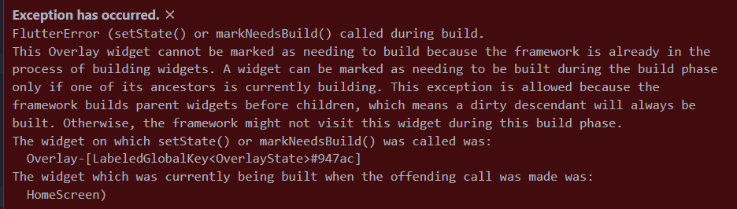

# 개발 일지 2023.03.07

- Toast Message 사용.

[fluttertoast | Flutter Package](https://pub.dev/packages/fluttertoast)

**Toast with No Build Context (Android & iOS)**

```dart
Fluttertoast.showToast(
        msg: "This is Center Short Toast",
        toastLength: Toast.LENGTH_SHORT,
        gravity: ToastGravity.CENTER,
        timeInSecForIosWeb: 1,
        backgroundColor: Colors.red,
        textColor: Colors.white,
        fontSize: 16.0
    );
```

사용은 가능하나, backgroundColor의 변경 등, 여러가지 옵션이 적용되지 않는다. 정확한 원리는 파악하지는 못했지만, 현재 상황에서는 BuildContext를 사용하는 것이 맞는 것으로 판단된다.

(추가로, Custom Toast는 API 30부터 deprecate 되었다.)

**Toast with Build Context (Android & iOS)**

Toast를 BuildContext와 사용하는 방법은 아래와 같다.

- MaterialApp을 만들 때, builder를 아래와 같이 설정한다.

```dart
MaterialApp(
    builder: FToastBuilder(),
    home: MyApp(),
    navigatorKey: navigatorKey,
),
```

- StatefulWidget 내에서 아래와 같이 설정한다. 여기서 FToast 객체는 late로 선언되어야 할 것이다. initState에서 초기화 해줄 수 있다. _showToast()를 통해 toast Widget을 생성할 수 있다. _showToast()는 return type을 결정하지 않고 사용하고 있는데, 이렇게 사용하는 것이 플러터의 관습인 것으로 보인다.

```dart
late FToast fToast;

@override
void initState() {
super.initState();
    fToast = FToast();
// if you want to use context from globally instead of content we need to pass navigatorKey.currentContext!
    fToast.init(context);
}

_showToast() {
    Widget toast = Container(
        padding:const EdgeInsets.symmetric(horizontal: 24.0, vertical: 12.0),
        decoration: BoxDecoration(
        borderRadius: BorderRadius.circular(25.0),
        color: Colors.greenAccent,
        ),
        child: Row(
        mainAxisSize: MainAxisSize.min,
        children: [
            Icon(Icons.check),
            SizedBox(
            width: 12.0,
            ),
            Text("This is a Custom Toast"),
        ],
        ),
    );

    fToast.showToast(
        child: toast,
        gravity: ToastGravity.BOTTOM,
        toastDuration: Duration(seconds: 2),
    );

// Custom Toast Position
    fToast.showToast(
        child: toast,
        toastDuration: Duration(seconds: 2),
        positionedToastBuilder: (context, child) {
return Positioned(
            child: child,
            top: 16.0,
            left: 16.0,
          );
        });
}
```

- 약 알람 추가 실패시, 성공시에 Toast Message 띄워주기. (ToastGravity.BOTTOM으로 설정했음에도 토스트 메시지가 Center 위치에서 뜨는 문제가 있었다. 원인은 키보드가 올라와 있었기 때문으로 보인다. 키보드가 올라와 있을 경우 키보드를 내린 다음에 Toast를 띄울 계획이다.)
- 디자인 일부 수정
- 현재 맞닥뜨린 문제이다. Dialog에서 OK 버튼을 누르고 나면 Toast Message를 띄워주어야 하는데, 만약 키보드가 열려있는 상태에서 OK버튼을 누른다면 키보드가 닫히지 않기 때문에 토스트 메시지가 키보드 위에서 뜬다. 이 문제를 해결하고자 여러가지 방법을 시도해보았다.

(하단은 에러 메시지)



- 시도한 방법
    1. Dialog에서 setState()를 실행하기 전에 FocusManager.instance.primaryFocus?.unfocus(); 를 사용하여 키보드를 먼저 내릴 수 있다. 그 다음 _showToast();를 사용해서 토스트를 pop-up 시키는데, keyboard가 내려간 상태가 변하고 나서 Toast가 나오지 않기 때문인지, Toast가 여전히 중앙에서 나오게 된다.
- 키보드를 내린 후 _showToast를 즉시 실행하는 방법은 불가능했다.

```dart
FocusManager.instance.primaryFocus?.unfocus();
_showToast('Test Toast');

this.setState(() {
  // -------------------------------------------------
  // 2023.03.06
  // takeOnMorning = this.takeOnMorning... 으로 했었는데,
  // 여기서 this는 scope가 addNewMedicine 내가 아닌
  // _HomeScreenState가 되므로, this를 붙이면 안된다.
  // --------------------------------------------------

  medicineList.add(
    MedicineModel(
      name: medicineName,
      description: medicineDescription,
      takeOnMorning: takeOnMorning,
      takeOnAfternoon: takeOnAfternoon,
      takeOnNight: takeOnMorning,
    ),
  );

  Navigator.of(context).pop();
});
```

- 키보드를 내린 후 setState에서 _showToast를 실행하는 방법도 불가능했다.

```dart
FocusManager.instance.primaryFocus?.unfocus();
_showToast('Test Toast');

this.setState(() {
  // -------------------------------------------------
  // 2023.03.06
  // takeOnMorning = this.takeOnMorning... 으로 했었는데,
  // 여기서 this는 scope가 addNewMedicine 내가 아닌
  // _HomeScreenState가 되므로, this를 붙이면 안된다.
  // --------------------------------------------------

  medicineList.add(
    MedicineModel(
      name: medicineName,
      description: medicineDescription,
      takeOnMorning: takeOnMorning,
      takeOnAfternoon: takeOnAfternoon,
      takeOnNight: takeOnMorning,
    ),
  );

  Navigator.of(context).pop();
});
```

이 때문에 this.setState()를 수행하면 StatefulWidget의 rebuild가 실행된다는 것에서 착안하여 rebuild 내에서 medicineList.length를 변수로 받고, 이를 통해 if문을 판단하여 Toast 메시지를 띄우고자 했는데, Toast 메시지를 띄우는데 필요한 toast.showToast() 메서드가 결국 setState를 다시 수행하는 메서드이기 때문에 위와 같은 오류가 발생한다. 이를 해결하기 위해 다음 블로그 게시글을 정리하고자 한다.

[Didier Boelens - Flutter](https://www.didierboelens.com/2019/04/addpostframecallback/)

**content**

초보자들이 많이 묻는 질문 세 가지

1. How can I show a Dialog only the first time a page is displayed?
2. How can I get the dimensions of something that depends on the device dimensions and other constraints?
3. How can I do something once the build is complete?

---

All these questions have something in common, we have to wait for the completion of `build` before doing something.

1. How can I show a Dialog only the first time a page is displayed?

    To display something on the screen at page load only one time, it seems that this code work properly.

    ```dart
    @override
      void initState(){
        super.initState();
        showDialog(
          ...
        );
      }
    ```

```dart
...
  @override
  Widget build(BuildContext context){
    showDialog(
      ...
    );
    return Scaffold(
      ...
    );
  }
```

But this code is not working. Why this happens?

In order to understand it, you need to get back to the basics and more precisely on the “StatefulWidget LifeCycle”. When you are loading a Page, the latter is either a StatelessWidget or a StatefulWidget, but if you consider the initState() method, it is a StatefulWidget. So, let’s continue the explanation with a StatefulWidget.

So, when you ask Flutter to display a new Page (=Route), behind the scene, Flutter needs to render your page on your device screen. This is done during a process called “frame rendering”

플러터에게 페이지를 그리라고 명령하면, frame rendering 이라는 과정을 거쳐서 그 페이지를 디바이스 스크린에 렌더링합니다.

During this frame rendering, related to the first time we want to display the new page, the Widget is inflated. This means that it creates an Element (=BuildContext) which starts its lifecycle and will call the following methods in sequence.

- initState
- didChangeDependencies
- build

우리가 화면에 보이려고 하는 새로운 페이지를 보이기 위해 프레임 렌더링을 진행하는 첫 순간에, 위젯이 생성된다. 이 말은 프레임 렌더링이 엘리먼트를 생성하고, 각각의 엘리먼트의 라이프 사이클을 시작할 뿐만 아니라, 아래 세 개의 메서드를 순차적으로 호출한다.

It is ONLY once the method build is complete, that a couple of milliseconds later the frame rendering of that page is complete and that you may request to display something else, in addition.

빌드 메서드는 그 페이지의 프레임 렌더링이 완료되고 몇 밀리초 뒤에 딱 한 번만 실행되며, 이 다음에 다른 어떤 것을 디스플레이 하라고 요청할 수 있게 된다.

What does happen when I call showDialog() inside the initState()?

그런데, initState()를 수행하고 있을 때, showDialog()를 수행하면 어떻게 될까?

In fact, when Flutter executes the initState() method, it is in the middle of a frame rendering process.

사실, Flutter에서 initState()를 수행할 때는 frame rendering이 진행되고 있는 중이다.

When you invoke the showDialog() method, you request Flutter to try to find the nearest Overlay Widget in the Widgets tree, using the context as source of the research.

showDialog() 메서드를 수행하고 있을 때, 플러터는 context를 사용하여 위젯 트리에서 가장 가까운 Overlay Widget을 찾아낸다.

⇒ 찾던 내용은 아니었다.

Future.delayed를 사용해서 지웠다.
