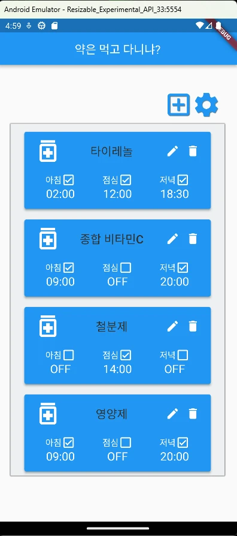

# 개발 일지 2023.03.14

작성일 2023-03-14
{ .post-date }

- GetX를 이용하여 home_screen에서의 상태 관리 코드를 변환했다.
- GetBuilder, Obx를 사용하는 방법 및 개념도 익힐 계획이다.
- 추후에는 Provider도 공부하고, Riverpod까지 다룰 계획이다. (우리 프로젝트에 어떤 것이 가장 좋을지 아직은 알 수 없으므로, 모두 써볼 필요가 있다.)

---

## ToDo

- [ ] Toast 메시지 출력
- [ ] MedAlarmSettingScreen GetX 적용 (checkbox)
- [ ] Card 롱 터치 시에 이동 가능하도록 만들기

[flutter ListView move item - Google Search](https://www.google.com/search?q=flutter+ListView+move+item)

ReorderableListView로 변환시키기

- [ ] Alarm 적용하기 (AlarmScreen 구현 및 Alarm 적용)
- [ ] 디자인 전반적으로 수정하기 (60:30:10 적용)
- [ ] Utility static method 적용 고려
