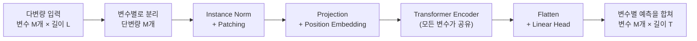

# PatchTST: A Time Series Is Worth 64 Words 리뷰

작성일 2024-11-25 · 최종 수정일 2024-11-28
{ .post-date }

장기 시계열 예측(Long-Term Time Series Forecasting, LTSF)에서 Transformer가 정말 효과적인지를 두고 이어진 논의를 따라가며 PatchTST를 정리한 글이다. PatchTST는 "아주 단순한 linear 모델이 Transformer 기반 모델들을 이긴다"는 문제 제기에 대한 답으로 나온 모델이어서, 그 문제 제기를 한 논문(Are Transformers Effective for Time Series Forecasting?)과 그 이전의 LTSF Transformer(LogTrans 등)를 먼저 살펴본 뒤 PatchTST로 넘어간다.

논문과 함께 논문을 해설한 세미나 영상을 보며 정리했다. 그림과 표는 옮기지 않고 글과 수식으로 다시 적었다.

PatchTST의 핵심은 두 가지다.

- **Patching**: 시점 하나하나를 토큰으로 쓰지 않고, 연속한 여러 시점을 묶은 sub-series 단위의 patch를 토큰으로 쓴다. 지역적인 정보(locality)가 토큰에 담기고, 토큰 수가 줄어 메모리 사용량도 줄어든다.
- **Channel-independence**: 다변량 시계열을 변수별 단변량 시계열로 나누어 같은 모델에 따로 넣는다. 변수 간 상관관계를 모델링하지 않는 방식이 CNN과 linear 모델에서 효과적이었다는 이전 연구 결과를 Transformer에 가져온 것이다.

## 1. 배경: Transformer는 시계열 예측에 효과적인가

### Permutation invariance

자연어는 단어의 순서가 조금 바뀌어도 의미가 대체로 보존된다. 세미나의 예시를 빌리면 "너 밥 먹었어"와 "먹었어 너 밥"은 같은 뜻으로 읽힌다. 반면 시계열은 그 자체로는 의미 정보가 부족한 수치의 나열이라서, $[0.1, 0.3, 0.5]$와 $[0.5, 0.1, 0.3]$은 전혀 다른 데이터다. 시계열에서는 시간에 따른 변화(temporal change)를 모델링하는 것이 무엇보다 중요하다.

Transformer는 self-attention으로 토큰 사이의 상관관계(attention score)를 구하기 때문에 긴 시퀀스에서 의미적 상관관계를 뽑아내는 데 매우 효과적이다. 그런데 self-attention은 구조상 permutation-invariant하다. Permutation invariance는 입력의 순서가 바뀌어도 출력이 바뀌지 않는 성질을 말한다.

이 성질이 무엇인지 따로 찾아 정리했다.

- 순서가 중요하지 않은 문제에서는 바람직한 성질이다. 예를 들어 문장의 긍정·부정을 가르는 감성 분석에서 bag-of-words 방식은 단어의 순서를 무시한 채 문제를 푼다.
- 순서가 곧 정보인 문제에서는 오히려 해가 된다. 주가 예측에서 미래의 주가는 과거 주가의 흐름에 기반하므로 순서를 버릴 수 없다.
- Transformer가 이 성질을 갖는 이유는, self-attention이 입력으로 들어온 모든 토큰 쌍의 관계를 위치와 무관하게 계산하기 때문이다. 그래서 순서가 중요한 문제에서는 positional encoding(또는 embedding)을 입력에 더해 순서 정보를 따로 넣어 준다.
- 다만 positional encoding으로 순서를 학습시킬 수는 있어도, 그것이 완전하게 학습된다는 보장은 없다.

결국 self-attention을 쓰는 한 시간 정보의 손실(temporal information loss)을 피하기 어렵고, 이 때문에 Transformer가 LTSF에 적합하지 않다는 지적이 계속 있었다.

### Transformer 기반 LTSF 모델들이 고치려 한 것

Vanilla Transformer를 LTSF에 쓰려는 모델들은 공통적으로 두 가지를 개선하려 했다.

1. Temporal pattern을 잘 추출해 장기 예측을 잘하는 것
2. Self-attention의 계산 복잡도와 메모리 사용량을 줄이는 것

세미나에서는 대표 모델들이 각 목표를 위해 둔 장치를 다음과 같이 정리했다.

| 모델 | Temporal pattern 추출 | Self-attention 복잡도 완화 |
|---|---|---|
| LogTrans (NeurIPS 2019) | Learnable positional encoding, convolutional self-attention | LogSparse self-attention |
| Informer (AAAI 2021) | Local & global timestamp embedding | ProbSparse, self-attention distilling |
| Autoformer (NeurIPS 2021) | Local & global timestamp embedding, auto-correlation | Time series decomposition, auto-correlation |
| Pyraformer (ICLR 2022) | Pyramidal attention module | Pyramidal attention module |
| FEDformer (ICML 2022) | Time series decomposition, local & global timestamp | Fourier / wavelet enhanced blocks |

이 가운데 [Informer](2025-01-15-informer.md)와 [Autoformer](2025-01-21-autoformer.md)는 이후에 따로 정리했다.

### LogTrans

LogTrans는 위 두 목표에 각각 하나씩 장치를 두었다.

**Convolutional self-attention.** Vanilla Transformer는 시점 $t$의 정보만으로 그 시점의 query, key, value를 만든다. 한 시점을 독립적으로 다루므로 앞뒤 시점의 정보가 들어가지 않고, 따라서 locality를 반영하지 못한다. 연속적인 값을 다루는 시계열에서는 이 점이 문제가 된다. LogTrans는 query와 key를 만들 때 시점 $t$를 포함한 과거 $k$개 시점에 causal convolution을 적용해, Transformer에 locality를 넣었다.

**LogSparse self-attention.** Vanilla Transformer는 모든 시점 쌍의 attention을 계산하므로 길이 $L$인 입력에 대한 복잡도가 $O(L^2)$이다. LogTrans는 각 시점에서 로그 간격으로 떨어진 과거 시점에 대해서만 attention을 계산해 복잡도를 $O(L(\log L)^2)$로 줄였다. 변형으로는 다음 두 가지가 있다.

- Local attention + LogSparse: 시점 $t$와 인접한 시점들에는 반드시 attention을 수행하고, 그보다 먼 과거에는 LogSparse 방식을 쓴다.
- Restart attention + LogSparse: 입력을 여러 sub-series로 나누고, 각 sub-series 안에서 LogSparse attention을 수행한 뒤 합친다.

LogTrans 이후의 모델들도 대부분 이런 식의 sparse attention으로 복잡도를 낮추는 데 집중했다.

### Are Transformers Effective for Time Series Forecasting?

이 논문의 문제의식은 다음과 같다. 기존 LTSF Transformer들은 positional encoding과 temporal embedding으로 permutation invariance를 보완하려 했지만, 실제로는 대부분 효율적인 self-attention을 설계하는 데 집중했다. 그렇다면 이 모델들은 시계열에서 가장 중요한 temporal pattern을 정말로 뽑아내고 있는가?

이를 확인하기 위해 논문은 한 층짜리 linear 모델인 LTSF-Linear를 제안하고 Transformer 기반 모델들과 비교한다.

**LTSF-Linear.** 변수 $M$개, 길이 $L$인 입력 $X_i \in \mathbb{R}^{L \times M}$을 받아 linear layer 하나로 길이 $T$의 예측 $\hat{X}_i = W X_i \in \mathbb{R}^{T \times M}$을 낸다. Linear layer를 시간 축을 따라 적용하므로 변수 간 상관관계는 반영하지 않는다. 변형은 두 가지다.

- **DLinear**: Autoformer와 FEDformer가 쓴 시계열 분해를 먼저 적용한다. Look-back window를 trend와 나머지(remainder)로 나누고, 각각에 독립된 linear layer $W_t$, $W_s$를 적용한 뒤 두 예측을 더한다.
- **NLinear**: 입력의 모든 시점에서 마지막 시점의 값을 빼서 정규화한 뒤 linear layer를 적용하고, 예측 뒤에 뺀 값을 다시 더한다.

**정량 결과.** LTSF-Linear는 변수 간 상관관계를 전혀 쓰지 않는데도, 다변량 예측에서 당시 최고 성능이던 FEDformer보다 20 ~ 50% 좋은 성능을 냈다. 또 look-back window의 마지막 값을 그대로 반복하는 기준선(Repeat)이 Exchange처럼 noise가 많은 데이터에서 Transformer 기반 모델보다 좋은 결과를 냈다. Transformer 기반 모델이 trend를 잘못 예측하고 있다는 뜻으로 읽을 수 있다.

단순한 모델이 더 좋다는 결과로 화두를 던진 뒤, 논문은 Transformer 기반 모델을 직접 분석한다.

**입력이 길어지면 더 잘 예측하는가.** Temporal relation을 잘 뽑아내는 모델이라면, look-back window가 길어져 정보가 많아질수록 성능이 좋아져야 한다. Traffic과 Electricity 데이터에서 예측 길이를 720으로 두고 look-back window 크기를 바꿔 가며 실험한 결과, Transformer 기반 모델은 입력이 길어져도 성능이 그대로이거나 오히려 나빠졌다. Transformer가 temporal relation을 제대로 뽑아내지 못한다는 근거다.

**시간 순서를 실제로 쓰는가.** 입력의 순서를 일부러 망가뜨렸을 때 성능이 함께 망가지는지를 본다.

- Shuf.: 입력 시퀀스 전체를 무작위로 섞는다.
- Half-Ex.: 입력 시퀀스를 앞뒤 두 개의 sub-series로 나누고 둘의 순서를 바꾼다.

Transformer 기반 모델은 순서를 섞어도 성능에 큰 차이가 없었다. 다만 FEDformer와 Autoformer는 주기성처럼 뚜렷한 temporal pattern이 있는 ETTh1 데이터셋에서 Shuf. 조건일 때 성능이 크게 떨어졌다. 두 모델이 가진 inductive bias 덕분에 주기성이 있는 데이터에서는 시간 순서를 어느 정도 반영한다고 볼 수 있다. Informer는 모든 조건에서 성능 하락이 거의 없었는데, 이는 시간 정보를 제대로 쓰지 못한다는 실험적 증거다.

## 2. Patch Time Series Transformer

PatchTST는 위 문제 제기에 대해 "Transformer도 제대로 쓰면 LTSF에 효과적이다"를 보이려는 모델이다.

### 전체 흐름

1. 다변량 look-back window를 변수별 단변량 시계열로 나눈다.
2. 각 단변량 시계열을 Transformer backbone에 넣어, patching과 Transformer encoder를 거쳐 그 변수의 미래 값을 예측한다. Backbone은 모든 변수가 공유한다.
3. 변수마다 얻은 단변량 예측을 합쳐 다변량 예측을 만든다.

목표는 변수 $M$개로 이루어진 시계열에서 길이 $L$의 과거로부터 길이 $T$의 미래를 예측하는 것이다. 일반적인 LTSF 모델은 $M$개 변수를 한꺼번에 입력으로 받지만, PatchTST는 channel-independent 모델이므로 $i$번째 변수의 시계열 $x^{(i)}_{1:L}$만을 입력으로 받아 $\hat{x}^{(i)}_{L+1:L+T}$를 낸다. Backbone은 공유하지만 입력과 출력은 항상 단변량이다.

### Patching

단변량 시계열 $x^{(i)}$에 sliding window를 적용해, 길이 $P$인 sub-series patch $N$개로 이루어진 patch sequence $x_p^{(i)} \in \mathbb{R}^{P \times N}$를 만든다. Window가 이동하는 간격(stride)을 $S$라 하면 patch의 수는 다음과 같다.

$$
N = \left\lfloor \frac{L - P}{S} \right\rfloor + 2
$$

데이터 길이가 모자라는 것을 막기 위해, 시퀀스 끝에 마지막 값을 $S$번 복사해 붙인 뒤(padding) patch를 자른다.

예를 들어 길이 $L = 12$인 입력을 $P = 4$, $S = 2$로 자른다고 하자. Padding을 하면 길이는 $L + S = 14$가 되고, 여기서 길이 4인 patch를 2칸씩 옮겨 가며 자르면 토큰 6개가 나온다. 위 식으로도 $\lfloor 8 / 2 \rfloor + 2 = 6$이다.

입력 토큰의 수가 $L$에서 대략 $L / S$로 줄어들므로, 토큰 수의 제곱에 비례하는 self-attention의 연산량과 메모리는 약 $1 / S^2$로 줄어든다. Patching의 장점을 정리하면 다음과 같다.

1. 시점 단위 토큰보다 많은 local semantic information을 담을 수 있다.
2. 토큰 수가 줄어 Transformer의 연산량과 메모리 사용량이 줄어든다.
3. 같은 GPU와 학습 시간 안에서 더 긴 look-back window를 쓸 수 있다.

논문은 이 효과를 실험으로 확인한다. 예측 길이 $T = 96$, look-back window $L = 336$에서 patching 없이 토큰 336개를 쓰면 MSE가 0.397이고, $P = 16$, $S = 8$로 patching해 토큰 42개를 쓰면 0.367이다. 토큰 수는 줄었는데 성능은 올랐으므로, locality를 반영하는 것이 효과가 있다는 뜻이다. 같은 설정에서 학습 시간은 Traffic 데이터 기준 22배 빨라졌고, 데이터셋이 클수록 속도 향상 폭이 컸다.

### Transformer backbone

Backbone은 vanilla Transformer encoder를 그대로 쓴다.

1. **Instance normalization + patching.** $i$번째 변수의 look-back window에 instance normalization을 적용한다. 학습 데이터와 테스트 데이터 사이의 distribution shift를 완화하는 데 효과적인 방법이다. 변수마다 따로 정규화하므로 입력들의 분산이 비슷해진다. 정규화한 시계열에 patching을 적용해 patch sequence를 만든다.
2. **Projection + position embedding.** Patch sequence에 학습 가능한 linear projection $W_p$와 학습 가능한 position encoding $W_{pos}$를 적용해, 시간 순서가 반영된 patch embedding을 만든다.

    $$
    x_d^{(i)} = W_p\, x_p^{(i)} + W_{pos}
    $$

3. **Transformer encoder.** Self-attention으로 patch representation $z^{(i)}$를 얻는다.
4. **Flatten + linear head.** $z^{(i)}$를 일렬로 펼친 뒤 linear head로 최종 예측을 낸다.

### 손실 함수

같은 Transformer encoder로 $M$개 변수 각각의 예측을 독립적으로 낸 뒤, 변수별로 예측과 실제 값의 MSE를 구하고 그 평균을 손실로 쓴다.

$$
\mathcal{L} = \frac{1}{M} \sum_{i=1}^{M} \left\lVert \hat{x}^{(i)}_{L+1:L+T} - x^{(i)}_{L+1:L+T} \right\rVert_2^2
$$

## 3. Representation Learning

PatchTST는 self-supervised 학습에도 그대로 쓸 수 있다. Patch를 만드는 데까지는 같고, 일부 patch를 가린(masking) 뒤 가려진 patch를 복원하도록 학습한다. 이 과정에서 모델은 시계열의 패턴을 학습한다.

Transformer로 masking 기반 self-supervised 학습을 할 때에는 원래 두 가지 어려움이 있다.

1. **연속한 여러 시점을 가려야 한다.** 시계열은 앞뒤 시점의 값만으로 가려진 값을 쉽게 맞힐 수 있다. 이상치가 아닌 이상 추세가 이어진다고 볼 수 있으므로, 바로 앞 시점의 값을 복사하기만 해도 꽤 잘 맞는다. 그래서 의미 있는 학습을 하려면 연속한 여러 시점을 한꺼번에 가려야 한다. Transformer 기반 representation learning 방법인 TST는 이를 위해 감마 분포와 Markov chain을 써서 복잡한 방식으로 masking을 한다.
2. **Linear head가 과적합되기 쉽다.** 일반적인 Transformer는 $L$개 시점 각각에 대해 $D$차원 representation을 얻고, 이를 모두 써서 미래 $T$개 시점의 $M$개 변수 값을 예측한다. 그러면 linear head의 가중치 크기가 $(L \cdot D) \times (M \cdot T)$가 되어 매우 크고, 과적합되기 쉽다.

PatchTST는 두 문제 모두에서 자유롭다.

1. Patch 길이와 stride를 같게 두면 patch끼리 겹치지 않고, 각 patch는 연속한 $P$개 시점으로 이루어진다. 따라서 patch를 무작위로 골라 가리기만 해도 그 자체가 연속한 여러 시점을 가리는 것이 된다. 복잡한 masking 전략이 필요 없다.
2. Patching과 channel-independence 덕분에 linear head의 가중치 크기가 $(N \cdot D) \times T$로 줄어든다.

## 4. 실험

### Supervised 예측

대표적인 LTSF 데이터셋 8개로 평가한다. 이 가운데 Weather, Traffic, Electricity가 큰 데이터셋이다. 비교 모델의 look-back window는 DLinear 논문의 실험 결과를 바탕으로 Transformer 기반 모델은 96, 그 밖의 모델은 336으로 두었다. PatchTST는 두 가지 버전으로 실험한다.

| 버전 | 입력 patch 수 | Look-back window | Patch 길이 | Stride | 비고 |
|---|---|---|---|---|---|
| PatchTST/64 | 64 | 512 | 16 | 8 | 여러 설정 가운데 성능이 가장 좋았던 모델 |
| PatchTST/42 | 42 | 336 | 16 | 8 | 비교 모델과 조건을 맞춘 모델 |

이름 뒤의 숫자가 입력 patch의 수이고, 논문 제목의 "64 words"도 여기서 나온 것이다. 앞의 식에 넣어 보면 $\lfloor (336 - 16) / 8 \rfloor + 2 = 42$, $\lfloor (512 - 16) / 8 \rfloor + 2 = 64$로 맞아떨어진다.

결과에서 PatchTST는 비교 모델들보다 좋은 성능을 보였고, 특히 큰 데이터셋에서 차이가 뚜렷했다.

### Representation learning

Self-supervised 실험은 겹치지 않는 patch로 진행한다. 입력 길이 512, patch 길이 12로 patch 42개를 만들고, 40%를 가린 뒤 100 epoch 동안 사전 학습한다. 사전 학습한 모델로 예측을 할 때에는 두 가지 방식을 쓴다.

- Linear probing: 나머지 가중치는 고정하고 linear head만 20 epoch 학습한다.
- End-to-end fine-tuning: linear head만 10 epoch 학습한 뒤, 모델 전체를 20 epoch 학습한다.

결과적으로 self-supervised 사전 학습을 거친 모델의 성능이 가장 좋았다. PatchTST의 구조가 self-supervised 학습에 유리하다는 점을 다시 확인해 주는 결과다. 다른 self-supervised 방법들과의 비교에서도 같은 경향이었다.

### Patching과 channel-independence의 효과

Patching(P)과 channel-independence(CI)를 넣고 빼는 조합으로 실험한 결과, 두 가지 모두 성능 향상과 메모리 절감에 효과가 있었다.

### Look-back window 길이

앞에서 본 것처럼 기존 Transformer 기반 LTSF 모델은 look-back window가 길어져도 성능이 좋아지지 않았다. PatchTST는 look-back window가 길어질수록 예측 성능이 좋아졌다. Temporal relation을 제대로 학습하고 있다는 뜻이다.

## 5. Channel-independence는 왜 효과적인가

논문 부록은 변수 간 상관관계를 버리는 방식이 왜 더 좋은지를 세 가지 근거로 설명한다.

**Adaptability.** Channel-independent 모델은 backbone은 공유하지만 변수마다 다른 attention map을 갖는다. 그래서 각 변수의 예측에 맞는 attention pattern을 따로 학습할 수 있다. 서로 비슷한 패턴의 변수들조차 실제로는 다른 attention pattern을 학습한다는 것을 실험으로 보였고, 이것이 성능이 좋은 이유 가운데 하나다.

**학습의 어려움.** Channel-mixing 모델은 학습해야 할 정보가 더 많아 더 많은 학습 데이터가 필요하다. 학습 데이터 크기를 바꿔 가며 실험한 결과, channel-independent 모델은 데이터가 늘수록 빠르게 수렴했지만 channel-mixing 모델은 초반에만 빠르게 학습된 뒤 과적합되었다.

**다른 모델에도 통한다.** Channel-mixing 방식인 Informer, Autoformer, FEDformer에 channel-independence를 적용하자 성능이 올랐다. PatchTST만큼은 아니지만, channel-independence가 Transformer 기반 LTSF 모델 전반에 효과가 있다는 근거다.

정리하면, 변수 간 상관관계를 반영하려고 모델을 키우는 것보다 차라리 그 정보를 쓰지 않는 편이 효과적이라는 것이 논문의 주장이다. 다만 이 결론은 지금의 데이터 규모에서 나온 것이라고 생각했다. 더 큰 모델을 감당할 만큼 데이터가 충분하다면 상관관계를 반영해 보는 것도 효과가 있을 것이다.

실제로 이 뒤에 나온 연구들은 channel-independence(CI)와 channel-dependence(CD)를 양자택일로 보지 않는다. 며칠 뒤 훑어본 LIFT(Learning from Leading Indicators For Time Series)가 그런 예다. LIFT는 한 변수가 다른 변수보다 먼저 움직이거나 늦게 따라가는 선후(lead-lag) 관계가 국소적으로는 안정적이라는 점에 주목한다. Cross-correlation으로 시점마다 선행 변수와 선행하는 정도를 추정하고, 선행 변수를 목표 변수에 맞게 시간 축에서 정렬한 뒤, 주파수 영역에서 선행 지표의 유용한 신호를 뽑아 처음의 예측을 다듬는다. 기존 예측 모델에 덧붙여 쓰는 plug-and-play 방식이어서 CI 모델과 CD 모델 모두에 적용할 수 있다. Plug-and-play는 여러 모델에 손쉽게 끼워 넣을 수 있도록 설계한 모듈을 뜻한다.

## 남았던 질문과 답

공부할 당시에는 풀지 못하고 남겨 둔 질문들이다. 글을 정리하면서 답을 찾아 덧붙였다.

**Q. Look-back window의 정확한 정의는 무엇인가.**

논문 3.1절의 문제 정의가 곧 정의다. 논문은 "look-back window $L$을 갖는 다변량 시계열 표본 $(x_1, \dots, x_L)$이 주어졌을 때 미래의 값 $T$개 $(x_{L+1}, \dots, x_{L+T})$를 예측한다"고 쓴다. 곧 look-back window는 예측 한 번에 모델이 입력으로 받는 가장 최근의 과거 구간이고, $L$은 그 길이(시점의 수)다. 예측할 구간의 길이 $T$는 prediction horizon이라고 따로 부른다. 시간 단위 데이터에서 $L = 336$, $T = 96$이면 직전 14일을 보고 다음 4일을 예측하는 설정이다. 이 글에서 써 온 뜻과 같다.

**Q. PatchTST의 Transformer encoder에도 attention head가 여러 개 있는가.**

있다. 논문 3.1절은 encoder의 multi-head attention에서 head $h = 1, \dots, H$마다 $W_h^Q$, $W_h^K$, $W_h^V$로 query, key, value를 만든다고 적는다. 부록 A.1.4에 따르면 기본 설정은 encoder 3층에 $H = 16$, $D = 128$이고, 아주 작은 데이터셋(ILI, ETTh1, ETTh2)에서는 과적합을 줄이려고 $H = 4$, $D = 16$으로 줄인다. 공식 코드의 실험 스크립트도 같은 값을 쓴다. Weather용 스크립트는 `--n_heads 16 --d_model 128`, ETTh1용 스크립트는 `--n_heads 4 --d_model 16`이다.

**Q. "Linear head의 가중치가 많다"는 것은 무슨 뜻인가. Head라고 하면 attention head가 떠올랐고, head의 수는 hyperparameter라고 생각했다.**

당시에 정리한 대로다. 여기서 head는 attention head가 아니라, encoder가 낸 representation을 예측 값으로 바꾸는 마지막 linear layer(prediction head)다. 논문은 $L$개 시점 각각의 representation $z_t \in \mathbb{R}^{D}$를 변수 $M$개, 예측 길이 $T$의 출력으로 보내는 linear map의 parameter 행렬이 $(L \cdot D) \times (M \cdot T)$ 크기가 되고, 네 값 가운데 하나라도 크면 지나치게 커져서 downstream 학습 표본이 적을 때 과적합을 일으킬 수 있다고 설명한다. 숫자를 넣어 보면 차이가 분명하다. $L = 336$, $D = 128$, $M = 21$, $T = 96$이면 $(336 \cdot 128) \times (21 \cdot 96) = 43{,}008 \times 2{,}016$으로 가중치가 약 8,670만 개다. 같은 조건에서 patch 42개와 channel-independence를 쓰면 $(42 \cdot 128) \times 96 = 5{,}376 \times 96$으로 약 52만 개다.

**Q. Fine-tuning에서 왜 linear head만 먼저 따로 학습하는가.**

논문은 4.2절에서 이유를 직접 밝힌다. Linear probing을 먼저 한 뒤 전체를 fine-tuning하는 두 단계 전략이 곧바로 fine-tuning하는 것보다 낫다는 선행 연구(Kumar et al., 2022)를 따른 것이다. 그 연구의 설명은 다음과 같다. 새로 붙인 head는 무작위로 초기화되어 있어서, 처음부터 전체를 함께 학습하면 head가 학습되는 동안 아래 층들도 동시에 바뀌면서 사전 학습으로 얻은 feature가 왜곡된다. Head를 먼저 맞춰 두고 전체를 풀면 이 왜곡이 줄어든다. 공식 코드의 fine-tuning 스크립트도 같은 순서다. `fine_tune(..., freeze_epochs=10)`을 호출해 head를 뺀 나머지를 고정한 채 10 epoch을 돈 뒤, 고정을 풀고 전체를 학습한다. 전체 학습 epoch의 기본값은 20이다.

## 참고 자료

- Yuqi Nie, Nam H. Nguyen, Phanwadee Sinthong, Jayant Kalagnanam. "A Time Series is Worth 64 Words: Long-term Forecasting with Transformers." ICLR 2023. [arXiv:2211.14730](https://arxiv.org/abs/2211.14730)
- Ailing Zeng, Muxi Chen, Lei Zhang, Qiang Xu. "Are Transformers Effective for Time Series Forecasting?" AAAI 2023. [arXiv:2205.13504](https://arxiv.org/abs/2205.13504)
- Shiyang Li 외. "Enhancing the Locality and Breaking the Memory Bottleneck of Transformer on Time Series Forecasting." NeurIPS 2019. (LogTrans) [arXiv:1907.00235](https://arxiv.org/abs/1907.00235)
- George Zerveas 외. "A Transformer-based Framework for Multivariate Time Series Representation Learning." KDD 2021. (TST)
- Lifan Zhao, Yanyan Shen. "Rethinking Channel Dependence for Multivariate Time Series Forecasting: Learning from Leading Indicators." ICLR 2024. (LIFT)
- PatchTST 논문 해설 세미나 영상. 본문의 모델 비교 표와 예시는 이 영상의 슬라이드를 참고했다.
- [What is Permutation Invariance? A Brief Introduction (Medium)](https://medium.com/@he165076373/what-is-permutation-invariance-a-brief-introduction-58ecb7a49334)
- [Transformer에서 permutation invariant가 무엇을 뜻하는지에 대한 질문 (Stack Overflow)](https://stackoverflow.com/questions/73850035/what-does-permutation-invariant-mean-in-the-context-of-transformers-doing-l)
- Ananya Kumar, Aditi Raghunathan, Robbie Jones, Tengyu Ma, Percy Liang. "Fine-Tuning can Distort Pretrained Features and Underperform Out-of-Distribution." ICLR 2022. (Linear probing 뒤에 fine-tuning하는 순서의 근거로 인용된 선행 연구)
- [PatchTST 공식 구현 (yuqinie98/PatchTST)](https://github.com/yuqinie98/PatchTST). "남았던 질문과 답"에서 실험 스크립트와 fine-tuning 스크립트를 확인하는 데 썼다.
