# Attention Is All You Need 리뷰

작성일 2025-01-06
{ .post-date }

시계열 예측용 Transformer들([Informer](2025-01-15-informer.md), [Autoformer](2025-01-21-autoformer.md))을 읽기에 앞서, 그 출발점인 Transformer 원 논문을 다시 읽고 정리한 글이다.

논문은 두 번 읽었다. 첫 번째에는 Abstract, Introduction, Conclusion만 읽으며 논문이 풀려는 문제를 파악했고, 두 번째에 본문 전체를 읽었다. 그보다 앞선 2024년 11월에 기계 번역의 흐름(Seq2Seq, attention, Transformer)을 다룬 강의 영상 몇 편을 보며 정리해 둔 노트가 있어서, 논문만으로는 짧게 지나가는 부분은 그 노트의 설명과 예시로 보충했다. 그림은 논문과 그 강의 화면에서 가져왔고 그림마다 출처를 적었다. 강의의 주소는 글 끝에 있다.

## 1. Transformer 이전: Seq2Seq와 Attention

Transformer가 무엇을 바꿨는지 보려면 그 앞의 흐름을 먼저 알아야 한다. 아래 연표가 이 절의 지도다.

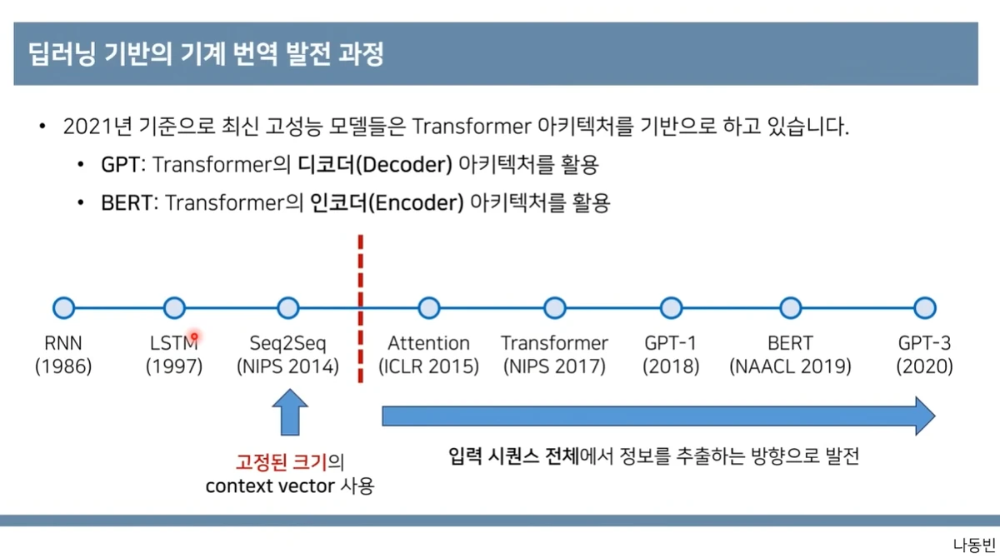

가운데의 빨간 점선이 갈림길이다. 점선 왼쪽의 Seq2Seq까지는 원문 전체를 고정된 크기의 context vector 하나에 담았고, 점선 오른쪽의 Attention부터는 입력 시퀀스 전체에서 정보를 뽑아 쓰는 방향으로 발전했다. 출처: 나동빈 강의 슬라이드

### 단어별 번역의 한계와 Seq2Seq

문장을 번역하는 가장 단순한 방법은 단어를 하나씩 옮기는 것이다. 이 방법에는 두 가지 문제가 있다.

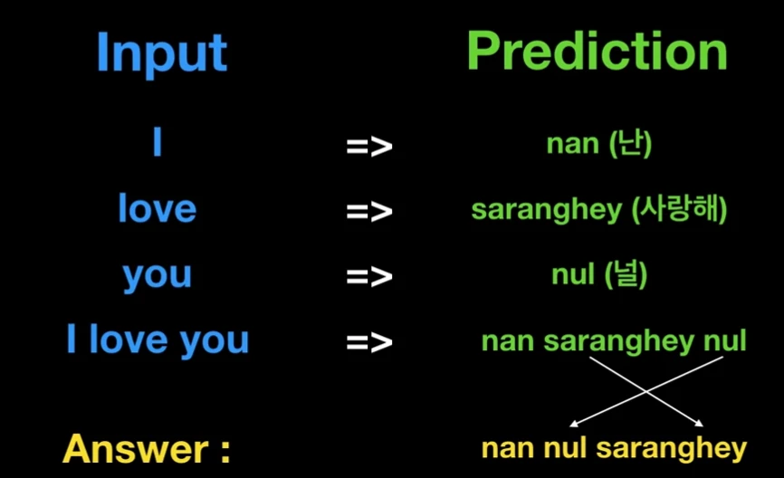

첫째는 어순이다. "I love you"를 단어별로 옮기면 "nan saranghey nul(난 사랑해 널)"이 되어, 정답인 "nan nul saranghey(난 널 사랑해)"와 뒤의 두 단어가 엇갈린다. 출처: Seq2Seq + Attention 강의 화면

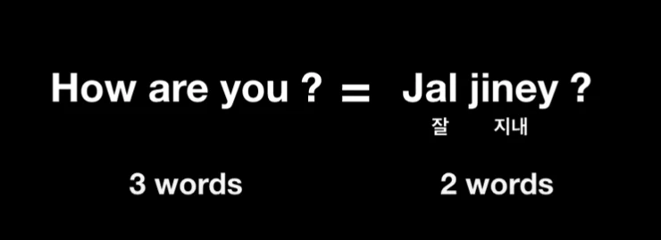

둘째는 단어 수다. "How are you?"는 3단어인데 "잘 지내?"는 2단어다. 번역 전후의 단어 수가 달라지면 단어끼리 하나씩 짝짓는 방식으로는 다룰 수 없다. 출처: Seq2Seq + Attention 강의 화면

RNN을 쓰는 encoder-decoder 구조(Seq2Seq)는 문장을 끝까지 읽은 다음에 번역문을 써 내려가는 방식으로 이 문제를 푼다.

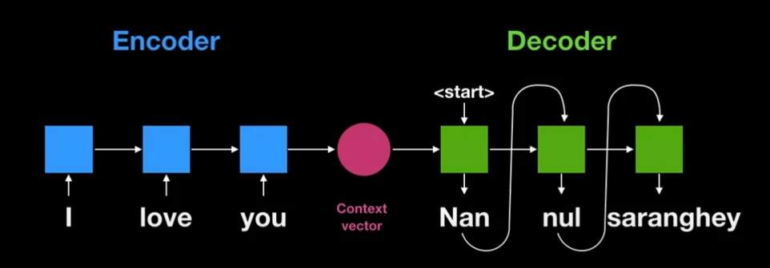

파란 상자가 encoder의 RNN cell, 초록 상자가 decoder의 RNN cell이고 그 사이의 분홍 원이 context vector다. Encoder가 I, love, you를 차례로 읽어 만든 벡터 하나에서 decoder가 출발해 Nan, nul, saranghey를 차례로 낸다. 출처: Seq2Seq + Attention 강의 화면

- **Encoder**: 단어를 순서대로 받으며 hidden state를 갱신한다. Hidden state는 그때까지 입력된 단어들의 정보를 담고 있으므로, 마지막 단어까지 받은 뒤의 hidden state는 문장 전체의 정보를 담은 context vector가 된다.
- **Decoder**: context vector에서 출발해 단어를 하나씩 출력한다. 이전에 출력한 정보를 담은 hidden state를 다음 cell에 넘기는 일을 `<end>`가 나올 때까지 반복한다.

RNN은 1986년 무렵 제안되었고 약 10년 뒤 LSTM이 나왔으며, LSTM을 활용한 Seq2Seq는 2014년에 등장했다. 문제는 context vector의 크기가 고정되어 있다는 점이다.

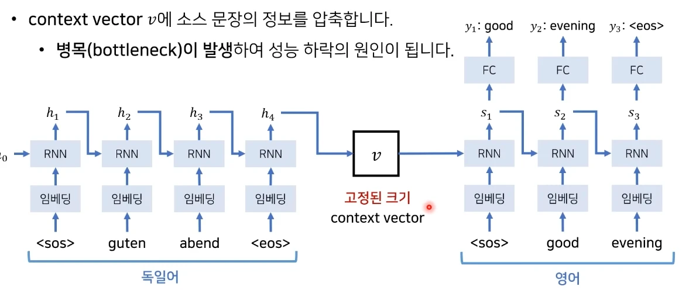

가운데의 상자 $v$가 고정된 크기의 context vector다. 독일어 문장(guten abend)의 정보가 모두 이 상자 하나를 지나야 영어 쪽 decoder로 넘어간다. 출처: 나동빈 강의 슬라이드

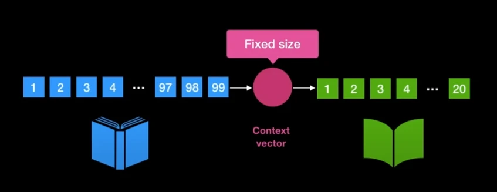

문장이 길어지면 문제가 뚜렷해진다. 입력은 99번째 단어까지 있는데 이를 같은 크기의 벡터 하나(분홍 원)에 눌러 담아야 하고, 정보가 모자라 출력은 20번째 단어에서 끝난다. 출처: Seq2Seq + Attention 강의 화면

문장이 길어지면 고정된 크기의 벡터 하나에 모든 정보를 담을 수 없고, 이 병목이 성능을 떨어뜨린다. 한 가지 보완책은 decoder의 모든 cell이 context vector를 매번 다시 참고하게 하는 것이다.

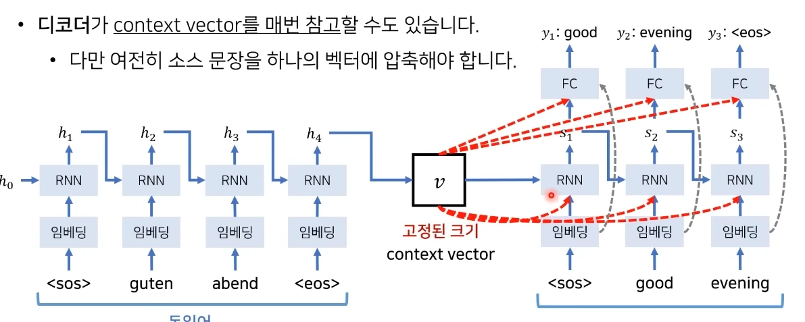

빨간 점선이 보완한 부분이다. Context vector $v$가 decoder의 첫 cell에만 들어가지 않고 모든 cell에 다시 들어가서, 출력 문장이 길어져도 정보가 덜 흐려진다. 출처: 나동빈 강의 슬라이드

이렇게 하면 조금 나아지지만, 원문 전체를 벡터 하나로 압축해야 한다는 점은 그대로다.

### Attention

Attention의 생각은, encoder의 마지막 state 하나만 쓰지 말고 encoder가 단어마다 낸 모든 hidden state를 쓰자는 것이다. Decoder는 단어를 하나 출력할 때마다 encoder의 모든 hidden state를 살펴 그때그때 다른 context vector를 만든다.

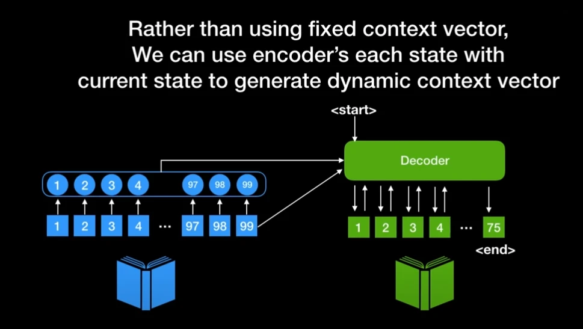

앞의 "Fixed size" 그림과 비교해 본다. 분홍 원이 사라지고 encoder의 state 전부(파란 원 1 ~ 99)가 decoder로 이어지며, 출력도 중간에 끊기지 않고 `<end>`까지 나온다. 출처: Seq2Seq + Attention 강의 화면

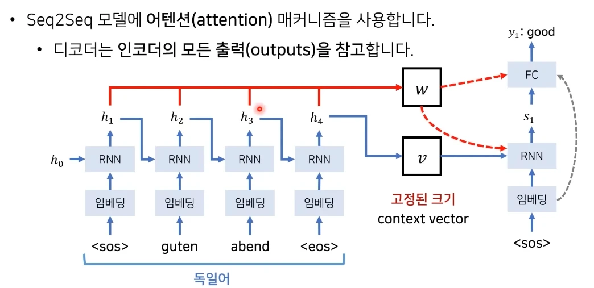

빨간 선을 따라간다. Encoder의 hidden state $h_1$ ~ $h_4$가 모두 상자 $w$로 모이고, $w$가 decoder의 RNN과 출력층(FC)으로 들어간다. 그 아래의 상자 $v$는 기존의 고정된 context vector다. 출처: 나동빈 강의 슬라이드

위 그림의 $w$가 attention으로 만든 가중합이다. Decoder가 $i$번째 단어를 만들 때의 계산은 다음과 같다. $s_{i-1}$은 decoder의 직전 hidden state, $h_j$는 encoder의 $j$번째 hidden state다.

$$
e_{ij} = a(s_{i-1}, h_j), \qquad
\alpha_{ij} = \frac{\exp(e_{ij})}{\sum_{k=1}^{T_x} \exp(e_{ik})}, \qquad
c_i = \sum_{j=1}^{T_x} \alpha_{ij} h_j
$$

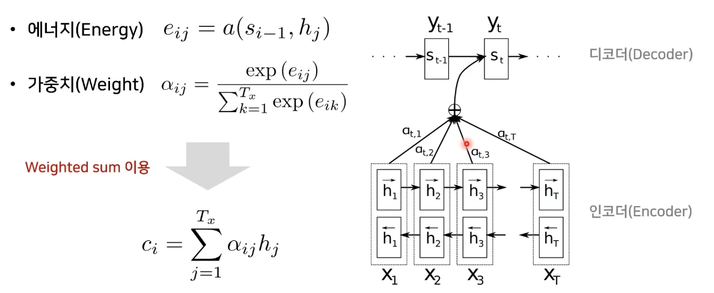

오른쪽 그림에서 아래 줄의 $h_1$ ~ $h_T$가 encoder의 hidden state, 위 줄의 $s_{t-1}$, $s_t$가 decoder의 hidden state다. 각 $h_j$에 가중치 $\alpha_{t,j}$를 곱해 한 점(⊕)으로 모은 것이 $s_t$를 만드는 데 들어간다. 출처: 나동빈 강의 슬라이드

- **Energy** $e_{ij}$: 지금 단어를 출력하기 위해 원문의 $j$번째 단어를 얼마나 참고해야 하는지를 수치로 나타낸 값이다. Decoder의 hidden state는 아직 갱신되기 전이므로 $i-1$번째 값을 쓴다.
- **Weight** $\alpha_{ij}$: energy에 softmax를 취해 상대적인 확률로 바꾼 값이다.
- **Context vector** $c_i$: weight로 encoder의 hidden state들을 가중합한 것이다.

식만으로는 감이 잘 오지 않으므로, 강의의 예시로 "I love you"를 "난 널 사랑해"로 옮기는 과정을 한 단계씩 따라가 본다. $h_1$, $h_2$, $h_3$는 encoder가 I, love, you를 읽고 낸 state다.

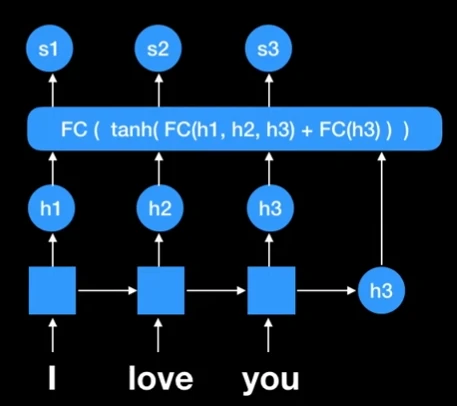

Encoder의 state $h_1, h_2, h_3$ 전부와 decoder의 직전 state를 작은 fully connected network에 넣어 단어별 점수 $s_1, s_2, s_3$를 얻는다. 첫 단어를 낼 때는 decoder가 낸 state가 아직 없으므로 그 자리에 encoder의 마지막 state $h_3$를 넣는다. 출처: Seq2Seq + Attention 강의 화면

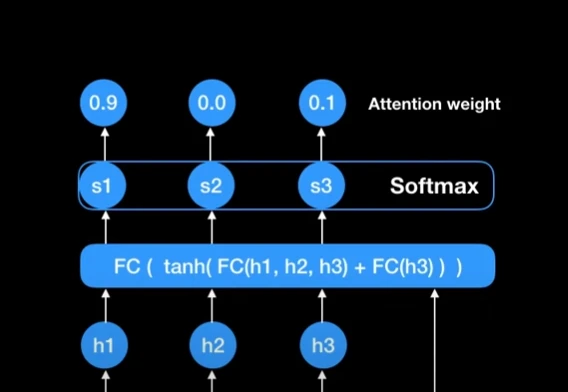

점수에 softmax를 취하면 attention weight 0.9, 0.0, 0.1이 나온다. 지금은 I에 90%, you에 10% 집중하겠다는 뜻이다. 출처: Seq2Seq + Attention 강의 화면

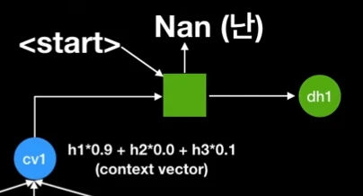

Weight로 가중합한 첫 번째 context vector $cv_1 = 0.9\,h_1 + 0.0\,h_2 + 0.1\,h_3$가 시작 신호 `<start>`와 함께 decoder의 첫 cell(초록 상자)에 들어가 "난"이 나온다. $dh_1$은 이 cell이 낸 decoder state다. 출처: Seq2Seq + Attention 강의 화면

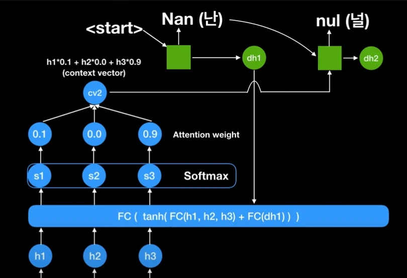

두 번째 단어에서는 방금 나온 $dh_1$이 network에 들어가고, $h_1, h_2, h_3$는 그대로 다시 쓰인다. Weight가 0.1, 0.0, 0.9로 바뀌어 you에 집중하고, 새 context vector $cv_2$에서 "널"이 나온다. 출처: Seq2Seq + Attention 강의 화면

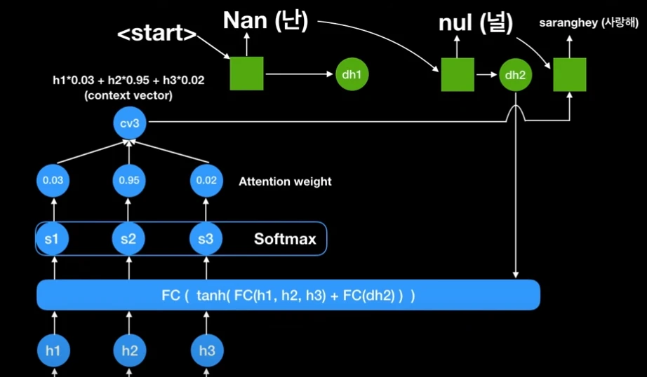

세 번째 단어에서는 $dh_2$로 다시 계산한 weight가 0.03, 0.95, 0.02여서 love에 집중하고, $cv_3$에서 "사랑해"가 나온다. 이 뒤에 `<end>`가 나오면 번역이 끝난다. 출처: Seq2Seq + Attention 강의 화면

중요한 점은 두 가지다. Decoder가 매 단계마다 encoder의 state들을 다시 보며 어디에 집중할지를 정한다는 것, 그리고 context vector가 단계마다 달라진다는 것이다. 덤으로 weight를 그려 보면 출력 단어마다 원문의 어느 단어를 참고했는지를 볼 수 있다.

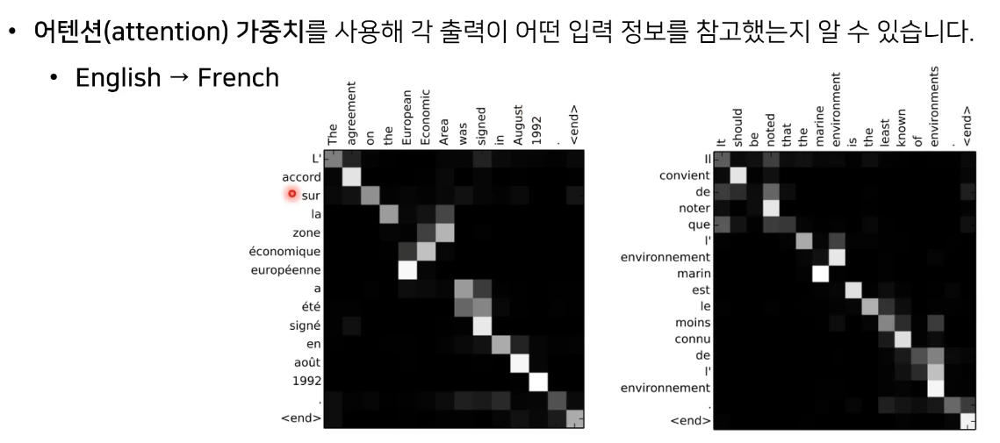

가로가 원문(영어) 단어, 세로가 출력(프랑스어) 단어이고 칸이 밝을수록 weight가 크다. 밝은 칸이 대체로 대각선을 따라 내려가다가, 두 언어의 어순이 다른 곳에서는 대각선을 벗어난다. 출처: 나동빈 강의 슬라이드

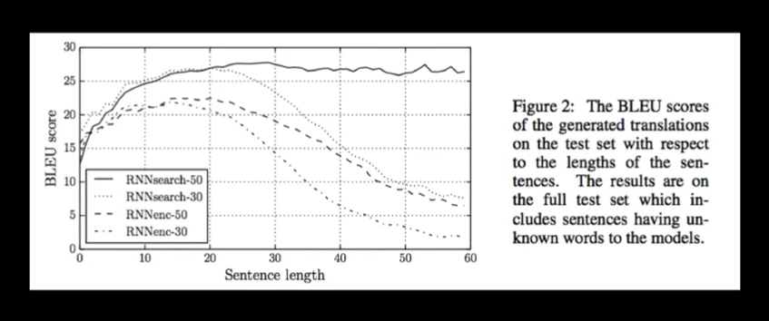

가로축이 문장 길이, 세로축이 번역 품질(BLEU)이다. 실선(RNNsearch-50)이 attention을 쓴 모델이고 RNNenc가 고정된 context vector를 쓰는 기존 encoder-decoder인데, RNNenc는 문장이 길어질수록 점수가 떨어지고 실선은 길이 60까지 유지된다. 출처: Bahdanau et al. (2015) Figure 2, Seq2Seq + Attention 강의 화면

Attention으로 긴 문장의 번역 성능은 좋아졌지만, 여전히 RNN cell로 단어를 순차적으로 처리하기 때문에 연산이 느렸다.

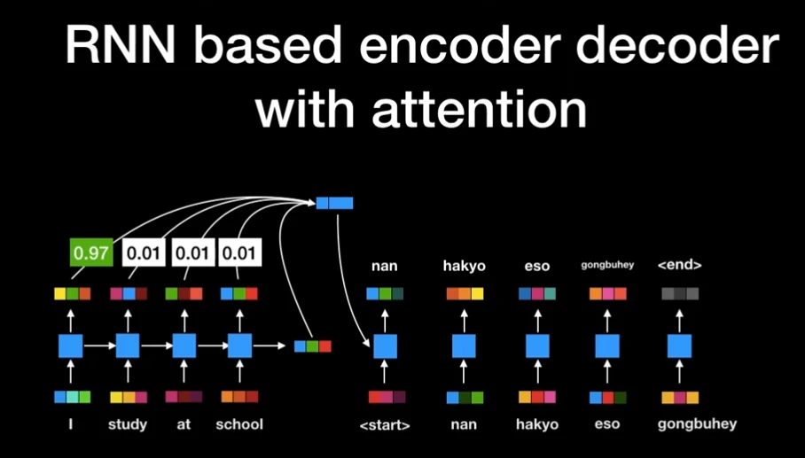

"I study at school"을 옮기는 attention 기반 encoder-decoder다. 첫 단어 "nan"을 낼 때 weight가 I에 0.97, 나머지 세 단어에 0.01씩 실린다. 그러나 파란 상자(RNN cell)들은 여전히 왼쪽에서 오른쪽으로 하나씩 이어져 있어서, 앞 단어의 계산이 끝나야 다음 단어를 계산할 수 있다. 출처: 허민석 강의 화면

그래서 RNN 없이 attention만으로 입력에서 중요한 정보를 찾아 인코딩할 수 없을까 하는 질문이 나왔고, 그 답이 Transformer다. 이후 GPT는 Transformer의 decoder 구조를, BERT는 encoder 구조를 활용했다.

## 2. 논문의 문제의식

### 첫 번째 읽기: Abstract, Introduction, Conclusion

당시의 대표적인 sequence transduction 모델은 encoder와 decoder를 갖춘 복잡한 RNN 또는 CNN이었다. 논문은 recurrence와 convolution을 완전히 없애고 attention mechanism만으로 이루어진 단순한 구조인 Transformer를 제안한다. 두 가지 기계 번역 과제에서 품질이 더 좋았고, 병렬화가 더 잘 되며 학습 시간도 크게 줄었다. 학습 데이터가 많을 때와 적을 때 모두 English constituency parsing에 성공적으로 적용되어, 다른 과제에도 잘 일반화된다는 것을 보였다. Constituency parsing은 문장을 구성 성분으로 나누고 그 사이의 계층 관계를 트리 형태로 분석하는 과제다.

Introduction의 논리는 다음과 같다.

- RNN, 특히 LSTM과 GRU는 언어 모델링과 기계 번역 같은 sequence modeling 문제에서 확고한 최고 성능의 방법이었고, encoder-decoder 구조와 함께 발전해 왔다.
- RNN은 위치를 따라 순차적으로 계산한다. Hidden state $h_t$는 이전 state $h_{t-1}$과 위치 $t$의 입력으로 만들어진다. 이 순차성 때문에 하나의 학습 예시 안에서는 병렬화를 할 수 없고, 시퀀스가 길수록 이 문제가 커진다.
- Factorization trick이나 conditional computation으로 계산 효율을 높인 연구가 있었지만 순차 계산이라는 근본적인 제약은 그대로다.
- Attention mechanism 덕분에 입력과 출력 시퀀스에서 거리와 상관없이 의존성을 모델링할 수 있게 되었다. 그러나 몇몇 경우를 빼면 attention은 RNN과 함께 쓰였다.
- Transformer는 recurrence를 쓰지 않고 attention만으로 입력과 출력 사이의 global dependency를 뽑아낸다.

Conclusion에서 저자들은 Transformer가 attention만으로 이루어진 첫 sequence transduction 모델이고, WMT 2014 영어-독일어와 영어-프랑스어 번역에서 새로운 최고 성능을 냈다고 정리한다. 앞으로는 텍스트가 아닌 입력·출력 modality로 확장하고, 이미지·오디오·비디오 같은 큰 입출력을 효율적으로 다루기 위해 국소적으로 제한된 attention을 연구하겠다고 밝힌다.

### 읽으며 생긴 질문과 답

**"더 parallelizable하다"는 것은 무슨 뜻인가.** 강의 노트에 답이 있었다. RNN은 첫 단어부터 마지막 단어까지 순서대로 계산해야 입력을 인코딩할 수 있지만, Transformer는 문장의 모든 단어를 한꺼번에 넣고 한 번의 행렬 곱으로 처리한다.

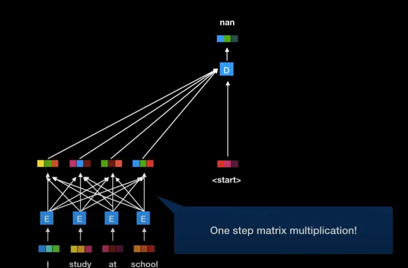

아래 줄의 E 네 개가 encoder다. 1절 마지막 그림의 RNN이라면 I, study, at, school 순서로 네 번 계산해야 하지만, 여기서는 네 단어가 서로 모두 이어져(교차하는 흰 선) 한 번의 행렬 곱으로 인코딩된다. 출처: 허민석 강의 화면

위치 정보도 입력에 한꺼번에 더해 넣기 때문에 encoder를 한 번 거칠 때마다 모든 위치의 출력이 병렬로 나온다. 강의의 표현대로 Transformer를 한 단어로 요약하면 parallelization이다. 다만 추론할 때의 decoder는 `<eos>`가 나올 때까지 여러 번 반복해서 실행해야 한다.

**기존의 attention과 Transformer의 attention은 무엇이 다른가.** 처음에는 기존 attention이 self-attention만 쓰다가 Transformer에서 입력과 출력을 잇는 attention이 새로 들어온 것인지 헷갈렸다. 1절의 내용을 보면 반대다. 기존의 attention은 decoder가 encoder의 hidden state를 참고하는 것이었고, 이는 Transformer의 encoder-decoder attention으로 그대로 이어진다. Transformer에서 새로 들어온 것은 RNN이 하던 인코딩 자체를 대신하는 self-attention이다.

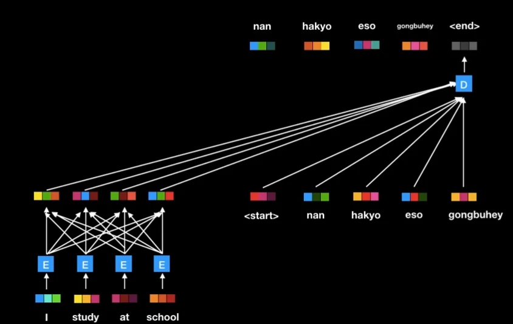

Transformer가 "nan hakyo eso gongbuhey"를 내는 과정이다. Decoder(D)는 단어를 낼 때마다 encoder의 출력 네 개 전부와 그때까지 낸 단어들을 참고한다. Encoder의 state 전부를 보며 한 단어씩 낸다는 점이 1절의 attention 기반 encoder-decoder와 닮았다. 출처: 허민석 강의 화면

강의에서도 Transformer의 디코딩 과정이 기존 attention 기반 encoder-decoder와 닮아 있으며, 기존의 concept은 유지한 채 RNN만 없앤 구조라고 설명한다.

## 3. 모델 구조

Transformer는 encoder layer와 decoder layer를 각각 여러 층 쌓은 encoder-decoder 구조다.

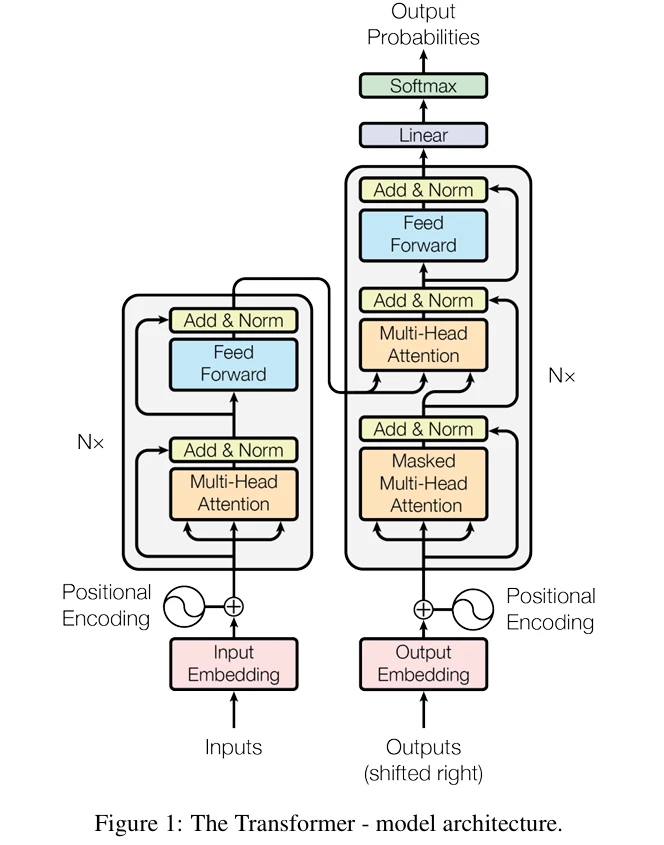{ width="520" }

왼쪽 회색 상자가 encoder layer, 오른쪽 회색 상자가 decoder layer이고, 옆의 N×는 같은 layer를 N번 쌓는다는 뜻이다. 아래에서 위로 읽는다. 입력이 embedding과 positional encoding을 거쳐 올라가고, encoder의 출력이 decoder 가운데의 attention으로 건너가며, decoder 맨 위의 Linear와 Softmax가 단어의 확률을 낸다. 출처: 논문 Figure 1

Encoder는 입력 $x = (x_1, \dots, x_n)$을 $z = (z_1, \dots, z_n)$으로 바꾸고, decoder는 $z$를 받아 출력 $y = (y_1, \dots, y_m)$을 만든다. Decoder는 auto-regressive하게 동작해서, 이전에 생성한 출력을 다음 단계의 입력으로 쓴다.

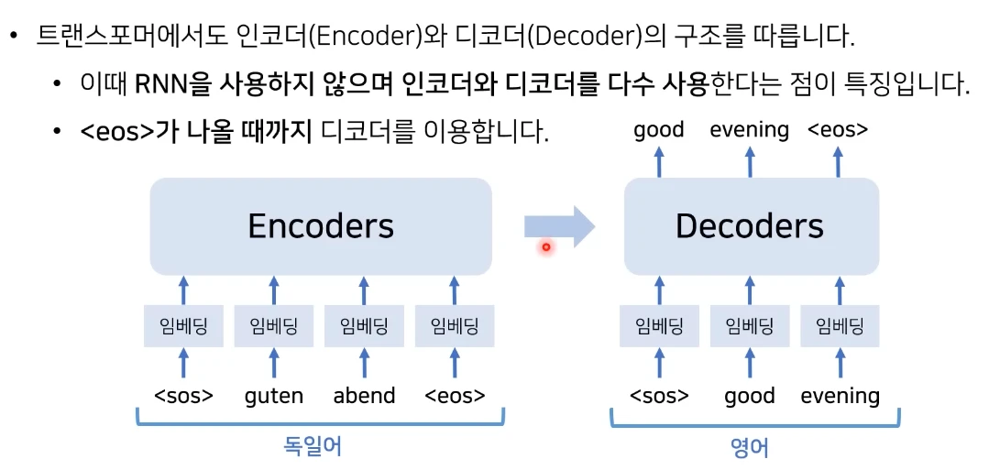

1절의 Seq2Seq 그림과 비교하면 encoder와 decoder라는 틀은 그대로이고, 그 안의 RNN과 가운데의 context vector가 없어졌다. 입력 문장의 단어들은 한꺼번에 encoder로 들어가고, decoder는 `<eos>`가 나올 때까지 반복해서 쓰인다. 출처: 나동빈 강의 슬라이드

이 절의 나머지는 논문 Figure 1의 상자들을 아래에서부터 하나씩 본다.

### Embedding과 Positional Encoding

먼저 단어를 벡터로 바꾼다. 입력 문장의 각 단어는 embedding table을 참조해 $d_{model}$ 차원의 벡터로 바뀐다.

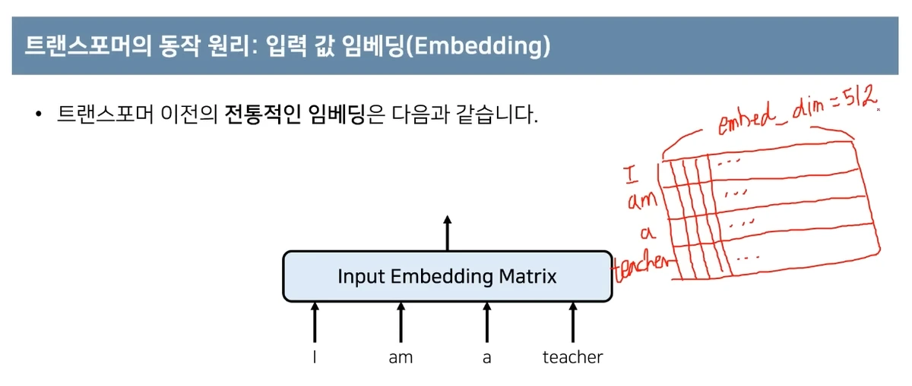

"I am a teacher"가 들어오면 단어마다 행이 하나씩 생긴다. 붉은 손글씨는 강의를 들으며 적어 넣은 것으로, 행이 단어 4개이고 열이 embedding 차원(512)인 표가 만들어진다는 뜻이다. 출처: 나동빈 강의 슬라이드

강의의 실습 코드로 확인한 바로는, 입력은 one-hot 벡터가 아니라 (문장 수, 문장 안의 단어 수) 크기의 단어 번호이고, (단어장 크기, hidden 차원) 크기의 embedding table에서 각 단어에 해당하는 벡터를 꺼내 (문장 수, 단어 수, hidden 차원)의 입력을 만든다. Encoder의 입력 차원과 decoder의 출력 차원은 각 언어의 단어장 크기다. 실습 예시에서는 각각 7853과 5893이었다.

다음으로 순서 정보를 넣는다. RNN은 단어가 순서대로 들어가므로 hidden state가 저절로 순서 정보를 갖는다. Transformer에는 그런 구조가 없어서 순서 정보를 embedding에 직접 넣어 주어야 한다. 이를 위해 위치 정보를 담은 positional encoding을 embedding에 element-wise로 더한다.

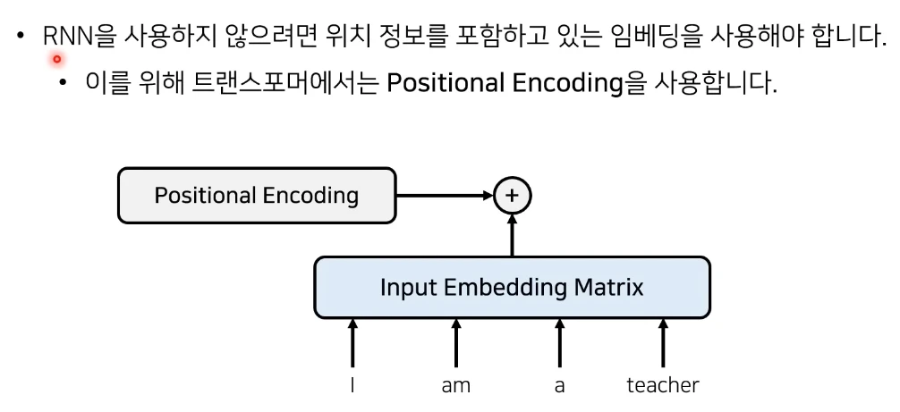

Embedding 행렬과 같은 크기의 positional encoding을 원소별로 더한다(⊕). 논문 Figure 1의 맨 아래에 있는 물결 기호와 ⊕가 이 부분이다. 출처: 나동빈 강의 슬라이드

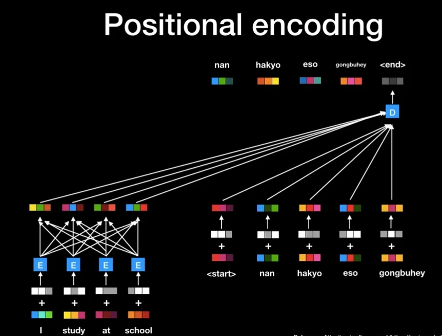

"위치를 더한다"는 것을 단순화한 예시다. 단어 embedding(색 상자)마다 위치를 나타내는 흰색·회색 상자가 더해진다(+). 이 예시에서는 첫 단어 I에 001, study에 010, at에 011, school에 100을 더하는 식으로 비트를 썼고, decoder 쪽 입력에도 같은 방식으로 순서 정보가 들어간다. 출처: 허민석 강의 화면

실제 논문은 비트 대신 sine과 cosine 함수를 쓴다.

$$
PE_{(pos,\,2i)} = \sin\!\left(\frac{pos}{10000^{2i/d_{model}}}\right), \qquad
PE_{(pos,\,2i+1)} = \cos\!\left(\frac{pos}{10000^{2i/d_{model}}}\right)
$$

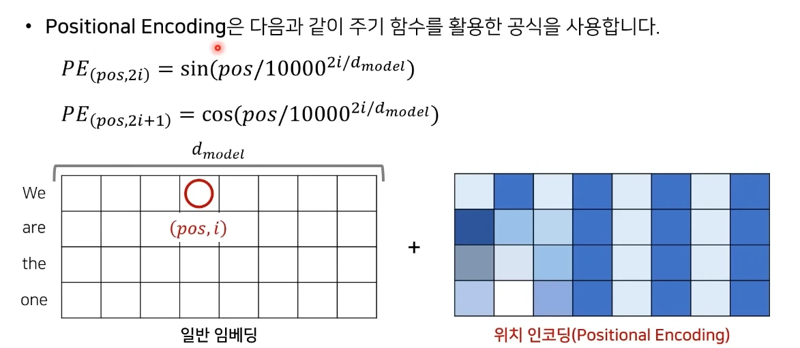

왼쪽이 단어 embedding, 오른쪽이 positional encoding이고 둘 다 가로 길이가 $d_{model}$이다. 붉은 원이 $(pos, i)$ 칸, 곧 $pos$번째 단어의 $i$번째 차원이다. 오른쪽 행렬의 같은 칸에 위 식으로 구한 값이 들어 있고, 두 행렬을 원소별로 더한 것이 encoder와 decoder의 입력이 된다. 출처: 나동빈 강의 슬라이드

$pos$는 단어의 위치, $i$는 embedding 차원 안에서의 위치다. 이 방식의 장점은 값이 항상 $-1$과 $1$ 사이에 있다는 것, 그리고 학습 데이터의 가장 긴 문장보다 긴 문장이 들어와도 문제없이 인코딩할 수 있다는 것이다. 모델이 단어의 상대적인 위치를 알 수 있기만 하면 꼭 이 함수일 필요는 없다. 위치 embedding을 학습시켜 넣어도 성능 차이가 거의 없었다고 논문은 보고한다.

### Scaled Dot-Product Attention

Attention이 하는 일은 한 단어의 벡터를, 문장 안에서 그 단어와 관련 있는 단어들의 정보를 섞어 다시 만드는 것이다. 정확히는 query 하나와 key-value 쌍들을 받아 출력을 내는 함수다. Query, key, value, 출력은 모두 벡터이고, 출력은 value들의 가중합이다. 각 value의 가중치는 query와 그 value에 대응하는 key 사이의 compatibility function으로 정한다. 물어보는 주체가 query, 물어보는 대상이 key라고 생각하면 된다. "I am a teacher"에서 I가 각 단어와 얼마나 관련 있는지를 볼 때, I가 query이고 네 단어 각각이 key다.

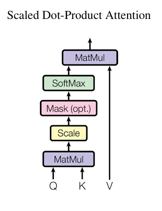

아래에서 위로 읽는다. Q와 K를 곱하고(MatMul), 크기를 줄이고(Scale), 필요하면 가리고(Mask), 확률로 바꾼 뒤(SoftMax), 그 확률로 V를 가중합한다(맨 위의 MatMul). 아래의 식과 다섯 단계가 이 다섯 상자에 그대로 대응한다. 출처: 논문 Figure 2 (왼쪽)

$$
\mathrm{Attention}(Q, K, V) = \mathrm{softmax}\!\left(\frac{Q K^\top}{\sqrt{d_k}}\right) V
$$

1. Query와 모든 key의 내적을 구한다. 이 값(강의에서는 attention energy라고 부른다)이 클수록 두 단어의 관련이 크다.
2. $\sqrt{d_k}$로 나눈다. $d_k$는 key의 차원이다. 차원이 커질수록 내적 값이 커지는데, 값이 커지면 softmax의 기울기가 매우 작아진다. Scaling은 이 gradient vanishing을 막기 위한 것이다.
3. 필요하면 mask를 적용한다.
4. Softmax로 확률로 바꾼다. 강의의 예시에서 I는 자기 자신과 72%, love와 15%, you와 13%의 관련을 갖는다.
5. 확률을 각 key에 대응하는 value에 곱하고 모두 더한다. 관련이 낮은 단어의 value는 비중이 작아진다. 이렇게 얻은 벡터는 더 이상 단어 I 하나가 아니라, 문장 전체 안에서 I가 갖는 의미를 나타낸다.

**Query, key, value는 어디에서 오는가.** 각각 가중치 행렬 $W^Q$, $W^K$, $W^V$를 embedding에 곱해 만들고, 이 행렬들은 학습으로 정해진다.

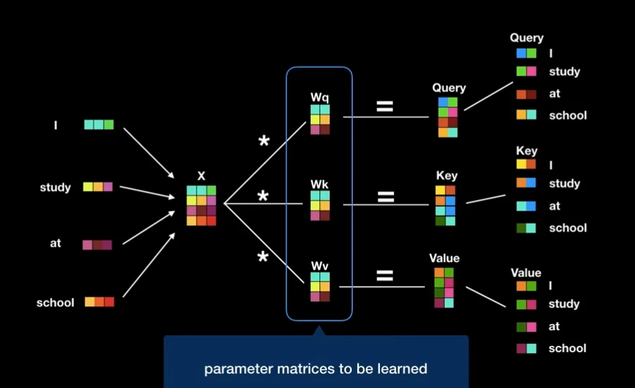

네 단어의 embedding을 쌓은 행렬 X에 Wq, Wk, Wv(파란 테두리 안, 학습되는 parameter)를 각각 곱하면 네 단어의 query, key, value가 한꺼번에 나온다. 출처: 허민석 강의 화면

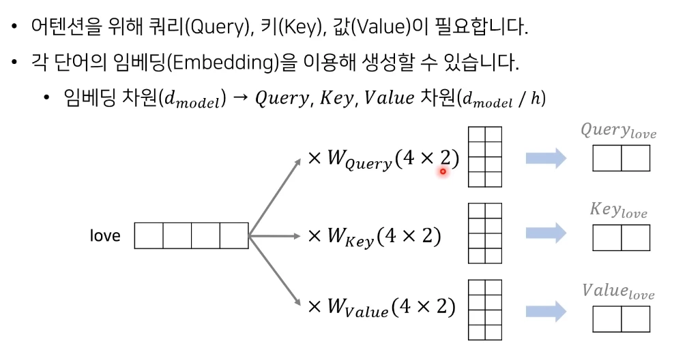

단어 하나로 보면 이렇다. Embedding이 4차원이고 head가 2개라고 하면, love의 4차원 embedding에 $4 \times 2$ 크기의 행렬 셋을 곱해 2차원짜리 query, key, value를 얻는다. Query, key, value의 차원은 $d_{model} / h$다. 출처: 나동빈 강의 슬라이드

**단어 하나의 attention.** 위의 다섯 단계를 I 한 단어에 대해 그리면 다음과 같다.

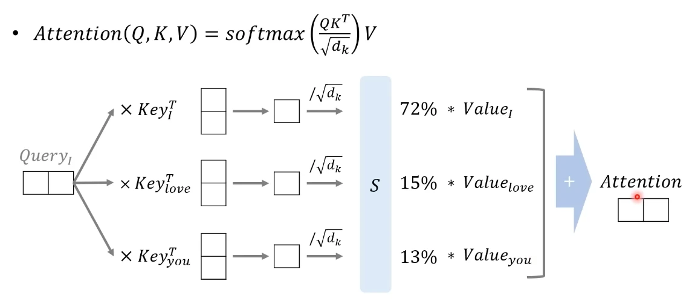

I의 query를 I, love, you 각각의 key와 곱하고 $\sqrt{d_k}$로 나눈 뒤 softmax(S)를 취하면 72%, 15%, 13%가 나온다. 이 비율로 세 단어의 value를 더한 것이 I의 attention 값이다. 출처: 나동빈 강의 슬라이드

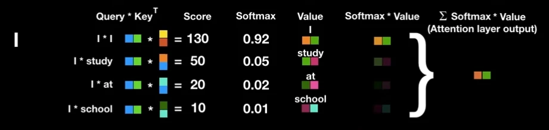

같은 계산을 "I study at school"의 I에 대해 한 것이다. 왼쪽부터 query와 key의 내적(score 130, 50, 20, 10), softmax(0.92, 0.05, 0.02, 0.01), 각 단어의 value, 확률을 곱한 value 순으로 읽는다. 확률이 낮은 단어의 value는 거의 보이지 않을 만큼 흐려지고, 이들을 모두 더한 맨 오른쪽 벡터가 attention layer의 출력이다. 출처: 허민석 강의 화면

**문장 전체를 한 번에.** 실제로는 단어를 하나씩 계산하지 않는다. 문장 하나는 행렬이므로 모든 단어의 query, key, value를 한 번의 행렬 곱으로 구할 수 있고, attention도 문장 전체에 대해 한 번에 계산된다.

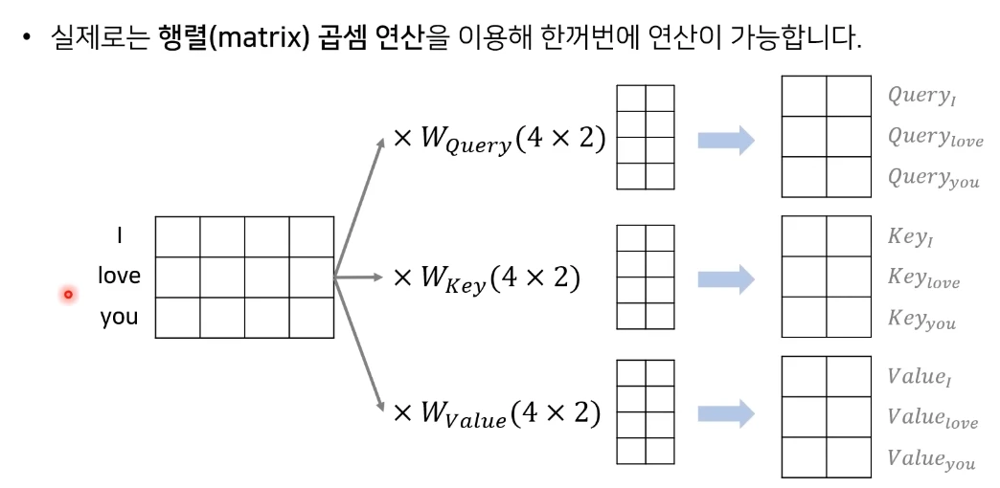

세 단어의 embedding을 쌓은 $(3, 4)$ 행렬에 $(4, 2)$ 행렬을 곱하면 세 단어의 query, key, value가 각각 $(3, 2)$ 행렬로 한 번에 나온다. 출처: 나동빈 강의 슬라이드

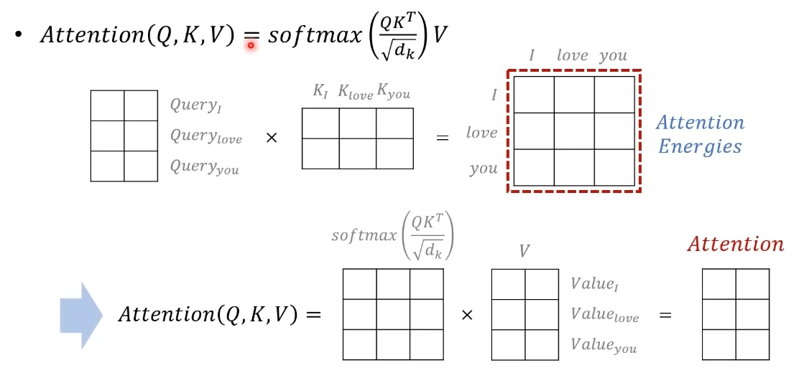

위 줄에서 query 행렬 $(3, 2)$와 key 행렬의 전치 $(2, 3)$을 곱하면 $(3, 3)$ 크기의 attention energy 행렬(붉은 점선)이 나온다. 행이 query 단어, 열이 key 단어여서, 각 단어가 다른 단어와 얼마나 관련 있는지가 이 행렬 하나에 모두 담긴다. 아래 줄에서 여기에 scaling과 softmax를 적용하고 value 행렬 $(3, 2)$를 곱하면 attention 값 $(3, 2)$가 된다. 출처: 나동빈 강의 슬라이드

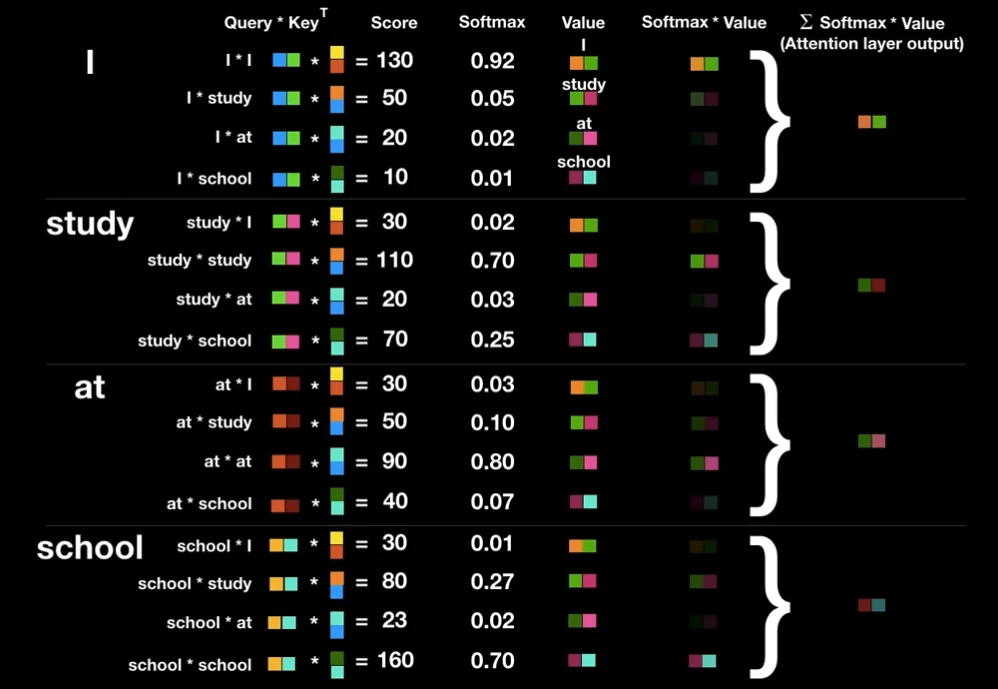

네 단어 모두에 대해 같은 계산을 한꺼번에 한 결과다. 각 단어 묶음에서 softmax 열을 보면 study는 자기 자신(0.70)과 school(0.25)에, at은 자기 자신(0.80)에, school은 자기 자신(0.70)과 study(0.27)에 큰 확률을 준다. 출처: 허민석 강의 화면

### Multi-Head Attention

논문은 attention을 한 번만 하는 것보다, query·key·value를 $h$개의 서로 다른 linear projection으로 나누어 $h$번의 attention을 병렬로 하는 것이 낫다는 것을 확인했다.

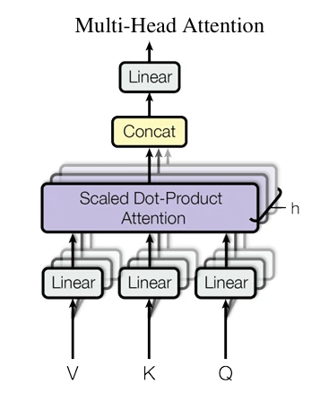

앞 그림의 Scaled Dot-Product Attention 상자가 $h$겹으로 겹쳐 있다. V, K, Q가 각각 Linear를 거쳐 $h$벌로 나뉘고, 겹마다 따로 attention을 한 뒤, 결과를 이어 붙여(Concat) 마지막 Linear를 통과시킨다. 출처: 논문 Figure 2 (오른쪽)

$$
\mathrm{MultiHead}(Q, K, V) = \mathrm{Concat}(\mathrm{head}_1, \dots, \mathrm{head}_h)\, W^O, \qquad
\mathrm{head}_i = \mathrm{Attention}(Q W_i^Q, K W_i^K, V W_i^V)
$$

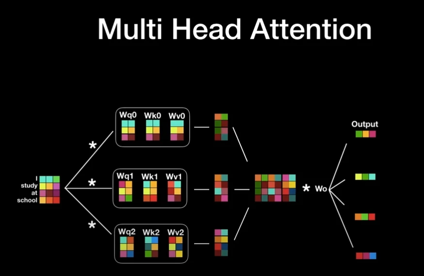

Head가 3개인 경우를 그린 것이다. 같은 입력에 head마다 다른 가중치 행렬(Wq0 ~ Wv2)을 곱해 attention을 세 번 따로 하고, 세 결과를 옆으로 이어 붙인 뒤 Wo를 곱해 출력을 만든다. 강의의 설명으로는 실제 Transformer는 이런 attention 8개를 동시에 수행한다. 출처: 허민석 강의 화면

각 head는 $d_v = d_{model} / h$ 차원의 출력을 내고, 이를 이어 붙여 $W^O$로 사영하면 다시 $d_{model}$ 차원이 된다. 논문의 기본 설정은 $d_{model} = 512$, $h = 8$이어서 head 하나의 query, key, value는 64차원이다.

강의의 작은 예시로 차원을 따라가 보면 이해가 쉽다. 단어 3개, embedding 4차원, head 2개라고 하자. 앞 절의 그림들이 이 표의 위쪽 다섯 줄이고, 아래의 두 그림이 나머지 두 줄이다.

| 단계 | 연산 | 크기 |
|---|---|---|
| 입력 embedding | | $(3, 4)$ |
| Head 하나의 $W^Q$, $W^K$, $W^V$ | | $(4, 2)$ |
| Query, key, value | $(3, 4) \times (4, 2)$ | $(3, 2)$ |
| Attention energy | $Q K^\top$, $(3, 2) \times (2, 3)$ | $(3, 3)$ |
| Head 하나의 출력 | energy에 softmax를 취하고 $V$를 곱한다 | $(3, 2)$ |
| Head 2개를 이어 붙임 | Concat | $(3, 4)$ |
| 출력 | $W^O$, $(4, 4)$를 곱한다 | $(3, 4)$ |

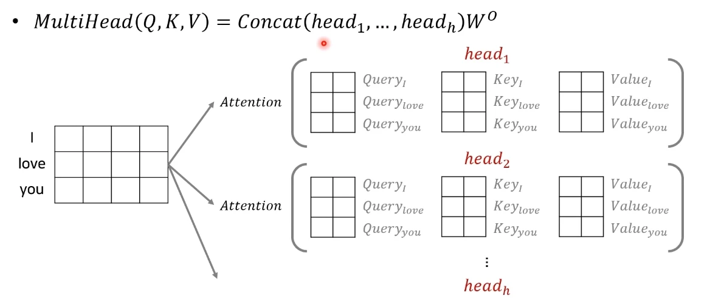

같은 $(3, 4)$ 입력에서 head 1, head 2, …가 각자의 query, key, value $(3, 2)$를 만들어 attention을 따로 한다. 출처: 나동빈 강의 슬라이드

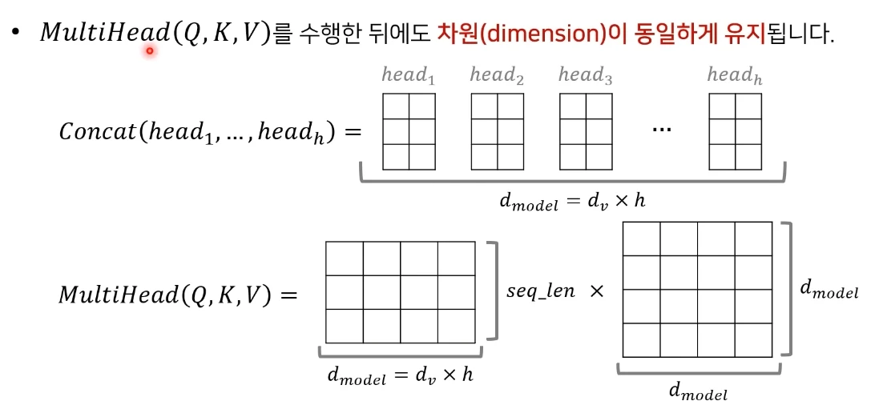

위 줄에서 head들의 출력을 옆으로 이어 붙이면 열의 수가 $d_v \times h = d_{model}$로 돌아온다. 아래 줄에서 여기에 $d_{model} \times d_{model}$ 크기의 $W^O$를 곱해도 크기는 (단어 수, $d_{model}$)로 유지된다. 출처: 나동빈 강의 슬라이드

Attention energy 행렬의 크기는 단어 수 × 단어 수이고, 각 단어가 다른 단어와 얼마나 관련 있는지를 한 번의 행렬 곱으로 모두 담는다. 마지막 출력의 크기가 입력과 같다는 점이 중요하다. 그래야 같은 구조의 layer를 여러 번 쌓을 수 있다.

Head를 여러 개 두는 이유는 서로 다른 관점의 attention을 학습하게 하기 위해서다. "The animal didn't cross the street because it was too tired."에서 it이 무엇을 가리키는지는 모호할 수 있는데, head마다 it과 관련된 서로 다른 단어에 집중하는 식으로 관련 정보를 서로 다른 관점에서 모은다.

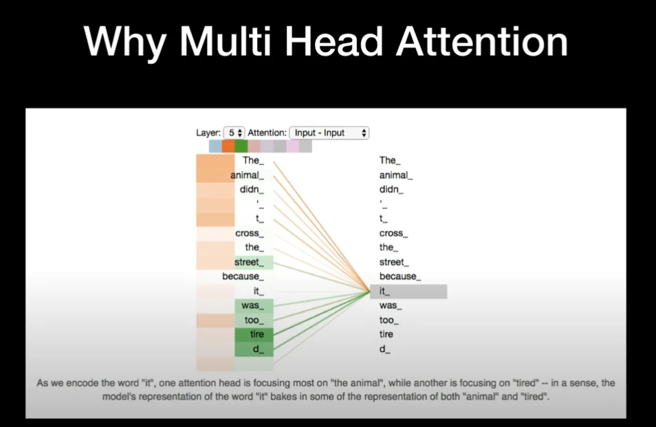

오른쪽의 it에서 왼쪽 단어들로 뻗은 선이 attention이고, 선의 색이 head를 나타낸다. 그림 아래의 설명대로 한 head(주황)는 "The animal"에, 다른 head(초록)는 "tired"에 가장 집중해서, it의 표현에 두 쪽의 정보가 함께 섞여 들어간다. 출처: 허민석 강의 화면

Attention 하나로는 모호한 문장을 충분히 인코딩하기 어렵다는 점을 보완하는 것이다. Query, key, value를 만드는 가중치 행렬은 모두 학습되는 parameter이고, head의 수만큼 따로 있다. Head의 수 자체는 hyperparameter다.

### Mask

Mask는 특정 단어를 참고하지 않도록 만드는 장치다.

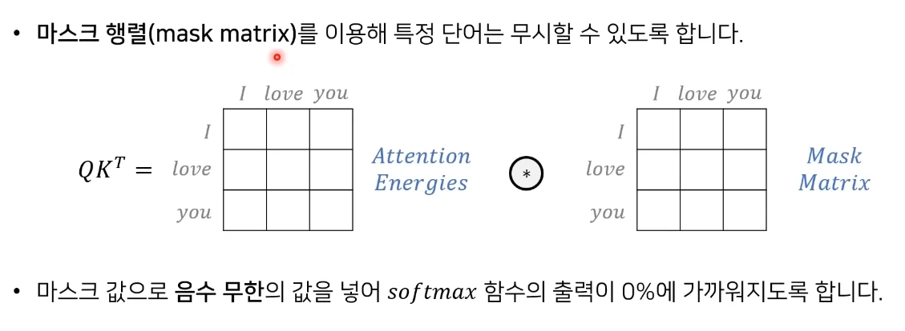

왼쪽의 attention energy 행렬과 오른쪽의 mask 행렬은 크기가 같고, 둘을 원소별로 적용한다. 출처: 나동빈 강의 슬라이드

가릴 위치의 energy 값을 음의 무한대에 가까운 값으로 바꾸면 softmax를 거친 확률이 0에 가까워진다.

### 세 가지 Attention

Transformer의 attention은 모두 같은 multi-head attention 함수이고, 쓰이는 위치와 query, key, value에 무엇을 넣는지만 다르다.

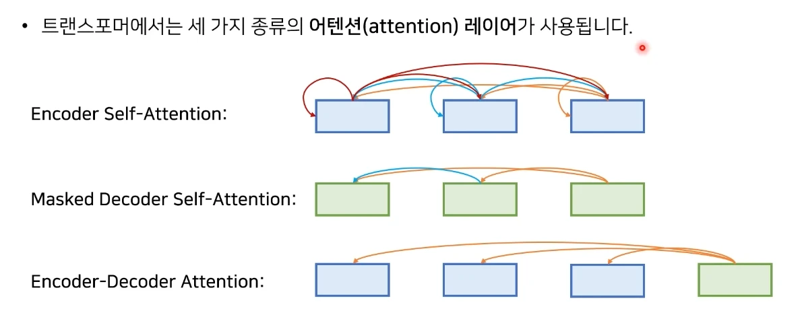

파란 상자가 encoder 쪽 단어, 초록 상자가 decoder 쪽 단어다. 첫 줄에서는 입력 단어들이 서로를 모두 참고하고, 둘째 줄에서는 출력 단어가 자기보다 앞의 단어만 참고하며(화살표가 앞쪽으로만 향한다), 셋째 줄에서는 출력 단어 하나가 입력 단어 전부를 참고한다. 출처: 나동빈 강의 슬라이드

| 종류 | 위치 | Query | Key, Value | 역할 |
|---|---|---|---|---|
| Encoder self-attention | Encoder | 입력 문장 | 입력 문장 | 입력 단어들이 서로 얼마나 관련 있는지를 구해 문장 전체의 표현을 학습한다 |
| Masked decoder self-attention | Decoder | 출력 문장 | 출력 문장 | 각 출력 단어가 자기보다 앞에 나온 단어만 참고하게 한다 |
| Encoder-decoder attention | Decoder | Decoder의 현재 상태 | Encoder의 최종 출력 | 각 출력 단어가 원문의 어느 단어에 가중치를 둘지 구한다 |

Self-attention이 무엇을 잡아내는지는 다음 예시가 보여 준다.

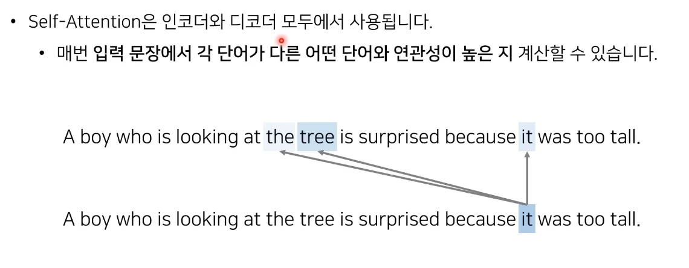

"A boy who is looking at the tree is surprised because it was too tall."에서 it의 attention을 그리면 the, tree, 그리고 it 자신으로 화살표가 향한다. it이 가리키는 것이 tree이므로 it의 표현이 tree와 비슷한 의미를 갖게 된다. 출처: 나동빈 강의 슬라이드

Decoder의 self-attention에 mask가 필요한 이유는 다음과 같다. "나는 축구를 했다"를 출력한다고 할 때, "축구를"을 내는 시점에 뒤에 나올 "했다"를 참고할 수 있다면 답을 미리 보는 것이어서 모델이 정상적으로 학습되지 않는다.

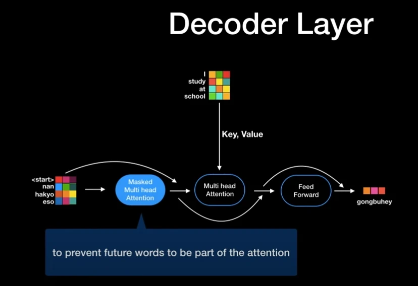

Decoder layer의 첫 sub-layer(밝은 파란색)가 masked multi-head attention이다. 그때까지 출력된 단어(`<start>`, nan, hakyo, eso)에만 attention을 적용해, 뒤에 올 단어가 계산에 끼어들지 못하게 한다. 출처: 허민석 강의 화면

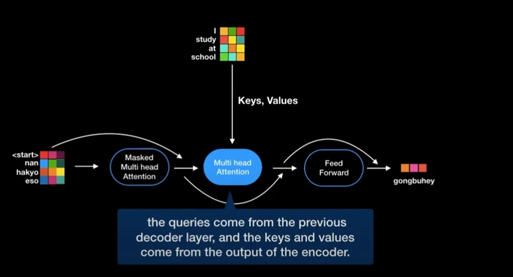

두 번째 sub-layer(밝은 파란색)가 encoder-decoder attention이다. Query는 앞의 decoder sub-layer에서 오고, key와 value는 위에서 내려오는 encoder의 최종 출력에서 온다. 출처: 허민석 강의 화면

Encoder-decoder attention은 decoder가 자신의 현재 상태를 query로 삼아 encoder에 질문하는 것이라고 볼 수 있다.

### Encoder와 Decoder

지금까지 본 부품을 조립하면 encoder layer와 decoder layer가 된다.

**Encoder layer**는 sub-layer 두 개로 이루어진다. 첫 번째는 multi-head self-attention, 두 번째는 position-wise fully connected feed-forward network다. 각 sub-layer에는 residual connection을 두고 그 뒤에 layer normalization을 적용한다.

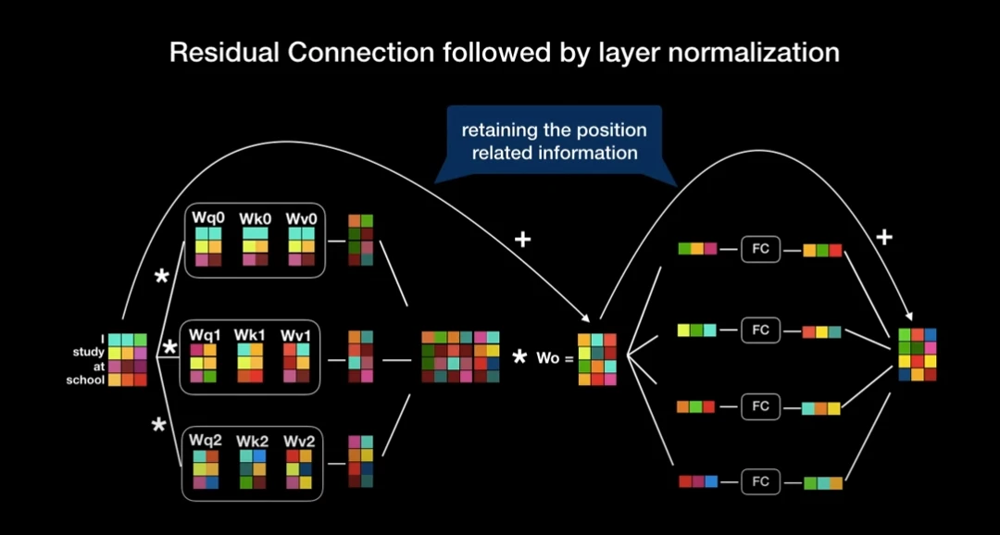

Encoder layer 하나를 펼친 그림이다. 왼쪽 절반이 multi-head attention(head별 attention, 이어 붙이기, Wo), 오른쪽 절반이 단어마다 따로 적용되는 feed-forward network(FC)다. 두 절반을 각각 건너뛰는 곡선과 +가 residual connection이고, 그 뒤에 layer normalization이 붙는다. 출처: 허민석 강의 화면

$$
\mathrm{LayerNorm}(x + \mathrm{Sublayer}(x))
$$

Sub-layer와 embedding layer의 출력은 모두 $d_{model}$ 차원이다. 입력과 출력의 차원이 같으므로 layer를 여러 개 이어 붙일 수 있고, 논문은 6개를 쌓는다.

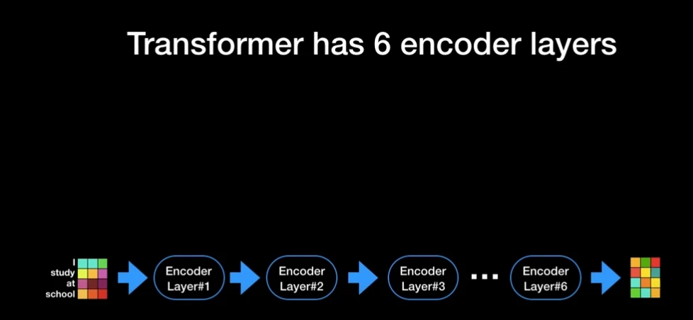

왼쪽의 입력 행렬과 오른쪽의 출력 행렬이 같은 크기여서 encoder layer 6개를 그대로 이어 붙일 수 있다. 출처: 허민석 강의 화면

Layer들은 가중치를 공유하지 않고 각자 고유한 parameter를 갖는다.

**Decoder layer**는 sub-layer 세 개로 이루어진다. Masked self-attention, encoder의 출력에 대한 encoder-decoder attention, feed-forward network 순이고, 각각의 뒤에 encoder와 같은 방식으로 residual connection과 layer normalization이 붙는다.

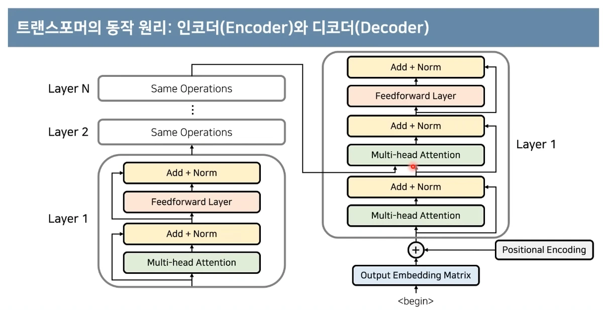

왼쪽이 encoder(Layer 1 ~ N), 오른쪽이 decoder의 Layer 1이다. Decoder layer에는 multi-head attention이 두 개 있고, encoder의 마지막 layer에서 나온 선이 그 가운데 두 번째 attention으로 들어간다. 출처: 나동빈 강의 슬라이드

Decoder도 6개 layer를 쌓으며, 마지막 encoder layer의 출력이 모든 decoder layer에 입력된다.

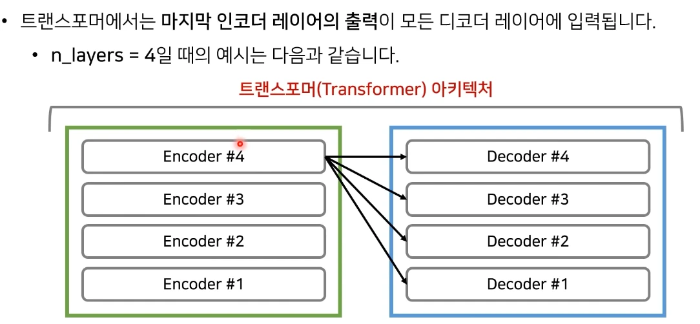

Layer가 4개인 예시다. 마지막 encoder layer(Encoder #4)의 출력이 decoder layer 네 개 모두에 입력된다. 출처: 나동빈 강의 슬라이드

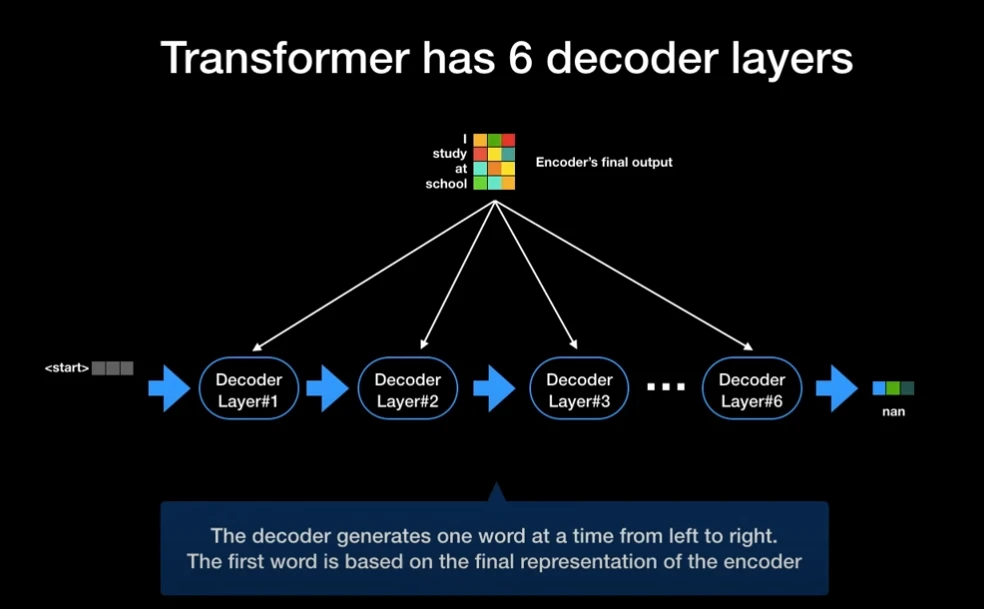

6개 layer 모두가 위쪽의 encoder 최종 출력을 받는다. Decoder는 `<start>`에서 출발해 왼쪽에서 오른쪽으로 한 번에 한 단어씩 낸다. 출처: 허민석 강의 화면

**Feed-forward network**는 ReLU를 사이에 둔 두 개의 linear transformation이다. Kernel 크기가 1인 convolution 두 개로 볼 수도 있다.

$$
\mathrm{FFN}(x) = \max(0,\, x W_1 + b_1)\, W_2 + b_2
$$

**출력.** Decoder의 마지막 출력에 linear layer와 softmax를 적용한다. Linear layer는 softmax에 넣을 logit을 만들고, softmax는 모델이 아는 모든 단어에 대한 확률을 낸다.

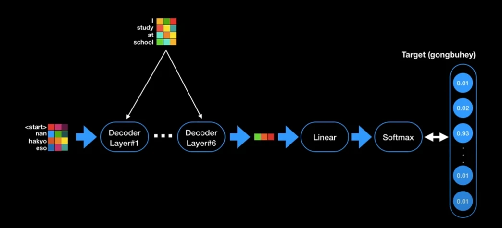

마지막 decoder layer가 낸 벡터가 Linear와 Softmax를 거쳐 단어별 확률(오른쪽 세로 줄)이 된다. 이 예시에서는 정답 단어 gongbuhey 자리의 확률이 0.93으로 가장 높다. 출처: 허민석 강의 화면

입력 embedding, 출력 embedding, softmax 직전의 linear transformation은 가중치를 공유한다.

### Residual connection은 왜 도움이 되는가

Residual connection은 어떤 값을 layer에 통과시켜 $F(x)$로 바꾸기만 하는 대신, layer를 건너뛴 입력을 그대로 더해 $x + F(x)$를 내보내는 기법이다.

Transformer에서는 왼쪽으로 돌아 multi-head attention을 건너뛴 뒤 Add + Norm으로 들어가는 선이 residual connection이다. 출처: 나동빈 강의 슬라이드

ResNet에서 온 것으로, 왜 이것이 학습을 쉽게 만드는지를 다른 강의에서 따로 찾아 정리했다.

입력 $x$가 weight layer 두 개를 거친 $F(x)$와, layer를 건너뛴 $x$(오른쪽 곡선, identity)가 더해져 $F(x) + x$가 된다. 곡선에 그어진 파란 X는 강의 화면의 표시로, 아래에서 비교할 "skip connection이 없는 경우"를 가리킨다. 출처: Skip-connection 강의 화면

Layer가 만들어야 하는 이상적인 출력을 $H(x)$라 하고, $F(x) = \sigma(x W_1) W_2$라고 하자. $H(x)$가 $x$와 매우 비슷하다고 가정하면 두 경우가 갈린다.

- Skip connection이 없으면 $F(x)$만으로 $x$에 가까운 값을 만들어야 한다. 그러려면 가중치 행렬들이 identity에 가까워져야 한다.
- Skip connection이 있으면 $x$가 이미 더해지므로 $F(x)$는 0에 가까우면 된다. 가중치 행렬은 영행렬에 가까우면 된다.

가중치 초기화는 Xavier, He, LeCun 어느 방식이든 평균이 0이고 표준편차가 작은 값에서 시작한다. 따라서 가중치를 학습으로 identity까지 끌고 가는 것보다 0 근처에 두는 것이 훨씬 쉽다.

그러면 왜 $H(x) \approx x$라고 가정할 수 있는가. 네트워크가 깊다면 입력으로부터 값을 조금씩 바꿔 나가는 것이 이상적이다. 한 layer에서 값을 급격히 바꾸는 모델은 학습 데이터에 과적합되었을 가능성이 크다. 그래서 잘 학습된 모델이라면 한 layer를 거쳐도 값이 크게 바뀌지 않을 것이라고 본다. Skip connection은 "한 layer에서 모든 것을 하려 하지 말고 값을 조금씩만 바꾸라"고 모델에 알려 주는 장치인 셈이다. 3에서 3.1을 통째로 만드는 대신 변화량 0.1만 만들면 되고, 이렇게 차이(residual)만 학습한다고 해서 residual learning이라고 부른다.

Transformer 강의에서는 한 가지 이유를 더 든다. Embedding에 더해 준 positional encoding의 정보가 layer를 거치며 흐려질 수 있는데, residual connection이 입력을 다시 더해 줌으로써 이를 보완한다는 것이다. 앞의 encoder layer 그림에서 곡선 위에 붙은 말풍선 "retaining the position related information"이 이 뜻이다.

### 학습: Label smoothing

학습에는 residual dropout과 label smoothing이 정규화 기법으로 쓰인다. Label smoothing은 정답 label을 0과 1만으로 이루어진 one-hot 벡터로 두지 않고 조금 완화하는 방법으로, 모델이 학습 데이터에 지나치게 맞춰지는 것을 막는다.

학습은 softmax의 출력(오른쪽 세로 줄의 0.01, 0.01, 0.93, …)과 정답 label의 차이를 줄이는 것이다. Label smoothing은 이때 비교하는 정답 쪽을 0과 1이 아닌 값으로 바꾸는 것이고, 말풍선대로 BLEU 점수와 정확도를 높이는 데 도움이 되었다. 출처: 허민석 강의 화면

학습 데이터가 깨끗하고 정답이 분명하면 큰 도움이 되지 않을 수 있다. 도움이 되는 것은 label에 noise가 있는 경우, 곧 같은 입력에 서로 다른 정답이 많은 경우다. "Thank you"의 정답이 어떤 데이터에서는 "고마워요"이고 다른 데이터에서는 "감사합니다"라고 하자. 둘 다 틀린 번역이 아니지만 one-hot으로 두면 완전히 다른 두 벡터가 되어, 모델의 parameter가 커졌다 작아졌다를 반복하며 학습이 잘 진행되지 않는다. Label smoothing을 적용하면 두 벡터의 차이가 줄어 학습이 더 원활해진다.

## 4. 왜 Self-Attention인가

저자들은 self-attention을 recurrent layer, convolutional layer와 세 가지 기준으로 비교한다.

1. Layer 하나의 전체 계산 복잡도
2. 병렬화할 수 있는 계산의 양
3. 네트워크 안에서 long-range dependency 사이의 경로 길이

Sequence transduction에서 장기 의존성을 학습하는 것은 핵심 과제다. 경로 길이는 입력의 한 위치에서 출력의 한 위치까지 신호가 전달되기 위해 거쳐야 하는 길이를 말한다. Self-attention은 모든 위치를 직접 연결하므로 경로 길이가 시퀀스 길이와 무관하게 일정하고, 그래서 먼 거리의 의존성을 학습하기에 유리하다.

## 5. 결과

Transformer는 영어-독일어, 영어-프랑스어 번역에서 모두 기존 모델보다 좋은 성능을 냈고 학습 비용도 훨씬 낮았다.

구성 요소의 중요도는 기본 설정에서 한 가지씩 바꿔 가며 본다.

맨 윗줄(base)이 기본 설정이고, 그 아래 (A) ~ (E)는 빈칸이 아닌 항목만 base에서 바꾼 것이다. 오른쪽의 BLEU는 높을수록, PPL은 낮을수록 좋다. base의 BLEU는 25.8이다. 출처: 논문 Table 3

표에서 다음이 관찰되었다.

- Attention head가 너무 적거나 너무 많으면 성능이 떨어진다. (A)에서 head가 1개이면 BLEU가 24.9, 32개이면 25.4다.
- Key의 차원 $d_k$를 줄이면 품질이 떨어진다. (B)에서 $d_k$를 16으로 줄이면 25.1이다. Dot product보다 나은 compatibility function이 있을 수 있음을 시사한다.
- Dropout은 과적합을 막는 데 매우 중요했다. (D)에서 dropout을 0으로 두면 24.6으로 떨어진다.
- Sinusoidal positional encoding을 학습된 positional embedding으로 바꿔도 결과는 거의 같았다. (E)의 BLEU가 25.7이다.

## 6. 한계

논문을 읽은 뒤 Transformer의 한계로 정리한 내용이다. 이후에 읽은 시계열 Transformer들은 대부분 이 가운데 하나를 겨냥한다.

- **연산 복잡도와 메모리.** Self-attention은 길이 $n$인 시퀀스의 모든 토큰 쌍에 대해 attention을 계산하므로 복잡도가 $O(n^2)$이다. 시퀀스가 길어지면 연산량과 GPU 메모리 사용량이 급격히 늘어난다.
- **매우 긴 시퀀스.** 병렬화 덕분에 학습은 빠르지만, 길이가 수천에서 수만에 이르는 시퀀스에서는 $O(n^2)$ 때문에 확장성이 떨어진다. 이를 보완하려고 sparse attention, Longformer, Performer 같은 효율적인 attention이 제안되었다.
- **Inductive bias의 부족.** RNN은 순차적인 구조를, CNN은 국소적인 구조를 자연스럽게 반영한다. Transformer는 모든 토큰 사이의 관계를 동일하게 보는 global attention이어서 시간적, 계층적 구조를 명시적으로 반영하기 어렵다.
- **데이터와 자원.** 대규모 데이터와 고성능 하드웨어가 없으면 성능을 내기 어렵다. 원 논문도 큰 번역 데이터셋과 P100 GPU 8개를 썼다.
- **장기 의존성.** RNN 없이 attention만으로 장기 의존성을 학습한다는 것은 장점이지만, 매우 긴 시퀀스에서 의미 있는 토큰 쌍을 찾아내는 것은 여전히 쉽지 않다.
- **해석.** Attention weight를 시각화해 어느 정도 해석할 수 있다고 하지만, head가 많아질수록 모델 전체의 동작을 직관적으로 이해하기 어렵다.

첫 번째와 두 번째 한계를 장기 시계열 예측에서 다룬 모델이 다음에 읽은 [Informer](2025-01-15-informer.md)다.

## 남았던 질문과 답

공부할 당시에는 풀지 못하고 남겨 둔 질문들이다. 글을 정리하면서 답을 찾아 덧붙였다.

**Q. RNN의 순차성이 "하나의 학습 예시 안에서의 병렬화"를 막는다는 문장은 이해했다. 이어지는 "메모리 제약이 예시들에 걸친 batching을 제한하므로 긴 시퀀스에서 치명적이다"는 정확히 무슨 뜻인가.**

당시에 이해한 방향이 맞다. 논문의 문장은 "이 순차성은 학습 예시 안에서의 병렬화를 막는데, 이는 시퀀스가 길어질수록 치명적이다. 메모리 제약이 예시들에 걸친 batching을 제한하기 때문이다"라는 구조다. 병렬화에는 두 가지 길이 있다. 한 예시 안에서 여러 위치를 동시에 계산하는 것과, 여러 예시를 한 batch로 묶어 동시에 계산하는 것이다. RNN은 앞의 길이 막혀 있으므로 뒤의 길에만 기댈 수 있다. 그런데 시퀀스가 길어지면 예시 하나가 차지하는 메모리가 커져서 한 batch에 넣을 수 있는 예시의 수가 줄어든다. 길이가 10배가 되면 같은 메모리에 들어가는 예시는 대략 10분의 1이다. 남아 있던 병렬화 수단마저 줄어드니, 예시 안에서 병렬화하지 못한다는 약점이 긴 시퀀스에서 더 크게 드러난다는 뜻이다.

**Q. 추론 단계에서 decoder의 입력 embedding은 무엇인가. 출력이 아직 정해지지 않았는데 positional encoding은 어떻게 주어지는가.**

Decoder의 입력은 "지금까지 생성한 출력"이다. 논문은 출력 embedding이 한 위치씩 밀려(offset by one position) 들어간다고 설명한다. 첫 단계의 입력은 시작 토큰 `<sos>` 하나이고, 여기서 첫 단어 $y_1$이 나온다. 다음 단계의 입력은 (`<sos>`, $y_1$), 그다음은 (`<sos>`, $y_1$, $y_2$)로 한 토큰씩 늘어나며, 매번 마지막 위치의 출력으로 다음 단어를 정한다. 각 토큰은 학습 때와 같은 embedding table에서 벡터를 꺼낸다. Positional encoding은 토큰의 내용이 아니라 위치 번호 $pos$만의 함수다. 그래서 그 자리에 어떤 단어가 올지 몰라도 $pos = 0, 1, 2, \dots$에 대한 값은 미리 계산해 둘 수 있고, 토큰이 정해지는 대로 그 위치의 값을 더하면 된다. 학습 때에는 정답 문장을 한 칸 민 것을 통째로 넣고 mask로 뒤쪽을 가리므로 이 반복이 필요 없다.

**Q. 번역 결과의 길이가 원문보다 길어져도 문제가 없는가. Mask는 실제로 어떻게 적용되는가.**

문제없다. 3절에서 본 것처럼 입력 길이 $n$과 출력 길이 $m$은 처음부터 따로 정의된다. Encoder-decoder attention의 energy 행렬은 크기가 $m \times n$이고(행이 출력 위치, 열이 원문 위치), 계산 어디에도 $m \le n$이어야 한다는 조건이 없다. 출력 길이를 정하는 것은 종료 토큰이 나오는 시점과 구현이 정해 둔 상한뿐이다. 논문은 추론 때 최대 출력 길이를 입력 길이 + 50으로 두고, 가능하면 그 전에 끝낸다고 적었다.

Mask에 대해 논문은 scaled dot-product attention 안에서 허용되지 않는 연결에 해당하는 softmax 입력을 $-\infty$로 바꾼다고 설명한다. 일반적인 구현에서는 두 가지 mask를 쓴다. Decoder self-attention에는 $m \times m$ 크기의 하삼각 mask를 써서 위치 $i$가 $i$보다 뒤의 위치를 보지 못하게 한다. 그리고 batch 안에서 길이를 맞추려고 넣은 `<pad>` 토큰의 열을 가리는 padding mask를 encoder self-attention과 encoder-decoder attention에 쓴다. 두 경우 모두 energy 행렬에서 가릴 자리를 아주 큰 음수로 채운 뒤 softmax를 취한다. 강의 실습 코드가 이 가운데 어떤 방식으로 구현했는지는 다시 확인하지 않았다.

**Q. Encoder-decoder attention에서 encoder 출력으로부터 key와 value를 만드는 linear layer는 decoder 쪽에 속한 것인가.**

그렇다. Encoder가 넘겨주는 것은 마지막 layer의 출력 $z$뿐이다. 논문은 encoder-decoder attention에서 query는 이전 decoder layer에서 오고 key와 value는 encoder의 출력에서 온다고 설명하는데, 그 출력에 곱하는 $W_i^K$, $W_i^V$는 multi-head attention sub-layer의 parameter이고 이 sub-layer는 decoder layer 안에 있다. Layer끼리 가중치를 공유하지 않으므로, decoder layer가 6개이면 같은 encoder 출력 $z$에 대해 서로 다른 $W^K$, $W^V$가 6벌 있는 셈이다. 각 decoder layer가 같은 원문 표현을 자기 방식으로 다시 읽는다고 볼 수 있다.

## 참고 자료

- Ashish Vaswani, Noam Shazeer, Niki Parmar, Jakob Uszkoreit, Llion Jones, Aidan N. Gomez, Łukasz Kaiser, Illia Polosukhin. "Attention Is All You Need." NeurIPS 2017. [arXiv:1706.03762](https://arxiv.org/abs/1706.03762)
- Dzmitry Bahdanau, Kyunghyun Cho, Yoshua Bengio. "Neural Machine Translation by Jointly Learning to Align and Translate." ICLR 2015. [arXiv:1409.0473](https://arxiv.org/pdf/1409.0473.pdf)
- [Seq2Seq + Attention 기계 번역 강의 (YouTube)](https://www.youtube.com/watch?v=WsQLdu2JMgI). 1절의 "I love you" 예시.
- [허민석, Transformer: Attention Is All You Need 강의 (YouTube)](https://www.youtube.com/watch?v=mxGCEWOxfe8&t=214s). Positional encoding, multi-head attention의 예시, label smoothing 설명.
- [나동빈, Transformer: Attention Is All You Need 논문 리뷰와 코드 실습 (YouTube)](https://www.youtube.com/watch?v=AA621UofTUA&list=PLRx0vPvlEmdADpce8aoBhNnDaaHQN1Typ&index=6). Seq2Seq with attention의 수식, 차원 예시, attention의 종류, 실습 코드.
- [Skip-connection 설명 강의 (YouTube)](https://www.youtube.com/watch?v=Fypk0ec32BU). Residual connection이 학습을 쉽게 만드는 이유.
