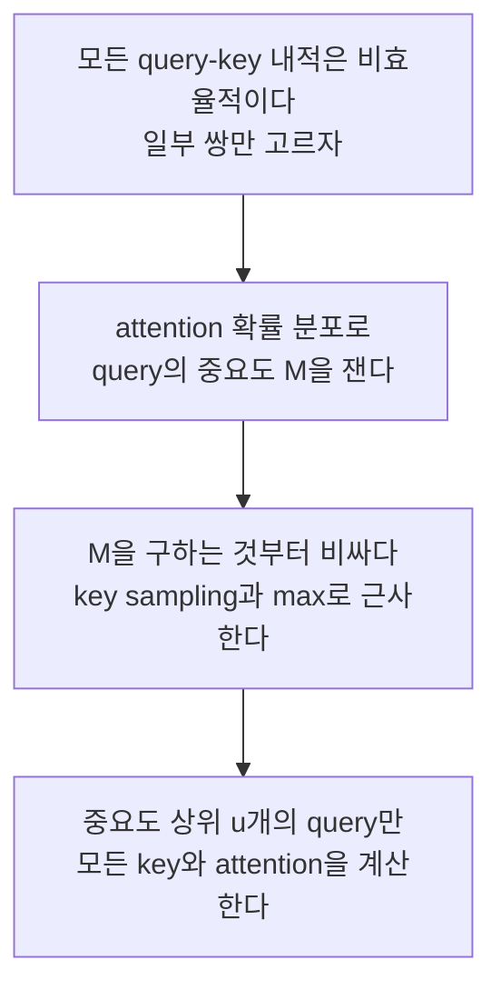

# Informer: 긴 시계열 예측을 위한 효율적인 Transformer

작성일 2025-01-15
{ .post-date }

[Attention Is All You Need](2025-01-06-attention-is-all-you-need.md)를 읽고 정리한 Transformer의 한계 가운데 첫 번째가 self-attention의 $O(L^2)$ 비용이었다. Informer(Informer: Beyond Efficient Transformer for Long Sequence Time-Series Forecasting, AAAI 2021)는 이 문제를 긴 시계열 예측(Long Sequence Time-series Forecasting, LSTF)에서 다룬 모델이다.

이 글은 논문을 처음부터 정독한 기록이 아니라, 다른 연구실(DSBA)의 Informer 세미나 영상을 따라가며 내가 이해한 대로 정리한 것이다. 수식은 세미나 슬라이드에 실린 논문의 식을 다시 적었고, 그림은 옮기지 않았다. 따라가며 생긴 질문과 그에 대해 스스로 내린 답도 함께 적었다.

Informer가 제안하는 것은 세 가지다.

1. **ProbSparse self-attention**: 의미 있는 query만 골라 attention을 계산한다.
2. **Self-attention distilling**: layer를 지날 때마다 시퀀스 길이를 절반으로 줄인다.
3. **Generative style decoder**: 한 번의 forward로 예측 구간 전체를 출력한다.

## 1. 배경

### 시계열 예측 딥러닝 모델의 세 갈래

| 계열 | 특징 | 한계 |
|---|---|---|
| RNN 기반 | 현재 시점이 이전 시점의 영향을 받는다는 시계열의 특성과 잘 맞는다 | Gradient vanishing이 커서 긴 시퀀스를 학습하기 어렵다. 멀리 떨어진 시점 사이의 dependency가 약해진다 |
| CNN 기반 | 시간 순서를 따라 filter를 적용해 과거와 현재의 관계를 파악한다 | 과거와 현재의 정보가 time-invariant하다고, 곧 시간에 따라 데이터의 특성이 변하지 않는다고 가정한다. Filter로는 local dependency만 잡으므로 장기 의존성 문제가 있다 |
| Attention 기반 | 서로 다른 시점 사이의 관계를 attention으로 직접 파악한다. Long-range dependency를 학습하기 쉽다 | 아래에서 다룬다 |

### LSTF 문제

시계열 예측은 짧은 구간을 예측하는 문제와 긴 구간을 예측하는 문제로 나눌 수 있다. 논문은 LSTM으로 예측 길이를 늘려 가며 실험한 결과를 보여 주는데, 예측 길이가 48을 넘어가는 지점부터 MSE가 급격히 커지고, 초당 예측 수로 잰 추론 속도는 길이가 늘수록 가파르게 떨어진다.

LSTF의 과제는 긴 시퀀스에 대한 예측 능력(prediction capacity)을 높이는 것이고, 이를 위해 두 가지 능력이 필요하다.

- Long-range alignment 능력. 장기 의존성을 파악하는 능력이라고 이해했다.
- 긴 입력과 출력을 효율적으로 처리하는 연산 능력.

Transformer는 RNN보다 long-range dependency를 잘 잡는다는 점에서 첫 번째 조건에 맞는다. 문제는 두 번째다. 길이 $L$인 입력과 출력에 대해 self-attention의 연산량과 메모리가 $L^2$에 비례한다. 짧은 시퀀스에서는 감당할 만하지만 긴 시퀀스에서는 병목이 된다. 따라서 Transformer를 LSTF에 쓰려면 long-range dependency를 잡는 능력은 유지하면서 self-attention의 연산, 메모리, 속도를 개선해야 한다.

## 2. Self-attention의 비용과 sparsity

### 왜 비싼가

Self-attention의 복잡도는 시퀀스 길이 $T$, 차원 $D$에 대해 $O(T^2 D)$이다. 길이가 늘면 연산이 급격히 커진다.

Self-attention에는 입력에 대한 구조적 가정(structural prior)이 전혀 없다. 이것은 장점이자 단점이다. 어떤 시퀀스든 들어오기만 하면 연산할 수 있지만, 모든 토큰 쌍에 대해 연산하므로 비효율적일 수 있다. 이를 개선하려는 연구는 sparse attention, linearized attention, prototype과 memory compression, low-rank self-attention, attention with prior, multi-head 메커니즘의 개선 등 여러 방향으로 진행되었고, Informer를 이해하는 데 핵심이 되는 배경은 sparse attention이다.

### Attention은 실제로 sparse하다

학습된 self-attention의 score를 보면 값이 높은 부분은 소수이고 대부분은 0에 가깝다. 0에 가까운 값들은 representation을 만드는 데 거의 기여하지 않으면서 메모리만 차지한다. 그래서 일부 연구자들은 구조적 가정(structural bias)을 두어 계산할 query-key 쌍의 수를 제한하자고 제안했다. 여기서 structural bias는 모든 query-key 쌍 가운데 어떤 쌍을 계산할지 정하는 기준이자 가정이다.

기존 sparse attention 연구의 공통된 출발점은 문장이 길어질수록 attention 비용이 크다는 것이고, 목표는 입력 길이에 대해 $O(N^2)$로 늘어나는 비용을 $O(N)$에 가깝게 만드는 것이다. 그 효과로 NLP에서는 기존의 512 토큰보다 긴 문장을 입력으로 쓸 수 있게 되었다. 입력이 길어지면 downstream task에 쓸 단서가 많아지므로, 이 효과를 확인하는 데에는 주로 질의응답과 문서 요약이 쓰였다. 시계열 예측의 관점으로 옮기면, 더 긴 시퀀스를 받아 더 긴 시퀀스를 예측할 수 있게 된다는 뜻이다. LogTrans의 LogSparse self-attention도 같은 목적으로 연산 속도와 메모리 효율을 높이려 한 방법이다.

## 3. Informer가 겨냥한 세 가지 한계

Informer의 동기는 "Transformer를 연산, 메모리, 구조 면에서 효율적으로 개선하면서 높은 예측 성능을 유지할 수 없을까"이다. 논문이 꼽는 vanilla Transformer의 한계는 세 가지다.

1. **Self-attention의 quadratic 연산.** Layer마다 dot-product 연산의 시간 복잡도와 메모리 사용량이 $O(L^2)$이다.
2. **긴 입력에서 layer를 쌓을 때의 메모리 병목.** Encoder·decoder layer를 $J$개 쌓으면 전체 메모리 사용량이 $O(J \cdot L^2)$이 되어, 긴 입력에 대한 확장성(scalability)을 제한한다. Scalability는 데이터의 크기가 커져도 모델이 계속 잘 동작하는 능력이다.
3. **긴 출력을 예측할 때의 속도 저하.** Vanilla Transformer의 dynamic decoding은 auto-regressive 방식이어서, 한 시점씩 예측하고 그 결과를 다시 입력으로 넣는다. 추론 속도가 RNN만큼 느려진다.

처음에는 왜 $L^2$이고 왜 $J \cdot L^2$인지를 질문으로 적어 두었는데, 따라가다 보니 답은 단순했다. Attention은 모든 query와 모든 key의 쌍에 대해 계산되므로 길이 $L$의 self-attention에서는 쌍의 수가 $L \times L$이다. 그리고 layer마다 이 크기의 attention map이 하나씩 생기므로 $J$개 층이면 $J$배가 된다.

선행 연구들은 주로 첫 번째 한계만 다루었다.

- Sparse Transformer, LogSparse Transformer, Longformer는 휴리스틱한 방법으로 self-attention의 복잡도를 줄였다.
- Reformer는 Locality-Sensitive Hashing(LSH) self-attention으로 복잡도를 $O(L \log L)$로 줄이고 메모리 효율을 개선했지만, 극단적으로 긴 시퀀스에만 특화되어 있다.
- Linformer는 선형 복잡도 $O(L)$의 attention을 제안했지만, 여기에 쓰이는 projection matrix를 현실의 긴 시퀀스에 맞게 고정하기 어렵다.

이 연구들은 연산 효율에 대한 해결책만 내놓았고, LSTF의 관점에서 두 번째와 세 번째 한계는 남겨 두었다. Informer는 세 가지 모두에 답하려 한다.

| 한계 | Informer의 해결책 |
|---|---|
| Self-attention의 $O(L^2)$ | ProbSparse self-attention으로 시간 복잡도와 메모리를 $O(L \log L)$로 줄인다 |
| Layer를 쌓을 때의 메모리 병목 | Self-attention distilling으로 layer를 지날수록 길이를 줄여 전체 공간 복잡도를 낮춘다 |
| Auto-regressive decoding의 느린 속도 | Generative style decoder로 한 번의 forward에 긴 출력을 얻는다. Auto-regressive 과정에서 생기는 오류 누적도 피한다 |

## 4. 문제 정의와 입력

**LSTF 문제.** 입력 $\mathcal{X}^t = \{x_1^t, \dots, x_{L_x}^t\}$로부터 출력 $\mathcal{Y}^t = \{y_1^t, \dots, y_{L_y}^t\}$를 예측한다. LSTF는 출력 길이 $L_y$가 선행 연구에서 다루던 길이(48 안팎)보다 긴 경우를 말하고, 변수의 수는 단변량에 한정되지 않는다.

**Encoder-decoder.** Encoder가 과거의 일정 구간을 받아 hidden representation을 만들고, decoder가 그 이후 시점을 예측한다. 일반적인 구조에서는 decoder가 예측을 한 시점씩 순차적으로 받아 가며 decoding하지만, Informer는 한 번의 forward로 예측을 끝낸다.

**Uniform input representation.** Informer는 입력에 전역적인 시간 정보와 국소적인 순서 정보를 모두 반영한다. 세 가지를 더해 입력을 만든다.

- Scalar: 시계열 값을 $d_{model}$ 차원으로 projection한 값
- Local time stamp: 일반적인 positional encoding
- Global time stamp: 시각 정보를 embedding한 것(time feature embedding). 어떤 시간 feature를 쓸지는 사용자가 설정으로 바꿀 수 있다

논문의 그림에서는 scalar와 stamp가 따로 들어가는 것처럼 보이지만, 별개의 입력이 아니라 모두 더해져 하나의 입력이 된다.

**Decoder의 입력.** Decoder에는 encoder 입력의 뒷부분 일정 길이를 start token으로 넣고, 예측할 구간은 0으로 채운다. 세미나의 예시로는 encoder 입력 길이가 96일 때 decoder 입력은 앞의 48개가 start token, 뒤의 24개가 0이다. 0으로 채운 구간에도 그 시점에 해당하는 time stamp는 계산해서 넣는다.

## 5. ProbSparse Self-Attention

### Attention을 확률로 다시 쓰기

Transformer의 scaled dot-product attention은 다음과 같다.

$$
\mathcal{A}(Q, K, V) = \mathrm{Softmax}\!\left(\frac{Q K^\top}{\sqrt{d}}\right) V
$$

이를 $Q$, $K$, $V$의 $i$번째 행 $q_i$, $k_i$, $v_i$로 쪼개면, $i$번째 query에 대한 attention은 kernel smoother의 형태로 쓸 수 있다.

$$
\mathcal{A}(q_i, K, V) = \sum_{j} \frac{k(q_i, k_j)}{\sum_{l} k(q_i, k_l)}\, v_j = \mathbb{E}_{p(k_j \mid q_i)}[v_j], \qquad
p(k_j \mid q_i) = \frac{k(q_i, k_j)}{\sum_{l} k(q_i, k_l)}
$$

여기서 kernel $k(q_i, k_j)$는 $\exp\!\left(q_i k_j^\top / \sqrt{d}\right)$이다. 곧 query $q_i$에 대한 attention 출력은, key $k_j$에 대한 softmax 확률 $p(k_j \mid q_i)$를 가중치로 삼은 value들의 평균이다.

이 식에서 첨자 $l$과 $j$가 각각 무엇을 가리키는지가 처음에는 헷갈렸다. 따져 보니 $l$은 분모에서 $q_i$와 계산되는 모든 key를 도는 첨자이고, $j$는 서로 짝이 되는 key와 value의 쌍을 도는 첨자다. Key 하나는 value 하나와 대응하므로, 이 식은 $q_i$가 만들어 내는 attention 전체를 빠짐없이 표현한다.

Vanilla Transformer는 모든 query와 key에 대해 이 확률을 계산하기 때문에 quadratic 연산이 필요하다. 선행 연구들은 $p(k_j \mid q_i)$ 가운데 성능에 의미 있는 영향을 주지 않는 것을 빼는 선택적(selective) 전략을 고안하거나, attention score를 근사하는 kernel function을 고안했다.

### 어떤 query가 중요한가

Informer는 기존의 선택 전략에 이론적 한계가 있다고 지적한다. Multi-head self-attention의 모든 head에 똑같은 선택 전략을 적용한다는 점이다. 이 지적에는 동의했다. Head마다 표현하려는 것이 다른데 같은 방식을 일괄 적용하면 각 head의 의미를 제대로 뽑아낼 수 있을지 알 수 없다.

Informer의 선택 기준은 attention 확률의 분포에서 나온다.

- Self-attention의 score는 꼬리가 긴(long tail) 분포를 따른다. 소수의 dot-product 쌍만이 attention에 크게 기여하고 나머지는 사소한(trivial) 값이다.
- 어떤 query가 key들과 활발하게 상호작용한다면 $p(k_j \mid q_i)$는 key에 따라 다양한 값을 갖는다. 그렇지 않은 query의 분포는 uniform 분포 $q(k_j \mid q_i) = 1 / L_K$에 가깝다.
- 분포가 uniform에 가까우면 그 query의 출력은 value들을 거의 균등하게 평균한 것이 되어, 있으나 없으나 한 query가 된다.

따라서 분포 $p$가 uniform 분포 $q$와 얼마나 다른지가 중요한 query를 가려내는 지표가 된다. 두 분포의 차이는 KL divergence로 잰다.

$$
KL(q \,\Vert\, p) = \ln \sum_{l=1}^{L_K} e^{q_i k_l^\top / \sqrt{d}} - \frac{1}{L_K} \sum_{j=1}^{L_K} \frac{q_i k_j^\top}{\sqrt{d}} - \ln L_K
$$

상수항 $\ln L_K$를 빼면 $i$번째 query의 sparsity 측정값이 된다.

$$
M(q_i, K) = \ln \sum_{j=1}^{L_K} e^{q_i k_j^\top / \sqrt{d}} - \frac{1}{L_K} \sum_{j=1}^{L_K} \frac{q_i k_j^\top}{\sqrt{d}}
$$

첫째 항은 $q_i$와 모든 key의 내적에 대한 Log-Sum-Exp이고, 둘째 항은 그 내적들의 산술평균이다. $M$이 큰 query일수록 attention 확률이 다양한 값을 가지므로 의미 있는 dot-product 쌍을 가질 가능성이 높다. Long tail 분포에서 머리 부분에 해당하는 쌍을 가진 query다.

### Top-u query만 계산하기

ProbSparse self-attention은 이 측정값이 큰 상위 $u$개의 query만으로 attention을 계산한다.

$$
\mathcal{A}(Q, K, V) = \mathrm{Softmax}\!\left(\frac{\bar{Q} K^\top}{\sqrt{d}}\right) V
$$

$\bar{Q}$는 $M(q_i, K)$ 기준 상위 $u$개의 query만 담은 행렬이다. $u$는 hyperparameter인 sampling factor $c$를 써서 $u = c \cdot \ln L_Q$로 정한다.

- 전체 $L_Q$개의 query 가운데 $O(\ln L_Q)$개만 dot-product 연산에 참여한다.
- 메모리 사용량은 $O(L_K \ln L_Q)$이다. 메모리에 남는 것은 query와 key를 곱해 만든 attention map인데, 그 크기가 (선택된 query 수) × (key 수)이기 때문이다.
- Head마다 서로 다른 query-key 쌍이 선택되므로, sampling으로 인한 심각한 정보 손실을 막는 효과가 있다.

### 측정값 자체를 싸게 구하기

여기에는 함정이 있다. 상위 $u$개의 query를 고르려면 모든 query에 대해 $M(q_i, K)$를 계산해야 하는데, 그러려면 모든 query-key 쌍의 내적, 곧 $O(L_Q L_K)$의 quadratic 연산이 다시 필요하다. 연산을 줄이려고 만든 지표를 구하는 데 원래만큼의 연산이 드는 셈이다.

논문은 Lemma 1과 Proposition 1을 근거로 $M$을 근사하는 식을 제안한다. Log-Sum-Exp 항을 최댓값으로 바꾼 것이다.

$$
\bar{M}(q_i, K) = \max_{j} \left\{ \frac{q_i k_j^\top}{\sqrt{d}} \right\} - \frac{1}{L_K} \sum_{j=1}^{L_K} \frac{q_i k_j^\top}{\sqrt{d}}
$$

여기에 key를 일부만 sampling해서 $\bar{M}$을 계산하면, quadratic 연산 없이도 중요한 query를 골라낼 수 있다. 그 결과 query의 중요도를 구하는 연산과, 고른 query로 self-attention을 하는 연산이 모두 $O(L \log L)$이 된다.

아이디어의 흐름을 한 번에 정리하면 다음과 같다.

세미나 발표자는 두 가지 해석을 덧붙였는데, 이해에 도움이 되었다.

- $\bar{M}$의 max 연산은 분포의 차이가 가장 크게 드러나는 값을 기준으로 삼아 의미 있는 query를 잘 걸러 내게 한다.
- Key sampling은 query의 중요도를 구하기 위한 수단일 뿐이다. 일단 중요한 query가 정해지면 그 query는 sampling된 key가 아니라 모든 key와 attention을 계산한다. 그래야 그 query가 실제로 어느 key와 관련이 높은지를 세밀하게 알 수 있다.

## 6. Encoder

Encoder는 긴 입력에 대한 메모리 효율을 높이는 방향으로 설계되었다. 세미나에서 든 설정(입력 길이 96, $d_{model} = 512$, head당 64차원)으로 한 layer를 따라가 본다.

1. **Embedding.** 96개 시점 각각에 대해 scalar와 stamp를 512차원으로 embedding해 더한다. 입력은 $(96, 512)$이다.
2. **ProbSparse attention.** Head마다 query $(96, 64)$와 key $(96, 64)$가 만들어지고, 상위 $u$개 query에 대한 attention matrix가 나온다.
3. **Attention 출력.** Attention matrix에 value를 곱하면 개념적으로는 $(u, 64)$의 출력이 나온다. 그러나 실제 구현에서는 길이를 유지해 $(96, 64)$로 맞춘다. 먼저 value의 평균값으로 $(96, 64)$를 채워 두고, 앞에서 저장해 둔 상위 $u$개 query의 index에 해당하는 행만 attention 출력으로 바꿔 넣는다. 선택되지 않은 query의 attention은 uniform에 가깝다고 보았으므로, 그 출력을 value의 평균으로 두는 것은 앞의 논리와 맞아떨어진다.
4. **Head 결합.** 모든 head의 출력을 이어 붙이고 다시 $d_{model}$ 차원으로 projection해 $(96, 512)$를 얻는다.
5. **Distilling.** 1D convolution과 max pooling을 적용해 길이를 절반으로 줄인다. 출력은 $(48, 512)$이고 이것이 다음 layer의 입력이 된다.

### Self-attention distilling

Distilling은 attention 출력에서 중요한 정보를 추려 다음 layer로 넘기는 연산이다. Layer를 지날 때마다 길이가 $96 \to 48 \to 24$로 줄어들므로, layer별 메모리 사용량도 $L \log L$의 $1$배, $1/2$배, $1/4$배로 줄어든다. 전체 메모리 사용량은 다음과 같다.

$$
O\big((2 - \epsilon)\, L \log L\big)
$$

등비수열의 합 $1 + \tfrac{1}{2} + \tfrac{1}{4} + \tfrac{1}{8} + \cdots \approx 2 - \epsilon$을 떠올리면 된다. Layer를 아무리 쌓아도 전체 메모리가 첫 layer의 두 배를 넘지 않는다. 이것이 $J$개 layer를 쌓을 때의 메모리 병목에 대한 답이다.

### Stacking layer replicas

Robustness를 높이기 위해, 원래 입력의 절반 길이만 받는 복제된 encoder를 추가로 둔다. 입력은 최근 시점을 기준으로 절반씩 잘라서 쓴다. 동작 방식은 같지만, 입력이 절반이면 distilling을 한 번 덜 해야 출력의 크기가 맞으므로 distilling layer의 수를 하나씩 줄인다. 이렇게 여러 encoder에서 나온 출력을 이어 붙여 최종 hidden representation을 만든다.

## 7. Decoder

Decoder는 디코딩 전체가 한 번의 forward step으로 끝나도록 구성된다. 4절에서 본 것처럼 start token과 0으로 채운 예측 구간을 한꺼번에 넣고, 마지막의 fully connected layer가 예측 구간 전체를 한 번에 출력한다. 이것이 generative style decoder다.

Vanilla Transformer의 decoder와 다른 점은 masked self-attention을 masked ProbSparse self-attention으로 바꾼 것이다. Encoder의 출력을 참고하는 cross-attention은 기존과 같은 full attention을 쓴다.

## 8. 실험

**여러 데이터셋에서의 성능.** 단변량 예측에서는 모델 사이의 성능 차이가 컸고, 다변량 예측에서는 그만큼 차이가 나지 않았다. 다변량 예측에서는 어느 모델이든 쓸 수 있는 feature 정보가 많아 예측 능력이 자연스럽게 올라가기 때문이라고 세미나에서는 설명한다.

**입력 길이와 예측 길이.** 입력 길이와 예측 길이를 바꿔 가며 실험했을 때, ProbSparse self-attention을 쓴 Informer는 긴 입력에서도 out-of-memory 없이 가장 좋은 성능을 냈다. 이 실험의 그래프에서는 입력이 길어질수록 오차가 꾸준히 줄어드는 경향이 분명히 보였다. 다른 모델과의 상대 비교에만 기댄 주장은 아니라고 판단했다.

**Distilling ablation.** 비교 대상은 다음과 같다.

| 모델 | 설명 |
|---|---|
| Informer† | ProbSparse attention 대신 기존 self-attention을 쓴 모델 |
| Informer‡ | Informer†에서 distilling까지 뺀 모델. 사실상 Transformer에 가깝다 |
| Informer§ | Informer‡의 decoder를 dynamic decoding(auto-regressive)으로 바꾼 모델 |

Distilling을 뺀 Informer‡는 encoder 입력이 길어지면(960, 1200) out-of-memory가 발생했다. Distilling이 긴 입력을 받아들이는 데 실제로 필요하다는 뜻이다.

**Generative decoder ablation.** Decoder를 auto-regressive 방식으로 바꾼 Informer§는 대부분의 조건에서 쓸 만한 결과를 내지 못했다. 반면 generative style decoder는 예측 위치를 뒤로 미루는 offset을 바꿔도 성능이 안정적이었다. 임의의 출력 위치에 대해 long-range dependency를 잡을 수 있고 오류 누적도 피한다는 뜻이다.

**학습과 추론 시간.** Informer가 비교한 모든 모델 가운데 가장 좋은 것은 아니지만 Transformer 기반 모델 중에서는 학습 효율이 가장 좋았고, 테스트 시의 decoding도 훨씬 빨랐다.

Informer 같은 sparse attention이 시계열에서 정보를 버린다는 비판에서 출발한 모델이 다음에 읽은 [Autoformer](2025-01-21-autoformer.md)다.

## 남았던 질문과 답

공부할 당시에는 풀지 못하고 남겨 둔 질문들이다. 글을 정리하면서 답을 찾아 덧붙였다.

**Q. Sparse attention의 배경 설명에 "global attention으로 long-range dependency 문제를 해소하고자 했다"는 대목이 있었다. Transformer의 self-attention은 원래 전역적인 attention이 아닌가. 여기서 말하는 global attention은 무엇인가.**

세미나 영상을 다시 확인하지는 못했다. 다만 2절에 적은 연구 방향의 분류(sparse attention, linearized attention, prototype과 memory compression, low-rank self-attention, attention with prior, multi-head 메커니즘의 개선)는 Lin et al.의 서베이 "A Survey of Transformers"의 분류와 같고, 이 서베이에서 global attention은 full self-attention이 아니라 sparse attention을 구성하는 패턴 하나의 이름이다. Sparse attention은 query마다 볼 수 있는 key를 제한하므로, 멀리 떨어진 위치 사이의 정보 전달이 약해진다. 서베이의 설명에 따르면 이 약점을 줄이려고 global node 몇 개를 정보 전달의 hub로 둔다. Global node는 시퀀스의 모든 위치를 보고, 모든 위치는 global node를 본다. 그러면 직접 연결되지 않은 두 위치도 global node를 거쳐 두 단계 만에 이어진다. Longformer가 분류에서는 `[CLS]` 토큰을, 질의응답에서는 질문 토큰을 global node로 쓰는 것이 그 예다. 곧 "self-attention은 원래 전역적"이라는 생각은 맞고, 여기서의 global attention은 sparse하게 만들면서 잃은 전역성을 소수의 토큰으로 되살리는 장치를 가리킨다.

**Q. Decoder 입력에서 0으로 채운 구간의 time stamp를 실제 구현은 어떻게 계산해 넣는가.**

공식 코드(Informer2020)에서는 값과 time stamp가 처음부터 따로 다뤄진다. 데이터셋 클래스가 데이터의 날짜 열로부터 time feature를 미리 계산해 `data_stamp`에 담아 두고, 표본 하나를 꺼낼 때 start token 구간과 예측 구간을 합친 범위(`label_len + pred_len`)의 stamp를 `seq_y_mark`로 잘라 준다. 0으로 채우는 것은 값뿐이다. 학습 코드는 기본 설정에서 `batch_y`의 앞 `label_len`개 값 뒤에 `pred_len` 길이의 0 tensor를 이어 붙여 decoder 입력을 만들고, stamp는 `batch_y_mark`를 그대로 모델에 넘긴다. Embedding 층에서 값 embedding, positional embedding, stamp embedding을 더하므로, 예측 구간의 토큰은 값은 0이지만 그 시점의 날짜와 시각 정보는 온전히 갖는다. 논문도 placeholder $\mathcal{X}_0$이 목표 구간의 time stamp를 담는다고 적는다. 데이터에 날짜가 없는 실제 미래를 예측할 때에는(`Dataset_Pred`) 마지막 날짜에서 데이터의 주기만큼씩 `pred_len`개의 날짜를 만들어 같은 방식으로 stamp를 계산한다. 미래의 값은 모르지만 미래의 날짜와 시각은 미리 알 수 있기 때문에 가능한 방식이다.

**Q. $M(q_i, K)$를 $\bar{M}(q_i, K)$로 근사해도 된다는 근거인 Lemma 1과 Proposition 1은 무엇을 말하는가.**

$a_j = q_i k_j^\top / \sqrt{d}$로 줄여 쓰면 Lemma 1은 다음 부등식이다.

$$
\ln L_K \;\le\; M(q_i, K) \;\le\; \max_j a_j - \frac{1}{L_K} \sum_{j=1}^{L_K} a_j + \ln L_K
$$

증명은 Log-Sum-Exp 항을 위아래로 묶는 것이 전부다. 위쪽은 $\sum_j e^{a_j} \le L_K\, e^{\max_j a_j}$에 로그를 취하면 $\ln \sum_j e^{a_j} \le \ln L_K + \max_j a_j$가 되어 바로 나온다. 아래쪽에 대해 논문 부록 D.1은 $M$이 key에 대해 볼록(convex)이라는 점을 써서, 모든 내적이 같을 때 최솟값 $\ln L_K$에 이른다는 것을 보인다. Jensen 부등식 $\frac{1}{L_K} \sum_j e^{a_j} \ge e^{\frac{1}{L_K} \sum_j a_j}$로도 같은 결론이 나온다. 여기에 $\ln \sum_j e^{a_j} \ge \max_j a_j$라는 Log-Sum-Exp의 기본 성질을 더하면 두 측정값의 관계가 한 줄로 정리된다.

$$
\bar{M}(q_i, K) \;\le\; M(q_i, K) \;\le\; \bar{M}(q_i, K) + \ln L_K
$$

곧 $M$과 $\bar{M}$의 차이는 어떤 query에서든 $0$ 이상 $\ln L_K$ 이하다. $L_K = 96$이면 $\ln 96 \approx 4.56$이다.

다만 이 부등식만으로는 두 측정값으로 query를 줄 세운 순서가 같다는 보장이 없다. Proposition 1이 그 부분을 맡는다. Key가 Gaussian 분포를 따른다고 가정하면, $M$이 최댓값에 가까운 구간에 있는 두 query $q_1$, $q_2$에 대해 $\bar{M}(q_1, K) > \bar{M}(q_2, K)$이고 내적의 분산도 $q_1$ 쪽이 크면 높은 확률로 $M(q_1, K) > M(q_2, K)$라는 내용이다. 부록 D.2의 증명은 내적에서 평균을 뺀 값 $\Delta a_j$를 Gaussian으로 보고, $M = \ln \sum_j e^{\Delta a_j}$가 로그정규 변수들의 합이 된다는 점을 이용해 두 query의 대소를 확률적으로 비교한다. 정리하면 $\bar{M}$으로 고른 Top-$u$가 $M$으로 고른 것과 항상 일치한다는 뜻이 아니라, 가정 아래에서 높은 확률로 비슷하다는 근사적인 근거다. 논문도 본문에서 Top-$u$의 범위가 "근사적으로 성립한다"고 표현한다.

### 아직 남은 질문

- Proposition 1의 증명 가운데 로그정규 변수의 합과 차의 분포를 근사하는 부분은 인용된 결과에 기대고 있어서 한 줄씩 검증하지 못했다. 인용된 문헌의 근사식과 그 성립 조건을 확인해야 한다.

## 참고 자료

- Haoyi Zhou, Shanghang Zhang, Jieqi Peng, Shuai Zhang, Jianxin Li, Hui Xiong, Wancai Zhang. "Informer: Beyond Efficient Transformer for Long Sequence Time-Series Forecasting." AAAI 2021. [arXiv:2012.07436](https://arxiv.org/abs/2012.07436)
- DSBA 연구실 세미나, Informer 논문 리뷰 영상. 이 글의 구성과 예시(입력 길이 96 설정, 발표자의 해석)는 이 세미나를 따랐다. 노트에 영상 주소는 남아 있지 않다.
- Shiyang Li 외. "Enhancing the Locality and Breaking the Memory Bottleneck of Transformer on Time Series Forecasting." NeurIPS 2019. (LogSparse self-attention)
- Tianyang Lin, Yuxin Wang, Xiangyang Liu, Xipeng Qiu. "A Survey of Transformers." 2021. [arXiv:2106.04554](https://arxiv.org/abs/2106.04554) (sparse attention과 global attention의 분류)
- [Informer 공식 구현 (zhouhaoyi/Informer2020)](https://github.com/zhouhaoyi/Informer2020). Decoder 입력의 time stamp 처리를 확인하는 데 썼다.
