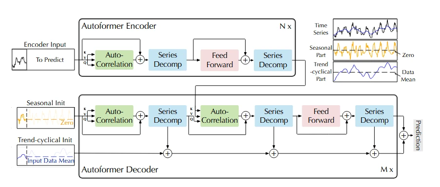
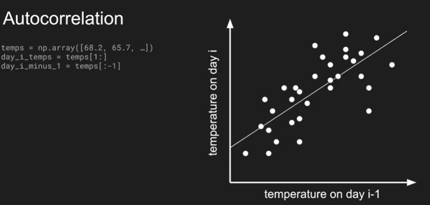
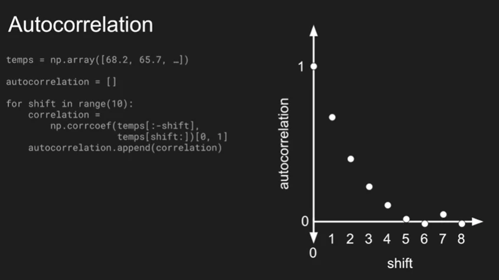
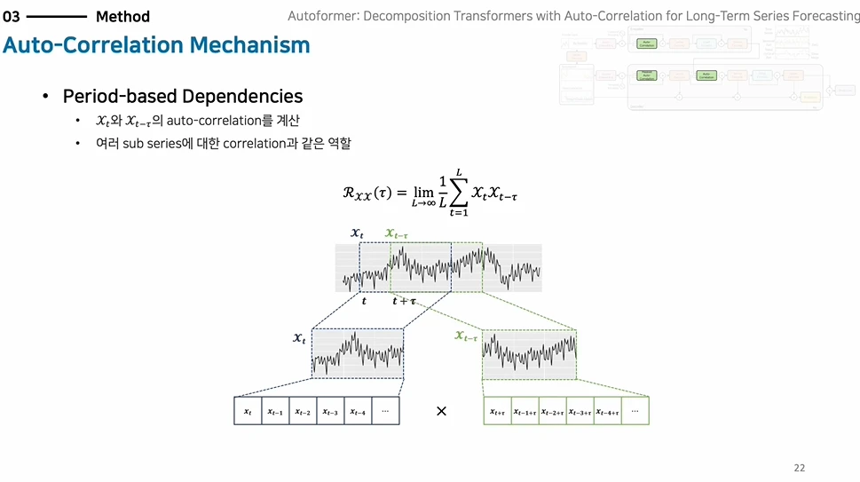
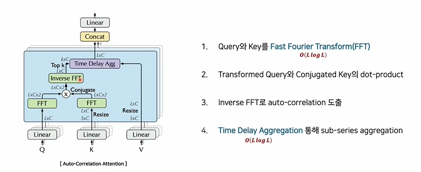
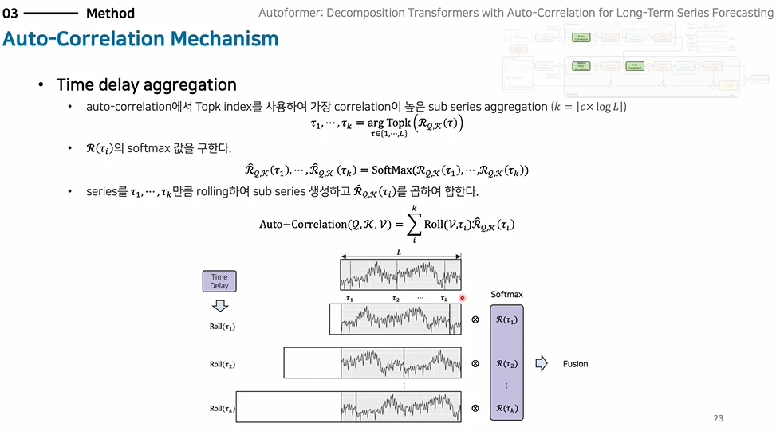
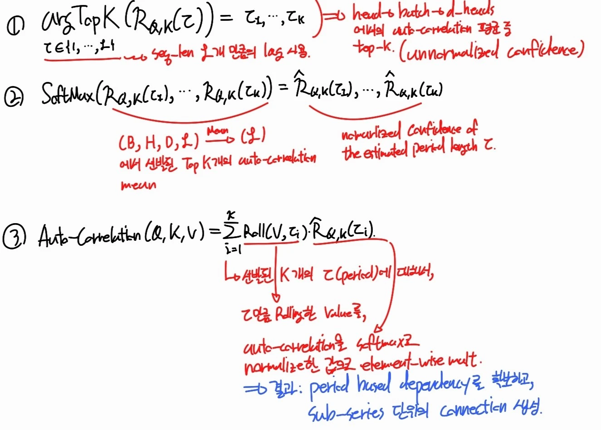

# Autoformer: 분해 구조와 Auto-Correlation을 코드로 따라가기

작성일 2025-01-21 · 최종 수정일 2025-01-22
{ .post-date }

[Informer](2025-01-15-informer.md) 다음으로 읽은 Autoformer(Autoformer: Decomposition Transformers with Auto-Correlation for Long-Term Series Forecasting, NeurIPS 2021)를 정리한 글이다. Informer를 비롯한 sparse attention 계열이 "시점 단위로 일부만 골라 본다"는 방식이었다면, Autoformer는 self-attention을 아예 다른 연산으로 바꾼다. 시계열의 주기성에 기반한 Auto-Correlation이다.

이틀에 걸쳐 세 단계로 읽었다.

1. Abstract, Introduction, Conclusion만 읽고 논문의 주장을 파악했다.
2. Related Work와 모델 구조(3장)를 식 단위로 따라가며 모르는 것을 질문으로 적었다.
3. Auto-Correlation이 식만으로는 이해되지 않아, 자기상관의 개념을 따로 정리하고 공식 구현에 tensor의 shape을 찍어 보며 연산을 한 단계씩 추적했다.

이 글의 중심은 3번이다. 논문의 식 세 줄이 실제로는 어떤 평균과 어떤 가중합으로 구현되어 있는지를 shape으로 확인한 과정을 적었다. 읽으며 생긴 질문은 본문 곳곳에 그대로 두었고, 끝에서 답을 찾은 것과 찾지 못한 것을 나누어 정리했다. 실험(4장)은 다루지 않는다.

## 1. 논문의 주장

### 문제

실용적인 목적에서 시계열의 예측 길이를 늘리는 것은 매우 중요하다. 기존 Transformer 기반 모델은 self-attention으로 long-range dependency를 잡으려 했지만 두 가지 문제가 있다.

- **얽힌 temporal pattern.** 긴 미래를 예측할 때에는 여러 temporal pattern이 복잡하게 얽혀(entangled) 있어서, 거기서 믿을 만한 dependency를 직접 찾아내기 어렵다.
- **Sparse attention의 병목.** Self-attention의 quadratic 연산 때문에 여러 sparse attention이 제안되었다. 그러나 이들은 여전히 시점 단위(point-wise)로 dependency를 찾고 정보를 모으며, 그중 일부만 골라 쓰기 때문에 정보 활용에 병목(information utilization bottleneck)이 생긴다.

Sparse attention이 왜 병목인지는 이렇게 이해했다. 들어온 정보 가운데 일부를 선별해서 처리하므로, 선별에서 빠진 정보는 쓰이지 못한다. Temporal dependency를 제대로 잡지 못한다면 주어진 정보를 더 잘 해석해야 하는데, 오히려 정보를 버리고 있는 것이다.

### 제안

Autoformer는 두 가지를 제안한다.

- **분해 구조(decomposition architecture).** 시계열 분해를 전처리로만 쓰지 않고, 모델 내부의 기본 블록으로 넣는다. 모델이 예측을 만들어 가는 동안 hidden series를 계속 분해하는 점진적 분해(progressive decomposition) 능력을 갖게 된다.
- **Auto-Correlation mechanism.** 확률 과정 이론에서 착안해, 시계열의 주기성에 기반해 sub-series 단위로 dependency를 찾고 representation을 모은다. Self-attention 계열을 대체하며, 계산 효율과 정보 활용을 동시에 개선한다. 복잡도는 $O(L \log L)$이다.

논문은 6개 벤치마크의 장기 예측 설정에서 38%의 상대적 성능 향상을 보고한다.

첫 번째 읽기에서 남긴 질문은 세 가지였다. Sub-series 단위로 dependency를 찾는다면 global dependency는 어떻게 되는가. "예측 결과에 대해 분해를 적용한다"는 것이 무슨 뜻인가. Progressive decomposition이 무엇인가. 뒤의 두 가지는 두 번째 읽기에서 풀렸다.

## 2. 관련 연구

### 시계열 예측 모델

논문이 정리하는 흐름은 다음과 같다.

- ARIMA는 차분으로 비정상 과정을 정상 과정으로 바꾼다.
- RNN 계열은 시계열의 temporal dependency를 모델링한다. DeepAR은 auto-regressive 방식과 RNN을 결합해 미래 시계열의 확률 분포를 모델링한다. LSTNet은 CNN에 recurrent-skip connection을 더해 단기와 장기의 temporal pattern을 잡는다. Attention 기반 RNN은 long-range dependency를 잡는 데 temporal attention을 쓴다.
- Temporal Convolution Network(TCN)는 causal convolution으로 시간적 인과를 모델링한다.

이 모델들은 recurrent connection, temporal attention, causal convolution으로 temporal relation을 모델링한다. Transformer의 self-attention을 장기 예측에 쓰려면 시퀀스 길이 $L$에 대한 메모리와 시간의 quadratic 복잡도가 걸림돌이 된다.

| 모델 | 방법 | 복잡도 |
|---|---|---|
| LogTrans | Local convolution, LogSparse attention | $O(L (\log L)^2)$ |
| Reformer | Locality-sensitive hashing(LSH) attention | $O(L \log L)$ |
| Informer | KL divergence 기반 ProbSparse attention | $O(L \log L)$ |

세 모델 모두 sparse attention으로 효율을 높였지만, 시점 단위의 dependency와 aggregation이라는 틀은 그대로다. Autoformer의 Auto-Correlation은 시계열에 내재한 주기성에 기반해 series 단위의 연결을 만든다. 병목을 없애고 sparse attention이 쓰지 못한 정보를 쓰겠다는 것이다.

### 시계열 분해

시계열 분해는 시계열을 몇 개의 성분으로 나누는 것이다. 각 성분은 trend, seasonality처럼 시계열에 내재한 패턴 하나를 나타내므로 더 예측하기 쉽다.

지금까지 분해는 예측 전에 과거 시계열에 적용하는 전처리로만 쓰였다. Prophet은 trend-seasonality 분해를, N-BEATS는 basis expansion을, DeepGLO는 matrix decomposition을 쓴다. 논문은 이런 전처리가 과거 시계열의 분해에만 머물러, 긴 미래에서 나타나는 패턴 사이의 계층적 상호작용을 놓친다고 지적한다.

이 대목은 "과거뿐 아니라 미래의 시계열도 분해해야 한다"는 주장으로 읽었다. 그런데 미래의 값은 모르는데 어떻게 분해하는가. 논문의 답은 이렇다. 미래를 직접 분해할 수는 없으므로, 예측을 만들어 가는 과정에서 hidden series를 점진적으로 분해한다. 분해의 대상에는 과거 시계열뿐 아니라 예측의 중간 결과도 포함된다. 첫 번째 읽기에서 이해하지 못했던 progressive decomposition이 바로 이것이다.

## 3. 분해 구조

Autoformer는 encoder-decoder 구조다. Vanilla Transformer와 비교하면 self-attention 자리에 Auto-Correlation이 들어가고, 각 연산 뒤에 series decomposition block이 붙는다. Feed-forward와 residual connection은 그대로 쓴다.



위가 encoder, 아래가 decoder다. 초록 상자가 Auto-Correlation, 파란 상자가 series decomposition block, 분홍 상자가 feed-forward다. 파란 상자가 연산 하나가 끝날 때마다 붙어 있다는 것, 그리고 decoder의 파란 상자에서 아래로 내려온 화살표들이 맨 아래 줄에서 차례로 더해진다는 것을 먼저 보면 된다. 출처: 논문 Figure 1

이 절의 나머지는 이 그림을 부분별로 읽는 것이다. 흐름은 두 갈래다. 상자들을 가로로 지나가는 위쪽 줄은 seasonal 성분이 다듬어지는 길이고, decoder 맨 아래의 줄은 분해 블록이 떼어 낸 trend-cyclical 성분이 쌓이는 길이다. 두 줄은 맨 오른쪽에서 더해져 예측이 된다. 그림 오른쪽 위의 작은 그래프 세 개는 분해가 무엇을 하는지를 보여 준다. 시계열 하나가 0을 중심으로 진동하는 seasonal 부분과, 데이터의 평균 근처에서 완만하게 움직이는 trend-cyclical 부분으로 나뉜다.

### Series decomposition block

시계열을 trend-cyclical 성분과 seasonal 성분으로 나눈다. Trend-cyclical은 장기간에 걸친 점진적 변화, 곧 추세이고, seasonal은 주기적으로 반복되는 패턴이다. Moving average로 주기적인 변동을 평탄화해 장기 추세를 드러내고, 원래 시계열에서 그것을 뺀 나머지를 seasonal 성분으로 둔다.

$$
\mathcal{X}_t = \mathrm{AvgPool}(\mathrm{Padding}(\mathcal{X})), \qquad
\mathcal{X}_s = \mathcal{X} - \mathcal{X}_t
$$

$\mathcal{X}_s, \mathcal{X}_t \in \mathbb{R}^{L \times d}$는 각각 seasonal 성분과 trend-cyclical 성분이다. 시퀀스의 길이가 바뀌지 않도록 padding을 한 뒤 average pooling을 적용한다. 이 연산을 $\mathcal{X}_s, \mathcal{X}_t = \mathrm{SeriesDecomp}(\mathcal{X})$로 줄여 쓴다.

이 블록은 예측 과정에서 얻는 중간 hidden variable에 반복해서 적용되어, 장기적이고 안정적인 추세를 조금씩 뽑아낸다. 미래의 시계열을 한 번에 분해할 수는 없으니, 조금씩 분해하면서 정보를 쌓아 가겠다는 것이다.

여기서 생긴 질문들이다.

- "주기적인 변동을 평탄화한다"는 것은 noise를 없애고 그 결과로 trend를 뽑는다는 뜻인가. 그렇게 이해했지만 확신하지는 못했다.
- 논문은 뽑아내는 추세를 stationary하다고 표현한다. 그렇다면 non-stationarity는 어떻게 반영되는가.
- Attention이 층에 따라 다른 것을 보듯이, decomposition block도 앞쪽 층에서는 긴 주기를, 뒤쪽 층에서는 짧은 주기를 뽑아낼까. 층마다 뽑히는 주기성의 의미를 해석하려는 시도는 없었을까.

### 모델의 입력

Encoder의 입력 $\mathcal{X}_{en} \in \mathbb{R}^{I \times d}$는 길이 $I$의 과거 시계열이다. Decoder는 seasonal 부분 $\mathcal{X}_{des}$와 trend-cyclical 부분 $\mathcal{X}_{det}$를 따로 받고, 둘 다 길이는 $\frac{I}{2} + O$다. $O$는 예측 길이다.

$$
\begin{aligned}
\mathcal{X}_{ens}, \mathcal{X}_{ent} &= \mathrm{SeriesDecomp}\big(\mathcal{X}_{en\,\frac{I}{2}:I}\big) \\
\mathcal{X}_{des} &= \mathrm{Concat}(\mathcal{X}_{ens}, \mathcal{X}_{0}) \\
\mathcal{X}_{det} &= \mathrm{Concat}(\mathcal{X}_{ent}, \mathcal{X}_{Mean})
\end{aligned}
$$

구조 그림의 왼쪽에 있는 입력 세 개가 이 식에 해당한다. Encoder Input은 과거 시계열 전체이고, 그 아래의 Seasonal Init과 Trend-cyclical Init이 decoder의 두 입력이다. 두 입력 모두 점선의 왼쪽에는 실제 곡선이, 오른쪽에는 평평한 선이 그려져 있다.

Decoder 입력의 앞부분(점선의 왼쪽)은 encoder 입력의 뒤쪽 절반($I/2$)을 분해한 것으로, 가장 최근의 정보를 담는다. 뒷부분(예측할 구간, 점선의 오른쪽)은 scalar placeholder로 채운다. $\mathcal{X}_0$은 0으로, $\mathcal{X}_{Mean}$은 encoder 입력의 평균으로 채운 것이다. 그림에서 Seasonal Init의 평평한 선에 Zero, Trend-cyclical Init의 평평한 선에 Input Data Mean이라고 적혀 있는 것이 이것이다. 식은 뒤쪽 절반을 잘라 분해하는 것으로 적혀 있지만, 공식 코드는 순서가 반대다. Encoder 입력 전체를 먼저 분해한 뒤 두 성분에서 마지막 `label_len` 구간을 잘라 쓴다.

- 왜 절반만 넣는가. 논문에 이유가 설명되어 있는지 찾지 못했다.
- 예측 구간을 scalar로 채우는 이유, 특히 trend 쪽에 encoder 입력의 평균을 넣는 이유도 알지 못했다.

### Encoder

구조 그림의 위쪽 상자다. Auto-Correlation → Series Decomp → Feed Forward → Series Decomp 순서로 지나가고, 이 묶음을 $N$번 반복한다. 두 분해 블록에서 아래로 나가는 화살표가 없다는 점이 decoder와 다르다. 떼어 낸 trend를 쓰지 않는다는 뜻이다.

Encoder는 seasonal 부분을 모델링하는 데 집중한다. Encoder의 출력은 과거의 seasonal 정보를 담고 있고, decoder에서 cross 정보로 쓰여 예측을 다듬는 데 도움을 준다. Encoder layer가 $N$개일 때 $l$번째 layer는 $\mathcal{X}_{en}^{l} = \mathrm{Encoder}(\mathcal{X}_{en}^{l-1})$이고, 안에서 일어나는 일은 다음과 같다.

$$
\begin{aligned}
\mathcal{S}_{en}^{l,1},\ \_ &= \mathrm{SeriesDecomp}\Big(\mathrm{AutoCorrelation}(\mathcal{X}_{en}^{l-1}) + \mathcal{X}_{en}^{l-1}\Big) \\
\mathcal{S}_{en}^{l,2},\ \_ &= \mathrm{SeriesDecomp}\Big(\mathrm{FeedForward}(\mathcal{S}_{en}^{l,1}) + \mathcal{S}_{en}^{l,1}\Big)
\end{aligned}
$$

- "$\_$"는 분해에서 나온 trend 성분을 버린다는 표시다. Encoder는 seasonal 성분만 다음으로 넘긴다.
- $\mathcal{X}_{en}^{l} = \mathcal{S}_{en}^{l,2}$, 곧 두 번째 분해의 seasonal 성분이 $l$번째 layer의 출력이다.
- $\mathcal{X}_{en}^{0}$은 $\mathcal{X}_{en}$을 $d_{model}$ 차원으로 embedding한 것이다.
- $\mathcal{S}_{en}^{l,i}$ ($i \in \{1, 2\}$)는 $l$번째 layer에서 $i$번째 분해 블록을 거친 seasonal 성분이다.

왜 encoder에서는 trend-cyclical 성분을 쓰지 않고 seasonal 성분만 쓰는가. Encoder에서는 추세를 걷어 낸 안정적인 부분을 파악하는 것이 더 중요하다는 뜻인가. 그렇다면 왜 그런지는 찾지 못했다.

### Decoder

구조 그림의 아래쪽 상자다. Encoder보다 Auto-Correlation이 하나 더 있고, 분해 블록마다 아래로 내려가는 화살표가 있다.

Decoder는 두 부분으로 이루어진다. Trend-cyclical 성분을 누적해 가는 구조(그림의 맨 아래 줄)와, seasonal 성분을 위해 쌓은 Auto-Correlation(위쪽 줄)이다. Decoder layer 하나에는 Auto-Correlation이 두 번 들어간다. 하나는 decoder 자신에 대한 것(inner Auto-Correlation)으로 예측을 다듬고, 다른 하나는 encoder의 출력을 참고하는 것(encoder-decoder Auto-Correlation)으로 과거의 seasonal 정보를 활용한다. 그림에서 encoder의 오른쪽 끝에서 나온 선이 decoder의 두 번째 초록 상자로 들어가는 것이 뒤의 것이다.

Decoder layer가 $M$개일 때 $l$번째 layer는 $\mathcal{X}_{de}^{l} = \mathrm{Decoder}(\mathcal{X}_{de}^{l-1}, \mathcal{X}_{en}^{N})$이다. $\mathcal{X}_{en}^{N}$은 encoder의 최종 출력이다.

$$
\begin{aligned}
\mathcal{S}_{de}^{l,1},\ \mathcal{T}_{de}^{l,1} &= \mathrm{SeriesDecomp}\Big(\mathrm{AutoCorrelation}(\mathcal{X}_{de}^{l-1}) + \mathcal{X}_{de}^{l-1}\Big) \\
\mathcal{S}_{de}^{l,2},\ \mathcal{T}_{de}^{l,2} &= \mathrm{SeriesDecomp}\Big(\mathrm{AutoCorrelation}(\mathcal{S}_{de}^{l,1}, \mathcal{X}_{en}^{N}) + \mathcal{S}_{de}^{l,1}\Big) \\
\mathcal{S}_{de}^{l,3},\ \mathcal{T}_{de}^{l,3} &= \mathrm{SeriesDecomp}\Big(\mathrm{FeedForward}(\mathcal{S}_{de}^{l,2}) + \mathcal{S}_{de}^{l,2}\Big) \\
\mathcal{T}_{de}^{l} &= \mathcal{T}_{de}^{l-1} + \mathcal{W}_{l,1} * \mathcal{T}_{de}^{l,1} + \mathcal{W}_{l,2} * \mathcal{T}_{de}^{l,2} + \mathcal{W}_{l,3} * \mathcal{T}_{de}^{l,3}
\end{aligned}
$$

- $\mathcal{X}_{de}^{l} = \mathcal{S}_{de}^{l,3}$이 $l$번째 layer의 출력이다. Encoder와 마찬가지로 마지막 분해의 seasonal 성분이다.
- $\mathcal{X}_{de}^{0}$은 $\mathcal{X}_{des}$를 embedding한 것이고, $\mathcal{T}_{de}^{0} = \mathcal{X}_{det}$는 trend 누적의 초깃값이다.
- $\mathcal{S}_{de}^{l,i}$, $\mathcal{T}_{de}^{l,i}$ ($i \in \{1, 2, 3\}$)는 $i$번째 분해 블록을 거친 seasonal 성분과 trend-cyclical 성분이다.
- $\mathcal{W}_{l,i}$는 $i$번째로 뽑힌 trend $\mathcal{T}_{de}^{l,i}$에 적용하는 projector다. 논문의 식은 trend마다 projector를 따로 두지만, 공식 코드는 decoder layer마다 세 trend를 먼저 더한 뒤 projection 하나를 적용한다.

식의 네 줄을 그림에 대응시키면 이렇다. 앞의 세 줄은 파란 상자 세 개이고, 각 상자에서 오른쪽으로 나가는 것이 seasonal 성분 $\mathcal{S}_{de}^{l,i}$, 아래로 내려가는 것이 trend 성분 $\mathcal{T}_{de}^{l,i}$다. 마지막 줄은 맨 아래 줄의 덧셈 기호 세 개다. Trend-cyclical Init에서 출발한 값에 세 trend가 차례로 더해진다.

최종 예측은 분해된 두 성분의 합이다.

$$
\mathcal{W}_{\mathcal{S}} * \mathcal{X}_{de}^{M} + \mathcal{T}_{de}^{M}
$$

$\mathcal{W}_{\mathcal{S}}$는 seasonal 성분을 목표 차원으로 보내는 projection이다. Trend에 쓰인 projector $\mathcal{W}_{l,i}$와는 다른 linear layer다.

모델은 이렇게 중간 hidden variable에서 잠재적인 trend를 뽑아낼 때마다 누적한다. 논문에 따르면 이는 trend 예측을 점진적으로 다듬는 동시에, Auto-Correlation이 주기 기반의 dependency를 찾을 때 방해가 되는 정보를 제거하는 역할을 한다.

Decoder에서 생긴 질문들이다.

- Trend를 계속 뽑아서 더해 나가는 것이 어떻게 도움이 되는가. 더하기만 하면 잘못 뽑힌 값을 되돌릴 수 없으니 오류가 누적될 수도 있지 않은가. 이전 layer의 trend에 더해 가는 것은 residual connection처럼 점진적으로 개선하려는 의도로 보이지만 확인하지 못했다.
- Trend에 projector가 왜 필요한가. 코드를 확인해 보니 최종 출력에서 두 성분을 더할 때 크기를 맞추기 위한 projection은 필요했다. Decoder 내부의 trend 하나하나에도 projection이 필요한 이유는 정확히 알지 못했다.
- Decoder의 첫 번째 Auto-Correlation은 무엇에 대해 구하는가. 이 질문은 5절의 코드 추적에서 풀렸다.
- Auto-Correlation과 "주기 기반의 dependency"가 무슨 관계인가. 이것이 다음 절의 주제다.

## 4. Auto-Correlation

Auto-Correlation은 식만 보아서는 이해되지 않았다. 그래서 다음 날 자기상관의 개념부터 다시 정리했다.

### 자기상관

Correlation은 선형 회귀와 닮았다. 두 변수의 산점도에 편차를 최소화하는 직선을 그었을 때, 점들이 그 직선에 얼마나 가깝게 붙어 있는지를 나타낸다. 보통 $R$로 쓰고, 0.9를 넘으면 높은 상관, 0.4 ~ 0.7이면 중간 정도, 0에 가까우면 상관이 없으며, 음수이면 음의 상관이다.

자기상관(auto-correlation)은 자기 자신과의 correlation이다. 시계열을 일정한 시차(lag)만큼 민(shift) 것과 원래 시계열의 correlation을 구한다. 예를 들어 기온 데이터와 그것을 하루 민 데이터는 상관이 높을 가능성이 크다. 기온은 날마다 변하지만, 한 주나 한 달 뒤와 비교했을 때만큼 크게 변하지는 않기 때문이다.



가로축이 전날($i-1$)의 기온, 세로축이 당일($i$)의 기온이다. 점 하나가 연속한 이틀이고, 점들이 오른쪽 위로 올라가는 직선 주위에 모여 있다. 두 변수가 따로 있는 것이 아니라, 왼쪽의 코드처럼 기온 배열 하나를 한 칸 어긋나게 잘라 둘로 만든 것이다. 출처: 자기상관 강의 화면

시차를 하루로 한정할 이유는 없다. 시차를 바꿔 가며 자기상관을 구하면 자기상관은 시차의 함수가 되고, 이것이 자기상관 함수(ACF)다.



위의 산점도 하나가 이 그래프의 점 하나가 된다. 가로축이 시차(shift), 세로축이 그 시차에서의 자기상관이다. 시차 0에서 1이고, 시차가 커질수록 0에 가까워진다. 출처: 자기상관 강의 화면

ACF를 보면 시계열의 주기를 더 넓은 관점에서 판단할 수 있다. 주기가 반복되는 시차에서는 상관이 높게 나오기 때문이다. 시차가 0이면 자기 자신과의 상관이므로 1이 되는 것과 같은 원리다.

ACF는 직접적인 영향과 간접적인 영향을 함께 반영한다. 이번 달의 생선 가격이 두 달 전의 가격과 상관이 있다고 할 때, 두 달 전의 가격이 이번 달에 직접 영향을 준 것일 수도 있고, 두 달 전 → 한 달 전 → 이번 달로 이어진 간접적인 영향일 수도 있다. 부분 자기상관 함수(PACF)는 중간 시점을 거치는 간접적인 영향을 빼고 직접적인 영향만 보는 방법이다.

### Time-delay similarity

논문의 time-delay similarity는 시계열과 그것을 $\tau$만큼 지연시킨 시계열 사이의 유사도다.

$$
\mathcal{R}_{\mathcal{XX}}(\tau) = \lim_{L \to \infty} \frac{1}{L} \sum_{t=1}^{L} \mathcal{X}_t\, \mathcal{X}_{t-\tau}
$$



같은 시계열에서 파란 상자($\mathcal{X}_t$)와, 그것을 $\tau$만큼 옮긴 초록 상자($\mathcal{X}_{t-\tau}$)를 잘라 낸다. 아래쪽에서 두 구간을 칸칸이 나란히 놓고 같은 자리끼리 곱하는 것이 식의 $\mathcal{X}_t\, \mathcal{X}_{t-\tau}$다. 출처: Autoformer 논문 해설 세미나 슬라이드

앞의 기온 예에서 배열 하나를 한 칸 어긋나게 잘라 둘로 만든 것과 같은 일이다. 다만 어긋나는 폭이 $\tau$이고, 점 하나하나가 아니라 구간 전체를 맞대어 본다. 슬라이드가 이것을 "여러 sub-series에 대한 correlation과 같은 역할"이라고 적은 이유다.

길이 $L$인 시퀀스에서 시차 $\tau$만큼 떨어진 모든 시점 쌍의 곱을 구해 평균한 값이다. 한 주기 안의 패턴은 계속 반복되므로, 지연시킨 시계열과의 상관을 구하면 반복되는 패턴을 효과적으로 찾을 수 있다. 시차를 바꿔 가며 자기상관을 계산하면 주기가 어떻게 구성되어 있는지를 알아낼 수 있다는 뜻이다. 앞에서 남긴 질문, 곧 Auto-Correlation과 주기 기반 dependency의 관계가 이것이다. $\mathcal{R}(\tau)$가 큰 $\tau$는 데이터의 실제 주기일 가능성이 높다.

### FFT로 한 번에 구하기

위 식을 그대로 계산하면, 시차 하나마다 시계열을 밀어서 전체 길이에 대해 곱하고 더해야 한다. 모든 시차에 대해 하면 시간 복잡도가 $O(N^2)$이다. 논문은 FFT(Fast Fourier Transform)를 써서 이를 훨씬 빠르게 구한다.

1. 시계열을 FFT로 주파수 영역으로 옮긴다.
2. 주파수 영역에서 자기 자신의 켤레 복소수(complex conjugate)와 원소별로 곱한다.
3. Inverse FFT로 시간 영역으로 되돌린다.

$$
\mathcal{R}(\tau) = \mathrm{IFFT}\big(\mathrm{FFT}(x) \cdot \mathrm{FFT}(x)^{*}\big)
$$

Fourier 변환의 크기를 제곱하면 주파수별 에너지인 전력 스펙트럼 밀도가 되고, 전력 스펙트럼 밀도의 inverse Fourier 변환은 자기상관의 시간 평균과 같다는 관계를 이용한 것이다. 복잡도는 $O(L \log L)$이다. 그리고 이 계산은 시차 하나가 아니라 모든 시차에 대한 자기상관을 한 번에 내놓는다. 시차마다 반복할 필요가 없다.

### Auto-Correlation block

Auto-Correlation block은 attention처럼 query, key, value를 입력으로 받는다. 구조 그림의 초록 상자 하나를 열어 보면 다음과 같다.



왼쪽 그림을 아래에서 위로 읽는다. Q와 K는 가운데의 곱셈(⊗)으로 모이고, V는 오른쪽으로 돌아 맨 위의 Time Delay Agg로 바로 들어간다. Q와 K는 "어느 시차를 쓸지"를 정하는 데만 쓰이고, 실제로 모아지는 것은 V라는 뜻이다. 출처: Autoformer 논문 해설 세미나 슬라이드(왼쪽 그림은 논문 Figure 2)

그림의 상자를 아래에서부터 따라가면 네 단계가 된다.

1. Query와 key를 각각 FFT한다(초록색 FFT 상자 두 개).
2. FFT한 query와, FFT한 key의 conjugate를 원소별로 곱한다(⊗).
3. Inverse FFT로 auto-correlation을 얻는다.
4. Auto-correlation이 큰 시차 $k$개를 고르고(Top k), 그 시차만큼 value를 민 것들을 가중합한다(Time Delay Agg, time delay aggregation).

K와 V 옆에 적힌 Resize는 key와 value의 길이를 query의 길이에 맞추는 단계다. 코드에서 무엇에 해당하는지는 글 끝의 "남았던 질문과 답"에서 다룬다.

Time delay aggregation의 식은 다음과 같다. $c$는 hyperparameter이고 $k = \lfloor c \times \log L \rfloor$이다.

$$
\begin{aligned}
\tau_1, \dots, \tau_k &= \underset{\tau \in \{1, \dots, L\}}{\arg\mathrm{Topk}} \big(\mathcal{R}_{\mathcal{Q},\mathcal{K}}(\tau)\big) \\
\hat{\mathcal{R}}_{\mathcal{Q},\mathcal{K}}(\tau_1), \dots, \hat{\mathcal{R}}_{\mathcal{Q},\mathcal{K}}(\tau_k) &= \mathrm{SoftMax}\big(\mathcal{R}_{\mathcal{Q},\mathcal{K}}(\tau_1), \dots, \mathcal{R}_{\mathcal{Q},\mathcal{K}}(\tau_k)\big) \\
\mathrm{AutoCorrelation}(\mathcal{Q}, \mathcal{K}, \mathcal{V}) &= \sum_{i=1}^{k} \mathrm{Roll}(\mathcal{V}, \tau_i)\, \hat{\mathcal{R}}_{\mathcal{Q},\mathcal{K}}(\tau_i)
\end{aligned}
$$



세 식을 한 장에 그린 슬라이드다. 맨 위가 길이 $L$인 원래 시계열이고, 그 아래의 줄들이 같은 시계열을 $\tau_1, \tau_2, \dots, \tau_k$만큼 옆으로 민 것이다. 줄마다 오른쪽의 $\mathcal{R}(\tau_i)$(softmax를 거친 값)를 곱한 뒤 모두 더한다(Fusion). 출처: Autoformer 논문 해설 세미나 슬라이드

그림으로 보면 식이 하는 일은 단순하다. 주기만큼 민 시계열은 원래 시계열과 모양이 비슷하게 겹친다. 그렇게 겹치는 시계열 $k$개를 골라(첫째 식), 얼마나 잘 겹치는지에 따라 비중을 정하고(둘째 식), 비중대로 섞는다(셋째 식).

여기까지 읽고도 두 가지가 풀리지 않았다.

1. $\tau$는 어디서 어떻게 정해지는가. FFT를 적용하려면 $\tau$가 먼저 있어야 할 것 같은데, 이를 정하는 과정이 논문에 보이지 않는다.
2. 한 번의 연산으로 어떻게 여러 $\tau$에 대한 auto-correlation을 얻는가. 그러려면 FFT 기반 계산이 수많은 $\tau$에 대해 한꺼번에 이루어져야 한다.

"혹시 $\tau$를 미리 정하는 것이 아니라, 일단 계산해 놓고 거기서 찾는 것은 아닐까"라고 가정을 세웠고, 이를 코드로 확인했다.

## 5. 코드로 따라가기

공식 구현의 Auto-Correlation에 shape 출력을 넣고 작은 설정으로 실행했다.

```text
e_layers=2
d_layers=1
n_heads=2
d_model=16
d_ff=32
factor=3
```

Batch 크기는 128, 입력 길이는 96이다. $d_{model} = 16$을 head 2개로 나누므로 head 하나의 차원(이하 `d_heads`)은 8이다.

### 입력의 shape

| 위치 | queries | keys, values | head로 나눈 뒤 |
|---|---|---|---|
| Encoder의 Auto-Correlation | (128, 96, 16) | (128, 96, 16) | (128, 96, 2, 8) |
| Decoder의 첫 번째 Auto-Correlation | (128, 144, 16) | (128, 144, 16) | (128, 144, 2, 8) |
| Encoder-decoder Auto-Correlation | (128, 144, 16) | (128, 96, 16) | queries (128, 144, 2, 8), keys·values (128, 96, 2, 8) |

여기서 3절의 질문 하나가 풀렸다. Decoder의 첫 번째 Auto-Correlation은 query, key, value가 모두 길이 144의 decoder 입력이다. 곧 decoder 자기 자신에 대한 Auto-Correlation이다. 길이 144는 encoder 입력 길이 96의 절반 48에 예측 길이를 더한 $\frac{I}{2} + O$에 해당한다. 그리고 head가 2개로 나뉘는 것에서, Auto-Correlation도 multi-head로 수행된다는 것을 확인했다.

### 1단계: 모든 lag의 auto-correlation

Encoder 쪽을 기준으로 따라간다. Query와 key를 FFT하고, query와 key의 conjugate를 원소별로 곱한 뒤, inverse FFT를 하면 auto-correlation tensor `corr`가 나온다. Shape은 (128, 2, 8, 96)이다.

핵심은 마지막 축이다. `corr[:, :, :, t]`는 시차 $t$에 대한 auto-correlation 값이다. 길이가 96이면 가능한 시차 96개에 대한 결과가 한 번에 나온다. 앞의 가정이 맞았다. $\tau$를 미리 정하는 것이 아니라 가능한 모든 시차에 대해 일단 계산하고, 그 가운데 가장 그럴듯한 $\tau$를 고르는 것이다. 이렇게 고른 $\tau$들을 논문은 estimated period라고 부른다.

각 값의 의미도 정리했다. 시차 $\tau$에 대한 값 하나는, 그 시차를 시계열 전체에 걸쳐 적용한 결과를 함축하고 있다. 식으로 보면 모든 $t$에 대해 $x_t$와 $x_{t+\tau}$의 관계를 구해 평균한 것인데, FFT가 시계열 전체를 한 번에 처리하므로 시점마다 따로 계산할 필요가 없다.

이 단계에서 한참 헷갈렸던 것은 `d_heads` 때문이었다. (128, 2, 8, 96)에서 8이 무엇인지에 신경이 쏠렸는데, 그것은 embedding 차원이 생긴 것일 뿐이다. Batch, head, `d_heads`를 빼고 생각하면 결국 96개 시점의 query와 96개 시점의 key가 있는 것이고, 시차를 적용해 가며 그 둘의 상관을 구하는 것이다. (96, 8)로 놓고 보면 행 하나가 시차 하나에 대한 결과를 8차원으로 표현한 것이다.

### 2단계: top-k lag 고르기

논문에서는 $\arg\mathrm{Topk}$ 한 줄이지만, 코드에서는 그 앞에 평균을 내는 과정이 있다.

1. `corr` (128, 2, 8, 96)를 head 축과 `d_heads` 축에 대해 평균한다. → (128, 96)
2. 이를 다시 batch 축에 대해 평균한다. → 길이 96의 벡터
3. 이 96개 값 가운데 큰 순서로 `top_k`개의 index를 고른다.

모든 batch와 모든 head를 아울러 보고 어느 $\tau$가 가장 그럴듯한지를 평가하겠다는 뜻이다. `top_k`는 `factor * ln(seq_len)`의 정수 부분이다. 이 설정에서는 $3 \times \ln 96 \approx 13.7$이므로 13이다.

여기서 따라간 것은 학습할 때 쓰이는 경로(`time_delay_agg_training`)다. 공식 코드는 추론할 때 다른 함수(`time_delay_agg_inference`)를 쓰며, 이 경로에서는 batch 축의 평균을 내지 않고 (128, 96)에서 샘플마다 따로 `top_k`개의 시차를 고른다. 아래 3단계에서 말하는 "시차의 선택은 batch 공통"이라는 점도 학습 경로에만 해당한다.

### 3단계: 가중치 만들기

고른 13개의 시차를 얼마씩 반영할지 정하는 가중치를 만든다.

1. 2단계에서 batch 평균을 내기 전의 값, 곧 head와 `d_heads`에 대해서만 평균한 (128, 96)을 가져온다.
2. 여기서 `top_k`개의 index에 해당하는 값만 뽑는다. → (128, 13)
3. 샘플마다 13개 값에 softmax를 취한다. → (128, 13)

결과는 batch 안의 샘플마다 13개 시차에 대한 확률이다. 눈여겨본 점은 두 평균의 범위가 다르다는 것이다. 어떤 시차를 고를지는 batch 전체를 평균해 일반적으로 정하지만, 고른 시차를 얼마나 반영할지는 샘플마다 따로 정한다. 시차의 선택은 공통으로 하되 가중치는 샘플의 특성을 반영하겠다는 의도로 이해했다.

### 4단계: Time delay aggregation

마지막으로 value를 쓴다. Value의 shape은 (128, 2, 8, 96)이다.

```text
delays_agg = 0
top_k개의 시차 τ_i 각각에 대해:
    1. value를 시간 축으로 τ_i만큼 roll한다              (128, 2, 8, 96)
    2. 3단계의 가중치에서 τ_i에 해당하는 열을 가져와
       value와 같은 크기로 늘린다                        (128,) → (128, 2, 8, 96)
    3. 둘을 원소별로 곱해 delays_agg에 더한다
```

4절의 time delay aggregation 슬라이드에서 Roll($\tau_1$), Roll($\tau_2$), …로 그려진 줄 하나가 이 반복문의 한 번이다. `top_k`번을 돌고 나면 `delays_agg`는 서로 다른 시차만큼 민 value들을, 각 시차의 확률로 가중해 모두 더한 것이 된다. 이것이 Auto-Correlation block의 출력이다. Attention과 비교하면, attention은 시점마다 다른 시점의 value를 가중합하지만 Auto-Correlation은 통째로 민 시계열 여러 개를 가중합한다.

논문의 식 세 줄과 코드의 대응을 손으로 정리한 메모다.

{ width="640" }

*논문의 식 ① ~ ③에 코드에서 확인한 내용을 적어 넣었다. ①의 top-k는 head, `d_heads`, batch에 대한 auto-correlation 평균에서 고르고(정규화 전의 confidence), ②의 softmax는 고른 k개의 평균값을 정규화하며, ③에서 τ만큼 roll한 value에 그 값을 곱해 더한다.*

정리하면, Auto-Correlation은 시차 단위로 민 시계열을 정규화된 confidence로 모음으로써 주기 기반의 dependency를 확보하고 sub-series 단위의 연결을 만든다.

## 읽으며 생긴 질문과 찾은 답

| 질문 | 찾은 답 |
|---|---|
| Sparse attention은 왜 정보 병목인가 | 들어온 정보에서 일부를 선별해 처리하므로, 선별에서 빠진 정보는 쓰이지 못한다 |
| 미래의 시계열을 어떻게 분해하는가. Progressive decomposition이란 | 미래를 직접 분해하지 않는다. 예측을 만들어 가는 중간 hidden variable에 분해 블록을 반복 적용해 trend를 조금씩 뽑아 누적한다 |
| Auto-Correlation과 주기 기반 dependency의 관계 | 시차를 바꿔 가며 자기 자신과의 상관을 구하면 주기가 어떻게 구성되는지 알 수 있다. 상관이 큰 $\tau$가 실제 주기일 가능성이 높다 |
| $\tau$는 어디서 정하는가 | 미리 정하지 않는다. FFT로 가능한 모든 시차의 auto-correlation을 한 번에 구한 뒤 큰 것 `top_k`개를 고른다 |
| 한 번의 연산으로 어떻게 여러 $\tau$의 결과가 나오는가 | Inverse FFT의 출력에서 index가 곧 시차다. `corr[..., t]`가 시차 $t$의 값이다 |
| "대응되는 auto-correlation 값으로 가중한다"는 무슨 뜻인가 | 고른 시차들의 auto-correlation 평균에 softmax를 취해 확률로 만들고, 그 시차만큼 민 value에 곱한다 |
| Decoder의 첫 번째 Auto-Correlation은 무엇에 대한 것인가 | Query, key, value가 모두 decoder 입력이다. 자기 자신에 대한 것이다 |
| Auto-Correlation도 multi-head인가 | 그렇다. Head별로 나누어 계산한다 |
| 왜 "sub-series 단위" 연산이라고 하는가 | 시점 하나하나가 아니라 $\tau$만큼 통째로 민 시계열을 정규화된 confidence로 더한다. 합 연산이어서 gradient도 그 연결을 따라 나뉘어 전달되므로, sub-series 사이의 연결이라고 볼 수 있다고 생각했다 |

## 남았던 질문과 답

공부할 당시에는 풀지 못하고 남겨 둔 질문들이다. 글을 정리하면서 답을 찾아 덧붙였다.

**Q. Sub-series 단위로 dependency를 찾는다면 global dependency는 어디서 잡히는가.**

"Sub-series 단위"는 연결의 단위를 말하는 것이지, 보는 범위가 좁다는 뜻이 아니다. $\mathcal{R}(\tau)$는 정의에서 보듯 모든 $t$에 대해 더한 값이어서 시퀀스 전체로부터 계산되는 통계량이다. 시차의 후보도 논문의 식에서 $\tau \in \{1, \dots, L\}$ 전체이므로, 시차가 아무리 길어도 상관이 크면 선택된다. 그리고 time delay aggregation의 출력에서 위치 $t$에는 $\tau_1, \dots, \tau_k$만큼 떨어진 위치의 value가 모이므로, 큰 시차가 선택되면 그만큼 먼 곳의 정보가 한 번에 전달된다. 곧 global dependency는 "모든 시점 쌍 사이의 관계"가 아니라 "시퀀스 전체에서 추정한 주기"의 형태로 잡힌다. 논문은 이것을 point-wise 연결과 대비해 series-wise connection이라고 부른다. 반대로 선택된 $k$개의 시차에 해당하지 않는 두 시점은 이 연산 안에서 직접 연결되지 않는다.

**Q. N-BEATS의 basis expansion과 DeepGLO의 matrix decomposition은 구체적으로 무엇인가.**

N-BEATS는 fully connected layer로 이루어진 block을 쌓은 모델이다. N-BEATS 논문에 따르면 각 block은 예측 값을 직접 내지 않고 expansion coefficient $\theta^f$(forecast용)와 $\theta^b$(backcast용)를 내며, 출력은 basis vector들의 선형 결합이다.

$$
\hat{y} = \sum_{i} \theta^f_i\, v^f_i
$$

Basis $v_i$를 학습에 맡기는 구성(generic)과, 해석할 수 있도록 형태를 정해 두는 구성이 있다. 뒤의 구성에서는 trend를 맡는 stack에 낮은 차수의 다항식 basis를, seasonality를 맡는 stack에 Fourier basis를 쓴다. 계수만 학습하므로 출력이 "추세 + 계절성"으로 나뉘어 읽힌다.

DeepGLO는 시계열 $n$개를 행으로 쌓은 행렬 $Y \in \mathbb{R}^{n \times t}$를 저차원 행렬 두 개의 곱으로 분해한다.

$$
Y \approx F X, \qquad F \in \mathbb{R}^{n \times k}, \quad X \in \mathbb{R}^{k \times t}
$$

$X$의 행 $k$개는 모든 시계열이 공유하는 basis 시계열이고, $F$는 각 시계열이 그 basis를 얼마씩 섞어 쓰는지를 담는다. DeepGLO 논문은 $X$가 시간 구조를 갖도록 TCN으로 정규화하고(TCN-MF), 이 global 모델의 예측을 시계열별 TCN의 입력 covariate로 넣어 최종 예측을 낸다. Autoformer 논문은 Prophet과 함께 이 두 방법을 분해가 과거 시계열의 전처리로 쓰이는 예로 든다.

**Q. Series decomposition block이 뽑는 추세가 stationary하다면 non-stationarity는 어떻게 반영되는가.**

논문의 표현은 "long-term stationary trend"인데, 여기서 stationary가 무슨 뜻인지는 논문이 정의하지 않는다. 평균과 분산이 시간에 따라 변하지 않는다는 통계적 정상성으로 읽으면 추세라는 말과 맞지 않으므로, 나는 "길게 보아 안정적으로 이어지는 완만한 성분"이라는 뜻으로 읽었다. 이것은 내 해석이다.

구조에서 확인할 수 있는 것은 다음과 같다. 분해 블록은 moving average를 trend로 떼어 내고 나머지를 seasonal로 둔다. 수준(level)이 올라가거나 내려가는 움직임은 moving average를 따라 trend 쪽으로 들어가고, seasonal 쪽에는 0 근처에서 진동하는 성분이 남는다. Trend는 decoder에서 $\mathcal{T}_{de}^{l}$로 누적되어 최종 예측에 그대로 더해진다. 따라서 수준이 변하는 형태의 non-stationarity는 trend 경로가 싣고 가고, Auto-Correlation은 그것을 걷어 낸 seasonal 경로에서 주기를 찾는다. 분산이 변하는 것과 같은 다른 형태의 non-stationarity를 다루는 장치는 이 논문에 따로 없다. 같은 연구 그룹은 이후 Non-stationary Transformers(NeurIPS 2022)에서 이 문제를 별도로 다루었다.

**Q. 층에 따라 decomposition block이 뽑는 주기성이 달라지는가.**

설계상으로는 층마다 다른 규모를 뽑도록 만든 장치가 없다. 공식 코드에서 encoder와 decoder의 모든 분해 블록은 같은 moving average window(`moving_avg`, 기본값 25)를 쓴다. 층과 무관하게 같은 폭의 평균을 trend로 떼어 낸다는 뜻이다. 논문이 보여 주는 시각화도 층별 비교가 아니다. 본문의 그림은 마지막 decoder layer의 seasonal 성분과 trend 성분, 그리고 학습된 시차 가운데 상위 6개를 원래 시계열 위에 표시한 것이다. 층마다 실제로 어떤 시차가 선택되는지는 아래에 남겼다.

**Q. Decoder 입력에 encoder 입력의 뒤쪽 절반만 넣는 이유는 무엇인가. 예측 구간을 0과 평균으로 채우는 이유는 무엇인가.**

절반에 대해서는 논문 부록 C.2에 설명이 있다. 과거 정보를 붙이는 것은 decoder에 최근의 정보를 주기 위해서이고, 길이는 성능과 메모리 사이의 절충이다. ETT 데이터의 입력 96, 예측 336 설정에서 decoder 입력에 과거를 붙이지 않으면 MSE가 0.360, 절반을 붙이면 0.339, 전부 붙이면 0.333이고, 메모리는 3029MB, 3271MB, 3599MB로 늘어난다. 많이 붙일수록 좋아지지만 비용이 커져서 $\frac{I}{2} + O$로 정했다는 것이다. 코드에서는 이 길이가 `label_len`이라는 인자이고 절반으로 고정되어 있지는 않다. 덧붙이면 논문의 식은 뒤쪽 절반을 잘라 낸 뒤 분해하지만, 공식 코드는 encoder 입력 전체를 분해한 뒤 뒤쪽 `label_len`개를 잘라 쓴다.

Placeholder의 값을 왜 0과 평균으로 두는지는 논문에 설명이 없다. 구조에서 읽을 수 있는 것만 적는다. Seasonal 성분은 원래 시계열에서 moving average를 뺀 것이어서 0 근처에서 진동하므로, 아직 모르는 구간을 0으로 두는 것은 "변동 없음"에서 출발하는 셈이다. Trend 쪽의 $\mathcal{X}_{det}$는 누적의 초깃값 $\mathcal{T}_{de}^{0}$이고 각 layer가 뽑은 trend가 여기에 더해지므로, 평균으로 채우면 예측 구간의 trend가 입력의 평균 수준에서 출발해 보정된다. 예측 구간에 placeholder를 두고 한 번의 forward로 전체를 출력하는 방식 자체는 [Informer](2025-01-15-informer.md)의 decoder 입력과 같다.

**Q. Encoder가 seasonal 성분만 넘기고 trend를 버리는 이유는 무엇인가.**

논문은 "encoder는 seasonal 부분의 모델링에 집중하고, 그 출력은 과거의 seasonal 정보를 담아 decoder에서 cross 정보로 쓰인다"고만 적고 이유를 따로 설명하지 않는다. 구조를 보면 두 가지를 확인할 수 있다. 첫째, encoder의 출력이 쓰이는 곳은 encoder-decoder Auto-Correlation의 key와 value뿐이고, 이 연산은 주기 기반의 dependency를 찾는 연산이다. 논문은 decoder를 설명하면서 trend를 떼어 내는 것이 Auto-Correlation의 주기 탐색을 방해하는 정보를 없앤다고 말하는데, 같은 논리가 encoder에도 적용된다고 볼 수 있다. 둘째, 과거의 trend 정보가 사라지는 것은 아니다. Encoder 입력을 분해해 얻은 trend는 encoder를 거치지 않고 $\mathcal{X}_{det}$를 통해 decoder의 trend 누적에 바로 들어간다. Encoder 안에서 버려지는 것은 hidden 표현에서 다시 떼어 낸 trend다.

**Q. Trend를 layer마다 더해 가는 구조에서 오류가 누적되지는 않는가. Decoder 내부의 trend마다 projector가 필요한 이유는 무엇인가.**

Auto-regressive 예측에서 말하는 오류 누적과는 성격이 다르다. 그 경우에는 추론할 때 모델의 출력이 다시 입력으로 들어가서, 앞 단계의 오차가 뒤 단계의 입력을 오염시킨다. Autoformer의 trend 누적은 한 번의 forward 안에서 일어나는 덧셈이고, 더해지는 항 전체가 최종 예측의 손실 하나로 함께 학습된다. 각 항은 학습되는 projection을 거치므로 부호와 크기가 자유롭고, 뒤에 더해지는 항이 앞의 항을 보정하도록 학습될 수 있다. 당시에 짐작한 대로 residual connection과 같은 구조다. 논문은 이를 trend 예측을 점진적으로 다듬는 것이라고 설명하고, 분해 블록을 늘릴수록 trend가 실제에 가까워지는 그림을 근거로 든다. 논문의 실험 설정은 decoder layer가 1개여서, 실제로 더해지는 것은 초깃값과 한 layer에서 나온 trend 세 개다.

Projector는 차원을 맞추는 데 필요하다. 분해 블록이 내는 $\mathcal{T}_{de}^{l,i}$는 $d_{model}$ 차원의 hidden 표현이고, 누적되는 $\mathcal{T}_{de}^{l}$은 초깃값 $\mathcal{X}_{det}$와 같은 출력 변수의 차원 $d$를 갖는다. 그대로는 더할 수 없으므로 $d_{model} \to d$의 projection이 있어야 한다. 논문의 식은 trend마다 $\mathcal{W}_{l,i}$를 따로 적지만, 공식 코드는 layer마다 세 trend를 먼저 더한 뒤 projection 하나(kernel 크기 3의 1D convolution)를 적용한다. 세 trend에 같은 가중치를 쓰는 것과 같다.

**Q. Auto-Correlation의 평균으로 유사도를 계산할 때 음의 상관은 고려되는가.**

고려되지 않는다. 공식 코드는 head와 `d_heads`에 대해 평균한 auto-correlation 값을 부호가 있는 그대로 두고 큰 순서로 top-k를 고르므로, 음의 상관이 강한 시차는 순위에서 가장 뒤로 밀린다. 선택된 시차의 가중치도 softmax를 거치므로 항상 양수다. 논문도 "반대 위상을 고르지 않도록 가장 가능성이 높은 시차를 고른다"고 적어, 이것이 의도한 동작임을 밝힌다. 당시의 걱정대로 한 시차의 결과가 하나의 값으로 축약되는 것도 맞다. Channel과 head에 대해 평균을 내므로 부호가 엇갈리는 channel이 있으면 서로 상쇄된다. 논문 부록은 이 평균을 속도를 위한 단순화라고 설명한다.

다만 주기적인 신호에서는 음의 상관이 담는 규칙성이 양의 상관에 이미 들어 있다. 예를 들어 주기가 $P$인 사인파는 시차 $P/2$에서 음의 상관이 가장 강하고 시차 $P$에서 양의 상관이 가장 강한데, 둘은 같은 주기를 가리킨다. 그래서 반대 위상의 시차를 쓰지 않아도 주기 정보 자체는 잃지 않는다.

**Q. 논문의 그림에는 key와 value에 Resize가 표시되어 있다. 코드에서 그에 해당하는 연산은 무엇이고 왜 필요한가.**

논문 부록의 알고리즘은 "Resize는 truncation 또는 zero filling"이라고 적는다. 공식 코드에서는 `AutoCorrelation.forward`의 맨 앞에 있다. Query의 길이 $L$과 key·value의 길이 $S$를 비교해, $L > S$이면 key와 value의 뒤에 0을 붙여 길이를 $L$로 늘리고, 그렇지 않으면 앞의 $L$개만 남긴다. 필요한 이유는 뒤의 연산이 길이가 같아야만 성립하기 때문이다. 주파수 영역에서 query와 key를 원소별로 곱하려면 두 FFT의 길이가 같아야 하고, roll한 value를 더한 결과가 query와 같은 길이의 출력이 되어야 한다. Encoder와 decoder의 self Auto-Correlation에서는 $L = S$여서 아무 일도 일어나지 않으므로 눈에 띄지 않았던 것이다. 5절의 설정에서는 encoder-decoder Auto-Correlation에서만 길이 96인 key와 value 뒤에 0이 48개 붙어 144가 된다. 논문 본문은 "길이 $O$로 resize한다"고 쓰지만, 부록의 알고리즘과 코드는 query의 길이에 맞춘다.

**Q. Query와 key에 FFT를 적용하면 길이 축이 절반으로 줄어드는 이유는 무엇인가.**

코드가 쓰는 함수가 실수 입력 전용인 `rfft`이기 때문이다. 길이 $L$인 실수 신호의 이산 Fourier 변환 $X_0, \dots, X_{L-1}$은 켤레 대칭 $X_{L-f} = X_f^{*}$를 만족한다. 뒤쪽 절반은 앞쪽 절반의 켤레 복소수일 뿐이어서 새로운 정보가 없다. `rfft`는 중복되지 않는 $\lfloor L/2 \rfloor + 1$개만 돌려주므로 길이 96의 입력에서 49개의 복소수가 나온다. 줄어든 것은 주파수 축의 표현이고 정보는 그대로다. 곱셈을 마친 뒤 `irfft`에 원래 길이를 주면(`n=L`) 길이 96의 실수 시퀀스로 돌아오고, 그 index가 시차다.

**Q. Time delay aggregation에서 value를 roll하는 이유는 무엇인가. "같은 위상 위치"와 어떻게 연결되는가.**

Roll은 같은 위상에 있는 값을 같은 자리로 가져오는 연산이다. 공식 코드의 `torch.roll(values, -τ, dim=-1)`은 시퀀스를 $\tau$만큼 당겨서, 위치 $t$에 원래 $t + \tau$에 있던 값이 오게 한다. 끝에서 밀려난 값은 반대쪽 끝으로 들어온다. $\tau$가 주기라면 $t$와 $t + \tau$는 주기 안에서 같은 위치, 곧 같은 위상이다. 시간 단위 데이터에서 $\tau = 168$이면 월요일 오전 9시 자리에 다음 주 월요일 오전 9시의 값이 온다. 이렇게 민 시퀀스 $k$개를 가중합하면 위치 $t$의 출력은 다음과 같다.

$$
\sum_{i=1}^{k} \hat{\mathcal{R}}(\tau_i)\, \mathcal{V}_{t + \tau_i}
$$

모든 위치가 자기와 같은 위상에 있는 값 $k$개를 모으게 된다. Attention은 위치마다 어느 위치를 볼지를 따로 계산하지만, 여기서는 정렬을 roll이 맡으므로 가중치 $k$개를 모든 위치가 함께 쓴다. 논문이 이 연산을 "추정된 주기의 같은 위상 위치에 있는 비슷한 sub-series를 정렬한다"고 표현한 것이 이 뜻이다.

**Q. "Auto-correlation이 주기성에 대응하는 peak를 각 lag에서 찾아낸다"는 설명은 정확히 무슨 뜻인가.**

$\mathcal{R}(\tau)$를 시차 $\tau$의 함수로 그리면 주기에 해당하는 시차에서 값이 솟는다는 뜻이다. 주기가 24인 사인파 $x_t = \sin(2\pi t / 24)$를 예로 들면 $\mathcal{R}(\tau) = \tfrac{1}{2}\cos(2\pi \tau / 24)$이다. $\tau = 24, 48, 72$에서 최댓값(peak)이 되고, 반대 위상인 $\tau = 12, 36$에서 최솟값이 된다. 하루 주기와 일주일 주기가 함께 있는 시간 단위 데이터라면 24의 배수마다 peak가 서고 168에서 더 높은 peak가 선다. 곧 "각 lag에서 peak를 찾는다"는 것은 시차 축 위에서 peak가 서는 위치를 찾는다는 말이고, 그 위치가 추정된 주기다. Top-k 선택은 가장 높은 peak $k$개를 고르는 일이며, 논문은 이때의 $\mathcal{R}(\tau)$ 값을 그 주기에 대한 정규화 전의 confidence라고 부른다.

### 아직 남은 질문

- 층마다 Auto-Correlation이 고르는 시차가 실제로 달라지는지, 그리고 그 의미를 해석한 연구가 있는지는 확인하지 못했다. 학습된 모델에서 layer별로 선택된 top-k 시차와 가중치를 기록해 비교해 보아야 한다.
- 음의 상관이 강한 시차를 따로 활용하면 예측에 도움이 되는지는 알 수 없다. Top-k의 기준을 절댓값으로 바꾼 모델과 원래 모델을 같은 조건에서 비교하는 실험이 필요하다.

## 참고 자료

- Haixu Wu, Jiehui Xu, Jianmin Wang, Mingsheng Long. "Autoformer: Decomposition Transformers with Auto-Correlation for Long-Term Series Forecasting." NeurIPS 2021. [arXiv:2106.13008](https://arxiv.org/abs/2106.13008)
- [Autoformer 공식 구현 (thuml/Autoformer)](https://github.com/thuml/Autoformer). 5절의 shape 추적에 사용했다.
- Autoformer 논문 해설 세미나 슬라이드. Auto-Correlation의 단계 구분은 이 자료를 참고했다. 노트에 주소는 남아 있지 않다.
- 자기상관과 부분 자기상관을 설명한 영상 강의. 4절의 기온과 생선 가격 예시는 이 강의에서 가져왔다. 노트에 주소는 남아 있지 않다.
- Boris N. Oreshkin, Dmitri Carpov, Nicolas Chapados, Yoshua Bengio. "N-BEATS: Neural basis expansion analysis for interpretable time series forecasting." ICLR 2020.
- Rajat Sen, Hsiang-Fu Yu, Inderjit S. Dhillon. "Think Globally, Act Locally: A Deep Neural Network Approach to High-Dimensional Time Series Forecasting." NeurIPS 2019. (DeepGLO)
- Yong Liu 외. "Non-stationary Transformers: Exploring the Stationarity in Time Series Forecasting." NeurIPS 2022. [arXiv:2205.14415](https://arxiv.org/abs/2205.14415)
- Haoyi Zhou 외. "Informer: Beyond Efficient Transformer for Long Sequence Time-Series Forecasting." AAAI 2021. [arXiv:2012.07436](https://arxiv.org/abs/2012.07436)
