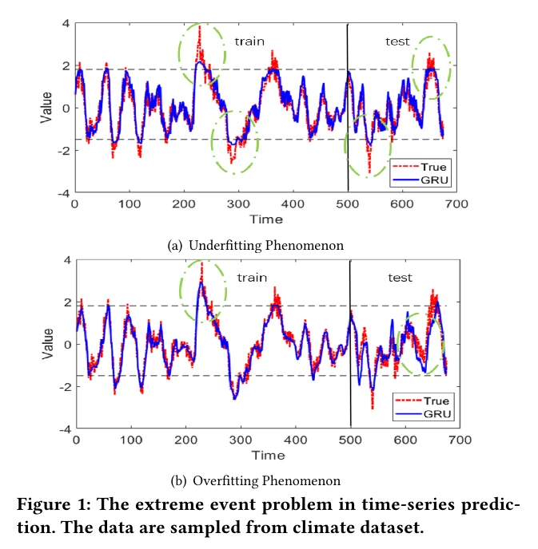
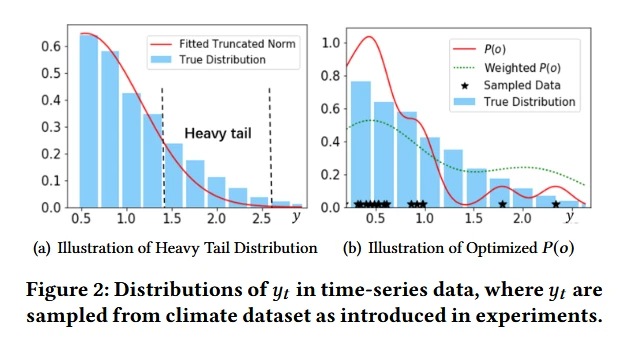
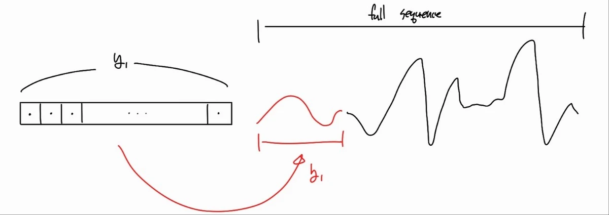
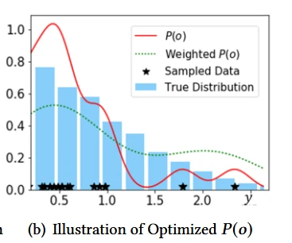
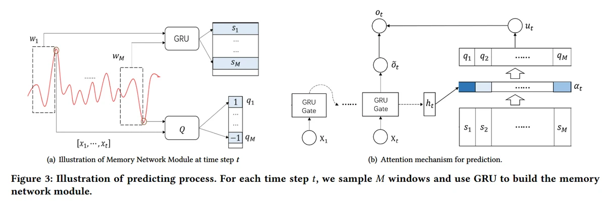

# Modeling Extreme Events in Time Series Prediction: MSE는 왜 극단값을 놓치는가

작성일 2025-02-04 · 최종 수정일 2025-03-26
{ .post-date }

"Modeling Extreme Events in Time Series Prediction"(Ding et al., KDD 2019)은 시계열 예측 모델이 극단적인 사건(extreme event)을 잘 맞추지 못하는 이유를 손실 함수에서 찾고, 이를 보완하는 손실 함수와 메모리 구조를 제안한 논문이다.

이 논문을 읽은 이유는 [DTF-net](2024-12-29-dtf-net.md) 때문이다. DTF-net은 "제곱합(sum-of-squares)을 최소화하는 방법은 꼬리가 가벼운 Gaussian 분포로 근사하므로 극단값을 지운다"는 주장을 trend filtering에 가져오는데, 그 근거가 이 논문이다. 그래서 방법보다 이론 부분, 즉 "MSE를 최소화하면 왜 극단값에서 underfitting이 생기는가"에 집중해서 읽었다.

읽은 과정은 다음과 같다.

| 시기 | 읽은 방식 |
|---|---|
| 2024-12-26 | DTF-net의 참고 문헌으로 도입부만 읽었다 |
| 2025-02-04 | 1차: 초록, 도입부, 결론. 2차: 2절(배경)과 3절(문제의 원인)을 식 단위로 따라갔다 |
| 2025-03-26 | 4절의 메모리 구조를 그림을 보며 다시 읽고 의문을 적었다 |

이 글이 다루는 범위는 1 ~ 3절의 이론과 4절의 메모리 구조 일부다. 제안된 손실 함수(Extreme Value Loss)의 식, 5절의 실험, 6절의 관련 연구는 정리하지 못했다.

## 요약

- 시계열 예측 연구는 대부분 extreme event의 존재를 간과한다.
- 논문은 흔히 쓰는 제곱 손실(quadratic loss)의 한계를 Extreme Value Theory(EVT)의 관점에서 설명한다.
- 미래의 extreme event를 감지하기 위한 Extreme Value Loss(EVL)를 제안한다.
- 과거의 extreme event를 기억하는 Memory Network 구조를 제안한다.
- 둘을 결합해 extreme event가 있는 시계열을 예측하는 end-to-end 프레임워크를 만들고, 합성 데이터와 주식, 기후 데이터에서 효과를 보인다.

## 1. 문제: 데이터 불균형으로서의 extreme event

RNN 계열 모델은 전통적인 방법에 비해 시계열의 비선형적인 시간 패턴을 깊이 모델링할 수 있다는 장점이 있다. 그러나 심층 신경망은 데이터 불균형에 약하다. 이진 분류에서 양성 표본이 99%, 음성 표본이 1%라면 두 가지 일이 생긴다.

1. 모델이 아무 패턴도 배우지 못하고 모든 표본을 양성으로 판단한다.
2. 모델이 학습 데이터는 완벽히 외우지만 test 데이터에는 일반화하지 못한다.

시계열에서 extreme event는 매우 작거나 매우 큰 값으로, 불규칙하게 드물게 나타난다. 드물게 나타난다는 점에서 위의 불균형 문제와 같은 구조다. 논문은 이를 확인하려고 표준적인 GRU를 1차원 시계열에 학습시키고, 임계값으로 extreme event를 구분해 결과를 본다. 아래 그림이 그 결과다.

빨간 점선이 실제 값, 파란 실선이 GRU의 예측이다. 가로 점선 두 개가 extreme event를 가르는 임계값이고, 세로선(시점 500)의 왼쪽이 학습 구간, 오른쪽이 test 구간이다. 초록색 타원이 문제가 생긴 곳이다. 출처: 논문 Figure 1

- **Underfitting** (위 그림): 타원 안을 보면 실제 값은 임계값을 넘어 크게 솟거나 꺼지는데 파란 선은 임계값 근처에서 멈춘다. 모델의 예측이 극단적인 피크를 따라가지 못한다. 학습 구간과 test 구간에서 모두 그렇다.
- **Overfitting** (아래 그림): 학습 구간의 타원에서는 파란 선이 피크 꼭대기까지 따라 올라간다. 그런데 test 구간의 타원에서는 파란 선이 실제 값에서 크게 벗어난다. 학습 구간의 extreme event는 잘 맞추지만 test 구간에서는 틀린다.

논문은 사람들이 underfitting을 overfitting보다 가볍게 여기는 경향이 있다고 지적한다. extreme event는 드물기 때문에, 못 맞추더라도 test 데이터에서의 평균 성능은 어느 정도 나오기 때문이다. 그러나 실제 문제에서는 extreme event를 맞추는 것이 더 가치 있는 경우가 많다.

논문이 던지는 질문은 두 가지다.

1. extreme event가 있는 시계열로 학습할 때, 심층 신경망은 왜 쉽게 underfitting이나 overfitting에 빠지는가? 논문은 EVT로 손실 함수의 문제를 짚고, EVL을 제안한다.
2. extreme event는 자유도(degrees of freedom)가 낮아 그 패턴이 기억될 수 있다는 선행 연구가 있다. 이를 바탕으로 과거의 extreme event를 기억하는 Memory Network를 제안한다.

## 2. 배경

### 시계열 예측과 extreme event의 표기

입력을 $X_{1:T}$, 정답을 $Y_{1:T}$, 모델의 출력을 $O_{1:T}$라고 하자. 시계열 예측의 일반적인 최적화는 MSE를 최소화하는 것이다.

$$
\min \sum_{t=1}^{T} \lVert o_t - y_t \rVert^2
$$

extreme event는 보조 지표 $V_{1:T} = [v_1, \dots, v_T]$로 표시한다. $\epsilon_1, \epsilon_2 > 0$은 임계값이다.

$$
v_t =
\begin{cases}
1 & y_t > \epsilon_1 \\
0 & y_t \in [-\epsilon_2, \epsilon_1] \\
-1 & y_t < -\epsilon_2
\end{cases}
$$

$v_t = 0$이면 normal event, $v_t = 1$이면 오른쪽 extreme event, $v_t = -1$이면 왼쪽 extreme event다.

### Heavy-tailed 분포

현실의 데이터는 경험적으로 꼬리가 두꺼운(heavy-tailed) 분포를 보이는 경우가 많다. 이런 분포에서는 임계값을 넘는 큰 값이 나올 확률을 무시할 수 없다. 반면 자주 쓰는 분포 가운데 Gaussian과 Poisson은 꼬리가 가볍고(light-tailed), Pareto와 log-Cauchy는 꼬리가 두껍다.

따라서 light-tailed인 모수적 분포로 데이터를 모델링하면 꼬리 부분의 정보를 무시할 수 없을 만큼 잃게 된다.

지금 볼 것은 왼쪽 (a)다. 파란 막대가 실제 분포의 히스토그램이고 빨간 곡선이 여기에 맞춘 truncated normal이다. "Heavy tail"이라고 표시한 두 세로 점선 사이에서 막대는 아직 높이가 남아 있는데 빨간 곡선은 거의 바닥에 붙는다. 그 차이가 light-tailed 분포로 모델링할 때 잃는 꼬리의 정보다. 오른쪽 (b)는 3절에서 다시 본다. 출처: 논문 Figure 2

### Extreme Value Theory

EVT는 heavy-tailed 데이터를 다루기 위해 발전한 이론으로, 관측된 표본의 최댓값이 따르는 분포를 다룬다. 확률 변수 $y_1, \dots, y_T$가 분포 $F_Y$에서 독립적으로 뽑혔다고 하면, 최댓값의 분포는 다음과 같다.

$$
\lim_{T \to \infty} P\{\max(y_1, \dots, y_T) \le y\} = \lim_{T \to \infty} F^T(y) = 0
$$

$T$가 커질수록 최댓값은 계속 커지므로, 어떤 고정된 $y$ 이하일 확률은 0으로 간다는 뜻이다. 이 분포가 0으로 퇴화하지 않도록 $y$에 선형 변환을 적용할 수 있다면, 변환 후의 분포 $G(y)$는 다음 형태를 가진다.

$$
G(y) =
\begin{cases}
\exp\left(-\left(1 - \dfrac{1}{\gamma}y\right)^{\gamma}\right) & \gamma \ne 0, \; 1 - \dfrac{1}{\gamma}y > 0 \\[2ex]
\exp\left(-e^{-y}\right) & \gamma = 0
\end{cases}
$$

$G(y)$를 Generalized Extreme Value 분포라고 하고, $\gamma$를 extreme value index라고 한다.

이 정리를 확장하면 실제 분포의 꼬리를 모델링할 수 있다. 충분히 큰 임계값 $\xi$에 대해 다음 근사가 성립한다.

$$
1 - F(y) \approx (1 - F(\xi))\left[1 - \log G\left(\frac{y - \xi}{f(\xi)}\right)\right], \quad y > \xi
$$

꼬리를 맞출 수 있는 분포의 형태는 이렇게 알려져 있다. 그래도 extreme event는 불규칙하게 나타나기 때문에 예측하기 어렵고, 심층 신경망의 학습에도 나쁜 영향을 준다. 그 이유가 다음 절의 내용이다.

## 3. Extreme event는 왜 문제를 일으키는가

### MSE를 최소화하는 것은 Gaussian likelihood를 최대화하는 것이다

간단히 하기 위해 시퀀스 하나 $X_{1:T}$, $Y_{1:T}$만 생각한다. 확률적인 관점에서 MSE를 최소화하는 것은 likelihood $P(y_t \mid x_t)$를 최대화하는 것과 같다. 논문은 Bregman의 이론을 인용해, 제곱 손실을 최소화하는 것은 분산 $\tau^2$의 Gaussian을 가정하는 것과 같다고 말한다.

$$
p(y_t \mid x_t, \theta) = \mathcal{N}(o_t, \tau^2)
$$

$\theta$는 모델의 parameter, $o_t$는 모델의 출력이다. 즉 정답 $y_t$가 모델의 출력 $o_t$를 평균으로 하는 정규분포를 따른다고 가정하고, 모델은 그 평균을 출력하도록 학습된다. 이렇게 보면 MSE의 최소화는 다음 최적화와 같은 문제다.

$$
\max_{\theta} \prod_{t=1}^{T} P(y_t \mid x_t, \theta)
$$

$T$개의 데이터에 대해 정답 $y$가 나올 확률이 가장 높아지는 $\theta$를 고르는 것, 즉 maximum likelihood estimation이다. 이 likelihood에 음의 로그를 취하면 곱이 합으로 바뀌고, Gaussian의 지수 안에 있던 제곱 오차가 손실로 남는다. 그래서 MSE를 최소화하는 것과 likelihood를 최대화하는 것이 논리적으로 같다.

이 likelihood는 Bayes 정리로 다음과 같이 쓸 수 있다.

$$
P(Y \mid X) = \frac{P(X \mid Y)P(Y)}{P(X)}
$$

### 학습이 끝난 뒤의 $P(Y)$

논문은 모델이 충분한 학습 능력을 가졌다고 가정한다. 그러면 학습이 끝난 모델은 $P(Y \mid X)$에 대한 최적의 근사를 내놓는다. 그리고 $P(Y \mid X)$를 완벽히 학습했다면 $P(Y)$, $P(X)$, $P(X \mid Y)$도 함께 학습한 것으로 본다. 확률적으로 서로 묶여 있는 분포들이므로, 하나가 정해지면 나머지는 Bayes 정리로 유도된다는 것이다.

이 가정 아래에서 학습이 끝난 뒤의 경험적 분포 $\hat{P}(Y)$는 다음과 같다. 표기는 논문을 그대로 옮겼다.

$$
\hat{P}(Y) = \frac{1}{N}\sum_{t=1}^{T} \mathcal{N}(y_t, \hat{\tau}^2)
$$

$\hat{\tau}$는 알 수 없는 분산이다. 관측된 각 $y_t$를 중심으로 하는 Gaussian을 하나씩 놓고 평균을 낸 형태다.

### Kernel density estimation

위 식은 kernel density estimation(KDE)과 같은 형태다. KDE는 주어진 표본으로 확률 밀도 함수를 추정하는 방법이다.

$$
\hat{P}(Y) = \frac{1}{N}\sum_{i=1}^{N} K_h(Y - y_i)
$$

- $y_i$는 관측된 표본이다. 예를 들어 데이터가 주가 변화율이라면 특정 날짜의 변화량이다.
- $Y$는 확률 밀도를 구하려는 값이다. $\hat{P}(Y)$는 $Y$ 근처에서 데이터가 얼마나 자주 나타나는지를 나타낸다.
- $K_h$는 kernel 함수다. 가장 많이 쓰는 것은 Gaussian kernel이다.
- $h$는 kernel의 폭을 정하는 smoothing parameter(bandwidth)다.

$$
K_h(x) = \frac{1}{\sqrt{2\pi h^2}}\,e^{-\frac{x^2}{2h^2}}
$$

Gaussian kernel에서 $h$는 각 표본 위에 놓는 정규분포의 표준편차 역할을 한다. KDE를 한마디로 하면 "표본 하나하나 위에 작은 종 모양 언덕을 올리고, 그 언덕들을 겹쳐 쌓아 전체 지형을 만드는 것"이다. 표본이 몰린 곳은 언덕이 겹쳐 높아지고, 표본이 없는 곳은 낮게 남는다. 과정을 노트에 적어 둔 예시와 함께 정리하면 다음과 같다.

1. 표본 $y_1, \dots, y_N$이 있다. 예를 들어 $y_1 = 2.3$, $y_2 = 2.7$, $y_3 = 3.1$, $y_4 = 3.8$, $y_5 = 4.0$의 다섯 개라고 하자.
2. 각 표본 $y_i$를 평균으로, $h$를 표준편차로 하는 Gaussian을 하나씩 놓는다. 예시에서는 Gaussian이 다섯 개 놓인다.
3. 밀도를 구하려는 $Y$마다 모든 Gaussian의 값을 평균한다. $Y = 1.0$이라면 $K_h(1.0 - y_1), \dots, K_h(1.0 - y_5)$의 다섯 값을 평균한 것이 $\hat{P}(1.0)$이다.
4. $Y$를 촘촘히 바꿔 가며 이를 반복하면 연속적인 확률 밀도 함수가 얻어진다. $Y$를 1.0부터 5.0까지 0.01 간격으로 옮기면 약 400개의 지점에서 3번을 되풀이하는 것이다.

KDE는 특정한 한 지점의 밀도만 구하는 방법이 아니라, 모든 $Y$에 대한 밀도를 구해 분포 전체를 추정하는 방법이다. 표본이 많을수록 추정이 정확해진다.

두 식을 비교하면, 학습이 끝난 모델이 가진 $\hat{P}(Y)$는 각 관측값 $y_t$를 평균으로 하는 Gaussian들의 평균이므로 Gaussian kernel을 쓴 KDE와 같은 방식으로 분포를 추정하고 있는 셈이다. 정리하면 다음과 같다.

> MSE를 최소화하는 것은 Gaussian kernel을 쓴 kernel density estimation을 하는 것과 같다.

이 대응을 받아들이는 데 시간이 걸렸다. 노트에 적어 둔 이해는 이렇다. MSE는 정답이 Gaussian을 따른다고 가정하지만, 우리는 정답의 분포에 대한 사전 지식이 없다. 그래서 $P(Y)$는 결국 데이터로부터 경험적으로 추정할 수밖에 없고, 가정이 Gaussian이므로 각 데이터 포인트를 중심으로 하는 Gaussian으로 $P(Y)$를 표현하게 된다. 식 자체는 납득했지만, 논문이 이 식을 엄밀히 어떻게 유도하는지는 끝까지 확신하지 못했다.

당시 그려 둔 그림이다. 오른쪽의 긴 곡선이 전체 시퀀스이고, 빨갛게 그린 앞부분이 그 가운데 구간 하나다. 왼쪽 상자는 그 구간에 들어 있는 여러 시점의 값을 한 묶음 $y_1$으로 본 것이다.

이 그림을 그리며 한 짐작은, 모델이 구간 하나에 대해 Gaussian을 하나 만들고 그 중심이 그 구간에 있는 값들의 평균일 것이라는 것이었다. 확실하지 않은 채로 적어 둔 것이고, Gaussian이 무엇 하나마다 놓이는지는 아래 "남았던 질문과 답"에서 다시 다룬다.

### 잘못 알고 있던 것

이 대목을 읽으면서 스스로 고친 것이 하나 있다. 논문은 "비모수적(non-parametric) 방법은 표본이 충분할 때만 잘 동작한다"고 말하는데, 처음에는 이 문장이 이상했다.

> 전체 분포를 Gaussian으로 가정했는데 왜 비모수적 방법이 나오는가? 평균과 분산만 구하면 되는 것 아닌가?

잘못 알고 있었다. Gaussian을 가정한 것은 각 표본 위에 놓는 kernel이지, 전체 분포가 아니다. KDE는 분포의 형태를 미리 정하지 않고 표본에서 직접 밀도를 추정하므로 그 자체가 비모수적 방법이다.

### Underfitting이 생기는 이유

비모수적 방법은 표본이 충분한 곳에서만 잘 동작한다. 꼬리 부분은 표본이 적으므로 추정이 나빠진다. 앞에서 미뤄 둔 Figure 2(b)가 이를 보여 준다.

바닥의 검은 별이 학습에 쓰인 표본이고, 빨간 곡선이 그 표본으로 추정한 $P(o)$다. 파란 막대는 실제 분포다. 별은 0.5 ~ 1.0 근처에 몰려 있고 1.5 너머에는 두 개뿐이다. 출처: 논문 Figure 2(b)

KDE는 별마다 언덕을 하나씩 올리는 것이므로 결과는 별의 개수를 그대로 따른다. 별이 몰린 0.5 근처에서는 언덕이 겹쳐 빨간 곡선이 파란 막대보다 높이 솟는다. 별이 드문 1.5 근처에서는 곡선이 거의 0까지 꺼져 파란 막대보다 한참 낮고, 그 너머에는 별 하나하나 위에 낮은 혹만 남는다. 실제로는 그 구간에도 값이 나오는데 모델은 "거의 안 나온다"고 배운 것이다.

논문은 이 그림 위의 두 지점을 test 표본으로 삼아 설명한다. 출력이 $o_1 = 0.5$인 $x_1$(평균에 가까운 값)과 $o_2 = 1.5$인 $x_2$(꼬리에 있는 값)다. 모델이 $P(X)$와 $P(X \mid Y)$를 완벽히 학습했다는 가정 아래에서 $x_1$에 대해 다음이 성립한다.

$$
P(y_1 \mid x_1, \theta) = \frac{P(X \mid Y)\hat{P}(Y)}{P(X)} \ge \frac{P(X \mid Y)P_{\text{true}}(Y)}{P(X)} = P_{\text{true}}(y_1 \mid x_1)
$$

평균 근처에서는 추정된 밀도가 실제보다 크거나 같으므로, 모델이 주는 확률도 실제보다 크거나 같다. 반대로 꼬리에 있는 $x_2$에 대해서는 다음이 성립한다.

$$
P(y_2 \mid x_2, \theta) \le P_{\text{true}}(y_2 \mid x_2)
$$

자주 나오는 평균 근처의 값은 실제보다 더 자주 나오는 것으로, 드물게 나오는 극단값은 실제보다 더 드문 것으로 학습된다. 그 결과 모델은 극단값을 제대로 예측하지 못한다. 이것이 underfitting이다.

### Overfitting이 생기는 이유

이 문제를 완화하려고 학습 과정에서 extreme point의 손실에 가중치를 주는 방법들이 있다. 이는 KDE를 맞출 때 extreme point를 여러 번 반복해 넣는 것과 같다. 위 그림에서 꼬리에 있는 별 위에 언덕을 여러 겹 올리는 셈이다. 그 결과가 초록색 점선(weighted $P(o)$)이다. 꼬리 쪽에서는 점선이 파란 막대보다 높아지고, 대신 0.5 근처에서는 막대보다 낮아진다. 그래서 $x_2$에 대해 부등호가 뒤집힌다.

$$
P(y_2 \mid x_2, \theta) = \frac{P(X \mid Y)\hat{P}(Y)}{P(X)} \ge \frac{P(X \mid Y)P_{\text{true}}(Y)}{P(X)} = P_{\text{true}}(y_2 \mid x_2)
$$

밀도 전체의 넓이는 정해져 있으므로 한쪽을 올리면 다른 쪽이 내려간다. extreme event의 추정 확률이 올라가는 만큼 normal event의 추정은 부정확해진다. test 데이터의 평범한 값이 extreme event로 잘못 판단될 가능성이 커지고, 이것이 overfitting의 모습이다.

### 결론: 꼬리에 대한 prior가 없다

논문의 진단을 정리하면 다음과 같다.

- extreme event 문제는 관측값의 꼬리 부분에 대한 prior가 충분하지 않아서 생긴다.
- maximum likelihood로 학습하면 $y_t$에 대한 비모수적 추정이 이루어지고, 이는 underfitting을 부른다.
- extreme value에 가중치를 주면 반대로 overfitting을 겪는다.
- 그래서 논문은 extreme value에 prior를 부여하는 방법을 제안한다.

"prior가 없다"는 말이 왜 문제인지 처음에는 와닿지 않았다. 정리한 이해는 이렇다. prior가 없으니 꼬리의 분포를 데이터로부터 추정해야 하는데, 꼬리에는 데이터가 거의 없다. 그래서 추정이 틀어질 수밖에 없다. EVT가 알려 주는 꼬리 분포의 형태를 prior로 넣자는 것이 논문의 방향이다.

### DTF-net과의 연결

이 논문을 읽은 목적으로 돌아가면, 흐름은 다음과 같이 이어진다.

1. MSE를 최소화하는 것은 Gaussian 분포를 근사하는 것이다.
2. prior를 모르므로 그 근사는 KDE와 같은 비모수적 추정이 된다.
3. 비모수적 추정은 데이터가 충분해야 정확하다.
4. 꼬리에 있는 extreme value는 데이터가 적어 제대로 근사되지 않는다.
5. 그래서 extreme value에서 underfitting이 생긴다.

DTF-net은 이 논증을 trend filtering으로 가져온다. HP filter와 L1 trend filtering도 원본과의 차이를 제곱합으로 줄이므로, MSE를 최소화한다는 점에서 같은 문제를 가진다는 것이다. DTF-net 논문이 "approximateness"라고 부르는 문제가 이것이라고 이해했다. 이 관점에서 두 필터를 직접 비교한 내용은 [HP filter와 L1 trend filtering 비교 실험](../research/sailab/04-hp-vs-l1-trend-filtering.md)에 있다.

## 4. 메모리 구조 (일부)

논문의 방법 가운데 과거의 extreme event를 기억하는 Memory Network 부분을 Figure 3을 보며 읽었다. 하려는 일은 "지금과 비슷한 흐름이 과거에 있었는지 찾아보고, 그때 바로 뒤에 extreme event가 왔었다면 이번 예측에도 그것을 반영한다"는 것이다.

왼쪽 (a)가 메모리를 만드는 과정이고 오른쪽 (b)가 그 메모리를 예측에 쓰는 과정이다. 출처: 논문 Figure 3

**메모리 만들기.** 그림 (a)의 빨간 곡선이 현재 시점 $t$까지의 시계열이고, 점선 상자 $w_1, \dots, w_M$이 과거 구간에서 뽑은 window다. 상자마다 두 가지를 저장한다.

- 각 window를 GRU에 통과시켜 그 window를 요약하는 벡터 $s_j$를 만든다. 그림에서 상자 위쪽으로 나가 GRU를 거쳐 $s_1, \dots, s_M$이 되는 화살표다.
- 각 window 바로 뒤의 시점이 extreme event였는지를 나타내는 label $q_j$를 함께 저장한다. 그림에서 상자 바로 오른쪽에 작은 빨간 원으로 표시한 점이 그 시점이다. $w_1$ 뒤의 점은 높은 피크여서 $q_1 = 1$이고, $w_M$ 뒤의 점은 깊은 골이어서 $q_M = -1$이다.
- window의 시작 위치 $t_j$는 $0 < t_j < t - \Delta$ 범위에서 정한다. $\Delta$는 window의 길이다.

시작 위치를 $t - \Delta$보다 작게 제한하는 이유는 다음과 같이 이해했다. 그보다 크면 뽑은 window가 현재 window와 겹치는 부분이 생기고, 그 window에 대한 attention이 무조건 크게 나올 수밖에 없다. 이 구조가 계산하려는 것은 "현재의 맥락이 과거의 어떤 맥락과 비슷한가"이므로, 겹치는 구간은 빼야 한다.

**예측에 쓰기.** 그림 (b)를 아래에서 위로 읽는다. 같은 GRU에 현재 window를 통과시켜 hidden state $h_t$를 얻는다. $h_t$와 메모리의 각 $s_j$ 사이의 attention weight $\alpha_j$를 구한다. 그림에서 $\alpha_t$ 줄의 칸 색이 진할수록 현재와 비슷한 window다. 이 weight로 $q_j$를 가중합한 것이 $u_t$이고, 이것을 GRU의 원래 예측 $\tilde{o}_t$에 더해 최종 출력 $o_t$를 만든다. 현재의 맥락과 비슷했던 과거 window 뒤에 extreme event가 있었다면, 그 정보가 예측에 반영되는 구조다.

### 읽으며 생긴 의문

- **extreme event의 판단 기준**: $q_j$를 만들려면 어떤 값이 extreme event인지 정해야 한다. 임계값을 임의로 정하는 것이라면 그 값에 결과가 크게 좌우될 것이다. 이에 대한 ablation이 있어야 한다고 생각했다.
- **$\alpha$와 $q$를 결합하는 방식**: 가중합한 값을 출력의 크기에 맞게 변환해 더하는 것은 이해했지만, 왜 이 방식이어야 하는지는 납득하지 못했다.
- **연산량**: GRU가 비교적 가볍기는 하지만, 매 시점마다 window를 뽑아 메모리를 새로 만들면 연산이 많지 않은가? 메모리를 만드는 과정에는 역전파가 없어서 큰 문제가 되지 않는 것인지 궁금했다.
- **메모리의 신뢰성**: 과거 전체를 기록하는 것이 아니라 뽑은 window만 쓰므로, 메모리가 항상 올바른 정보를 담고 있다고 확신할 수 없다. softmax를 적용하면 weight의 합은 무조건 1이 되기 때문에, 현재와 관련된 window가 메모리에 없더라도 어쨌든 결과는 나온다. change point를 반영해 어떤 과거를 참고할지 정하는 장치가 필요하다고 생각했다.
- **EVL만 쓴 경우**: 메모리 없이 GRU에 EVL만 적용한 비교는 왜 없는가 하는 의문이 들었다. 당시에는 EVL이 extreme event를 감지하기 위한 분류 손실이고 그 분류 출력이 메모리 구조에서 나오므로, 메모리 구조가 없으면 이 손실을 쓸 수 없다고 정리했다. 이 정리는 틀렸다. 논문의 Table 2는 extreme event 감지의 F1을 GRU+CE와 GRU+EVL로 비교하므로, EVL은 메모리 구조 없이 GRU 분류기에도 쓰인다. 다만 예측 오차(RMSE)를 비교한 Table 3에는 GRU, Mem, Mem+EVL만 있고 GRU+EVL은 없다.

## 남았던 질문과 답

공부할 당시에는 풀지 못하고 남겨 둔 질문들이다. 글을 정리하면서 답을 찾아 덧붙였다.

**Q. 학습이 끝난 뒤의 경험적 분포 $\hat{P}(Y)$가 각 $y_t$를 중심으로 하는 Gaussian의 평균이 된다는 식은 어떻게 엄밀히 유도되는가? 모델이 예측 하나마다 Gaussian을 하나씩 만든다고 이해하면 되는가?**

논문은 이 식을 유도하지 않는다. 모델에 $y_t$에 대한 prior가 없다는 것과 출력 $o_t$가 Gaussian likelihood 아래에서 학습된다는 것, 두 가지를 들고 "그러므로 이런 형태라고 보는 것이 합리적이다"라고 적을 뿐이다. 엄밀한 증명이 아니라 직관적인 논증이다. 이 식이 나오는 가장 자연스러운 경로는 다음과 같다. 논문에 적힌 유도가 아니라 보탠 설명이다. 모델이 주는 조건부 분포 $p(y \mid x_t, \theta) = \mathcal{N}(o_t, \tau^2)$를 학습 데이터의 입력들에 대해 평균하면 $Y$의 주변 분포가 된다.

$$
\hat{P}(Y) = \frac{1}{T} \sum_{t=1}^{T} p(Y \mid x_t, \theta) = \frac{1}{T} \sum_{t=1}^{T} \mathcal{N}(Y;\ o_t,\ \tau^2)
$$

여기에 "모델의 학습 능력이 충분하다"는 가정을 넣으면 학습 데이터에서 $o_t \approx y_t$이므로 각 Gaussian의 중심이 $y_t$가 된다. 따라서 "학습 시점 하나마다 그 정답을 중심으로 하는 Gaussian이 하나씩 놓인다"고 이해하면 된다. 논문 식의 $1/N$은 합의 범위에 맞추어 $1/T$로 읽는 것이 자연스럽다.

**Q. 결론에서 EVL이 "관측값의 꼬리 분포에 대한 근사를 포함한다"고 하는데, 손실 함수 안에 그것이 어떻게 들어가는가?**

Binary cross entropy의 각 항에 곱하는 가중치로 들어간다. EVL은 값 $o_t$가 아니라 extreme event의 indicator $u_t$에 대한 분류 손실이다. 오른쪽 extreme event를 감지하는 경우의 식은 다음과 같다.

$$
\text{EVL}(u_t) = -\beta_0 \left[ 1 - \frac{u_t}{\gamma} \right]^{\gamma} v_t \log(u_t) - \beta_1 \left[ 1 - \frac{1 - u_t}{\gamma} \right]^{\gamma} (1 - v_t) \log(1 - u_t)
$$

$\beta_0 = P(v_t = 0)$은 데이터에서 normal event가 차지하는 비율, $\beta_1 = P(v_t = 1)$은 extreme event가 차지하는 비율이다. 대괄호 항이 꼬리 분포에서 온 것이다. Generalized Extreme Value 분포 $G(y) = \exp(-(1 - y/\gamma)^{\gamma})$에서 $-\log G(y) = (1 - y/\gamma)^{\gamma}$이다. 논문은 $u_t$를 임계값 기준으로 정규화한 관측값 $(y_t - \epsilon_1)/f(\epsilon_1)$의 근사로 보고, 2절의 꼬리 근사식에서 나오는 이 값을 cross entropy의 각 항에 가중치로 곱한다. $\gamma$는 extreme value index에 해당하는 hyperparameter다. 논문의 설명에 따르면 $\beta_0$는 extreme event를 normal로 판단했을 때의 벌점을 키우고, $[1 - u_t/\gamma]^{\gamma}$는 extreme event를 낮은 확신으로 맞혔을 때의 벌점을 키운다.

**Q. Extreme point에 가중치를 주는 것을 "KDE에서 그 점을 반복해 넣는 것"으로 본다면, 그것은 단순히 그 점을 더 많이 학습시키는 것과 같은가?**

목적 함수의 수준에서는 같다. 손실 $\sum_t w_t\, \ell_t$에서 $w_t$가 정수이면, 그 표본을 $w_t$번 복사해 넣은 데이터셋의 손실과 식이 같다. 그 표본이 gradient에 기여하는 크기도 $w_t$배가 된다. KDE로 보면 추정 밀도가 다음과 같이 바뀐다.

$$
\hat{P}(Y) = \frac{\sum_t w_t\, \mathcal{N}(Y;\ y_t,\ \hat{\tau}^2)}{\sum_t w_t}
$$

중요한 것은 꼬리에 대한 새로운 정보가 더해지지 않는다는 점이다. 같은 몇 개의 점이 더 크게 세어질 뿐이어서, 그 점들 위의 봉우리만 높아지고 점들 사이와 바깥은 여전히 비어 있다. 밀도 전체의 합은 1이므로 꼬리가 올라간 만큼 normal 영역은 상대적으로 낮아진다. 논문이 이것을 overfitting의 원인으로 설명하는 이유다.

**Q. 이 논문의 논증은 예측 모델의 출력 분포에 대한 것이다. 이를 trend filtering의 fidelity 항에 그대로 적용해도 되는가?**

그대로는 아니다. 논문은 trend filtering을 다루지 않으며, 아래는 논증의 구조를 따져 본 내 정리다. 논증의 앞 절반은 옮겨진다. 제곱합 fidelity 항을 최소화하는 것은 관측을 $y_t = x_t + e_t$, $e_t \sim \mathcal{N}(0, \sigma^2)$로 두는 것, 즉 추세에서 벗어난 부분을 꼬리가 가벼운 Gaussian noise로 가정하는 것과 같다. 뒤 절반은 옮겨지지 않는다. KDE 논증은 parameter $\theta$를 가진 모델이 유한한 학습 표본에서 배운 것을 test 표본에 일반화하는 상황을 전제하는데, trend filtering에는 학습과 test의 구분이 없고 시점마다 자유 변수 $x_t$가 하나씩 있다. Penalty가 없으면 제곱합의 최소해는 $x_t = y_t$로, 극단값을 포함한 모든 점을 그대로 지난다. 따라서 trend filtering에서 peak가 깎이는 직접적인 원인은 꼬리의 표본이 적어서가 아니라, smoothness penalty와 제곱 오차 사이의 trade-off다. 정리하면 이 논문의 논증 가운데 trend filtering에 그대로 성립하는 것은 "제곱합은 light-tailed Gaussian 가정"까지이고, 표본 부족으로 꼬리가 과소 추정된다는 부분은 유추로 읽어야 한다.

### 아직 남은 질문

- Fidelity 항을 제곱합이 아닌 다른 손실로 바꾸면 추세가 극단값을 보존하는 정도가 실제로 달라지는가? 같은 penalty를 두고 fidelity 항만 바꾸어 비교하는 실험으로 확인해야 한다.

## 참고 자료

- D. Ding, M. Zhang, X. Pan, M. Yang, X. He, "Modeling Extreme Events in Time Series Prediction", KDD 2019. <https://doi.org/10.1145/3292500.3330896>
- "Towards Dynamic Trend Filtering through Trend Point Detection with Reinforcement Learning", IJCAI 2024. <https://arxiv.org/abs/2406.03665>
- KDE가 비모수적 방법이라는 점을 확인한 블로그 글: <https://challenge.tistory.com/28>
- J. Weston, S. Chopra, A. Bordes, "Memory Networks". 메모리 구조의 배경으로 읽으려고 적어 둔 논문이다. <https://arxiv.org/abs/1410.3916>
