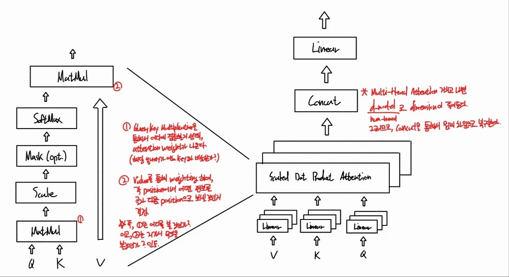
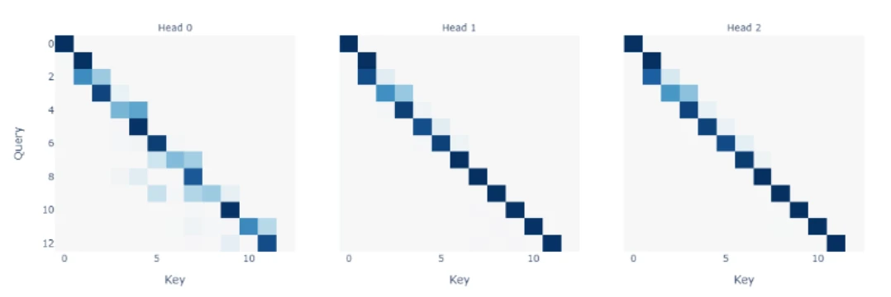
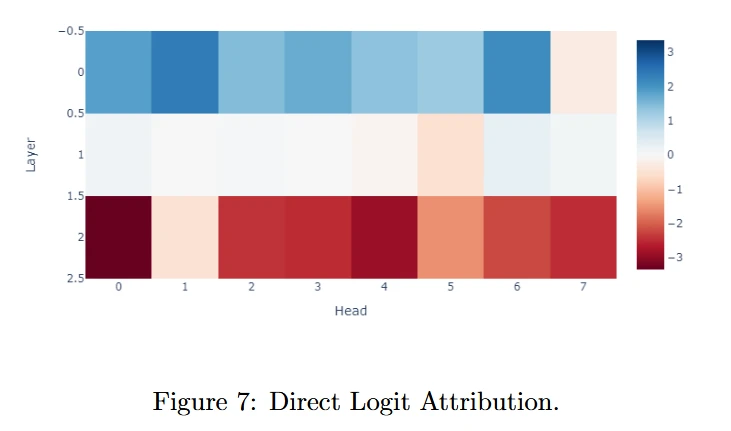
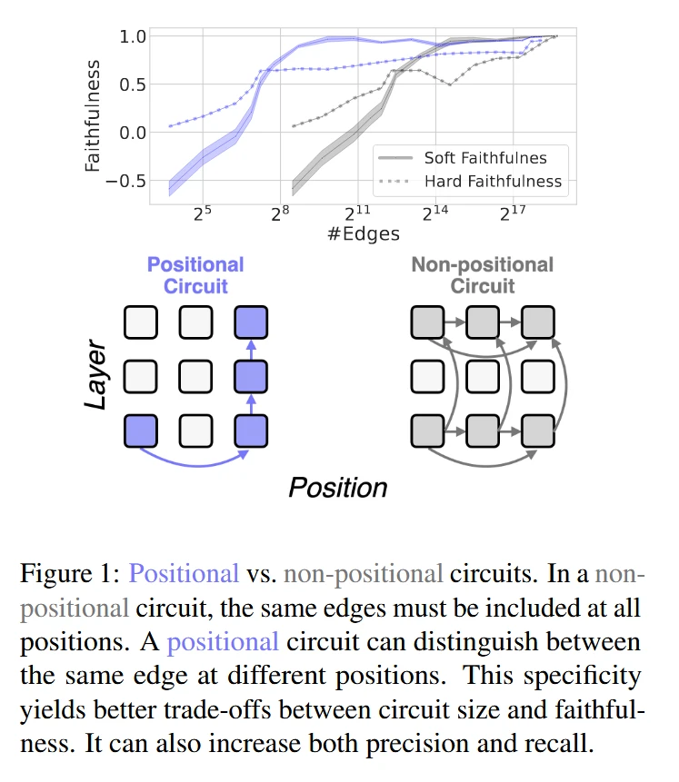

# Interpreting Affine Recurrence Learning in GPT-style Transformers

작성일 2025-03-04
{ .post-date }

작은 GPT 구조의 Transformer가 수열의 규칙을 문맥만 보고 알아내 다음 값을 예측할 때, 내부에서 어떤 계산이 일어나는지를 layer와 attention head 단위로 분석한 논문이다. 모델 내부를 회로(circuit) 단위로 해석하는 연구를 처음 읽은 것이어서, in-context learning, induction head, QK/OV circuit 같은 용어를 하나씩 찾아 가며 요약했다. 며칠 앞서 읽은 "Position-aware Automatic Circuit Discovery"의 서론 노트도 회로 분석이 무엇인지 정리한 것이어서 뒤에 함께 실었다.

## 한 줄 요약

3-layer Transformer는 0번 layer에서 직전 값을 복사해 대략적인 예측을 만들고, 2번 layer의 "negative similarity head"가 그 예측을 반대 방향으로 깎아 다듬는다.

## 무엇을 다루는가

**Affine recurrence**는 각 항이 직전 항에 어떤 수를 곱하고 상수를 더한 값으로 정해지는 수열이다.

$$
a_n = c\,a_{n-1} + d
$$

**In-context learning**(ICL)은 모델이 가중치를 바꾸지 않고, 입력으로 주어진 문맥 안에서 새로운 패턴을 파악해 적용하는 능력이다. 보통은 새로운 데이터를 학습하려면 가중치를 갱신하는 훈련이 필요하다. Transformer 기반 모델은 추론 시점에 프롬프트만 보고 패턴을 찾아 다음 출력을 예측한다. "이전 문맥을 보고 다음을 예측하는 과정"이 마치 학습한 것처럼 보이는 현상이다.

GPT-3, GPT-4 같은 모델이 ICL을 보인다는 것은 알려져 있지만 왜 가능한지는 분명하지 않았다. 이 논문은 그 내부 메커니즘을 이해하기 위해 과제를 아주 작게 잡는다.

- Transformer가 ICL로 affine recurrence 형태의 수열을 예측할 수 있는가?
- 가능하다면 그 과정에서 어떤 내부 메커니즘이 작동하는가?
- 어느 layer가 어떤 방식으로 예측을 개선하는가?

접근은 3-layer Transformer를 affine recurrence 수열로 학습시킨 뒤, 그 모델의 동작을 경험적, 이론적으로 분석하는 것이다.

## 배경

### In-context learning과 induction head

이전 연구에서 Transformer는 선형 회귀, decision tree, 작은 신경망을 in-context로 학습할 수 있음이 확인되었다. ICL을 설명하는 주요 개념이 **induction head**다. 특정 패턴을 찾아 반복하는 역할을 하는 attention head의 한 종류로, 문맥 안에서 앞에 나온 토큰을 다시 예측하는 기능을 한다. 두 가지 역할로 나누어 볼 수 있다.

1. **패턴 감지**: 어떤 토큰이 특정한 순서로 반복되는지 찾는다.
2. **토큰 복사**: 감지한 패턴을 바탕으로, 앞에서 나왔던 토큰을 뒤에서 다시 쓴다.

ICL이 가능한 이유는 이렇게 정리했다. Attention은 입력 전체를 보고 지금 위치와 관련된 부분, 즉 이전에 등장한 것 가운데 비슷한 부분이 어디인지 찾을 수 있다. Induction head는 그렇게 찾은 이전 패턴을 복사한다. 이 둘이 합쳐져 모델이 입력에서 패턴을 감지하고 적용한다.

한계도 있다.

- 문맥이 없으면 새로운 패턴을 파악하지 못한다. 한 번도 본 적 없는 개념을 완전히 이해하려면 훈련이 필요하다. 한국어 번역을 본 적이 없는 모델이 "apple → 사과"를 추론할 수는 없다.
- 주어진 문맥 안에서만 작동한다. ICL로 파악한 것이 이후에도 남지는 않고, 새로운 입력이 들어오면 처음부터 다시 추론해야 한다.
- 패턴이 복잡하면 ICL로 파악하기 어렵다.

### 관련 연구

Transformer의 ICL을 분석한 연구는 있었지만 수치 수열에 대한 연구는 부족했다. 이 논문이 바탕으로 삼은 연구는 세 가지다.

- Garg et al.: Transformer가 단순한 함수 class를 in-context로 학습할 수 있음을 보였다.
- Olsson et al.: ICL을 돕는 induction head를 reverse-engineering했다.
- Nanda et al.: Transformer의 copying 메커니즘을 eigenvalue 분석으로 조사했다.

## 실험 설정

**데이터.** 입력은 40차원 벡터의 수열 $\vec{a}_0, \vec{a}_1, \dots, \vec{a}_{n-1}$이고, 길이 $n$은 3에서 14 사이다. Exploding gradient를 피하려고 데이터를 정규화한다.

벡터가 40차원이라는 것을 두고 두 가지 가능성을 생각했다.

1. 벡터의 각 축이 따로 affine recurrence를 따른다. 한 수열 안에서 계수 $c$는 같고 상수 $\vec{d}$는 축마다 다를 수 있다.
2. Affine recurrence는 하나이고, 각 시점의 값이 embedding을 거쳐 40차원으로 늘어난 것이다.

첫 번째가 맞다고 판단했다.

**모델.** 직접 구성한 3-layer Transformer이고 layer마다 attention head가 8개다. 이전 값들을 입력으로 받아 다음 값을 예측한다. Optimizer는 weight decay를 쓰는 AdamW이고, NVIDIA T4 GPU에서 100,000 step 학습했다.

**Loss.** MSE를 쓰되 모든 위치에 똑같이 적용하지 않는다. 모델에 $\vec{a}_0$만 주면 $\vec{a}_1$을 예측할 방법이 전혀 없다. $\vec{a}_0$와 $\vec{a}_1$을 주더라도 $\vec{a}_2$를 맞히기는 쉽지 않다. 저자들은 모델이 index 3부터 제대로 예측하기 시작한다는 것을 경험적으로 확인했고, 그래서 index 3부터 loss를 적용했다. 수열의 최소 길이가 3인 것도 같은 이유다. 그보다 짧으면 affine recurrence라는 것 자체를 알아낼 수 없다.

**Tokenization을 건너뛴다.** 일반적인 GPT에서 입력은 텍스트다. 텍스트는 토큰으로 쪼개지고, 각 토큰은 vocabulary의 index로 대응되고, index는 embedding 행렬 $W_E \in \mathbb{R}^{|V| \times d_{model}}$을 거쳐 $d_{model}$차원 벡터가 된다.

```text
일반적인 경우:  text → tokens → embeddings → transformer
이 논문:        40차원 벡터 → transformer
```

이 논문의 모델은 텍스트가 아니라 숫자 벡터의 수열을 직접 받는다. 논문의 "bypass tokenization"은 텍스트, vocabulary, tokenizer로 이어지는 과정을 생략한다는 뜻이다.

## 분석

학습된 모델의 오차(MSE)는 0.0001 수준으로 낮다. 수열의 규칙을 잘 학습했다는 뜻이고, 여기서부터 내부 계산을 분석한다.

### QK circuit과 OV circuit

Attention head 하나는 두 가지 일을 한다. "어디를 볼 것인가"와 "거기서 무엇을 가져올 것인가"다. Attention의 구조를 직접 그려 놓고 두 일이 각각 어느 부분에서 일어나는지 표시해 보았다.



왼쪽이 head 하나 안의 계산(scaled dot-product attention)이고, 오른쪽이 여러 head를 묶은 multi-head attention이다. 왼쪽에서 ①로 표시한 아래쪽 MatMul이 query와 key를 곱해 어디에 집중할지를 정하는 곳이고, ②로 표시한 위쪽 MatMul이 그 weight로 value를 가중합해 무엇을 보낼지를 정하는 곳이다. ①에서 softmax까지가 QK circuit, $V$에서 ②를 거쳐 오른쪽 위의 Linear까지가 OV circuit에 해당한다.

| | 하는 일 | 관련 행렬 |
|---|---|---|
| QK circuit | 어디를 볼지 정한다. Query와 key의 조합 가운데 어떤 것에 집중할지 고른다 | Query, key 행렬 |
| OV circuit | 무엇을 옮길지 정한다. 집중한 위치에서 어떤 정보를 가져와 더할지 정한다 | Value 행렬 $V$, output projection 행렬 $O$ |

OV circuit이 답하는 질문은 "한 위치에서 다른 위치로 어떤 정보를 보내는가"다. 얼마나 집중할지는 QK가 정하고, 거기서 어떤 정보를 줄지는 value를 통해 조절한다.

저자들은 value bias를 "fold out"하고 분석한다. Bias와 layer normalization의 효과를 모델에 남겨 두면, 모델의 어떤 경향이 value projection에서 온 것인지 bias에서 온 것인지 구분하기 어렵다. OV circuit으로 정확히 어떤 정보가 옮겨지는지 보려고, 상수 항인 bias와 분석을 흐리는 layer norm을 걷어 낸 것으로 이해했다.

### Attention pattern

Attention pattern은 "각 위치(query)가 앞의 어느 위치(key)를 보는가"를 표로 그린 것이다. 0번 layer의 head 세 개를 보면 다음과 같다.



세로축이 query, 가로축이 key이고 칸이 진할수록 attention weight가 크다. 진한 칸이 대각선 바로 아래를 따라 내려간다. Query 0과 1은 자기 자신(key 0, 1)을 보지만, query 2는 key 1을, query 3은 key 2를 보는 식으로 그 뒤로는 한 칸 앞을 본다. 출처: 논문

- **0번 layer**: 위 그림처럼 바로 직전 벡터에 집중한다. 처음 한두 위치에서는 자기 자신을 보지만 그 뒤로는 바로 앞 위치를 본다. 과거 값을 복사하는 패턴이다. Head 1과 2는 거의 한 칸에만 집중하고, head 0은 주변 칸으로 조금 번져 있다.
- **1번 layer**: attention의 대부분이 두 번째 벡터, 즉 수열의 초기값 쪽으로 향한다.
- **2번 layer**: 값이 양수와 음수를 오가는 수열(계수가 음수인 경우로 이해했다)에서 checkerboard 모양의 attention pattern이 나타난다. 이전 벡터들과 특정한 방식으로 상호작용하면서 예측을 다듬는다.

### Direct logit attribution

각 attention head가 최종 예측에 얼마나, 어느 방향으로 기여하는지를 측정한다. Head가 예측을 정답 쪽으로 미는지, 반대쪽으로 미는지를 본다. 계산은 다음 순서다.

1. 입력 벡터 $\vec{x}_j$를 value 행렬 $W_V$로 변환해 $\vec{v}_j$를 얻는다.
2. 각 위치에서 attention weight를 계산한다. $\text{softmax}(QK^\top)$
3. 위치 $m$에서 value 벡터의 가중합을 구한다. 이것이 위치 $m$에서 그 head가 만든 결과다.

    $$
    \vec{v}'_m = \sum_j \text{attn}_{m,j} \cdot \vec{v}_j
    $$

4. Output 행렬 $W_O$를 곱한다. 이것이 그 head가 residual stream에 더하는 정보다.
5. 이 벡터가 정답 $\vec{a}_{m+1}$과 얼마나 일치하는지 본다.

결과는 layer별로 뚜렷하게 갈린다.



세로가 layer(0, 1, 2), 가로가 head(0 ~ 7)다. 파란색은 예측을 정답 쪽으로 미는 기여, 빨간색은 반대쪽으로 미는 기여이고, 색이 진할수록 크다. 윗줄은 거의 모두 파랗고, 가운뎃줄은 거의 흰색이고, 아랫줄은 빨갛다. 출처: 논문 Figure 7

| Layer | 기여 |
|---|---|
| 0번 | 양의 방향. 정답 쪽으로 정보를 보낸다 |
| 1번 | 거의 없음 |
| 2번 | 음의 방향. 이전 예측을 보정한다 |

Transformer가 먼저 단순한 예측을 만들고 마지막에 그것을 수정하는 구조라는 것이 여기서 드러난다. 마지막 layer는 너무 강하게 예측된 부분을 조정한다. 그림에서 2번 layer의 head 0이 가장 진한 빨간색으로, 깎는 쪽의 기여가 가장 크다.

### Layer별 역할

**0번 layer의 OV circuit.** 대부분 이전 벡터를 그대로 복사한다. 다만 단순한 복사가 아니라 2배 정도로 강하게 복사하는 경향이 있다. 이전 값을 그대로 쓰되 조금 과장된 형태다.

**1번 layer.** 거의 아무 역할도 하지 않는다. 이 layer의 attention pattern을 제거해도 성능이 거의 변하지 않고, 직접 기여도를 보아도 의미 있는 정보를 더하지 않는다.

**2번 layer의 QK/OV circuit.** QK 쪽은 단순한 복사에 가까운 형태이고, OV 쪽은 복사가 아니라 음의 방향으로 조정한다. 0번 layer가 과하게 예측한 것을 2번 layer가 깎아서 최종 예측을 다듬는다.

**MLP.** 예측에 크게 기여하지 않는다. 예측값을 조금 더 정밀하게 조정하는 정도다.

저자들의 추측을 정리하면, 모델은 0번 layer에서 "이전 값 복사 + 약간의 과장"으로 대략적인 예측을 만들고, 2번 layer에서 너무 강한 부분을 줄여 보정한다.

## 결론

- 0번 layer는 대략적인 추정치를 준다.
- 2번 layer는 negative similarity head로 그 추정치를 다듬는다.
- GPT 구조의 Transformer가 affine recurrence를 학습할 수 있음을 보였다.
- Transformer에서 수치 과제를 분석하는 방법을 제시했고, 이를 위해 TransformerLens를 수치 수열을 다룰 수 있도록 수정했다.

## 함께 읽은 것: 회로 분석과 Position-aware Automatic Circuit Discovery

위 논문의 분석 도구인 circuit이 무엇인지는 며칠 앞서 "Position-aware Automatic Circuit Discovery"의 초록과 서론을 읽으며 정리했다.

### 회로 분석이란

Circuit analysis는 언어 모델의 메커니즘을 파헤치는 대표적인 방법이다. 모델 안에서 특정한 계산이나 기능을 담당하는 subnetwork를 찾는다.

1. 이해하고 싶은 모델의 동작을 하나 정한다.
2. 그 동작과 가장 관련 있는 뉴런을 찾는다. 보통 출력에 얼마나 영향을 주는지를 기준으로 한다.
3. 출력에서부터 계산 과정을 거슬러 올라간다. 이 과정에서 이어지는 부분들이 circuit이다.
4. 그 circuit이 어떤 방식으로 동작에 관여하는지 살핀다.
5. Ablation으로 그 circuit이 대상 동작에 미치는 영향을 확인한다.

얻을 수 있는 것은 투명성(모델의 설명성 확보), 안전성과 신뢰성(오류나 편향을 이해하고 대처), 개선(더 나은 구조나 fine-tuning, regularization 전략에 대한 인사이트)이다.

Circuit의 노드는 모델의 구성 요소다. Attention head일 수도, 뉴런일 수도, layer일 수도 있다. Circuit discovery는 특정 과제를 담당하는 최소 subgraph를 찾는 일이다.

### 이 논문이 지적하는 문제

수작업으로 circuit을 찾으면 위치에 따른 통찰을 얻을 수 있다. 그러나 자동화된 방법은 위치 정보를 놓친다. 모든 구성 요소가 입력의 모든 토큰 위치에 대해 똑같이 관련이 있다고 가정한다. 어떤 attention head가 circuit에 들어 있다면 그 head가 모든 토큰에 똑같이 기여한다고 보는 것이다. 이렇게 위치 불변(position-invariant)을 가정하면 위치 사이의 상호작용을 무시하게 된다.

이 가정은 두 가지 문제를 만든다.

**Precision이 떨어진다.** 기존 방법은 어떤 edge(연산 경로)가 중요하다고 판단되면 그 edge가 모든 토큰 위치에서 circuit에 속한다고 본다. 실제로는 특정 위치에서만 중요할 수 있다. "The dog runs in the park."에서 주어와 동사의 관계를 잡는 head가 edge로 선택되었다고 하자. 이 head는 `dog → runs`에서만 작동하는데, 기존 방식은 `in → the` 같은 위치에서도 작동한다고 간주한다. 필요 없는 위치까지 circuit에 들어가면서, circuit에 포함된 것 가운데 실제로 중요한 것의 비율이 낮아진다.

**Recall이 떨어진다.** 기존 방법은 각 위치에서의 중요도를 먼저 합산하거나 평균한 뒤 circuit에 넣을지 정한다. 어떤 head가 일부 위치에서는 강하게, 다른 위치에서는 약하게 작용한다면, 강한 위치의 기여가 약한 위치의 기여와 섞여 전체 중요도가 낮게 평가된다. 부정적인 단어와 감정 표현을 잇는 head가 그런 예다. 실제로 중요한 연결이 circuit에서 빠진다.

여기서 precision은 "정답이라고 예측한 것 가운데 실제 정답의 비율", recall은 "실제 정답 가운데 정답이라고 맞힌 비율"이고 둘 사이에는 trade-off가 있다.

### 제안

- **PEAP(Position-aware Edge Attribution Patching)**: gradient 기반 방법인 edge attribution patching을 확장해, 토큰 위치별로 edge의 중요도를 따로 평가한다. 위치를 가로지르는 edge의 중요도도 평가할 수 있다. 그 결과 더 작고 정확한 circuit을 얻는다.

    

    아래쪽 두 그림에서 네모 하나가 "어느 layer의 어느 위치"다. 오른쪽 non-positional circuit은 어떤 layer가 circuit에 들어가면 그 layer의 세 위치가 모두 칠해지고 edge도 모든 위치 사이에 그려진다. 왼쪽 positional circuit은 실제로 쓰이는 위치의 네모와 edge만 칠해져 훨씬 작다. 위쪽 그래프는 같은 edge 수에서 positional circuit(보라색)의 faithfulness가 더 높다는 것을 보여 준다. 출처: "Position-aware Automatic Circuit Discovery" Figure 1
- **Dataset schema**: 위치 정보를 circuit에 넣는 것은 입력들의 길이와 구조가 같으면 간단하지만 그렇지 않으면 어렵다. 같은 역할의 단어가 예시마다 다른 위치에 오고 길이도 다르기 때문이다. Schema는 토큰 구간(span)에 의미 label을 붙인다. "The war lasted from 1453 to 14__"의 `war`와 다른 예시의 `Black Plague`는 둘 다 주어지만 span의 길이가 다르다. 여기에 같은 label을 붙이면 길이가 달라도 같은 자리로 보고 edge의 중요도를 모을 수 있다.

Edge가 중요한지를 판단하는 기준은 세 가지로 정리해 두었다.

| 기준 | 내용 | 주의할 점 |
|---|---|---|
| Activation | Attention weight가 크면 그 연결이 중요할 가능성이 크다 | 값이 크다고 항상 중요한 것은 아니다 |
| Gradient | 조금 바꾸었을 때 예측이 크게 변하면 중요하다 | Gradient가 작아도 중요할 수 있다 |
| Ablation | 연결을 없앴을 때 성능이 얼마나 변하는지 본다 | 모든 edge를 하나씩 없애 보는 것은 비용이 크다 |

## 읽으며 가진 질문과 찾은 답

**Affine recurrence를 "학습한다"는 것이 무슨 뜻인가?** 서론에서 가장 먼저 걸린 부분이다. 여기서 학습은 두 층위로 나뉜다. 모델은 훈련 단계에서 수많은 affine recurrence 수열로 학습된다. 추론할 때는 가중치를 바꾸지 않은 채, 처음 보는 수열의 앞부분만 보고 그 수열의 규칙에 맞는 다음 값을 낸다. 논문이 분석하는 것은 뒤쪽, 즉 문맥에서 규칙을 알아내는 과정이다.

**가중치를 바꾸지 않고 affine recurrence를 알아내려면 모델은 무엇을 학습해 두어야 하는가? 다양한 텍스트를 학습해 두면 되는가?** 실험 설정을 읽고 풀렸다. 이 논문의 모델은 텍스트가 아니라 affine recurrence 수열 자체로 학습한다.

**"Bypass tokenization"은 무엇을 건너뛴다는 것인가?** 텍스트를 토큰으로, 토큰을 embedding으로 바꾸는 과정 전체다. 입력이 처음부터 40차원 벡터이기 때문이다.

**수열의 최소 길이가 왜 3인가?** 앞의 두세 항만으로는 규칙을 알아낼 수 없어서, 모델이 index 3부터 예측하기 시작하고 loss도 거기서부터 적용하기 때문이다.

## 남았던 질문과 답

공부할 당시에는 풀지 못하고 남겨 둔 질문들이다. 글을 정리하면서 답을 찾아 덧붙였다.

**Q. 문맥에서 찾아낸 패턴이 사실은 모델 안에 이미 학습되어 있던 것일 수도 있지 않은가? 그것을 찾아내는 것도 "학습"이라고 불러야 하는가?**

절반은 맞다. 가중치에 이미 들어 있는 것은 "affine recurrence라는 부류의 수열을 이어 가는 방법"이고, 이것은 훈련에서 배운 것이다. 가중치에 들어 있지 않은 것은 지금 주어진 수열의 $c$와 $\vec{d}$다. 논문의 데이터 생성 방식에서 이 값들은 수열마다 $[-2, 2]$에서 새로 뽑히므로 모델이 미리 외울 수 없고, 문맥에서 알아내야 한다. ICL에서 말하는 "학습"은 이 뒤쪽, 즉 부류 안의 어떤 함수인지를 문맥의 예시로부터 특정하는 일을 가리킨다. 논문도 ICL을 "가중치를 바꾸지 않고 추론 중에 새로운 수열을 배우는 능력"으로 정의한다. 가중치를 갱신한다는 뜻의 학습과는 다른 의미이므로, 용어에 대한 의문 자체는 타당하다.

**Q. 파라미터가 바뀌지 않는데 추론 중에 무엇이 바뀌어서 "학습"이 되는가?**

바뀌는 것은 가중치가 아니라 activation이다. 모델의 출력은 고정된 함수 $f_\theta$에 문맥 전체를 넣은 값이고, attention이 앞 위치의 값을 읽어 오므로 문맥이 달라지면 residual stream에 쌓이는 값이 달라진다. 고정된 계산만으로도 이것이 가능하다는 것은 작은 예로 확인할 수 있다. 축 하나에 대해 연속한 세 항이 있으면 다음 식으로 $c$를 구하고 다음 항을 낼 수 있다.

$$
c = \frac{a_n - a_{n-1}}{a_{n-1} - a_{n-2}}, \qquad a_{n+1} = a_n + c\,(a_n - a_{n-1})
$$

이 식에는 학습할 parameter가 없지만 어떤 affine recurrence가 들어와도 맞는 답을 낸다. 수열마다 달라지는 것은 중간 계산값 $c$뿐이다. Transformer에서는 이 중간 계산값의 자리에 activation이 있다. 다만 이 식은 "고정된 계산으로 문맥에 적응할 수 있다"는 것을 보이는 예일 뿐이고, 모델이 실제로 이 식을 계산한다는 뜻은 아니다. 논문이 찾은 메커니즘은 0번 layer의 복사와 2번 layer의 negative similarity head다.

**Q. 왜 하필 affine recurrence인가?**

논문은 affine recurrence가 ICL의 핵심이라고 주장하지 않는다. 논문이 드는 이유는 수치 과제에서 재귀 수열을 해석한 연구가 드물다는 것이다. 가장 가까운 선행 과제로 mechanistic interpretability의 open problem으로 제시된 Fibonacci 수열 분석을 들고, 그것을 더 복잡한 부류로 넓힌 것이라고 자리매김한다. 결론에서는 더 높은 차원의 선형 recurrence와 다항식 recurrence를 후속 과제로 든다. 여기에 일반적인 이유를 보태면, 해석 연구에서는 정답을 내는 규칙이 닫힌 식으로 알려져 있고, 문맥 없이는 풀 수 없으면서, 작은 모델로 학습되는 과제가 다루기 좋다. Affine recurrence는 이 조건을 만족하는 과제 가운데 하나다.

**Q. "Folding"은 정확히 어떤 연산인가?**

생략이 아니라, 모델의 출력을 바꾸지 않으면서 어떤 parameter를 다른 parameter 안으로 옮겨 넣는 재매개변수화다. 논문은 layer normalization의 가중치와 value bias를 fold했다고 적는다. Value bias의 경우는 이렇다. Head 하나의 출력은 다음과 같고, attention weight는 행마다 합이 1이므로 $b_V$가 들어간 항은 위치나 입력과 무관한 상수가 된다.

$$
\sum_j \text{attn}_{m,j}\,(\vec{x}_j W_V + \vec{b}_V)\,W_O + \vec{b}_O = \sum_j \text{attn}_{m,j}\,\vec{x}_j W_V W_O + \big(\vec{b}_V W_O + \vec{b}_O\big)
$$

그래서 $\vec{b}_V$를 0으로 두고 $\vec{b}_O$를 $\vec{b}_O + \vec{b}_V W_O$로 바꾸어도 모델은 똑같이 동작한다. 이렇게 하면 OV circuit을 볼 때 "옮겨지는 정보"가 $W_V W_O$ 하나로 정리된다. Layer normalization의 fold도 같은 생각으로, 정규화 뒤에 곱하고 더하는 학습된 scale과 bias를 바로 다음 linear layer의 가중치에 합치는 것이다. 본문에 "걷어 낸 것"이라고 적은 부분은 "다른 가중치에 합쳐 넣은 것"으로 읽어야 정확하다.

**Q. Direct logit attribution에서 벡터의 내적이 어떻게 "예측에 미친 영향"이 되는가?**

Residual stream이 덧셈 구조이기 때문이다. 마지막 위치의 residual stream은 embedding과 모든 head, 모든 MLP의 출력을 더한 것이고, 최종 출력은 여기에 마지막 layer normalization과 unembedding $W_U$를 적용한 것이다. 정규화의 scale을 고정된 것으로 보면 이 변환은 선형이므로, 최종 출력은 구성 요소별 기여의 합으로 나뉜다. Head 하나의 출력 $\vec{v}'_m$을 같은 변환에 통과시킨 것이 그 head가 최종 출력에 직접 더한 몫이고, 그것과 정답 $\vec{a}_{m+1}$의 내적은 그 몫이 정답 방향으로 얼마나 향하는지를 잰다. 양수이면 출력을 정답 쪽으로 밀고, 음수이면 반대쪽으로 민다. 논문의 식은 $\langle \text{ln}_{\text{final}}(\vec{v}'_m)\,W_U,\ \vec{a}_{m+1} \rangle$이다. 이 방법이 재는 것은 직접 경로뿐이다. 어떤 head의 출력을 뒤 layer가 읽어서 생기는 간접 효과는 잡히지 않으므로, 값이 0에 가깝다고 해서 쓸모없는 head라고 단정할 수는 없다. 논문이 1번 layer에 대해 mean ablation을 따로 한 이유다.

**Q. 0번 layer가 2배로 강하게 복사한다는 것을 identity mapping과 어떻게 연결해 이해해야 하는가?**

복사하는 head란 OV circuit이 identity의 양수 배에 가까운 head다. 논문은 residual stream 벡터 $\vec{x}$에 대해 차원별로 $(x_d,\ (OV\vec{x})_d)$를 찍었을 때 절편이 거의 0이고 기울기가 2.1 ~ 2.5인 직선($R^2 = 0.83$)이 나온다는 것으로 이를 보인다. 즉 residual stream 벡터에 대해서는 $OV\vec{x} \approx \alpha\vec{x}$이고, 0번 layer는 $\vec{v}_n \to \vec{v}_n + \alpha\,\vec{v}_{n-1}$을 한다. 그런데 OV 행렬을 직접 그리면 identity처럼 보이지 않는다. 논문의 설명은 OV가 embedding 공간 안에서는 복사를 하면서, 동시에 embedding 공간의 직교 여공간에 다른 정보를 쓴다는 것이다. OV 출력의 norm 가운데 평균 84.15%가 직교 여공간에 있었다고 한다. $\alpha$가 2보다 큰 것이 왜 쓸 만한 추정인지에 대해서는, $\vec{a}_n = c\,\vec{a}_{n-1} + \vec{d}$를 넣으면 추정이 $(c + \alpha)\,\vec{a}_{n-1} + \vec{d}$가 되고 $c > -2$이므로 $c + \alpha$가 항상 양수여서, 부호가 번갈아 바뀌는 수열에서 정답과 비슷한 모양이 된다고 설명한다.

**Q. Circuit의 edge는 정확히 무엇인가?**

모델의 계산 그래프에서 앞쪽 구성 요소의 출력이 뒤쪽 구성 요소의 입력으로 들어가는 연결 하나다. "Position-aware Automatic Circuit Discovery"에서 노드는 MLP, attention head, embedding, logit이고, edge $e = (u, v)$는 노드 $u$의 출력이 residual stream을 거쳐 노드 $v$의 입력에 더해지는 경로다. Attention head로 들어가는 입력은 query, key, value 세 가지로 나누므로 한 노드에서 뒤쪽 head 하나로 가는 edge는 세 개다. Edge의 중요도는 그 edge에 흐르는 값만 다른 입력에서 얻은 값으로 바꾸었을 때 지표가 얼마나 변하는지로 재고, edge attribution patching은 이것을 $(z_u^{*} - z_u)^\top \nabla_v M$으로 근사한다. Position-aware한 설정에서는 같은 노드를 토큰 위치마다 따로 두고, 한 위치 안의 edge와 attention을 통해 위치를 가로지르는 edge를 구분한다. 그림에서 노드를 잇는 화살표 하나를 edge 하나로 본 짐작은 이 정의와 맞는다.

### 아직 남은 질문

- 0번 layer에서 "직전 위치를 본다"는 attention pattern이 가중치에서 어떻게 나오는가? 일반적으로는 attention score $(\vec{x}_m W_Q)(\vec{x}_j W_K)^\top$에서 positional embedding끼리 만나는 항이 $j = m - 1$일 때 가장 커지도록 $W_Q$, $W_K$가 학습되면 이런 pattern이 생긴다. 이 모델도 positional embedding을 더하지만 논문은 0번 layer의 QK circuit을 분석하지 않았다. 이 모델에서 실제로 그런지는 positional embedding에 대한 QK 행렬을 직접 그려 보아야 확인할 수 있다.

## 참고 자료

- "Interpreting Affine Recurrence Learning in GPT-style Transformers". arXiv:2410.17438. <https://arxiv.org/abs/2410.17438>
- "Position-aware Automatic Circuit Discovery". arXiv:2502.04577. <https://arxiv.org/abs/2502.04577>
