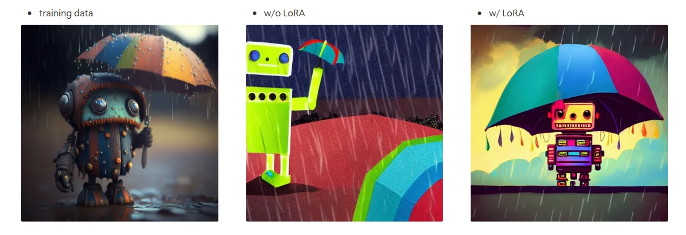
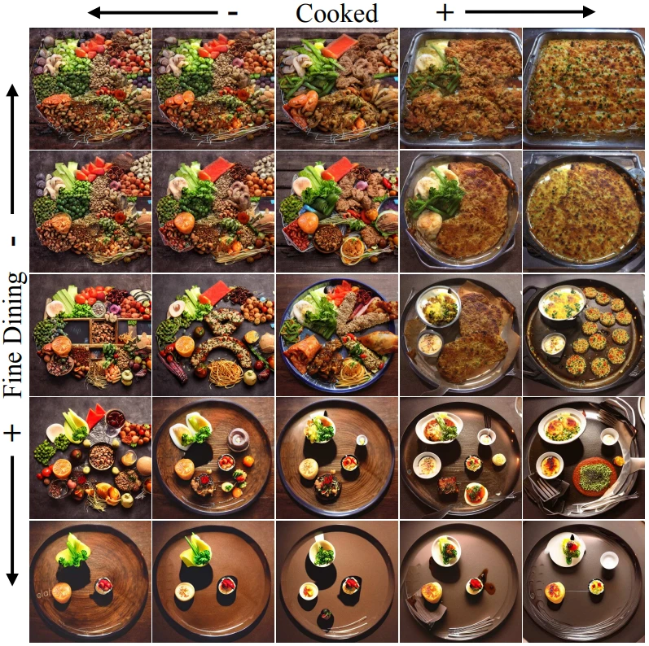
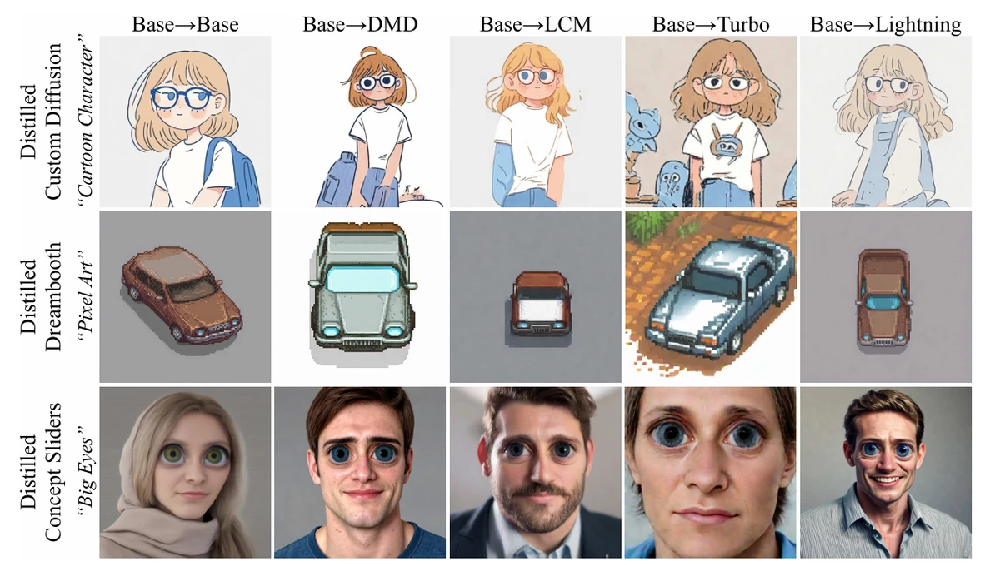
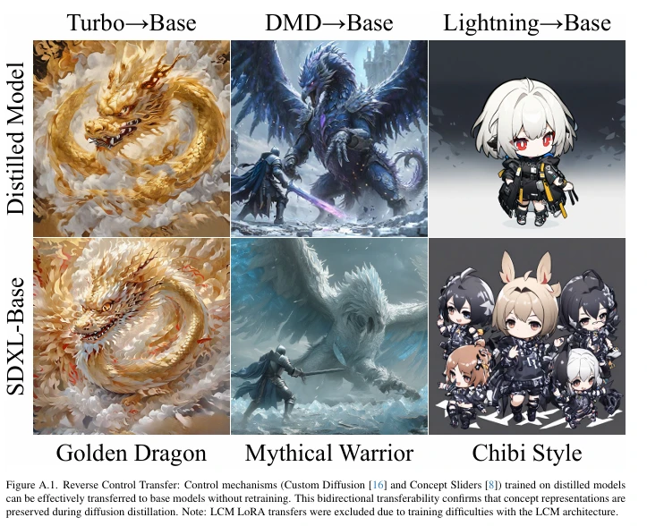
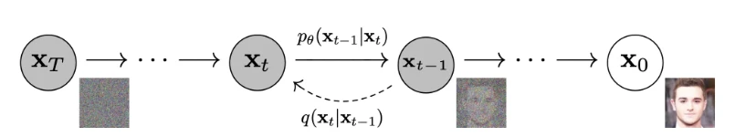
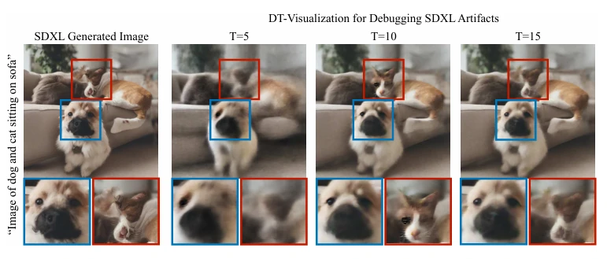
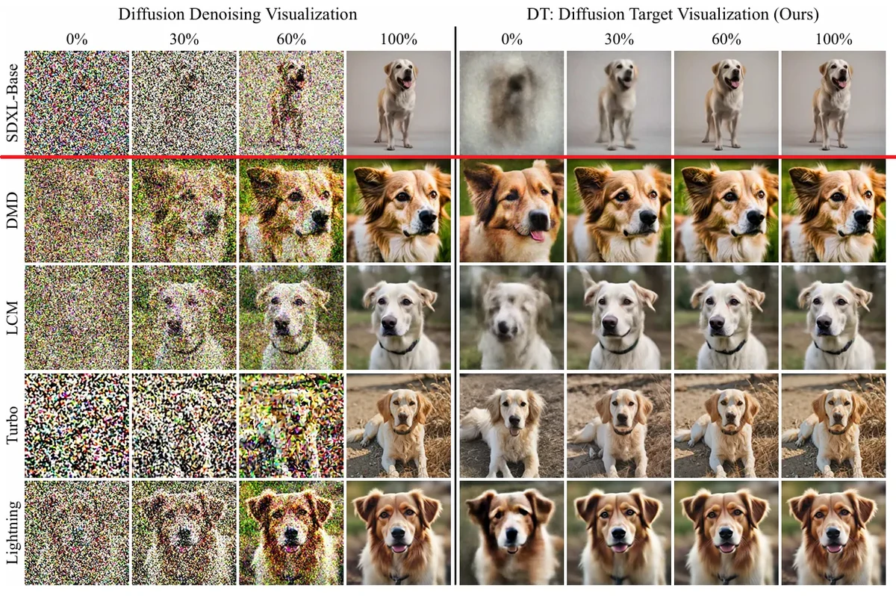
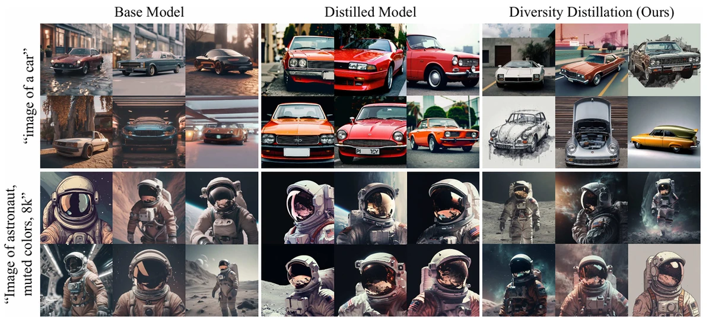
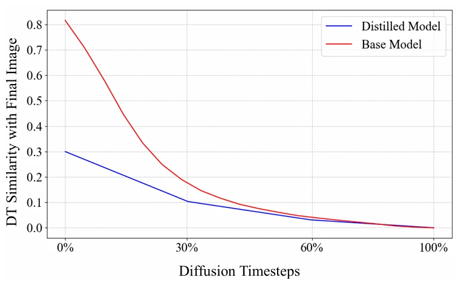
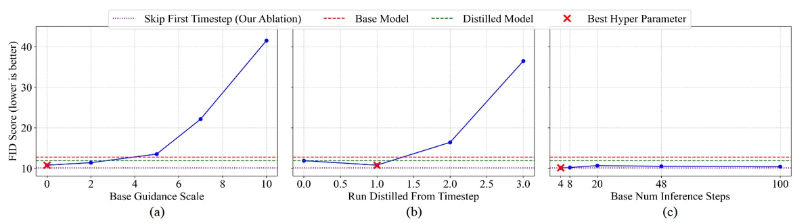

# Distilling Diversity and Control in Diffusion Models

작성일 2025-04-09
{ .post-date }

적은 step으로 이미지를 생성하도록 distillation한 diffusion 모델은 빠르지만, 같은 프롬프트에 비슷한 이미지만 내놓는다. 이 논문은 그 이유를 모델 내부에서 찾고, 첫 step만 원래 모델에 맡기는 간단한 방법으로 다양성을 되찾는다. 읽으면서 concept representation, mode collapse, LoRA, Concept Sliders 같은 용어를 절마다 따로 찾아 정리했다. 그 내용을 먼저 적고 논문의 순서를 따라간다.

이 글은 arXiv의 초기 판(v1, 2025년 3월)을 읽고 정리한 것이다. 이후의 개정판(v4, 2025년 11월)에서는 DT-Visualization이라는 이름 대신 $\hat{\mathbf{x}}_0$ visualization이라고 부르고, 초록에서 다양성이 base 모델을 넘어선다는 표현이 다양성을 회복한다는 표현으로 바뀌는 등 일부 명칭과 주장이 달라졌다.

## 한 줄 요약

Distillation은 모델이 가진 개념의 표현은 그대로 두고 다양성만 무너뜨린다. 다양성은 초기 denoising step에서 정해지므로, 첫 step만 base 모델로 돌리고 나머지를 distilled 모델로 돌리면 속도를 유지하면서 다양성이 회복된다.

## 초록을 읽고

초록의 주장은 다음과 같다.

- Distilled diffusion 모델은 다양성(diversity)이 부족하다. 그러나 base 모델의 concept representation은 보존되어 있다.
- 그래서 base 모델에서 학습한 control 메커니즘(Concept Sliders, LoRA)을 distilled 모델에 재학습 없이 그대로 쓸 수 있다. 반대 방향도 된다.
- 다양성이 왜 줄어드는지 보려고 DT-Visualization을 제안한다. Reverse process의 중간 단계에서 모델이 예상하는 최종 출력을 본다.
- 여기서 artifact와 불일치가 생기는 지점을 볼 수 있었고, 초기 diffusion step이 출력의 다양성을 불균형하게 크게 결정하며 이후 step은 detail을 다듬는다는 것을 확인했다.
- 이 관찰로부터 diversity distillation을 제안한다. 첫 step만 base 모델을 쓰고 이후는 distilled 모델을 쓴다. 다양성이 base 모델보다도 좋아지고 빠른 추론 속도는 유지된다.

정리하면 distillation은 concept을 무너뜨리지 않고 다양성만 무너뜨린다는 주장이다. 마지막 문장에서는 의문이 들었다. Base 모델을 일부만 쓰는데 어떻게 base 모델보다 다양성이 좋아질 수 있는가. 말이 안 된다고 생각했고, 이 질문을 들고 본문을 읽었다.

## 먼저 정리한 개념

**Concept representation.** 모델이 어떤 시각적, 의미적 개념을 내부에서 어떻게 표현하고 있는가를 말한다. 모델은 dog, grass, sitting 같은 단어에 해당하는 시각적 개념을 학습했고, 이 개념들은 모델 내부에서 벡터로 표현된다. Distillation 뒤에도 concept representation이 유지된다는 것은, 모델이 개를 개로, 풀을 풀로 표현하는 능력을 잃지 않는다는 뜻이다.

**Diversity.** 같은 프롬프트로 이미지를 여러 장 생성했을 때 얼마나 다양한 이미지가 나오는가다. "a futuristic city"라는 프롬프트에 base 모델은 높은 건물, 유리 돔, 공중 교통 등을 다양하게 그리고, distilled 모델은 비슷한 도시 이미지를 반복해서 그린다.

**Mode collapse.** 생성 모델이 데이터의 여러 경우(mode)를 내지 못하고 일정한 패턴의 출력만 반복하는 현상이다. GAN에서 잘 알려져 있다. Generator와 discriminator를 균형 있게 학습시켜야 하는데 discriminator가 너무 빨리 학습되면, generator는 진짜 같은 이미지를 만든다는 원래 목적을 잃고 discriminator가 가장 헷갈려하는 같은 그림만 만들게 된다.

**GAN과 diffusion.** 둘 다 노이즈에서 이미지를 만든다. GAN은 한 번에 만든다. 한 step으로 끝나므로 mode collapse가 자주 생긴다. Diffusion은 수십에서 수백 step에 걸쳐 노이즈를 조금씩 제거한다. 느리지만 상대적으로 안정적으로 학습된다. Distilled 모델은 계산 효율을 위해 reverse process를 아주 짧게 고정한다. Step 수를 확 줄였으니 초반에 너무 많은 것이 결정되고, 그래서 mode collapse가 생긴다고 이해했다.

**LoRA(Low-Rank Adaptation).** 큰 모델 전체를 다시 훈련하지 않고, 작은 adaptor만 학습해 원하는 개념이나 스타일을 추가하는 방법이다. 매우 적은 파라미터로 fine-tuning할 수 있고, 학습한 adaptor만 떼어 다른 곳에 붙여 쓸 수 있다.

LoRA를 찾아보며 본 예시다. 왼쪽이 학습에 쓴 이미지, 가운데가 LoRA 없이 생성한 이미지, 오른쪽이 LoRA를 붙여 생성한 이미지다. 같은 "우산을 쓴 로봇"이지만 오른쪽은 가운데보다 학습 이미지의 구도(커다란 우산 아래에 선 작은 로봇)에 가까워졌다. 모델 본체는 그대로 두고 adaptor만 붙였을 때 생기는 차이다.

**Concept Sliders.** 특정 속성을 슬라이더처럼 조절할 수 있게 하는 방법이다.

가로 방향이 "Cooked" 슬라이더, 세로 방향이 "Fine Dining" 슬라이더다. 오른쪽으로 갈수록 재료가 익힌 요리로 바뀌고, 아래로 갈수록 접시에 조금씩 담아낸 고급 요리의 모습이 된다. 두 속성을 서로 얽히지 않게 따로 조절하는 것이 목표다. 출처: Concept Sliders 논문

내가 이해한 구현 방식은 다음과 같다.

1. 젊은 사람의 이미지와 나이 든 사람의 이미지처럼 속성이 대비되는 데이터로 LoRA를 학습한다. 목표하는 개념에 대해 다른 속성과 얽히지 않은(disentangled) 방향을 찾는 것이 목적이다.
2. 학습한 LoRA weight의 차이를 분석해 하나의 벡터로 만든다. 예를 들면 "나이 벡터"다.
3. 추론할 때 이 벡터를 latent에 적용해 개념을 제어한다.

Diffusion 모델이 개념을 다루는 방식에 대한 연구는 크게 두 가지다. **Personalization**은 특정 인물, 캐릭터, 스타일처럼 새로운 개념을 모델에 추가하는 것이고, **control mechanism**은 모델이 이미 아는 개념(표정, 조명, 날씨, 나이)을 정확하게 조절하는 것이다.

## 1. Control distillation

Distillation을 하면 추론은 빨라지지만 다양성이 줄어든다. 그렇다면 base 모델이 가지고 있던 개념의 표현도 달라지는가? 논문은 이것을 control 메커니즘의 이식으로 확인한다. Base 모델에서 학습한 adaptor가 distilled 모델에서 그대로 작동하는지, 반대로 distilled 모델에서 학습한 것이 base 모델에서 작동하는지 본다. Fine-tuning으로 얻은 adaptor가 다른 모델에서도 제대로 동작하려면 핵심적인 concept representation이 같아야 한다는 가정이 깔려 있다고 보았다.

논문은 base 모델에서 fine-tuning한 control 메커니즘이 distillation 뒤에도 재학습 없이 적용되는 것을 **control distillation**이라고 부른다.

### 실험 설정

세 가지 방법으로 확인한다. 세 방법 모두 공식 구현에 따라 LoRA를 썼다고 한다.

- **Concept Sliders**: low-rank adaptor로 나이, 날씨, 눈 크기 같은 시각적 속성을 미세하게 조절한다.
- **DreamBooth**: 특정 인물이나 대상의 이미지 몇 장으로 fine-tuning한다. 그 대상을 새로운 토큰에 연결해 `a photo of <my_cat>`처럼 프롬프트에 쓸 수 있게 한다. 과적합을 막으려고 prior preservation loss를 써서 기존 개념을 유지하면서 새로운 대상만 반영한다.
- **Custom Diffusion**: cross-attention layer만 학습해도 스타일이나 개념을 반영할 수 있다는 점을 이용한다. Cross-attention의 key, value projection만 새로 학습한다.

### 결과

정량 결과는 원본 이미지와 LoRA를 적용한 이미지 사이의 CLIP score 변화율(%)이다. 값이 클수록 속성 변화나 스타일 전이가 강하게 일어났다는 뜻이다. Base는 SDXL이고 나머지 네 개는 distilled 모델이다.

| 방법 | Concept | Base→Base | Base→DMD | Base→LCM | Base→Turbo | Base→Lightning |
|---|---|---|---|---|---|---|
| Concept Sliders | Age | 20.4 | 17.8 | 27.1 | 19.0 | 24.8 |
| | Smile | 19.7 | 21.4 | 19.5 | 33.5 | 14.0 |
| | Muscular | 34.6 | 26.7 | 33.8 | 39.0 | 33.2 |
| Customization | Lego | 32.2 | 26.8 | 26.0 | 30.3 | 29.7 |
| | Watercolor style | 34.3 | 31.4 | 29.6 | 27.5 | 39.2 |
| | Crayon style | 32.7 | 27.8 | 24.7 | 29.5 | 32.5 |

모든 경우에 CLIP score가 올라갔다. Base에서 학습한 adaptor가 어느 distilled 모델에서도 의도한 방향으로 이미지를 바꾼다는 뜻이다. Distillation 방법에 따라 값의 차이는 있고, 논문은 이것을 아키텍처의 차이로 해석한다.

표에 DreamBooth라는 이름의 행은 보이지 않는다. DreamBooth는 개념을 조절하는 것이 아니라 개념이 있는지 없는지의 문제인 personalization이어서, 정성 평가에 집중한 것이 아닐까 추측했다.

정성 결과는 다음 그림이다.

맨 왼쪽 열(Base→Base)이 adaptor를 학습한 SDXL에서 그대로 쓴 결과이고, 나머지 네 열이 같은 adaptor를 distilled 모델에 붙인 결과다. 줄마다 방법이 다르다. 위에서부터 Custom Diffusion("Cartoon Character"), DreamBooth("Pixel Art"), Concept Sliders("Big Eyes")다. 출처: 논문

어느 줄에서든 다섯 열이 같은 특성을 보인다. 맨 아랫줄은 어느 모델에서나 눈이 커졌고, 가운뎃줄은 어느 모델에서나 pixel art로 그려졌다. SDXL에서 fine-tuning한 adaptor를 distilled 모델에 붙였을 때 해당 특성이 옮겨 간 것이다. Step 수가 크게 줄었는데도 효과가 유지된다. 표에 없던 DreamBooth는 이 그림에 가운뎃줄로 들어 있다. 다만 adaptor를 붙이기 전의 이미지도 함께 실었다면 비교가 더 분명했을 것이라고 생각했다.

반대 방향(distilled → base)의 결과는 부록에 있고 정량 결과는 제공되지 않는다.

윗줄이 adaptor를 학습한 distilled 모델의 결과, 아랫줄이 그 adaptor를 SDXL base에 붙인 결과다. 금빛 용, 전사, chibi 스타일이 아랫줄에도 그대로 나타난다. 그림 설명에 따르면 LCM은 학습이 어려워 이 실험에서 빠졌다. 출처: 논문 Figure A.1

개념의 표현이 유지된다면 다양성은 왜 줄어드는가. 이 질문이 다음 절로 이어진다.

## 2. DT-Visualization

DT(Diffusion Target) Visualization은 reverse process의 각 step에서 모델이 최종 출력을 무엇으로 예상하고 있는지를 본다.

오른쪽 끝의 $\mathbf{x}_0$가 이미지이고 왼쪽 끝의 $\mathbf{x}_T$가 순수한 noise다. 점선 화살표 $q$가 noise를 더하는 forward process, 실선 화살표 $p_\theta$가 noise를 걷어 내는 reverse process다. 출처: DDPM 논문

Diffusion은 forward process에서 이미지 $\mathbf{x}_0$에 Gaussian noise를 더해 가고, 마지막 step $T$에서는 순수한 Gaussian noise가 된다. 그림에서 오른쪽에서 왼쪽으로 가는 방향이다. Reverse process에서는 step $t$에서 noise를 예측하고 그것을 제거해 $t-1$의 이미지를 얻는다. 왼쪽에서 오른쪽으로 한 칸 가는 것이다.

$$
\mathbf{x}_{t-1} = \frac{\mathbf{x}_t - \sqrt{1 - \alpha_t}\,\epsilon_\theta(\mathbf{x}_t, t)}{\sqrt{\alpha_t}}
$$

$\alpha_t = 1 - \beta_t$는 step $t$ 한 번에서 신호가 보존되는 비율이다. 이를 처음부터 $t$까지 누적해 곱한 $\bar{\alpha}_t$가 그 시점에 원본 이미지의 비율이 얼마나 남아 있는지를 나타낸다. $\bar{\alpha}_t$는 forward process가 진행될수록 작아지고, 반대로 reverse process에서 denoising이 진행될수록 커진다.

DT-Visualization은 지금 step에서 예측한 noise만으로 곧바로 최종 이미지를 추정한다.

$$
\tilde{\mathbf{x}}_{0,t} = \frac{\mathbf{x}_t - \sqrt{1 - \bar{\alpha}_t}\,\epsilon_\theta(\mathbf{x}_t, t)}{\sqrt{\bar{\alpha}_t}}
$$

위 그림으로 말하면, 한 칸씩 가지 않고 지금 있는 $\mathbf{x}_t$에서 오른쪽 끝의 $\mathbf{x}_0$로 한 번에 건너뛰어 보는 것이다. 실제로 이미지를 생성하려면 남은 step을 모두 거치며 noise를 다시 예측해야 한다. 이 식은 그 대신 "지금 예측한 noise를 가지고 끝까지 간다면 무엇이 나오는가"를 본다. 남은 단계를 건너뛰어 바로 $\mathbf{x}_0$를 구하는 것으로 해석했다. 한 step을 가는 식과 비교하면 $\alpha_t$ 자리에 $\bar{\alpha}_t$가 들어가 있다. $\bar{\alpha}_t$는 처음부터 $t$까지의 $\alpha$를 누적한 값이다. 전체 denoising을 끝내지 않고도 모델이 지금 어떤 그림을 그리고 있는지 볼 수 있게 해 주는 도구다.

### Artifact가 생기는 지점

"an image of a dog and a cat sitting on a sofa"라는 프롬프트로 생성한 최종 이미지에 개는 온전한데 고양이가 제대로 그려지지 않은 경우를 본다.

맨 왼쪽이 최종 이미지이고 오른쪽 세 장이 step 5, 10, 15에서 모델이 예상한 최종 이미지다. 파란 상자가 개, 빨간 상자가 고양이가 있어야 할 자리이며, 아래에 두 상자를 확대해 놓았다. 출처: 논문

빨간 상자만 따라가면 된다. $T = 10$에서는 고양이 얼굴이 또렷하게 보인다. $T = 15$에서는 그 얼굴이 뭉개지고, 최종 이미지에서는 고양이 얼굴이 제대로 남아 있지 않다. 모델은 초기에는 고양이를 그리려 했지만 reverse process를 거치며 그 개념을 지우거나 무시하게 된 것이다. 이런 결정이 어느 step에서 일어나는지를 이렇게 볼 수 있다. 이 과정은 base 모델보다 distilled 모델에서 훨씬 빨리 일어난다.

### Mode collapse가 생기는 지점

같은 도구를 base 모델과 distilled 모델에 적용해 비교한다.

가로는 진행률(0%, 30%, 60%, 100%)이고 세로는 모델이다. 빨간 선 위의 한 줄이 base 모델(SDXL-Base), 아래 네 줄이 distilled 모델이다. 왼쪽 절반은 중간 결과 $\mathbf{x}_t$를 그대로 그린 것이고 오른쪽 절반이 DT-Visualization이다. 빨간 선은 읽으면서 그어 둔 것이다. 출처: 논문

볼 곳은 오른쪽 절반의 0% 열이다.

- Base 모델(맨 윗줄)의 0%는 형체를 알아보기 어려운 얼룩이다. 30%, 60%로 가면서 개의 모습이 잡힌다. 이미지의 구조를 여러 step에 걸쳐 점진적으로 만든다.
- Distilled 모델(아래 네 줄)의 0%에는 조금 흐릿한 경우는 있어도 이미 개가 있고, 100%의 이미지와 구도가 거의 같다. 첫 번째 denoising step에서 이미지의 구조를 완성해 버린다.

왼쪽 절반에서는 이 차이가 보이지 않는다. 어느 모델이든 0%는 noise일 뿐이기 때문이다. 중간 결과를 그대로 그리는 일반적인 시각화보다 DT-Visualization이 이 차이를 더 잘 보여 준다는 것이 이 뜻이다.

Distilled 모델은 결정을 너무 빨리 내린다. 그래서 random seed를 바꾸어도 결과가 매우 비슷하다. 이것이 diversity loss이고 mode collapse다.

가운데 묶음이 distilled 모델이다. "image of a car"에는 붉은 계열의 차를 앞쪽에서 가까이 잡은 구도만, 우주 비행사 프롬프트에는 헬멧을 가까이서 잡은 구도만 나온다. 왼쪽의 base 모델은 차의 색과 배경, 구도가 제각각이다. 오른쪽 묶음은 3절에서 다룰 diversity distillation의 결과다. 출처: 논문

정량적으로는 COCO-10k 프롬프트에 대해 각 step의 DT-Visualization과 최종 이미지 사이의 DreamSim distance를 잰다. DreamSim은 사람이 느끼는 유사성을 반영한 이미지 유사도 척도이고, 값이 작을수록 비슷하다.

빨간 선이 base 모델, 파란 선이 distilled 모델이다. 세로축의 이름은 similarity로 적혀 있지만 값은 distance여서, 낮을수록 최종 이미지와 비슷하다. 출처: 논문

출발점의 높이가 다르다. Base 모델은 0%에서 0.8을 넘는 곳에서 시작해 가파르게 내려온다. 초반 step에서 최종 출력과의 유사도가 낮다가 점차 올라간다는 뜻이다. Distilled 모델은 0.3에서 시작한다. 초반 step부터 유사도가 높다. Base 모델이 distilled 모델의 출발점 높이까지 내려오는 데는 전체의 20% 남짓이 걸리고, 절반쯤 지나면 두 선이 거의 붙는다.

## 3. Diversity distillation

Distilled 모델의 초기 denoising step이 다양성을 결정하는 원인이라면, 그 부분만 바꾸면 다양성이 돌아와야 한다. 논문은 이것을 실험으로 확인한다. 다양성에 결정적인 초기 step만 base 모델로 돌리고, 그 뒤는 distilled 모델로 돌린다. 2절의 seed별 이미지 그림에서 오른쪽 묶음이 이렇게 만든 결과다. 가운데의 distilled 모델과 달리 차의 색, 각도, 화풍이 다시 제각각이 된다.

### 결과

**분포 수준의 다양성.** 생성된 이미지의 분포가 실제 데이터의 분포를 얼마나 잘 덮는지를 COCO-30k에서 평가한다.

| 방법 | Steps | FID (↓) | IS (↑) | CLIP (↑) | Time (s) (↓) |
|---|---|---|---|---|---|
| Base | 50 | 12.74 | 24.74 | 31.83 | 9.22 |
| Distilled | 4 | 15.52 | 27.20 | 31.69 | 0.64 |
| Hybrid | 4 | 10.79 | 26.13 | 32.12 | 0.64 |

- FID: 생성된 이미지의 분포가 실제 이미지의 분포와 얼마나 가까운가.
- IS: 생성된 이미지가 얼마나 뚜렷하고(물체가 분명하고) 다양한 class를 표현하는가.
- CLIP: 생성된 이미지가 프롬프트와 얼마나 일치하는가.

Hybrid는 distilled 모델과 같은 시간에 FID와 CLIP에서 base 모델보다도 좋은 값을 낸다.

**샘플 수준의 다양성.** 같은 프롬프트에 seed를 바꾸어 이미지 100장을 생성하고 DreamSim distance의 평균을 낸다. 값이 클수록 서로 다른 이미지가 나온다는 뜻이다.

| 프롬프트 | Base | Distilled | Hybrid |
|---|---|---|---|
| Sunset beach | 0.396 | 0.271 | 0.373 |
| Cute puppy | 0.233 | 0.199 | 0.265 |
| Futuristic city | 0.237 | 0.198 | 0.283 |
| Person | 0.484 | 0.347 | 0.461 |
| Van Gogh art | 0.337 | 0.305 | 0.366 |
| 평균 | 0.337 | 0.264 | 0.350 |

Hybrid가 평균적으로 가장 높다. Base만 쓴 것보다 base와 distilled를 섞은 쪽이 더 다양하다. 계산 효율과 다양성 사이의 trade-off에 효과적으로 대응하는 방법이라고 볼 수 있다.

### Hyperparameter 분석

다양성의 척도로는 FID를 쓴다. 실제 데이터셋에는 다양한 이미지가 있으므로 생성 분포의 공분산이 작으면 다양성도 낮다고 볼 수 있기 때문이다.

세 그래프 모두 세로축이 FID이고 낮을수록 좋다. 파란 선이 hybrid의 값이고, 빨간 X가 가장 좋았던 설정이다. 가로 점선은 비교 기준으로, 빨간 점선이 base 모델, 초록 점선이 distilled 모델이다. 출처: 논문

- **Guidance.** Classifier-free guidance(CFG)는 생성된 이미지가 프롬프트를 얼마나 강하게 따르게 할지를 조절한다.

    $$
    \epsilon_{\text{guided}} = (1 + w)\,\epsilon_{\text{cond}} - w\,\epsilon_{\text{uncond}}
    $$

    Guidance는 대부분의 diffusion 모델에서 필수로 쓰이는데, hybrid 모델에서는 guidance를 약하게 줄수록 다양성이 높게 나왔다. 그림 (a)에서 FID는 guidance scale이 0일 때 가장 낮고, 키울수록 가파르게 올라간다.

- **Base 모델을 쓰는 step 수.** $k = 1$, 즉 첫 step 하나만 base 모델로 돌려도 다양성이 상당히 회복된다. 그 이상 늘려도 효율이 떨어진다. 그림 (b)에서 가로축 1에 빨간 X가 있고, 2와 3으로 가면 FID가 오히려 크게 나빠진다.
- **Base 모델의 inference step 수.** Step 수를 늘리면 계산 비용은 오르지만 다양성의 증가는 점점 줄어든다. 그림 (c)에서 파란 선은 4부터 100까지 거의 수평이다. 그래서 첫 step에서 일대일로 교체하는 것이 가장 효율적이라고 주장한다.

## 한계와 읽으며 든 생각

논문의 Limitations and Discussion을 정리하면서 항목마다 내 생각을 붙였다.

1. **모델이 두 개 필요하다.** 메모리 측면에서 distilled 모델만 쓰는 것보다 불리하다. 내 생각으로는 두 모델을 이어 붙이는 것보다 distillation 자체를 개선하는 편이 더 근본적인 해결책이 아닐까 한다.
2. **Semantic diversity에 대한 분석이 부족하다.** 이 논문은 다양성을 "시각적으로 다양한가"로 평가한다. 의미적으로 다양한 대상을 그리는지도 확인이 필요하다. Hybrid의 IS(26.13)가 distilled(27.20)보다 낮다는 점을 보면, 다양한 class를 덜 표현하게 되었을 가능성도 있지 않을까.
3. **프롬프트의 특성을 반영하지 않는다.** 모든 프롬프트에 똑같이 base 모델을 1 step 쓴다. 그러나 프롬프트에 따라 필요한 구조 정보의 복잡도는 다르다. 프롬프트의 특성에 따라 base에서 distilled로 넘어가는 시점을 찾는 연구가 필요하다고 생각했다.

## 남았던 질문과 답

공부할 당시에는 풀지 못하고 남겨 둔 질문들이다. 글을 정리하면서 답을 찾아 덧붙였다. 이 논문은 내가 읽은 뒤에 개정되었으므로, 답은 arXiv의 첫 판(v1)과 개정판(v4)을 함께 보고 적었다.

**Q. Hybrid가 base보다 다양하다는 것은 왜 그런가?**

논문은 이유를 설명하지 않고, 주장 자체도 개정판에서 약해졌다. 첫 판은 hybrid가 다양성을 "회복할 뿐 아니라 base 모델을 넘어선다"고 썼지만, 개정판은 같은 표를 두고 "distillation에서 잃은 다양성을 회복한다"고만 쓴다. 표를 다시 보면 hybrid가 base보다 높은 프롬프트는 다섯 개 가운데 세 개이고(Cute puppy, Futuristic city, Van Gogh art), 두 개에서는 낮다(Sunset beach, Person). 평균의 차이는 0.013이고 반복 실험의 편차는 보고되지 않았다. 개정판 부록의 다른 프롬프트("image of a car")에서는 base가 0.357, hybrid가 0.350이다. 따라서 "base보다 다양하다"가 아니라 "base와 비슷한 수준까지 돌아온다"로 읽는 것이 안전하고, 처음에 가진 의문은 타당했다. FID가 base보다 좋아진 것에 대해서는 개정판이 가설을 하나 든다. 마지막 step들을 distilled 모델로 돌린 것이 원인일 수 있고, 마지막 step의 guidance 수준이 FID에 영향을 준다는 선행 연구가 있다는 것이다.

**Q. Step 수를 줄인 것이 왜 "초반에 너무 많은 것을 결정하게" 만드는가?**

먼저 관찰이다. 각 step에서 추정한 최종 이미지(본문의 $\tilde{\mathbf{x}}_{0,t}$, 개정판의 표기로는 $\hat{\mathbf{x}}_{0|t}$)와 실제 최종 이미지 사이의 DreamSim distance를 재면, distilled 모델은 첫 step에서 이미 최종 구조에 가깝고 base 모델은 전체 step의 약 30%를 지나야 비슷한 수준이 된다. 첫 판에는 이 관찰만 있었고, 개정판이 부록에 이론적 설명을 더했다. 추정식에서 noise 예측이 $\Delta\epsilon$만큼 달라지면 추정한 최종 이미지는 다음만큼 달라진다.

$$
\Delta\hat{\mathbf{x}}_{0|t} = -\sqrt{\frac{1 - \bar{\alpha}_t}{\bar{\alpha}_t}}\;\Delta\epsilon
$$

Noise가 가장 많은 첫 denoising step에서는 $\bar{\alpha}_t$가 가장 작으므로 이 증폭 계수가 가장 크다. 한편 teacher의 출력을 MSE로 맞추도록 학습한 student는 조건부 평균 $\mathbb{E}[Y \mid X]$를 배우고, teacher 출력이 가지고 있던 조건부 분산 $\mathbb{E}[\text{Var}(Y \mid X)]$만큼의 다양성을 잃는다. 이 손실이 위의 계수로 증폭되므로 다양성의 손실이 첫 step에 집중된다는 것이 논문의 논증이다. 저자들은 이 논증이 확률적인 teacher를 쓰는 방식(SDXL-Turbo)에 해당한다고 밝히고, teacher가 결정적인 DMD에서도 같은 현상이 관측되는 것은 teacher 표본을 드물게 뽑기 때문일 것이라는 가설만 든다. 여기에 일반적인 설명을 보태면, step이 네 개뿐인 모델은 첫 step에서 순수한 noise로부터 넓은 noise 구간을 한 번에 건너야 하므로 첫 예측이 이미 완성에 가까운 이미지여야 하고, 수십 step에 걸쳐 조금씩 구조를 정하는 base 모델과 달리 구조를 나누어 정할 여지가 없다.

**Q. DT-Visualization의 정확한 알고리즘은 무엇인가?**

저자들이 공개한 코드로 확인했다. 별도의 추론을 더 하는 것이 아니라 평소의 sampling loop 안에서 얻는다. Step $t$에서 모델이 예측한 noise(guidance를 쓰면 guidance를 적용한 뒤의 noise)와 현재의 $\mathbf{x}_t$를 본문의 두 번째 식에 넣어 $\tilde{\mathbf{x}}_{0,t}$를 구한다. 구현에서는 scheduler가 한 step을 진행하면서 함께 계산하는 "predicted original sample"을 그대로 가져온다. Latent diffusion 모델이므로 이 값은 latent이고, VAE decoder에 통과시켜 이미지로 본다. 보고 싶은 step에서 sampling을 멈추고 이 이미지를 내놓는 것이 전부다. 이 식은 forward process의 관계 $\mathbf{x}_t = \sqrt{\bar{\alpha}_t}\,\mathbf{x}_0 + \sqrt{1 - \bar{\alpha}_t}\,\epsilon$을 $\mathbf{x}_0$에 대해 푼 것으로, 새로 만든 것이 아니라 DDPM에서부터 쓰이던 추정량이다. 개정판은 DT-Visualization이라는 이름을 쓰지 않고 $\hat{\mathbf{x}}_0$ visualization이라고 부르며 선행 연구를 인용한다.

**Q. DreamBooth는 어떻게 동작하는가?**

대상의 사진 몇 장(보통 3 ~ 5장)으로 diffusion 모델 자체를 fine-tuning한다. 사진마다 "a [V] dog"처럼 드물게 쓰이는 식별자 토큰 [V]와 대상의 class 이름을 붙인 프롬프트를 주고, 일반적인 denoising 손실로 학습한다. 이것만 하면 모델이 "dog"라는 class 전체를 그 대상으로 덮어쓰거나 과적합하므로, 원래 모델이 "a dog"로 생성한 이미지들에 대한 denoising 손실을 함께 더한다. 이것이 prior preservation loss다.

$$
\mathcal{L} = \mathcal{L}_{\text{denoise}}\big(\text{대상 사진},\ \text{"a [V] dog"}\big) + \lambda\, \mathcal{L}_{\text{denoise}}\big(\text{원래 모델이 생성한 사진},\ \text{"a dog"}\big)
$$

Textual Inversion이 토큰의 embedding만 학습하는 것과 달리 모델의 가중치를 바꾼다는 점이 다르다. 이 논문에서는 가중치 전체가 아니라 LoRA로 학습했다고 한다. 결과 표에는 DreamBooth라는 이름의 행이 따로 없는데, "Customization" 행이 Custom Diffusion과 DreamBooth를 함께 인용하고 있다.

**Q. 샘플 다양성 실험에 쓴 데이터셋은 무엇인가?**

데이터셋을 쓰지 않았다. COCO-30k라는 추정은 틀렸다. 표에 적힌 다섯 개의 프롬프트(Sunset beach, Cute puppy, Futuristic city, Person, Van Gogh art) 각각에 대해 seed를 바꾸어 이미지 100장을 생성하고, 그 이미지들 사이의 pairwise DreamSim distance를 평균한 것이다. COCO-30k는 FID로 재는 분포 수준의 다양성 평가에 쓰였다.

### 아직 남은 질문

- 일부 프롬프트에서 hybrid의 샘플 다양성이 base보다 높게 나온 것이 실제 효과인지, 측정의 편차인지는 알 수 없다. Guidance가 강할수록 다양성이 줄어든다는 것은 잘 알려져 있고 hybrid는 base 모델의 guidance가 0에 가까울 때 가장 좋았다고 하므로, 비교 대상인 base 모델의 guidance 설정이 차이를 만들었을 가능성이 있다. 두 방법의 guidance를 맞추고 seed 묶음을 바꾸어 반복한 실험이 있어야 확인할 수 있다.

## 참고 자료

- "Distilling Diversity and Control in Diffusion Models". arXiv:2503.10637. <https://arxiv.org/abs/2503.10637>
- 논문의 프로젝트 페이지(코드와 데이터 공개): <https://distillation.baulab.info>
- N. Ruiz, Y. Li, V. Jampani, Y. Pritch, M. Rubinstein, K. Aberman, "DreamBooth: Fine Tuning Text-to-Image Diffusion Models for Subject-Driven Generation". CVPR 2023.
- N. Kumari, B. Zhang, R. Zhang, E. Shechtman, J.-Y. Zhu, "Multi-Concept Customization of Text-to-Image Diffusion". CVPR 2023. (Custom Diffusion) <https://arxiv.org/abs/2212.04488>
- R. Gal 외, "An Image is Worth One Word: Personalizing Text-to-Image Generation using Textual Inversion". arXiv:2208.01618, 2022.
