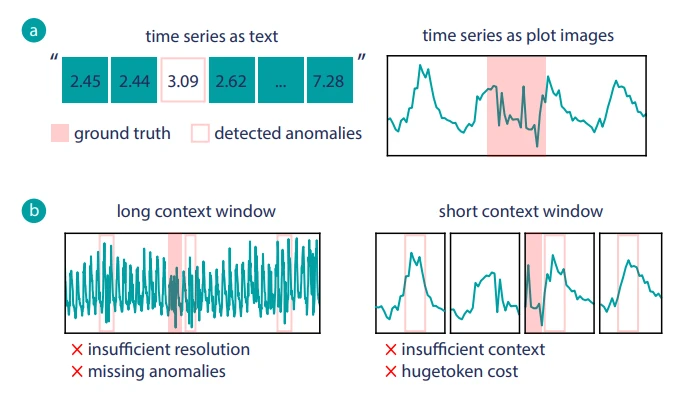
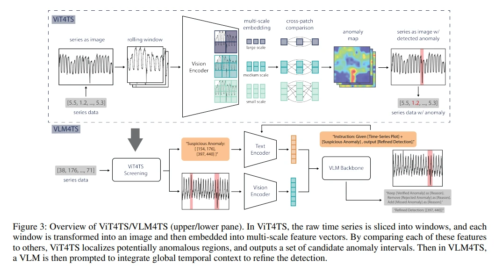
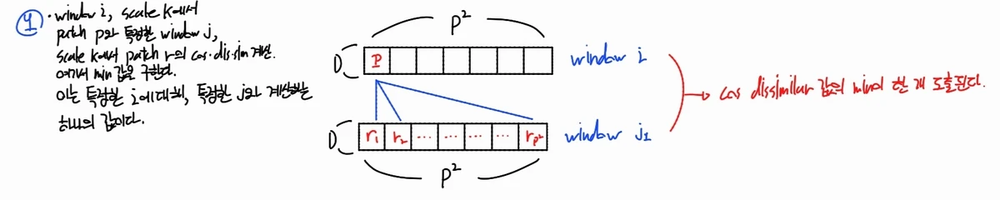
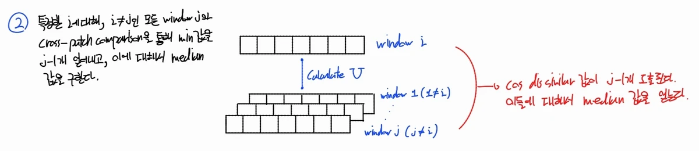
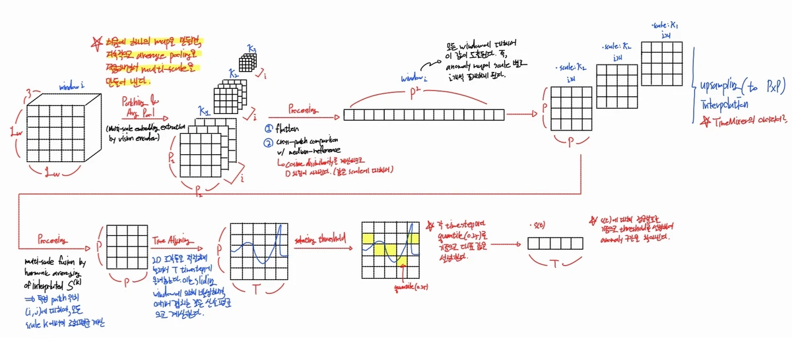
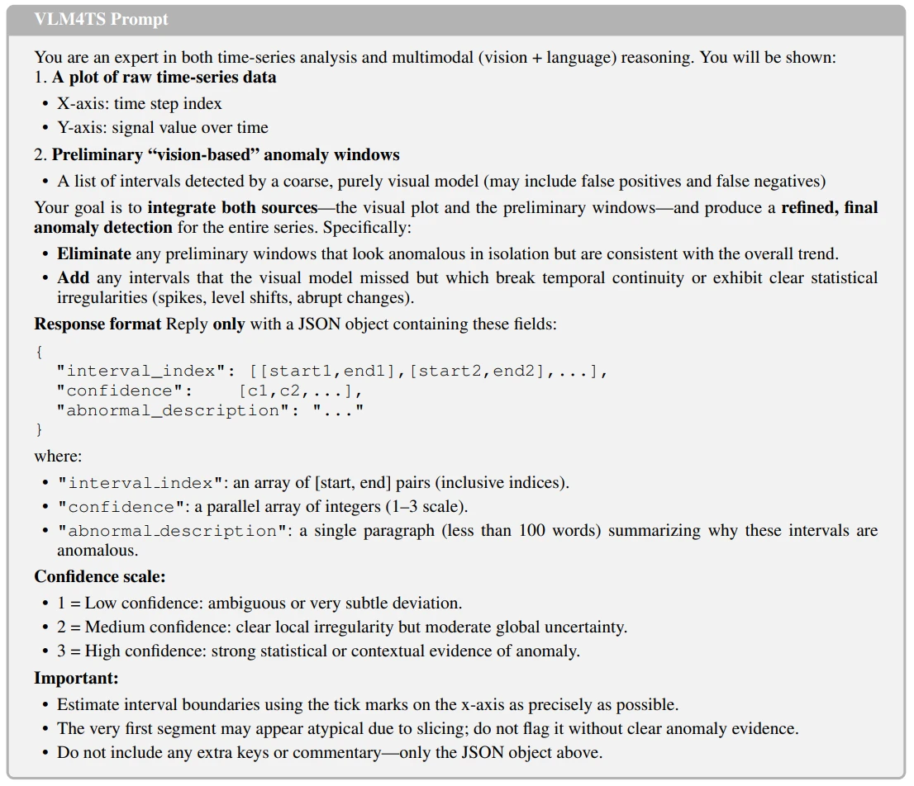
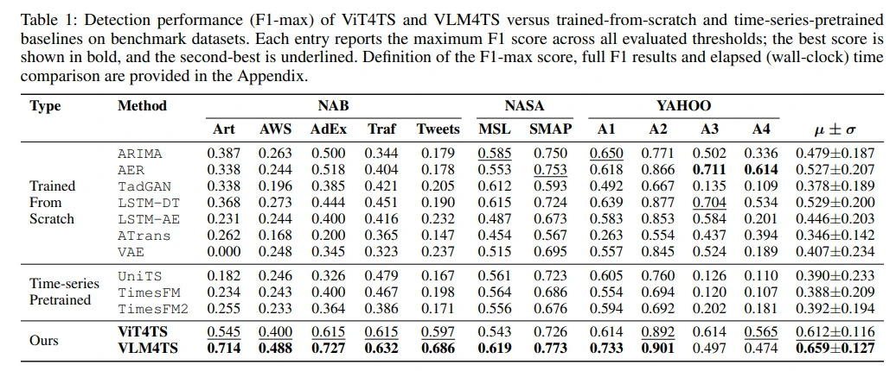
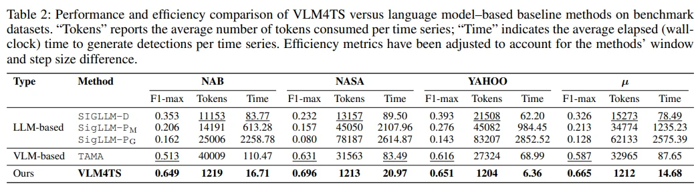
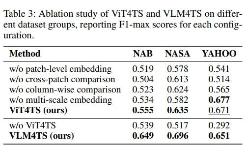
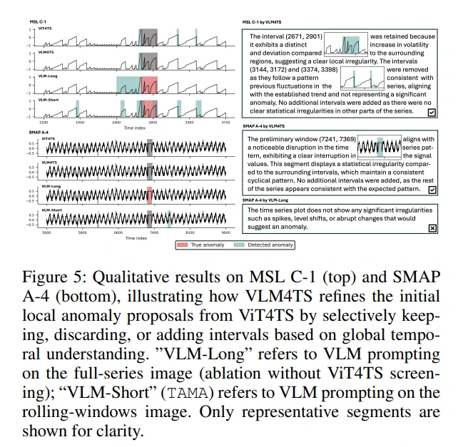

# Harnessing Vision-Language Models for Time Series Anomaly Detection 리뷰

작성일 2026-01-22 · 최종 수정일 2026-04-06
{ .post-date }

시계열을 line graph 이미지로 바꾸어 Vision-Language Model(VLM)로 이상 탐지(TSAD)를 수행하는 논문(AAAI 2026)을 정리한 글이다. 가벼운 vision encoder가 이상 후보 구간을 먼저 찾고(ViT4TS), VLM이 전체 맥락에서 그 후보를 검증하는(VLM4TS) 2단계 구조를 제안한다. 논문의 그림과 표, 그리고 읽으면서 직접 그린 그림을 함께 실었다.

## Abstract & Introduction

> 이 논문은 시계열 이상치 탐지에 VLM을 효율적으로 활용하기 위한 2단계 프레임워크를 제안한다.

### 문제 의식과 핵심 아이디어

- **기존 모델의 한계**: 주로 수치 데이터에 기반한 도메인 특화 모델이어서, 인간 전문가처럼 시각적·시간적 맥락을 통해 이상치를 찾아내는 능력이 부족하다.
    - **Vision Screening**: 시계열 모델들은 값이 갑작스럽게 변동되는 point anomaly는 잘 찾아내지만, 값의 범위는 정상인데 흐름이나 모양이 미세하게 변하는 contextual anomaly는 수식적으로 정의하기가 매우 까다롭다. 반면 사람은 그래프의 전체적인 모양을 보고 패턴을 파악하여 이상치를 탐지한다. 이 논문은 VLM이 바로 이 시각적 직관을 모사할 수 있다고 주장한다.
    - **Generalization**: 기존 모델들은 특정 데이터셋에 맞춰 학습되거나, 분포나 선형성에 대한 가정을 둔다. 문제는 가정을 벗어나는 데이터를 만나면 모델이 무력해진다는 것이다. VLM은 수십억 개의 image-text pair를 통해 범용적인 추론 능력을 갖추고 있다. 이를 이용해 domain learning 없이도 general하게 판단을 내리도록 만들려는 것이다.
    - **Multiscale Understanding**: 인간은 그래프를 볼 때 자연스럽게 확대(local)해서 세부적인 떨림을 보고, 동시에 축소(global)해서 전체적인 추세를 본다.
        - 기존 모델의 한계: window 크기를 작게 잡으면 국소적인 이상치는 잘 보지만 전체적인 흐름(trend, seasonality)을 놓치고, 크게 잡으면 세부적인 anomaly가 뭉개진다.
        - VLM의 강점: 논문에서 제안한 ViT4TS는 vision transformer의 patch 구조를 이용해 여러 scale의 특징을 동시에 추출함으로써, multi-scale로 anomaly pattern과 temporal pattern을 추출한다.

**해상도-맥락 딜레마(Resolution-Context Dilemma).** 그렇다면 시계열을 그림으로 그려 VLM에 보여 주기만 하면 될까? 그렇지 않다. VLM은 입력으로 받는 이미지의 크기와 token 수에 제한이 있어서, 시계열을 "얼마나 길게 잘라 한 장에 그리느냐"에 따라 서로 반대되는 두 가지 문제가 생긴다. 전체를 한 번에 그리면 해상도가 떨어져 세부 정보가 손실되고, 짧은 window로 나누면 맥락이 끊기고 token 비용이 급증한다.

{ width="640" }

분홍색으로 칠한 구간이 실제 anomaly(ground truth), 분홍 테두리 상자가 모델이 탐지한 구간이다. (a)는 같은 시계열을 숫자 text로 넣을 때와 plot image로 넣을 때의 차이이고, (b)가 딜레마다. 왼쪽처럼 길게 한 장에 담으면 선이 뭉개져 anomaly를 놓치고, 오른쪽처럼 짧게 여러 장으로 자르면 장마다 맥락이 모자라 엉뚱한 곳을 짚는다. 출처: 논문 Introduction의 그림

- **Long context window: 전체는 보이지만, 세부가 뭉개진다.** (그림 (b)의 왼쪽)

    > 시계열의 긴 구간을 하나의 이미지에 모두 담으려고 할 때 발생하는 문제이다.

    - 해상도 저하: 아주 긴 데이터를 한 장의 그림에 압축하다 보니, 이미지의 해상도가 저하된다.
    - 위치 파악 불가: x축의 시간 표시(tick marks)가 너무 빽빽해져서, 모델이 이상치가 정확히 어느 시점에서 발생하는지 경계선을 찾아내기 어렵다.
    - 정보 과부하: 너무 많은 시각적 정보가 한꺼번에 입력되면 모델의 attention이 분산되어, 일부 anomaly를 지나치게 된다.

- **Short context window: 세부는 선명하지만, 흐름을 모른다.** (그림 (b)의 오른쪽)

    > 데이터를 잘게 쪼개서 여러 장의 고해상도 이미지로 만들 때 발생하는 문제이다.

    - 맥락 부족: 각 이미지는 아주 짧은 순간만 보여 주기 때문에, 전체적인 trend나 seasonality를 파악할 수 없다. 예를 들어, 잠깐의 수치 변화가 전체 흐름상 자연스러운 잡음인지 진짜 이상치인지 구분하기 어렵다.
    - 비용 및 지연 시간 급증: 긴 시계열을 수많은 작은 이미지로 나누면, 처리해야 할 token 수가 급격히 늘어난다. 예를 들어 1,000 step의 sequence를 20장의 이미지로 자르면 token의 수가 20,000개가 된다. 무거운 모델이 여러 번 돌아가므로 latency가 생길 수 있고, 수천 개의 센서에서 수행되는 real-time monitoring에는 적합하지 않을 수 있다.

**제안된 솔루션.** "어디가 이상한지 찾는 일"과 "정말 이상한지 판정하는 일"을 한 모델에 한꺼번에 시키지 않는다. 문제를 위치 탐색(Localization)과 검증(Verification)의 두 단계로 분리하여 해결한다.

- 먼저 가벼운 모델로 이상치의 후보 위치를 찾는다. 짧은 window를 고해상도로 보는 일은 값싼 모델이 맡는다.
- 이후에 그 부분만 강력한 VLM이 전체 맥락과 함께 검증하게 하여, 효율성과 정확도를 동시에 잡는다. 비싼 VLM은 전체 그림 한 장만 본다.

### Framework

두 단계가 실제로 어떻게 이어지는지는 아래 그림 한 장에 담겨 있다. 위쪽 점선 상자가 1단계(ViT4TS), 아래쪽이 2단계(VLM4TS)다.

위쪽은 왼쪽에서 오른쪽으로 읽는다. 시계열을 이미지로 그리고(series as image), rolling window로 자르고, vision encoder로 여러 scale의 embedding을 뽑고, patch끼리 비교해 anomaly map을 만든 뒤, 수상한 구간(빨간 띠)을 표시한다. 아래쪽에서는 그 수상한 구간의 목록(주황 상자의 "Suspicious Anomaly")과 전체 시계열 plot이 함께 VLM에 들어가고, VLM이 구간을 유지·삭제·추가해 최종 결과(Refined Detection)를 낸다. 출처: 논문 Figure 3

- **Localization** (그림 위쪽): lightweight pre-trained vision encoder(ViT4TS)를 사용하여 anomalies를 localize한다. 쉽게 말해, anomaly가 있을 법한 부분만 잘라낸다는 것이다.
- **Verification** (그림 아래쪽): VLM(VLM4TS)을 활용하여 이 local anomalies를 검증한다. 그림의 예에서는 ViT4TS가 [154, 176]과 [397, 440] 두 구간을 후보로 냈고, VLM이 그중 [397, 440]만 남긴다.

두 과정 모두 zero-shot setting으로 동작한다. ViT4TS와 VLM4TS 어느 쪽도 in-domain time series data에 대해서 fine-tuning하지 않고도 높은 성능을 보인다.

- ViT4TS: image-pretrained weights를 사용해, visual pattern matching으로 window screening을 수행한다.
- VLM4TS: 넓은 범위의 TSAD task에 대해서 뛰어난 generalizability를 보인다.

### Contributions

- 1D anomaly detection을 2D anomaly detection으로 전환하고, VLM을 사용하여 이 문제를 해결한다. 이 과정에서 VLM을 활용함으로 인해 발생하는 resolution-context dilemma에 대처하기 위해, 처리 과정을 localization과 verification stage로 분해한다.
- Localization task에서는 ViT4TS를 사용하여 multi-scale cross-patch comparison으로 anomaly candidates를 정확히 localize한다. Verification task에서는 VLM4TS를 제안하여, detected anomalous intervals에 대해 global temporal context를 보완함으로써 최종 결정을 수행한다.
- Dataset-specific tuning 없이 다양한 domain에 걸쳐 SOTA의 성능을 보이는 generalization을 입증했고, token usage도 기존의 language model 기반 method보다 훨씬 적다.

## Related Work

### In-domain TSAD

> in-domain TSAD는 특정 데이터셋이나 도메인의 특성에 맞춰 해당 도메인의 데이터를 직접 학습(training)하여 이상치를 탐지하는 기존의 방식이다. 특정 산업군이나 데이터셋의 수치적 특징을 학습하여, 해당 환경에 최적화된 모델을 구축한다.

- 초기에는 통계 및 거리 기반의 탐지 기법이 많았고, 많은 양의 정제된 데이터와 전문가 지식을 필요로 했다. 이후 RNN이나 sequential autoencoder의 prediction/reconstruction error를 쓰는 방법, VAE/GAN 기반으로 normal behavior를 probabilistic하게 modeling하는 방법, Transformer 기반으로 temporal pattern을 modeling하는 방법이 나왔다.
- 이러한 방식들은 in-domain에서는 매우 효과적이지만, 많은 양의 training set을 필요로 하며 훈련된 상황을 넘어서는 generalization을 얻기는 힘들다.

### Foundation Model-based and LLM-based TSAD

- 최근 time series 분야에서도 (1) general-purpose time series encoder를 pretrain하려는 시도와 (2) anomaly detection에 적용할 수 있는 large forecasting foundation model을 만들려는 시도가 나타나고 있다. 그러나 이러한 방식들은 작은 window나 몇 step 정도의 예측에서만 좋은 성능을 보이고, long-range temporal context가 필요한 상황에서는 성능이 좋지 않다.
- Time series를 그대로 text로 바꿔 LLM에 넣는 방식도 연구되었으나, classical TSAD 방식보다 성능이 저조할 뿐만 아니라 token cost가 너무 크다.

### Vision and VLM-based TSAD

- Time series를 image로 처리하는 방식은 classification, forecasting 등 여러 분야에서 유망한 결과를 보이고 있지만, unsupervised anomaly detection에서는 연구가 부족하다.
- Spectrogram과 RP transformation을 사용하는 vision-based TSAD 연구도 있었지만, 오직 vision modality만 다룬다. 이러한 pure vision-based approach는 multimodal reasoning과 temporal understanding capability를 가지지 못한다.
- TAMA 및 관련 방법들과 같은 최근의 프로토타입 모델들은 작은 rolling-window plot을 VLM에 prompt로 넣어 anomaly score를 할당한다. 하지만 이 방식으로는 long-range temporal understanding을 얻지 못하므로 robust한 anomaly detection이 불가능하다.

## Methodology

### Problem Formulation

- Univariate time series: $x = (x_1, \dots, x_T) \in \mathbb{R}^T$
- Set of anomalies: $\mathbf{A} = \{(t_s, t_e)^i \mid 1 \le t_s < t_e \le T \}^m_{i=1}$
- Objective: time series 내부에 존재하는 $m$개의 anomalous interval을 찾아내는 것이다.

> 이 논문에서는 univariate time series에 집중한다.

### ViT4TS: Visual Time Series Anomaly Screening

1단계의 목표는 "이 시계열의 어느 구간이 다른 구간들과 다르게 생겼는가"를 싼값에 찾아내는 것이다. 앞의 Figure 3 위쪽을 왼쪽에서 오른쪽으로 따라가는 순서 그대로, 시계열을 그림으로 그리고 → window로 자르고 → 여러 scale의 embedding을 뽑고 → patch끼리 비교해 점수를 매기고 → 점수를 시간축으로 되돌려 후보 구간을 정한다. 아래 소절은 이 다섯 걸음을 하나씩 설명한다.

#### Time Series as Line Graphs

- 1D time series를 2D image로 rendering하여 사용한다.
- 2D image는 temporal ordering과 relative amplitude changes를 보존하므로, cross-patch comparison에서 유의미한 성능을 보일 수 있다.
- 불필요한 visual artifact를 없애기 위해, axis ticks, legends 등 장식 요소는 제거한다.

#### Rolling Windows and Image Creation

긴 시계열을 vision encoder가 받을 수 있는 크기의 정사각형 이미지 여러 장으로 자르는 단계다(Figure 3의 "rolling window").

- 일반적으로 pretrained vision encoder는 $224 \times 224$ 또는 $336 \times 336$ 크기의 입력을 처리하기 때문에, rolling window를 적용하여 이미지의 크기를 맞춘다.
    - 맞추는 과정을 자세히 설명하면, 길이가 224인 window로 시계열을 자르고, 그 window 하나를 하나의 데이터로 삼아 모델에 입력하는 방식이다.
    - Window의 time step 수가 224이면 1 pixel = 1 time step이 되어 이미지를 그리기 편하다. 하지만 값의 scale은 224 범위로 맞추기 쉽지 않을 수 있다. 이것은 normalization을 적용한 뒤 scaling으로 조절할 수 있다.
    - 이 과정에서 window끼리 겹치는 부분이 생기는데, 이는 cross-patch comparison을 수행하기 위해 의도적으로 겹치게 설계한 것이다.
- $L_w$: window length
- $L_s = \left\lfloor L_w/4 \right\rfloor$: stride
- 이때 image의 크기가 $L_w \times L_w$가 되도록 만들고, 값의 scale은 $[\min_t x_t, \max_t x_t]$가 되도록 설정한다.
- 이렇게 하면 $N \approx (T - L_w)/L_s + 1$개의 image $\mathbf{I}_i \in \mathbb{R}^{L_w \times L_w \times 3}$이 만들어진다.
    - 여기서 channel은 vision encoder와의 compatibility를 위해 복사된다.

#### Multi-Scale Embedding Extraction

Window 이미지 한 장을 CLIP의 vision encoder에 넣어 patch별 embedding을 얻고, 그것을 여러 크기로 뭉쳐서 "가까이서 본 것"과 "멀리서 본 것"을 함께 준비하는 단계다. Figure 3에서 vision encoder 오른쪽에 격자가 셋(large, medium, small scale) 그려진 부분이 이것이다. 짧은 spike는 잘게 나눈 격자에서, 길게 이어지는 drift는 크게 뭉친 격자에서 잘 보인다.

$$
\mathbf{F} = f_{\text{clip}}(\mathbf{I}) \in \mathbb{R}^{P \times P \times D}
$$

여기서 $P$는 patch size, $D$는 embedding dimension이다.

$$
\mathbf{I}_i \in \mathbb{R}^{L_w \times L_w \times 3} \to f_{\text{clip}} \to \mathbf{F} \in \mathbb{R}^{P \times P \times D}
$$

- 이를 통해 narrow spikes와 brief dips는 patch resolution에서 localize된다.
    - 단 하나의 patch 안에서만 발생하는 아주 미세한 변화(spikes and dips)를 정확하게 찾아낼 수 있다는 뜻이다.
- 이와 동시에, temporal pattern을 긴 time step에 걸쳐 왜곡시키는 extended jump와 drift는 많은 patch에 걸쳐 존재하기 때문에, 이를 잡아내려면 더 많은 context가 필요하다.
- 이를 잡아내기 위해 average pooled feature map $\{\mathbf{F}^{(k)}\}_{k \in \mathcal{K}}$을 생성한다.
    - Average pooling으로 global pattern을 보겠다는 것으로, 시계열 데이터의 전반적인 흐름과 추세를 파악할 수 있는 방식이다.
        - 이때 average pooling은 multi-scale로 적용되므로, $\mathcal{K}$는 pooling에 쓰는 kernel 크기 $k$를 모아 둔 집합이다.
        - 정리: $\mathbf{F}$는 sliding window $L_w$로 만들어 낸 이미지 $\mathbf{I}_i$를 CLIP에 통과시켜 얻은 feature map이다. $\mathbf{F}^{(k)}$에서 $k \in \mathcal{K}$는 feature map을 만드는 데 사용된 kernel의 size이다. 이를 조절하여 multi-scale embedding extraction을 수행한다.
    - Kernel size $k$에 대해 stride 1을 적용하여 만들어 낸다.

$$
\mathbf{F}^{(k)}_{i,j,d} = \frac{1}{k^2} \sum_{u=0}^{k-1} \sum_{v=0}^{k-1} \mathbf{F}_{i+u,\, j+v,\, d}
$$

각 dimension $d$별로 개별적으로 size $k$, stride 1의 average pooling을 진행한다. 이 과정은 fine spatial detail과 broader contextual information을 맞바꾸는(trading) 과정이다.

이러한 multi-scale embedding은 풍부한 cross-window comparison을 가능하게 만들어 rolling window의 stride를 더 크게 잡을 수 있게 해 준다. Localization accuracy를 희생하지 않으면서 효율을 높이는 방식이다.

#### Cross-Patch Comparison

이제 patch마다 "얼마나 이상한가"를 점수로 매긴다. 정답(정상 패턴)이 주어지지 않으므로 기준은 시계열 자신이다. 어떤 patch와 닮은 모양이 다른 window들에 흔하면 정상이고, 어디에서도 닮은 모양을 찾을 수 없으면 이상하다고 본다.

- 어떠한 ground truth reference도 없으므로, anomalies의 희귀성을 활용한다.
- 이를 위해 multiple scale에서 각 window의 patch embeddings를 다른 모든 window와 매칭시키는 방식을 쓴다(Figure 3의 "cross-patch comparison"에서 patch 사이를 잇는 선들).

> 아주 짧은 narrow spikes는 작은 scale에서 잘 포착되지만, 상대적으로 긴 시간 동안 발생하는 drift나 jump 같은 이상치는 더 넓은 context를 포함하는 큰 scale에서 효과적으로 감지된다. 이후에 조화 평균(harmonic averaging)으로 융합하여, 세밀한 감도(localization)와 문맥 파악 능력(context awareness)을 동시에 확보한다.

- $\mathbf{L}^{(k)}_i \in \mathbb{R}^{P^2 \times D}$: sliding window $i$, kernel size(scale) $k$에서의 embedding이다.
    - Patch 축을 기준으로 flatten한 것이다.
- Window $i$의 patch $p$에 대한 anomaly score를 구하기 위하여, window $i$가 아닌 모든 window $j$에 속한 모든 patch $r$에 대하여 $p$와 $r$의 cosine dissimilarity를 계산한다.
- 이 결과를 window마다 median으로 aggregate함으로써 cross-patch reference map을 얻는다.

$$
\mathbf{S}^{(k)}_i[p] = \mathrm{median}_{j \ne i}\, \boldsymbol{U}^{(k)}_{i,j}[p], \quad \text{with} \quad \boldsymbol{U}^{(k)}_{i,j}[p] = \min_r \left[ 1 - \cos\left( \mathbf{L}^{(k)}_i[p],\ \mathbf{L}^{(k)}_j[r] \right) \right]
$$

> $\mathbf{S} \in \mathbb{R}^{P^2}$ 또는 $\mathbf{S} \in \mathbb{R}^{P \times P}$: cosine similarity는 두 벡터에 대해 연산하여 하나의 scalar 값을 내므로, hidden dimension인 $D$가 사라진다.

식이 한 줄에 min과 median을 함께 담고 있어 읽기 어렵다. 안쪽($\boldsymbol{U}$)과 바깥쪽($\mathbf{S}$)의 둘로 나누어 그림으로 그려 보면 다음과 같다(그림의 ①, ②).

**① 다른 window 하나에서 가장 닮은 patch를 찾는다 (min).**

윗줄이 window $i$를 flatten한 $P^2$개의 patch(각각 $D$차원)이고, 아랫줄이 다른 window $j$의 patch $r_1, \dots, r_{P^2}$이다. 빨간 patch $p$ 하나에서 아랫줄의 모든 patch로 파란 선을 긋고(cosine dissimilarity), 그중 가장 작은 값 하나만 남긴다.

- 특정한 window $i$의 patch $p$가 있고, $i \ne j$인 특정한 window $j$ 내부의 모든 patch $r$($P^2$개)이 있다. $p$와 모든 $r$에 대해 cosine dissimilarity를 계산하고, 그중 가장 작은 값을 대표값으로 가져온다. 이는 특정한 $i$와 특정한 $j$에 대해 계산되는 하나의 값($\boldsymbol{U}^{(k)}_{i,j}[p]$)이다.
- Local Optimal Matching: 특정한 window $i$의 patch $p$가, 다른 시간대(window $j$)에서 가장 비슷한 패턴을 가진 patch $r$을 찾는 과정이다. Cosine dissimilarity가 최소라는 것은 유사도가 최대인 지점을 찾는다는 뜻이며, 공간적 위치에 상관없이 유사한 패턴이 존재하는지를 확인하는 것이다.

**② 그 일을 나머지 모든 window에 대해 되풀이하고 가운데 값을 고른다 (median).**

윗줄의 window $i$를 아래에 겹쳐 그린 나머지 window들과 하나씩 짝지어 ①의 $\boldsymbol{U}$를 계산한다. 그림에 적은 "$j-1$개"는 window $i$를 뺀 나머지 window의 수, 곧 $N-1$개를 뜻한다.

- ①의 과정을 $i \ne j$인 모든 window $j$에 대해서 수행하면 minimum cosine dissimilarity 값이 $N-1$개 구해진다. 여기서 median 값을 가져오면 $\mathbf{S}^{(k)}_i[p]$가 된다.
- 말로 옮기면 $\mathbf{S}^{(k)}_i[p]$는 "patch $p$와 가장 닮은 모양이, 보통의 다른 window에서는 얼마나 멀리 있는가"이다. 닮은 모양이 어느 window에나 있으면 값이 작고, 어디에도 없으면 값이 크다.

**Q. 위의 과정이 가장 유사한 패턴을 가진 patch를 찾는 과정이라면, 왜 굳이 유사도(cosine similarity)가 아니라 비유사도(cosine dissimilarity)를 사용하는 걸까?**

A. 최종 결과물의 목적이 anomaly score이기 때문이다.

- "높은 점수 = 이상치"라는 직관을 유지한다.
    - 비유사도를 사용하면 다른 패턴들과 다를수록 점수가 높게 나온다. 점수가 높으면 이상하다는 직관이 유지된다.
- 거리(distance) 기반 탐지의 관습을 따른다.
    - Anomaly detection 분야에서는 전통적으로 정상 데이터들로부터 거리가 먼 것(outlier)을 이상치로 정의한다.
    - 따라서 정상으로부터 가장 가까운 것(cosine similarity)이 아닌, 가장 먼 것(cosine dissimilarity)을 사용하는 것이 개념적으로 가장 자연스럽다.
- 통계적 일관성이 있다.
    - 두 번째 단계에서 median 연산을 수행하는데, 비유사도를 쓰면 "대부분의 window와 얼마나 떨어져 있는가"를 구하게 된다.
    - 만약 유사도를 쓰고 최댓값을 찾는다면 "대부분의 window와 얼마나 닮았는가"를 구하게 된다. 이 값은 normal score이지 anomaly score가 아니다.

> 결국 수식의 흐름을 [차이 계산] → [차이들의 대표값 추출] → [최종 이상치 정도]로 일관되게 설계하기 위해, 비직관적으로 보일 수 있는 "비유사도의 최솟값" 방식을 사용한 것이다.

- 이러한 cross-patch matching을 통해 irregular seasonal shifts, trends, periodic motifs에 영향을 받지 않고 local pattern을 효과적으로 capture할 수 있다.

**Median-reference variant.** 위 방식은 모든 window 쌍을 비교해야 한다. 그래서 실제로는 순서를 바꾼다. 다른 window들을 먼저 하나의 "대표 window"로 요약해 두고, 각 patch를 그 대표와만 비교한다. Memory 사용량을 줄이기 위하여 이 median-reference variant를 사용한다.

$$
\tilde{\mathbf{S}}^{(k)}_i[p] = \min_r \left[ 1 - \cos\left( \mathbf{L}^{(k)}_i[p],\ \mathbf{V}^{(k)}[r] \right) \right], \quad \text{with} \quad \mathbf{V}^{(k)}[r] = \mathrm{median}_j\, \mathbf{L}^{(k)}_j[r]
$$

**median-reference란**

- Patch location(공간적 위치)을 고려하는 방식이다.
- Position-wise median: $\mathbf{V}$는 모든 window $j$를 통틀어 동일한 patch 위치 $r$에 있는 embedding 값들의 중앙값을 계산한 결과물이다.
    - $j$: window index
    - $r$: embedding grid 내부의 patch index
    - $\mathbf{L}^{(k)}_j[r]$: $j$번째 window에서 $r$ 위치에 해당하는 patch의 embedding 값

> 각 patch 위치별로 중앙값을 구하여 하나의 참조 맵(reference map)을 만드는 것이다. 이는 전체 데이터에서 가장 일반적인 형태의 데이터를 뽑아내는 것과 같다.

**왜 median-reference인가**

- 각 patch를 다른 모든 window의 patch와 비교하려면 memory 사용량이 매우 높다.
- Median-reference 방식을 사용하면, 모든 window의 특징을 응집시킨 단 하나의 표준 참조 맵 $\mathbf{V}$만 미리 계산해 두면 된다. 이후 테스트할 patch를 이 $\mathbf{V}$에 있는 patch들과만 비교하면 되므로, memory 점유율을 크게 낮출 수 있다.

Window $i$의 patch $p$를 다른 모든 window $j$의 patch $r$과 비교하기에는 연산량이 너무 많다. 그래서 데이터의 전반적인 흐름을 담은 median-reference를 미리 만들고, 이것과 비교하여 cross-patch anomaly score를 계산한다. 특정한 window의 patch들에 대한 anomaly score를 global하게 파악하겠다는 의도로 볼 수 있다.

> 이때 vision encoder를 통과시켜 얻어 낸 feature map $\mathbf{F}$에 average pooling을 적용하면서 multi-scale embedding을 얻고, 각 scale 안에서 anomaly map을 얻는다. 큰 embedding(거시적 embedding)에서 점차 작은 embedding(미시적 embedding)으로 나아간다. 처음에는 global dependencies를, 마지막에는 local dependencies를 capture하기 위한 것이다.

**Multi-scale fusion.** 여기까지 하면 window 하나에 대해 scale마다 anomaly map이 한 장씩 생긴다(Figure 3에서 "anomaly map"이 여러 장 겹쳐 그려진 부분). 이것을 한 장으로 합치는 단계다. Scale-specific map $\{\mathbf{S}^{(k)}_i\}_{k \in \mathcal{K}}$를 base patch resolution으로 upsample하고, 모든 patch location에 대해 harmonic averaging을 적용한다.

- 이 과정은 서로 다른 kernel size $k$로 만들어진 $\mathbf{S} \in \mathbb{R}^{P^2}$들의 정보를 종합하여, 더욱 정확하게 anomaly를 찾아내기 위한 fusion 작업이다.
- 이를 위해 서로 다른 scale로 표현되어 있는 cross-patch anomaly score map $\mathbf{S}^{(k)}$들을 동일한 크기로 맞추는 interpolation을 수행한다.
    - 이를 통해 모든 scale $k$에서 모든 window의 map 크기가 같아진다.
- Harmonic averaging(조화 평균): 크기가 $P \times P$로 통일된 여러 개의 cross-patch anomaly score map $\mathbf{S}^{(k)}$를 조화 평균으로 하나의 map으로 integrate한다.

    $$
    \text{Fused Score}_{i,j} = \frac{|\mathcal{K}|}{\sum_{k \in \mathcal{K}} \frac{1}{S^{(k)}_{i,j}}}
    $$

    - 각 patch index $(i, j)$에 대해, 여러 scale $k$에서 얻은 anomaly score들을 조화 평균 공식에 넣는다.
        - Interpolation으로 크기가 $P \times P$로 맞춰진 모든 map에 대해, patch index가 같은 위치에서 multi-scale $k$에 대한 조화 평균을 계산하는 것이다.
        - 그렇다면 결과로 나오는 것은 $P \times P$ 크기의 값일까?
    - 조화 평균을 쓰는 이유: 조화 평균은 값들 중 하나라도 매우 낮으면 전체 평균을 낮추는 특성이 있다. 다시 말해, 입력값 중에서 "가장 작은 값"에 강하게 수렴하는 성질이 있다. 그리고 값이 작을수록 정상에 가깝다는 뜻이다. 그러므로 여러 scale이 공통적으로 "여기는 이상하다"라고 가리키는 부분을 더 견고하게 강조하고, 특정 scale에서만 강하게 나타나는 노이즈를 억제하는 효과를 준다.

    > 조화 평균의 의미를 다시 해석해 보면, 특정한 위치 $(i, j)$에 대하여 각 window가 서로 다른 scale에서 표현된 것을 aggregate함으로써 local, global anomaly information을 통합한다고 볼 수 있다.

> Time series를 rolling window로 나누고, multi-scale embedding extraction을 수행한 다음, 각 scale별로 anomaly map을 구한다. 이렇게 구한 map을 interpolation으로 shape을 맞춰 주고, 조화 평균을 통해 anomaly가 정말로 강한 부분만 남도록 만든다.

#### Anomaly Scoring and Localization

지금까지의 점수는 window 이미지 안의 patch 격자 위에 있다. 최종적으로 필요한 것은 "몇 번째 time step부터 몇 번째까지가 이상한가"이므로, 격자 위의 점수를 시간축 위의 점수 $s(t)$로 되돌리고 임계값으로 구간을 잘라낸다.

- 이제 각 patch마다 harmonic averaging된 anomaly score가 있는데, 이 점수들을 다시 원래의 시간축으로 정렬한다.
    - 이를 위해 각 patch의 점수를 시계열의 원래 time index $t$에 맞춰 다시 배치한다.
    - 이 과정이 정확히 어떻게 구현되는지는 코드를 통해 확인해야 한다. 대략적으로 생각해 보면, 최종적으로 얻는 map의 크기는 $\mathbb{R}^{P \times P}$이고 원본 rolling window는 $\mathbb{R}^{L_w \times L_w}$이므로 어디에 매칭되는지 대략 알 수 있고, 이를 대응시켜 주면 된다.
        - Rolling window를 사용하므로 자연스럽게 겹치는 구간이 생긴다. 겹치는 부분에는 averaging(산술평균)을 적용하여 하나의 값으로 합친다.
- 이 결과로 $\mathbf{M} \in \mathbb{R}^{P \times T}$인 2D anomaly map을 얻는다.
    - $P$: patch resolution
    - $T$: time series length

    > Q. Anomaly score를 시계열의 시간축에 매칭하는데, 왜 patch resolution이 필요한 걸까?

- $\mathbf{M}$의 각 time step $t$에는 수직 방향의 패턴 정보를 담은 $P$차원의 벡터가 있다. 이를 하나의 숫자로 합치기 위해 quantile 연산을 수행한다.
    - Quantile 연산을 수행한다는 것은, 수직 벡터의 $P$개 값을 하나로 압축할 때 어떤 기준의 값을 대표값으로 선택할지 결정하는 과정이다.

        $$
        s(t) = \text{quantile}_q(\mathbf{M}_{:,t})
        $$

        - Low $q$ (예: 0.1): $P$개의 수직 구역 중에서 일부만 이상해도 점수가 민감하게 반응한다. 미세한 형태의 왜곡을 잡는 데 유리하다.
        - High $q$ (예: 0.5): 수직 구역 전반이 이상해야 높은 점수가 나오므로, 강력한 spike와 같이 확실한 변화를 강조한다.
    - 특정한 time step에 속하는 $P$개의 값들 중 $q$ 분위에 해당하는 값을 가져온다는 것이다. 논문에서는 두 특성 사이의 trade-off를 조절하고자 $q = 0.25$로 설정한다. 즉, 0.25 선에 해당하는 값을 기준으로 한다.

    > Quantile을 사용하는 이유는, 이미지에는 흰색 배경이 존재하므로 과도하게 낮은 점수들 때문에 진짜 이상치 점수가 희석될 수 있기 때문이다.

- 임계값 설정
    - 앞에서 1D로 collapse한 $s \in \mathbb{R}^T$에 정규분포를 적용해 threshold를 결정한다.
        - 상위 $\alpha$만큼의 확률을 제외한 나머지 $(1 - \alpha)$ 확률이 포함되는 지점을 임계값 $\tau$로 정한다.
    - $s(t)$가 $\tau$를 넘는 연속 구간들이 ViT4TS가 내놓는 anomaly 후보가 된다.

        $$
        \hat{\mathbf{A}} = \{(t_s, t_e)^i \mid s(t) > \tau,\ \forall\, t_s \le t \le t_e \}^m_{i=1}
        $$

**ViT4TS의 전체 흐름.** 여기까지의 과정을 window 하나를 기준으로, tensor의 모양이 어떻게 바뀌는지에 맞춰 한 장에 그려 보았다. 윗줄은 왼쪽에서 오른쪽으로 1 ~ 3번, 빨간 선을 따라 아랫줄로 내려와 다시 왼쪽에서 오른쪽으로 4 ~ 6번이다.

윗줄 왼쪽의 육면체가 window 이미지 한 장($L_w \times L_w \times 3$), 그 오른쪽에 크기가 다른 격자 묶음 셋이 scale $k_1, k_2, k_3$의 feature map이다. 아랫줄에서는 $P \times P$ 격자 한 장이 시간축 $T$ 위에 놓이고, 노란 칸(각 time step에서 고른 quantile 값)이 모여 맨 오른쪽의 길이 $T$짜리 $s(t)$가 된다.

1. (윗줄 왼쪽) Window $i$의 이미지($L_w \times L_w \times 3$)를 vision encoder에 넣어 patch feature map을 만든다. 처음에 하나의 map을 만든 뒤, average pooling을 거듭 적용하면서 multi-scale feature map을 만들어 낸다.
2. (윗줄 가운데) Scale마다 feature map을 flatten하고($P^2$개의 patch), median-reference로 cross-patch comparison을 수행한다. Cosine dissimilarity를 계산하므로 같은 scale 안에서 $D$ 차원이 사라진다. 이 값은 모든 window에 대해서 구해지므로, anomaly map은 scale별로 window 수만큼 존재한다.
3. (윗줄 오른쪽) Scale별 anomaly map을 $P \times P$ 크기로 upsampling(interpolation)한다. 이 부분은 TimeMixer의 아이디어일까?
4. (아랫줄 왼쪽) Interpolate된 $\mathbf{S}^{(k)}$들을 harmonic averaging으로 fusion한다. 특정 patch 위치 $(i, j)$에 대해 모든 scale $k$의 값으로 조화 평균을 계산한다.
5. (아랫줄 가운데) Time aligning: 2D 조각들을 제자리에 놓아 $T$개의 time step 위에 올려놓는다. Sliding window 때문에 겹치는 값은 산술평균으로 계산한다.
6. (아랫줄 오른쪽) 각 time step마다 quantile(0.25)을 기준으로 대표값을 골라 $s(t)$를 만들고, $s(t)$에 정규분포를 기준으로 threshold를 설정하여 anomaly 구간을 찾아낸다.

### VLM4TS: Anomaly Verification and Refinement

2단계는 1단계가 낸 후보를 "전체 그림을 보면서 다시 판정"하는 단계다. Figure 3의 아래쪽처럼, 전체 시계열을 그린 plot 한 장과 후보 구간의 목록을 VLM에 함께 넣고, 후보를 유지할지 버릴지, 놓친 구간을 더할지를 묻는다.

- ViT4TS가 정확한 anomaly candidate intervals를 선택하고 나면, VLM4TS가 global context에서 이를 verify한다.
- ViT4TS는 정확한 local detection에는 뛰어나지만, extended anomalies를 놓치거나 benign fluctuation을 잡아 버릴 수도 있다.
    - Benign fluctuation: anomaly처럼 보이지만, 실제로는 시스템의 정상 동작 범위 내에 있거나 무해한 자연스러운 변동을 말한다.
    - Extended anomalies(gradual drift): 시계열에 점진적으로 concept drift가 발생하는 상황으로, 잡아내기 어렵다.
- VLM4TS는 이러한 문제를 개선하기 위해 도입한 방법으로, global temporal context에서 cross-modal understanding을 활용한다.
    - 모델은 GPT-4o를 사용한다.
- **Visual input**
    - 각 time series를 x축과 y축 value label이 표시된 평범한 line graph로 만든다.
        - 이를 VLM에 넣어, 모델이 시계열 데이터의 trend, seasonality, drift 등을 한눈에 알아볼 수 있게 한다.
    - VLM은 이미 충분히 좋기 때문에, 이 이미지를 그대로 넣는다.
- **Textual input**
    - 모델이 anomaly intervals set $\hat{\mathbf{A}}$를 알고, 이것이 local shape matching 과정을 통해 생성된 것임을 기억할 수 있게 하는 prompt를 작성한다.
    - 모델에게 global pattern과 상당한 차이를 보이는 것만 인정하도록 지시한다.
    - False positive(anomaly가 아니지만 anomaly라고 판단한 것)를 걸러 내도록 한다.
    - ViT4TS가 놓쳤을 수도 있는, 명확한 statistical/visual irregularities를 잡아내도록 한다.
- 이후에 VLM이 각 interval에 대해 1 ~ 3 사이의 정수 confidence를 정하도록 한다.
- 결과적으로 모델은 정제된 anomaly set $\hat{\mathbf{A}}_{\text{final}} = \{(t_s, t_e)^i\}^{\hat{m}}_{i=1}$을 confidence rating과 함께 출력한다.
    - Confidence가 1인 anomaly interval은 삭제한다.

**Prompt 예시.** 논문에 실린 VLM4TS prompt는 다음과 같다.

위에서부터 주어지는 두 입력(plot과 예비 anomaly window), 할 일(Eliminate와 Add), JSON 응답 형식, confidence 척도, 주의 사항의 순서다. 출처: 논문의 VLM4TS Prompt

구성을 항목별로 옮기면 다음과 같다.

- 역할: time-series analysis와 multimodal(vision + language) reasoning의 전문가.
- 주어지는 것
    - Raw time-series data의 plot (x축: time step index, y축: signal value)
    - 예비 "vision-based" anomaly window: coarse한 순수 visual model이 탐지한 interval의 목록으로, false positive와 false negative가 섞여 있을 수 있다고 알려 준다.
- 목표: 두 정보를 통합해 시계열 전체에 대한 정제된 최종 anomaly detection을 낸다.
    - Eliminate: 따로 떼어 보면 이상해 보이지만 전체 trend와는 일치하는 예비 window를 제거한다.
    - Add: visual model이 놓쳤지만 temporal continuity를 깨거나 명확한 statistical irregularity(spikes, level shifts, abrupt changes)를 보이는 interval을 추가한다.
- 응답 형식: `interval_index`([start, end] 쌍의 배열), `confidence`(같은 순서의 1 ~ 3 정수 배열), `abnormal_description`(왜 anomaly인지 요약한 100단어 미만의 한 문단)으로 이루어진 JSON object만 답한다.
- Confidence scale
    - 1 = Low: 모호하거나 매우 미세한 deviation
    - 2 = Medium: local irregularity는 명확하지만 global하게는 어느 정도 불확실함
    - 3 = High: anomaly라는 강한 statistical 또는 contextual 근거가 있음
- 주의 사항: interval의 경계는 x축의 tick mark를 이용해 최대한 정밀하게 추정한다. 맨 첫 segment는 slicing 때문에 이상해 보일 수 있으므로 명확한 근거 없이 flag하지 않는다.

## Experiments

다양한 industrial anomaly detection benchmark에 대해서 evaluation을 진행한다.

### Experimental Setup

#### Benchmark Datasets and Baseline Methods

- Benchmark datasets: astronomy sensory 같은 센서 데이터, production traffic 같은 web monitoring 데이터, Twitter mentions 같은 web metric 데이터 등 여러 도메인의 benchmark 11개를 쓴다.
- Baseline models: statistical model(ARIMA), deep learning model(forecasting-based LSTM, reconstruction-based LSTM-AE·VAE·TadGAN, hybrid인 AER, Transformer-based인 Anomaly Transformer), pre-trained time series foundation model(UniTS, TimesFM), LLM-based approach(prompt-based detector인 SigLLM-PG(GPT)와 SigLLM-PM(Mistral), LLM prediction-based인 SigLLM-D), 그리고 naive rolling-window VLM prompting baseline인 TAMA와 비교한다.

#### Evaluation

- Continuous anomaly score를 만드는 모델에 대해서는 raw output에 exponentially weighted moving average를 적용해 smoothing한 뒤, Gaussian-based threshold $\mu + k\sigma$를 적용한다.
    - $\mu, \sigma$: mean과 standard deviation
    - $k$: 임계값의 높이를 결정하는 배수(multiplier)다. 평균으로부터 표준편차의 몇 배만큼 떨어진 지점부터 이상치로 간주할 것인지, 통계적 거리를 결정한다.
        - $k$ 값이 크면 모델이 보수적으로 변해서 확실하게 튀는 값만 이상치로 판단한다. 정밀도(precision)는 높아지지만, 미세한 이상치를 놓칠 수 있어 재현율(recall)은 낮아진다.
        - $k$ 값이 작으면 임계값이 낮아져서 모델이 민감해진다. 작은 변동도 이상치로 잡아내어 재현율은 올라가지만, 정상적인 노이즈를 이상치로 오판할 가능성이 커져 정밀도가 떨어질 수 있다.
    - 논문에서는 $k$ 값을 고정하지 않고, 다양한 값으로 변화(sweep)시키며 F1 score를 계산한다.
    - F1-max: 여러 $k$ 값 중에서 가장 높은 F1 score를 기록했을 때의 값을 모델의 최종 성능인 F1-max로 보고한다.

### Performance Evaluation

결과는 표 두 장으로 나뉜다. Table 1은 시계열로 직접 학습했거나 시계열로 pretrain한 모델과의 비교이고, Table 2는 LLM·VLM에 prompt를 넣는 방법과의 비교다.

맨 아래 두 행(Ours)이 ViT4TS와 VLM4TS이고, 굵은 숫자가 열마다의 1위, 밑줄이 2위다. 맨 오른쪽 열($\mu \pm \sigma$)이 11개 데이터셋의 평균이다. 굵은 숫자가 거의 모두 VLM4TS 행에, 밑줄이 ViT4TS 행에 몰려 있는 것을 보면 된다. 출처: 논문 Table 1

- 이 논문이 제안한 2-stage TSAD model이 F1-max score 기준으로 가장 좋은 성능을 기록했다.
    - 11개의 benchmark 데이터셋 중 9개에서 SOTA를 기록했고, 가장 좋은 baseline 대비 평균 F1-max score가 24.6% 개선되었다. 표의 평균 열에서 VLM4TS는 0.659, baseline 가운데 가장 높은 LSTM-DT는 0.529다.
- 이 결과를 통해 VLM을 사용함으로써 좋은 성능을 얻을 수 있음을 확인할 수 있다.
- 눈에 띄는 것은 ViT4TS만 사용하더라도 두 번째로 높은 성능(평균 0.612)을 기록한다는 점이다.
    - Time series anomaly를 visual perspective로 잡아내는 것이 매우 효과적임을 보여 준다.

데이터셋 그룹(NAB, NASA, YAHOO)마다 F1-max, Tokens(시계열 하나에 쓴 평균 token 수), Time(시계열 하나를 처리하는 데 걸린 평균 시간)의 세 열이 있다. 맨 아래 VLM4TS 행은 F1-max가 가장 높으면서 Tokens와 Time은 가장 작다. 출처: 논문 Table 2

- LLM-based model(SigLLM 계열)과 비교해 보아도 가장 좋은 성능을 보인다.
- VLM-based method가 LLM prompting framework를 능가하는 모습을 보이며, time series를 image로 casting하는 것이 text-only representation만으로 task를 수행하는 것보다 훨씬 효과적임을 입증한다. 표에서도 평균 F1-max가 SigLLM 계열은 0.128 ~ 0.326인데, 이미지를 쓰는 TAMA는 0.587, VLM4TS는 0.665다.

#### Task-Specific Detection Performance

- Table 1을 보면, VLM4TS는 real-world dataset에서 큰 gain을 얻고 있다.
- 이러한 advantage는 2D representation 안에서 관찰되는 anomaly들을 localize할 수 있는 역량에서 비롯되며, recall을 희생하지 않고 precision을 높일 수 있는 global-context verification 덕분이다.

> 단, synthetic data에서는 VLM4TS가 forecasting-based model보다 부족한 성능을 보였다. VLM4TS는 anomaly가 rare하다고 가정하므로, anomaly가 적은 상황에 더 잘 맞기 때문이다.

Table 1에서 VLM4TS가 1위가 아닌 열은 YAHOO의 A3와 A4 둘뿐이다. 이 두 열에서는 AER(0.711, 0.614)와 LSTM-DT(A3에서 0.704)가 더 높고, VLM4TS는 0.497, 0.474로 ViT4TS(0.614, 0.565)보다도 낮다.

- Table 2를 보면, VLM4TS는 NAB dataset group과 같이 long-range context를 필요로 하는 데이터셋에서 큰 gain을 보였다(NAB의 F1-max가 TAMA 0.513, VLM4TS 0.649).
    - ViT4TS가 localized proposals(candidates)를 제시하고 VLM4TS가 anomalies를 refine함으로써, localization accuracy를 잃지 않고 더 큰 temporal horizon을 볼 수 있기 때문이다.

#### Computational Time and Token Cost

Token 사용량 면에서는 기존의 language model 기반 TSAD method보다 평균 36배 효율적이라고 보고한다. 실험 절의 본문에서는 rolling window마다 수치를 text나 image로 넣는 LLM·VLM 기반 detector와 비교해 token 사용량이 평균 30배 줄었다고 적고 있다.

Table 2의 맨 오른쪽 묶음($\mu$)에서 이 차이를 바로 볼 수 있다. 시계열 하나에 쓰는 평균 token 수가 VLM4TS는 1,212개인데, SigLLM 계열은 15,273 ~ 62,133개, TAMA는 32,965개다. 평균 소요 시간도 VLM4TS가 14.68로 가장 짧다(TAMA 87.65, SigLLM-D 78.49).

### Additional Analysis

각 부품을 하나씩 빼 보면서 무엇이 성능에 기여하는지를 확인하는 ablation이다.

{ width="460" }

위쪽 묶음은 ViT4TS에서 부품 하나를 뺀 설정들과 온전한 ViT4TS(ours)의 비교이고, 아래쪽 묶음은 VLM4TS에서 ViT4TS screening을 뺀 설정(w/o ViT4TS)과 온전한 VLM4TS의 비교다. 숫자는 데이터셋 그룹별 F1-max다. 출처: 논문 Table 3

Table 3은 ViT4TS의 각 component의 contribution을 보여 준다. 이를 통해 VLM4TS에서 visual screening의 중요성도 확인할 수 있다. 표에는 아래 네 항목 말고도 w/o column-wise comparison 행이 있다.

- **w/o patch-level embedding**: patch 단위의 embedding grid 대신, window마다 global summary token 역할을 하는 CLS token 하나만 쓰는 설정이다. 이렇게 patch-level embedding을 빼면 평균 11.94%의 성능 하락을 보였다.
- **w/o cross-patch matching**
    - 기존 방식: 현재 patch를 다른 window의 모든 위치 $r$에 있는 patch들과 비교하여, 가장 유사한 것을 찾는다.
    - 제외 시: 현재 patch를 다른 window에서 정확히 동일한 위치에 있는 patch와만 비교한다.
    - 제거한 결과 모든 데이터셋 그룹에서 성능이 하락했고, 특히 YAHOO 데이터셋에서 그 차이가 극명하게 나타났다.
    - Cross-patch matching을 적용했을 때, YAHOO 데이터셋 그룹에서 적용하지 않았을 때보다 18.76%의 성능 향상이 있었다.
        - Cross-patch matching은 spatial position과 관계없이 유사한 local pattern의 대응 관계를 포착할 수 있게 하므로, 불규칙한 계절성 변화, 추세, periodicity 등에 매우 robust하다.
        - 특히 YAHOO 데이터셋은 seasonality와 trend pattern 속에 anomaly가 숨겨져 있는 경우가 많다. 위치가 고정된 비교 방식은 자연스러운 변화를 이상치로 오해할 가능성이 높다.
- **w/o multi-scale embedding**: average pooling을 활용한 multi-scale embedding extraction을 하지 않으면 성능이 떨어졌고, 특히 NASA 데이터셋 그룹에서 F1-max가 8.35% 하락했다(표에서 0.635 → 0.582). 다만 표의 YAHOO 열만은 multi-scale을 뺀 쪽이 0.677로 온전한 ViT4TS(0.671)보다 근소하게 높다.
    - Multi-scale embedding은 patch-level에서 잡아내기 어려운 extended contextual anomalies를 효과적으로 잡아낸다.
        - 이는 patching의 locality 때문이며, average pooling을 통해 global dependency를 기반으로 gradual drift나 extended contextual anomalies를 잡는다.
- **visual screening**: 이를 없애면 매우 큰 성능 하락이 나타났다. 특히 anomaly의 수가 많은 데이터에서 더 그러했다. 표의 아래쪽 묶음에서 w/o ViT4TS 행이 이 설정이며, YAHOO에서 0.651이 0.292로 떨어진다(NAB 0.649 → 0.539, NASA 0.696 → 0.517).

#### Qualitative Results

숫자 대신 실제 탐지 결과를 그림으로 비교한 것이다. 같은 시계열에 네 가지 방법을 적용했을 때 어디를 anomaly로 짚는지를 위아래로 나란히 놓았다.

{ width="600" }

빨간 띠가 실제 anomaly, 청록 띠가 모델이 탐지한 구간이다(둘이 겹치면 어둡게 보인다). 위쪽 MSL C-1을 보면 ViT4TS는 진짜 구간 말고도 오른쪽에 두 곳을 더 짚었는데, VLM4TS에서는 그 둘이 사라지고 진짜 구간만 남는다. 오른쪽 글 상자는 VLM4TS가 내놓은 판정 이유다. 출처: 논문 Figure 5

- Figure 5를 보면, VLM4TS가 가장 정확한 탐지를 수행하고 있다.
- VLM4TS는 ViT4TS에서 선발된 candidate proposals에 대해서, 각 candidate를 full-series context와 비교함으로써 true anomalous intervals를 탐지한다.
    - MSL C-1의 글 상자를 보면, (2671, 2901) 구간은 주변과 뚜렷이 다르다는 이유로 유지하고, (3144, 3172)와 (3374, 3398) 구간은 앞선 변동과 같은 패턴을 따른다는 이유로 제거했다. 추가한 구간은 없다.
    - SMAP A-4에서는 예비 구간 (7241, 7369)를 주기적인 패턴이 끊긴 곳이라는 이유로 유지했다.
- 이와 대조적으로 VLM-Long(prior screening 없이 time series 전체를 VLM에 넣는 것)은 anomaly boundaries 자체를 잘못 잡거나, 아예 anomaly를 flag하지 않는다. 그림에서 MSL C-1의 VLM-Long 행은 실제 구간보다 훨씬 앞에서부터 넓게 칠해져 있고, SMAP A-4에서는 "뚜렷한 irregularity가 보이지 않는다"고 답해 아무것도 짚지 못했다.
- VLM-Short(TAMA)는 모든 rolling window에 대해 prompt를 넣는데, narrow context와 high token usage 때문에 false positive가 많이 나온다. MSL C-1의 VLM-Short 행에 청록 띠가 여러 군데 흩어져 있는 것이 그것이다.

## Conclusion

이 논문은 ViT4TS와 VLM4TS로 이루어진 2-stage TSAD model을 제안한다. 1D time series를 2D 이미지로 변환해, pretrained vision model과 vision-language model을 in-domain training 없이 활용한다. ViT4TS가 multi-scale cross-patch comparison으로 anomaly candidates를 high resolution으로 생성하고, VLM4TS가 이 candidate proposals를 long context를 기반으로 verify하며, 적은 token으로 많은 benchmark dataset에서 SOTA를 기록했다.

## Experimental Details and Further Discussion

### Data Preprocessing

- 각 raw series를 min-max normalize로 $[0, 1]$ 범위로 조절하고, least-squares linear fit(최소제곱 선형 적합)을 사용해 detrending을 적용한다.
    - Least-squares linear fit은 데이터를 가장 잘 설명하는 직선을 찾는 것이다.
    - Trend line을 하나 찾아 뺌으로써 데이터의 전체적인 기울기가 사라지고, 모든 데이터가 수평(평균적으로 0 근처)을 유지하게 된다.
    - 데이터에 추세가 존재하면 anomaly를 판단하기가 어려울 수 있다. 그러므로 trend를 제거해 주는 과정이 중요하다고 볼 수 있다.

> Q. 그런데 왜 일반적인 normalization이 아니라 min-max normalize를 적용했을까? 어쩌면 standardization 같은 것을 적용하면 분포의 표현이 상당히 들쑥날쑥해지므로, 최대한 안정적으로 표현되도록 만들고자 했던 것은 아닐까?

### Postprocessing and Evaluation

- Anomaly score를 만든 이후에는 exponentially weighted moving average를 적용하여 score를 smoothing하고, Gaussian quantile threshold를 적용한다.

### Limitation and Future Work

- 현재의 prompting strategy가 매우 단순하다.
- Advanced in-context reasoning method(예: chain-of-thought, retrieval-augmented prompt)를 연구할 필요가 있다.
- Multivariate data를 다뤄야 한다.

## 참고 자료

- Zelin He, Sarah Alnegheimish, Matthew Reimherr. "Harnessing Vision-Language Models for Time Series Anomaly Detection." Proceedings of the AAAI Conference on Artificial Intelligence, 40(26), 21690-21698, 2026. [arXiv:2506.06836](https://arxiv.org/abs/2506.06836), [doi:10.1609/aaai.v40i26.39319](https://doi.org/10.1609/aaai.v40i26.39319)
- 논문의 공개 코드: [github.com/ZLHe0/VLM4TS](https://github.com/ZLHe0/VLM4TS)

## 관련 글

- [Delving into Large Language Models for Effective Time-Series Anomaly Detection 리뷰](2026-03-23-llm-tsad-delving.md): LLM 기반 시계열 이상 탐지를 다룬 논문이다.
- [Can Multimodal LLMs Perform Time Series Anomaly Detection? 리뷰](2026-04-22-mllm-tsad-benchmark.md): multimodal LLM의 시계열 이상 탐지 능력을 다룬 논문이다.
