# TS-RAG: Retrieval-Augmented Generation based Time Series Foundation Models are Stronger Zero-Shot Forecaster 리뷰

작성일 2026-02-08 · 최종 수정일 2026-03-19
{ .post-date }

Time Series Foundation Model(TSFM)에 Retrieval-Augmented Generation(RAG)을 붙여 zero-shot 예측 성능을 높인 TS-RAG를 정리한 글이다. 먼저 논문을 요약하고, 읽으면서 생긴 질문과 논문의 한계를 정리한 뒤, 논문의 절 순서를 따라 자세히 적는다. 논문의 구조도와 결과 표, 그래프를 함께 싣고 그림을 가리키며 설명한다.

시계열 RAG를 다룬 다른 글로는 [RAFT](2026-03-19-raft.md), [Cross-RAG](2026-03-20-cross-rag.md), [RAG4CTS](2026-09-07-rag4cts.md)가 있다.

## 요약

### 1. 연구 수행 배경

- 기존 시계열 예측 연구의 bottleneck은 크게 세 가지로 정리된다.
    - 전통적인 통계/머신러닝/딥러닝 계열 방법은 특정 도메인 안에서는 잘 작동해도, 보지 못한 데이터셋이나 새로운 분포로 넘어가면 일반화가 약하다.
    - 최근의 LLM 기반 TSF는 fine-tuning을 하는 경우가 많지만, 이 방식은 계산 비용이 크고, 특정 데이터셋 적응에는 유리해도 unseen domain으로의 일반화는 여전히 불안정하다.
    - TSFM 계열은 multi-domain pretraining으로 generalization은 높였지만, external context를 dynamic하게 끌어와서 adapt하는 mechanism이 없어 non-stationarity, distribution shift, evolving pattern에 약하다고 지적한다. 해석 가능성도 제한적이라고 본다.
- 저자들이 RAG를 가져오는 이유는 다음과 같다. NLP에서 RAG가 필요한 외부 지식을 그때그때 검색해서 generation 모델의 정확도와 적응성을 높였듯, 시계열에서도 현재 입력만으로는 부족한 context를 retrieval knowledge base에서 찾아와 보강하면 zero-shot forecasting을 더 강하게 만들 수 있다고 주장한다.
- 즉, 이 논문에서 RAG와 FM을 접목한 이유는 frozen TSFM이 원래 갖지 못하는 동적인 외부 지식 주입 기능을 추가하기 위해서다.
    - 그 결과로 fine-tuning 없이도 unseen domain에서 더 잘 예측하고, retrieved sequence를 근거로 예측의 evidence를 제시할 수 있다는 점을 강조한다.
- 이 논문의 핵심은 TSFM backbone 자체보다는 retrieval-augmentation이라는 framework에 있다.
- 따라서 이 논문의 관점은 "foundation model + retrieval"이 zero-shot adaptation의 핵심이라는 쪽에 가깝다고 볼 수 있다.

### 2. 논문의 핵심 Contribution 3줄 요약

- TS-RAG라는 retrieval-augmented zero-shot forecasting framework를 제안해, frozen TSFM에 외부 시계열 패턴을 주입함으로써 일반화와 해석성을 동시에 개선했다.
- 검색된 future horizon들을 단순히 concat하지 않고, Adaptive Retrieval Mixer(ARM)로 query 표현과 retrieved pattern의 기여도를 동적으로 섞어 예측 성능을 높였다.
- 7개의 벤치마크에서 zero-shot forecasting SOTA 수준의 결과를 보고한다. backbone인 Chronos-Bolt 대비 평균적으로 개선되고, 특정 데이터셋에서는 최대 6.84%의 MSE 감소를 보였으며, RAF보다 정확도와 추론 속도 모두 우수했다.

### 3. 논문의 기존 한계 해결 방식

- 이 논문은 기존 한계를 "입력 시계열만 보고 예측하는 폐쇄형 forecasting"에서 "외부 기억을 참조하는 개방형 forecasting"으로 바꾸는 방식으로 해결한다. 아래에서 말로 설명하는 흐름은 논문 정리의 [전체 구조 그림](#ts-rag-for-zero-shot-time-series-forecasting)에 한 장으로 그려져 있다.
- 입력된 query sequence를 pretrained retrieval encoder로 embedding하고, knowledge base에 저장된 과거 시계열 context들과의 임베딩 유사도를 계산해서 top-k개의 유사한 시계열 pair(context, future horizon)를 찾는다.
- 여기서 중요한 것은, retrieval 대상이 단순히 비슷한 과거 조각이 아니라 그 조각에 대응되는 실제 future horizon까지 함께 저장된 pair라는 점이다. 즉, "비슷한 과거가 나왔을 때 실제 미래가 어땠는지"를 참고하게 된다.

    > 이는 [RAFT](2026-03-19-raft.md)의 방식과 동일한 방식이다.

- 검색된 future horizon들은 그대로 붙이지 않고, query의 TSFM 표현과 함께 ARM에 넣어 dynamic하게 fusion한다. ARM은 retrieved candidates 각각의 중요도를 계산하고, query 자체의 representation을 보존하면서 external information을 섞는다.
- 이 구조는 retrieved pattern의 유용성을 instance-wise하게 조절해서 retrieved pattern이 noise로 동작하는 것을 완화하려는 것이다. 실제로 gate보다 ARM이 낫다는 ablation 결과가 있다.
- TS-RAG는 backbone TSFM과 retrieval encoder를 freezing하고, projector와 ARM만 학습한다. 기존 TSFM 위에 lightweight retrieval adaptor를 얹는 방식이다. 그래서 저자들은 fine-tuning 없이 zero-shot inference를 수행하면서도 외부 knowledge base를 통해 도메인 변화에 대응할 수 있다고 주장한다.
- 또 하나의 해결 포인트는 해석 가능성이다. 일반적인 TSFM은 왜 그런 예측을 했는지 설명하기 어렵지만, TS-RAG는 retrieval된 top-k sequence와 그 가중치를 보여 줄 수 있어 "어떤 과거 패턴을 근거로 미래를 예측했는지"를 노출한다. 즉, RAG를 단지 성능 향상 수단이 아니라 evidence-based forecasting 수단으로도 제시한다.

### 4. 꼭 알아야 할 필수 선행 연구

#### (1) Chronos / Chronos-Bolt

이 논문을 이해하려면 가장 먼저 봐야 할 베이스라인이다. TS-RAG의 메인 backbone이 Chronos-Bolt이고, 논문도 TSFM 계열의 strong baseline 위에 retrieval을 얹는 형태로 설계되어 있다.

따라서 기존의 강한 TSFM이 어디까지 가능한가를 이해해야 TS-RAG의 개선 폭과 의미가 보인다. 특히 이 논문은 backbone을 갈아엎은 것이 아니라, Chronos-Bolt 같은 기존 TSFM 위에 retrieval adaptor를 추가했다는 점이 핵심이다.

#### (2) RAF (Retrieval Augmented Forecasting)

가장 직접적인 비교 대상이다. RAF도 zero-shot time series forecasting에 retrieval을 쓰지만, 논문에 따르면 retrieved context를 원 입력에 직접 concat하는 방식이라 대규모 retrieval database에서 확장성과 효율성에 한계가 있고, TS-RAG는 이를 embedding retrieval과 ARM 융합으로 개선한다.

실제로 저자들은 RAF 대비 정확도와 추론 시간 모두의 우위를 강조한다. 따라서 TS-RAG의 novelty는 크게 보면 "retrieval을 쓰는가" 자체보다는, retrieval knowledge의 표현 방식과 augmentation/integration 전략을 어떻게 설계했는가에 있다.

> - 이 논문은 본질적으로, TSFM의 zero-shot 한계는 모델 자체를 더 키우는 것만으로 해결되지 않고 retrieval로 외부 시계열 기억을 붙여야 풀린다는 주장을 한다.
> - novelty는 완전히 새로운 forecasting backbone이 아니라, TSFM 위에 얹는 retrieval-augmentation 레이어를 잘 정의했다는 점에 있다.
> - 다만 retrieval DB가 결국 시계열 pair 중심이고 멀티모달 외부 지식까지는 다루지 않으므로, 진짜 의미의 "open-world contextual forecasting"까지 확장되었다고 보기는 아직 이르다.

## 질문 정리

### 1. ARM에서 말하는 instance-wise는 무슨 뜻인가?

- instance-wise는 데이터셋 전체에 대해 하나의 고정된 mixing rule을 쓰는 것이 아니라, 각 입력 시계열 샘플(query)마다 retrieved pattern들의 중요도를 다르게 계산한다는 뜻이다.
- 실험에서도 단순 gating보다 ARM이 더 좋았다고 설명한다.
    - 즉, retrieved pattern이 모든 샘플에 동일하게 주입되지 않고 query별로 선택적으로 반영된다는 뜻으로 이해하면 된다.

> 단, instance-wise는 논문에서 직접 쓴 표현은 아니다. 논문에서는 adaptive weighting이라고 설명한다.

### 2. 이 논문의 약점/한계

- **retrieval이 시계열-시계열 pair에만 머문다.**
    - RAG라고는 하지만 NLP에서 말하는 외부 지식 주입과는 다르게, 실제로는 "유사한 과거 시계열 패턴 검색"에 가깝다. 그래서 open-world contextual forecasting, event-aware forecasting까지 갔다고 보기는 어렵다.
- **성능이 retrieval knowledge base의 구성에 꽤 의존적이다.**
    - in-domain KB가 가장 좋고, cross-domain이나 distribution shift에서도 개선은 되지만 정도가 다르다고 보고한다.
    - 반대로 말하면, 실제 배치 환경에서 어떤 retrieval DB를 깔아 둘 것인가가 성능을 크게 좌우한다는 것이다.
    - 즉, 모델이 완전히 retrieval-free generalization을 한 것이 아니라, 좋은 외부 메모리를 얼마나 잘 준비했는가에 영향을 받는다.
- **retrieval lookback, k, distance metric 등의 설계 선택이 아직 heuristic하다.**
    - lookback length 실험에서 256, 512가 전반적으로 낫지만, 항상 길수록 좋은 것은 아니고 오히려 noise가 들어올 수 있다.
    - retrieved sequence의 개수 k도 늘리면 좋아지다가 plateau에 이르거나 일부 데이터셋에서는 악화된다.
    - 즉, retrieval 설계가 아직 "문제에 따라 잘 맞추면 좋아지는" 수준이지, 원리적으로 정리된 것은 아니다.
- **retriever 자체는 거의 학습이 되지 않는다.**
    - backbone과 retrieval encoder를 freeze하고 ARM과 projector만 학습한다. 효율성 측면에서는 장점이지만, 반대로 말하면 retrieval quality를 query-specific forecasting objective에 맞게 충분히 최적화하지 못했을 가능성이 있다.
    - 즉, 현재는 retrieval을 잘 썼다기보다는 기존 encoder가 만든 embedding space가 꽤 괜찮았다는 데 일부 기대고 있다고 볼 수 있다.
- **평가 범위가 제한적이다.**
    - standard public benchmark 위주로 구성되어 있어 real-world deployment까지 바라보기는 어렵다. zero-shot forecasting 성능을 강조하지만 benchmark dataset에 대해서만 실험이 진행되었으므로, real-world에 적용 가능한지는 좀 더 확인이 필요하다.
- **개선 폭 자체는 의미 있지만, 완전히 압도적이지는 않다.**
    - 평균 MSE 개선은 backbone인 Chronos-Bolt 대비 3.54% 수준이다. 데이터셋에 따라서는 꽤 좋지만, 어떤 경우에는 매우 소폭의 개선이다.
    - 즉, 논문의 메시지는 "retrieval이 분명 유의미하다"는 것이지, "backbone만으로는 안 되고 retrieval이 필수다"까지 증명한 것은 아니다.

논문을 처음 정독하면서 적어 둔 한계 두 가지도 여기에 함께 둔다.

- **Limited Interpretability.** 결국 유사한 패턴만을 가져오는 것이기 때문에, 그것만으로는 실질적으로 유의미한 정보를 얻기가 쉽지 않아 보인다. 유사한 것을 찾았다면 정확히 무엇 때문에 유사하다고 판단했는지까지 제시하는 프레임워크가 필요해 보인다.
- **Complete Zero-shot Forecasting?** 데이터셋을 Mixup해서 만드는 과정이 있으므로, 실질적으로 완전한 zero-shot forecasting이라고 보기는 어렵다고 생각한다. 또 cross-domain knowledge base를 사용했을 때도 baseline보다 성능이 향상되는 것은 맞지만, gain이 상대적으로 적어 보인다.

## 논문 정리

### Abstract

배경과 기여는 앞의 요약과 겹치므로, 여기서는 읽으면서 따로 정리해 둔 것만 적는다.

> Time series 분야에서 활용되는 LLM은 domain adaptation을 통해 그 도메인에서 나타나는 non-stationary dynamics를 잘 맞출 수 있지만, generalization이 부족하다. 반대로 TSFM은 generalization은 충분히 얻을 수 있지만, non-stationary dynamics에 잘 대처하지 못한다는 문제가 있다.

TS-RAG는 pre-trained time series encoder로 knowledge base에서 의미적으로 유사한(semantically relevant) segment를 retrieve해 input query의 contextual representation을 개선하고, ARM으로 retrieve된 pattern을 TSFM의 internal representation과 dynamic하게 fuse한다.

### Introduction

> 기본적으로 time series forecasting에 LLM이나 FM을 적용하는 이유는 time series의 domain-specific한 특성과 data shortage 문제 때문이다. 다양한 도메인에서 학습을 거쳐 generalization이 확보된 모델을 적용함으로써, 다양한 도메인에서 좋은 성능을 보이는 범용 모델을 구축하고자 하는 것이다.

TS-RAG가 하려는 일은 한 문장으로 "이미 학습된 TSFM은 건드리지 않고, 바깥에서 찾아온 비슷한 시계열을 옆에 붙여 준다"이다. 아래 그림이 그 모습이다.

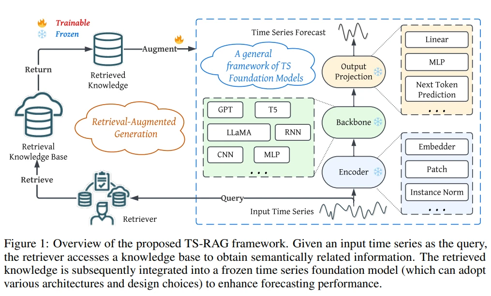

오른쪽 파란 점선 상자가 TSFM이고(Encoder, Backbone, Output Projection 모두 눈송이 표시, 즉 frozen), 왼쪽의 고리가 RAG다. 아래쪽의 입력 시계열에서 나온 Query 화살표를 따라가면 Retriever → Retrieval Knowledge Base → Retrieved Knowledge → Augment 순으로 한 바퀴 돌아 TSFM으로 다시 들어간다. 불꽃 표시가 붙은 Augment 부분만 학습된다. 출처: 논문 Figure 1

- retriever는 knowledge base에 query를 보내 현재 time series와 semantically related한 정보를 가져오고, 그렇게 가져온 knowledge가 frozen TSFM을 증강하는 데 쓰인다.
- 그림 오른쪽의 세 상자(Encoder, Backbone, Output Projection) 옆에 여러 선택지(Patch·Instance Norm, GPT·T5·MLP, Linear·MLP 등)가 나열된 것은, TSFM이 어떤 구조이든 이 틀을 얹을 수 있다는 뜻이다.
- 논문은 이 방식으로 특정 데이터셋에 대한 fine-tuning을 우회할 수 있을 뿐만 아니라, 예측에 대한 contextual evidence를 제공하므로 interpretability도 향상할 수 있다고 말한다.

> Q. 그러면 결국, non-stationarity에 대한 대처는 잘 안 되는 건가?

### Related Work

#### Time Series Foundation Models

- LLM 기반 time series forecaster들은 in-domain time series analysis에서 효과적이었지만, domain adaptation의 어려움과 computational cost 때문에 TSFM의 필요성이 대두되었다.
- 초기 모델인 Lag-Llama와 TimeGPT-1, patch 단위 tokenization을 쓰는 TimesFM·MOMENT·Timer·Sundial, 효율을 높인 Tiny Time Mixers(TTM)와 Time-MoE, point forecasting의 한계에 대처해 확률 예측을 하는 Moirai로 이어진다.
- Chronos는 scaling과 quantization으로 time series를 discretize하고, cross-entropy loss로 categorical distribution을 모델링한다.
- Chronos-Bolt는 discrete tokenization을 patch 기반의 입력 방식으로 바꾸고, decoder representation으로 여러 미래 시점의 quantile forecast를 한 번에 출력한다. 이를 통해 Chronos보다 뛰어난 성능을 확보했다.

> 그러나 이러한 기존 방식들은 external contextual knowledge를 동적으로 반영하지 못하고, 이 때문에 zero-shot learning 성능이 부족하며 interpretability도 떨어진다는 한계를 지닌다.

#### Retrieval-Augmented for Time Series Forecasting

- LLM과 TSFM이 time series forecasting에서 뛰어난 성능을 보이고 있지만, 여전히 non-stationarity나 distribution shift는 다루기 어렵다.

    > RAG는 external knowledge를 반영하는 방식으로, generalization과 robustness를 향상하는 데 도움이 될 수 있다.

- **Fine-tuning 기반 접근.** 모델을 fine-tuning해서 downstream task에 adapt시킨다. ReTime, RATD, TimeRAG, RAFT 등이 있다.
    - ReTime은 relational retrieval과 content synthesis를 제안했다.
    - [RAFT](2026-03-19-raft.md)는 multi-resolution retrieval forecasting framework다. target task의 training set에서 retrieval database를 구성하고, model adaptation을 위해 fine-tuning을 한다.
    - TimeRAG는 frozen LLM backbone을 기반으로 retrieved sequence를 forecasting에 반영하고, time series와 text modality를 align하기 위한 trainable reprogramming layer를 둔다.
- **Zero-shot time series forecasting.** RAF는 zero-shot time series forecasting에 RAG를 적용한 초기 연구다.
    - Chronos를 backbone으로 쓰고, 처리한 retrieved context를 original time series input과 concat한다.
    - 그러나 이 방식은 large-scale retrieval database를 쓸 때 scalability와 efficiency의 문제를 맞을 수 있다.
    - 또한 time series forecasting을 위한 RAG 테크닉은 아직 덜 연구되었다. 특히 knowledge base를 구축하는 방법, augmentation을 수행하는 방법, 이를 zero-shot forecasting에 적용하는 방법이 더 연구될 필요가 있었다.
    - 이 문제들을 개선하기 위해 TSFM의 zero-shot forecasting 성능을 높이는 프레임워크로 TS-RAG를 제안한다.

### TS-RAG for Zero-Shot Time Series Forecasting

**Overview.** 이 절은 "비슷한 과거를 어떻게 찾고, 찾아온 것을 예측에 어떻게 섞는가"를 설명한다. TS-RAG는 세 개의 주요 컴포넌트로 구성된다.

- Time series foundation model
- Retriever
- 학습 가능한 Adaptive Retrieval Mixer(ARM) augmentation module

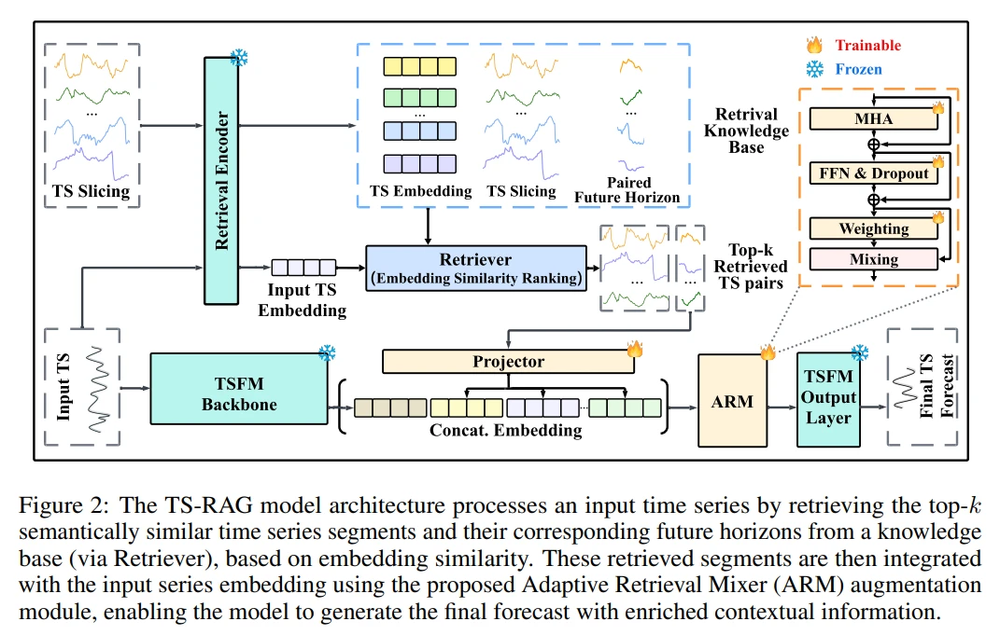

왼쪽 아래의 Input TS에서 화살표가 두 갈래로 갈라지는 것을 먼저 본다. 위로 가는 갈래는 검색(Retrieval Encoder → Retriever), 오른쪽으로 가는 갈래는 예측(TSFM Backbone → ARM → TSFM Output Layer)이다. 눈송이가 붙은 청록색 상자는 frozen이고, 불꽃이 붙은 Projector와 ARM만 학습된다. 출처: 논문 Figure 2

그림을 따라 한 번의 예측이 만들어지는 순서를 적으면 다음과 같다.

**① Retrieval (그림의 위쪽 절반).**

- input time series가 주어지면 pretrained encoder(세로로 긴 Retrieval Encoder 상자)를 통해 Input TS Embedding을 생성한다.
- 이 embedding을 retrieval knowledge base(파란 점선 상자)에 저장되어 있던 time series context embedding들과 비교해서, knowledge base로부터 top-k개의 유사한 time series pair를 찾아낸다. 파란 Retriever 상자의 "Embedding Similarity Ranking"이 이 단계다.
    - knowledge base 상자 안의 세 열이 각각 TS Embedding, TS Slicing(과거 context), Paired Future Horizon이다. 즉 각 pair는 (1) historical context와 (2) 그에 대응하는 forecasting horizon을 가지고 있다. 이 가운데 forecasting horizon(Retriever 오른쪽의 작은 점선 상자)이 zero-shot forecasting을 refine하는 augmentation으로 사용된다.

**② Concatenation of Input Embedding and Retrieved Information ⇒ ARM module (그림의 아래쪽 가운데).**

- retrieve된 top-k개 pair의 forecasting horizon은 Projector를 거쳐 embedding으로 변환되고, TSFM backbone이 생성한 time series embedding과 concat되어(그림의 Concat. Embedding. 맨 앞 칸이 query, 뒤의 칸들이 검색된 horizon이다) ARM augmentation module로 들어간다.
- ARM augmentation module은 이 embedding들에 적응적으로 importance score를 부여하고, score가 부여된 embedding들을 동적으로 섞어 하나의 unified representation으로 만든다. 오른쪽 위의 주황색 점선 상자가 ARM의 내부(MHA → FFN & Dropout → Weighting → Mixing)를 펼친 것이다.

**③ Output Projection Layer (그림의 오른쪽 아래).**

- 이렇게 만든 final representation을 TSFM의 output projection layer에 넣어 최종 예측을 얻는다.

#### Construction of the Retrieval Knowledge Base

검색해 올 "과거 사례 창고"를 어떤 데이터로, 어떤 모양으로 만들어 두는지에 대한 절이다. 위 구조도에서 파란 점선 상자에 해당한다.

- multi-domain dataset을 구성하며, 특히 ARM augmentation module을 학습시키는 데 집중한다.
- dataset은 Chronos에서 사용된 pretraining dataset을 쓴다.
    - 이 데이터는 TSMixup으로 만들어진 것으로, 다양한 도메인에서 time series data point를 랜덤하게 뽑아 결합하는 방식이다.
    - 다양한 패턴을 혼합함으로써 data diversity와 모델의 generalization을 높인다.

**TSMixup.** TSMixup의 바탕이 되는 Mixup은 서로 다른 두 데이터 샘플 $(x_1, x_2)$와 그에 대응하는 라벨 $(y_1, y_2)$를 일정한 비율 $\lambda$로 섞어 새로운 가상 샘플을 만드는 기법이다.

$$
x_{\text{new}} = \lambda x_1 + (1-\lambda)x_2
$$

$$
y_{\text{new}} = \lambda y_1 + (1-\lambda)y_2
$$

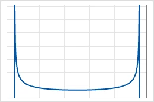

노트에 함께 붙여 둔 beta 분포의 모양이다. 곡선이 양 끝에서 높고 가운데에서 낮다. 즉 $\lambda$는 0이나 1에 가까운 값이 자주 뽑힌다.

- $\lambda$는 0과 1 사이의 값으로, beta 분포에서 무작위로 추출한다. 위 그림처럼 한쪽 끝에 가까운 값이 주로 나오면 두 시계열 가운데 하나가 대부분을 차지하게 되므로, 섞어서 만든 시계열이 원래 시계열에서 매우 크게 달라지지는 않는다.

Knowledge base를 만드는 과정은 다음과 같다.

- TS-RAG가 학습하는 parameter의 수는 TSFM backbone이나 retrieval encoder의 parameter 수보다 현저히 적다. 그래서 Chronos pretraining dataset 전체가 아니라, 거기서 uniform하게 sampling한 subset을 TS-RAG의 pretraining dataset으로 쓴다.
- 이 subset에 기반해 TS-RAG를 위한 retrieval knowledge base를 구축한다. 이것이 이후의 inference(forecasting) 단계에서 사용된다.
- retrieval knowledge base에 저장되는 데이터는 standard pair로 처리된다. 각 pair는 context window와 그에 대응하는 forecasting horizon을 가진다.

$$
\{(\mathbf{x}_i, \mathbf{y}_i) \mid i=1,2,\dots,n\}, \quad \mathbf{x}_i \in \mathbb{R}^T, \quad \mathbf{y}_i \in \mathbb{R}^L
$$

- $\mathbf{x}_i$: 길이가 $T$인 $i$번째 input context window. 즉, 시계열 예측의 lookback window다.
- $\mathbf{y}_i$: $i$번째 context window에 대응되는, 길이가 $L$인 future horizon. 즉, 시계열 예측의 prediction window다.
- $n$: knowledge base에 저장된 pair의 총 개수.
- pretrained retrieval encoder를 사용해 $\{\mathbf{x}_i \mid i=1,2,\dots,n\}$을 $\{\mathbf{e}_i \mid i=1,2,\dots,n\}$, $\mathbf{e}_i \in \mathbb{R}^d$로 변환하고, 이 embedding을 pair와 함께 저장한다.
- 정리하면, retrieval knowledge base는 다음과 같은 triple의 집합이다.

$$
\mathcal{D} = \{(\mathbf{x}_i,\mathbf{e}_i,\mathbf{y}_i) \mid i=1,2,\dots,n\}
$$

- $\mathcal{D}$: retrieval knowledge base
- $\mathbf{e}_i$: input sequence $\mathbf{x}_i$를 pretrained retrieval encoder에 넣어 얻은 embedding. 이것을 함께 저장해 두므로 학습을 효율적으로 진행할 수 있다.

즉, TS-RAG는 retrieval DB를 단순한 raw time series로 저장하지 않고, (과거 context window, 그 context의 embedding, 그 context에 대응하는 future horizon)의 triplet으로 저장한다. 구조도의 knowledge base 상자에 그려진 세 열(TS Slicing, TS Embedding, Paired Future Horizon)이 바로 이 $\mathbf{x}_i$, $\mathbf{e}_i$, $\mathbf{y}_i$다. retriever는 비슷한 과거 조각만 찾는 것이 아니라 그 조각의 실제 미래까지 같이 들고 오므로, retrieval 결과가 바로 forecasting augmentation에 쓰일 수 있다.

#### Architecture of TS-RAG Framework

- TS-RAG는 external knowledge database에서 retrieve한 relevant time series context를 활용해, input query time series가 additional contextual information과 함께 더 풍부한 표현을 갖도록 만든다.
    - 이를 통해 forecasting accuracy와 모델의 generalization을 높인다.

**TSFM의 세 가지 주요 컴포넌트**

- encoding layer: normalization과 embedding layer를 포함한다.
- transformer 기반 모델: GPT, T5, Llama 등.
- projection layer: MLP로 구현되며, backbone을 통해 얻은 temporal representation을 최종 예측값으로 mapping한다.

**TS-RAG가 더하는 두 가지 컴포넌트**

- Retriever
- ARM(Adaptive Retrieval Mixer) augmentation module

아래에서는 이 두 컴포넌트를 구조도의 위쪽(Retriever)과 오른쪽 위 주황색 상자(ARM) 순서로 수식과 함께 따라간다.

**Retriever.** 하는 일은 단순하다. query를 벡터 하나로 바꾸고, 창고에 미리 계산해 둔 벡터들 가운데 가장 가까운 $k$개를 고른다.

- pretrained retrieval encoder(Chronos encoder)의 encoder 부분을 그대로 retriever encoder로 사용한다. Chronos encoder는 T5 구조이며, 이미 학습된 encoder를 frozen 상태로 쓴다.
    - 이 encoder가 input query time series와, external knowledge database에 저장될 time series context를 embedding으로 변환한다.
- Retriever는 현재 time series query와 knowledge base에 저장된 각 context 사이의 유사도를 Euclidean distance로 측정하고, 가장 유사한 top-k개의 candidate를 선발한다.
- 기호는 다음과 같다. query context는 $\mathbf{x}_q \in \mathbb{R}^T$, 그 embedding은 $\mathbf{e}_q \in \mathbb{R}^d$이고, knowledge base에 저장된 것은 $\mathbf{x}_i \in \mathbb{R}^T$, $\mathbf{y}_i \in \mathbb{R}^L$, $\mathbf{e}_i \in \mathbb{R}^d$다.
- 먼저 query context를 입력받아 embedding을 생성한다.

    $$
    \mathbf{e}_q = f_{\text{enc}}(\mathbf{x}_q)
    $$

- 이후 query embedding과 저장된 모든 embedding 사이의 Euclidean distance를 계산한다.

    $$
    d(\mathbf{e}_q, \mathbf{e}_i) = \lVert \mathbf{e}_q - \mathbf{e}_i \rVert_2, \quad \forall i \in \{1, 2, \dots, n\}
    $$

- 거리가 가장 작은 top-k개를 선택한다.

    $$
    \mathcal{C} = \text{TopK}_{\min}\left(\{(\mathbf{x}_i, \mathbf{y}_i, d(\mathbf{e}_q, \mathbf{e}_i)) \mid i = 1, 2, \dots, n\},\ k\right)
    $$

- 이렇게 얻은 retrieved set $\mathcal{C}$는 $k$개의 $(\mathbf{x}_i, \mathbf{y}_i, \mathbf{e}_i)$ 묶음이며, 이후에 forecasting process를 증강하는 데 사용된다.
- top-k로 뽑힌 것은 $(\mathbf{x}, \mathbf{y})$ pair들이지만, 실제 augmentation에 쓰이는 것은 $\mathbf{y}$다. 검색된 forecasting horizon $k$개를 쌓으면 $\mathbb{R}^{k \times L}$이고, 아래의 projection을 거치면 $\mathbb{R}^{k \times d}$가 된다.
- 검색은 raw sequence가 아니라 compact한 embedding 위에서 이루어지며, FAISS의 fast nearest-neighbor search를 쓴다. 논문은 이 두 가지를 RAF보다 retrieval이 훨씬 빠른 이유로 든다.

**Adaptive Retrieval Mixer (ARM) augmentation module.** 검색된 미래 $k$개와 query 자신의 표현, 모두 $k+1$개를 놓고 "이번 query에서는 어느 것을 얼마나 믿을지"를 정해 하나로 합치는 모듈이다. 구조도의 주황색 상자에 적힌 네 단계(MHA → FFN & Dropout → Weighting → Mixing)가 아래 식들과 하나씩 대응한다. 상자 옆의 ⊕는 residual connection이다.

- top-k retrieved forecasting horizon의 projection을 TSFM backbone에서 얻은 query time series embedding과 결합해 prediction accuracy를 높인다.
- projection은 MLP로 이루어지며, 각각의 retrieved sequence를 $d$차원의 vector로 매핑한다.

    $$
    \hat{\mathbf{e}}_i = f_{\text{MLP}}(\mathbf{y}_i), \quad i = 1, 2, \dots, k
    $$

- 결과적으로 다음과 같은 embedding의 stack이 만들어진다. 여기서 $d$는 embedding dimension이다.

    $$
    E_{\text{ret}} = [\hat{\mathbf{e}}_1, \hat{\mathbf{e}}_2, \dots, \hat{\mathbf{e}}_k] \in \mathbb{R}^{k\times d}
    $$

- 이후 TSFM backbone이 생성한 query time series representation $\hat{\mathbf{e}}_q \in \mathbb{R}^{1\times d}$를 retrieved information과 fuse하기 위해, 두 representation을 하나의 representation $E_{\text{concat}}$으로 concat한다. 구조도 아래쪽의 Concat. Embedding이 이것이다.

    $$
    E_{\text{concat}} = [\hat{\mathbf{e}}_q; E_{\text{ret}}] \in \mathbb{R}^{(k+1)\times d}
    $$

    > 여기부터 나오는 구조는 평범한 Transformer encoder 구조다.
    >
    > 1. Multi-head self-attention
    > 2. Feed-forward network
    > 3. Softmax

- (MHA) 이렇게 결합된 representation은 multi-head attention layer로 들어가며, residual connection을 연결한다. query와 검색된 horizon들이 서로를 참고하는 단계다. 여기서 $E_{\text{att}} \in \mathbb{R}^{(k+1)\times d}$는 contextualized feature다.

    $$
    E_{\text{att}} = \text{MHA}(E_{\text{concat}})+E_{\text{concat}}
    $$

- (FFN & Dropout) 이후 FFN을 거치고 dropout을 적용한 뒤, 다시 residual connection을 연결해 $E_{\text{ffn}}$을 얻는다.

    $$
    E_{\text{ffn}} = \text{Dropout}(\text{FFN}(E_{\text{att}})) + E_{\text{att}}
    $$

- (Weighting) Mixing mechanism: retrieved sequence representation과 original representation의 contribution을 동적으로 조절하기 위해, scoring network를 거쳐 각 representation에 importance weight를 부여한다. $W_g, b_g$는 learnable parameter이고, $\alpha \in \mathbb{R}^{(k+1)\times 1}$은 normalized attention weight다.

    $$
    \alpha = \text{Softmax}(W_g E_{\text{ffn}} + b_g)
    $$

- (Mixing) $k+1$개의 representation에 대한 weight를 정하고 나면, 이를 weighted sum으로 합치고, 앞서 TSFM을 통해 얻은 query time series embedding $\hat{\mathbf{e}}_q$에 더해 $\mathbf{e}_{\text{final}}$을 얻는다. 원래의 query 표현을 그대로 두고 그 위에 더하는 꼴이어서, 검색 결과가 쓸모없을 때에도 query 자체의 정보는 보존된다.

    $$
    \mathbf{e}_{\text{final}} = \hat{\mathbf{e}}_q + \sum^{k+1}_{i=1} \alpha_i E_{\text{ffn},i}
    $$

- 최종적으로 projection layer(구조도의 TSFM Output Layer)를 거쳐 예측 $\hat{\mathbf{y}}_q \in \mathbb{R}^{L}$을 얻는다.

    $$
    \hat{\mathbf{y}}_q = f_{\text{proj}}(\mathbf{e}_{\text{final}})
    $$

- training objective는 TSFM backbone과 동일하게 설정한다(아래 Experimental Setup 참고).

#### Pretraining Strategy and Zero-shot Inference

**Pretraining Strategy.**

- 미리 구성한 multi-domain dataset으로, TS-RAG가 새로 더한 parameter인 projector와 ARM augmentation module만 pretraining한다.
- 다른 모든 parameter는 frozen 상태다.

**Zero-shot Inference.**

- zero-shot inference 단계에서 TS-RAG는 pretrained component들을 활용해 예측하며, 이 과정에서 어떠한 task-specific fine-tuning도 수행하지 않는다.

### Experiments

#### Experimental Setup

**Datasets and Retrieval Knowledge Base.**

- Chronos pretraining dataset에서 5천만(50 million) data point를 uniform sampling해서 TS-RAG의 pretraining dataset을 구성한다. zero-shot forecasting을 수행하기 전에 이것으로 모델을 학습시킨다.
- 거기서 다시 5백만(5 million) data point를 뽑아 multi-domain retrieval knowledge base를 구성한다.
- pretraining dataset과 retrieval knowledge base를 미리 정한 context window 크기에 따라 segment로 나누면, 최종적으로 2,600만(26 million) 개의 pretraining pair와 280만(2.8 million) 개의 retrieval knowledge base pair가 만들어진다.

    > 즉, 이 논문은 multi-domain mixed data로 ARM을 pretrain하고, 별도로 retrieval KB까지 구성한다.

- 벤치마크는 ETTh1, ETTh2, ETTm1, ETTm2, Weather, Electricity, Exchange Rate의 7개이고, data split 비율은 ETT가 6:2:2, 나머지가 7:1:2다.
- retrieval knowledge base(RKB)는 in-domain, distribution shift, cross-domain, multi-domain의 여러 설정으로 구성될 수 있다. 각 설정의 영향은 아래 ablation에서 다룬다.

**Baselines.** backbone은 Chronos-Bolt를 쓴다. zero-shot forecasting의 비교 대상은 TTM, TimesFM, Moirai, Chronos, Chronos-Bolt, MOMENT, Time-MoE다.

**Setup.**

- context length(input sequence)는 512이고, forecasting length는 64다.
- backbone TSFM과 동일한 forecasting loss를 적용한다. Chronos-Bolt는 quantile regression loss를 쓴다.
- evaluation에는 MSE와 MAE를 사용한다.

**Quantile regression loss.** 평균이 아니라 분포의 특정 지점(quantile)을 맞추도록 학습시키는 loss다. 방법은 예측이 실제보다 낮을 때와 높을 때의 벌점을 다르게 주는 것이다. 즉 error의 부호에 따라 다른 loss를 적용한다.

$$
\text{error} = y - X\theta, \qquad
L =
\begin{cases}
w \cdot \text{error} & \text{if } \text{error} \ge 0 \\
(w - 1) \cdot \text{error} & \text{if } \text{error} < 0
\end{cases}
$$

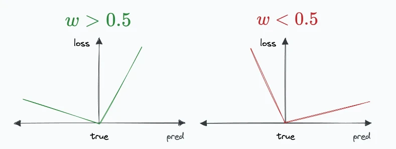

가로축이 예측값(가운데가 실제값), 세로축이 loss다. 왼쪽 그림($w > 0.5$)은 V자의 오른쪽 변이 가파르고, 오른쪽 그림($w < 0.5$)은 왼쪽 변이 가파르다. 어느 방향의 오차에 벌점을 더 크게 줄지를 $w$가 정한다는 뜻이다.

- hyperparameter $w$가 0.5보다 큰지 작은지에 따라 loss function의 기울기가 양쪽에서 서로 다르게 그려진다. 그래서 평균에 적합되는 linear regression과 달리, 특정한 quantile 지점에 적합이 이루어진다. 아래 두 그림이 그 결과다.

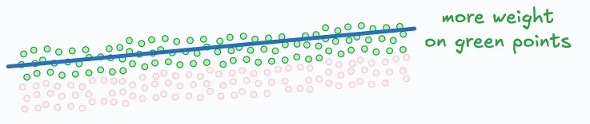

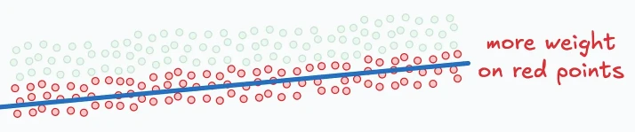

같은 점 구름인데, 위쪽 점(초록)에 가중치를 더 주면 파란 직선이 구름의 위쪽 경계 근처로 올라가고, 아래쪽 점(빨강)에 더 주면 아래쪽 경계 근처로 내려간다. 아래에서 말하는 "각 시점의 확률적인 경계값(quantile)"이 이런 선에 해당한다.

- Chronos는 본래 autoregressive 방식이었는데, 이것은 너무 느리다. Chronos-Bolt는 autoregressive 방식 대신 generative style decoding을 수행하기 위해 quantile regression layer를 쓰고, 이때 이 loss가 사용된다.
- 이 loss는 autoregressive 방식을 generative style로 전환할 수 있게 할 뿐만 아니라, 각 시점별로 확률적인 경계값(quantile)을 정확히 출력하도록 훈련한다는 특징이 있다. TS-RAG는 Chronos-Bolt가 쓰던 것을 그대로 가져와 사용한다.

#### Experimental Results for Zero-shot Forecasting

"학습 때 보지 못한 7개 데이터셋에서, retrieval을 붙인 것이 기존 TSFM보다 나은가"를 확인하는 주 실험이다.

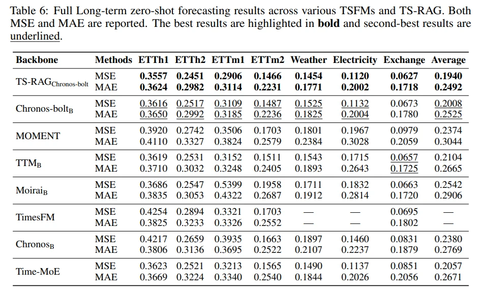

맨 위 두 줄(TS-RAG)과 바로 아래 두 줄(backbone인 Chronos-Bolt)을 비교해서 본다. 모든 열에서 TS-RAG가 굵은 글씨(최고)이고, 맨 오른쪽 Average 열에서 MSE가 0.2008에서 0.1940으로, MAE가 0.2525에서 0.2492로 내려간다. 출처: 논문 Table 6 (본문 Table 1에 Time-MoE와 평균 열을 더한 전체 표)

- lookback window 512, prediction window 64의 설정에서, TS-RAG는 모든 벤치마크 데이터셋에서 다른 baseline들을 상회하는 결과를 보였다.
    - 특히 backbone 모델인 Chronos-Bolt의 성능도 상회한다. 다만 표에서 보듯 Chronos-Bolt와의 차이는 소수 셋째 자리 수준인 데이터셋이 많다(Electricity 0.1132 → 0.1120, ETTm2 0.1487 → 0.1466). 절대값으로 차이가 가장 큰 것은 ETTm1(0.3109 → 0.2906)이고, 요약에서 말한 최대 6.84%의 MSE 감소는 Exchange rate(0.0673 → 0.0627)에서 나온다.

#### Ablation Studies

ablation은 네 가지를 차례로 묻는다. 섞는 방법(ARM)이 중요한가, 창고(knowledge base)를 무엇으로 채우느냐가 중요한가, 더 먼 미래를 예측할 때도 도움이 되는가, 검색에 쓰는 과거 길이는 얼마가 좋은가. 앞의 두 질문의 답이 아래 막대그래프 한 장에 들어 있다.

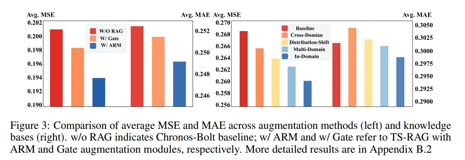

막대가 낮을수록 좋고, 각 그래프에서 앞의 묶음이 MSE(왼쪽 축), 뒤의 묶음이 MAE(오른쪽 축)다. 왼쪽 그래프는 빨강(retrieval 없음) → 주황(Gate) → 파랑(ARM) 순으로 낮아진다. 오른쪽 그래프의 MSE는 빨강(baseline) → Cross-Domain → Distribution-Shift → Multi-Domain → 파랑(In-Domain) 순으로 낮아진다. 출처: 논문 Figure 3

**Effectiveness of ARM Module.**

- ARM module은 retrieved forecasting horizon을 query representation과 통합한다는 점에서 매우 중요한 역할을 한다.
- 비효율적인 fusion design은 retrieval의 이점을 떨어뜨릴 수 있다. 그래서 ARM의 효과를 확인하기 위해, ARM을 TSFM의 예측과 retrieved forecasting horizon을 linear하게 결합하는 gate 방식으로 바꿔 본다. 식으로 쓰면 다음과 같은 꼴이다.

    $$
    Y_{\text{final}} = g \cdot Y_{\text{TSFM}} + (1 - g) \cdot Y_{\text{retrieved}}
    $$

- 위 Figure 3의 왼쪽을 보면, gate fusion(주황)도 retrieval이 없는 경우(빨강)보다는 낮아져 성능 향상을 가져오기는 하지만, ARM(파랑)과 비교하면 더 낮은 성능을 보인다.
- 즉, ARM에서 사용되는 attention-based fusion과 residual connection이 zero-shot forecasting에 효과적임을 보여 준다.

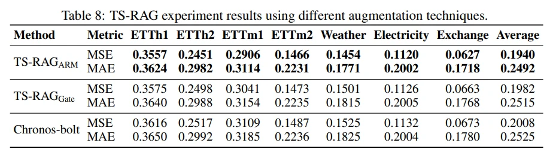

막대그래프의 왼쪽을 데이터셋별 수치로 풀어 놓은 표다. 평균 MSE가 Chronos-Bolt 0.2008, Gate 0.1982, ARM 0.1940이고, MSE 기준으로 7개 데이터셋 모두에서 ARM, Gate, Chronos-Bolt 순으로 좋다. 출처: 논문 Table 8

**Impact of Retrieval Knowledge Base.**

- retrieval knowledge base의 구성이 zero-shot forecasting 성능에 어떤 영향을 미치는지 확인한다.
- in-domain: RKB를 동일한 데이터셋으로 구성한다.
- distribution shift: RKB를 연관성은 높지만 분포가 다른 데이터셋으로 구성한다.
    - 예를 들면 ETTh1을 평가하기 위해 ETTh2를 사용하는 것이다.
- cross-domain: 다른 도메인의 데이터를 사용한다.
- multi-domain: 다양한 도메인의 데이터를 사용한다.
    - Experimental Setup에서 설명한 것처럼, pretraining dataset의 subset으로 multi-domain knowledge base를 구성한다.
    - 사용할 수 있는 모든 데이터셋을 그냥 다 사용하는 것이다.

> - Mixup: multi-domain에서만 사용
> - in-domain: 예측하려는 데이터만으로 구성
> - distribution shift: 예측하려는 데이터와 유사한 것만으로 구성
> - cross-domain: 예측하려는 데이터만 빼고 구성
> - multi-domain: 모든 데이터를 포함해 구성

- 실험 결과(위 Figure 3의 오른쪽, 아래 Table 7), 모든 구성에서 TS-RAG는 baseline을 뛰어넘는 성능을 보였다.
    - 막대그래프를 보면 이것은 MSE 묶음에서 그렇다. MAE 묶음에서는 Cross-Domain과 Distribution-Shift의 막대가 baseline보다 조금 높게 그려져 있다.
- 일반적으로 in-domain이 가장 좋은 성능을 보였다. retrieval이 대체로 forecasting 성능을 향상시키기는 하지만, retrieval knowledge를 어떻게 구성하느냐가 성능에 영향을 미친다는 뜻이다.

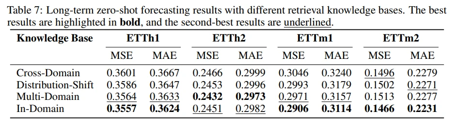

맨 아랫줄(In-Domain)이 ETTh1, ETTm1, ETTm2에서 굵은 글씨다. ETTh2에서만 Multi-Domain(0.2432)이 In-Domain(0.2451)보다 낫다. 예측 대상과 같은 데이터로 창고를 채우는 것이 대체로 가장 좋지만, 구성 사이의 MSE 차이는 ETTm1(0.2906 ~ 0.3046)을 빼면 소수 셋째 자리에서 난다. 출처: 논문 Table 7

**Effectiveness of Longer Forecasting Horizons.**

- TSFM은 pretraining length보다 긴 horizon을 예측할 때 통상적으로 rolling strategy를 사용한다.
- 이때 모델은 짧은 segment에 대한 예측을 생성하고, 전체 horizon을 채울 때까지 다음 segment에 대한 예측을 반복한다.
- TS-RAG도 이와 유사한 방식을 쓰지만, retrieval augmentation으로 이를 강화한다.
- 구체적으로, TS-RAG는 매 iteration마다 RKB에서 다음 64-step의 forecasting horizon을 검색한다.
    - 각 iteration에서 가장 유사한 과거 패턴을 가져오는 것이다.
    - 이를 정해진 forecasting length에 도달할 때까지 수행한다.

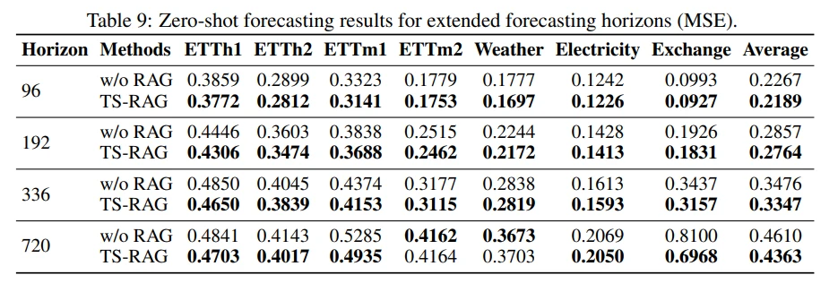

horizon마다 윗줄(w/o RAG)과 아랫줄(TS-RAG)을 짝지어 본다. 굵은 글씨가 거의 모두 아랫줄에 있고, 맨 오른쪽 평균은 96에서 0.2267 → 0.2189, 720에서 0.4610 → 0.4363이다. 출처: 논문 Table 9 (본문 Table 2는 이 가운데 ETTh1, ETTh2, Electricity, Exchange rate의 네 데이터셋만 실은 것이다)

- 이 표는 여러 데이터셋에서 forecasting length를 늘려 가며 수행한 zero-shot forecasting 결과다. TS-RAG가 지속적으로 backbone 모델의 성능을 상회하며, RAG가 accuracy를 유지하면서 forecasting length를 늘리는 데 효과적임을 보여 준다.
- 전체 데이터셋에 대해 forecasting horizon을 늘려 보았을 때, w/o RAG와 TS-RAG를 비교하면 거의 일관되게 RAG를 포함하는 쪽이 뛰어났다.
    - 예외는 horizon 720의 ETTm2(0.4162 대 0.4164)와 Weather(0.3673 대 0.3703) 두 칸으로, 여기서는 w/o RAG가 근소하게 낫다.
- 눈에 띄는 점은, Exchange처럼 distribution shift가 극심하게 나타나는 데이터셋에서 forecasting horizon이 길어질수록 성능 향상 폭이 컸다는 것이다. Exchange 열을 따라 내려가면 차이가 96에서 0.0993 → 0.0927, 720에서 0.8100 → 0.6968로 벌어진다.
    - generalization이나 robustness 확보에서 RAG 방식이 큰 효과를 보였다는 것으로도 일부 해석할 수 있다고 본다.

**Effect of Retrieval Lookback Length.**

"비슷한 과거"를 찾을 때 입력의 끝부분 얼마만큼을 보고 찾을 것인가에 대한 실험이다.

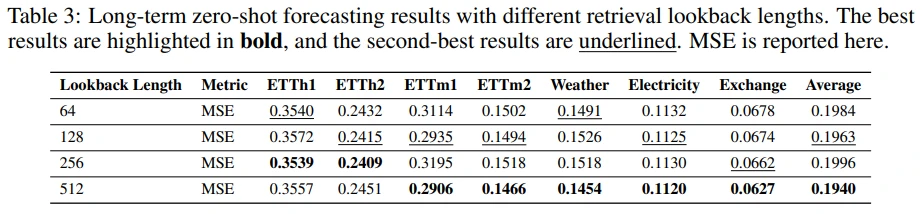

맨 아랫줄(512)에 굵은 글씨가 가장 많고 평균도 0.1940으로 가장 낮다. 다만 ETTh1과 ETTh2는 256에서 가장 좋고, 평균으로 보면 256(0.1996)이 128(0.1963)보다 나쁘다. 길이에 따라 단조롭게 좋아지지는 않는다는 뜻이다. 출처: 논문 Table 3

- Table 3은 retrieval lookback length를 바꿔 가며 zero-shot 성능을 실험한 것이다.
- input sequence length가 512일 때, 마지막 64, 128, 256, 512 time step을 기준으로 retrieval해서 예측을 수행한 결과다.
- 대체로 retrieval lookback window가 길수록 더 좋은 성능을 보였다.
- 그러나 모든 경우에 그런 결과가 나타나지는 않았다. 과도하게 긴 retrieval window가 noise나 irrelevant information을 제공했을 가능성을 나타낸다.

**Additional Ablation Study.**

- retriever configuration의 영향을 확인하기 위한 추가 실험이다.
    - retrieved sequence의 수(top-k)
    - retriever encoder에 따른 성능 차이
    - retrieval distance metric에 따른 차이
- 이 실험들을 통해, TS-RAG는 적절한 수의 retrieved sequence를 설정하는 것이 중요하며, retriever encoder와 distance metric의 선택에는 robust한 결과를 보인다는 것을 확인했다.

**Appendix 내용 정리.**

위의 세 가지 추가 실험을 그림과 표로 하나씩 본다.

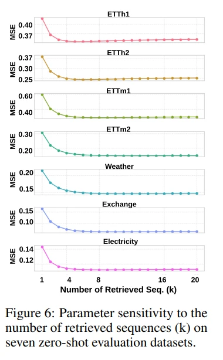

가로축이 $k$(1 ~ 20), 세로축이 MSE다. 일곱 곡선 모두 $k$가 1에서 4 ~ 8 정도까지 늘 때 가파르게 떨어지고, 그 뒤로는 거의 수평이다. 출처: 논문 Figure 6

- retrieved sequence의 수 $k$를 바꿔 가며 성능을 비교한다.
    - 특정한 임계치를 넘어서면 성능 향상이 거의 나타나지 않거나, 약간 감소하는 경향을 보였다. 그림에서 곡선이 평평해지는 구간이 이것이다. 검색해 오는 수를 늘린다고 계속 좋아지지는 않는다.

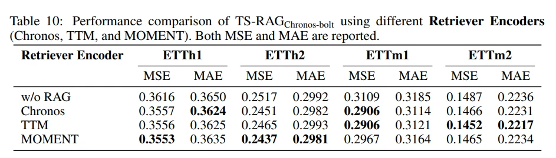

첫 줄(w/o RAG)과 아래 세 줄의 차이에 비해, 아래 세 줄끼리의 차이가 훨씬 작다는 것을 본다. 예를 들어 ETTh1의 MSE는 retrieval이 없을 때 0.3616이고, 세 encoder는 0.3557, 0.3556, 0.3553이다. 출처: 논문 Table 10

- retrieval encoder를 바꿔 가며 비교한다(Table 10).
    - TS-RAG는 Chronos encoder를 main retrieval encoder로 사용한다. Chronos encoder는 T5 architecture를 기반으로 한다.
    - TTM은 MLP-Mixer와 유사한 architecture를 사용하고, MOMENT는 Transformer encoder에 기반한다.
    - 결과적으로 retrieval encoder의 선택은 성능에 큰 영향을 미치지 않는 것으로 확인되었다.

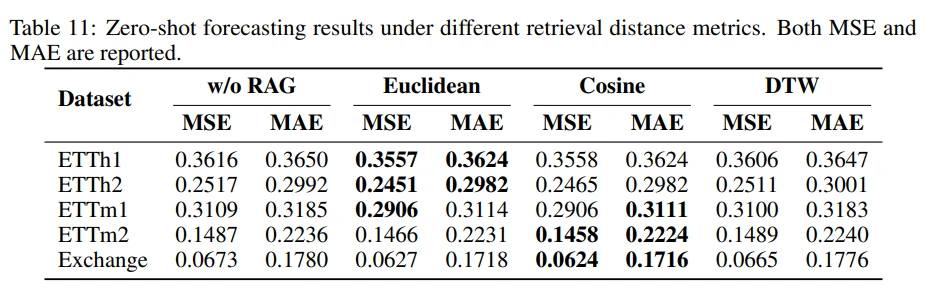

Euclidean 열과 Cosine 열은 거의 같은 숫자이고, 맨 오른쪽 DTW 열만 맨 왼쪽 w/o RAG 열에 가깝다. ETTh1에서 w/o RAG 0.3616, Euclidean 0.3557, Cosine 0.3558, DTW 0.3606이고, ETTm2에서는 DTW(0.1489)가 w/o RAG(0.1487)보다 조금 나쁘다. 출처: 논문 Table 11

- cosine similarity와 DTW를 기준으로 추가 ablation을 수행한다.
    - cosine similarity는 Chronos encoder가 생성한 embedding 위에서 측정했고, DTW distance는 original time series space에서 직접 계산했다.
    - Euclidean distance와 cosine similarity 사이에는 큰 성능 차이가 없다.
    - 하지만 DTW는 baseline 대비 개선이 작았고, 일부 경우에는 baseline보다 약간 떨어졌다.
    - raw time series space에서 직접 distance를 재는 것보다 embedding 기반 retrieval로 distance를 재는 것이 더 effective하고 robust하다는 뜻으로 볼 수 있다.
    - 이는 Retrieval-Augmented Diffusion Models for Time Series Forecasting(RATD)에서 correlation-based method가 embedding-based method보다 부족한 성능을 보인다고 제시한 것과 같은 결과다.

#### Comparison with RAF

- TS-RAG의 성능을 더 자세히 평가하기 위해 RAF(Retrieval Augmented Forecasting)와 비교한다.
- RAF는 retrieval-augmented method로 zero-shot time series forecasting을 수행하는 최신 연구다.

**TS-RAG vs RAF.**

- TS-RAG는 이미 잘 만들어진 TSFM을 그대로 쓰되, 모델 내부에서 검색된 지식을 임베딩 레벨에서 동적으로 섞어 주는 방식이다.
    - 따라서 모델 전체를 새로 학습할 필요가 없어 효율적이며, 처음 보는 데이터에 강하다.
- RAF는 검색한 유사 과거 사례들을 입력 단계에서 원래 입력에 직접 붙여 주는 방식이다.

**Effectiveness.**

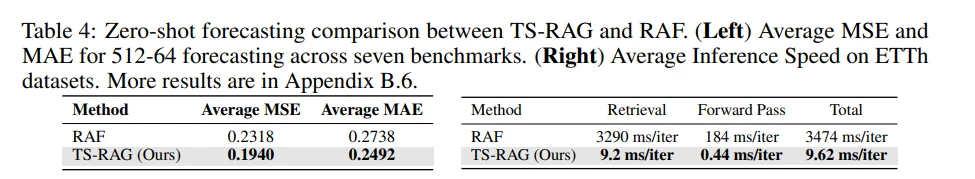

왼쪽 표가 정확도, 오른쪽 표가 속도다. 오른쪽 표의 Retrieval 열에서 RAF 3290 ms/iter와 TS-RAG 9.2 ms/iter의 차이를 먼저 본다. 출처: 논문 Table 4

- 7개의 benchmark dataset에 대해 TS-RAG는 평균 MSE 0.1940, RAF는 평균 MSE 0.2320을 기록했다(논문의 본문 기준. Table 4에는 RAF가 0.2318로 적혀 있다).
- 나아가 TS-RAG는 모든 데이터셋에 걸쳐 더 낮은 error를 보이며, generalization과 robustness가 뛰어남을 입증했다.

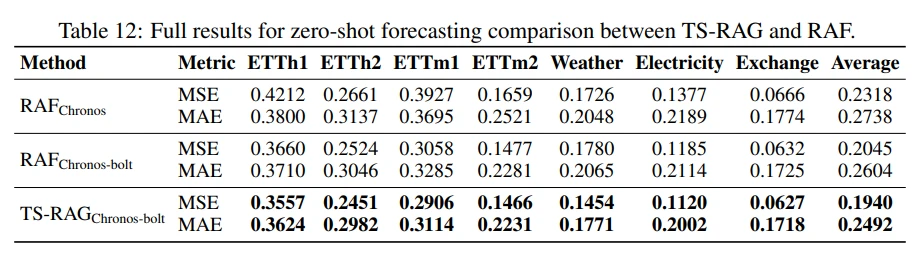

위 표의 평균을 데이터셋별로 풀어 놓은 것이다. RAF는 backbone을 Chronos로 둔 것(평균 MSE 0.2318)과 Chronos-Bolt로 바꾼 것(0.2045) 두 가지가 실려 있고, 같은 Chronos-Bolt 위에서 비교해도 TS-RAG(0.1940)가 모든 열에서 더 낮다. 출처: 논문 Table 12

**Efficiency.**

- Inference speed: TS-RAG와 RAF의 추론 속도를 ETTh dataset에서 확인한다.
    - TS-RAG는 inference efficiency 측면에서 RAF를 상당히 상회했다. 위 Table 4의 오른쪽을 보면 RAF는 검색에 3290 ms/iter, forward pass에 184 ms/iter로 합계 3474 ms/iter이고, TS-RAG는 각각 9.2 ms/iter와 0.44 ms/iter로 합계 9.62 ms/iter다. 시간의 대부분이 검색 단계에서 갈린다.
- 이러한 차이가 발생하는 원인은 다음과 같다.
    - FAISS(Facebook AI Similarity Search): Meta AI Research에서 개발한, 고밀도 벡터의 유사도 검색과 클러스터링을 위한 오픈소스 라이브러리다. 이를 통해 대규모 데이터셋에서 유사한 패턴을 찾는 과정을 근본적으로 최적화했다.
    - TS-RAG의 compact한 embedding retrieval.

#### Interpretable Forecasting with Case Studies

- TSFM은 일반적으로 black box 모델이어서 prediction이 어떻게 만들어지는지 알 수 없다.
- TS-RAG는 다음 두 가지의 interpretability feature를 제공한다.
    - retrieval-as-evidence: 매 query window마다 top-k의 유사한 시퀀스를 찾아내므로, 이 자체를 선택의 근거로 활용할 수 있다.
    - transparent weighting: retrieved sequence 가운데 어느 것이 가장 크게 반영되었는지를 weight로 알 수 있으며, 이로써 가장 영향력 있는 패턴이 무엇인지 쉽게 알 수 있다.

아래 그림들은 모두 같은 방식으로 읽는다. 회색 세로 점선이 "지금"이고, 그 왼쪽이 입력(과거), 오른쪽이 예측해야 할 미래다.

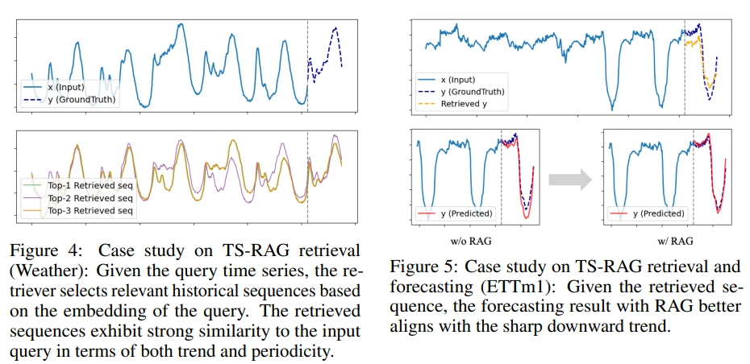

왼쪽(Figure 4)은 위 칸이 query(파란 실선)와 실제 미래(남색 점선), 아래 칸이 검색된 Top-1 ~ 3 시퀀스다. 오른쪽(Figure 5)은 위 칸에 검색된 미래(주황 점선)가 실제 미래와 겹쳐 그려져 있고, 아래 두 칸이 retrieval 없이 예측한 것(w/o RAG)과 붙여서 예측한 것(w/ RAG)이다. 출처: 논문 Figure 4, Figure 5

- Figure 4는 Weather dataset에서의 retrieval process를 보여 준다. 아래 칸의 세 곡선이 위 칸의 입력과 같은 자리에서 오르내린다. periodicity와 trend가 충분히 align된, 관련성 높은 sequence를 찾고 있다.
- Figure 5는 ETTm1 dataset의 사례다. 점선 뒤에서 실제 값이 급하게 떨어지는데, w/o RAG의 빨간 예측선은 골짜기 바닥에서 실제 값(남색 점선)보다 더 깊이 내려가 벌어지고, w/ RAG에서는 내려가는 구간과 바닥이 모두 실제 값에 거의 겹친다. TSFM이 유사한 패턴을 보이는 retrieved information을 활용해 예측을 더 정확히 수행한 것이다. 위 칸의 주황색 retrieved forecasting이 높은 weight를 기록했는데, 모델이 retrieved pattern 중에서 가장 영향력 있는 것을 충분히 활용하면서 현재 시퀀스의 주요 패턴도 잘 반영한다고 평가할 수 있다.

**Showcases.**

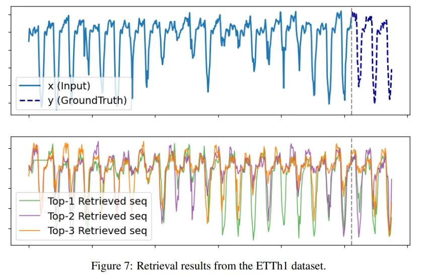

위 칸의 입력에 보이는 날카로운 하강이 아래 칸의 세 곡선에도 같은 간격으로 반복된다. 세 곡선은 서로 조금씩 다르다. 출처: 논문 Figure 7

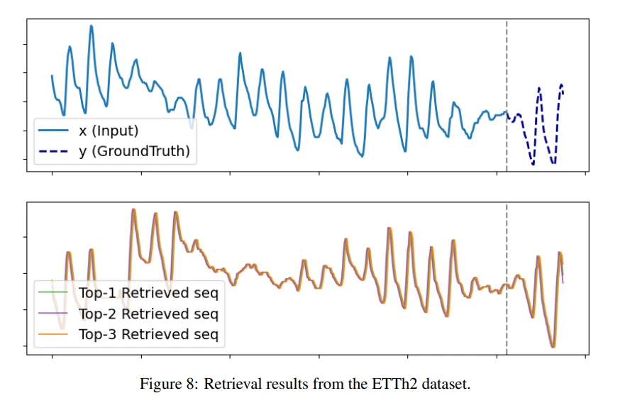

여기서는 아래 칸의 세 곡선이 한 줄로 보일 만큼 겹쳐 있다. 출처: 논문 Figure 8

- Figure 7과 8은 ETTh1과 ETTh2에 대한 retrieval 결과다. TS-RAG는 input과 구조적 유사성이 강한 historical pattern을 찾아내며, 특히 periodicity와 trend 측면의 pattern을 잘 잡아낸다.
    - ETTh1에서는 retrieved sequence가 input의 복잡한 fluctuation과 local variation까지 잘 매칭된다.
    - ETTh2에서는 더 부드러운 periodicity를 잘 잡아내면서, retrieved sequence들이 거의 완전히 일치하는 모습을 보인다. 모델이 데이터 안에 존재하는 주기적 패턴을 확실하게 파악했다는 것으로 해석할 수도 있다.
- 결과적으로, 데이터에 강한 seasonal dependency가 존재하는 경우 retrieval augmentation이 이에 매칭되는 패턴을 효과적으로 찾아내 forecasting accuracy 향상에 크게 도움이 되었다고 볼 수 있다.

    > Q. 그렇다면 의문이 드는 것은, Exchange에서는 왜 좋은 성능이 나왔을까? robustness 측면에서도 어느 정도 효과를 볼 수 있기 때문일까?

    성능 향상은 generalization의 측면(모든 데이터에서 성능 향상)과 robustness의 측면(periodicity를 효과적으로 잡고, local variation에 대해서도 강한 추론 성능을 보임)으로 나누어 설명할 수 있을 것 같다.

- Figure 9와 10은 Weather dataset에서 retrieval augmentation이 forecasting accuracy에 미치는 영향을 분석한다. 두 그림 모두 위 칸에 입력과 실제 미래, 검색된 미래(주황 점선)가 있고, 아래 두 칸이 w/o RAG와 w/ RAG의 예측(빨간 실선)이다.

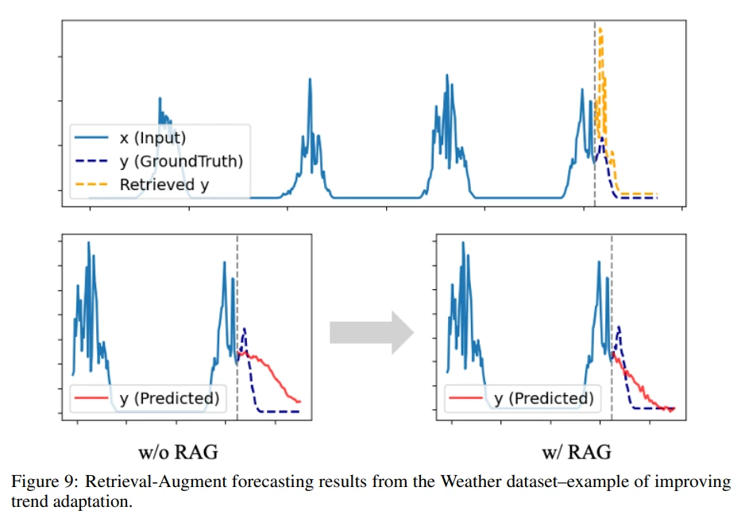

실제 값(남색 점선)은 회색 점선 직후에 잠깐 솟았다가 곧바로 바닥으로 떨어진다. w/o RAG의 빨간 선은 한참 높은 곳에 머물다 천천히 내려오고, w/ RAG의 빨간 선은 더 일찍 내려와 끝에서 바닥에 닿는다. 출처: 논문 Figure 9

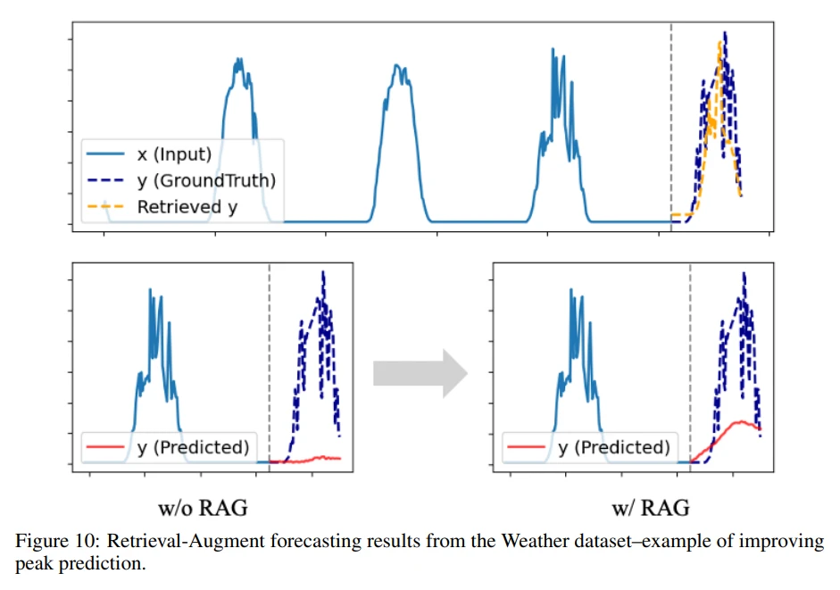

입력의 끝은 평평한 바닥인데 실제 미래에는 큰 봉우리가 온다. w/o RAG의 빨간 선은 바닥에 거의 붙어 있고, w/ RAG에서는 봉우리의 높이에는 한참 못 미치지만 올라가는 모양이 생긴다. 위 칸의 주황 점선(검색된 미래)에 같은 봉우리가 들어 있다. 출처: 논문 Figure 10

- 두 그림을 정리하면 다음과 같다.
    - Figure 9에서 baseline TSFM은 갑작스러운 trend shift를 잡아내기 어려워한다. 그러나 ARM을 반영하면 이러한 trend change에 일부 적응한다.
    - Figure 10에서도 TSFM은 peak를 거의 맞추지 못하지만, ARM을 반영하면 더 정확한 예측을 한다.

> 이러한 케이스 분석을 통해, retrieval-augmented forecasting이 모델로 하여금 complex temporal pattern에 더 잘 적응하도록 만들며, 이를 통해 real-world forecasting task에서 robustness를 향상할 수 있다는 것을 알 수 있다.

### Conclusion

- 이 연구는 TSFM의 zero-shot forecasting에서 generalization과 interpretability를 향상하는 novel retrieval-augmented forecasting framework를 제시한다. (robustness도 일부 얻었다고 보인다.)
- RAG를 pretrained retrieval encoder, ARM augmentation module과 결합했고, 이를 통해 TS-RAG는 retrieved relevant pattern들을 효과적으로 반영해 unseen domain에 대한 forecasting accuracy를 높였다.
- 결과적으로 TS-RAG는 retrieval-augmented time series forecasting에 대한 아이디어를 제공했다는 점에서 contribution이 있다고 볼 수 있다.

#### Contributions

- **Injection of external knowledge for time series.** time series는 domain-specific한 특성이 강하고 데이터의 수도 적어, 상대적으로 학습이 어려운 task가 많다. 이 논문은 사전에 구성한 retrieval knowledge base에서 RAG로 유사한 패턴을 찾아 예측을 강화하는 방식을 적용했다.
    - 이전까지 사용된 방식은 찾아낸 정보를 input 자체에 concat하는 정도였으며, multi-domain knowledge base를 구성하지는 않았다.
    - TS-RAG는 multi-domain RKB를 구성하므로, 상대적으로 generalization이 더 뛰어난 방식이라고 볼 수 있다.
    - ARM augmentation module: TSFM encoder로 추출한 embedding과 RAG로 retrieve된 forecasting window를 attention-based mixing으로 결합한다. 이 방식 덕분에 time series foundation model의 구조에 관계없이 범용적으로 쓸 수 있는 framework가 되었고, 가중치를 동적으로 결정해 현재 예측을 강화한다.
- **Interpretability.** ARM의 동작 특성 덕분에, time series에서 얻기 어려운 interpretability를 확보할 수 있다.
- **Improved zero-shot forecasting performance.** 기존 TSFM은 복잡한 temporal dynamics를 다루는 데 어려움을 겪는다는 한계가 있었다. TS-RAG는 RAG와 ARM augmentation module을 활용해, 특히 temporal dependency(주기적 특성)가 강하게 나타나는 데이터에서 뛰어난 성능 향상을 보였다. 나아가 local variation과 같은 distribution shift에도 일부 적응하는 모습을 보이며, robustness도 일부 향상했다.

#### Limitations

읽으면서 적은 한계(적용 시나리오의 제한, interpretability의 제한, 완전한 zero-shot인가에 대한 의문)는 앞의 질문 정리 2번에 함께 묶어 두었다.

## Appendix

### Additional Results

#### Generalization across Backbones

TS-RAG가 Chronos-Bolt에만 통하는 것인지, 다른 TSFM에 얹어도 좋아지는지를 본다.

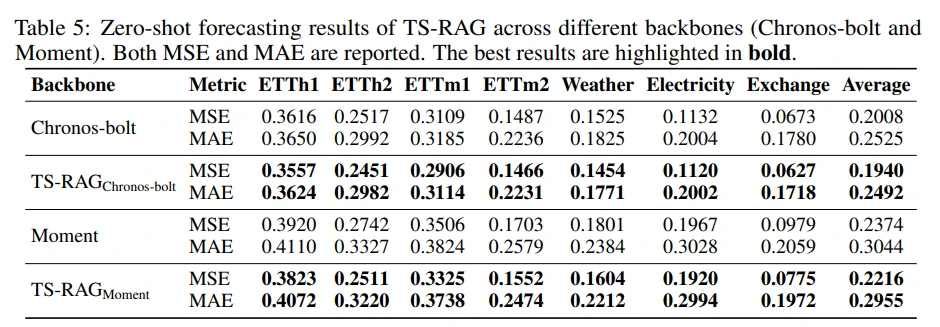

위의 두 묶음(Chronos-bolt와 그 위에 얹은 TS-RAG), 아래의 두 묶음(Moment와 그 위에 얹은 TS-RAG)을 각각 짝지어 본다. 두 backbone 모두 TS-RAG를 얹은 쪽이 모든 열에서 굵은 글씨이고, 평균 MSE는 Chronos-Bolt가 0.2008 → 0.1940, MOMENT가 0.2374 → 0.2216이다. 출처: 논문 Table 5

- 다양한 backbone에 TS-RAG를 적용해 TS-RAG의 generalization을 실험한다.
    - 여기서 MOMENT는 zero-shot forecasting을 수행할 수 있도록, prediction head를 TS-RAG와 같은 pretraining data로 pretrain한다.

#### Impact of Retriever Encoder Choice

- retriever encoder를 다른 것으로 바꿔도 큰 차이는 없었다. 표는 앞의 "Appendix 내용 정리"에 실은 Table 10이다.

### Analysis on Time Series Characteristics Influencing TS-RAG Effectiveness

어떤 성질의 시계열에서 retrieval이 더 잘 듣는지를, 데이터셋의 통계적 특성과 성능 향상 폭 사이의 상관으로 본 분석이다.

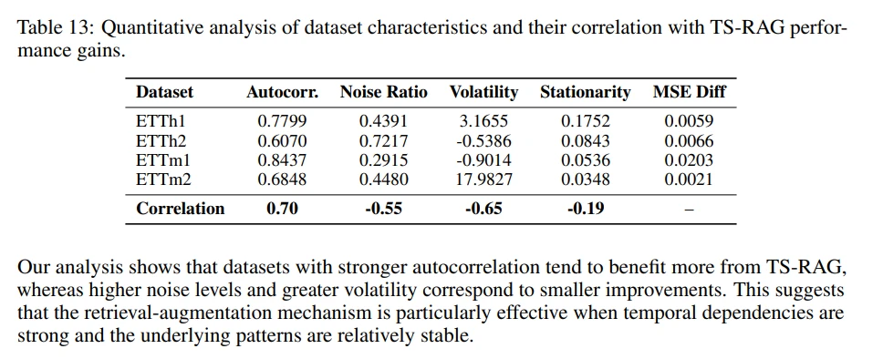

맨 아래 Correlation 줄만 보면 된다. 각 특성과 MSE 개선 폭(MSE Diff) 사이의 상관계수가 autocorrelation +0.70, noise ratio −0.55, volatility −0.65, stationarity −0.19다. 다만 데이터셋 네 개로 계산한 상관이다. 출처: 논문 Table 13

- 분석 결과, autocorrelation이 강한 데이터셋일수록 TS-RAG로 얻는 benefit이 컸다. 표에서 autocorrelation이 가장 큰 ETTm1(0.8437)의 MSE 개선 폭이 0.0203으로 가장 크다.
- 반면 noise level(일차 차분의 variance. 즉, 예기치 못한 fluctuation의 정도)이 크거나 volatility(standard deviation)가 클수록 benefit이 적었다.

> 이러한 결과는 TS-RAG의 retrieval-augmentation mechanism이 temporal pattern이 두드러지게 나타나거나, 내재된 패턴이 상대적으로 안정적인 경우에 특히 효과적임을 보인다.

## 참고 자료

- Kanghui Ning, Zijie Pan, Yu Liu, Yushan Jiang, James Yiming Zhang, Kashif Rasul, Anderson Schneider, Lintao Ma, Yuriy Nevmyvaka, Dongjin Song. "TS-RAG: Retrieval-Augmented Generation based Time Series Foundation Models are Stronger Zero-Shot Forecaster." NeurIPS 2025. [arXiv:2503.07649](https://arxiv.org/abs/2503.07649)
- Chronos: Learning the Language of Time Series (Chronos, Chronos-Bolt의 바탕이 되는 논문)
- Retrieval Augmented Time Series Forecasting (RAF)
- Retrieval-Augmented Diffusion Models for Time Series Forecasting (RATD)
