# RAFT: Retrieval Augmented Time Series Forecasting 리뷰

작성일 2026-03-19 · 최종 수정일 2026-04-01
{ .post-date }

Retrieval Augmented Time Series Forecasting은 입력과 닮은 과거 구간을 training 시계열에서 검색하고, 그 구간 뒤에 실제로 이어졌던 값을 현재 예측에 함께 쓰는 모델 RAFT(Retrieval-Augmented Forecasting of Time-Series)를 제안한 논문이다. 글은 요약, 질문 정리, 논문 정리, Appendix 정리의 순서로 되어 있다. 논문의 그림과 표를 함께 실었고, 설명은 그림을 보면서 따라갈 수 있게 적었다.

## 요약

### 1. 연구 수행 배경

이 논문의 생각은 아래 그림 한 장에 담겨 있다. 지금 들어온 입력과 닮은 구간을 과거에서 찾고, 그때 그 뒤에 무슨 일이 있었는지를 예측에 참고한다.

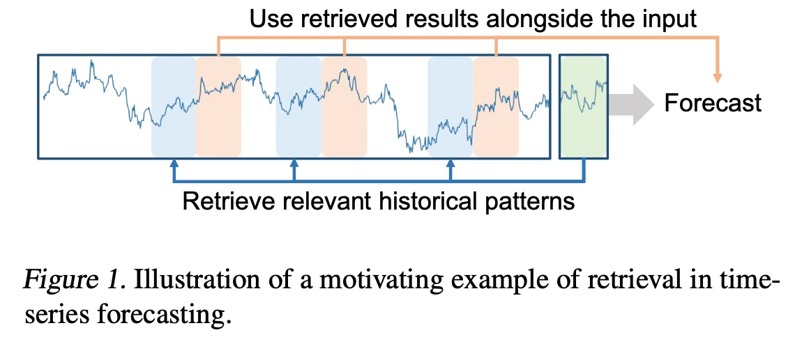

초록 구간이 현재 입력이고, 파란 구간이 과거에서 찾아낸 입력과 닮은 구간, 주황 구간이 그 바로 뒤에 실제로 이어졌던 값이다. RAFT는 주황 구간을 입력과 함께 써서 예측한다. 출처: 논문 Figure 1

이런 방법이 필요한 이유는 다음과 같다.

- 현실의 시계열은 non-stationary하고 주기와 형태가 다양하며, 자주 반복되지 않는 희귀한 패턴도 많다.
- 논문은 특히 이런 패턴들이 명확한 temporal correlation이 없거나 non-deterministic한 과정에서 발생할 수 있어서, 모델이 이를 파라미터 안에 전부 학습해 기억하려는 방식에는 한계가 있다고 지적한다.
- 다시 말해 기존 forecasting 모델은 결국 weights 안에 다양한 패턴을 암묵적으로 저장해야 하는데, 드물게 나타나는 패턴이나 서로 공통성이 적은 패턴까지 모두 memorization하려는 것은 일반화와 효율성 측면에서 불리하다. 이것이 이 논문의 핵심 문제 설정이다.
- 따라서 저자들은 "모든 패턴을 내부 파라미터로 외워야 할 필요가 있는가?"라는 관점으로 접근한다.
- 그 대안으로, 입력과 유사한 과거 패턴을 훈련 시계열 전체에서 retrieval한 뒤, 그 패턴 뒤에 실제로 이어졌던 future segment를 현재 예측에 직접 참고하게 만든다.
- 이는 모델 내부의 파라미터 용량만으로 복잡한 패턴을 모두 흡수하려는 것이 아니라, 외부 메모리처럼 과거 사례를 검색해서 prediction의 보조 정보로 쓰는 발상이다.
- 모델은 MLP 기반 forecasting backbone에 retrieval module을 더한 매우 단순한 구조로 설계한다.
- 이 논문에서 RAG는 언어 모델용 기술을 그대로 이식한 것이라기보다, retrieval-augmentation이라는 원리를 시계열에 맞게 옮긴 것에 가깝다.

> - 기존 모델의 병목은 희귀하거나 비정상적이거나 temporal correlation이 낮은 패턴을 순수한 파라미터 학습만으로 다루기 어렵다는 점이고, 이를 해결하기 위해 retrieval을 통한 explicit historical pattern access를 제안한다.

### 2. 논문의 핵심 Contribution 3줄 요약

- 이 논문은 입력과 가장 유사한 과거 시계열 패턴을 훈련 데이터에서 검색하고, 그 뒤에 실제로 관측된 future patch를 함께 활용하는 RAFT를 제안한다.
- RAFT는 단순한 MLP backbone 위에 retrieval module만 추가했음에도, 10개 벤치마크에서 강한 baseline들을 상대로 평균 win ratio 86%를 기록하며 일관된 성능 향상을 보였다. 특히 ETTh1/2, ETTm1/2, Electricity, Traffic 등 다수 데이터셋에서 평균 MSE 기준 최고 성능을 냈다.
- 추가 분석을 통해, retrieval은 특히 희귀하게 반복되는 패턴이나 temporal correlation이 약한(random walk에 가까운) 패턴에서 더 큰 효과를 보인다고 주장하며, retrieval이 forecasting에 유효한 inductive bias임을 보였다.

### 3. 논문의 기존 한계 해결 방식

#### (1) 모든 패턴을 weights에 저장하는 부담을 줄임

- 기존 딥러닝 forecasting 모델은 복잡한 패턴을 잘 예측하기 위해, 결국 그런 패턴을 training 과정에서 파라미터에 흡수해야 한다.
- 그런데 희귀하거나 비정형적인 패턴은 반복적인 노출이 적어 학습이 잘 되지 않는다.
- RAFT는 이를 해결하기 위해 현재 입력과 닮은 과거 구간을 전체 시계열에서 검색해서, 그때 뒤이어 나왔던 future 값들을 현재 예측의 참고 자료로 제공한다.
    - backbone으로 예측하기 전에 유사한 embedding을 더하는 방식이 아니라, 유사한 과거 구간 뒤에 실제로 이어졌던 값을 현재 예측에 더하는 방식이다.
    - 남은 질문: 이 방식이 더 효과적인 이유는 무엇인가?

#### (2) look-back window 내부 관계만 보는 한계를 넘어섬

- Transformer류는 보통 주어진 look-back window 내부의 dependency를 학습한다.
- 반면 RAFT는 retrieval을 통해 현재 입력 창 밖, 더 과거의 전체 시계열 영역에서 유사 패턴을 찾는다. 따라서 현재 context 안의 self-attention 관계만 활용하는 것이 아니라, 전체 학습 시계열을 external memory처럼 탐색할 수 있다.
- 이것이 논문이 기존 attention 기반 forecasting과 구분하는 중요한 차이다.

#### (3) scale/offset보다 "모양" 유사성에 초점을 맞춤

- retrieval 시에는 query와 key patch에서 마지막 값을 offset처럼 빼고, similarity는 Pearson correlation으로 계산한다.
- 이는 절대값의 크기보다 증가/감소 형태와 패턴의 shape similarity를 비교하려는 설계다.
- 시계열에서 레벨이 달라도 비슷한 동학이 반복될 수 있다는 점을 반영한다.

#### (4) multi-period retrieval로 local/global 패턴을 함께 반영

- 논문은 period 1, 2, 4로 downsample한 여러 버전의 시계열에서 각각 retrieval을 수행한다.
- 작은 period는 더 로컬한 패턴을, 큰 period는 더 거시적인 패턴을 포착한다는 가정이다.
- 각 period의 retrieval 결과를 projection한 뒤 합쳐서 최종 예측에 사용한다.
- 즉, 단순히 비슷한 과거 1개를 찾는 것이 아니라 multi-resolution에서 유사한 과거를 찾고, 그 미래를 aggregation하여 예측에 반영하는 구조다.

#### (5) 실제로 retrieval이 유리한 조건도 함께 검증

- 논문은 synthetic experiment를 통해, 다음과 같은 상황에서 retrieval이 특히 더 잘 동작한다고 말한다.
    - rare pattern이 다시 등장할 때
    - temporally less correlated pattern일 때 (즉, random walk에 가까워 모델이 일반 규칙으로 학습하기 어려울 때)

> - 이 논문은 retrieval을 통한 성능 향상을 잘 보였지만, retrieval이 실패하는 경우나 미래와 과거가 구조적으로 달라지는 regime shift 상황, retrieval cost의 확장성, single-series 설정 밖에서의 일반화는 충분히 깊게 다루지 않는다.
> - 또한 Exchange, Illness, Solar, Weather처럼, 모든 데이터셋에서 항상 최고 성능인 것은 아니다.

### 4. 꼭 알아야 할 필수 선행 연구

- TimeMixer: Decomposable Multi-Scale Mixing for Time Series Forecasting
- Are Transformers Effective for Time Series Forecasting? (DLinear와 NLinear를 제안한 논문으로, [PatchTST 리뷰](2024-11-25-patchtst.md)에서 함께 정리했다.)

## 질문 정리

MLP backbone의 구성과 retrieval augmentation 방식에 대한 질문은 아래 논문 정리의 3.2 ~ 3.3절에 합쳐 적었다.

### 현재 retrieval 방식은 data leakage 아닌가?

- 검색 대상은 training 시계열이고, 학습 단계에서는 입력 $\mathbf{x}$와 겹치는 patch를 key에서 제외한다. 평가 시점의 query 입장에서는 과거 사례만 찾아보는 셈이다.
- 그러면 찾아볼 과거 사례가 적은 시계열 앞쪽의 예측에서는 실질적으로 성능이 낮을 것이다.
- 이 부분은 따로 분석이 필요하다. [TS-RAG](2026-02-08-ts-rag.md)는 아예 augmentation을 해서 이 점을 보완한다.

## 논문 정리

### 1. Introduction

배경과 문제 설정은 요약에 적은 것과 같다. 논문은 RAFT가 두 가지 advantage를 제공한다고 설명한다.

- 학습된 model weights에만 의존하지 않고, retrieved information을 inference time에 직접 활용할 수 있다. 이를 통해 temporal correlation이 부족하거나 다른 패턴들과 공통적인 특성을 공유하지 않는 패턴에 대해서도 추가 정보를 제공하여, 모델의 학습 부담을 줄일 수 있다.
- 특정한 패턴이 historical data에 적게 나타나거나 모델이 학습하기 어렵더라도, retrieval module을 통해 그런 패턴이 다시 나타났을 때 과거 사례를 쉽게 활용할 수 있다.

**Contributions**

- training dataset에서 현재 input과 유사한 패턴을 보이는 sequence를 찾고, 이를 현재 예측에 반영하여 forecasting performance를 향상하는 방법론(RAFT)을 제안한다.
- RAFT는 contemporary baselines를 win ratio 86%로 능가했다.
- synthetic dataset과 real-world dataset을 활용하여, RAFT가 더 beneficial한 상황에 대한 추가 분석을 제공한다.

### 2. Related Work

- 예측 모델 쪽에서는 Transformer 기반 모델이 뛰어난 성능을 보였지만 DLinear/NLinear 같은 단순한 MLP 기반 모델이 더 좋은 예측 성능을 보였고, 이후의 MLP 계열 모델(TiDE, TSMixer, TimeMixer)은 time series decomposition과 multi-periodicity(downsampling, upsampling) 같은 방법을 사용한다.
- retrieval-augmented model은 통상 주어진 input과 유사한 데이터를 dataset에서 찾아내고, input을 찾아낸 instance들과 결합하여 prediction을 생성한다.
- 시계열에서도 유사한 entity를 retrieve하는 연구가 있었다. 이 연구들은 training set이 다양한 종류의 time series entity를 가진다고 가정하고, 각 entity의 예측에 필요한 정보를 모든 entity 간의 유사도에 기반하여 얻어낸다.
- 이 논문은 retrieval이 single time series에만 적용될 때도 유용함을 보이고자 한다. RAG가 LLM에 추가 정보를 제공하여 knowledge-intensive task를 보완하는 것과 비슷하게, 모델이 가능한 모든 복잡한 패턴을 외우게 하는 대신 retrieval module로 learning process를 간단하게 만드는 정보를 제공하여 time series forecasting의 learning complexity를 줄이려는 것이다.

### 3. Method

#### 3.1. Overview

**Problem formulation.**

- single time series: $\mathbf{S} \in \mathbb{R}^{C \times T}$
    - $C$: channels
    - $T$: timesteps
- historical observations: $\mathbf{x} \in \mathbb{R}^{C \times L}$
    - $L$: look-back window size
- predicted future values: $\mathbf{y} \in \mathbb{R}^{C \times F}$
    - $F$: forecasting window size

RAFT가 하는 일은 "과거에서 닮은 구간을 찾아 그 뒤의 값을 가져오고(retrieval), 그것을 입력과 합쳐 선형 층으로 예측한다"로 요약된다. 전체 구조는 아래 그림과 같다.

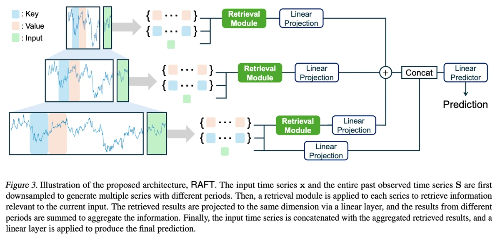

세 줄은 같은 시계열을 서로 다른 period로 downsample한 것이다(맨 아래가 원래 해상도). 줄마다 초록색 입력으로 파란색 key를 검색해 주황색 value를 가져오고, 세 줄의 결과를 더한 뒤 입력과 이어 붙여 예측한다. 출처: 논문 Figure 3

그림을 왼쪽에서 오른쪽으로 따라가면 다음과 같다.

- **검색 (초록색 Retrieval Module).** input $\mathbf{x}$(초록)가 주어지면, retrieval module이 $\mathbf{S}$에서 $\mathbf{x}$와 가장 유사한 patch(파랑)를 찾고 그 뒤에 이어진 patch(주황)를 가져온다.
    - retrieval process는 input과 retrieved patches 사이에 importance weights가 attention처럼 부여되는 구조다. retrieved patches는 weighted sum으로 합쳐진다.
    - RAFT가 attention-based forecasting model들과 다른 점은, relevant data를 전체 time series에서 찾아낸다는 것이다. 쉽게 말해, 고정된 look-back window만 처리하는 것이 아니라 데이터셋 전체에서 현재 sequence와 유사한 정보를 찾아낸다는 뜻으로 이해했다.
- **여러 주기 (세 줄).** time series는 본질적으로 multi-periodicity를 가지므로, RAFT는 time series를 downsampling하여 여러 주기에서 비슷한 patch를 찾아낸다.
- **합치기 (Linear Projection과 ⊕).** 줄마다 나온 retrieved patches는 linear projection을 거친 뒤 summation으로 aggregate된다.
- **예측 (Concat과 Linear Predictor).** 최종적으로 input과 aggregated retrieval result를 concat한 뒤, linear model로 prediction을 수행한다.

초록색 Retrieval Module 상자 안은 3.2절에서, 그 뒤의 합치기와 예측은 3.3절에서 다룬다.

#### 3.2. Retrieval module architecture

retrieval module은 두 가지 일을 한다. 먼저 시계열 전체를 잘라 "과거 구간(key)과 그 뒤에 이어진 구간(value)"의 쌍을 만들어 두고, 입력이 들어오면 입력과 닮은 key를 골라 그 value들을 유사도에 따라 섞어서 내놓는다.

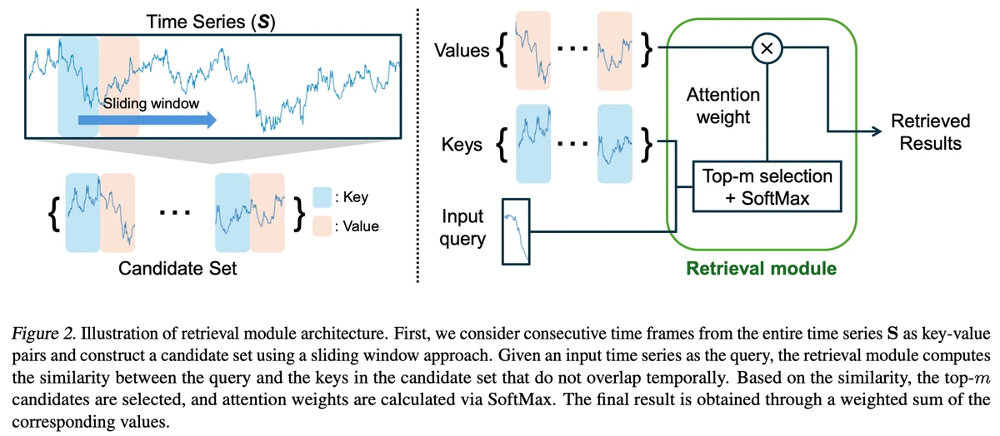

왼쪽은 sliding window로 key(파랑)와 value(주황)의 쌍을 만드는 과정이고, 오른쪽은 입력 query와 key의 유사도로 top-$m$을 고르고 SoftMax로 만든 weight를 value에 곱해 합치는 과정이다. 출처: 논문 Figure 2

**후보 만들기 (그림 왼쪽).**

- stride 1의 sliding window로 time series를 여러 개의 key patch로 나눈다.

    $$
    \mathcal{K} = \{ \mathbf{k}_1, \dots, \mathbf{k}_{T-(L+F)+1} \}
    $$

    - $i$는 patch $\mathbf{k}_i \in \mathbb{R}^{C \times L}$의 시작 시점을 가리킨다.
    - 단, 주어진 $\mathbf{x}$와 겹치는 key patch는 training 과정에서 제외된다.
- 그다음, 각 key patch 바로 뒤에 이어지는 구간을 value patch로 둔다.

    $$
    \mathcal{V} = \{ \mathbf{v}_1, \dots, \mathbf{v}_{T-(L+F)+1} \}
    $$

    - 각 $\mathbf{v}_i \in \mathbb{R}^{C \times F}$는 time series에서 $\mathbf{k}_i$ 뒤에 연속해서 나오는 구간이다. 즉, value patch는 key에 대응되는 future values다.
- input $\mathbf{x}$를 query로 사용하여 이와 유사한 key patch를 찾아내고, 그 key patch에 대응되는 value patch를 활용한다.

**비교하기 전의 전처리.** 그림에는 나오지 않지만, 유사도를 재기 전에 모든 patch의 높이를 맞추는 단계가 있다.

- query, key, value는 서로 distribution이 다를 수 있다. 이 discrepancy를 완화하기 위해, 모든 query, key, value patch에서 last time step의 값을 offset으로 보고 빼는 preprocessing을 적용한다.
    - $\mathbf{x} = \{ \mathbf{x}^t \}_{t \in \{1, \dots, L\}}$이고, $\mathbf{x}^t \in \mathbb{R}^C$는 input $\mathbf{x}$ 안에서 $t$번째 time step의 $C$개 변수 값이다(즉, $\mathbf{x}^t = \{ x^t_1, \dots, x^t_C \}$).

        $$
        \hat{\mathbf{x}} = \{ \mathbf{x}^t - \mathbf{x}^L \}_{t \in \{1, \dots, L\}}
        $$

    - $\hat{\mathbf{x}}$는 offset을 뺀 input query다. key와 value에도 같은 처리를 해서 $\hat{\mathbf{k}}_i \in \hat{\mathcal{K}}$, $\hat{\mathbf{v}}_i \in \hat{\mathcal{V}}$를 만든다.
    - offset 적용의 의의는 다음과 같다.
        - 절대값이 아니라 패턴의 shape를 비교하게 만든다.
        - level shift와 non-stationarity의 방해를 줄인다.
        - retrieval된 future를 현재 입력의 기준점에 자연스럽게 정렬시킨다.
    - Q. 코드에서 이 밖의 normalization을 따로 하지는 않는가? 공개된 코드를 확인해 보면, 모델 안에서는 마지막 시점 값을 빼고 예측 뒤에 다시 더하는 것 외의 정규화가 없다. 다만 데이터 로더가 train 구간의 통계로 변수별 표준화(StandardScaler)를 한 뒤 모델에 넘긴다.

**고르고 섞기 (그림 오른쪽).** 그림의 "Top-m selection + SoftMax" 상자와 ⊗ 기호가 아래 네 단계에 해당한다.

- $\hat{\mathbf{x}}$와 $\hat{\mathcal{K}}$의 각 key patch 사이의 similarity $\rho_i$를 계산한다.

    $$
    \rho_i = s(\hat{\mathbf{x}}, \hat{\mathbf{k}}_i), \quad \hat{\mathbf{k}}_i \in \hat{\mathcal{K}}
    $$

    - similarity function $s$로는 Pearson's correlation을 사용하여 scale variation과 value offset의 영향을 최대한 줄이고, 상승/하락의 경향성에 집중하도록 만들었다.
    - 논문의 기본 설정에서는 학습된 embedding 공간에서 유사도를 비교하지 않는다. query와 key의 raw time-series patch 자체를 비교한다. (다른 유사도와의 비교는 아래 Appendix C.1에 있다.)
- 그리고 correlation이 높은 순으로 top-$m$개의 patch를 고른다.

    $$
    \mathcal{J} = \text{arg top-}m \left( \{ \rho_i \mid 1 \le i \le |\hat{\mathcal{K}}| \} \right)
    $$

    - $\mathcal{J}$는 top-$m$ patch들의 index다.
    - $m$은 validation dataset의 성능에 기반해 선택하는 hyperparameter다.
- top-$m$개의 patch를 찾아낸 뒤에는, temperature $\tau$를 사용하여 value patch들의 weight를 정한다.

    $$
    w_i =
    \begin{cases}
    \dfrac{\exp(\rho_i/\tau)}{\sum_{j \in \mathcal{J}} \exp(\rho_j/\tau)}, & \text{if } i \in \mathcal{J},\\[6pt]
    0, & \text{otherwise}.
    \end{cases}
    $$

    - 이는 top-$m$개의 correlation에 대해서만 SoftMax를 취하는 것과 같다.
    - temperature의 역할은 다음과 같다.
        - top-$m$ retrieval 후보들 사이에서 가중치 분포의 날카로움을 조절한다.
        - retrieval 결과가 특정 유사 패턴 하나에 집중할지, 아니면 여러 유사 패턴을 안정적으로 평균 낼지를 결정한다.
        - noise에 민감한 retrieval과 과도한 averaging 사이의 균형점을 잡는다.
- 최종적으로 value patch들의 weighted sum으로 retrieval result $\tilde{\mathbf{v}} \in \mathbb{R}^{C \times F}$를 얻는다. 그림에서 "Retrieved Results"로 나가는 화살표가 이것이다.

    $$
    \tilde{\mathbf{v}} = \sum_{i \in \{1, \dots, |\hat{\mathcal{V}}|\}} w_i \cdot \hat{\mathbf{v}}_i
    $$

#### 3.3. Forecast with retrieval module

retrieval module이 내놓은 $\tilde{\mathbf{v}}$("닮은 과거 뒤에 이어졌던 값들의 가중 평균")를 입력과 합쳐 예측을 만드는 단계다. 3.1절 전체 구조 그림의 오른쪽 절반(Linear Projection, ⊕, Concat, Linear Predictor)에 해당한다. period를 하나만 쓰는 경우를 먼저 보고, 여러 개로 넓힌다.

**Single period.** 전체 구조 그림에서 맨 아래 한 줄만 있는 경우다.

- retrieval module에서 query, key, value를 처리한 것과 마찬가지로, input $\mathbf{x}$에서도 last time step offset을 빼서 $\hat{\mathbf{x}}$로 만든다.
- 그다음 $f(\hat{\mathbf{x}})$와 $g(\tilde{\mathbf{v}})$를 concat하고, $h$에 넣어 prediction $\hat{\mathbf{y}}$를 얻는다.

    $$
    \hat{\mathbf{y}} = h\left( f(\hat{\mathbf{x}}) \oplus g(\tilde{\mathbf{v}}) \right)
    $$

    - $f: \mathbb{R}^L \to \mathbb{R}^F$
    - $g: \mathbb{R}^F \to \mathbb{R}^F$
    - $h: \mathbb{R}^{2F} \to \mathbb{R}^F$
    - $\oplus$: concatenation
    - $f$, $g$, $h$는 모두 linear projection이다. 그림으로 보면 $f$는 초록색 입력에서 곧장 Concat으로 가는 맨 아래의 Linear Projection, $g$는 Retrieval Module 뒤의 Linear Projection, $h$는 마지막의 Linear Predictor다.

**Multiple periods.** 전체 구조 그림처럼 줄을 세 개로 늘린 경우다. 줄마다 따로 검색하고, 결과를 ⊕에서 더한다.

- 다양한 period에서 time series의 패턴을 처리하기 위해, $n$개의 period로 이루어진 집합 $\mathcal{P}$를 고려한다. 논문은 $\mathcal{P} = \{1, 2, 4\}$로 둔다.
- multi-periodicity를 고려한다는 것은, 저장된 train 데이터만 다른 periodicity로 본다는 뜻이 아니다. query, key, value를 모두 period별로 downsample해서 각각 retrieval을 수행한 뒤 합친다는 뜻이다.
- 이를 위해 query, key, value를 주기 $p$로 average pooling하여 downsampling한다.
    - query patch: $\mathbf{x}^{(p)} \in \mathbb{R}^{C \times \lfloor L/p \rfloor}$
    - key patch: $\mathbf{k}^{(p)}_i \in \mathbb{R}^{C \times \lfloor L/p \rfloor}$
    - value patch: $\mathbf{v}^{(p)}_i \in \mathbb{R}^{C \times \lfloor F/p \rfloor}$
- 이렇게 downsampling된 patch들에 대하여, period마다 독립적으로 retrieval process를 수행한다.
    - 이를 통해 각 period $p$에 대하여 $\tilde{\mathbf{v}}^{(p)} \in \mathbb{R}^{C \times \lfloor F/p \rfloor}$를 얻는다.
    - 각 결과는 period별 linear layer $g^{(p)}$를 거쳐 동일한 embedding space로 들어간다. 이 과정에서 $\mathbb{R}^{\lfloor F/p \rfloor}$를 $\mathbb{R}^F$로 mapping한다.
- 최종적으로 $f(\hat{\mathbf{x}})$를 linear projection들의 sum과 concat하고, linear predictor $h$에 입력한다.

    $$
    \hat{\mathbf{y}} = h\left( f(\hat{\mathbf{x}}) \oplus \sum_{p \in \mathcal{P}} g^{(p)}(\tilde{\mathbf{v}}^{(p)}) \right)
    $$

- $\hat{\mathbf{y}}^t$를 $\hat{\mathbf{y}}$의 $t$번째 time step이라고 할 때, 앞에서 빼 주었던 $\mathbf{x}^L$을 $\hat{\mathbf{y}}$에 다시 더해 final forecast $\mathbf{y}$를 얻는다.

    $$
    \mathbf{y} = \{ \hat{\mathbf{y}}^t + \mathbf{x}^L \}_{t \in \{1, \dots, F\}}
    $$

- train loss는 실제 미래 값 $\mathbf{y}_0$에 대한 MSE loss로 둔다.

    $$
    \mathcal{L} = \text{MSE}(\mathbf{y}, \mathbf{y}_0)
    $$

정리하면 patch의 마지막 시점 값을 offset으로 보고 뺀 뒤 예측을 만들고, 마지막에 그 offset을 다시 더해 원래 스케일로 복원하는 구조다.

> 이는 NLinear의 idea와 똑같지만, retrieval similarity를 더 의미 있게 만들기 위한 목적이라고 봐야 한다. 즉, offset과 scale의 영향을 줄이고 pattern similarity를 비교하기 위한 핵심 장치다.

### 4. Experiments

#### 4.1. Experimental settings

**Datasets.** ETTh1, ETTh2, ETTm1, ETTm2, Electricity, Exchange, Illness, Solar, Traffic, Weather의 10개 데이터셋을 사용한다.

**Baselines.** Autoformer, Informer, Non-stationary Transformer, FEDformer, PatchTST, DLinear, MICN, TimesNet, TimeMixer의 9개 모델과 비교한다.

**Implementation details.**

- period 집합은 $\{1, 2, 4\}$, temperature는 0.1, batch size는 32다.
- learning rate, top-$m$, look-back window size는 grid search로 정한다.
    - 공정한 비교를 위해 RAFT뿐만 아니라 모든 baseline에 대해서도 hyperparameter search를 수행했다.
    - learning rate는 $10^{-5}$ ~ 0.05 사이에서 정했다.
    - look-back window size는 $\{96, 192, 336, 720\}$에서 정했다.
    - 검색하는 patch의 개수 $m$은 $\{1, 5, 10, 20\}$에서 정했다.
    - 데이터셋과 horizon별로 실제로 고른 값은 아래 Appendix B의 표에 있다.
- computational complexity에 관한 내용은 아래 Appendix D에 정리했다.

**Evaluation.**

- metric은 MSE와 MAE를 사용한다.
- forecasting horizon length는 $\{96, 192, 336, 720\}$으로 실험한다.
    - 각 세팅마다 서로 다른 seed로 세 번 실험한 평균을 제시한다.
    - Illness dataset에서는 $\{24, 36, 48, 60\}$을 forecasting horizon length로 둔다.

#### 4.2. Experimental results on forecasting benchmarks

단순한 선형 모델에 retrieval만 붙인 RAFT가 기존 모델들과 비교해 어느 정도인지를 10개 데이터셋에서 본다.

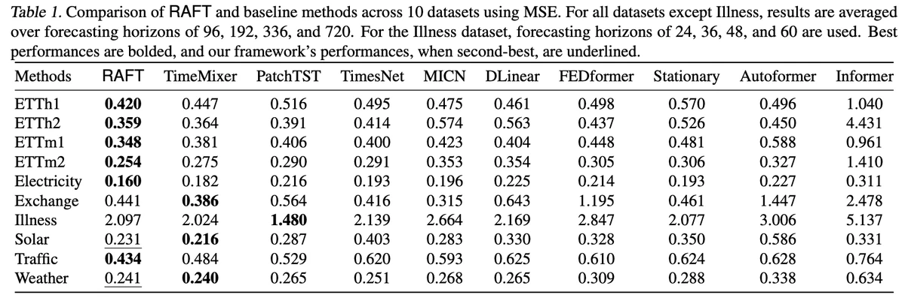

맨 왼쪽 열이 RAFT이고 값은 네 가지 horizon의 평균 MSE다(낮을수록 좋다). 굵은 글씨가 가장 좋은 값인데, ETT 4종과 Electricity, Traffic에서는 RAFT가, Exchange, Illness, Solar, Weather에서는 다른 모델이 차지했다. 출처: 논문 Table 1

표에서 먼저 볼 것은 RAFT 열과 바로 옆 TimeMixer 열의 차이다. Solar(0.231 대 0.216)와 Weather(0.241 대 0.240)는 근소하게 뒤지는 정도지만, Exchange(0.441 대 0.386)와 Illness(2.097 대 2.024, 가장 좋은 PatchTST는 1.480)는 차이가 뚜렷하다. 이 표를 보고 정리한 분석은 다음과 같다.

> - Internal retrieval augmentation은 한계가 명확하다.
> - 데이터셋의 길이가 상대적으로 길고 반복적인 패턴이 충분히 등장하는 ETT/ECL/Solar/Traffic/Weather 데이터셋에서는 가장 좋은 성능을 기록하거나, 1등과 근소한 차이로 2등을 기록했다.
> - 반면 Exchange나 Illness처럼 데이터셋의 길이 자체가 짧고 반복적인 패턴이 매우 적은 데이터셋에서는 consistent하게 outperform하기 어려웠다.
>     - 특히 RAFT(NLinear + TimeMixer)와 TimeMixer가 대체로 비슷한 approach를 취하고 있다는 것을 고려하면, Exchange에서는 사실상 retrieval이 안 좋은 영향을 미쳤다고 볼 수 있다.
>     - Illness에서는 retrieval의 영향이 거의 없거나 조금 안 좋았다고 보아야 한다.
> - 이러한 사실은 in-domain retrieval만으로는 non-stationarity에 대한 robustness를 확보하기 어렵다는 것을 의미한다. Foundation Model 같은 large model에서는 더 유의미한 성능 향상을 확보할 수 있을 것으로 보인다.

### 5. Discussions

#### 5.1. Better retrieval results lead to better performance.

이 절이 확인하려는 것은 "닮은 과거를 잘 찾을수록 예측도 좋아지는가"다. RAFT의 전제는 두 단계로 이루어져 있다. 과거 구간이 입력과 닮았으면 그 뒤에 이어진 값도 실제 미래와 닮았을 것이고, 미래와 닮은 값을 가져왔으면 예측이 좋아질 것이라는 전제다. 논문은 이 두 단계를 각각 산점도로 확인한다.

- retrieval을 통한 forecasting performance 향상을 두 가지 관점에서 분석한다.
    - retrieval로 가져온 value patch들이 실제 미래 값과 얼마나 유사한가
    - retrieval로 가져온 value patch들을 효율적으로 활용하는가
- 분석에 쓰는 두 가지 유사도는 다음과 같다.
    - key similarity: input query와 retrieved key patch 사이의 유사도
    - value similarity: 실제 미래 값과 retrieved value patch 사이의 유사도

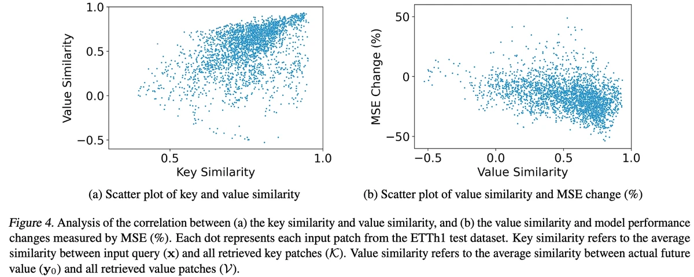

점 하나가 ETTh1 test set의 입력 patch 하나다. (a)는 점들이 오른쪽 위로 올라가고(key가 닮을수록 value도 미래와 닮는다), (b)는 오른쪽 아래로 내려간다(value가 미래와 닮을수록 MSE가 더 많이 줄어든다). 출처: 논문 Figure 4

- (a)를 보면, input query와 유사도가 높은 key patch를 가져올수록 실제 미래 값과 retrieved value patch 사이의 유사도도 높다. 오른쪽 위 구석에 점이 몰려 있는 것이 이 관계다.
- (b)의 세로축은 retrieval을 붙였을 때 MSE가 변한 비율(%)이어서, 0보다 아래에 있는 점은 retrieval로 예측이 좋아진 경우다. value similarity가 높을수록 점들이 더 아래로 내려가므로 성능 향상도 컸다. 반대로 value similarity가 낮은 왼쪽에서는 점들이 0 근처에 머문다.
- Spearman's correlation으로 분석한 결과, 다음과 같이 높은 수준의 상관관계를 보였다.
    - (a) key similarity와 value similarity 사이: 0.60
    - (b) value similarity와 성능 변화 사이: −0.54. 성능 변화를 MSE로 재기 때문에(낮을수록 좋다) 음의 상관으로 나온다.
- 정리하면, input query와 key patch의 유사도가 높을수록 실제 미래 값과 value patch 사이의 유사도도 높고, 이를 통해 더 좋은 성능을 얻어낼 수 있었다.

#### 5.2. Retrieval is helpful when rare patterns repeat.

드물게 나타나는 패턴은 모델이 학습으로 외우기 어렵다. 이 절은 그런 패턴이 다시 나타났을 때 retrieval이 정말 도움이 되는지를, 패턴의 등장 횟수를 직접 조절할 수 있는 합성 데이터로 확인한다.

**Synthetic data generation with autoregressive model.**

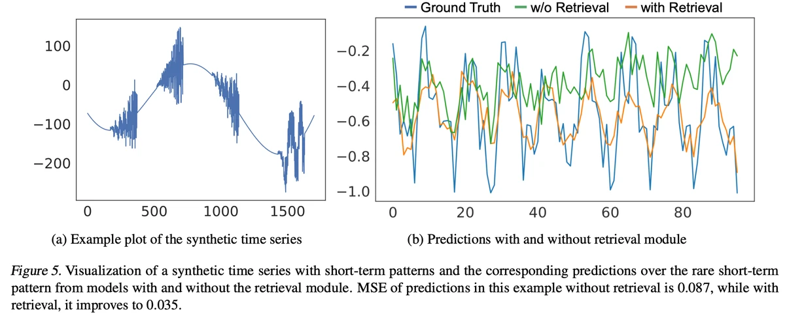

(a)는 합성 시계열의 예로, 매끄러운 곡선(trend와 seasonality) 위에 삐죽삐죽한 short-term pattern이 군데군데 얹혀 있다. (b)는 그 short-term pattern 구간의 예측으로, retrieval을 쓴 주황 선이 쓰지 않은 초록 선보다 파란 정답을 잘 따라간다. 출처: 논문 Figure 5

- (a)처럼 세 개의 component를 합쳐 synthetic dataset을 만든다.
    - Trend
    - Seasonality
    - Event-based short-term patterns
- Trend와 Seasonality는 sinusoidal function을 사용해 period, amplitude, offset을 바꿔 가면서 생성했다.
    - period는 trend가 $[1000, 4000]$, seasonality가 $[500, 1000]$의 uniform distribution에서 뽑는다.
    - amplitude는 trend가 $[200, 300]$, seasonality가 $[100, 200]$에서 뽑는다.
    - offset은 $[100, 200]$에서 뽑는다.
- Short-term pattern은 autoregressive model로 생성했다. 다음 step의 값이 이전 20개 time step으로 결정된다.

    $$
    x_t = \sum_{i=1}^{20} \varphi_i x_{t-i} + \epsilon_t
    $$

    - parameter $\varphi_i$는 $[-5, 5]$, noise $\epsilon_t$는 $[-10, 10]$의 uniform distribution에서 뽑는다.
    - short-term pattern의 길이는 200이다.
    - short-term pattern이 trend와 seasonality에 비해 과도하게 크거나 작은 값을 만들지 않도록, 값을 $[-100, 100]$으로 clipping했다.
    - 모델이 rare pattern을 효과적으로 잡아내는지 엄밀하게 검증하기 위해, 서로 다른 short-term pattern 세 개를 만들고 등장 빈도를 바꿔 가며 주입했다.
- forecasting accuracy는 MSE로 재고, forecasting horizon length는 96이다.

**Results.**

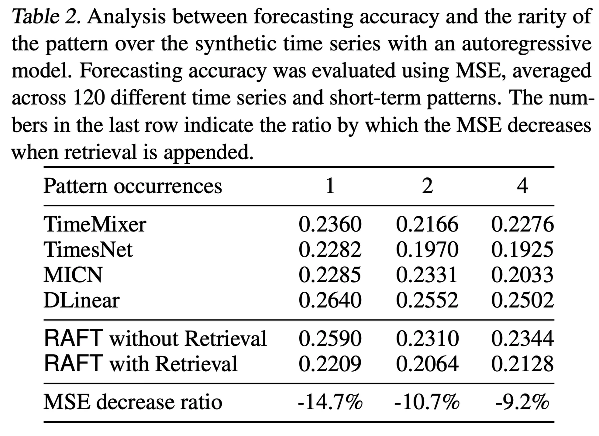

열은 같은 short-term pattern이 시계열에 등장한 횟수(1, 2, 4)다. 아래쪽 두 행(RAFT without/with Retrieval)과 맨 아래의 MSE 감소율을 보면 된다. 출처: 논문 Table 2

- Table 2는 short-term pattern의 등장 횟수와 그에 따른 성능을 RAFT와 baseline들에 대해 비교한 결과다.
    - 이 실험에서는 multiple periods를 고려하지 않으므로, w/o Retrieval은 사실상 NLinear와 동일하다.
- 실험 결과, retrieval을 수행했을 때가 수행하지 않았을 때보다 항상 일관되게 더 좋은 성능을 보였다(0.2590 → 0.2209, 0.2310 → 0.2064, 0.2344 → 0.2128).
    - 또한 패턴이 나타나는 횟수가 적을수록 성능 향상 폭이 더 컸다. MSE 감소율이 1회일 때 14.7%, 2회일 때 10.7%, 4회일 때 9.2%다.
- 위 Figure 5(b)는 w/o Retrieval과 w/ Retrieval의 prediction을 시각화한 것이다.
    - retrieval을 사용할 때, 모델의 예측은 전반적인 offset과 periodicity를 더 잘 따라갔다. 초록 선(w/o Retrieval)은 뒤로 갈수록 정답보다 위쪽에 떠 있지만, 주황 선(with Retrieval)은 정답이 오르내리는 높이와 박자를 따라간다.
    - 이 예시에서 MSE는 retrieval이 없을 때 0.087, 있을 때 0.035다.

#### 5.3. Retrieval is helpful when patterns are temporally less correlated.

- 앞의 실험에서는 모든 short-term pattern을 autoregressive model로 만들었기 때문에 패턴들이 서로 유사한 특성을 가졌다.
- 이와 달리, 이번에는 random walk를 적용하여 어떠한 temporal correlation도 없는 상황을 가정한다.

**Synthetic data generation with random walk model.**

$$
x_t = x_{t-1} + \epsilon_t
$$

- autoregressive model과 달리, random walk model에서는 다음 time step의 값이 이전 time step의 값과 noise로만 결정된다.
- step size $\epsilon_t$는 uniform distribution에서 뽑으며, short-term pattern의 길이는 200이다.
    - step size는 한 번의 time step에서 변할 수 있는 최대 크기를 의미한다.
    - 범위는 본문 5.3절에는 $[-20, 20]$, Appendix E에는 $[0, 20]$으로 적혀 있어 두 곳이 서로 다르다.
- 여기서도 값은 $[-100, 100]$으로 clipping했다.

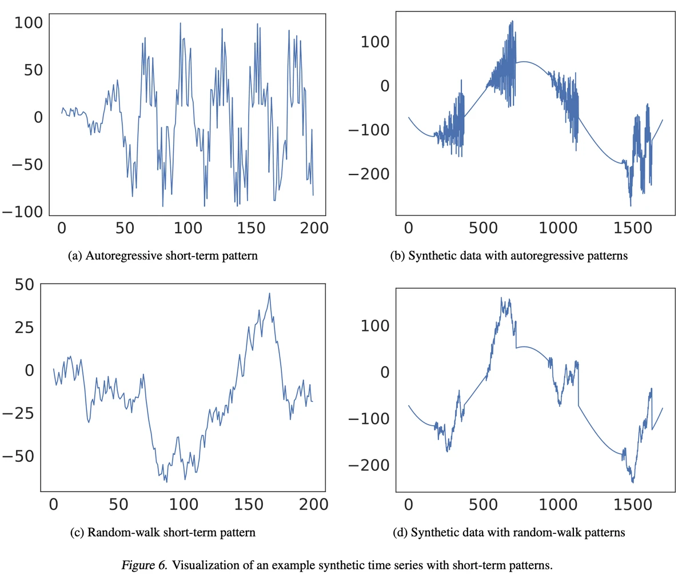

위 줄이 5.2절의 autoregressive 패턴, 아래 줄이 이 절의 random walk 패턴이다. 왼쪽은 길이 200의 short-term pattern 하나이고, 오른쪽은 그것을 trend와 seasonality 위에 얹은 합성 시계열이다. 출처: 논문 Figure 6

(a)의 autoregressive 패턴은 위아래로 빠르게 진동하는 모양이 되풀이되는 반면, (c)의 random walk 패턴은 정해진 박자 없이 흘러간다. 앞의 값들에서 규칙을 뽑아내기 어려운 쪽이 (c)다.

**Results.**

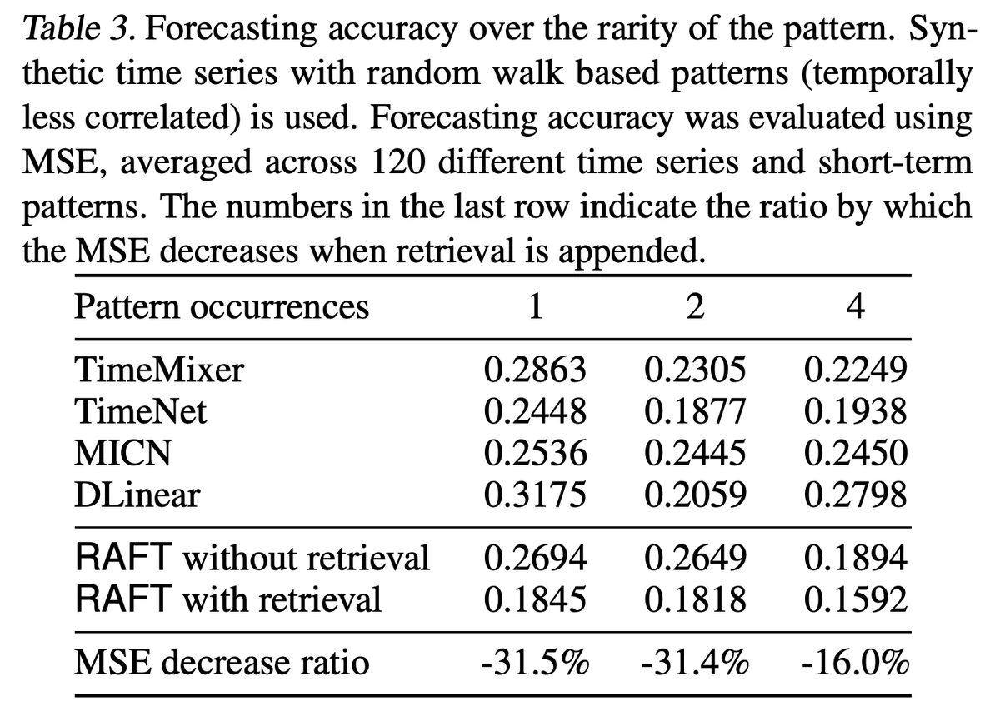

표의 구성은 Table 2와 같고, short-term pattern만 random walk로 바뀌었다. 맨 아래 행의 MSE 감소율이 Table 2보다 크다. 출처: 논문 Table 3

- Table 3을 보면, retrieval module이 모든 경우에서 성능 향상에 기여한다(0.2694 → 0.1845, 0.2649 → 0.1818, 0.1894 → 0.1592).
- 또한 성능 향상의 정도가 앞의 autoregressive 실험보다도 더 커졌다. MSE 감소율이 등장 횟수 1회, 2회, 4회에서 31.5%, 31.4%, 16.0%로, autoregressive 실험의 14.7%, 10.7%, 9.2%보다 크다.

#### 5.4. Retrieval is also helpful for Transformer-variants

- Autoformer를 사용하여, retrieval의 성능 향상이 Transformer-variants에서도 유효한지 확인한다.
- Autoformer의 내부 구조를 수정하지 않고, 그 출력에 곧바로 retrieval 결과를 더해 주는 방식을 썼다.

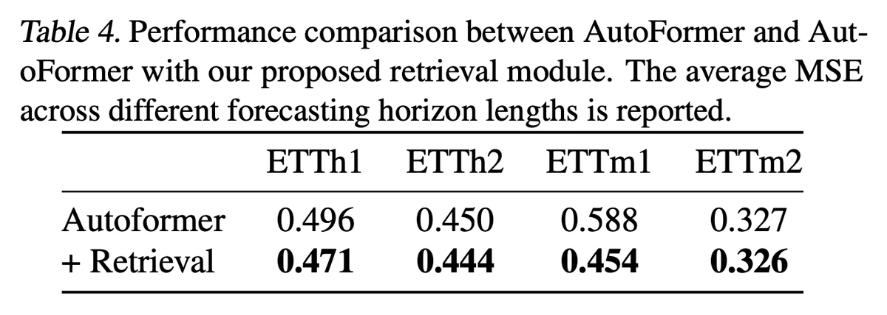

ETT 4종에서 Autoformer만 썼을 때와 retrieval을 붙였을 때의 평균 MSE다. 네 데이터셋 모두 아래 행이 더 낮다. 출처: 논문 Table 4

- 결과적으로 retrieval이 Transformer 기반 모델에서도 성능 향상에 기여함을 확인할 수 있었다. 다만 향상 폭은 데이터셋마다 차이가 크다. ETTm1은 0.588에서 0.454로 크게 줄었지만 ETTm2는 0.327에서 0.326으로 거의 그대로다.

### 6. Conclusion

- 이 논문이 제안하는 RAFT는 training data에 대한 retrieval을 통해, 학습하기 어려운 희귀한 패턴을 모델이 학습해야 하는 부담을 줄임으로써 forecasting performance를 향상한다.
- benchmark dataset과 synthetic dataset으로 실험하여, 이러한 retrieval-augmented forecasting이 실질적으로 예측 성능 향상에 도움이 됨을 확인했다.
- 논문이 쓴 retrieval augmentation은 naive한 방식이어서, time series에 맞게(tailor) 개선할 여지가 여전히 남아 있다.
    - 특히 언제, 어디서, 어떻게 retrieval을 적용할지를 데이터셋의 특성에 맞춰 결정할 수 있다.
    - non-stationary/non-linear한 characteristics를 capture하는 더 복잡한 similarity measure를 도입할 수 있다.

## Appendix 정리

### B. Implementation Details

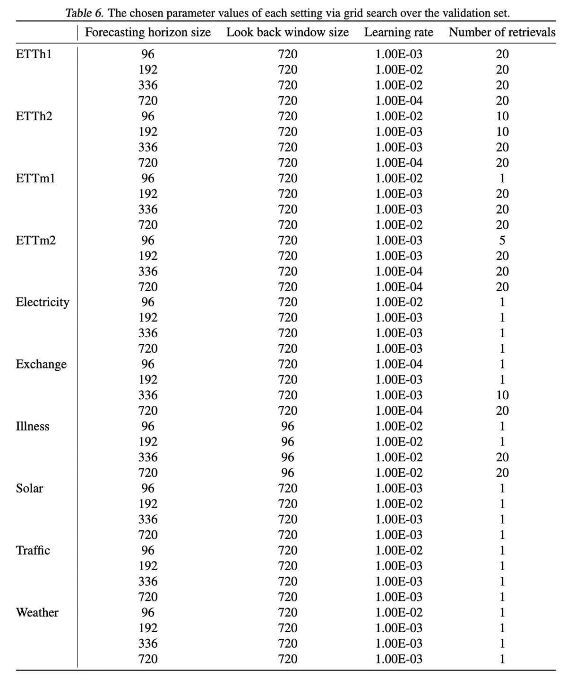

4.1절의 grid search로 데이터셋과 horizon마다 고른 look-back window size, learning rate, 검색 개수 $m$이다. look-back window는 Illness(96)를 빼면 모두 720이 골라졌고, $m$은 ETT 계열에서는 대부분 10 ~ 20, Electricity·Solar·Traffic·Weather에서는 모두 1이다. 출처: 논문 Table 6

### C. Component Analysis

RAFT의 설계 선택(유사도 함수, retrieval module의 구성 요소, look-back window, hyperparameter, 학습 데이터 길이)을 하나씩 바꿔 가며 본 실험들이다.

#### C.1. Different Similarity Metrics for Retrieval

- 유사도를 재는 metric으로 여러 방식을 적용해 보았다.
    - L2 distance
    - cosine similarity
    - cosine similarity with projection
        - query와 key에 trainable linear projection head를 적용하고, 그 embedding 사이의 cosine similarity를 재는 방식이다.
    - Pearson's correlation

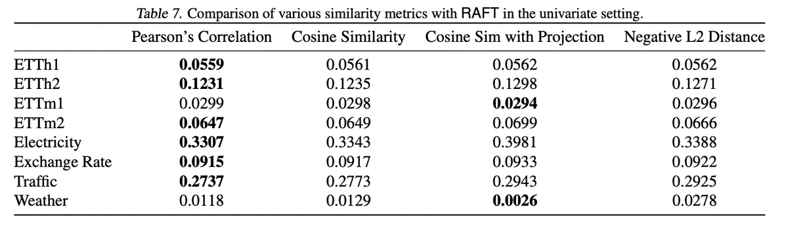

열이 유사도 metric이고 값은 univariate 설정의 결과다(낮을수록 좋다). 굵은 글씨가 대부분 맨 왼쪽의 Pearson's Correlation 열에 있다. 출처: 논문 Table 7

- 실험 결과, Pearson's correlation이 가장 좋은 성능을 보였다. 8개 데이터셋 가운데 6개에서 가장 좋았고, 나머지 둘(ETTm1, Weather)에서는 cosine similarity with projection이 가장 좋았다. 다만 Pearson's correlation과 cosine similarity의 차이는 어느 데이터셋에서나 소수점 셋째 자리 이하로 작다.
- 또한 linear projection을 사용한 경우에도, raw query와 key를 직접 비교하는 것과 비슷한 수준의 성능이 나왔다.
- projection을 활용하면 computational advantage를 얻을 수 있다.
    - sparse high-dimensional input을 dense lower-dimensional embedding으로 mapping함으로써 연산량을 줄일 수 있다.
- 추가로, projection을 쓰면 external feature를 넣는 것이 가능하다.
    - 이 경우 예측 모델뿐만 아니라 encoder도 함께 optimize함으로써 performance를 더 끌어올릴 수 있다.

#### C.2. Ablation Study on Retrieval Module

retrieval module에서 "닮은 것을 고른다", "유사도로 가중한다", "여러 period를 쓴다"를 하나씩 빼 보는 실험이다.

- Random Retrieval: query와의 유사도를 고려하지 않고 key patch를 무작위로 가져온다.
- Without Attention: value patch를 합칠 때 유사도 기반 weight 대신 동일한 weight를 쓴다.
- With One Period: period 1만 retrieval에 사용한다.
- Without Retrieval: retrieval을 완전히 제거한다.

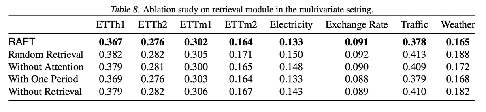

맨 위 행이 온전한 RAFT이고 맨 아래 행이 retrieval을 아예 뺀 경우다. 가운데 세 행을 맨 아래 행과 비교해 보면 된다. 출처: 논문 Table 8

Table 8은 이 ablation study의 결과다. 논문은 모든 구성 요소를 갖춘 RAFT가 가장 좋은 결과를 기록했다고 정리한다(표를 보면 ETTm1과 Exchange Rate에서는 다른 행에 근소하게 더 낮은 값이 있다). 눈에 띄는 것은, retrieval을 random하게 수행하거나 without attention, with one period로 수행한 경우에 retrieval을 아예 수행하지 않는 것보다 안 좋은 결과가 나오기도 했다는 점이다. 예를 들어 Electricity에서는 Random Retrieval(0.150)과 Without Attention(0.148)이 Without Retrieval(0.143)보다 나쁘다. 아무 구간이나 가져오거나, 가져온 구간을 똑같은 비중으로 섞으면 오히려 방해가 된다는 뜻이다.

#### C.3. Effect of Look Back Window Size (L)

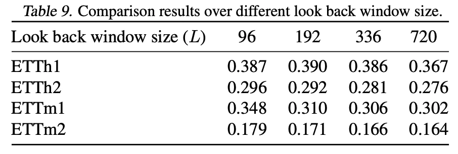

ETT 4종에서 look-back window size $L$을 96에서 720까지 늘렸을 때의 결과다. 오른쪽으로 갈수록 값이 작아진다. 출처: 논문 Table 9

- look-back window size를 바꿔 가며 실험한 결과, window size가 늘어날수록 일관되게 성능이 향상되었다(ETTh1의 192만 96보다 조금 높다). Appendix B의 표에서 look-back window가 거의 모두 720으로 골라진 것과 같은 방향이다.

#### C.4. Hyper-Parameter Analysis

- RAFT는 크게 두 가지의 internal hyperparameter를 가진다.
    - retrieval module이 가져오는 patch의 개수
    - weight를 계산하는 softmax에 쓰이는 temperature $\tau$
- 각 hyperparameter는 validation dataset을 기준으로 최적화되었다.

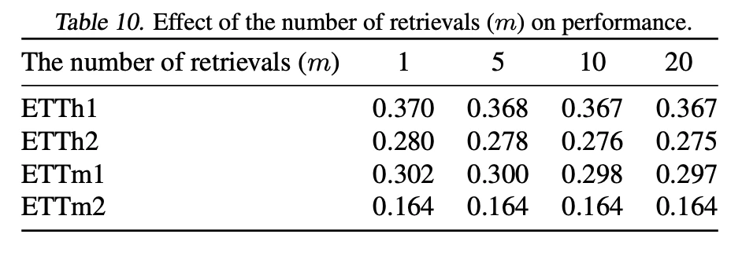

검색해 오는 patch의 수 $m$을 1에서 20까지 늘렸을 때의 결과다. 값이 조금씩 줄지만 차이는 소수점 셋째 자리 수준이다. 출처: 논문 Table 10

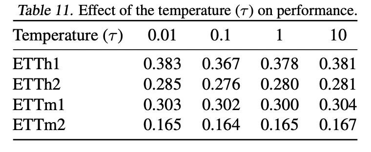

SoftMax의 temperature $\tau$를 0.01에서 10까지 바꿨을 때의 결과다. 출처: 논문 Table 11

- Table 10과 Table 11은 각 hyperparameter에 따른 성능 차이를 보여 준다.
    - retrieval하는 patch의 수는 늘릴수록 대체로 성능이 향상되었지만, 큰 차이가 나타나지는 않았다. ETTh1은 0.370에서 0.367, ETTm2는 네 경우 모두 0.164다.
    - temperature는 데이터셋마다 optimal 값이 달랐다. ETTh1, ETTh2, ETTm2는 논문의 기본값인 0.1에서, ETTm1은 1에서 가장 좋았다.

#### C.5. Effect of Training Time Series Length

- 데이터셋의 길이가 짧을수록 key patch의 후보도 자연스럽게 줄어든다. 이는 성능 향상 폭의 저하로 이어질 수 있다.
- 이에 따른 성능 차이를 확인하기 위해, 학습에 사용하는 데이터의 길이를 바꿔 가며 실험한다.

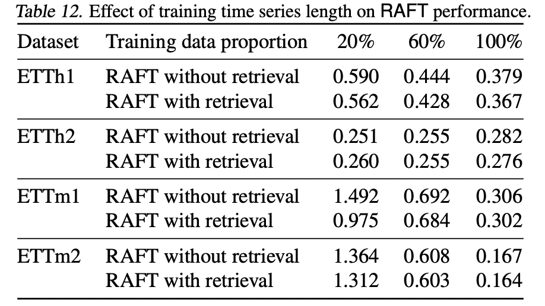

데이터셋마다 위 행이 retrieval이 없는 경우, 아래 행이 있는 경우이고, 열은 학습에 쓴 데이터의 비율이다. 출처: 논문 Table 12

- Table 12는 데이터셋을 20%, 60%, 100% 사용했을 때 retrieval이 있는 경우와 없는 경우의 성능을 보여 준다.
- 일부 데이터셋에서는 데이터의 수가 적을수록 성능이 큰 폭으로 차이가 났지만(ETTm1은 20%일 때 1.492와 0.975), 다른 데이터셋에서는 데이터의 수에 따른 성능 차이가 크지 않았다. 오히려 데이터가 더 적을 때 성능이 더 좋은 경우도 있었다(ETTh2는 20%일 때의 값이 100%일 때보다 낮다).
- ETTh2의 20%에서는 retrieval이 있는 쪽(0.260)이 없는 쪽(0.251)보다 오히려 나쁘다.

### D. Computational Complexity for Retrieval

- 효율적인 학습을 위해, retrieval process는 training/validation data에 대해 pre-compute된다. 이를 통해 training 과정에서는 retrieval 계산이 한 번만 수행된다.
- RAFT의 computational cost를 확인하기 위해, pre-computation, training, inference time을 ETTm1 dataset에서 측정했다.

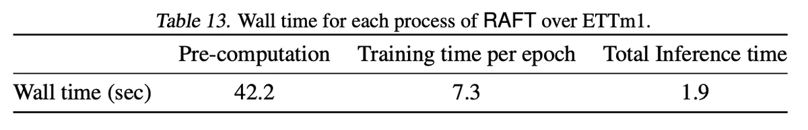

미리 해 두는 검색(pre-computation)이 42.2초로 가장 오래 걸리고, 학습은 epoch당 7.3초, 추론 전체는 1.9초다. 출처: 논문 Table 13

- pre-computation의 복잡도는 $O(N^2)$이며, $N$은 training data의 time series 길이를 의미한다. 세 단계 가운데 이 단계가 가장 무겁다.
- 이 시간을 줄이는 한 가지 방법은 sliding window의 stride를 1보다 크게 늘리는 것이다. 후보 patch의 수가 그만큼 줄어든다.

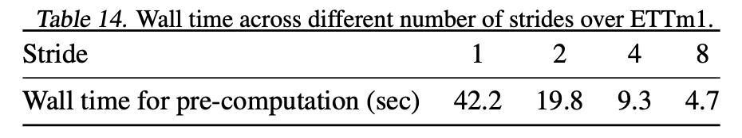

stride를 두 배로 늘릴 때마다 pre-computation 시간이 대략 절반으로 준다(42.2초 → 19.8초 → 9.3초 → 4.7초). 출처: 논문 Table 14

- 마지막으로, stride를 늘리는 것이 forecasting performance에 미치는 영향을 분석한다.

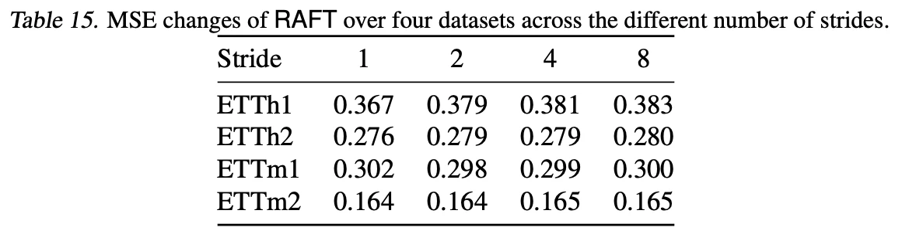

같은 stride 값에서 MSE가 얼마나 달라지는지를 ETT 4종에서 본 것이다. 출처: 논문 Table 15

- ETT dataset들로 실험했을 때, 대체로 stride가 늘어날수록 성능이 저하되었다. 그러나 성능의 감소량은 다소 미미했다. 가장 많이 변한 ETTh1이 0.367에서 0.383이고, ETTm1은 오히려 0.302에서 0.300으로 조금 낮아졌다.
- 두 표를 함께 보면, stride를 8로 늘려 pre-computation 시간을 약 9분의 1로 줄여도 MSE의 변화는 0.02 이내다.

### F. Qualitative Analysis on Retrieval

retrieval이 실제로 무엇을 찾아오는지를 눈으로 확인하는 절이다. 숫자로만 보던 "닮은 key"와 "그 뒤의 value"를 직접 겹쳐 그렸다.

- input query와 retrieved key patch, 그리고 ground truth와 value patch를 period 1, 2, 4에서 각각 시각화하여 비교한다. 시각화한 것은 모두 top-1 similarity를 기록한 key patch와 그에 대응되는 value patch다.
- 아래 세 그림은 모두 같은 구성이다. 왼쪽 열은 query(파랑)와 검색된 key(주황), 오른쪽 열은 실제 미래 값(파랑)과 검색된 value(주황)이고, 위에서부터 period 1, 2, 4다. 오른쪽 그림은 시계열에서 왼쪽 그림의 바로 뒤에 이어지는 구간이다. 두 열 모두 선들이 오른쪽 끝에서 0으로 모이는 것은 3.2절의 offset 처리(마지막 시점 값을 뺀다)가 반영된 것으로 보인다.

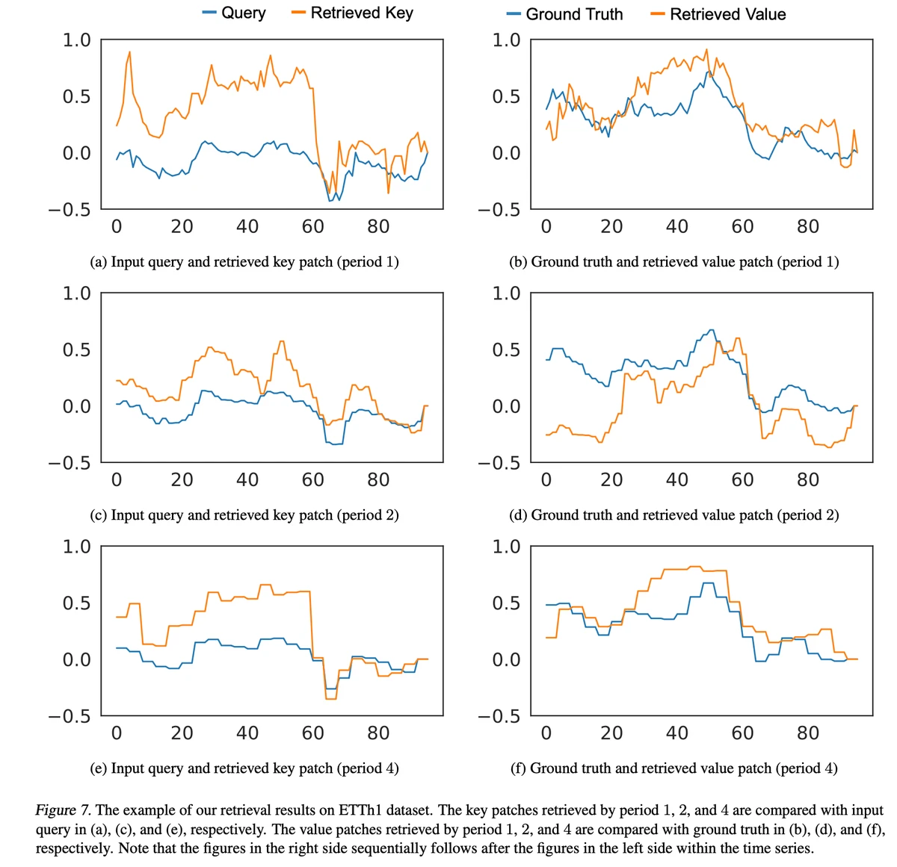

ETTh1의 예다. 왼쪽 열에서 key는 query보다 높이 떠 있지만 60 시점 부근에서 뚝 떨어지는 모양은 같고, 오른쪽 열에서 value는 가운데가 솟았다가 내려오는 실제 미래의 흐름을 대체로 따라간다. 출처: 논문 Figure 7

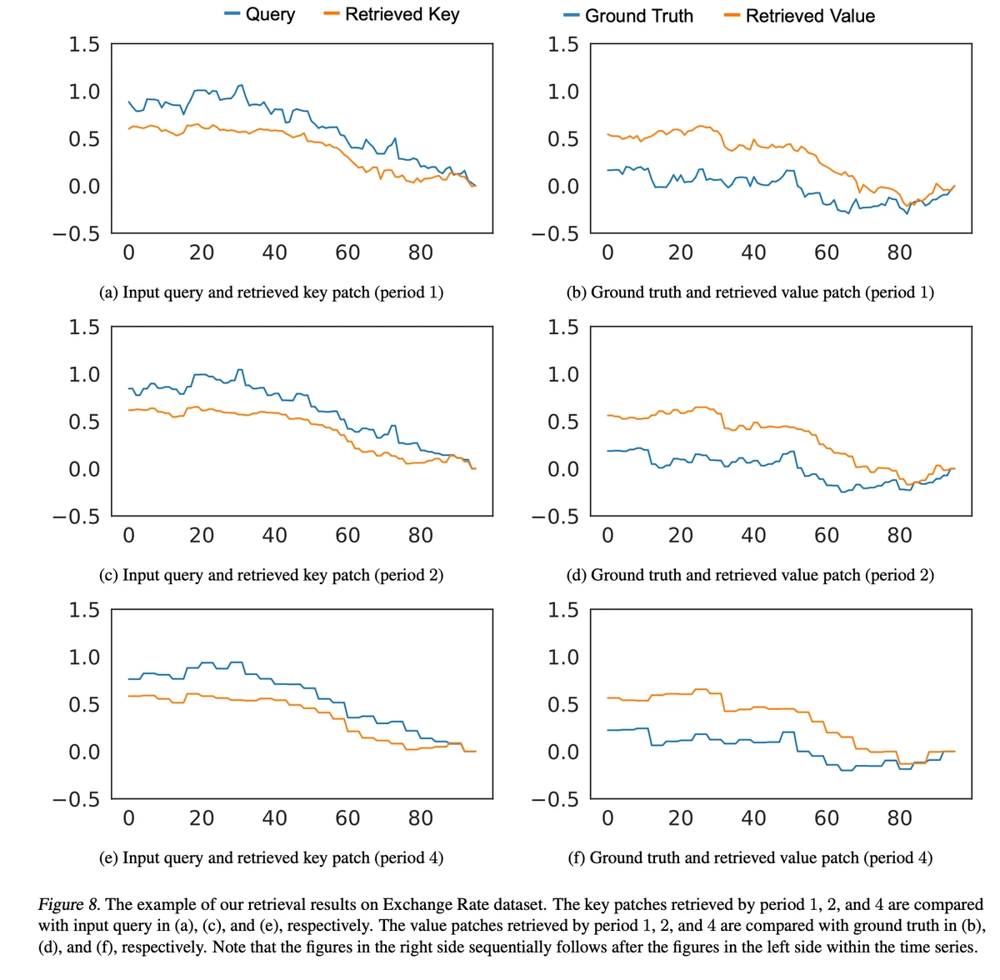

Exchange Rate의 예다. query와 key가 모두 완만하게 내려가는 모양이고, value도 실제 미래와 같은 방향으로 내려가지만 둘 사이의 높이 차이가 구간 내내 벌어져 있다. 출처: 논문 Figure 8

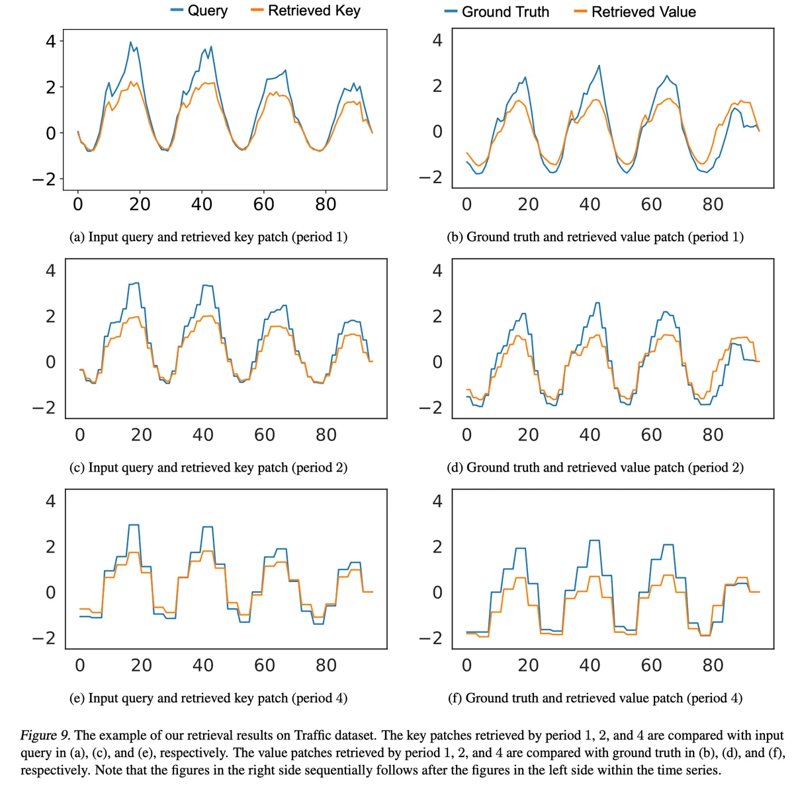

Traffic의 예다. 주기가 뚜렷한 데이터여서 key가 query와 같은 박자로 오르내리고(봉우리의 높이만 낮다), value도 봉우리의 위치까지 실제 미래와 맞는다. 출처: 논문 Figure 9

- 세 그림을 비교하면, 반복되는 주기가 뚜렷한 Traffic에서는 검색된 value가 실제 미래와 봉우리 위치까지 맞고, 뚜렷한 주기 없이 흘러가는 Exchange Rate에서는 방향만 비슷하다. 4.2절에서 본 데이터셋별 성능 차이(Traffic에서는 가장 좋고 Exchange에서는 뒤진다)와 통하는 모습이다.
- 논문은 이를 통해 RAFT의 retrieval이 future value를 예측하는 데 필요한 useful information을 효과적으로 제공한다고 설명한다.

### G. Full Results

4.2절의 Table 1은 horizon 네 개의 평균만 실은 것이다. horizon별 전체 결과는 아래 두 표에 있다.

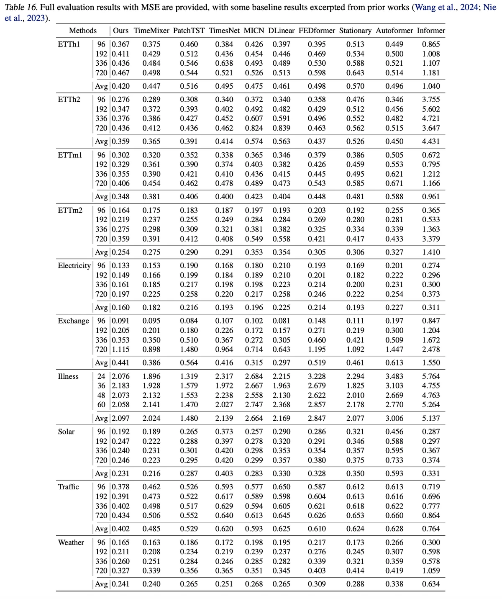

데이터셋마다 horizon 네 개의 MSE와 그 평균(Avg)이 있고, 맨 왼쪽의 Ours 열이 RAFT다. Avg 행이 Table 1에 해당하는데, 두 표의 값이 서로 다른 칸도 있다(Traffic의 RAFT가 Table 1에서는 0.434, 여기서는 0.402). 출처: 논문 Table 16

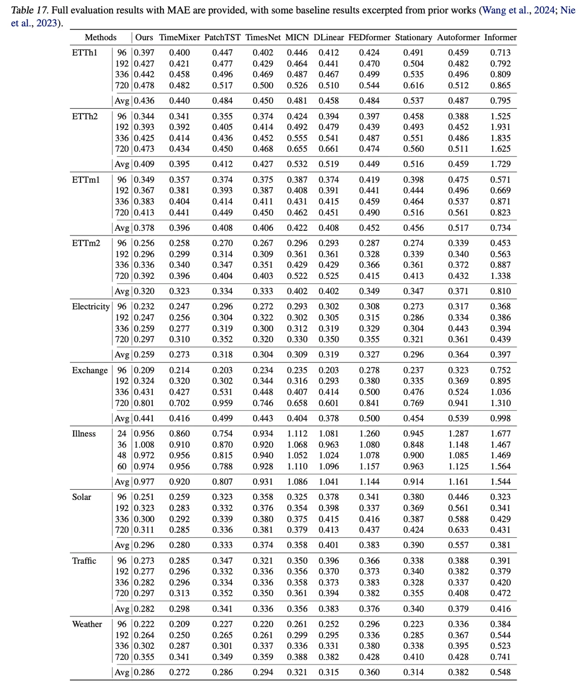

같은 구성으로 MAE를 실은 표다. 출처: 논문 Table 17

## 참고 자료

- Sungwon Han, Seungeon Lee, Meeyoung Cha, Sercan O. Arik, Jinsung Yoon. "Retrieval Augmented Time Series Forecasting." ICML 2025 (PMLR 267). [arXiv:2505.04163](https://arxiv.org/abs/2505.04163)
- RAFT 공개 코드: [github.com/archon159/RAFT](https://github.com/archon159/RAFT)
- TimeMixer: Decomposable Multiscale Mixing for Time Series Forecasting
- Ailing Zeng, Muxi Chen, Lei Zhang, Qiang Xu. "Are Transformers Effective for Time Series Forecasting?" AAAI 2023. [arXiv:2205.13504](https://arxiv.org/abs/2205.13504)
- 시계열 RAG를 다룬 다른 글: [TS-RAG](2026-02-08-ts-rag.md), [Cross-RAG](2026-03-20-cross-rag.md), [RAG4CTS](2026-09-07-rag4cts.md)
