# Cross-RAG: Zero-shot Retrieval-Augmented Time Series Forecasting via Cross-Attention 리뷰

작성일 2026-03-20 · 최종 수정일 2026-04-17
{ .post-date }

Time Series Foundation Model(TSFM)의 zero-shot 예측에 retrieval을 붙일 때, 검색해 온 샘플을 모두 비슷하게 쓰지 않고 query와 입력 패턴이 얼마나 맞는지를 cross-attention으로 따져 가려 쓰는 Cross-RAG를 정리한 글이다. 먼저 논문을 한 번 훑고 정리한 요약을 싣고, 이어서 논문의 절 순서대로 읽으며 정리한 내용을 싣는다. 논문의 그림과 표는 그 내용을 설명하는 자리에 함께 실었다.

시계열 RAG를 다룬 다른 글로는 [TS-RAG](2026-02-08-ts-rag.md), [RAFT](2026-03-19-raft.md), [RAG4CTS](2026-09-07-rag4cts.md)가 있다. 이 논문의 직접 비교 대상은 TS-RAG다.

## 요약

### 1. 연구 수행 배경

- 최근 TSFM은 대규모 사전학습을 통해 다양한 시계열 도메인에서 강한 표현력을 보이지만, zero-shot forecasting에서는 보지 못한 데이터셋에 대한 일반화가 여전히 제한적이다.
- 논문은 그 원인으로 pretraining distribution과 test time의 unseen dataset 사이의 distribution mismatch, target dataset에 맞추는 adaptation cost, external knowledge를 반영하지 못하는 구조, 그리고 explainability 부족을 지적한다.
- 즉 TSFM만으로는 내부 파라미터에 저장된 표현에 의존하기 때문에 unseen dataset에서 충분히 유연하지 않다는 것이 출발점이다.
- 이 때문에 저자들은 retrieval augmentation이 필요하다고 본다.
- RAG를 붙이면 현재 query와 유사한 외부 시계열 패턴을 가져와 예측에 활용할 수 있다. 그러므로 zero-shot에서도 데이터셋에 특화된 재학습 없이 외부 정보로 domain gap을 일부 보완할 수 있다.
- 저자들은 기존 방법이 대체로 target set에 대한 fine-tuning이 필요하거나([RAFT](2026-03-19-raft.md) 등), zero-shot이라고 해도 retrieved sample을 query에 단순히 concat하거나(RAF) self-attention으로 섞을 뿐([TS-RAG](2026-02-08-ts-rag.md)), query와 retrieved input 사이의 관계 자체를 명시적으로 모델링하지 못한다고 비판한다.
- 즉 이 논문이 제시하는 bottleneck은 단순히 "retrieval을 안 썼다"가 아니다. 더 정확히는, retrieval을 쓰더라도 어떤 retrieved sample이 정말 query와 관련 있는지 선택적으로 가려내는 메커니즘이 부족했다는 것이다.
- 논문은 fixed top-k retrieval에서 최적의 개수가 dataset마다, 심지어 같은 dataset 안의 query마다도 달라서 irrelevant sample을 쉽게 끌어들인다는 것을 보인다. 따라서 핵심은 "더 많이 retrieve하는 것"이 아니라 "retrieve된 것들 가운데 무엇을 더 믿을지"라고 주장한다.
- 논문의 초점은 LLM이나 VLM이 아니다. TSFM + RAG가 계산 비용과 도메인 적응 측면에서 훨씬 유리하다고 말하며, TSFM이 현실적인 backbone이라고 주장한다.
- 정리하면, TSFM은 강력하지만 zero-shot 일반화에 한계가 있으므로 이를 외부 retrieval로 보완해야 한다는 것이 논문의 문제 설정이다.

### 2. 논문의 핵심 Contribution 3줄 요약

- Cross-RAG는 zero-shot 시계열 예측에서 query와 retrieved input 사이의 input-level relevance를 cross-attention으로 직접 모델링해, relevant한 retrieval에 더 큰 가중치를 주는 plug-in RAG framework를 제안한다.
- 기존 zero-shot 시계열 RAG와 달리 retrieved output만 모으지 않고, query 정보, retrieval 자체의 정보, query-retrieval 관계 정보를 함께 결합하는 구조를 설계했다. 이를 통해 irrelevant한 retrieved sample이 섞여도 더 robust하게 동작한다.
- 7개의 벤치마크에서 Cross-RAG는 TSFM과 RAG baseline 대비 일관된 성능 향상을 보였다. 특히 retrieval 수가 늘어나는 경우, random retrieval, 작은 knowledge base, 다른 dataset으로 만든 knowledge base 같은 다양한 retrieval setting에서도 robust함을 보였다.

### 3. 논문의 기존 한계 해결 방식

이 논문의 해결 아이디어를 한 문장으로 줄이면 "retrieve한 샘플을 모두 비슷하게 쓰지 말고, query와 입력 패턴이 얼마나 맞는지 보고 출력의 활용도를 동적으로 조절하자"이다. 즉 retrieval augmentation의 핵심을 retrieval 자체가 아니라 selection-aware fusion으로 옮긴 것이다.

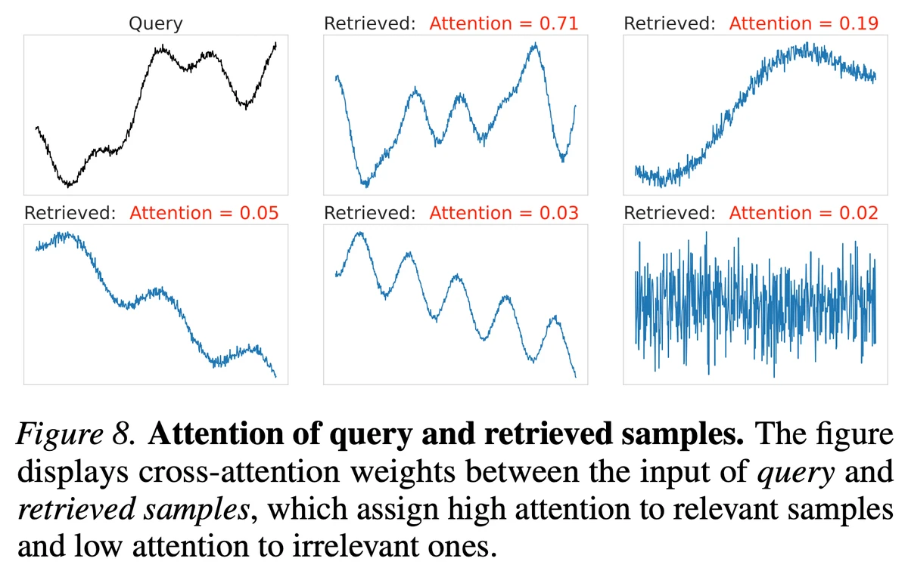{ width="640" }

왼쪽 위의 검은 선이 query의 입력이고, 파란 선 다섯 개가 검색된 샘플의 입력이다. query처럼 꺾였다가 올라가는 샘플은 attention 0.71을, 완만하게 올라가는 샘플은 0.19를 받고, 내려가는 두 샘플과 noise뿐인 샘플은 0.05, 0.03, 0.02를 받는다. 출처: 논문 Figure 8

위 그림이 이 아이디어가 실제로 동작하는 모습이다. 검색은 다섯 개를 똑같이 가져왔지만, 예측에 반영되는 정도는 입력이 query와 닮은 정도에 따라 크게 달라진다. 이를 위해 구조적으로는 세 가지 정보를 함께 쓴다.

- 첫째, backbone TSFM이 만든 query 자체의 표현을 skip-connection으로 유지한다.
- 둘째, retrieved output들끼리 self-attention을 수행해 retrieval set 자체의 요약 정보를 얻는다.
- 셋째, 가장 중요한 부분으로, query representation을 query로 두고 retrieved input을 key, retrieved output을 value로 쓰는 cross-attention을 수행해 "입력 패턴이 비슷한 retrieval의 미래(output)"를 더 많이 반영한다.
- 이로써 모델은 단순한 top-k 평균이나 단순한 concat이 아니라, 입력 유사성에 기반해 어떤 retrieved future를 더 신뢰할지를 학습한다.

이 방식에서 중요한 점은, retrieved output들만 attention으로 섞는 기존 TS-RAG와 달리 retrieved output을 쓰기 전에 그 output이 어떤 input에서 왔는지를 query와 대조한다는 것이다.

- 그래서 irrelevant sample이 retrieval set 안에 포함되어도 attention weight가 낮아지고, 반대로 정말 relevant한 sample은 높은 가중치를 받는다. 위 그림의 0.71과 0.02가 그 차이다.
- 논문의 toy example(아래 Introduction의 그림)도 이 점을 뒷받침한다.

또 하나 흥미로운 점은, 선행 연구들이 retrieval encoder 기반의 latent retrieval을 선호했던 것과 달리 이 논문은 data-space retrieval만으로도 충분히 robust하다고 본다는 것이다.

- 실제로 cosine, Euclidean, correlation 등 여러 metric에서 성능 차이가 크지 않음을 보인다.
- 그래서 별도의 retriever encoder 없이 raw input space에서 retrieve해 효율성을 높인다.
    - 복잡한 retriever를 따로 학습해야 한다는 부담이 줄고, retrieval 비용도 크게 줄어든다.
    - ETTh1 기준으로 data-space retrieval이 latent-space retrieval보다 총 339.5배 빠르다고 보고한다.

실험에서도 논문은 이 해결 방식이 단순한 성능 향상에 그치지 않고 retrieval 조건의 변화에 대한 robustness로 이어진다고 주장한다.

- retrieve하는 개수 k가 커질수록 기존 TS-RAG는 성능이 불안정하지만, Cross-RAG는 오히려 평균 성능이 개선된다.
- 또한 knowledge base가 작거나, target dataset과 다른 dataset에서 knowledge base를 가져와도 대체로 강한 baseline보다 낫다.
- 따라서 논문의 본질적인 주장은 "cross-attention이 retrieval noise를 견디게 해 준다"로 정리할 수 있다.

> - 이 논문은 forecasting backbone 자체를 새로 발명한 것이 아니라, Chronos-Bolt 위에 얹는 retrieval-fusion 개선 논문이다.
> - 현재는 metadata 같은 auxiliary information을 쓰지 않고 input-level relation에만 의존한다. 그래서 텍스트, 메타데이터, 도메인 속성까지 포함하는 더 풍부한 retrieval-interaction으로 확장될 여지가 있다.

### 4. 꼭 알아야 할 필수 선행 연구

#### (1) TS-RAG: Retrieval-Augmented Generation based Time Series Foundation Models are Stronger Zero-shot Forecaster

- Cross-RAG의 직접 비교 대상이다([TS-RAG 리뷰](2026-02-08-ts-rag.md)). Cross-RAG의 핵심 메시지 자체가 사실상 "TS-RAG는 retrieved output들을 self-attention으로 합치지만, query와 retrieved input의 관계를 명시적으로 보지 않는다"는 비판 위에 서 있다.
- 실험도 거의 전부 TS-RAG 대비 개선을 보이도록 설계되어 있고, ablation과 여러 k에 대한 분석에서도 TS-RAG가 main baseline 역할을 한다.
- 따라서 Cross-RAG의 novelty는 상당 부분 TS-RAG 대비 fusion 방식의 개선으로 이해하는 것이 맞다.

#### (2) RAF: Retrieval Augmented Time Series Forecasting

- RAF는 zero-shot RAG 계열에서 retrieved sample을 query 앞에 붙이는 단순 concat 기반 baseline을 대표한다.
- Cross-RAG는 RAF류 접근의 한계를 "retrieval과 query 사이의 interaction을 모델링하지 않는다"는 식으로 정리한다.
- 즉 TS-RAG가 "retrieved output aggregation"의 baseline이라면, RAF는 "raw concatenation augmentation"의 baseline이다.
- 이 두 논문을 함께 봐야, Cross-RAG가 해결하려는 문제가 retrieval 자체가 아니라 fusion 방식의 정교화임을 분명히 이해할 수 있다.

## 논문 정리

### Abstract

- 기존의 접근은 고정된 개수의 retrieved sample에 의존해 irrelevant information을 반영할 수 있었다.
- Cross-RAG는 input query와 retrieved samples 사이의 cross-attention으로 relevance를 반영해, query와 relevant한 retrieved sample에만 선택적으로 집중하는 retrieval-augmented forecasting framework다.

### 1 Introduction

배경은 요약에서 정리한 것과 같다. 논문은 첫 그림에서 전체 흐름을 두 단계로 보여 준다.

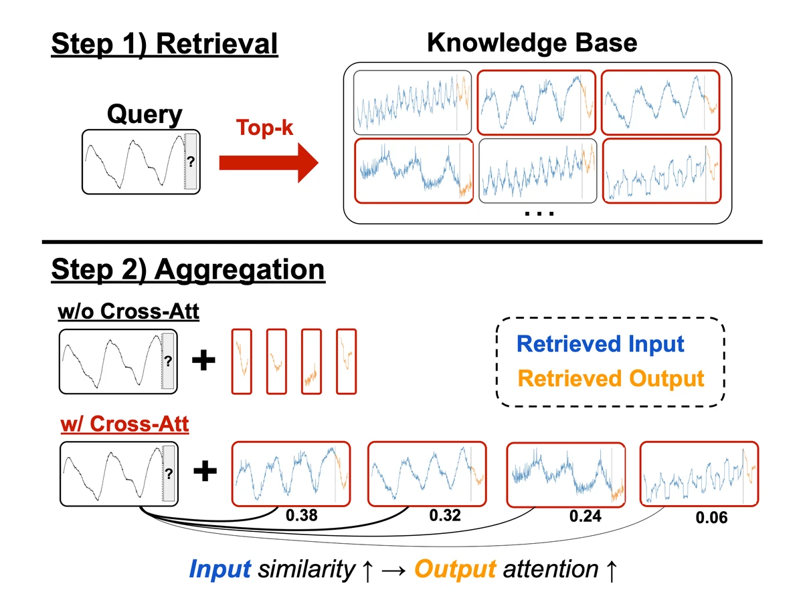

파란 선이 검색된 샘플의 입력(retrieved input), 주황 선이 그 뒤에 이어진 미래(retrieved output)다. 위쪽 Step 1은 어느 방법이나 같고, 차이는 아래쪽 Step 2에 있다. Cross-attention이 없으면 주황색 조각만 떼어 와 query에 붙이고, 있으면 파란 입력을 query와 비교해 닮은 순서대로 0.38, 0.32, 0.24, 0.06의 가중치를 준다. 출처: 논문 Figure 1

그림을 보며 처음 든 의문은 다음과 같았다.

> 이것이 TS-RAG와 다른 점이 무엇인가? 사실상 TS-RAG와 approach는 비슷한 것 아닌가?

답은 그림의 Step 2에 있다. "w/o Cross-Att" 줄이 TS-RAG의 방식이다. 검색된 샘플에서 미래(주황)만 가져오므로, 그 미래가 어떤 입력 뒤에 나온 것인지는 더 이상 알 수 없고 네 조각이 사실상 같은 자격으로 쓰인다. "w/ Cross-Att" 줄에서는 입력(파랑)까지 함께 가져와 query와 대조한다. 그림 맨 아래의 문장처럼 입력이 닮을수록(input similarity ↑) 그 샘플의 미래가 더 크게 반영된다(output attention ↑). 논문은 Cross-RAG가 함께 쓰는 정보를 세 가지로 든다.

- the query itself
- the retrieved samples themselves
- the relational information between the query and retrieved samples (by cross-attention)

Introduction에서 미리 보여 주는 실험 결과는 두 가지다. 첫째는 검색하는 개수 k를 늘려 갈 때의 성능이다.

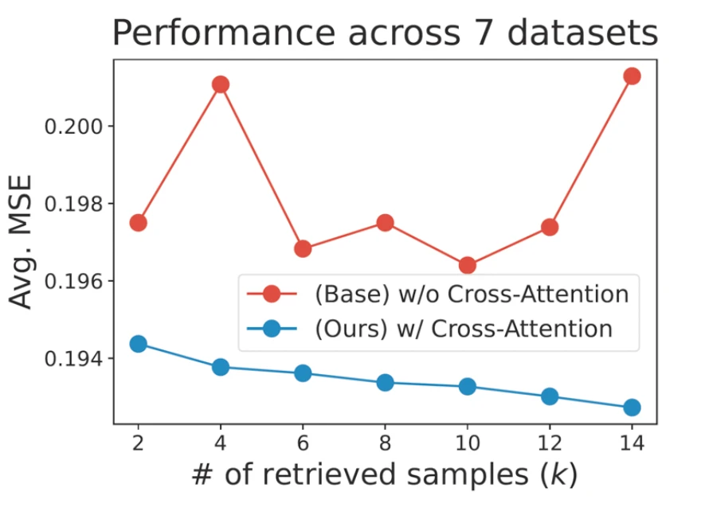{ width="480" }

빨간 선(cross-attention 없음)은 k가 2에서 14로 늘어나는 동안 오르내리기만 하고, 파란 선(Cross-RAG)은 k가 늘수록 꾸준히 내려간다. 많이 가져올수록 섞여 들어오는 무관한 샘플을 걸러 낼 수 있느냐의 차이다. 출처: 논문 Introduction의 그림 (a)

둘째는 비슷한 샘플과 다른 샘플이 섞인 knowledge base를 일부러 만들어 본 toy experiment다.

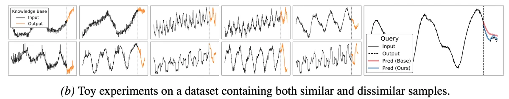

왼쪽 열 개가 knowledge base의 샘플(검은 선이 입력, 주황 선이 출력)이고, 오른쪽이 query다. 오른쪽에서 점선이 실제 미래인데, cross-attention이 없는 방법의 예측(빨강)은 위로 벗어나고 Cross-RAG의 예측(파랑)은 점선을 따라간다. 출처: 논문 Introduction의 그림 (b)

- 이전 방법론은 retrieve하는 sample 수가 늘어나도 성능이 일관되게 향상되지 못했지만, Cross-RAG는 일관되게 향상된다.
- Toy experiments에서 cross-attention을 쓰지 않는 이전 방법론은 실패했지만 Cross-RAG는 성공했다(robustness).

#### Contributions

- Retrieved samples에 대해, cross-attention으로 얻어 낸 query와의 유사성에 기반해 선택적으로 retrieval-augmentation을 수행하는 plug-in framework Cross-RAG를 제안한다.
- Cross-RAG는 query와 retrieved inputs 사이의 relationship을 modeling한 첫 연구다. 아래 Table 1이 기존 시계열 RAG 방법들과의 차이를 정리한다.
- Cross-RAG가 다양한 실험에서 SOTA 성능을 보임을 확인했다. 이는 target 데이터셋에 대한 별도의 fine-tuning을 수행하지 않는 zero-shot 설정에서의 결과다.

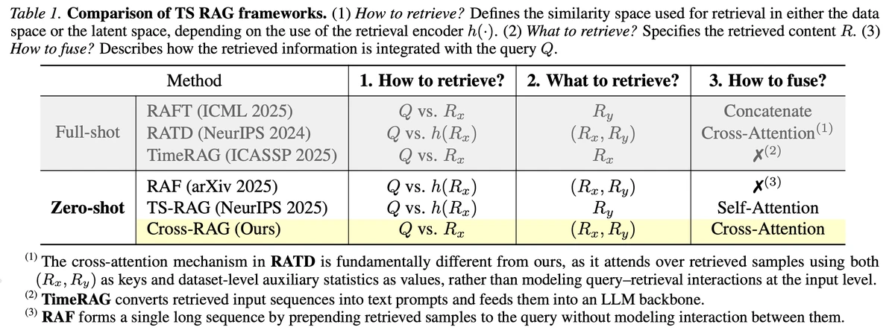

맨 아래 노란 줄이 Cross-RAG다. Zero-shot 방법 셋 가운데 retrieval encoder $h(\cdot)$ 없이 data space에서 검색하고($Q$ vs. $R_x$), 입력과 출력을 모두 가져오며($(R_x, R_y)$), cross-attention으로 합치는 것은 Cross-RAG뿐이다. 출처: 논문 Table 1

표에서 RATD도 "Cross-Attention"으로 적혀 있지만, 표의 주석 (1)이 설명하듯 $(R_x, R_y)$를 key로 두고 attention을 수행해 그 결과를 value인 auxiliary statistics에 반영하는 방식이므로 Cross-RAG와는 차이가 있다. Query와 retrieved input의 관계를 보는 것이 아니다.

### 2 Related Work

#### 2.1 TSFM

초기 연구(Lag-Llama, TimeGPT-1)에서 patch-based tokenization(TimesFM, MOMENT), 간결한 구조로 efficiency를 높인 TTM, sparse한 Mixture-of-Experts의 Time-MoE, predictive distribution의 mixture를 쓰는 Moirai, 시계열을 categorical token으로 discretize하는 Chronos, 그리고 이를 patch-based input과 multi-step quantile forecast로 바꾼 Chronos-Bolt로 이어지는 계보는 [TS-RAG 글](2026-02-08-ts-rag.md)에서 정리한 것과 같다.

이러한 모델들은 generalization이 뛰어나지만 내부 representation에만 의존하기 때문에 외부 지식을 반영하지 못하고, 이로 인해 interpretability와 zero-shot adaptability가 부족하다.

#### 2.2 Retrieval-Augmented Generation in Time Series

위 Table 1의 위쪽 세 줄(Full-shot)과 아래쪽 세 줄(Zero-shot)이 이 절의 두 묶음이다.

- ReTime: content synthesis를 통한 relational retrieval 기법을 제안한다.
- RATD: diffusion-based denoising을 guide하기 위해 retrieved historical series를 사용한다.
- [RAFT](2026-03-19-raft.md): retrieval을 multi-resolution에서 수행해 forecasting을 augment한다.
- TimeRAG: retrieved sequences를 trainable reprogramming layer를 통해 frozen LLM backbone에 반영하여 modality를 align한다.

> 이러한 방법론들은 unseen dataset에 adapt하기 위해 target set에 대한 fine-tuning이 필요하다.

- RAF: raw data space에서 retrieved sequences를 query sequence와 concat하여 augmented input을 만든다.
- [TS-RAG](2026-02-08-ts-rag.md): pretrained encoder를 사용해 시계열 segment를 retrieve하고, query와 retrieved output을 concat하여 self-attention을 수행한다.

> 이러한 방법론들은 query와 retrieved inputs 사이의 명시적인 관계를 반영하지 않는다.

### 3 Methodology

논문은 방법을 세 가지 질문으로 나누어 설명한다. 아래 구조도의 빨간 제목 [1], [2], [3]이 각각 그 질문이다.

- Section 3.1: How to Retrieve
- Section 3.2: What to Retrieve
- Section 3.3: How to Fuse

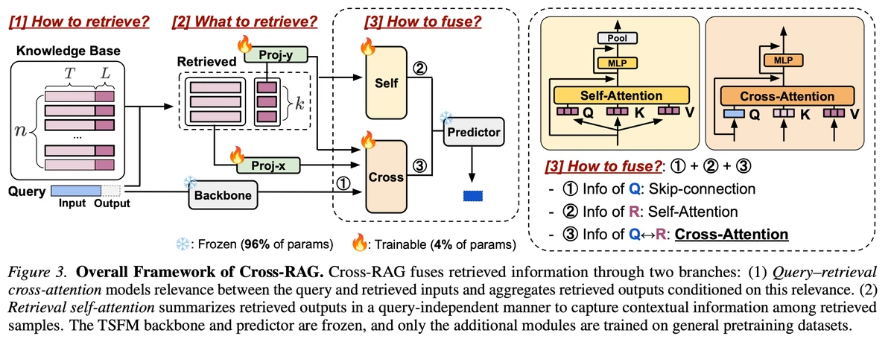

왼쪽에서 오른쪽으로 읽는다. Query의 입력은 두 군데로 간다. 하나는 knowledge base로 가서 비슷한 샘플 $k$개를 찾고, 하나는 Backbone을 지나 query 표현(①)이 된다. 검색된 샘플의 출력은 Self 블록에서 요약되고(②), 입력과 출력은 Cross 블록에서 query와 대조된다(③). 눈꽃 표시(Backbone, Predictor)는 고정된 부분이고 불꽃 표시(Proj-x, Proj-y, Self, Cross)만 학습한다. 출처: 논문 Figure 3

**External knowledge base의 구성.** 그림 왼쪽의 Knowledge Base 상자를 보면, 한 줄이 길이 $T$의 옅은 부분과 길이 $L$의 진한 부분으로 이루어져 있다. Cross-RAG는 knowledge base를 이렇게 입력 window와 그에 대응하는 미래 horizon의 쌍으로 둔다. 논문의 표기로 retrieval knowledge base는 $\mathcal{D} = \{(x_j, y_j)\}_{j=1}^{n}$이고,

- $x_j$는 길이 $T$의 과거 input window,
- $y_j$는 그 직후의 길이 $L$ forecasting horizon이다.

다시 말해 knowledge base의 각 item은 단순한 과거 시계열 조각이 아니라, 과거 패턴과 그 뒤에 실제로 이어졌던 미래의 pair다. 실험 세팅에서는 두 층위의 knowledge base가 있다.

- Pretraining용 knowledge base
    - Chronos pretraining dataset에서 50M data points를 샘플링하고, 그중 5M data points를 knowledge base 구성에 사용한다.
    - 그 뒤 고정된 input window로 segmentation해서 26M개의 pretraining pair와 2.8M개의 retrieval pair를 만든다.
- Zero-shot evaluation 시의 knowledge base
    - 각 benchmark dataset에서 training split을 knowledge base 구성에 쓰고, test split을 zero-shot inference에 쓴다.
    - 예를 들어 ETTh1을 평가할 때는 ETTh1의 train 구간에서 $(x, y)$ pair들을 만들어 knowledge base를 구성하고, test query에 대해 거기서 retrieve한다.
    - 추가 분석에서는 target dataset의 knowledge base가 없다고 가정하고 다른 dataset으로 knowledge base를 구성하는 실험도 한다(5.1절의 R4).

#### 3.1 How to Retrieve

무엇을 기준으로 "비슷하다"를 잴 것인가의 문제다. 구조도에서 query가 Backbone을 거치지 않고 곧바로 Knowledge Base로 이어지는 선이 이 절의 결론이다. 검색에는 encoder를 쓰지 않는다.

- Cross-RAG는 retrieval space와 metric 모두에 대해 robust했다. 이는 data-space retrieval이 inferior performance를 보였다는 과거 연구와는 다른 결과다.
- 이 경우 data-space retrieval은 추가적인 retrieval encoder(즉 retriever)가 필요하지 않으므로 더 효율적이다.
- 이러한 관찰에 기반해, input space에서의 cosine similarity로 data-space retrieval을 수행한다. 이 과정에서 top-k개의 similar sample을 찾아낸다.

정리하면 유사도 비교의 기본 선택은 L2 norm이 아니라 data-space cosine similarity다. Embedding에서 유사도를 비교해도 실질적인 차이가 없다는 것을 이 절에서 확인했으므로, 별도의 encoding 비용을 쓰지 않기 위해 data-space retrieval을 쓰는 것이다.

#### 3.2 What to Retrieve

검색 결과에서 무엇을 가져와 쓸 것인가의 문제다. 구조도의 "Retrieved" 상자에 입력(넓은 막대)과 출력(좁은 막대)이 둘 다 들어 있는 것이 답이다.

- 고정된 top-k개의 sample을 가져오는 방식은 noise를 반영할 수도 있다.
- Optimal k는 데이터셋마다 다르다. 심지어 같은 데이터셋 안에서도 query context에 따라 optimal k가 달라질 수 있다.
- 그래서 query와 retrieved inputs의 관계를 명시적으로 모델링하여 information을 fuse한다. 그러려면 출력뿐 아니라 입력도 가져와야 한다.
- $\mathcal{R}_i$는 query $x_i$와 가장 유사한 top-k개 sample의 모음이다.
    - 이 안에 있는 retrieved element를 각각 MLP를 사용해 $d$차원 latent space로 projection한다. 구조도의 Proj-x(입력용)와 Proj-y(출력용)가 이 MLP다.

검색으로 가져오는 것은 가장 유사한 top-k개의 $(x, y)$ pair다. 그리고 input query와 retrieved context $x$ 사이의 cross-attention을 통해, 그에 대응하는 $y$를 weighting하여 사용하는 구조다. 즉 따져 보면 현재 예측에 값으로 반영되는 것은 검색된 미래 $y$뿐이고, $x$는 그 가중치를 정하는 데 쓰인다.

#### 3.3 How to Fuse

가져온 것을 query와 어떻게 합칠 것인가의 문제다. 구조도 오른쪽의 두 상자(노란 Self-Attention, 주황 Cross-Attention)가 이 절의 두 갈래이고, 차이는 Q, K, V 자리에 무엇이 들어가느냐에 있다. 노란 상자는 셋 모두 검색된 출력이고, 주황 상자는 Q 자리에만 파란 query 표현이 들어간다.

- $\mathbf{h} \in \mathbb{R}^d$: 임의의 TSFM backbone이 만들어 낸 query representation (구조도의 ①)
- $\mathbf{R}_x \in \mathbb{R}^{k \times d}$, $\mathbf{R}_y \in \mathbb{R}^{k \times d}$: retrieved input과 output의 representation을 쌓은 것 (Proj-x, Proj-y의 출력)

**Query-Retrieval Cross-Attention** (구조도의 주황 상자, ③)

$$
\mathbf{c} = \text{Attn}(\mathbf{h}, \mathbf{R}_x, \mathbf{R}_y) + \mathbf{h}
$$

$$
\tilde{\mathbf{c}} = \text{FFN}_{\text{cross}}(\mathbf{c}) + \mathbf{c}
$$

- $\mathbf{h}$를 query, $\mathbf{R}_x$를 key, $\mathbf{R}_y$를 value로 둔다. Query와 key를 비교해 "어느 샘플의 입력이 지금 입력과 닮았는가"를 점수로 만들고, 그 점수로 value인 미래들을 가중 평균한다. 입력된 query와 retrieved samples 사이의 상대적 중요도를 찾아내 value에 반영하는 것이고, query-retrieval 관계 정보가 여기에 담긴다.
- 식 끝에서 더하는 $\mathbf{h}$가 query 자체의 정보를 유지하는 skip-connection이다. 구조도에서 Q에서 나와 블록 위쪽으로 돌아 들어가는 선이다.
- 이후에 FFN을 적용한다(구조도의 MLP).

> Q. 과연 cross-attention으로 유사도를 조절하는 것이, 오직 optimal-k만 찾아오는 것보다 더 좋은 결과를 낼까?

**Retrieval Self-Attention** (구조도의 노란 상자, ②)

$$
\mathbf{s} = \text{Attn}(\mathbf{R}_y, \mathbf{R}_y, \mathbf{R}_y) + \mathbf{R}_y
$$

$$
\tilde{\mathbf{s}} = \text{Pool}\left(\text{FFN}_{\text{self}}(\mathbf{s}) + \mathbf{s}\right)
$$

- 이 과정을 통해 retrieved sample 자체의 정보를 query와 관계없이 요약한다(self-attention). 검색된 미래 $k$개가 서로를 참고해 "이 묶음이 전체적으로 어떤 미래를 말하는가"를 정리하는 단계다.
- 이후에 FFN을 적용하고, retrieved sample들에 대해 average pooling을 적용한다. $k$개의 표현을 하나로 줄이는 것이 구조도 맨 위의 Pool이다.

마지막으로 두 결과를 결합한다.

$$
\mathbf{z} = \lambda \tilde{\mathbf{c}} + (1 - \lambda) \tilde{\mathbf{s}}
$$

- Hyperparameter $\lambda$로 반영량을 조절한다. $\lambda$는 고정된 값이고, 실험에서는 $\lambda = 0.7$을 쓴다. 즉 관계 정보(③) 쪽에 더 큰 비중을 둔다.
- 이렇게 얻은 $\mathbf{z}$는 (1) the query, (2) the retrieved samples, (3) their relational information을 encoding하고 있다. 구조도 오른쪽 아래의 "① + ② + ③"이 이 뜻이다.
- 최종적으로 이를 forecasting head(구조도의 Predictor)에 전달하여 prediction $\hat{y}$를 만든다. Forecasting head는 따로 설계한 것이 아니라 Chronos-Bolt가 원래 쓰는 forecasting head다.

### 4 Experiments

#### 4.1 Experimental Setup

**Baseline Methods.** TSFM baseline은 Chronos, Chronos-Bolt, MOMENT, TTM, Moirai, TimesFM, Time-MoE다.

**Experimental Settings.** Chronos-Bolt를 TSFM backbone으로 둔다.

> Q. Chronos-Bolt를 단변량 설정으로 예측하는 것인가? 논문에는 다변량 데이터셋의 변수를 어떻게 다루는지에 대한 설명이 따로 없어 확인하지 못했다.

#### 4.2 Zero-shot Forecasting

Zero-shot 성능은 TSFM과의 비교, RAG 방법과의 비교 두 가지로 평가한다.

**Comparison with TSFMs.**

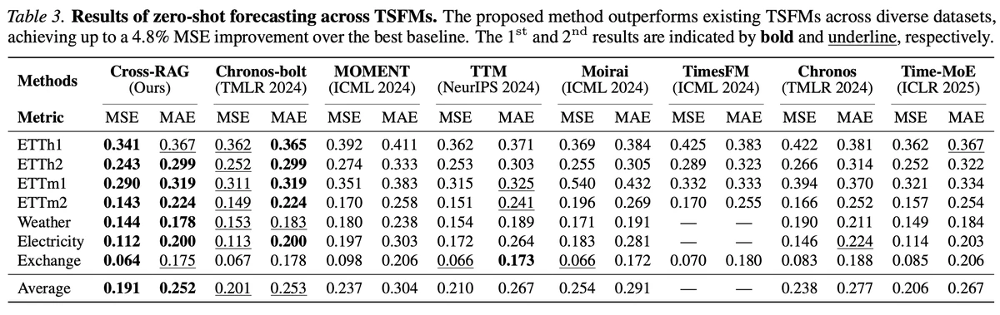

맨 왼쪽 열이 Cross-RAG이고 바로 옆이 backbone인 Chronos-Bolt다. MSE는 7개 데이터셋 모두에서 Cross-RAG가 가장 낮고, 평균은 0.191로 Chronos-Bolt의 0.201보다 낮다. MAE는 Chronos-Bolt와 같은 값인 데이터셋이 많다. 출처: 논문 Table 3

7개의 벤치마크에서 Cross-RAG가 TSFM baseline들보다 일관되게 좋은 성능을 보인다. 다만 표에서 2등(밑줄)이 거의 전부 Chronos-Bolt라는 점이 눈에 들어온다.

> 이것을 정말 RAG가 좋아서 나온 결과라고 봐야 할까? 그냥 Chronos-Bolt가 강력한 것은 아닐까?

**Comparison with RAG Methods.**

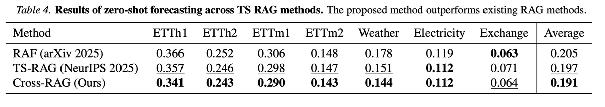

평균 MSE는 RAF 0.205, TS-RAG 0.197, Cross-RAG 0.191이다. Electricity에서는 TS-RAG와 같고(0.112), Exchange에서는 RAF(0.063)가 Cross-RAG(0.064)보다 조금 낮다. 출처: 논문 Table 4

RAG 방법과의 비교에서는 TS-RAG가 main baseline이고, 여기서도 Cross-RAG가 대체로 앞선다.

#### 4.3 Ablation Studies

Cross-RAG를 이루는 세 요소, 즉 query 자체의 표현(Q), retrieval self-attention(R), query-retrieval cross-attention(Q↔R)을 넣고 빼며 비교한 실험이다.

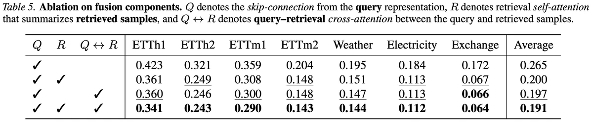

아래로 내려갈수록 요소가 더해진다. 평균 MSE는 Q만 쓸 때 0.265, R을 더하면 0.200, R 대신 Q↔R을 더하면 0.197, 셋을 다 쓰면 0.191이다. 하나만 더한다면 self-attention보다 cross-attention 쪽이 조금 더 낫고, 둘을 함께 쓸 때 가장 좋다. 출처: 논문 Table 5

> Q. 그런데 여기서 Q만 반영하면 사실상 Chronos-Bolt와 거의 동일한 것 아닌가?
>
> - 사실상 Chronos-Bolt를 거의 그대로 쓰되, Chronos의 embedding에 MLP를 적용하고 이를 다시 predictor에 넣는 것이다.
> - 단순히 MLP를 하나 거칠 뿐인데 성능이 급격히 떨어진다. Chronos-Bolt의 평균 MSE는 0.201인데(Table 3), Q만 사용한 Cross-RAG는 0.265다(Table 5의 첫 줄). 즉 원래 학습된 유용한 표현력을 제대로 활용하지 못하게 된다.
> - 그리고 실제로 성능을 비교해 보면 성능 향상이 그렇게 크지는 않다. 이것이 정말 novel한 연구인지는 의문이 남는다.

### 5 Analysis

#### 5.1 Various Retrieval Scenarios

검색 조건을 일부러 나쁘게 만들어도 버티는지를 네 가지 상황으로 확인한다.

- R1: Retrieval with various numbers of samples (k)
- R2: Retrieval of random samples
- R3: Retrieval using a smaller knowledge base
- R4: Retrieval from a different dataset

**R1: Retrieval with various numbers of samples (k)**

Introduction에서 본 k 그래프의 실제 수치다.

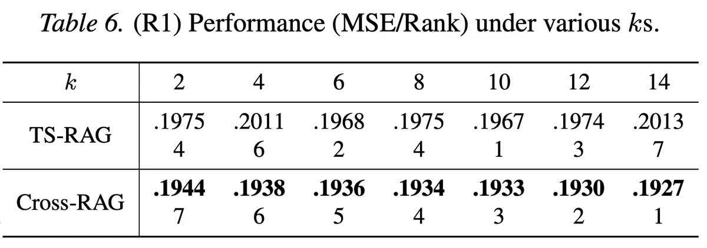{ width="560" }

각 칸의 위 숫자가 평균 MSE, 아래 숫자가 그 방법 안에서의 순위다. Cross-RAG의 순위는 7, 6, 5, 4, 3, 2, 1로 k가 클수록 좋아지고, TS-RAG의 순위는 4, 6, 2, 4, 1, 3, 7로 k와 무관하게 흩어진다. 출처: 논문 Table 6

- 7개의 데이터셋에 대해 k를 높여 갈 때의 성능 변화를 보면, Cross-RAG는 k가 늘어날 때 일관되게 성능이 향상된다.
- 즉 relevance를 제대로 고려하지 않는다면 단순히 k를 늘린다고 해서 성능이 향상되지는 않는다.

**R2: Retrieval of random samples**

유사도로 고르는 대신 무작위로 샘플을 뽑아 붙이면 어떻게 되는지를 본다. 검색 결과가 전부 "운에 맡긴 샘플"인 최악의 경우다.

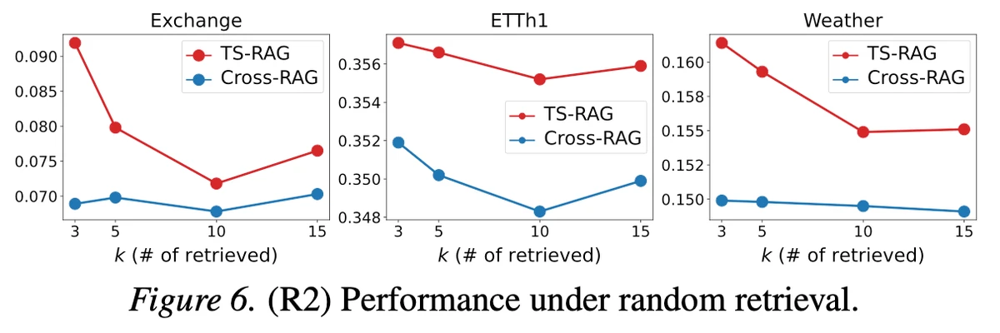

세 데이터셋 모두에서 파란 선(Cross-RAG)이 빨간 선(TS-RAG)보다 아래에 있다. Exchange와 Weather에서는 k에 따른 변화도 훨씬 작아서, Exchange에서 TS-RAG는 k = 3일 때 0.09를 넘지만 Cross-RAG는 0.07 근처에 머문다. 출처: 논문 Figure 6

- Cross-RAG는 TS-RAG와 비교할 때 더 안정적으로 성능이 좋다.
    - 즉 Cross-RAG는 관련성 있는 정보에만 선택적으로 주의를 기울이는 능력이 뛰어나다.
    - 따라서 query와 무관한 샘플이 검색 결과에 포함되더라도 예측 성능의 저하를 막을 수 있는 높은 robustness를 갖추고 있다.

**R3: Retrieval using a smaller knowledge base**

전체 학습 데이터셋의 일부 비율만 사용해 크기가 제한된 knowledge base를 구축했을 때, 제한된 정보 속에서 모델이 얼마나 잘 동작하는지를 평가한다.

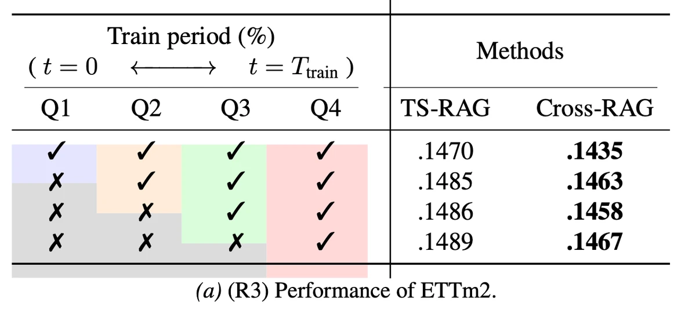{ width="520" }

Q1이 가장 오래된 구간, Q4가 가장 최근 구간이다. 아래로 내려갈수록 오래된 구간이 하나씩 빠져(✗) 맨 아래 줄은 Q4만으로 knowledge base를 만든 경우다. 네 줄 모두 Cross-RAG가 더 낮고, 데이터를 1/4만 써도 MSE는 0.1435에서 0.1467로 조금만 나빠진다. 출처: 논문 5.1절 R3의 그림 (a)

- 여기서 든 의문은, 그러면 오직 그 일부 데이터만으로 knowledge base를 구성했다는 것인가 하는 점이었다. 논문의 설정을 다시 확인하면 그렇다. 위 표처럼 ETTm2의 training split을 시간 순서대로 네 구간으로 나누고, 오래된 구간부터 빼 가며 남은 구간만으로 knowledge base를 구성해 비교한다.

데이터가 줄어도 크게 나빠지지 않는 이유를 논문은 아래 그림으로 설명한다.

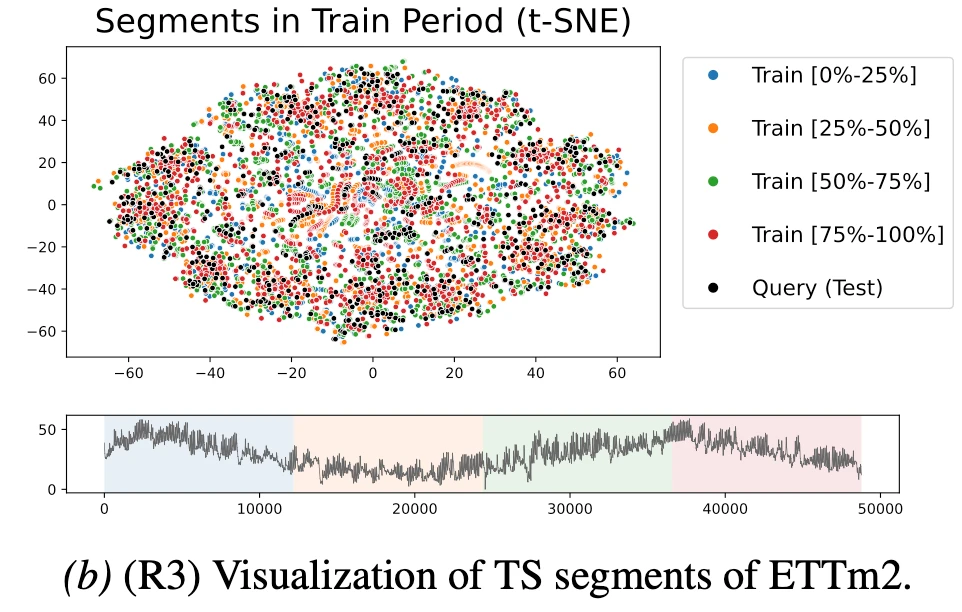{ width="520" }

위쪽 산점도에서 색은 train의 네 구간, 검은 점은 test query다. 아래쪽 띠는 같은 색으로 구간을 나눈 원래 시계열이다. 출처: 논문 5.1절 R3의 그림 (b)

- 이 시각화를 보면, 최신 데이터가 query에 대해 relevant한 데이터를 더 많이 포함하고 있다.
    - 그래서 데이터의 양 자체가 적더라도 retrieval에 충분한 양의 context를 제공할 수 있었다.

**R4: Retrieval from a different dataset**

Target 데이터셋으로 구축한 knowledge base가 아예 없는 완전한 zero-shot 상황을 가정하고, 다른 데이터셋을 knowledge base로 활용해 검색을 수행했을 때의 성능을 평가한다.

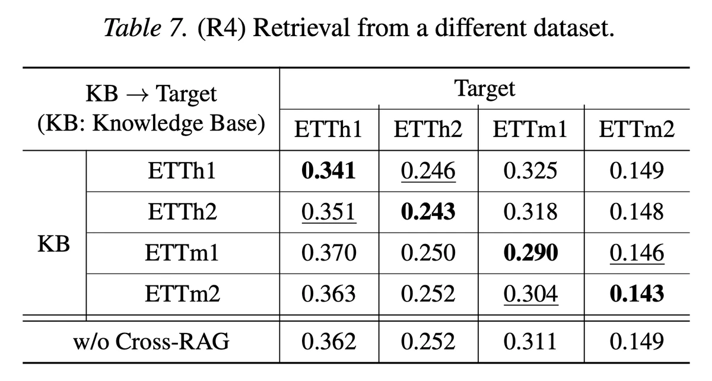{ width="560" }

행이 knowledge base로 쓴 데이터셋, 열이 target이다. 대각선(굵은 글씨)은 자기 자신을 knowledge base로 쓴 경우이고, 맨 아래 줄은 Cross-RAG 없이 backbone만 쓴 경우다. ETTh1을 예측할 때 같은 hourly인 ETTh2를 쓰면 0.351로 맨 아래 줄의 0.362보다 낫지만, 분 단위인 ETTm1을 쓰면 0.370으로 오히려 나빠진다. 출처: 논문 Table 7

- ETT 데이터셋 네 개 가운데 하나를 target으로 잡고 나머지로 knowledge base를 구성한 실험이다. 논문 본문은 나머지 세 개를 knowledge base로 쓴다고 설명하고, 결과 표는 위처럼 knowledge base로 쓴 데이터셋 하나와 target 하나의 쌍마다 성능을 적고 있다.
- 비슷한 데이터로 knowledge base를 구성해야 성능이 좋다. 가령 target이 hourly라면 knowledge base도 hourly로 구성할 때다. 표에서 대각선 다음으로 좋은 값(밑줄)이 모두 같은 시간 단위의 데이터셋에서 나온다.

> Q. 과연 모든 데이터를 가지고 knowledge base를 구성하여 retrieval을 수행하는 것이 맞을까? 이로 인해 noise가 발생하지는 않을까?

#### 5.2 Other Analyses

**Performance across various T, L.**

입력이 짧을 때와 길 때, 예측 구간이 짧을 때와 길 때 retrieval의 효과가 어떻게 달라지는지를 본다.

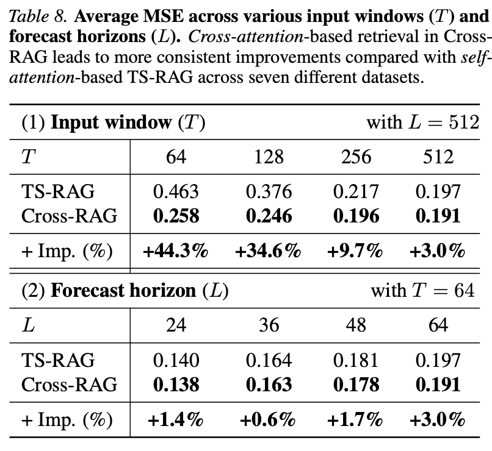{ width="480" }

위쪽 표는 $T$를 64에서 512로 늘린 것이고 아래쪽 표는 $L$을 24에서 64로 늘린 것이다. "+ Imp." 줄이 TS-RAG 대비 개선율로, $T = 64$일 때 44.3%이던 것이 $T = 512$에서는 3.0%가 된다. 표 머리의 "with L = 512", "with T = 64"는 서로 바뀌어 적힌 것으로 보인다. 두 표의 마지막 열(0.197, 0.191)이 본 실험(input 512, horizon 64)의 평균과 같기 때문이다. 출처: 논문 Table 8

- Forecast horizon의 길이를 64로 고정하고 input window의 길이를 64, 128, 256, 512로 늘리는 실험
    - Input window가 작을 때는 TS-RAG 대비 성능 향상 폭이 매우 컸다(44.3%, 34.6%).
    - 하지만 input window가 커질수록 성능 향상 폭이 크게 줄어들었다(9.7%, 3.0%).
- Input window의 길이를 512로 고정하고 forecast horizon의 길이를 24, 36, 48, 64로 늘리는 실험
    - 미약하긴 하지만(0.6 ~ 3.0%) 어쨌든 성능이 더 높게 나왔다.

> Q. 왜 input window의 길이가 길어질수록 성능에 큰 차이가 없을까? Context가 충분히 제공되면 모델이 예측을 더 잘 수행할 수 있기 때문인 것 같다.
>
> - 사실 당연한 말이긴 하다. 다만 real-world에서는 적은 정보로 먼 미래를 예측해야 할 가능성이 높기 때문에, input context window의 길이가 매우 짧을 수도 있다는 점은 염두에 두어야 한다.

**Attention weights across retrieved samples.**

요약의 3번에 실은 Figure 8이 이 분석의 그림이다.

- Query와 유사한 샘플일수록 높은 attention weight를 받았고(0.71, 0.19), irrelevant하거나 noisy한 샘플일수록 낮은 weight를 받았다(0.05, 0.03, 0.02).

> Q. 논문의 예시에서 attention weight 0.03, 0.02를 받는 샘플들이 정말 예측에 도움이 될까? 아닐 것 같다.

**Robustness to similarity metrics.**

검색할 때 쓰는 유사도 기준을 바꿔도 결과가 달라지는지를 본다. Cosine similarity, Euclidean distance, correlation, latent-space metric을 고려했다.

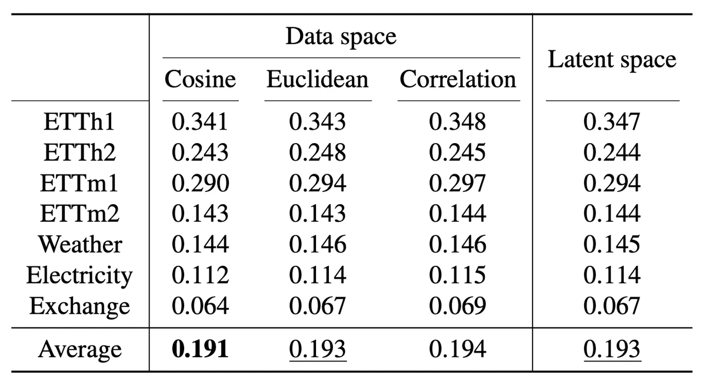{ width="520" }

맨 아래 평균 줄이 0.191, 0.193, 0.194, 0.193으로 거의 같다. Encoder를 거친 latent space에서 검색해도(맨 오른쪽 열) data space의 cosine보다 나아지지 않는다. 출처: 논문 5.2절의 표

- Metric에 관계없이 전반적으로 consistent한 결과를 보였다.
- 이를 통해 별도의 retrieval encoder를 쓰지 않고도 유사도 비교가 가능해진다.

**Robustness to $\lambda$**

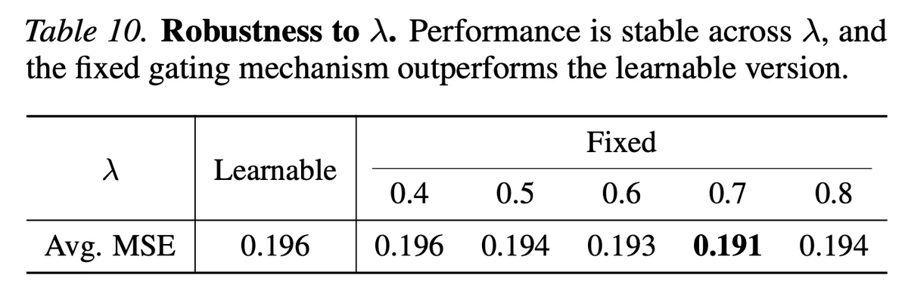{ width="560" }

$\lambda$를 0.4에서 0.8까지 바꿔도 평균 MSE는 0.191 ~ 0.196 사이에 있고, 0.7에서 가장 낮다. $\lambda$를 학습하게 둔 경우(0.196)가 고정한 경우보다 낫지 않다. 출처: 논문 Table 10

- $\lambda$를 몇으로 설정하더라도 전반적으로 consistent했다.

#### 5.3 Efficiency Analyses

**Efficiency analysis 1 - Retrieval.**

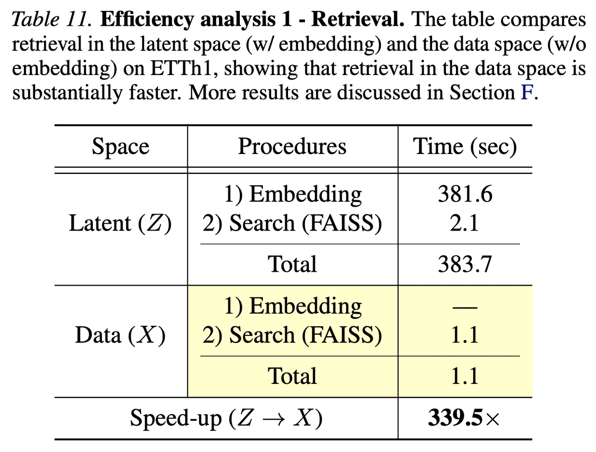{ width="480" }

Latent space에서 검색하면 걸리는 383.7초 가운데 381.6초가 embedding을 만드는 시간이다. Data space에서는 이 단계가 아예 없어 검색 1.1초만 남는다. 출처: 논문 Table 11

- Embedding을 사용하지 않으면 339.5배 더 빠르게 처리할 수 있다. 검색 자체가 빨라진 것이 아니라 embedding 단계가 사라진 효과다.

여기서 검색에 쓰이는 FAISS는 대규모 벡터 데이터에서 가장 유사한 항목을 빠르고 효율적으로 검색하기 위해 Meta가 개발한 오픈소스 라이브러리다([TS-RAG 글](2026-02-08-ts-rag.md)에서도 다루었다).

- 이 논문에서 FAISS는 유사한 과거 시계열 segment를 찾기 위한 검색 인덱스를 offline으로 미리 계산하고 구축하는 데 쓰인다.
- Query가 들어올 때마다 전체 데이터를 뒤지는 것이 아니라, 사전에 모든 timestep과 변수에 대한 검색 인덱스를 만들어 둔다.
- 모델이 실제로 학습하거나 추론할 때는 검색을 반복해서 수행하지 않고, 이미 저장된 인덱스에만 접근하여 효율성을 높인다.

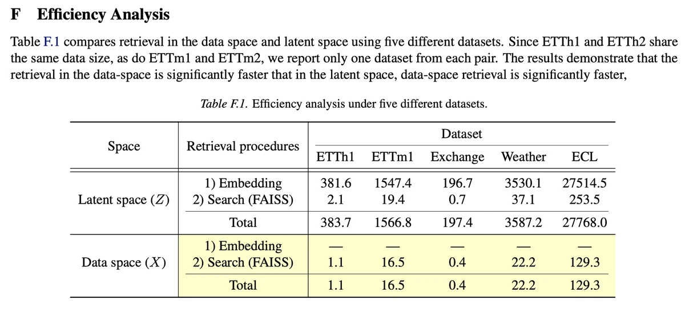

같은 비교를 다섯 데이터셋으로 넓힌 표다. 데이터가 클수록 embedding 시간이 크게 늘어, ECL에서는 latent space 검색이 27768.0초, data space 검색이 129.3초다. 출처: 논문 Table F.1

**Efficiency analysis 2 - Inference.**

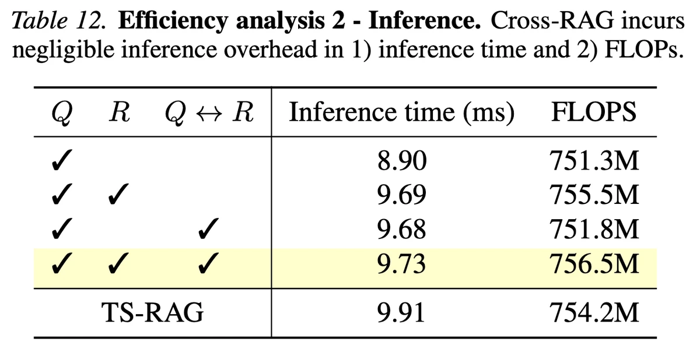{ width="480" }

Q만 쓸 때 8.90ms이던 inference time이 세 요소를 다 써도(노란 줄) 9.73ms이고, TS-RAG의 9.91ms보다 짧다. FLOPs는 751.3M에서 756.5M으로 늘 뿐이다. 출처: 논문 Table 12

- Cross-RAG의 여러 컴포넌트를 하나씩 적용하면서 inference time을 비교했다.
- 제안한 컴포넌트를 반영하더라도 inference speed가 거의 변하지 않았고, FLOPs도 거의 변하지 않았다.

**Efficiency analysis 3 - Parameters.**

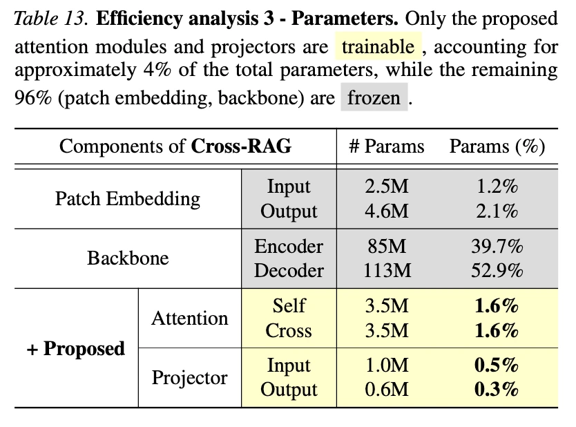{ width="480" }

회색이 고정된 부분(patch embedding, backbone), 노란색이 새로 학습하는 부분이다. Self-attention과 cross-attention이 각각 3.5M(1.6%), projector 두 개가 1.0M과 0.6M으로, 노란 부분을 다 더하면 4%가량이다. 출처: 논문 Table 13

- 전체 파라미터 가운데 4%가량만 학습 가능한 파라미터다.
- Zero-shot이므로 학습 자체는 매우 효율적이다.

### 6 Conclusion

- Cross-attention을 활용해 query와 retrieved samples 사이의 relevance를 반영함으로써, noise가 섞이는 것을 줄이고 유용한 정보만으로 prediction을 증강하는 Cross-RAG를 제안했다.

**Limitation and Future Works.**

- 데이터셋들 사이의 metadata를 반영하지 못한다. 논문은 이를 반영하는 것을 future work로 든다.
    - 데이터에 붙어 있는 의미론적 정보(메타데이터)를 함께 활용하겠다는 말이다.

> 과연 cosine similarity 등으로 잰 입력 window의 형태적 오르내림이 비슷하다고 해서, 정말 예측에 도움이 될까?

## 참고 자료

- Seunghan Lee, Jaehoon Lee, Jun Seo, Sungdong Yoo, Minjae Kim, Tae Yoon Lim, Dongwan Kang, Hwanil Choi, SoonYoung Lee, Wonbin Ahn. "Cross-RAG: Zero-shot Retrieval-Augmented Time Series Forecasting via Cross-Attention." 2026. [arXiv:2603.14709](https://arxiv.org/abs/2603.14709). 이 글은 2026년 3월에 공개된 첫 버전을 읽고 정리했다. 이후 개정판은 제목이 "Not All Retrievals are Useful: Cross-Attention for Input-Aware RAG in Time Series Forecasting"으로 바뀌었고, KDD 2026의 Workshop on Mining and Learning from Time Series에서 발표되었다.
- K. Ning 외. "TS-RAG: Retrieval-Augmented Generation based Time Series Foundation Models are Stronger Zero-shot Forecaster." NeurIPS 2025. [arXiv:2503.07649](https://arxiv.org/abs/2503.07649) ([리뷰](2026-02-08-ts-rag.md))
- K. Tire, E. O. Taga, M. E. Ildiz, S. Oymak. "Retrieval Augmented Time Series Forecasting." 2024. (RAF) [arXiv:2411.08249](https://arxiv.org/abs/2411.08249)
- S. Han, S. Lee, M. Cha, S. O. Arik, J. Yoon. "Retrieval Augmented Time Series Forecasting." ICML 2025. (RAFT) ([리뷰](2026-03-19-raft.md))
- S. Yang, D. Wang, H. Zheng, R. Jin. "TimeRAG: Boosting LLM Time Series Forecasting via Retrieval-Augmented Generation." ICASSP 2025.
- J. Liu, L. Yang, H. Li, S. Hong. "Retrieval-Augmented Diffusion Models for Time Series Forecasting." NeurIPS 2024. (RATD)
- A. F. Ansari 외. "Chronos: Learning the Language of Time Series." 2024. (Chronos, Chronos-Bolt) [arXiv:2403.07815](https://arxiv.org/abs/2403.07815)
