# Delving into Large Language Models for Effective Time-Series Anomaly Detection 리뷰

작성일 2026-03-23 · 최종 수정일 2026-04-07
{ .post-date }

LLM을 시계열 이상 탐지(Time-Series Anomaly Detection, TSAD)에 쓰면 왜 기대만큼의 성능이 나오지 않는지를 understanding과 localization이라는 두 능력으로 나누어 진단하고, de-seasonalization과 index-aware prompting이라는 단순한 방법으로 이를 고친 논문이다. 글은 논문을 한 번 훑고 쓴 요약, 읽으면서 생긴 질문을 정리한 부분, 논문의 절 순서를 따라간 정리의 세 부분으로 되어 있다. 논문의 그림과 표는 그 내용을 설명하는 자리에 함께 실었다.

LLM·VLM으로 시계열 이상 탐지를 다룬 다른 글로는 [VLM4TS](2026-01-22-vlm4ts.md)와 [Can Multimodal LLMs Perform Time Series Anomaly Detection?](2026-04-22-mllm-tsad-benchmark.md)이 있다.

## 요약

### 1. 연구 수행 배경

- 기존 TSAD 계열은 크게 통계/고전적 방법, ML/DL 방법, 그리고 최근의 TSFM/LLM 계열로 나뉜다.
    - 전통적 방법은 효율성과 해석성은 좋지만, non-stationary하고 복잡한 시계열 구조를 다루는 데는 한계가 있다.
    - DL 계열은 성능은 좋지만 학습/튜닝 비용과 해석성의 문제가 있다.
    - TSFM도 여전히 주로 timestamp-wise anomaly score + thresholding에 의존하기 때문에, 해석 가능한 interval-level localization에는 한계가 있다.
- 이 논문은 특히 LLM-based TSAD가 왜 자꾸 기대 이하의 성능을 보이는지에 초점을 맞춘다.

#### LLM-based TSAD의 문제점

- time-series understanding의 문제
    - text로 time-series sequence를 주면 LLM은 정상적인 변동이나 배경의 noise를 anomaly로 오인해 FP를 많이 낸다.
    - 반대로 graph image를 주면 눈에 띄는 spike는 잡아도, trend shift나 frequency change처럼 미묘하고 구조적인 이상은 잘 놓친다.
- anomaly localization의 문제
    - 기존 프롬프트는 anomaly가 있는 interval의 start/end index를 답하라는 식이다. 그런데 인덱스가 명시되지 않은 text input에서는 사실상 LLM이 내부적으로 값을 세어서 위치를 추론해야 하고, 논문은 이것이 LLM의 약한 능력이라고 본다.
    - 실제로 이 논문은 TSAD를 통짜 문제로 보지 않고, (1) anomaly를 이해하는 능력과 (2) 이해한 anomaly를 정확한 구간으로 번역하는 능력으로 분해해서 분석한다.

#### VLM 도입에 대한 필요성 언급

- 이 논문은 VLM을 반드시 접목해야 하는 이유에 대해서는 언급하지 않는다.
- prior work에서 time-series를 image로 바꿔 Multimodal LLM/VLM에 넣는 흐름이 있었지만, 이 논문은 시각적인 표현만으로는 subtle anomaly와 precise localization을 해결하기 어렵다고 분석한다.
- 이미지 입력은 point/range anomaly처럼 시각적으로 튀는 경우에는 도움을 주지만, 위치를 정확히 찍어야 하는 TSAD에서는 명시적인 인덱스 정보가 필요하고, 이는 텍스트 쪽이 더 적합하다고 본다.

> 즉, 이 논문에서 Multimodal/VLM은 필수가 아닌 보조적인 단서이며, 핵심은 de-seasonalization + index-aware text prompting이다. 저자들은 text-only 설정도 크게 개선되며, 이것이 "time-series text는 본질적으로 TSAD에 부적합하다"는 기존 인식을 뒤집는다고 명시한다.

- 또 하나의 배경은, prior work가 LLM이 AD를 할 수 있는지만 봤지, 왜 실패하는지(failure mode)를 분석하지는 않았다는 것이다.
    - 이 논문은 instance-level detection 실험으로 understanding 실패를,
    - GT anomaly를 highlight한 localization-only 실험으로 localization 실패를 따로 측정한다.
- 그 결과, trend/frequency anomaly는 이해 자체가 어렵고, frequency anomaly처럼 조각난 anomaly segment가 많은 경우에는 localization이 특히 어렵다는 것을 보인다.
    - 즉, 이 논문의 관점은 단순한 성능 개선이 아니라, 실패 원인을 task decomposition으로 진단하고 맞춤형으로 고치는 것이다.

### 2. 논문의 핵심 Contribution 3줄 요약

- 이 논문은 LLM/VLM 기반 TSAD의 실패 원인을 (1) temporal understanding 부족과 (2) anomaly localization 실패라는 두 축으로 분해하여 진단했다.
- 이를 해결하기 위해 (1) 외부 통계적 de-seasonalization과 (2) index-aware prompting을 결합한 단순한 방법을 제안했고, AnomLLM benchmark에서 기존 21개 프롬프트 전략 대비 평균적으로 큰 폭의 향상, 최대 66.6%의 F1 개선을 보고했다.
- 또한 LLM 기반 TSAD의 실질적 가치도 함께 점검하여, 실시간성은 약하지만 자연어 context를 활용한 context-aware anomaly filtering은 기존 score-based TSAD가 갖기 어려운 고유한 장점임을 보여 주었다.

### 3. 논문의 기존 한계 해결 방식

이 논문은 기존 한계를 아주 복잡한 새로운 아키텍처로 풀지 않는다. 대신 다음과 같은 철학으로 접근한다.

- LLM이 못하는 부분은 외부 도구가 맡고,
- LLM은 reasoning에 집중하게 하자.

#### (1) de-seasonalization

- 논문은 subtle trend shift나 frequency anomaly가 잘 안 잡히는 이유가, 정상적인 seasonality가 anomaly를 가려 버리기 때문이라고 본다.
- 그래서 입력 시계열에서 dominant period를 ACF로 찾고, additive decomposition으로 seasonality를 분리한 뒤, seasonality만 제거한 시계열을 LLM에 제공한다.
    - 이렇게 하면 LLM이 정상적인 반복 구조를 일일이 해석할 필요 없이, anomaly가 더 잘 드러난 신호를 보게 된다.
- 중요한 건, 저자들이 LLM에게 decomposition까지 end-to-end로 다 하게 하는 것이 아니라, 이런 수치적인 분해는 외부의 통계 도구가 훨씬 정확하고 효율적이라고 본다는 점이다.
    - 실제로 LLM은 component의 존재 여부는 어느 정도 맞힐 수 있지만, trend/seasonality sequence 자체를 정확히 생성하는 데는 실패하므로 반드시 외부 tool이 필요하다고 한다.

#### (2) index-aware prompting

- 기존 텍스트 프롬프트는 값의 나열만 주는 경우가 많아서, LLM이 "몇 번째 위치가 anomaly인지"를 찾기 위해 사실상 counting을 해야 한다.
- 논문은 별도의 counting 실험을 통해 LLM이 이런 숫자 세기 문제를 꽤 못한다는 점을 보여 주고, 해결책으로 각 값을 (index, value) 형태로 명시한다.
- 그러면 anomaly localization은 더 이상 "내부적으로 세기"가 아니라, anomaly pattern을 찾은 뒤에 바로 해당 인덱스를 lookup하는 문제가 된다.
    - 이 변화가 localization 성능에 매우 크게 기여하며, ablation에서도 index 제거가 가장 큰 성능 하락을 일으킨다.

#### (3) complementary multimodal

- 논문은 이미지 자체를 부정하지 않는다. 이미지 plot은 전체 shape, 급격한 변동, 시각적인 salience를 주는 데 유용하고, 텍스트는 인덱스와 정확한 값 정보를 준다.
- 따라서 최종적으로는 text와 vision을 함께 쓰되, 핵심 localization은 텍스트의 explicit index가 떠받치게 된다.
- 실제 ablation에서도 이미지와 텍스트 값은 서로 보완적이다. 다만 이 논문이 말하는 본질은 "VLM이 있으니 해결된다"가 아니라, "구조를 단순화한 신호 + 위치가 명시된 텍스트"가 있어야 해결된다는 것이다.

#### (4) anomaly detection의 현실적인 정의

- 기존 방법은 abrupt drop, flat segment 같은 패턴의 변화가 있으면 일단 anomaly score를 높인다. 그런데 실제 현업에서는 maintenance, promotion, system shutdown처럼 설명 가능한 이상은 굳이 보고 싶지 않을 수도 있다.
- 저자들은 LLM의 자연어 reasoning 능력을 활용해 temporal/pattern context를 함께 주면, 이런 explainable anomaly를 제외하고 novel하거나 truly interesting한 anomaly만 남길 수 있다는 점을 보여 준다.
- 즉, 이 논문은 TSAD를 단순한 패턴 감지에서 context-aware, objective-aware detection으로 옮기려는 방향성도 함께 제시한다.

### 4. 논문의 제안 방법론

이 논문은 새로운 trainable neural architecture를 제안하는 논문이 아니다. 핵심은 MLLM/LLM + 외부 통계 전처리 + 프롬프트 설계이고, 아래 그림 한 장에 전부 들어 있다.

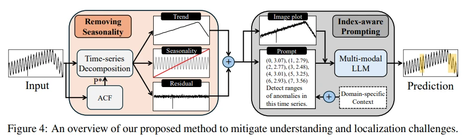

왼쪽 주황 상자가 seasonality를 걷어 내는 전처리이고, 오른쪽 회색 상자가 index를 붙인 prompt를 만들어 LLM에 넣는 부분이다. 맨 왼쪽의 입력은 톱니 모양의 반복에 가려 어디가 이상한지 잘 보이지 않지만, seasonality를 빼고 만든 "Image plot"에서는 아래로 튀는 지점과 꺾이는 지점이 드러난다. 출처: 논문 Figure 4

그림을 왼쪽에서 오른쪽으로 따라가면 다음과 같다.

- ACF가 입력에서 가장 두드러진 주기 $P^\ast$를 찾아 Time-series Decomposition에 넘긴다(외부 모듈 1: 시계열 de-seasonalization용 통계 decomposition).
- 분해된 세 성분 가운데 Seasonality에만 빨간 사선이 그어져 있다. 버린다는 뜻이고, Trend와 Residual만 더해(⊕) 다음 단계로 보낸다.
- 더한 시계열을 line plot(Image plot)과 `(0, 3.07), (1, 2.79), …` 형식의 텍스트(Prompt)로 만든다(외부 모듈 2: index-aware text formatting).
- Multi-modal LLM이 이를 받아 anomaly interval의 시작과 끝을 JSON 형태로 직접 생성한다. 맨 오른쪽 Prediction의 노란 띠가 그 답이다.

나머지 구성은 다음과 같다.

- 백본 모델: MLLM/LLM
    - GPT-4o
    - Gemini-1.5-Flash
    - Qwen2.5-VL-72B-Instruct
    - InternVL2-Llama3-76B
- 입력 모달리티: text-only 또는 text+vision. text-only일 때는 그림의 Image plot 없이 Prompt만 넣는다.
- 점선 상자의 Domain-specific Context는 기본 실험에서는 넣지 않는다. Context를 주는 실험은 논문 정리의 5.2절에서 다룬다.

> 즉, 구조적으로는 Input time series → 계절성 제거 → text/image로 변환 → index-aware prompt와 함께 LLM/MLLM에 입력 → anomaly interval 직접 생성의 흐름이다.

- 이 연구는 zero-shot 연구이다.

### 5. 꼭 알아야 할 필수 선행 연구

#### (1) Can LLMs Understand Time Series Anomalies?

- 이 논문의 직접적인 출발점이다. 이 논문은 실험을 AnomLLM benchmark 위에서 수행했고, 기존 21개 prompt variant를 모두 비교 기준으로 삼았다.
- 다시 말해, 이 논문이 "기존 LLM TSAD가 왜 실패하는지"를 분석할 수 있었던 것도 AnomLLM이 다양한 anomaly type과 prompt setting을 체계화했기 때문이다.
- 이 논문의 성능 향상은 결국 AnomLLM prompt family를 얼마나 넘어서느냐로 읽어야 한다.

#### (2) Large Language Models Can Deliver Accurate and Interpretable Time Series Anomaly Detection

- 이 논문과 가장 밀접한 개념적 비교 대상이다. 이유는 두 가지이다.
    - 첫째, LLM으로 해석 가능한 anomaly interval을 직접 생성한다는 문제 설정이 매우 가깝다.
    - 둘째, 이 논문이 강조하는 index-aware text의 중요성이 완전히 처음 나온 것은 아니다. (2)번 논문에서 이미 index를 포함한 time-series text를 사용했다고 이 논문의 저자들이 언급한다.
        - 다만 이 논문은 이를 더 체계적으로 파고들어, 왜 index가 중요한지, 길어진 프롬프트의 불이익보다 index-aware의 이익이 더 큰지를 실험적으로 입증했다.
        - 또한 context-aware 활용 측면에서도 비교해 볼 가치가 크다.

그 밖에 함께 볼 만한 논문은 [Can Multimodal LLMs Perform Time Series Anomaly Detection?](2026-04-22-mllm-tsad-benchmark.md)과 TSB-AD benchmark 논문(The Elephant in the Room)이고, 나머지는 글 끝의 참고 자료에 적었다.

> 추가로 꼽은 논문들은 이 논문의 핵심 아이디어(failure mode를 understanding/localization으로 분해했다는 점, de-seasonalization + index-aware prompting, visual-only의 한계와 context-aware filtering)를 이해하는 데는 우선순위가 낮다.

## 질문 정리

### 1. 이 논문에서 말하는 instance-level detection은 무엇이고, anomaly에 대한 understanding이란 무엇인가?

- 이 논문에서 말하는 instance-level detection이란, 원래의 TSAD를 더 쉬운 형태로 바꾼 것이다.
- 원래 TSAD는 anomaly가 어느 구간에 있는지도 맞혀야 하지만, instance-level detection에서는 시계열 전체를 하나의 instance로 보고, 그 안에 anomaly가 하나라도 존재하는지만 True/False로 판단한다.
- 즉, interval localization 없이 anomaly 존재 여부만 판단하는 이진 분류이다.
- 이런 실험을 하는 이유는, TSAD의 최종 성능이 localization 능력에 크게 좌우되기 때문이다.
- 그래서 localization을 걷어 내고도 모델이 anomaly의 존재 자체를 못 맞힌다면, 그건 위치를 못 잡아서가 아니라 시계열 패턴 자체를 이해하지 못한 것이라고 볼 수 있다.
    - 더 쉬운 문제인 존재 여부조차 못 맞힌다면, anomaly를 판단하기 위한 시계열 패턴 자체를 이해하지 못한 것일 수 있다는 것이다.
- 논문도 바로 이 점 때문에, instance-level 실험을 understanding failure를 분리해서 측정하는 실험으로 둔다.
- Understanding
    - 여기서 understanding이란, 간단히 말하면 "normal/abnormal 패턴을 구별하는 능력"이다.
    - 좀 더 정확히는, 복잡한 trend/seasonality/background pattern이 섞여 있어도 이 시계열에 anomalous behavior가 존재하는지를 인식하는 능력이다.
    - 즉, 정확히 몇 번 인덱스부터 몇 번 인덱스까지인지를 맞히는 능력이 아니라, 이 시계열이 정상인지, 아니면 어떤 형태로든 비정상인지 알아차리는 능력을 말한다.

### 2. localization-only experiment는 anomaly interval을 잡아내는 실험인가?

- 이 실험은 모델이 anomaly를 찾는 실험이 아니라, 이미 주어진 anomaly의 위치를 정확한 interval 출력으로 번역하는 실험이다.
- 논문에서는 GT anomaly region을 이미지 위에 직접 하이라이트해 주고(논문 정리 2절에 실은 Figure 1의 파란 띠와 같은 형태), 그 상태에서 모델이 x-axis 상의 anomaly interval을 반환하게 한다.
- 좀 더 자세히 말하면, 주어진 anomaly 영역을 정확한 start/end interval로 출력하는 localization 능력만 따로 보는 실험이다.

> 논문에 따르면, VLM이 instance의 anomaly 여부를 정확히 짚어 냈더라도 localization을 잘하는 것은 아닐 수 있다. 그러므로 이 부분을 반드시 구분해서 평가해야 한다고 말한다.

### 3. subtle anomaly는 무엇인가?

- point/range/trend/frequency처럼 독립된 anomaly type의 이름이 아니라, 눈에 확 띄지 않고 정상 패턴 속에 숨어 있는 이상을 가리키는 설명적인 표현이다.
- 즉, trend shift나 frequency change를 이런 subtle anomaly의 대표적인 현상이라고 볼 수 있다.
    - 이들은 spike anomaly처럼 크게 튀지 않으면서 정상적인 trend나 seasonality와 얽혀 있어서 정상처럼 보이기 쉽기 때문이다.

### 4. Data의 입력 형태 및 프로세스 과정은 어떠한가?

#### (1) 기본 입력 형태

- 입력 시계열을 두 가지 표현으로 만든다.
    - time-series text: 값 리스트
    - time-series image: line plot

이 중 하나, 혹은 둘 다를 선택하여 LLM에 입력한다. 모델은 최종적으로 anomaly interval $(a, b)$들을 텍스트로 생성한다.

#### (2) 제안 방법의 실제 입력 형태

- 입력(0shot-Text-Vision):
    - (index, value) 형식의 시계열 텍스트
    - plotted time-series image

#### (3) 전체 처리 프로세스

1. raw time-series를 입력받는다.
2. ACF로 period를 탐색한다.
3. 통계 decomposition을 수행한다.
4. seasonality를 제거한다.
5. de-seasonalized signal을 text((index, value) 리스트)와 image(line plot) 형태로 만든다.
6. 이 입력을 0-shot prompt와 함께 MLLM/LLM에 넣는다.
7. 모델이 anomaly interval을 JSON으로 직접 생성한다.
8. 후처리로 (start, end) interval을 추출한다.

> 중요한 것은, 이 논문은 score를 직접 만들고 thresholding하는 방식이 아니라, LLM이 label/interval을 직접 생성하는 방식이라는 점이다.

### 5. Multivariate/Univariate

실제 제안 방법과 실험은 사실상 univariate이다. 이유는 다음과 같다.

- benchmark 자체가 주로 univariate time-series + synthetic anomaly로 구성된다.
    - AnomLLM benchmark의 point/range/trend/frequency anomaly는 각 시계열 길이 1000의 단일 시계열 형태이다.
- real-world 비교도 TSB-AD-U, 즉 univariate subset을 사용한다. 논문도 TSB-AD benchmark 중 dimension이 1인 subset을 사용했다고 명시한다.
- decomposition 구현도 Appendix C.2에서 statsmodels의 `seasonal_decompose`를 사용하며, 이를 univariate time series decomposition으로 설명한다.

### 6. instance-level detection 후에 anomaly가 있으면, localization을 수행하는 구조인가?

- 아니다. instance-level anomaly detection은 단순히 failure analysis를 위한 진단 실험이다.
- 이미지와 텍스트를 VLM에 전달하고, 실제 inference에서는 한 번에(one-shot) anomaly interval들을 생성한다.
    - 즉, 이 과정은 understanding + localization 두 능력의 결합으로 볼 수 있지만, 구현 자체는 one-shot direct interval generation이다.
- 따라서 instance의 size에 따라 탐지 성능이 달라진다는 것은 말 자체가 성립하지 않는다. instance-level detection은 애초에 추론 과정에 반영되는 것이 아니기 때문이다.
- 하지만 길이와 anomaly segment 구조가 localization에 영향을 준다는 점은 분명하다.
    - 시퀀스의 길이가 길어질수록 counting이 어려워진다.
        - Section 3.2의 counting experiment(논문 정리 3.2절의 Figure 5)에서, sequence length가 길어질수록 counting MAE가 증가하는 것을 알 수 있다.
        - 즉, index-free prompting일 때는 길어진 입력이 localization을 더 어렵게 만든다.
    - anomaly segment의 개수와 분절(fragmentation)이 localization을 어렵게 만든다.
        - Figure 3(c)(논문 정리 2.2절에 실은 그림의 오른쪽)와 그 설명에서, localization의 residual failure는 anomaly의 개수, 그리고 분절 정도(fragmentation)와 연관된다고 설명한다. 특히 frequency anomaly는 짧고 흩어진 segment가 많아서 localization이 더 어렵다고 말한다.

## 논문 정리

- Input: univariate time-series plot & prompt
- Output: detected anomaly intervals
- 이 논문은 LLM이 anomaly detection에 실패하는 원인을 다음 두 가지로 분석하고, 각 문제를 개선하기 위한 간단하지만 강력한 방법을 제시한다.
    - understanding complex temporal dynamics
    - localizing anomalies accurately
- 방법론
    - ACF로 dominant period를 찾아내고, additive decomposition으로 dominant seasonality를 제거한다.
    - de-seasonalized time series를 시각화하고, prompt와 함께 VLM에 전달한다.
    - prompt에는 (index, normalized_value) 형식으로 전체 시계열의 정보를 제공한다.

요약의 4번에 실은 Figure 4가 이 흐름을 그린 것이다.

### 1 Introduction

문제의식과 접근은 앞의 요약에 적은 것과 같다. 수치로는 AnomLLM benchmark의 21개 prompting strategy 전체에 대해 F1 score를 평균 39.9%, 최대 66.6% 향상했다고 보고한다. 또 기존 TSAD method 대비 LLM의 practical value를 검증하기 위해, TSB-AD 데이터에서 16개의 non-LLM method와 zero-shot accuracy 및 efficiency를 비교하고, 잘 알려졌거나 설명 가능한 anomaly를 탐지 대상에서 선택적으로 제외하는 실용적 활용 방안도 제시한다.

Contributions는 다음과 같다.

> - LLM이 TSAD에서 실패하는 근본적인 한계에 대해 종합적인 분석 결과를 제시한다. 분석에 따르면, LLM은 temporal pattern을 이해하는 것과 anomaly를 정확히 localize하는 것에 어려움을 겪는다.
> - 이러한 문제를 해결하기 위하여 statistical decomposition(de-seasonalization)과 index-aware prompting을 적용한 method를 제시한다. 이를 통해 기존 LLM-based TSAD 방법론 대비 최대 66.6%의 F1 score 향상을 달성했다.
> - 이 방법론을 non-LLM methods와 비교하며, practical한 contextual reasoning이 가능함을 보인다.

### 2 Analysis: why do LLMs struggle with TSAD?

**Task Setup.**

- input time series $\mathbf{x}_{t-L:t}$를 normalize하고, comma-separated text로 만들거나 simple line plot으로 만든다.
- 이러한 representation들은 instruction과 함께 LLM에 입력된다.
    - 예를 들어 "이상 동작을 보이는 연속 구간 $[a_i, b_i]$를 모두 찾아라"와 같은 instruction이다.
- LLM은 지정된 JSON 형태로 anomaly span $(a_i, b_i)$의 list를 출력하고, 이를 parse하여 anomaly interval을 얻는다.
    - 이러한 방식은 timestamp별로 anomaly score를 구하고 thresholding을 적용하는 conventional approach와는 차이가 있다.

**Analysis of common failure cases.**

논문은 AnomLLM의 failure case를 먼저 분석한다. 아래 두 사례는 점수로는 똑같이 F1 score 0이지만, 틀린 이유가 서로 다르다.

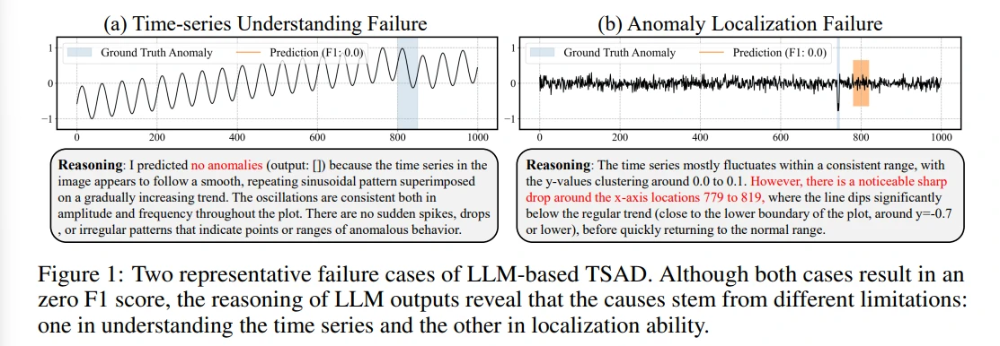

파란 띠가 정답 구간(ground truth), 주황 띠가 LLM이 답한 구간이고, 아래 상자는 LLM에게 그렇게 답한 이유를 설명하게 한 것이다. (a)에는 주황 띠가 아예 없고, (b)에는 주황 띠가 있지만 파란 띠 바로 옆으로 비켜나 있다. 출처: 논문 Figure 1

- (a)에서는 명시적인 trend shift anomaly가 나타났음에도 LLM이 이를 감지하지 못했다.
    - Reasoning을 보면 "완만하게 증가하는 trend 위에 부드럽게 반복되는 sinusoidal pattern이 얹혀 있을 뿐"이라며 anomaly가 아예 없다고 결론짓는다. 여기서는 더 근본적인 failure가 발생한 것이다.
- (b)에서는 LLM이 anomaly를 predict했으나, ground truth와 overlap되지 않는다.
    - 그런데 흥미로운 것은, 모델에 reasoning을 시켜 보면 spike의 존재를 설명한다는 것이다. x축 779 ~ 819 부근에 눈에 띄는 급격한 하락이 있다는 식으로 답한다.
    - 그림에서 실제로 아래로 급락하는 곳은 750 부근(파란 띠)이다. 급락이 있다는 사실은 맞게 봤고, 그 위치를 숫자로 옮기는 데서 틀린 것이다.
    - 이를 해석해 보면, LLM이 time series pattern 자체는 정확히 이해한 것으로 보인다. 따라서 (b)에서 LLM이 detection에 실패한 것은 localization step의 문제이지, understanding의 문제가 아니라는 것을 알 수 있다.
- 이러한 분석은 LLM-based zero-shot anomaly detection의 두 가지 큰 challenge를 제시한다.
    - understanding time-series dynamics
    - accurately localizing the anomaly intervals
- 이 두 종류의 failure를 구분하기 위하여, 다음 두 가지 실험을 진행한다.
    - (a)에 집중하기 위한 instance-level TSAD experiments (Understanding)
    - (b)에 집중하기 위한 TSAD with GT anomalies (Localization)

#### 2.1 Evaluating LLMs' time-series understanding capability

- TSAD의 최종 성능은 결국 localization capability에 좌우된다.
- 따라서 우선 original problem을, precise localization 없이 entire sequence에 anomaly가 존재하는지 아닌지만 판단하는 간단한 문제로 바꿔 본다.
    - 이를 instance-level anomaly detection이라고 하며, 일종의 binary detection problem이다.

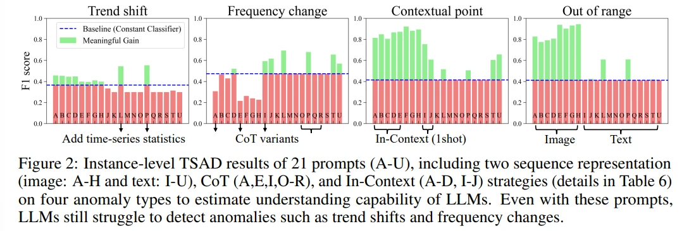

막대 하나가 prompt 하나다(A ~ H는 image, I ~ U는 text 입력). 파란 점선은 입력과 무관하게 항상 같은 label을 내는 constant classifier의 점수이고, 점선 위로 올라온 초록 부분만이 의미 있는 향상이다. 왼쪽 두 칸에는 초록이 거의 없고, 오른쪽 두 칸에서는 A ~ H만 높이 올라간다. 출처: 논문 Figure 2

- 위 그림은 anomaly type에 따른 LLM의 understanding capability를 보여 준다.
- trend shift와 frequency change(왼쪽 두 칸)에 대해서는, 대부분의 prompt가 constant classifier보다 조금 나은 정도이거나 오히려 더 떨어지는 성능을 보인다. 점선에 못 미치는 막대도 많다.
- 반면 point와 range anomaly(오른쪽 두 칸)에 대해서는, image prompt(A ~ H)를 사용할 때 거의 만점에 가까운 성능을 보였다.
    - image prompt는 시계열의 temporal representation을 image로 제공하고 instruction을 prompt로 제시하는 것이다. 일부에서는 CoT나 예시 문장을 추가한다.
    - 같은 anomaly라도 text prompt(I ~ U)에서는 대부분 점선 높이에 머문다. 눈에 띄게 튀는 이상은 그림으로 볼 때 잘 잡힌다는 뜻이다.
- 전체적으로, CoT나 in-context exemplar 등을 적용하더라도 temporal dynamics에 대한 understanding capability를 향상시키기 어려웠다.

#### 2.2 Evaluating LLMs' time-series localization capability

- LLM의 localization 성능을 점검하기 위하여, time-series understanding의 필요성을 제거하고 오직 localization만 수행하는 실험을 한다.
- 구체적으로, time-series image에서 GT anomaly region을 하이라이트한다(Figure 1의 (a), (b)와 같은 형태).
    - 이 실험에서는 time-series image를 사용하지만, Section 4.2에서는 time-series text에 대한 localization을 실험한다.
- 만약 localization이 bottleneck이 아니라면, 이러한 실험 세팅에서 LLM의 성능은 당연히 거의 만점에 가까워야 할 것이다. 정답이 어디인지 이미 칠해 주었기 때문이다.

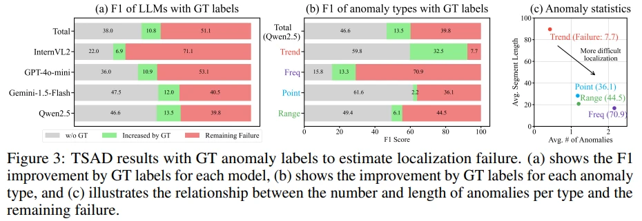

막대에서 회색은 정답 위치를 알려 주지 않았을 때의 F1, 초록은 알려 주어서 늘어난 부분, 빨강은 그래도 남은 실패다. (a)의 맨 윗줄(Total)을 보면 회색 38.0에 초록은 10.8뿐이고 빨강이 51.1이나 남는다. 출처: 논문 Figure 3

- 그러나 performance gain이 굉장히 제한적이라는 것을 확인할 수 있다. (a)에서 네 모델 모두 초록이 6.9 ~ 13.5에 그친다.
- anomaly type별로 자세히 들여다보면, localization difficulty에 대한 인사이트를 추가로 얻을 수 있다.
- (b)를 보면, trend(+32.5)와 frequency(+13.3) anomaly는 point(+2.2)나 range(+6.1) anomaly보다 높은 성능 향상을 보인다.
    - 다만 남은 실패는 type마다 크게 다르다. Trend는 7.7만 남고, frequency는 70.9가 남는다. 이를 통해 localization difficulty는 anomaly type에 따라 다르다는 것을 알 수 있다.
- (c)는 이러한 interpretation을 더 자세히 보여 준다. 가로축이 시계열 하나에 들어 있는 anomaly의 평균 개수, 세로축이 anomaly 구간의 평균 길이이고, 괄호 안의 숫자가 (b)의 남은 실패다.
    - Trend는 개수가 적고 길어서 왼쪽 위에, frequency는 개수가 많고 짧아서 오른쪽 아래에 있다. 화살표가 가리키는 오른쪽 아래로 갈수록 localization이 어렵다.
- 분석에 따르면, anomaly가 자잘하게 넓게 퍼져 있을 경우 localization이 더 어렵다.
    - 그래서 frequency anomaly를 잡아내기가 더 힘들었다고 한다.
    - 다만 데이터셋마다 나타나는 anomaly의 특징은 다를 수 있다.

### 3 Methodology

- 앞의 실험으로 확인한 두 가지 문제를 해결할 수 있는 방법론을 제시한다. 전체 구조는 요약의 4번에 실은 Figure 4이고, 그림의 주황 상자가 3.1절, 회색 상자가 3.2절이다.
- 시계열의 complex temporal dynamics를 이해하는 대표적인 방법은 decomposition이다.
- 기존의 non-LLM method들은 이러한 decomposition을 end-to-end 학습으로 모델 내부에 넣는 경우가 많았다. 그러나 강력한 pretrained LLM에게 decomposition을 수행하도록 학습시키는 것은 오히려 pretrained capability를 저하시킬 수 있다.
- 이에 따라 이 논문은 external tool로 time-series를 decompose하고 그 결과를 LLM에 전달하는 방식을 쓴다.
- 이러한 방식은 LLM에 더 정확하게 전처리된 input을 넣어 줌으로써, LLM이 core strength에 집중하도록 만들 수 있다.

#### 3.1 De-seasonalization: supporting LLMs' understanding of time-series

- 두드러지는 seasonality는 때로 trend shift나 frequency change와 같은 anomaly를 모호하게 만들 수 있다. 따라서 이러한 seasonality를 제거하면 LLM이 anomaly를 더 명확히 바라볼 수 있게 된다.
- de-seasonalization module
    - [step 1] period discovery: ACF를 사용하여, autocorrelation에 기반해 가장 두드러지는 주기 $P^\ast$를 찾아낸다.
    - [step 2] additive decomposition: 전통적인 additive 분해로 시계열을 분해한다.
    - [step 3] residual pass-through: time-series에서 seasonality를 제거한 뒤 image와 text로 가공하고, 이를 LLM에 전달한다.
- 이러한 external module의 사용은 두 가지 질문을 불러일으킨다.
    - LLM이 자체적으로 decomposition을 수행할 수 있는 ability가 있지는 않을까?
    - 외부 도구를 붙인 진짜 tool-augmented framework라면, 전처리를 무조건 사람이 먼저 하는 것이 아니라 LLM이 필요성을 판단해야 하는 것 아닌가?
    - 이에 대한 내용은 Section 4.2에서 다룬다.

#### 3.2 Index-aware prompting: challenges in positional reasoning over time-series text

- localization problem은 time series가 image/text 중 어떤 것으로 표현되었느냐에 따라 달라진다.
- time-series image만 사용하면, LLM이 x-axis에서 정확한 index에 접근하기가 어렵다.
- text만 사용하면, AnomLLM의 기존 prompt는 어떠한 명시적인 positional information도 없이 numerical value만 제시한다.
    - 따라서 LLM은 암시적으로 counting task를 수행해야 한다.
    - 그러나 token이나 semantic chunk를 counting하는 task는 LLM이 잘하지 못하는 challenge로 이미 널리 알려져 있다.
    - time-series domain에서 이 문제를 확인하기 위하여, LLM에게 제공된 sequence의 길이를 세어 보라는 간단한 실험을 진행한다.

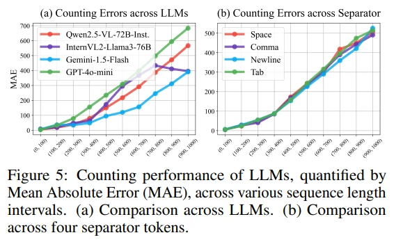{ width="560" }

가로축은 세어야 하는 sequence의 길이 구간, 세로축은 LLM이 답한 길이와 실제 길이의 차이(MAE)다. (a)에서 네 모델 모두 길이가 길수록 오차가 커져서 900 ~ 1000 구간에서는 수백 개씩 틀린다. (b)에서 구분자를 space, comma, newline, tab으로 바꿔도 네 곡선이 거의 겹친다. 출처: 논문 Figure 5

- 실험 결과, open-source와 proprietary LLM 모두 이러한 simple task에서 매우 저조한 성능을 보였다. separator를 다양하게 설정했을 때도 마찬가지였다.
    - 전체 개수조차 수백 개씩 틀리는 모델에게 "몇 번째 값부터 몇 번째 값까지가 이상한가"를 세어서 답하게 하는 것은 무리라는 뜻이다.
- 이러한 counting burden을 완화하기 위하여 index-aware prompting을 도입한다. 각 value를 positional index와 명시적으로 묶어 제시하는 방법이다.
    - 이를 통해 LLM이 counting을 수행하는 부담을 줄일 수 있고, LLM은 단순히 index를 곧바로 lookup하면 된다.
    - 또한 time-series plot에 index를 visualize하면 이미지가 난잡해지거나 overlap이 발생할 수 있으므로, textual form으로 제시하는 것이 매우 practical하다.
- 다만 index-aware prompting이 완전히 novel한 아이디어는 아니라고 논문은 밝힌다.
- 이미 이전 연구에서 time-series text를 index와 함께 제시한 바가 있다.
- 그러나 대부분의 사전 연구들은 index information을 활용하지 않았으며, 이는 긴 prompt가 성능 하락으로 이어질 수 있다는 우려 때문인 것으로 보인다.
    - 이러한 trade-off는 Section 4.2에서 자세히 분석한다.

### 4 Experiment

**Datasets.**

- AnomLLM에서 제시된 데이터셋을 사용한다. point, range, trend, frequency anomaly를 포함하며, 모두 정확하게 annotate되어 있다.
- 또한 TSB-AD-U benchmark를 사용하여, 좀 더 realistic한 time-series application에서의 성능도 확인한다.
- 일부 prompting method는 domain-specific context를 포함하지만, 이 논문의 방법론은 그러한 context를 포함하지 않는다.

**Metric.**

- AnomLLM은 affiliation metric을 사용하는데, 이 방식은 localization error에 덜 sensitive하다.
- 또한 method 간의 차이를 명확히 구별하지 못하므로, 정확한 evaluation을 위해 F1 score와 affiliation metric을 함께 사용한다.

**Baselines.**

- Multimodal LLM으로는 Qwen2.5-VL-72B-Instruct, InternVL2-Llama3-76B, GPT-4o(및 mini), Gemini-1.5-Flash를 쓴다.
- conventional TSAD model과의 비교에는 ML baseline(SR, IForest, Sub-PCA, KMeans-AD, MatrixProfile), DL baseline(CNN, USAD, AnomalyTransformer, OmniAnomaly, AutoEncoder, TimesNet, FITS), FM baseline(Chronos, TimesFM, Lag-Llama, MOMENT)을 쓰고, thresholding method로 Percentile, MAD, EVT-POT를 적용한다.

#### 4.1 Comparison with various prompting strategies in LLM-based TSAD

**4.1.1 Main results**

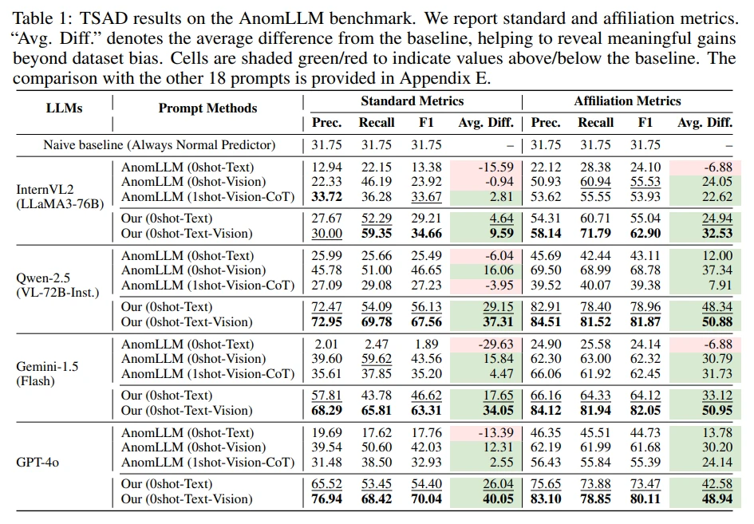

LLM마다 위 세 줄이 AnomLLM의 prompt, 아래 두 줄("Our")이 이 논문의 prompt다. "Avg. Diff." 열은 맨 윗줄 naive baseline(항상 정상이라고 답하는 predictor, 31.75)과의 차이로, 초록이면 baseline보다 낫고 빨강이면 그보다 못하다. 출처: 논문 Table 1

- 논문에서 제시한 방법론이 다양한 LLM backbone에서 TSAD 성능을 상당히 향상시킴을 확인했다. 0shot-Text-Vision의 F1은 GPT-4o 70.04, Qwen-2.5 67.56, Gemini-1.5 63.31, InternVL2 34.66이다.
- 이전의 방법론들은 naive baseline의 성능을 뛰어넘기 어려워하거나 때때로 더 저조한 성능을 보여 주었다(표의 빨간 칸). 하지만 이 논문이 제안한 방법론은 명확하고 일관적인 gain을 제공한다. "Our" 줄에는 빨간 칸이 없다.
- 0shot-text prompt를 AnomLLM의 것과 비교해 보면, input condition이 동일함에도 performance gain이 매우 크다는 것을 확인할 수 있다. GPT-4o의 F1이 17.76에서 54.40으로, Gemini-1.5는 1.89에서 46.62로 오른다.
- 물론 vision과 text를 결합하면 advantage를 얻을 수 있지만, de-seasonalization과 index-aware prompting을 적용한다면 text 하나만 사용하더라도 TSAD 성능을 개선할 수 있다는 것을 확인했다.

**4.1.2 Model-wise performance discrepancy and analysis of underlying factors**

- 모델마다 gain의 magnitude가 달랐는데, 이를 조사하기 위해 general reasoning ability가 TSAD에서의 improvement와 관련이 있는지 correlation을 확인한다.
- 이를 위해 다음 benchmark에 대한 각 모델의 score를 기록한다.
    - MMLU-Pro (language reasoning)
    - MMMU (visual reasoning)

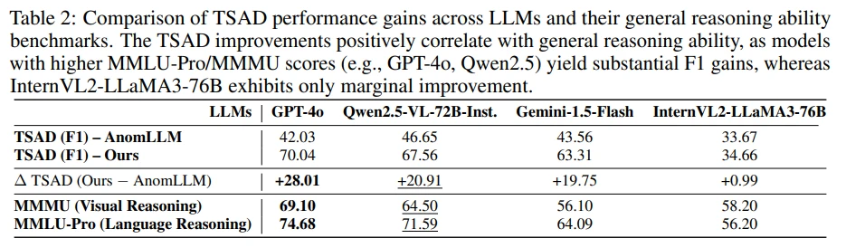

셋째 줄(Δ TSAD)이 이 논문의 방법을 적용해 늘어난 F1이고, 아래 두 줄이 일반 reasoning benchmark 점수다. 왼쪽 열일수록 향상 폭이 크다. 출처: 논문 Table 2

- 위 표를 보면, reasoning capability가 뛰어난 모델일수록 이 논문의 방법론을 적용했을 때 성능 향상 폭이 더 컸다. 두 benchmark 점수가 가장 높은 GPT-4o는 +28.01, 그다음인 Qwen2.5는 +20.91이고, MMLU-Pro가 가장 낮은 InternVL2는 +0.99에 그친다.
- 이러한 trend는 general reasoning ability가 뛰어날수록 더 효과적인 anomaly detection을 수행할 가능성이 높다는 것을 의미한다.

#### 4.2 In-depth analysis

**4.2.1 Ablation study**

제안된 방법론의 요소를 하나씩 빼 보는 실험이다.

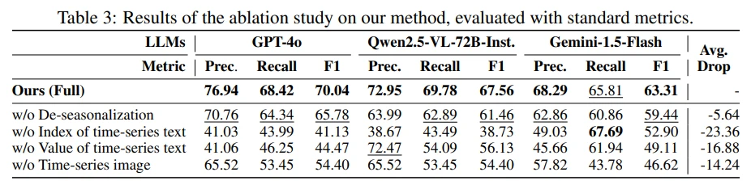

맨 오른쪽 "Avg. Drop"이 그 요소를 뺐을 때 세 모델의 F1이 평균 얼마나 떨어지는지다. Index를 뺀 줄이 −23.36으로 가장 크다. 출처: 논문 Table 3

- de-seasonalization을 제거하면 평균 5.64 %p의 F1 저하가 나타났다.
- index information을 제거할 때 −23.36 %p로 가장 큰 성능 하락이 나타났다.
    - 이는 LLM이 positional reasoning을 어려워하며, explicit indexing이 accurate localization에 큰 benefit을 준다고 해석할 수 있다.
- time-series의 value를 제거하거나(−16.88) time-series image를 제거할 때도(−14.24) 성능이 저하되었으며, 이는 각 modality가 상호 보완적인 역할을 한다고 볼 수 있다.

**4.2.2 Can LLMs perform time-series decomposition without external tool?**

- 두 가지 task를 통해, LLM이 decomposition을 수행할 수 있는지를 검증한다.
    - component의 존재 여부 탐지하기
    - 각 component의 sequence를 개별적으로 생성하기

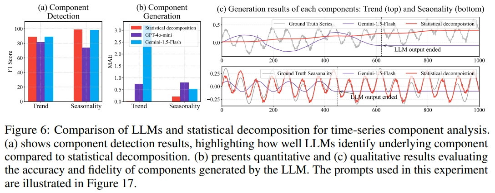

(a)는 성분이 있는지 알아맞히는 과제이고, (b)와 (c)는 그 성분을 수열로 직접 써 내는 과제다. (a)에서는 Gemini-1.5-Flash(하늘색)가 통계적 분해(빨강)와 비슷한 높이다. 그러나 (b)에서는 LLM의 오차가 훨씬 크고, (c)에서는 LLM의 출력(보라)이 정답(회색)을 따라가지 못한 채 중간에서 끊긴다("LLM output ended"). 출처: 논문 Figure 6

- 위 그림의 (a)를 보면, LLM은 statistical decomposition과 거의 유사한 성능으로, decomposed component가 time-series에 존재하는지를 탐지할 수 있었다.
- 그러나 이를 generation할 때는 매우 저조한 성능을 보였다((b), (c)). 이를 통해 decomposition을 수행하는 external tool이 필요함을 확인했다.
- 그럼에도 LLM이 decomposed component의 존재를 탐지하는 데는 성공했으므로, external decomposition tool을 언제 적용할지를 LLM이 결정하게 하는 것은 유의미할 것으로 보인다.

**4.2.3 Index-Free vs. Index-Aware**

- 기존 연구들에 따르면 input token이 길면 LLM의 performance가 떨어진다고 하며, 이 때문에 index-free prompt를 선호하는 연구들도 있다.
    - 이러한 이유로, index-free와 index-aware 방식을 GT-provided setting에서 비교한다.

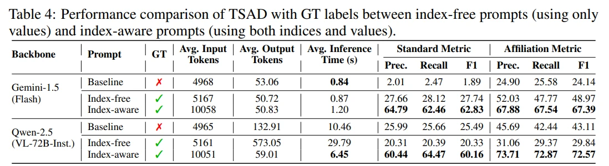

Index-free와 Index-aware 줄은 둘 다 정답 anomaly를 알려 준(GT ✓) 설정이고, 차이는 값에 index를 붙였느냐뿐이다. Input token은 약 5,100개에서 약 10,000개로 늘지만, F1은 Gemini에서 27.74 → 62.83, Qwen에서 20.33 → 60.16이 된다. 출처: 논문 Table 4

- 위 표를 보면, LLM은 index-free 상황에서 더 나쁜 성능을 보였다.
- index-aware prompt는 `(0, 0.3), (1, 0.5), …`처럼 값마다 index가 붙어 input token이 약 2배로 늘어나는데도, localization accuracy는 상승한 것이다.
- input length는 inference time에도 영향을 미치지만, 실질적으로 wall-clock latency를 좌우하는 것은 output token의 수이므로 큰 차이는 없다. Gemini의 평균 inference time은 0.87초에서 1.20초가 된다.
- 단, Qwen의 경우에는 index-free prompt가 때때로 verbose/rambling output을 생성하기도 했다(Appendix Figure 19).
    - 이 때문에 decoding length와 inference time이 상당히 늘어나기도 했다. 표에서 Qwen의 index-free 줄은 평균 output token이 573.05개, inference time이 29.79초로, index-aware(59.01개, 6.45초)보다 오히려 길다.
    - 논문은 원인을 정확히 분석하지는 못했으나, positional index가 없어서 model이 따라갈 수 있는 구조가 명확히 제시되지 못했기 때문일 수 있다고 본다.
- 결과적으로, index token을 추가하는 것은 input overhead가 매우 적으면서도 TSAD 성능을 향상할 수 있는 효과적인 방안이다.

### 5 Discussion and limitation

- 이 section에서는 TSAD를 위한 LLM의 practical value를 따져 본다.
- 이전의 LLM 기반 방법론들은 다음 두 가지를 주요한 benefit으로 든다.
    - zero-shot capability without domain-specific training
    - the ability to incorporate contextual information expressed in natural language
- 그러나 이러한 advantage들은 지금까지 non-LLM method와 충분히 비교되지 못했다.
- 따라서 이 논문은 LLM-based method와 non-LLM method를 비교하여, 이 장점들이 real-world scenario에서 실제로 어느 정도 성립하는지 분석한다.

#### 5.1 Comparison with conventional non-LLM TSAD methods

- TSB-AD-U benchmark를 사용해, conventional method와 LLM-based method의 accuracy와 inference time을 비교한다.
- LLM-based method와는 다르게, conventional method는 통상적으로 매 timestamp마다 anomaly score를 생성하고 그 수치에 thresholding을 적용해 anomaly 여부를 판단한다.
- 공정한 비교를 위해, anomaly label을 직접 예측하는 LLM-based method에 맞춰 모든 모델에 label-based evaluation metric을 적용한다.
- conventional model에 대해서는 percentile, MAD, EVT-POT을 모두 적용해 보고 가장 좋은 성능이 나오는 방법으로 보고했다.
- 실험에 드는 전체 cost를 줄이기 위해, TSB-AD-U benchmark에서 8개의 category를 선택하고 거기서 evaluation set을 골랐다. 이때 길이가 짧은 것 위주로 선택했다.

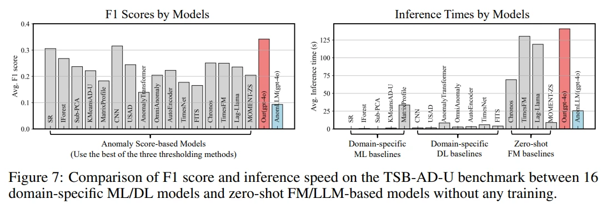

빨간 막대가 이 논문의 방법(GPT-4o), 하늘색 막대가 AnomLLM(GPT-4o), 회색 막대가 anomaly score를 내는 기존 모델 16개다. 왼쪽(F1)에서 빨간 막대가 가장 높고, 오른쪽(inference time)에서도 빨간 막대가 가장 높다. 가장 정확하지만 가장 느리다는 뜻이다. 출처: 논문 Figure 7

- 위 그림이 이 실험의 결과다. 결과는 정확도와 속도로 나누어 읽어야 한다.
    - 정확도: 이 논문의 LLM-based method가 conventional method들보다 높은, benchmark에서 가장 높은 평균 F1 score를 기록했다. domain-specific training 없이도 reasonable한 성능을 낸다는 것이다.
    - 속도: anomaly segment를 textual description으로 decoding하는 과정의 overhead 때문에 inference speed는 매우 느리다. 오른쪽 그림에서 ML/DL baseline은 막대가 바닥에 붙어 있고, 같은 zero-shot인 FM baseline(Chronos, TimesFM, Lag-Llama)도 느린 편이지만 이 논문의 방법은 그보다도 느리다.
- 이러한 속도의 한계는 real-world scenario, 특히 실시간 환경에 적용할 때의 bottleneck이 될 수 있다.

#### 5.2 Excluding known anomalies using context

- LLM-based method의 또 다른 advantage는 reasoning이 가능하다는 것이다.
- 이 논문은 LLM이 특정한 pattern의 anomaly를 선택적으로 찾지 않도록 할 수 있는지 확인했다.
- 이전 연구들은 context를 활용하여 predefined anomaly type을 찾아내는 데 집중했다.
- 하지만 이는 true anomaly detection이라기보다는 pattern recognition에 더 가깝다.
- 또한 real-world scenario는 이전에 보지 못한 unseen anomaly의 탐지를 요구하므로, 이미 알려진 패턴은 관심 대상이 아닐 수 있다.
- context를 알려진 anomaly를 찾는 데 쓰면 그러한 specific pattern 쪽으로 bias가 생길 수 있다. 그래서 이 논문은 context를 알려진 anomaly를 제외하는 데 쓴다.

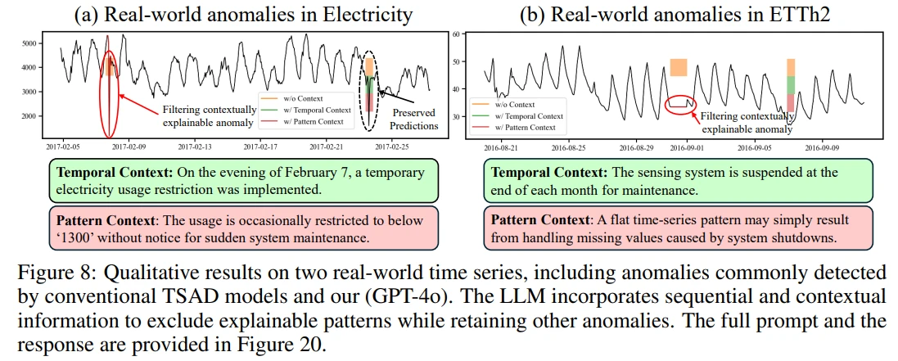

주황, 초록, 빨강 띠는 각각 context 없이, temporal context를 주고, pattern context를 주고 LLM이 anomaly라고 답한 구간이다. 빨간 타원으로 표시한 곳((a)의 급락, (b)의 평평한 구간)에는 주황 띠만 있고, 다른 anomaly에는 세 띠가 모두 남아 있다. 아래 상자가 실제로 준 context다. 출처: 논문 Figure 8

- 위 그림은 forecasting에 주로 사용되는 ECL, ETTh2 데이터에 대한 qualitative result를 보여 준다. 여기에 표시된 anomaly들은 conventional model이 흔히 찾아내는 것들이다.
- context가 제공되지 않으면(주황), LLM은 conventional model과 유사하게 동작하며 abrupt dip이나 flat pattern을 anomaly로 판단한다.
- 그러나 temporal context와 prior knowledge of expected time-series behavior가 제공되면, LLM은 explainable anomaly를 filter out할 수 있다.
    - (a)에서는 "2월 7일 저녁에 일시적인 전력 사용 제한이 있었다"(temporal context) 또는 "갑작스러운 시스템 점검으로 예고 없이 사용량이 1300 아래로 제한되는 일이 가끔 있다"(pattern context)는 한 문장을 주자 그 급락을 anomaly에서 뺐다.
    - (b)에서는 "매월 말에 점검을 위해 sensing system이 중단된다", "평평한 패턴은 system shutdown으로 생긴 결측값을 처리한 결과일 수 있다"는 문장으로 평평한 구간을 뺐다.
    - 두 경우 모두 context로 설명되지 않는 다른 anomaly는 그대로 남는다(그림의 "Preserved Predictions").
- 이는 LLM의 강력한 장점을 보여 준다.
    - LLM은 natural language context를 직접 inference에 반영할 수 있으며,
    - interpretable context-aware filtering을 별도의 rule-based system이나 low-level code 구현 없이도 수행할 수 있다.

### 6 Conclusion

- 이 논문은 LLM을 TSAD에 쓸 때 겪는 두 가지 challenge인 temporal understanding과 anomaly localization을 다뤘다. 이전 연구들이 performance에만 집중했던 것과 달리 failure mode를 분석하고, 이에 기반해 simple method를 제안했다.
- 이 방법은 statistical decomposition과 index-aware prompting을 결합한 것으로, 추가적인 training 없이도 성능을 크게 향상했고, 기존 LLM-based method뿐 아니라 conventional method보다도 좋은 성능을 보였다.
- 다만 LLM은 real-time setting에서 한계를 지닌다.
- 한편 LLM에 context를 주입하면 탐지할 anomaly를 더 정교하게 targeting할 수 있으며, 이는 LLM-based TSAD의 실용적 활용에 도움이 될 것으로 본다.

### Appendix

#### C Model details

**Our prompts.**

이 논문은 0shot-Text와 0shot-Text-Vision 두 가지 prompt로 테스트를 수행한다. 두 prompt는 거의 같고, 이미지를 함께 본다는 문구가 있느냐만 다르다.

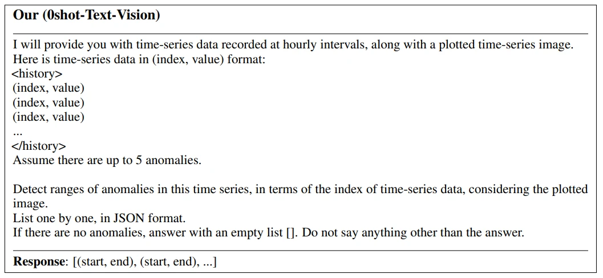

`<history>` 안에 시계열 전체가 (index, value)로 한 줄씩 들어가고, 응답은 `[(start, end), …]` 형식의 list다. 출처: 논문 Figure 13

- 0shot-Text-Vision의 주요 특징
    - time-series의 value를 (index, value) 형태로 넣어 준다.
    - 최대 5개의 anomaly가 존재한다고 설명한다("Assume there are up to 5 anomalies."). 이렇게 제시하는 이유는 데이터의 특징 때문인가?
    - 제시한 이미지를 고려하여 찾으라고 말한다("considering the plotted image").

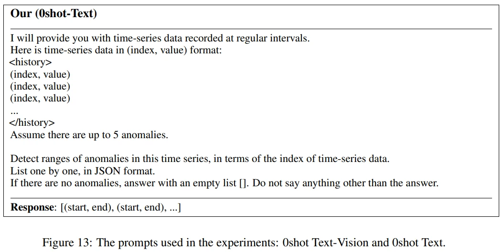

위 prompt에서 이미지에 관한 두 구절("along with a plotted time-series image", "considering the plotted image")만 빠져 있다. 출처: 논문 Figure 13

- 0shot-Text의 주요 특징
    - time-series의 value를 (index, value) 형태로 넣어 준다.
    - 여기서도 마찬가지로 최대 5개의 anomaly가 존재한다고 설명한다.
    - 이미지를 넣어 주지 않기 때문에, 이미지를 고려하여 찾으라는 말은 하지 않는다.

> 이와 같이 up to 5 anomalies라고 제한하는 것은, 모델이 (1) 과도하게 많은 interval을 hallucinate하지 않도록 하고, (2) JSON 응답 길이를 통제하며, (3) 검색해야 할 anomaly segment 수를 제한하는 역할을 한다고 보는 것이 자연스럽다.

#### D Experiment details

**D.5 Index-free vs Index-aware experiments in Section 4.2**

4.2.3절의 실험(정답 anomaly를 알려 주고 위치만 찾게 하는 실험)에 쓴 index-aware prompt의 예다.

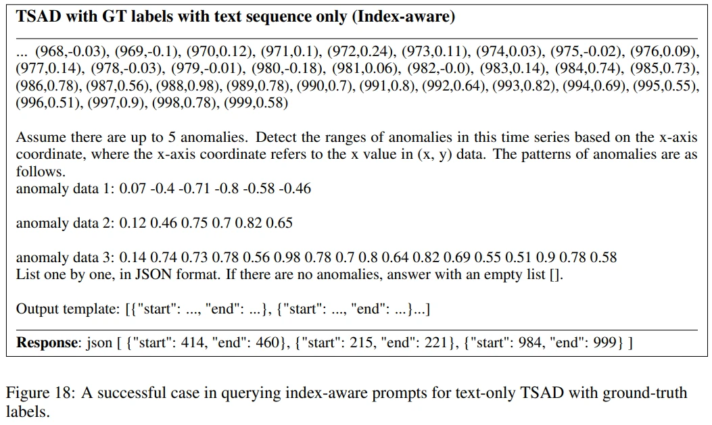

맨 위가 (index, value)로 적은 시계열의 끝부분이고, 가운데의 "anomaly data 1 ~ 3"이 정답 anomaly 구간의 값을 그대로 알려 주는 부분이다. anomaly data 3의 0.74, 0.73, 0.78, …은 위 텍스트의 (984, 0.74), (985, 0.73), (986, 0.78), …과 같은 값이고, 모델의 응답에도 984 ~ 999가 들어 있다. 출처: 논문 Figure 18

- prompt의 주요 특징
    - 최대 5개의 anomaly가 존재한다고 설명한다.
    - anomaly data에 대한 reference(anomaly에 해당하는 값의 나열)를 넣어 준다.
    - 값마다 index가 붙어 있으므로, 모델은 알려 준 값이 나오는 자리를 찾아 그 index를 읽기만 하면 된다. Index-free prompt에서는 같은 일을 하려면 값의 개수를 세어야 한다.

## 참고 자료

- Junwoo Park, Kyudan Jung, Dohyun Lee, Hyuck Lee, Daehoon Gwak, ChaeHun Park, Jaegul Choo, Jaewoong Cho. "Delving into Large Language Models for Effective Time-Series Anomaly Detection." NeurIPS 2025. [논문 페이지](https://proceedings.neurips.cc/paper_files/paper/2025/hash/950a34c7b107111570077078e1b5b8ef-Abstract-Conference.html), [코드](https://github.com/junwoopark92/LLM-TSAD)
- Z. Zhou, R. Yu. "Can LLMs Understand Time Series Anomalies?" ICLR 2025. (AnomLLM)
- J. Liu 외. "Large Language Models Can Deliver Accurate and Interpretable Time Series Anomaly Detection." 2024. [arXiv:2405.15370](https://arxiv.org/abs/2405.15370)
- X. Xu 외. "Can Multimodal LLMs Perform Time Series Anomaly Detection?" 2025. [arXiv:2502.17812](https://arxiv.org/abs/2502.17812) ([리뷰](2026-04-22-mllm-tsad-benchmark.md))
- Q. Liu, J. Paparrizos. "The Elephant in the Room: Towards a Reliable Time-Series Anomaly Detection Benchmark." NeurIPS 2024. (TSB-AD)
- M. Dong, H. Huang, L. Cao. "Can LLMs Serve As Time Series Anomaly Detectors?" 2024. [arXiv:2408.03475](https://arxiv.org/abs/2408.03475)
- S. Alnegheimish 외. "Large Language Models Can Be Zero-Shot Anomaly Detectors for Time Series?" 2024. [arXiv:2405.14755](https://arxiv.org/abs/2405.14755)
- A. Yang 외. "Refining Time Series Anomaly Detectors using Large Language Models." 2025. [arXiv:2503.21833](https://arxiv.org/abs/2503.21833)
