# Can Multimodal LLMs Perform Time Series Anomaly Detection? 리뷰

작성일 2026-04-22 · 최종 수정일 2026-04-24
{ .post-date }

Multimodal LLM(MLLM)이 time series anomaly detection(TSAD)을 수행할 수 있는지를 묻는 논문이다. 기존 연구는 point-wise anomaly를 range-wise anomaly의 특별한 경우로 보거나 point anomaly를 모아 range-wise 상황을 근사하는 식으로 둘을 구별하지 않았고, 그래서 multi-granular anomaly를 다루는 데 한계가 있고 irregular time series에 대처하기 어려웠다. 이 논문은 point-, range-, variate-wise anomaly와 irregular sampling 조건까지 평가하는 VisualTimeAnomaly benchmark로 MLLM을 평가하고, 그 결과를 바탕으로 scanning, planning, detection, checking을 자동으로 수행하는 TSAD-Agents framework를 제안한다.

논문의 그림과 표는 그 내용을 설명하는 자리에 함께 실었다.

## 1. Introduction

- LLM을 활용한 TSAD가 많은 인기를 얻고 있다. LLM의 zero-shot in-context learning 능력 덕분이다.
- LLM 기반 TSAD 연구는 time series의 numerical data를 text로 넣는다. 그러나 이것이 최선의 전략이 아닐 수 있다.
- 이전 연구들은 TSAD를 수행하는 과정에서 visualization을 활용했다.
    - 그러나 이들은 point-wise anomaly를 range-wise anomaly의 특별한 경우로 취급하거나, range-wise anomaly를 point-wise anomaly의 aggregation으로 취급했다.

    > 논문은 이 문제를 자세히 설명하지 않는다. 왜 이전 연구는 point-wise anomaly를 range-wise anomaly(seasonality, trend, shapelet)의 특별한 경우로 설정하거나, range-wise anomaly를 point-wise anomaly의 aggregation으로 보았는가? Appendix의 Related Work는 어느 연구가 어느 쪽인지만 밝힌다. Can LLMs Understand Time Series Anomalies?는 range-wise anomaly에 집중하면서 point anomaly를 특별한 경우로 보았고, TAMA는 point-wise anomaly에 집중하면서 range anomaly를 point의 모음으로 보았다는 것이다. 왜 그렇게 설정했는지는 해당 연구들을 읽어 봐야 알 수 있다.

- 현실의 시계열은 수집되는 과정에서 결측이 지속적으로 발생하며, 이런 상황에서 point-, range-, variate-wise anomaly가 발생할 수 있다.
- 또한 time series를 visualize하는 것의 장점은 연구되었으나, 그것이 근본적으로 왜 성능을 향상시키는지는 분석되지 않았다.

### Research Questions

- **RQ1**: Can MLLMs perform zero-shot multi-granular (point, range, and variate) time series anomaly detection?
    - point-wise anomaly 2종
    - range-wise anomaly 3종
    - variate-wise anomaly 4종
- **RQ2**: Can MLLMs detect irregular time series anomalies in a zero-shot setting?
    - 비율을 바꿔 가며 point를 무작위로 떨어뜨린다(point dropping).
- **RQ3**: Which input modality (text, image or hybrid) best supports time series anomaly detection with MLLMs?
    - controlled experiment로 확인한다.

이 질문들에 답하기 위해 논문은 VisualTimeAnomaly benchmark를 제안한다.

- anomaly granularity, irregularity ratio, series length, dimensionality를 다양하게 설정해 multimodal anomaly detection dataset을 생성할 수 있다.
- 논문의 실험은 VisualTimeAnomaly로 MLLMs를 평가한 것이다.

### Key Takeaways

- MLLMs와 traditional methods는 anomaly granularity에 대해 상호보완적이다.
    - MLLMs는 coarse-grained(range-, variate-wise) anomaly에 강하다.
    - Traditional methods는 fine-grained(point-wise) anomaly를 잡는 데 강하다.
- MLLMs는 time series를 image로 입력받아 qualitative하게 분석하므로 irregularity에 resilient하다.
    - 데이터의 25%가 결측된 상태에서도 탐지가 가능하다.
    - 반면 traditional methods는 이 조건을 다루기 어렵다.
- Input modality를 text가 아닌 image로 바꾸면 MLLM의 focus가 quantitative variation에서 qualitative pattern으로 옮겨 간다.
    - Input length가 크게 줄어들기 때문에 MLLM의 hallucination도 크게 감소한다.
- TSAD-Agents: multi-agent framework
    - MLLM과 traditional methods를 상호보완적으로 활용한다.
    - MLLM의 자체 역량을 활용해, 사람의 개입 없이 전 과정을 자동화한다.
    - Scanning Agent, Detection Agent, Planning Agent, Checking Agent로 구성된다.

## 2. VisualTimeAnomaly Benchmark

- sine, cosine 기반의 synthetic data에 point-wise, range-wise, variate-wise anomaly를 주입한다.
- 또한 UCR, UEA archive에서 univariate, multivariate dataset을 가져와 현실 세계의 사례를 평가한다.

### 2.1 Time Series Anomaly Definition

이 논문의 anomaly는 "얼마나 큰 단위가 이상한가"에 따라 세 층으로 나뉜다. 점 하나(point-wise), 연속된 구간(range-wise), 변수 하나 전체(variate-wise)다. 앞의 둘은 시계열 하나 안에서 정의된다.

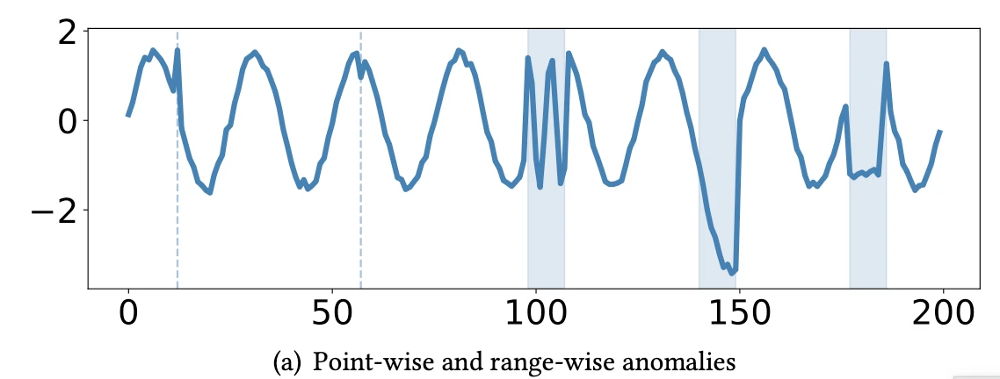{ width="640" }

세로 점선 두 개가 point-wise anomaly, 옅게 칠한 세 구간이 range-wise anomaly다. 100 부근의 구간은 진동이 갑자기 빨라지고, 140 ~ 150 구간은 아래로 쭉 내려가며, 180 부근의 구간은 파형이 평평한 모양으로 바뀐다. 차례로 아래 목록의 seasonality, trend, shapelet 변화에 해당하는 것으로 보인다. 출처: 논문 2.1절의 그림 (a)

논문이 다루는 point-wise, range-wise anomaly의 유형은 다음과 같다.

- global point-wise: 전체 시계열 단위에서 값의 범위를 벗어나며 나타나는 포인트 이상
- contextual point-wise: 전체 시계열을 기준으로 보면 값의 범위 안에 있지만 문맥적으로 나타나는 포인트 이상
- seasonality: frequency의 변화
- trend: trend의 변화
- shapelet: 시계열의 정상적인 패턴이 기존의 패턴과 확연히 다르게 나타나는 변화

#### Point-wise Anomaly

$$
|x_t - \hat{x}_t| > \delta
$$

- $x_t$는 시점 $t$의 값, $\hat{x}_t$는 그 시점에서 기대되는 값, $\delta$는 threshold다.
- 종류는 global anomaly와 contextual anomaly 두 가지다.

#### Range-wise Anomaly

$$
\text{diss}(\mathbf{x}_{i,j}, \hat{\mathbf{x}}_{i,j}) > \delta
$$

- seasonality, trend, shapelet의 변화로 발생하는 연속적인 이상 구간이다.
- $\mathbf{x}_{i,j}$는 subsequence, $\hat{\mathbf{x}}_{i,j}$는 expected subsequence, $\delta$는 threshold다.
- $\text{diss}$는 두 subsequence 사이의 dissimilarity를 계산하는 함수다(DTW 등을 쓴다).

#### Variate-wise Anomaly

$$
\text{diss}(G(x)_m, \hat{G}(x)_m) > \delta
$$

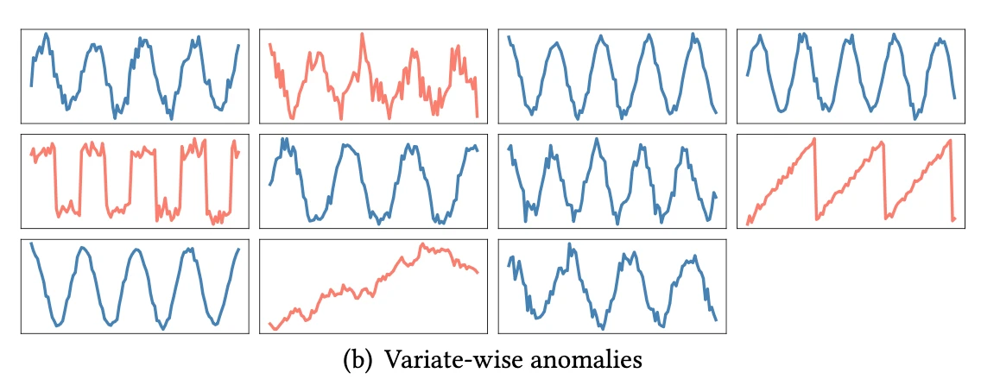{ width="640" }

칸 하나가 변수 하나다. 파란 칸들은 모두 비슷한 sine 파형이고, 주황색 네 칸만 모양이 다르다. 불규칙하게 흔들리는 파형, 사각파, 톱니파, 크게 한 번 올랐다 내려오는 파형으로, 아래에 적은 네 종류(random, square, sawtooth, triangle)를 하나씩 보여 주는 것으로 보인다. 출처: 논문 2.1절의 그림 (b)

- Variate-wise anomaly는 시계열 하나 전체가 이상인 경우로, multivariate time series 안에서 다른 시계열들과 확연히 다르게 나타나는 시계열을 뜻한다. 위 그림에서 주황색 칸 하나가 통째로 anomaly 하나다.
- 논문은 각 variate $m$이 특정한 generative function $G(x)_m$에 의해 생성된다고 가정한다.
- $\hat{G}(x)_m$은 expected generative function, 또는 모든 변수 가운데 다수를 차지하는 generative function이다(sine, cosine wave 등).
- $\text{diss}$는 두 univariate time series 사이의 dissimilarity를 계산하는 함수다.
- 종류는 triangle, square, sawtooth, random anomaly 네 가지다.

> 이 anomaly에 대해서는 의문이 있다. 이렇게 정의하면 사실상 변수들이 거의 비슷한 패턴을 보이는 시계열 데이터셋에서만 잡아낼 수 있는 anomaly가 아닌가?

#### Irregular Anomaly

- Irregular anomaly는 sampling interval이 non-uniform하거나 missing이 있는 univariate/multivariate time series에서 나타나는 anomaly를 뜻한다.
- 즉 anomaly의 정의는 앞의 것을 모두 그대로 유지한다. 다만 contextual anomaly에서 data point를 없애면 anomaly를 정의하는 데 필요한 temporal context가 왜곡될 수 있으므로, contextual anomaly는 제외한다.
- Irregularity ratio는 다음과 같이 정의한다. $T$는 원래 시계열의 point 수, $S$는 그중 관측된 point 수다.

$$
r = 1 - \frac{S}{T}
$$

### 2.2 Benchmark Setting

#### Datasets

- synthetic time series(sine/cosine)에 anomaly를 주입한다.
- univariate, multivariate sequence의 길이는 각각 400, 200으로 둔다. Multivariate 쪽은 dimension이 늘어난 만큼 길이를 줄인 것이다.
- real-world dataset도 추가한다.
    - UEA multivariate time series classification archive에서는 길이 144의 ArticularyWordRecognition 데이터셋을 가져와 다변량 이상 탐지에 쓴다.
    - UCR time series archive에서는 길이 398의 Symbols 데이터셋을 가져와 단변량 이상 탐지에 쓴다.
    - 두 데이터셋의 길이(398, 144)가 synthetic setting과 비슷해서 각각 univariate, multivariate로 설정한 것이다.
- anomaly type마다 서로 다른 noise로 100개의 이미지를 만들었고, 모든 실험은 이 100개의 이미지에 대해 세 번씩 수행했다.
- 기성(off-the-shelf) TSAD 데이터셋은 쓰지 않는다. 논문이 밝힌 근거는 두 가지다.
    - 실험에 쓰는 데이터셋은 특정한 anomaly type이 들어 있음을 알 수 있어야 한다.
    - 기존 public dataset은 label 품질이 매우 떨어지는 것으로 알려져 있다. 논문이 여기서 인용한 연구(Wu and Keogh, 2021)는 특히 Yahoo, Numenta, NASA, OMNI benchmark dataset을 배제해야 한다고 주장한다.

## 3. RQ1: Multi-Granular TSAD

- variate-wise anomaly를 point-, range-wise anomaly와 비교하는 것이 주요 목표다.
    - 전자는 multivariate, 후자는 univariate time series에서 나타난다.
- 길이 400인 univariate time series에 anomalous point 또는 길이 20의 range anomaly를 주입했다.
    - Q. anomalous point도 모두 20개가 들어간 것인가?
    - A. 논문 본문에는 point의 수가 따로 적혀 있지 않다. 다만 공개된 benchmark 생성 코드는 point-wise anomaly도 range-wise와 같은 비율 5%로 주입한다. 길이 400이면 20개 위치다(위치를 무작위로 뽑으므로 겹치면 그보다 적어질 수 있다).
- 같은 5% anomaly ratio를 유지하기 위해, variate-wise anomaly는 20-variate time series에 하나를 주입했다(20개 중 하나가 이상이면 5%다).
- real-world 실험에는 seasonality anomaly 결과가 따로 없다. 실험에 쓰인 real-world 데이터셋에 뚜렷한 seasonality가 없어서 반영하지 않은 것으로 보인다.

### Multi-Granular Detection Results

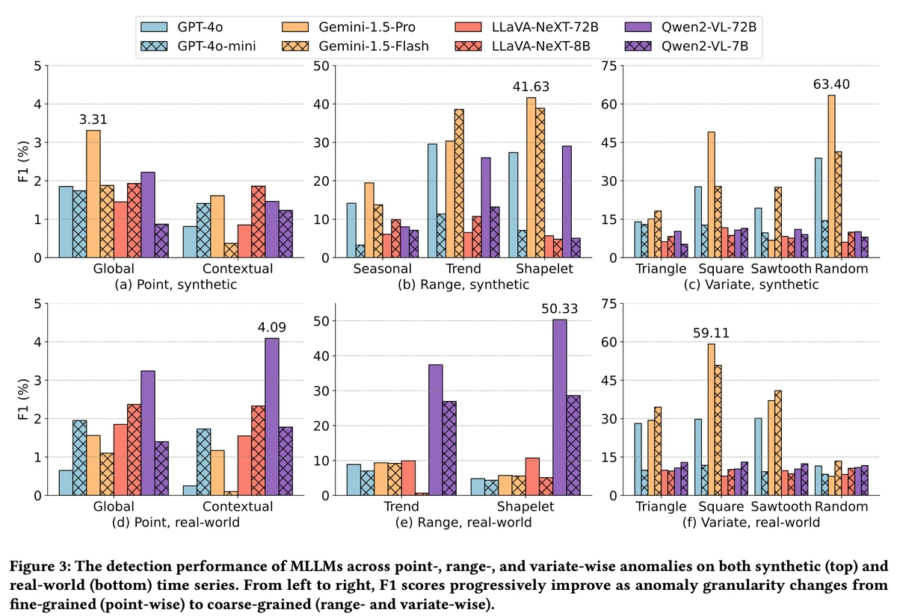

윗줄이 synthetic, 아랫줄이 real-world이고, 왼쪽부터 point, range, variate다. 세로축의 눈금이 칸마다 다르다는 점을 먼저 봐야 한다. Point는 0 ~ 5, range는 0 ~ 50, variate는 0 ~ 75다. 막대의 높이는 비슷해 보여도 왼쪽 칸의 점수는 오른쪽 칸의 10분의 1 수준이다. 출처: 논문 Figure 3

- MLLMs는 coarse-grained anomaly를 잡아내는 데 유리하다.
    - range-wise anomaly에 대한 max F1은 50.33(real-world shapelet), variate-wise anomaly에 대한 max F1은 63.40(synthetic random)이었다.
    - 그에 반해 point-wise anomaly에 대한 max F1은 4.09였다.
- 또 하나 중요한 점은 avg F1과 max F1의 결과가 매우 다르게 나온다는 것이다. 그림에서도 숫자가 붙은 가장 높은 막대 옆에 10 안팎의 낮은 막대가 여럿 서 있다. 논문은 이 차이를 공개하는 것을 꺼리지 않는 것으로 보인다.
- 아랫줄 가운데 칸(range, real-world)에는 seasonal이 없고 trend와 shapelet만 있다. 앞에서 적은 대로다.

> 이 실험에서는 image만 주고 prompt는 매우 간단하게 준 것인가? 3절 본문에는 이에 대한 설명이 빠져 있다. Appendix C에 prompt 예시가 실려 있는데, point-wise의 경우 "Detect points of anomalies in this time series, in terms of the x-axis coordinate."라는 지시에 출력 형식의 예시와 anomaly가 없을 때의 답(빈 list)을 덧붙인 정도로 간단하다. Range-wise는 구간의 list를, variate-wise는 이상인 univariate time series의 ID list를 답하게 한다. 세 prompt의 실제 모습은 글 끝의 Appendix에 실었다.

### Comparison with Traditional TSAD Methods

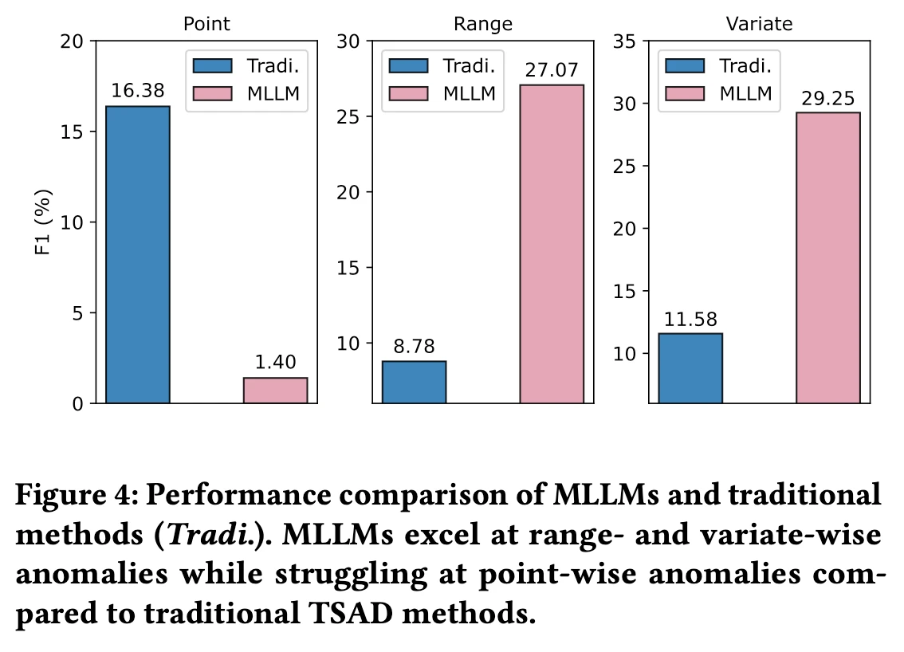{ width="560" }

파란 막대가 traditional method, 분홍 막대가 MLLM이다. Point에서는 파란 막대가 훨씬 높고(16.38 대 1.40), range와 variate에서는 분홍 막대가 훨씬 높다(27.07 대 8.78, 29.25 대 11.58). 출처: 논문 Figure 4

- Traditional methods와 MLLMs의 성능을 비교한 위 그림을 보면, 둘은 anomaly granularity에 대해 상호보완적인 관계다. 한쪽이 못하는 곳을 다른 쪽이 잘한다.
- 이는 MLLMs의 numerical reasoning ability가 부족하기 때문이다. 9.11 > 9.9라고 답하는 사례가 대표적이다.
    - 따라서 MLLMs를 point-wise change를 잡는 데 쓰는 것은 부적절하다.

## 4. RQ2: Irregular TSAD

- irregularity ratio $r$을 0%에서 25%까지 5%씩 늘려 가며 실험한다.
- global(point-wise), trend(range-wise), random(variate-wise) 세 가지 anomaly에 집중한다.

### Irregular Detection Results

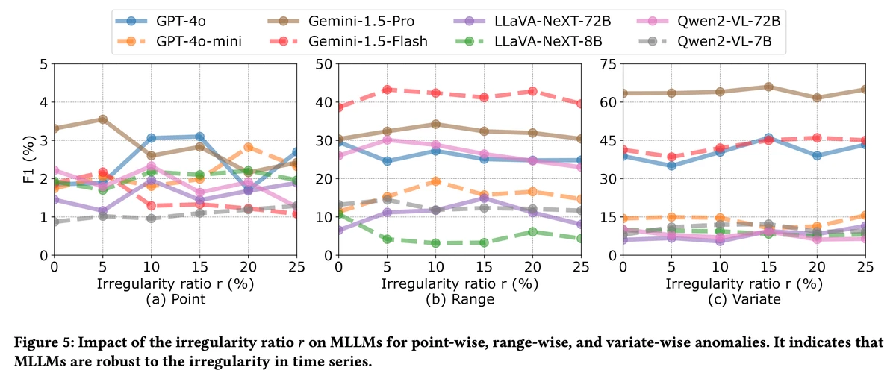

가로축이 떨어뜨린 point의 비율이다. 오른쪽으로 갈수록 데이터가 더 많이 빠지는데도 선들이 거의 수평이다. 출처: 논문 Figure 5

- MLLMs는 irregularity에 대해 robust하다. Point의 4분의 1을 지워도 range와 variate의 F1은 거의 그대로다.
- 반면 fine-grained anomaly에는 여전히 취약하다. (a) Point의 세로축은 이번에도 0 ~ 5다.

### Comparison with Traditional TSAD Methods

- Classic TSAD baseline들은 통상 regularly sampled data를 가정한다.
- 이 때문에 OCSVM이나 TranAD 같은 모델은 runtime error가 발생하므로, compatibility를 위해 mean imputation을 적용한다.

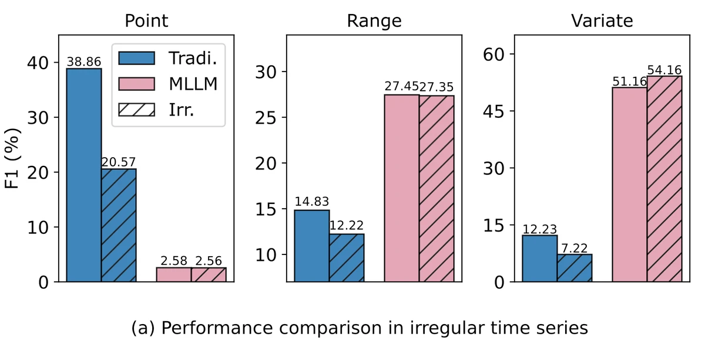{ width="640" }

민무늬 막대가 regular, 빗금 막대가 irregular 조건이다. 파란 막대(traditional)는 빗금 쪽이 눈에 띄게 낮아지고(point에서 38.86 → 20.57), 분홍 막대(MLLM)는 두 막대의 높이가 거의 같다. 출처: 논문 Figure 6(a)

- 결과적으로 traditional methods는 irregularity에 취약한 반면, MLLMs는 강건한 성능을 보였다.

왜 이런 차이가 나는지는 두 방법이 "빠진 값"을 어떻게 보게 되는지를 그려 보면 알 수 있다.

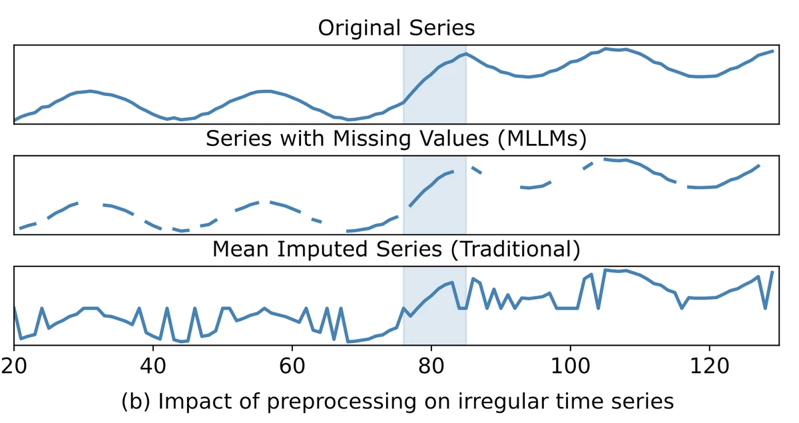{ width="640" }

맨 위가 원래 시계열(칠한 구간이 anomaly), 가운데가 MLLM이 보는 그림, 맨 아래가 traditional method가 받는 입력이다. 가운데 그림은 선이 군데군데 끊겼을 뿐 전체 모양이 남아 있고, 맨 아래는 빠진 자리마다 평균값이 채워져 원래 없던 뾰족한 요철이 생겼다. 출처: 논문 Figure 6(b)

- MLLM이 쓰는 visualization-based approach는 missing value를 blank region으로 나타내므로, imputation 때문에 생기는 distortion을 피한다.
- 이를 통해 trend, shapelet 같은 핵심적인 구조적 특성(critical structural features)을 보존할 수 있다.

### Origin of Resilience

- MLLMs가 irregular sampling에 강건하기는 하지만, 그 강건함이 visualization에서 오는지 LLM의 reasoning에서 오는지는 여전히 알 수 없다. 이 논문은 이를 확인하기 위해 다음 세 조건을 실험한다.
    - (C1) visualization alone (w/o LLMs)
    - (C2) LLMs alone (w/o visualization)
    - (C3) combination of both visualization and LLMs

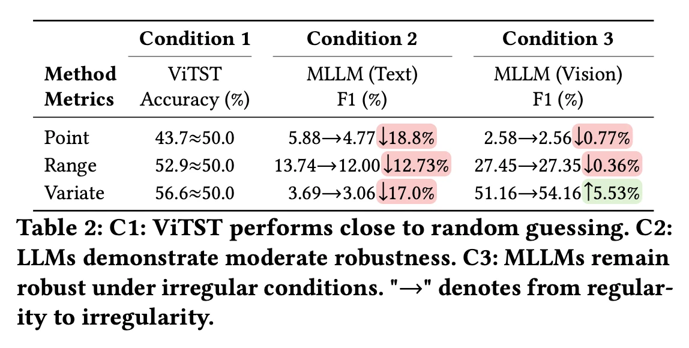{ width="640" }

"→"의 왼쪽이 regular, 오른쪽이 irregular 조건의 점수다. C1은 정확도가 50% 근처이고, C2는 F1이 12 ~ 19% 떨어지며, C3는 1% 미만으로 떨어지거나 오히려 오른다. 출처: 논문 Table 2

- **C1**: irregular time series classification에 뛰어난 성능을 보이는 pre-trained vision Transformer인 ViTST를 사용한다.
    - 태스크를 단순화하기 위해 문제를 binary classification으로 바꾼다.
    - 실험 결과 ViTST는 random guessing에 가까운 성능을 보였다. Visualization 하나만으로는 irregular condition에서 효과를 보기 어렵다는 뜻이다.
- **C2**: 시계열을 text로 주면서 missing point를 "NaN" token으로 두고, prompt에서 이를 설명한다.
    - 실험 결과 LLM만 사용하더라도 어느 정도 안정적인 성능(robustness)이 나타났다. 다만 표의 C2 열처럼 세 anomaly 모두에서 F1이 10% 넘게 떨어진다.
- **C3**: visualization과 LLM을 함께 쓰는 조건, 즉 MLLM에 이미지를 입력하는 조건이다. Irregular data에서도 매우 안정적인 성능을 보였고, 이를 통해 visualization과 LLM의 reasoning을 결합할 때 irregularity에 가장 강건하다는 것을 확인했다.

## 5. RQ3: Input Modality in TSAD

- text, vision, 그리고 둘의 조합(T+V)을 입력으로 주는 실험이다.

### Input Modality on Performance

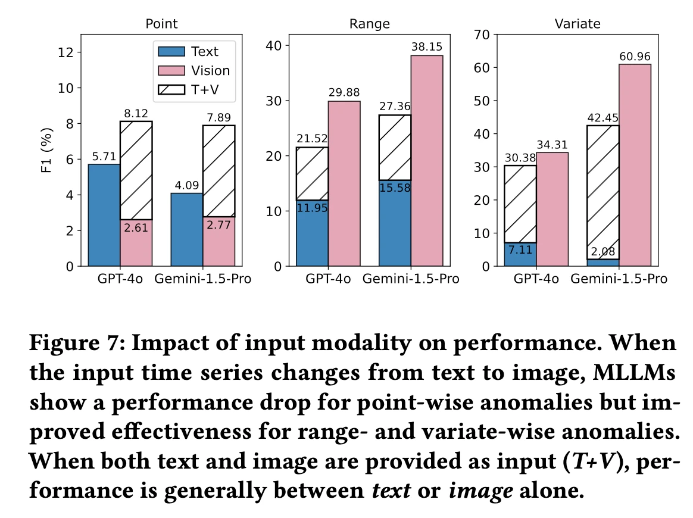{ width="640" }

파랑이 text, 분홍이 vision, 빗금이 둘을 함께 준 T+V다. Point에서는 text(5.71, 4.09)가 vision(2.61, 2.77)보다 높고, range와 variate에서는 반대로 vision이 가장 높다. Variate에서 Gemini-1.5-Pro는 text 2.08, vision 60.96이다. 출처: 논문 Figure 7

- Input을 text에서 visual로 바꾸면 point anomaly에 대해서는 performance drop이 발생한다.
- 그러나 range-, variate-wise anomaly에 대해서는 성능이 좋아진다.
- 이를 통해 text는 quantitative variation을 강조하고, image는 qualitative pattern을 강조함을 알 수 있다. 값 하나가 튀는 것은 숫자로 볼 때, 모양이 달라지는 것은 그림으로 볼 때 잘 보인다는 뜻이다.
- Text와 vision을 함께 줄 때, point-wise anomaly에 대해서는 best performance가 나타났다(8.12, 7.89. 상호보완적 효과 때문이다).
- 그러나 range-, variate-wise anomaly에서는 visual modality만 사용하는 것이 성능이 더 좋았다. T+V는 text와 vision의 사이에 놓인다.
- 이러한 차이는 LLM의 long-context learning challenge 때문일 수 있다.
- Univariate time series는 길이가 400일 뿐이지만, multivariate time series는 20×200까지 데이터가 늘어난다.
    - 그러므로 text만 사용하면 데이터가 너무 많아 F1이 자연히 줄어들 수밖에 없다.

### Input Modality on Hallucinations

- 작은 모델일수록 hallucination을 보일 가능성이 높으며, input modality가 이에 영향을 미친다.

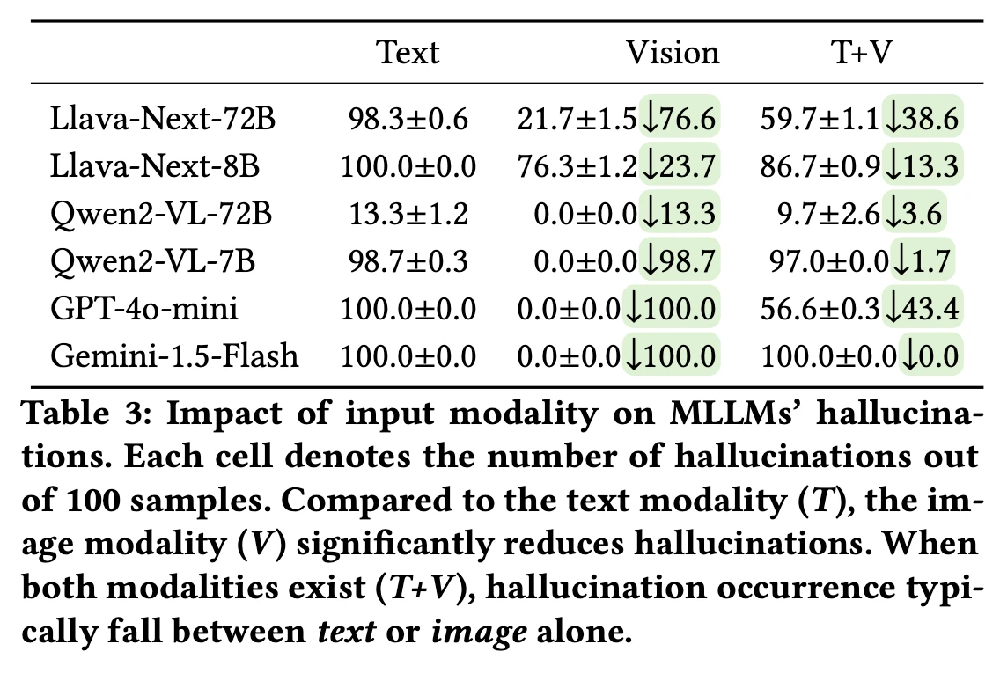{ width="640" }

Text 열은 Qwen2-VL-72B를 빼면 거의 100이다. 샘플마다 hallucination이 나온다는 뜻이다. Vision 열에서는 네 모델이 0이 된다. 초록 칸은 text 대비 줄어든 횟수다. 출처: 논문 Table 3

- 위 표는 MLLM에서 hallucination이 발생하는 빈도를 보여 준다. 표의 각 셀은 100개의 샘플 가운데 hallucination이 발생한 횟수다.
    - 실험을 통해 vision input modality가 hallucination을 유의미하게 줄임을 알 수 있다.
- 이러한 hallucination이 발생하는 원인은 text input의 길이다.
    - T+V가 vision만 쓸 때보다 hallucination을 줄이지 못한다는 점에서 이를 확인할 수 있다. T+V 열에서 Gemini-1.5-Flash는 100.0, Qwen2-VL-7B는 97.0으로 text만 줄 때와 거의 같다. 이미지를 더해 주어도 긴 text가 입력에 남아 있으면 소용이 없다는 것이다.

## 6. TSAD-Agents

- MLLMs는 fine-grained anomaly를 찾아내는 데 어려움을 겪는다(Key Insight).
- Reasoning, planning, self-reflection, tool-use capability 같은 MLLM 고유의 역량을 활용해, 앞에서 찾아낸 Key Insight를 체계적으로 자동화해 이용하는 시스템이 TSAD-Agents다. 논문은 이를 motivation, architectural design, experimental evaluation의 순서로 설명한다.
- TSAD-Agents는 point-, range-wise anomaly를 대상으로 한다. Variate-wise anomaly는 MLLM이 이미 충분히 잘 잡아내기 때문이다.

### 6.1 Motivation

- Traditional TSAD methods와 달리, 어떠한 prior assumption도 없이 automatic TSAD를 수행하는 TSAD-Agents를 제안한다.
- TSAD-Agents는 다양한 anomaly form을 적응적으로 처리하고, missing data는 MLLM으로 처리해 강건한 성능을 보일 수 있다.
- 이 framework의 목표는 anomaly type을 사람이 직접 고를 필요를 없애는 것이다.

### 6.2 Architecture

네 agent가 scanning, planning, detection, checking을 차례로 맡는다. 아래 그림은 range anomaly가 하나 들어 있는 시계열이 네 agent를 거쳐 가는 예시다.

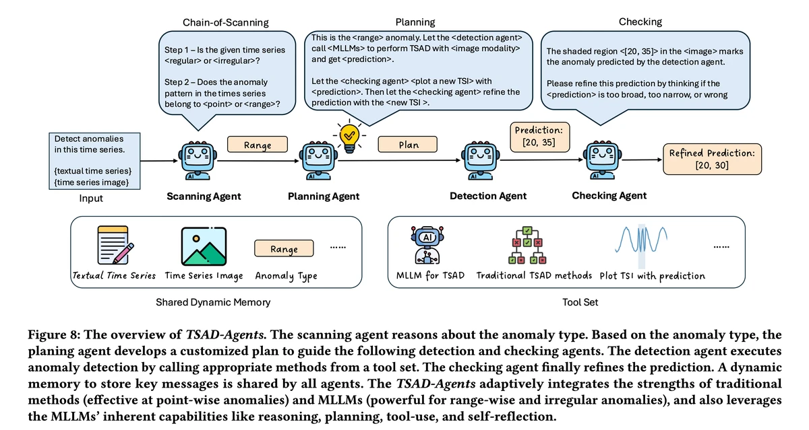

가운데 줄을 왼쪽에서 오른쪽으로 읽는다. Agent 사이의 주황 상자가 다음 agent에게 넘어가는 결과물(anomaly type "Range" → Plan → Prediction [20, 35] → Refined Prediction [20, 30])이고, 위의 말풍선이 각 단계에서 실제로 오가는 지시문이다. 아래의 두 상자는 모든 agent가 함께 쓰는 메모리와 도구다. 출처: 논문 Figure 8

#### Scanning Agent

- 세부적인 탐지를 수행하기 전에, input time series에 포함된 anomaly type을 찾아내는 역할이다.
- Chain-of-Scanning(CoS): agent가 anomaly를 step by step으로, 계층적으로 판별하게 만드는 방식이다.
    1. Determine if the time series is regular or irregular.
    2. Determine if potential anomalies are point- or range-wise.
- 이를 통해 agent는 anomaly를 point, range, irr-point, irr-range 네 가지 카테고리로 나눈다. 그림의 예에서는 "Range"라는 답이 나와 공유 메모리의 Anomaly Type에 적힌다.
- 그 결과 anomaly type에 대한 human assumption 없이, 지금 탐지해야 할 anomaly의 종류를 파악한다.

> 좋은 방식이기는 하다. 그런데 이 framework가 여러 anomaly가 결합되어 있는 시계열에서도 효과적으로 동작할지는 의문이다.

#### Planning Agent

- Detection Agent와 Checking Agent에게 지시를 내리기 위한 tailored plan을 만든다.
- Anomaly type별 method 구성은 다음과 같다.
    - Point: traditional methods (text modality) for detection; hybrid modality for checking.
    - Range: MLLMs (image modality) for detection and checking.
    - Irr-Point: traditional methods (text modality) for detection; hybrid modality for checking.
    - Irr-Range: MLLMs (image modality) for detection and checking.
- 앞의 실험 결과가 그대로 규칙이 된 것이다. Point는 traditional method가 잘하므로 그쪽에 맡기고, range는 MLLM이 이미지로 볼 때 잘하므로 그쪽에 맡긴다. 그림의 Planning 말풍선이 range일 때의 plan이다. Detection agent에게는 MLLM을 image modality로 부르게 하고, checking agent에게는 prediction을 표시한 새 TSI를 그려 다듬게 한다.

#### Detection Agent

- 지정된 anomaly detection tool을 활용해 anomaly detection을 수행한다.
    - 예: traditional TSAD method로는 iForest, MLLM-based detector로는 Gemini

#### Checking Agent

- MLLMs를 통해 prediction 결과의 validity를 확인한다.
- Prediction을 표시해 보여 줄 적절한 tool을 고른다. Textual series로 보여 주거나, TSI(time series image) plot으로 보여 준다.
- 이를 바탕으로 해당 prediction이 잘못되지는 않았는지 검사하고, prediction을 최종적으로 refine한다.
    - 그림의 예에서는 detection agent가 답한 구간 [20, 35]를 이미지에 칠해 보여 주고, 이 구간이 너무 넓은지, 너무 좁은지, 틀렸는지를 다시 생각해 보게 한다. 그 결과 [20, 30]으로 좁혀진다.

### 6.3 Experimental Results and Ablation Study

- TSAD-Agents의 성능을 실험한다. Tool로는 iForest와 Gemini 기반 detection method를 쓴다.
- 모든 agent는 LangChain framework로 만들어졌으며 Gemini를 활용한다.
- LLM 기반 approach인 LLMAD, SIGLLM, TAMA도 baseline에 추가한다.

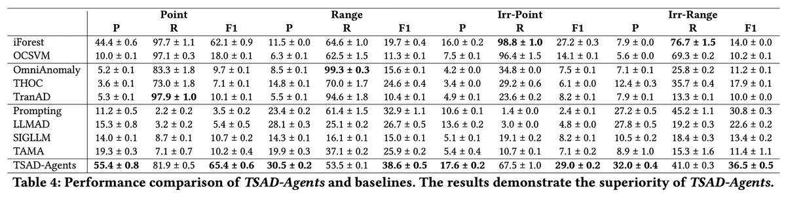

위에서부터 traditional method 5종, LLM 기반 method 4종, 맨 아래가 TSAD-Agents다. 네 조건의 F1 열에서 모두 맨 아랫줄이 굵은 글씨다(65.4, 38.6, 29.0, 36.5). 출처: 논문 Table 4

- 결과를 보면 TSAD-Agents가 일관되게 가장 높은 성능을 보인다.
    - 표를 조건별로 보면 baseline은 한쪽에서만 강하다. iForest는 Point F1이 62.1이지만 Range에서는 19.7이고, MLLM에 바로 묻는 Prompting은 Range F1이 32.9이지만 Point에서는 3.5다. TSAD-Agents는 조건에 맞는 쪽을 골라 쓰므로 양쪽에서 모두 높다.

> 여기에도 VLM 기반 모델을 넣지 않은 것을 보면, VLM으로 multivariate TSAD를 다루는 전략이 아직 많지 않은 것 아닐까?

#### Ablation Study

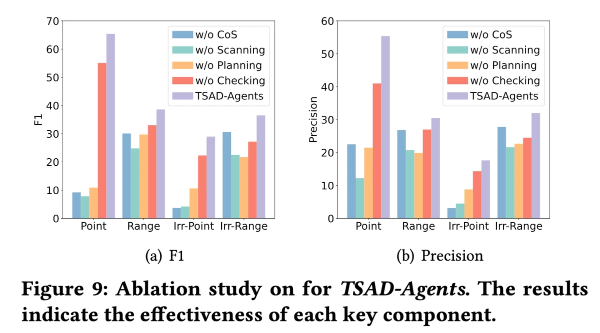{ width="640" }

조건마다 맨 오른쪽 연보라 막대가 전체 TSAD-Agents이고, 나머지 넷이 요소를 하나씩 뺀 경우다. 어느 조건에서나 연보라 막대가 가장 높다. Point에서는 CoS, Scanning, Planning 가운데 하나만 빠져도 F1이 10 안팎으로 떨어진다. 출처: 논문 Figure 9

- Ablation study를 통해 Chain-of-Scanning(scanning은 하되 CoS는 수행하지 않는 경우와 비교), Scanning, Planning, Checking이 모두 중요함을 보인다.

## 7. Conclusion and Future Work

- Future work로는 time series를 raw image가 아닌 다른 방식으로 표현하는 방법과, 이를 통해 MLLM의 hallucination을 효과적으로 줄이는 방안을 든다.

## Appendix

### Prompt 예시

3절의 질문에서 언급한 prompt들이다. 세 경우 모두 이미지 한 장과 짧은 지시문, 그리고 출력 형식의 예시로 이루어져 있다.

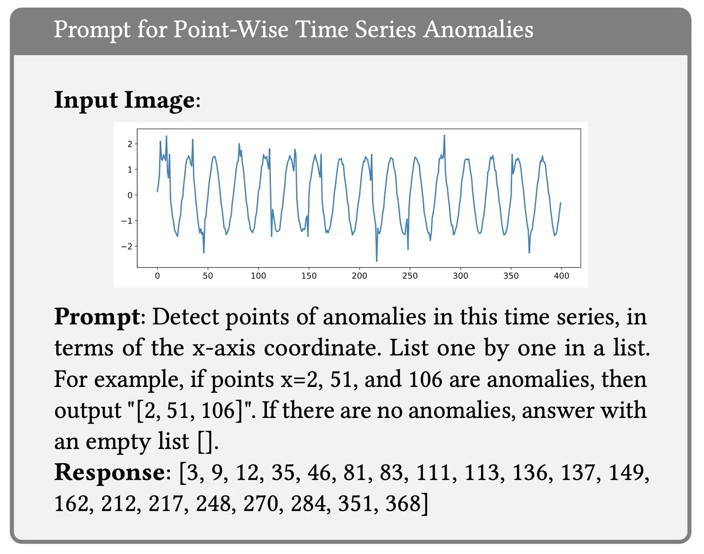{ width="560" }

이상인 점의 x축 좌표를 list로 답하게 한다. 출처: 논문 Appendix의 prompt 예시

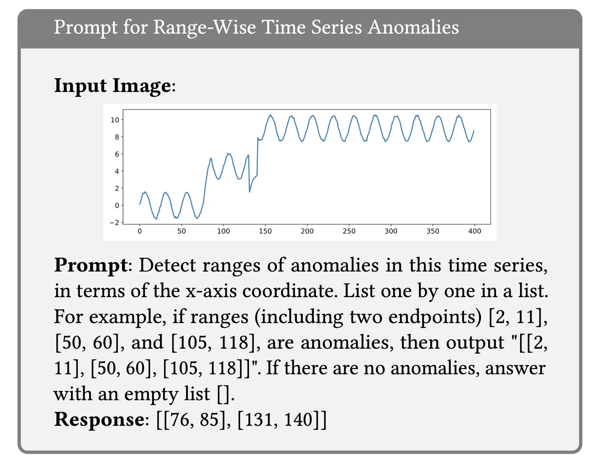{ width="560" }

이상인 구간을 양 끝점의 쌍으로 답하게 한다. 이 예에서 응답은 값의 수준이 급히 바뀌는 두 구간 [76, 85], [131, 140]이다. 출처: 논문 Appendix의 prompt 예시

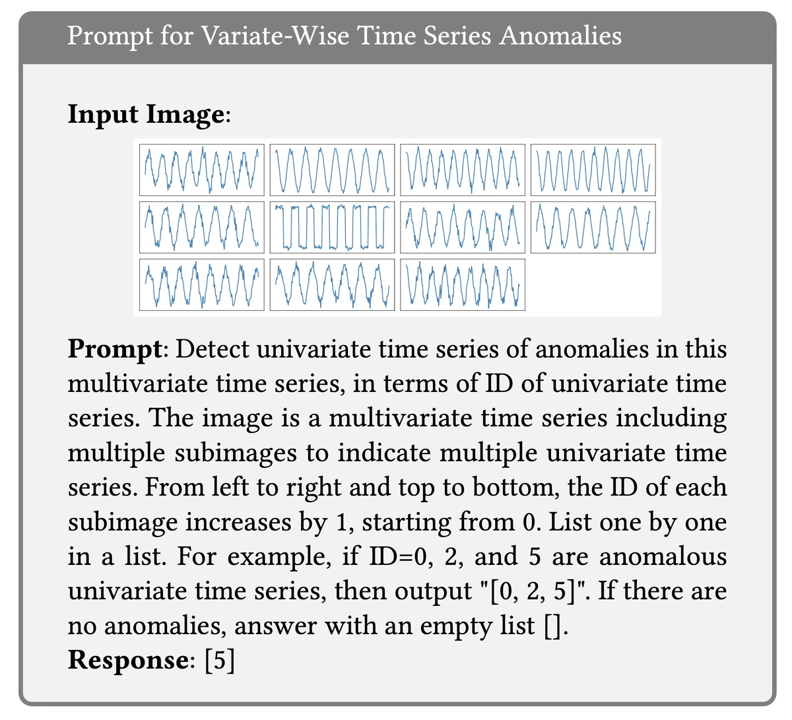{ width="560" }

변수마다 칸 하나씩을 그린 이미지를 주고, 왼쪽 위부터 0번으로 세어 이상인 칸의 ID를 답하게 한다. 이 예에서는 사각파가 그려진 5번 칸이 답이다. 출처: 논문 Appendix의 prompt 예시

### 차원 수에 따른 성능

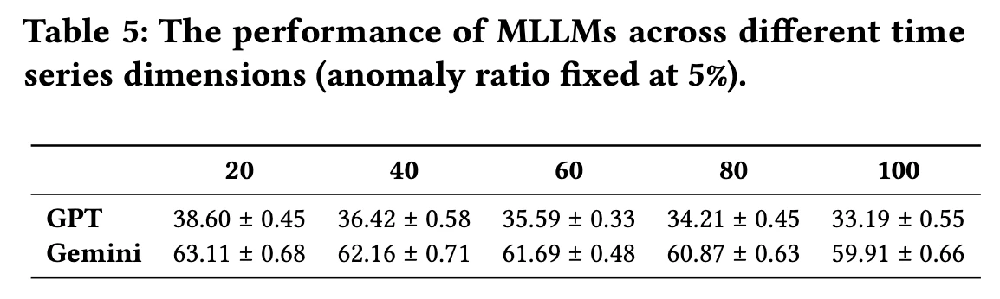{ width="560" }

차원이 20에서 100으로 늘면 GPT는 38.60에서 33.19로, Gemini는 63.11에서 59.91로 내려간다. 출처: 논문 Table 5

- 고차원 time series 이미지를 변수 일부씩만 담은 여러 장의 이미지로 나누어(예: 100차원을 20차원 이미지 5장으로) 20, 40, …, 100차원에서 TSAD를 수행한 결과가 실려 있다.
- Dimension을 늘릴수록 성능이 하락함을 볼 수 있다. 다만 하락 폭은 완만하다.

## 관련 글

- [Harnessing Vision-Language Models for Time Series Anomaly Detection 리뷰](2026-01-22-vlm4ts.md)
- [Delving into Large Language Models for Effective Time-Series Anomaly Detection 리뷰](2026-03-23-llm-tsad-delving.md)

## 참고 자료

- Xiongxiao Xu, Haoran Wang, Yueqing Liang, Philip S. Yu, Yue Zhao, Kai Shu. "Can Multimodal LLMs Perform Time Series Anomaly Detection?" WWW 2026 (Proceedings of the ACM Web Conference 2026). [arXiv:2502.17812](https://arxiv.org/abs/2502.17812)
- VisualTimeAnomaly benchmark 코드: [github.com/mllm-ts/VisualTimeAnomaly](https://github.com/mllm-ts/VisualTimeAnomaly)
