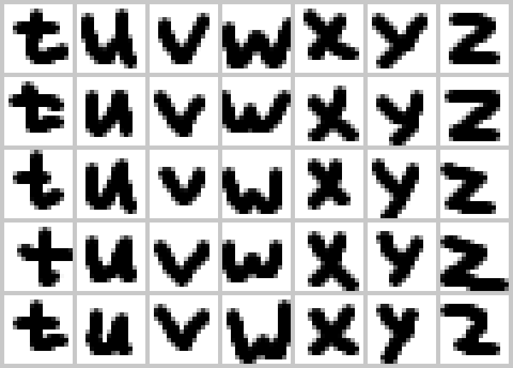
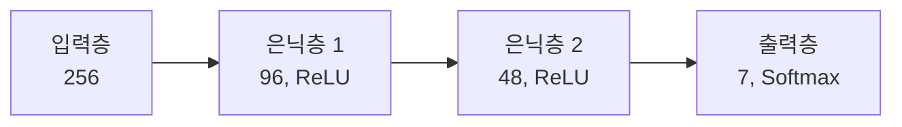

# 손글씨 알파벳 분류기: 라이브러리 없이 MLP 구현하기

작성일 2023-12-18
{ .post-date }

인공지능 수업의 첫 번째 과제로 만든 손글씨 분류기를 기록하고자 한다. 직접 쓴 알파벳 이미지를 학습해 어떤 글자인지 맞히는 모델이며, NumPy나 딥러닝 프레임워크 없이 순전파와 역전파를 직접 구현했다. 같은 모델을 Python으로 먼저 만들고, 이어서 C로 옮겼다.

| 항목 | 내용 |
|---|---|
| 시기 | 2023년 12월 (3학년 2학기 인공지능 수업, 과제 1번) |
| 형태 | 개인 과제 |
| 언어 | Python (표준 라이브러리와 이미지 읽기용 PIL), C (표준 라이브러리) |
| 자료 | [Python 저장소](https://github.com/Ignis-Gallon/A-Simple-Hand-written-Classifier-in-Python), [C 저장소](https://github.com/Ignis-Gallon/A-Simple-Hand-written-Classifier-in-C) |

## 과제와 데이터

과제의 목표는 자신이 만든 손글씨 이미지를 학습해 인식하는 모델을 만드는 것이다. 대상 글자는 t, u, v, w, x, y, z 일곱 개다.

데이터는 16 x 16 크기의 회색조 이미지로 직접 만들었다. 학습용은 글자마다 60장씩 420장, 테스트용은 글자마다 20장씩 140장이다.

{ width="420" }

이미지 한 장은 픽셀 256개를 한 줄로 편 벡터로 다룬다. 픽셀 값은 0 ~ 255 범위이므로 255로 나눠 0 ~ 1 사이로 맞췄다. 값이 크면 가중치와 곱한 결과도 커져서 학습이 불안정해지기 때문이다. 정답은 길이 7의 one-hot 벡터로 만든다. 예를 들어 u는 `[0, 1, 0, 0, 0, 0, 0]`이다.

## 모델 구조

완전연결 계층 네 개로 이루어진 다층 퍼셉트론이다.



각 계층은 다음 두 단계를 거친다.

$$
z^{[l]} = W^{[l]} a^{[l-1]} + b^{[l]}, \qquad a^{[l]} = g^{[l]}(z^{[l]})
$$

은닉층의 활성화 함수 $g$는 ReLU, 출력층은 Softmax다. 출력은 합이 1인 길이 7의 벡터가 되고, 값이 가장 큰 자리가 예측한 글자다.

계층 수, 계층별 노드 수, 학습률, epoch 수는 한곳에 모아 두어서 값을 바꿔 가며 실험할 수 있게 했다.

## 역전파

출력층에 Softmax를, 손실 함수로 교차 엔트로피를 쓰면 출력층의 기울기가 간단해진다.

$$
dZ^{[L]} = a^{[L]} - y
$$

나머지는 연쇄 법칙을 따라 출력층에서 입력층 쪽으로 내려가며 구한다. 계층 하나에서 하는 계산은 세 가지다.

$$
dW^{[l]} = dZ^{[l]} \, {a^{[l-1]}}^{\top}, \qquad
db^{[l]} = dZ^{[l]}, \qquad
dA^{[l-1]} = {W^{[l]}}^{\top} dZ^{[l]}
$$

은닉층의 $dZ$는 위 계층에서 받은 $dA$에 ReLU의 미분을 곱해 얻는다. ReLU의 미분은 순전파 때의 $z$가 음수면 0, 아니면 1로 두었다.

$$
dZ^{[l]} = dA^{[l]} \odot \mathbb{1}\left[z^{[l]} \ge 0\right]
$$

이 계산에는 순전파 때의 $z^{[l]}$와 $a^{[l-1]}$이 필요하다. 그래서 순전파를 하면서 두 값을 계층마다 저장해 두고(cache), 역전파에서 꺼내 쓴다.

코드에서는 이 계산을 함수 하나씩으로 나눴다.

| 함수 | 역할 |
|---|---|
| `calc_output_layer_dZ` | 출력층의 $dZ = a - y$ |
| `calc_hidden_layer_dZ` | 은닉층의 $dZ$ (ReLU 미분 적용) |
| `calc_dW`, `calc_db` | 가중치와 편향의 기울기 |
| `calc_dA_prev` | 아래 계층으로 넘길 $dA$ |
| `backward_pass` | 출력층에서 시작해 위 함수들을 계층 순서대로 호출 |

## 초기화와 학습 방식

가중치는 평균이 0인 정규분포에서 뽑는다. 표준편차는 계층의 활성화 함수에 맞춰 정했다.

| 계층 | 표준편차 | 비고 |
|---|---|---|
| 은닉층 (ReLU) | $\sqrt{2 / n_{in}}$ | He 초기화 |
| 출력층 (Softmax) | $\sqrt{1 / n_{in}}$ | 참고한 교재는 Xavier 초기화라고 불렀지만 실제로는 LeCun 방식이다 |

편향은 모두 0으로 시작한다.

학습은 배치 경사하강법이다. 예시 하나마다 순전파와 역전파를 수행해 기울기를 계층에 누적하고, 420장을 모두 돈 뒤 누적한 값을 420으로 나눠 한 번 갱신한다. 이것이 1 epoch이다. 미니배치는 쓰지 않았다.

## Python 구현

`Layer` 클래스가 가중치, 편향, 기울기, cache를 가지고, `Model` 클래스가 `Layer` 목록과 데이터, 학습 설정을 가진다. 외부 모듈은 이미지를 읽는 `PIL`과 `math`, `random`, `os`뿐이다.

행렬곱은 이중 반복문으로 직접 썼다.

```python
def dot_product(prev_node_num, cur_node_num, weight, data):
    output = []
    for i in range(cur_node_num):
        value = 0
        for j in range(prev_node_num):
            value += weight[i][j] * data[j]
        output.append(value)
    return output
```

Softmax는 지수 함수의 값이 넘치지 않도록 입력에서 최댓값을 뺀 뒤 계산한다. 모든 원소에서 같은 값을 빼도 결과는 달라지지 않는다.

```python
def softmax(input):
    total_exp_value_sum = 0
    activation = []
    max_value = max(input)

    for idx in range(len(input)):
        exp_value = math.exp(input[idx] - max_value)
        total_exp_value_sum += exp_value
        activation.append(exp_value)

    for idx in range(len(input)):
        activation[idx] = activation[idx] / total_exp_value_sum

    return activation
```

학습 반복문은 위에서 설명한 흐름 그대로다.

```python
for epoch in range(self.epoch_num):
    correct = 0
    for train_data_index in range(self.train_data_num):
        output = self.forward_pass(train_data_index, "train")
        if self.isCorrect(output, train_data_index):
            correct += 1
        self.backward_pass(output, train_data_index)   # 기울기를 계층에 누적

    for layer_idx in range(1, self.layer_num):         # 1 epoch에 한 번 갱신
        self.layers[layer_idx].update_parameter(...)
        self.layers[layer_idx].clear_gradient(...)
```

## C로 옮기기

같은 구조를 C로 다시 구현했다. 알고리즘은 같지만 Python이 대신 해 주던 일을 직접 처리해야 했다.

**자료 구조.** 클래스 대신 구조체를 썼다. `Layer`는 가중치와 기울기를 가리키는 포인터와 cache를, `Model`은 계층 배열과 데이터 배열을 가진다.

```c
typedef struct layer {
    int layer_idx;
    int activation_type;   // RELU 또는 SOFTMAX

    float* cache_Z;        // 순전파 때의 z
    float* cache_prev_A;   // 순전파 때의 이전 계층 출력

    float** weight;
    float** dW;
    float* bias;
    float* db;
} Layer;
```

**메모리.** 가중치 행렬은 계층마다 크기가 달라서 `malloc`으로 2차원 배열을 할당하고, 프로그램이 끝날 때 모두 해제한다. 순전파에서 계층 사이를 오가는 값은 가장 큰 계층 크기(256)로 잡은 버퍼 하나를 재사용했다.

**난수.** C 표준 라이브러리에는 정규분포 난수가 없다. `rand()`로 얻은 균등분포 난수 두 개를 Box-Muller 변환으로 바꿔 사용했다.

```c
float get_random_number(float std) {
    double u1 = rand() / (RAND_MAX + 1.0);
    double u2 = rand() / (RAND_MAX + 1.0);
    double z = sqrt(-2.0 * log(u1)) * cos(2.0 * PI * u2);   // 표준 정규분포
    return std * z;
}
```

**데이터 읽기.** C에서 PNG를 직접 읽는 대신 이미지를 CSV로 바꿔 두고 읽었다. 파일 하나가 이미지 한 장이며, 픽셀 256개 뒤에 정답 글자가 붙어 있다. 파일 이름을 만들고 쉼표 단위로 값을 잘라 내는 부분도 직접 작성했다.

**Softmax.** Python과 같은 방식으로 구현했다. 이 글을 정리하면서, 정규화 반복문이 0번 원소만 나누고 있던 것을 발견해 바로잡았다. 아래는 고친 코드다.

```c
void softmax(float* activation, int current_layer_node_num) {
    float total_exp_value_sum = 0;
    float max_value = max(activation);

    for (int node_index = 0; node_index < current_layer_node_num; node_index++) {
        float exp_value = exp(activation[node_index] - max_value);
        total_exp_value_sum += exp_value;
        activation[node_index] = exp_value;
    }

    for (int node_index = 0; node_index < current_layer_node_num; node_index++) {
        activation[node_index] /= total_exp_value_sum;   // 고치기 전에는 activation[0]
    }
}
```

## 결과

| 구현 | 설정 | 학습 정확도 | 테스트 정확도 |
|---|---|---|---|
| Python | 200 epoch, 학습률 0.03 | 97.1% | 92.1% (140장 중 129장) |
| C | 130 epoch, 학습률 0.02 | 96.4% | 87.9% |

Python의 값은 과제 당시 노트북에 남은 출력이다. C는 당시 출력이 남아 있지 않아, Softmax를 고친 코드를 2026년 11월에 다시 빌드해 실행한 값이다. 고치기 전 코드로는 같은 환경에서 학습 92.4%, 테스트 79.3%가 나온다.

학습 정확도에 비해 테스트 정확도가 낮다. 테스트용 이미지를 만들 때 학습용보다 변칙적인 모양을 일부러 많이 넣었고, 모델이 그런 모양까지는 학습하지 못했다. 데이터 증강이나 L2 정규화를 적용해 보려 했으나 과제 기간 안에 구현하지는 못했다.

과제를 하면서 계층 수와 노드 수, 학습률, 초기화 방법을 바꿔 가며 실험했다. 프레임워크가 한 줄로 처리하는 순전파와 역전파가 실제로는 어떤 값을 저장하고 어떤 순서로 계산하는지를, 반복문 단위로 직접 써 보며 확인한 과제였다.
