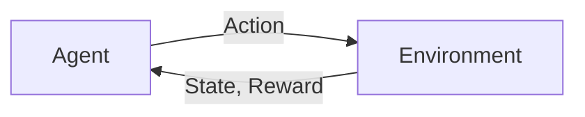
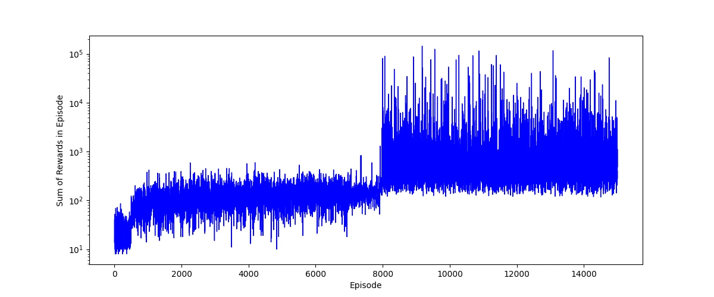

# Q-Learning으로 CartPole 균형 잡기

작성일 2023-12-01
{ .post-date }

인공지능 수업의 두 번째 과제로 강화학습을 다룬 내용을 기록하고자 한다. 강화학습의 기본 이론을 Q-Learning까지 정리해 발표했고, OpenAI Gym의 CartPole 환경에 Q-Learning을 적용해 막대가 쓰러지지 않게 수레를 움직이는 Agent를 학습시켰다.

구현은 Aleksandar Haber의 공개 튜토리얼 코드([저장소](https://github.com/AleksandarHaber/Q-Learning-Algorithm-in-Python-with-Cart-Pole-OpenAI-Gym--Gymnasium-Environment))를 바탕으로 했다. 코드를 한 줄씩 따라가며 주석을 달고, 각 부분이 이론의 어느 식에 해당하는지를 연결해 정리했다.

| 항목 | 내용 |
|---|---|
| 시기 | 2023년 12월 (3학년 2학기 인공지능 수업, 과제 2번) |
| 형태 | 개인 과제 (이론 발표와 실습) |
| 환경 | Python 3.9, gym 0.26.2, NumPy, Matplotlib |
| 자료 | [저장소](https://github.com/Ignis-Gallon/Q-Learning-with-Cartpole-Example) (노트북, 발표 자료) |

## 강화학습의 기본 개념

지도학습은 정답이 붙은 데이터로 손실을 줄이는 방향으로 학습한다. 강화학습은 정답이 없다. Agent가 Environment 안에서 행동하고, 그 결과로 받는 보상을 최대로 만드는 행동 방식을 시행착오로 찾아간다.



| 용어 | 의미 |
|---|---|
| State $S_t$ | 시점 $t$에서 Agent의 상태 |
| Action $A_t$ | Agent가 고른 행동. 고를 수 있는 행동 전체가 Action Space다 |
| Reward $R_{t+1}$ | 행동의 결과로 환경이 주는 보상 |
| Policy $\pi(a \mid s)$ | 상태 $s$에서 행동 $a$를 고를 확률 |
| Episode | 시작 상태에서 종료 상태에 이를 때까지의 한 번의 진행 |

### Return과 가치 함수

Return은 시점 $t$ 이후에 받을 보상의 합이다.

$$
G_t = R_{t+1} + \gamma R_{t+2} + \gamma^2 R_{t+3} + \cdots
$$

$\gamma$는 0과 1 사이의 할인율이다. 먼 미래의 보상을 작게 반영해서, Episode가 끝나지 않더라도 Return이 발산하지 않게 한다. Episode가 반드시 끝난다면 $\gamma = 1$이어도 된다.

Agent의 행동은 Policy에 따라 확률적으로 정해지므로 Return은 확률 변수다. 그래서 Return의 기댓값으로 상태나 행동을 평가한다.

$$
v_\pi(s) = \mathbb{E}_\pi\left[G_t \mid S_t = s\right], \qquad
q_\pi(s, a) = \mathbb{E}_\pi\left[G_t \mid S_t = s, A_t = a\right]
$$

$v$는 상태 가치 함수, $q$는 행동 가치 함수다. $q$는 상태에 더해 "그 상태에서 어떤 행동을 했는가"까지 조건으로 건다는 점만 다르다. 강화학습의 목표는 이 기댓값을 가장 크게 만드는 Policy를 찾는 것이다.

### Bellman 방정식

Return의 정의에서 $G_t = R_{t+1} + \gamma G_{t+1}$이므로, 가치 함수를 다음 시점의 가치 함수로 표현할 수 있다.

$$
q_\pi(s, a) = \mathbb{E}_\pi\left[R_{t+1} + \gamma \, q_\pi(S_{t+1}, A_{t+1}) \mid S_t = s, A_t = a\right]
$$

또한 상태 가치는 그 상태에서 고를 수 있는 행동들의 가치를 Policy의 확률로 평균한 값이다.

$$
v_\pi(s) = \sum_{a} \pi(a \mid s) \, q_\pi(s, a)
$$

따라서 각 상태에서 $q$가 가장 큰 행동을 고르면 상태 가치도 최대가 된다. 문제는 그러려면 최적의 $q$를 알고 있어야 한다는 점이다.

### Temporal Difference와 SARSA

기댓값은 충분히 많이 시도해 평균을 내면 근사할 수 있다. $N$번의 평균은 다음과 같이 직전까지의 평균과 새 값으로 나눠 쓸 수 있다.

$$
Q_N = \frac{1}{N} \sum_{i=1}^{N} q_i = Q_{N-1} + \frac{1}{N}\left(q_N - Q_{N-1}\right)
$$

$1/N$을 상수 $\alpha$로 바꾸면, 한 번 시도할 때마다 값을 조금씩 고쳐 가는 식이 된다. $\alpha$가 크면 새 값을, 작으면 기존 값을 더 믿는다는 뜻이다. 여기에 Bellman 방정식을 적용해 새 값 $q_N$ 자리에 $R + \gamma Q(S', A')$를 넣으면, Episode가 끝나기를 기다리지 않고 한 걸음마다 갱신할 수 있다.

$$
Q(S, A) \leftarrow Q(S, A) + \alpha \left[ R + \gamma \, Q(S', A') - Q(S, A) \right]
$$

갱신에 $(S, A, R, S', A')$가 쓰여서 이 방법을 SARSA라고 한다.

### ε-Greedy

가장 큰 $Q$만 따라가면, 처음에 우연히 찾은 경로만 반복하게 되어 더 좋은 경로를 찾지 못할 수 있다. 그래서 확률 $\varepsilon$으로는 무작위 행동을 하게 해서 다른 경로를 탐색(Exploration)하게 한다. 학습이 진행되면 $\varepsilon$을 점차 줄여 지금까지 배운 값을 활용(Exploitation)하는 비중을 높인다. 이 방식을 Decaying ε-Greedy라고 한다.

### Q-Learning

Q-Learning은 SARSA와 갱신식 한 곳이 다르다. 다음 상태에서 실제로 고를 행동의 $Q$가 아니라, 다음 상태에서 가장 큰 $Q$를 쓴다.

$$
Q(S, A) \leftarrow Q(S, A) + \alpha \left[ R + \gamma \max_{a} Q(S', a) - Q(S, A) \right]
$$

| | 행동을 고르는 방식 (behavior policy) | 갱신에 쓰는 다음 행동 (target policy) | 구분 |
|---|---|---|---|
| SARSA | Decaying ε-Greedy | Decaying ε-Greedy | On-Policy |
| Q-Learning | Decaying ε-Greedy | Greedy | Off-Policy |

## CartPole 환경

CartPole은 수레를 좌우로 움직여 수레 위에 세운 막대가 쓰러지지 않게 하는 문제다.

| 항목 | 내용 |
|---|---|
| State | 수레 위치 $x$, 수레 속도 $\dot{x}$, 막대 각도 $\theta$, 막대 각속도 $\dot{\theta}$ |
| Action | 왼쪽(0) 또는 오른쪽(1)으로 밀기 |
| Reward | 한 time step을 버틸 때마다 +1 |
| 종료 조건 | 막대 각도가 12도를 넘거나, 수레 위치가 2.4를 넘을 때. CartPole-v1은 500 step에서도 끊는다 |
| 초기 상태 | 네 값 모두 -0.05 ~ 0.05 사이의 무작위 값 |

오래 버틸수록 보상이 커지므로, 보상을 최대로 만드는 것이 곧 막대를 오래 세워 두는 것이다.

## 구현

### 연속 상태를 이산화하기

Q-Learning은 상태와 행동의 쌍마다 $Q$ 값을 표(Q-table)로 저장한다. 그런데 CartPole의 상태 값 네 개는 모두 연속 값이어서 상태가 무한히 많다. 그래서 각 값의 범위를 일정한 개수의 구간으로 나누고, 값이 속한 구간의 번호를 상태로 사용했다.

속도와 각속도는 범위가 무한대라서 구간을 나눌 수 없다. 이 둘은 범위를 직접 정했다.

| 상태 값 | 범위 | 구간 수 |
|---|---|---|
| 수레 위치 | -4.8 ~ 4.8 (환경이 정한 범위) | 30 |
| 수레 속도 | -3 ~ 3 (직접 제한) | 30 |
| 막대 각도 | -0.418 ~ 0.418 rad (환경이 정한 범위) | 30 |
| 막대 각속도 | -10 ~ 10 (직접 제한) | 30 |

Q-table의 크기는 30 x 30 x 30 x 30 x 2이고, 0과 1 사이의 무작위 값으로 초기화한다. 상태를 구간 번호로 바꾸는 부분은 다음과 같다.

```python
def returnIndexState(self, state):
    cartPositionBin = np.linspace(self.lowerBounds[0], self.upperBounds[0], self.numberOfBins[0])
    # ... 속도, 각도, 각속도도 같은 방식으로 구간을 만든다

    indexPosition = np.maximum(np.digitize(state[0], cartPositionBin) - 1, 0)
    # ... 나머지 세 값도 같은 방식으로 구간 번호를 구한다

    return tuple([indexPosition, indexVelocity, indexAngle, indexAngularVelocity])
```

### 행동 선택

탐색과 활용의 비중은 Episode 번호에 따라 세 단계로 바뀐다.

| Episode | 행동 선택 |
|---|---|
| 0 ~ 499 | 항상 무작위 행동. Q-table을 고르게 채우기 위한 탐색이다 |
| 500 ~ 7000 | $\varepsilon = 0.2$의 ε-Greedy |
| 7000 이후 | 행동을 고를 때마다 $\varepsilon$에 0.999를 곱해 줄인다 |

Greedy 행동을 고를 때 두 행동의 $Q$ 값이 같으면 둘 중 하나를 무작위로 고른다.

### Q 값 갱신

한 step을 진행한 뒤 Q-Learning의 갱신식을 그대로 적용한다. 종료 상태에서는 다음 상태의 가치가 없으므로 보상만 반영한다.

```python
(stateSprime, reward, terminalState, _, _) = self.env.step(actionA)
stateSprimeIndex = self.returnIndexState(list(stateSprime))
QmaxPrime = np.max(self.Qmatrix[stateSprimeIndex])

if not terminalState:
    error = reward + self.gamma * QmaxPrime - self.Qmatrix[stateSIndex + (actionA,)]
else:
    error = reward - self.Qmatrix[stateSIndex + (actionA,)]

self.Qmatrix[stateSIndex + (actionA,)] += self.alpha * error
```

### 설정

| 항목 | 값 |
|---|---|
| 학습률 $\alpha$ | 0.1 |
| 할인율 $\gamma$ | 1 |
| 초기 $\varepsilon$ | 0.2 |
| Episode 수 | 15000 |

## 결과

Episode마다 받은 보상의 합을 기록한 그래프다. 세로축은 로그 눈금이다.



- 무작위로만 행동하는 처음 500 Episode는 보상의 합이 수십 수준에 머문다.
- ε-Greedy로 바뀐 뒤에는 100 안팎으로 올라간다.
- 8000 Episode 부근에서 한 단계 더 올라간다. $\varepsilon$이 줄어 무작위 행동이 거의 사라지고, 학습된 $Q$ 값을 따르는 비중이 커진 시기와 맞물린 변화로 보인다.

그래프의 값이 500을 훌쩍 넘는 것은 학습 반복문이 막대가 쓰러지는 종료만 확인하고 500 step 제한은 적용하지 않았기 때문이다. 그래서 막대가 쓰러지지 않으면 Episode가 계속 이어진다.

학습이 끝난 뒤에는 탐색 없이 $Q$ 값이 가장 큰 행동만 고르게 해서 Agent가 실제로 막대를 세우고 있는 모습을 화면으로 확인했다.

보상의 합이 전체적으로 올라가기는 하지만 Episode마다 변동이 크다. 상태를 구간으로 나눠 표현했기 때문에 모든 상태에 대해 $Q$ 값이 충분히 학습되지 않았을 수 있다. Episode 수, 탐색과 활용의 비율, $\varepsilon$·$\alpha$·$\gamma$ 값, 구간을 나누는 방식을 바꿔 보는 것이 다음에 해 볼 수 있는 실험이다.
