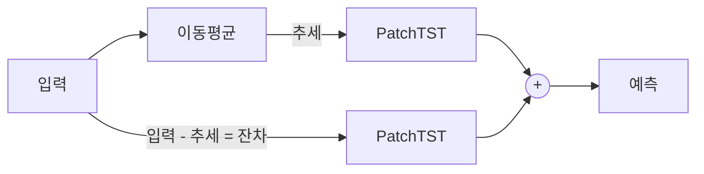
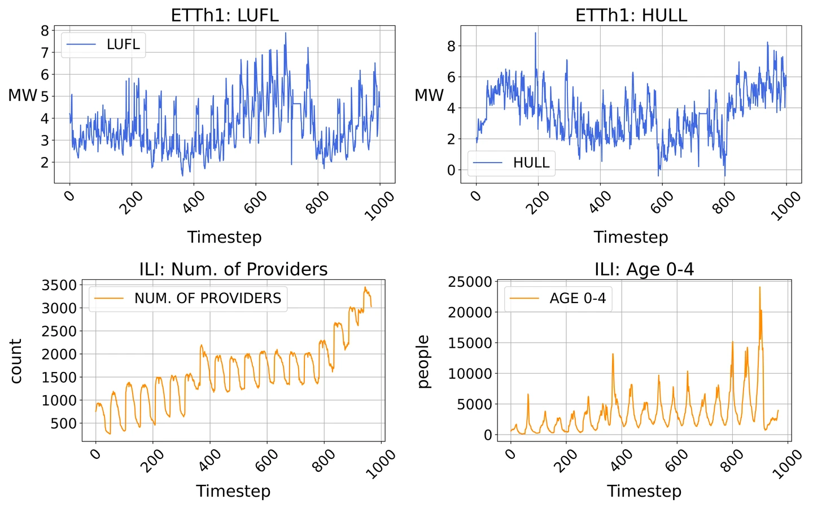
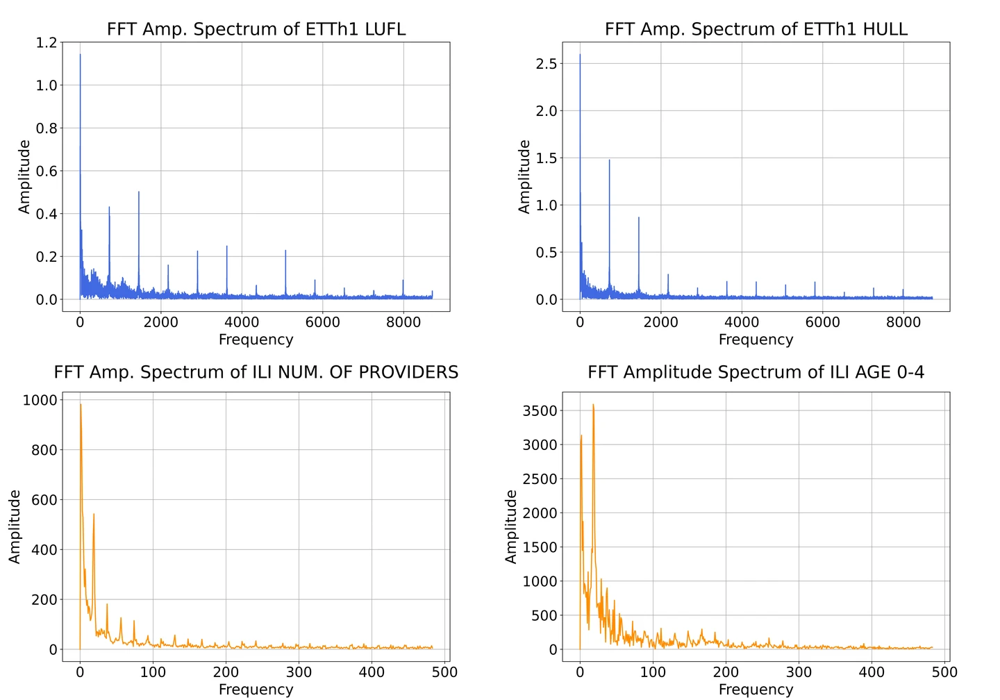

# PatchTST 성능 개선 실험

인공지능 수업의 프로젝트로 진행한 내용을 기록하고자 한다. 장기 시계열 예측 모델인 PatchTST의 논문과 공식 코드를 분석하고, 여기에 세 가지 방법(이동평균 분해, Non-stationary Attention, FFT Top-k 분해)을 적용해 예측 성능이 어떻게 달라지는지 실험했다.

| 항목 | 내용 |
|---|---|
| 기간 | 2023.10 ~ 2023.12 (3학년 2학기 인공지능 수업 프로젝트) |
| 형태 | 2인 팀 프로젝트 |
| 대상 논문 | A Time Series is Worth 64 Words: Long-term Forecasting with Transformers (Nie et al., ICLR 2023) |
| 데이터 | ETTh1, ILI |
| 환경 | Python, PyTorch |
| 자료 | [코드 저장소](https://github.com/JongHyun9999/PatchTST_project), [논문 형식으로 정리한 글 (PDF)](https://drive.google.com/file/d/1c8_B-wFmWOC4kjwjMXrCCq4jEbTyT2ev/view) |

## 배경

시계열 예측은 과거의 일정 구간(look-back window)을 보고 미래 구간을 예측하는 문제다. 그중에서도 먼 미래까지 예측하는 것을 장기 시계열 예측(Long-term Time Series Forecasting, LTSF)이라고 한다.

Transformer가 자연어 처리에서 성공한 뒤, Informer, Autoformer, FEDformer처럼 Transformer를 시계열에 맞게 고친 모델이 이어서 나왔다. 그런데 2022년에 나온 논문 "Are Transformers Effective for Time Series Forecasting?"은 선형 계층 하나로 이루어진 단순한 모델(DLinear, NLinear)이 이 모델들보다 더 좋은 성능을 낸다는 결과를 보였다. 복잡한 Attention 구조가 장기 시계열 예측에 정말 필요한지에 대한 질문이었다.

PatchTST는 이 질문에 대한 Transformer 쪽의 답이다. 구조를 크게 바꾸지 않고 입력을 넣는 방식 두 가지를 바꿔서, 선형 모델보다 좋은 성능을 보였다.

이 프로젝트에서는 PatchTST가 다루지 않은 부분을 건드려 보았다. 단순한 선형 모델이 강했다는 사실에서 "장기 예측에서는 세세한 변동보다 전체적인 추세를 학습하는 것이 중요하다"는 가정을 세우고, 모델이 추세와 주요 성분을 따로 학습하도록 하는 방법들을 적용했다.

## PatchTST의 구조

### 패칭

기존 Transformer 기반 모델은 시점 하나를 토큰 하나로 넣었다. 하지만 시계열에서 시점 하나의 값은 그 자체로는 의미가 거의 없고, 주변 값과 이어져야 의미가 생긴다. PatchTST는 연속한 시점 여러 개를 묶은 패치(patch)를 토큰으로 쓴다.

길이 $L$인 입력을 길이 $P$의 패치로, $S$만큼씩 이동하며 자르면 패치 개수는 다음과 같다. 공식 구현은 끝을 $S$만큼 채운 뒤 자르기 때문에 2를 더한다.

$$
N = \left\lfloor \frac{L - P}{S} \right\rfloor + 2
$$

ETTh1 설정($L = 336$, $P = 16$, $S = 8$)에서는 토큰이 336개에서 42개로 줄어든다. 토큰 수가 줄면 Attention의 계산량이 줄고, 같은 자원으로 더 긴 과거를 볼 수 있다.

### 채널 독립

변수가 여러 개인 다변량 시계열을 변수별로 쪼개서, 각각을 하나의 단변량 시계열로 보고 같은 모델에 넣는다. 변수 사이의 관계를 직접 모델링하지 않는 방식이다. 직관과는 다르게, 이렇게 하는 쪽이 분포 변화에 더 강건하고 장기 예측 성능이 좋다는 것이 여러 연구에서 보고되었다. 모든 변수가 같은 가중치를 공유하므로 변수 사이의 정보가 간접적으로는 반영된다.

### 코드에서의 흐름

공식 코드를 따라가며 텐서의 모양이 어떻게 바뀌는지 정리했다. ETTh1(변수 7개)을 배치 128, 예측 길이 96으로 넣는 경우다.

| 단계 | 텐서 모양 | 설명 |
|---|---|---|
| 입력 | [128, 336, 7] | 배치, 입력 길이, 변수 |
| 축 교환 | [128, 7, 336] | 변수별로 다루기 위해 순서를 바꾼다 |
| RevIN 정규화 | [128, 7, 336] | 입력 구간마다 평균과 표준편차로 정규화하고 값을 기억해 둔다 |
| 패칭 | [128, 7, 42, 16] | 끝을 채운 뒤 길이 16, 간격 8로 자른다 |
| 패치 임베딩 | [896, 42, 16] | 변수 축을 배치로 합치고(128 x 7), 패치를 `d_model` 차원으로 사영한 뒤 위치 인코딩을 더한다 |
| Transformer Encoder | [896, 42, 16] | Multi-Head Attention과 Feed-Forward를 3층 반복 |
| Flatten + Linear | [128, 7, 96] | 패치 42개의 출력을 펴서 예측 길이로 사영 |
| RevIN 역정규화 | [128, 96, 7] | 기억해 둔 평균과 표준편차로 원래 분포로 되돌린다 |

변수 축을 배치로 합치는 부분이 채널 독립이 구현된 자리다. Encoder 입장에서는 변수 7개짜리 배치 128개가 아니라 단변량 시계열 896개가 들어온다.

## 기준 모델 재현

방법을 적용하기 전에, 저자가 공개한 코드와 설정으로 원래 실험을 재현했다.

| 항목 | ETTh1 | ILI |
|---|---|---|
| 입력 길이 | 336 | 104 |
| 예측 길이 | 96, 192, 336, 720 | 24, 36, 48, 60 |
| 패치 길이 / 간격 | 16 / 8 | 24 / 2 |
| `d_model` / 헤드 수 / Encoder 층 수 | 16 / 4 / 3 | 16 / 4 / 3 |
| 배치 크기 / 학습률 | 128 / 0.0001 | 16 / 0.0025 |
| Epoch | 100 | 100 |

논문에는 데이터셋이 8개 나오지만, 사용할 수 있는 컴퓨팅 자원을 고려해 가벼운 ETTh1과 ILI 두 개로 실험했다. ETTh1은 변압기의 유류 온도와 전력 부하 6개를 1시간 간격으로 기록한 데이터이고, ILI는 주 단위로 집계한 인플루엔자 유사 질환 환자 통계다.

재현한 결과는 논문의 값과 일치하지 않았다. 설정을 바꿔 가며 같은 값을 맞춰 보려고도 했지만, 값이 같아지더라도 그것이 논문과 같은 조건에서 나온 것이라고 확신할 수 없다고 판단했다. 그래서 공개된 설정으로 얻은 재현 값을 기준으로 삼고, 여기서 얼마나 달라지는지를 보기로 했다.

## 적용한 세 가지 방법

### 이동평균 분해

시계열 분해는 데이터를 추세, 계절성, 잔차 같은 성분으로 나누는 방법이다. 이동평균은 각 시점에서 주변 값의 평균을 구하는 것으로, 세세한 변동이 사라지고 전체적인 추세가 남는다.

입력을 이동평균으로 구한 추세와, 원래 값에서 추세를 뺀 잔차로 나눈다. 두 성분을 서로 다른 PatchTST에 넣어 각각 예측하고, 두 출력을 더해 최종 예측으로 쓴다.



계절성과 주기까지 분해하지 않은 것은, 다변량 데이터의 모든 변수가 계절성과 주기를 가진다고 보는 것이 강한 가정이기 때문이다. 그런 성질이 없는 변수까지 분해하면 Attention이 잘못된 관계를 학습할 수 있다고 보았다.

공식 구현에는 이 분해를 켜는 옵션과 분해 모듈이 들어 있지만 논문의 실험에는 쓰이지 않았다. 이 옵션을 켜서 실험했다.

```python
class series_decomp(nn.Module):
    def __init__(self, kernel_size):
        super(series_decomp, self).__init__()
        self.moving_avg = moving_avg(kernel_size, stride=1)

    def forward(self, x):
        moving_mean = self.moving_avg(x)   # 추세
        res = x - moving_mean              # 잔차
        return res, moving_mean
```

이동평균의 창 크기(kernel size)는 25로 했다. ETTh1은 1시간 간격 데이터이므로 하루 단위의 추세를 보려는 값이다. 주 단위 데이터인 ILI는 한 달과 한 분기에 해당하는 5와 13을 먼저 시도했는데, 25로 두었을 때보다 성능이 낮아서 똑같이 25를 썼다. 창이 지나가며 줄어드는 길이는 양 끝 값을 반복해 채워서 입력 길이가 유지되게 한다.

### Non-stationary Attention

정상성(stationarity)은 시간이 지나도 평균과 분산 같은 통계적 성질이 변하지 않는 것을 말한다. 실제 시계열은 대부분 그렇지 않다. PatchTST는 RevIN으로 입력을 정규화해서 이 문제를 줄인다. 그런데 정규화된 값만 Attention에 들어가면, 원래 데이터가 가지고 있던 비정상성 정보가 사라진다.

"Non-stationary Transformers" 논문은 이 문제를 풀기 위해, 정규화하기 전의 통계량으로부터 두 값 $\tau$와 $\Delta$를 학습해 Attention 점수에 다시 넣는 방법을 제안했다. 이 방법을 PatchTST의 Attention에 적용했다.

$$
\mathrm{Attn}(Q, K, V) = \mathrm{Softmax}\left( \frac{\tau \, Q K^{\top} + \mathbf{1}\Delta^{\top}}{\sqrt{d_k}} \right) V
$$

코드에서 바꾼 부분은 세 곳이다.

1. RevIN이 정규화에 쓴 평균과 표준편차를 함께 반환하게 했다.
2. 원래 입력과 통계량을 받아 $\tau$와 $\Delta$를 내는 작은 MLP(Projector)를 두 개 추가했다. $\tau$는 표준편차를, $\Delta$는 평균을 입력으로 받는다. $\tau$는 양수가 되도록 지수 함수를 거친다.
3. 두 값을 Encoder를 거쳐 Attention까지 전달하고, Softmax 직전의 점수에 적용했다.

구현하면서 걸린 부분은 텐서의 크기였다. $\tau$와 $\Delta$는 배치(128) 단위로 계산되는데, Attention은 채널 독립 때문에 변수 축이 합쳐진 크기(896)로 동작한다. 두 값을 변수 개수만큼 반복해 크기를 맞췄다.

### FFT Top-k 분해

시계열을 주파수 영역에서 보면 주요한 주기 성분을 골라낼 수 있다. TimesNet이 FFT로 진폭이 큰 주파수 $k$개를 뽑아 주기 정보로 쓰는 것에서 아이디어를 얻었다.

1. 입력에 FFT를 적용한다.
2. 진폭이 가장 큰 주파수 $k$개만 남기고 나머지는 0으로 만든다.
3. 역변환으로 시간 영역의 신호를 되돌린다. 이것이 주요 성분이다.
4. 원래 입력에서 주요 성분을 뺀 것이 잔차다.
5. 주요 성분과 잔차를 서로 다른 PatchTST에 넣고, 두 출력을 더한다.

이동평균 분해와 구조는 같고, 성분을 나누는 기준이 시간 영역의 평균에서 주파수 영역의 진폭으로 바뀐 것이다. $k$는 5로 했다.

## 실험 결과

각 방법을 따로 적용한 모델을 학습하고, 테스트 구간의 MSE를 기록했다. 발표 당시 정리한 결과는 다음과 같다. 값이 작을수록 좋다.

| 데이터 | 예측 길이 | 논문 | 기준 (재현) | 이동평균 분해 | Non-stationary | FFT Top-k |
|---|---|---|---|---|---|---|
| ETTh1 | 96 | 0.375 | 0.427 | 0.411 | 0.426 | 0.463 |
| ETTh1 | 192 | 0.414 | 0.461 | 0.450 | 0.465 | 0.499 |
| ETTh1 | 336 | 0.431 | 0.463 | 0.449 | 0.463 | 0.484 |
| ETTh1 | 720 | 0.449 | 0.461 | 0.456 | 0.464 | 0.514 |
| ILI | 24 | 1.522 | 1.784 | 1.496 | 1.590 | 1.300 |
| ILI | 36 | 1.430 | 1.854 | 1.662 | 1.510 | 1.247 |
| ILI | 48 | 1.673 | 1.983 | 1.953 | 1.830 | 1.683 |
| ILI | 60 | 1.529 | 1.954 | 2.011 | 1.520 | 1.949 |

기준(재현) 대비 MSE의 변화율로 바꾸면 다음과 같다. 음수가 개선이다.

| 데이터 | 예측 길이 | 이동평균 분해 | Non-stationary | FFT Top-k |
|---|---|---|---|---|
| ETTh1 | 96 | -3.7% | -0.2% | +8.4% |
| ETTh1 | 192 | -2.4% | +0.9% | +8.2% |
| ETTh1 | 336 | -3.0% | 0.0% | +4.5% |
| ETTh1 | 720 | -1.1% | +0.7% | +11.5% |
| ILI | 24 | -16.1% | -10.9% | -27.1% |
| ILI | 36 | -10.4% | -18.6% | -32.7% |
| ILI | 48 | -1.5% | -7.7% | -15.1% |
| ILI | 60 | +2.9% | -22.2% | -0.3% |

표에서 읽은 내용은 이렇다.

- ILI에서는 세 방법 모두 대체로 MSE가 줄었다.
- ETTh1에서는 이동평균 분해만 조금 줄었다. Non-stationary는 거의 변화가 없었고, FFT Top-k는 오히려 늘었다.

## 결과 해석

두 데이터셋에서 결과가 갈린 이유를 찾기 위해 데이터를 직접 그려 보았다.



ILI는 등락이 비교적 규칙적이고, 시간이 갈수록 값과 진폭이 커지는 뚜렷한 상승 추세가 있다. ETTh1은 상승이나 하락의 추세가 잘 보이지 않고 잡음이 많다.

당시에는 이 차이로 결과를 다음과 같이 해석했다.

- **분해 방법(이동평균, FFT Top-k).** ILI는 주요한 추세를 뽑아내기 쉬워서, 입력을 주요 성분과 잔차로 나누는 것이 도움이 된다. ETTh1은 추세가 뚜렷하지 않아 나눠도 얻는 것이 적다.
- **Non-stationary Attention.** ILI처럼 시간이 지나며 진폭이 커지는 데이터는 정규화 과정에서 그 정보가 사라진다. 이를 Attention에 다시 넣어 준 것이 효과를 냈다. 분포 변화가 크지 않은 ETTh1에서는 차이가 없다.
- **ETTh1에서 이동평균이 FFT보다 나은 이유.** 이동평균은 값을 평균 내면서 정보를 일부 잃지만, 그 과정에서 잡음도 함께 줄어든다. 잡음이 많은 ETTh1에서는 이 평활화가 유리하게 작용한 것으로 보았다.

이후 내용을 다시 정리하면서 두 데이터의 진폭 스펙트럼도 그려 보았다.



ILI는 큰 진폭이 낮은 주파수 쪽에 몰려 있고, ETTh1은 여러 주파수에 걸쳐 뾰족한 성분이 퍼져 있다. 진폭이 큰 주파수 몇 개로 주요 성분을 대표하기에는 ILI 쪽이 더 적합한 모양이다.

## 추가 실험: 입력 길이

장기 예측 모델이라면 더 긴 과거를 볼수록 성능이 좋아져야 한다. 방법을 적용한 뒤에도 이 성질이 유지되는지 보기 위해, ETTh1에서 입력 길이를 192, 336, 720으로 바꿔 가며 같은 실험을 했다.

| 입력 길이 | 예측 길이 | 기준 (재현) | 이동평균 분해 | Non-stationary | FFT Top-k |
|---|---|---|---|---|---|
| 192 | 96 | 0.445 | 0.430 | 0.439 | 0.481 |
| 192 | 192 | 0.492 | 0.482 | 0.483 | 0.492 |
| 192 | 336 | 0.507 | 0.493 | 0.498 | 0.507 |
| 192 | 720 | 0.499 | 0.491 | 0.494 | 0.499 |
| 336 | 96 | 0.427 | 0.411 | 0.426 | 0.463 |
| 336 | 192 | 0.461 | 0.450 | 0.465 | 0.499 |
| 336 | 336 | 0.463 | 0.449 | 0.463 | 0.484 |
| 336 | 720 | 0.461 | 0.456 | 0.464 | 0.514 |
| 720 | 96 | 0.402 | 0.395 | 0.409 | 0.446 |
| 720 | 192 | 0.437 | 0.429 | 0.438 | 0.470 |
| 720 | 336 | 0.445 | 0.446 | 0.442 | 0.471 |
| 720 | 720 | 0.458 | 0.453 | 0.458 | 0.494 |

네 모델 모두 입력 길이가 길어질수록 MSE가 줄었다. ILI는 입력 길이 104가 이미 과적합이 시작되는 지점이어서 더 늘리는 실험은 하지 않았고, 줄였을 때 성능이 떨어지는 것만 확인했다.

## 마무리

"장기 예측에서는 세세한 변동보다 추세를 학습하는 것이 중요하다"는 가정에서 출발해, PatchTST가 추세와 주요 성분을 따로 보도록 하는 방법 세 가지를 적용해 보았다. 정리한 결과에서는 ILI에서 세 방법 모두 MSE가 대체로 줄었고, ETTh1에서는 이동평균 분해만 소폭 줄었다. 결과가 갈린 이유는 두 데이터의 성질, 곧 추세가 얼마나 뚜렷한지와 잡음이 얼마나 많은지에서 찾았다.

논문을 읽는 데서 그치지 않고 공식 코드를 한 줄씩 따라가며 구조를 파악하고, 다른 논문의 아이디어를 그 코드에 직접 넣어 본 프로젝트였다.
