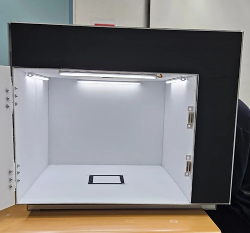
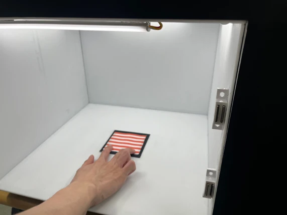
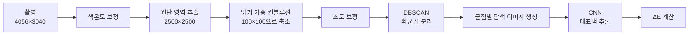
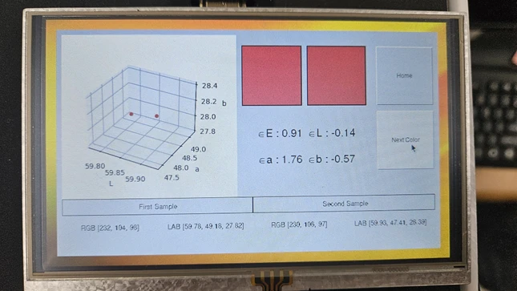

# 다색상 원단의 색상 유사도 검출 시스템: 개요

작성일 2024-06-14
{ .post-date }

학부 졸업작품으로 2024년 1월부터 6월까지 진행한 프로젝트를 기록하고자 한다. 원단 두 장을 차례로 촬영하면 두 원단의 색이 얼마나 다른지를 수치로 알려 주는 임베디드 시스템이며, 무늬가 있는 다색상 원단도 다룰 수 있도록 만들었다.

이 글에서는 무엇을 왜 만들었는지와 시스템의 전체 구성을 설명한다. 각 단계에서 어떤 문제가 있었고 어떻게 풀었는지는 [기술 소개](02-technology.md)에서 다룬다.

| 항목 | 내용 |
|---|---|
| 기간 | 2024.01 ~ 2024.06 |
| 형태 | 4인 팀 프로젝트. 팀장으로 시스템 총괄과 알고리즘 설계를 맡았다 |
| 하드웨어 | Raspberry Pi 5, HQ 카메라 모듈, 조명을 통제한 촬영 박스, 5인치 터치스크린 |
| 소프트웨어 | Python, PyTorch, scikit-learn, scikit-image, OpenCV, Tkinter |
| 자료 | [코드 저장소](https://github.com/inu-ese-capstone-design-team-YSN/project), [개발 기록 블로그](https://inu-ese-capstone-design-team-ysn.github.io/) |

## 문제 상황

옷을 만들려는 클라이언트는 원하는 색과 재질의 원단 견본을 원단 생산 공장에 전달하고, 공장은 그 견본과 같은 색의 샘플을 만들어 돌려보낸다. 클라이언트가 샘플이 견본과 같다고 판단해야 대량 생산이 시작된다.

문제는 "같다"를 판단하는 기준이 사람의 눈뿐이라는 점이다. 이 분야에서 30년간 거래를 중개해 온 현직자를 인터뷰해 다음 사실을 확인했다.

- 요청은 항상 실물 견본으로 이루어지고, 색상 수치는 함께 전달되지 않는다.
- 공장에서는 염색 담당자가 경험에 따라 염료를 배합한다.
- 샘플이 견본과 다르다는 클레임은 클라이언트의 주관적 판단에서 나오며, 이를 반박할 객관적인 수치가 없다.
- 클레임이 나면 샘플을 다시 만들어 비교하는 과정이 반복되고, 그만큼 시간이 든다.

결국 클라이언트는 색이 다르다고 보고 공장은 같다고 보는데, 어느 쪽이 맞는지 가릴 방법이 없어서 생기는 갈등이다.

## 기존 방법의 한계

원단의 색을 측정하는 장비로는 분광측색계가 쓰인다. 하지만 측정 환경에 따라 결과가 달라지고, 한 번에 좁은 지점만 측정하기 때문에 원단 전체의 색을 대표하기 어렵다. 무엇보다 여러 색이 섞인 원단은 어느 지점을 재느냐에 따라 값이 완전히 달라진다.

카메라로 원단을 촬영해 색을 비교하는 제품도 있었지만, 단색 원단만을 대상으로 했다. 체크나 스트라이프처럼 실제로 흔히 거래되는 다색상 원단에는 적용할 수 없다.

## 목표

위 문제를 바탕으로 다음과 같이 목표를 정했다.

1. 두 원단의 색 차이를 사람의 눈이 아닌 수치로 제시한다. 수치는 사람의 색 지각과 잘 맞는 CIELAB 색공간의 색차 ΔE(CIEDE2000)를 쓴다.
2. 다색상 원단은 색 군집별로 나누어 각각 비교한다.
3. 측정 환경을 통제해, 언제 어디서 측정해도 같은 결과가 나오게 한다.
4. 견본 크기에 맞춰 한 변 10cm 이내의 원단을 수용한다.

## 시스템 구성

### 하드웨어

외부 빛이 결과에 영향을 주지 않도록 촬영 공간 전체를 밀폐된 박스로 만들었다. 박스는 원단을 넣고 촬영하는 측정부와, Raspberry Pi와 전원 장치를 넣는 모듈부로 나뉜다.

{ width="420" }

*시스템 정면. 앞문을 열면 측정부가 보이고, 위쪽 검은 부분이 모듈부다.*

- **외형**: 흰색 불투명 아크릴(3T)과 철제 프레임으로 만들고, 바깥에는 검은 시트지를 붙여 빛이 새어 들어오지 않게 했다. 측정부의 크기는 400 × 400 × 300mm다.
- **조명**: 색온도 6,500K의 고연색 LED 바를 천장 가장자리에 둘렀다.
- **카메라**: 천장 중앙에 HQ 카메라 모듈(4056 × 3040)과 망원 렌즈를 달아 바닥을 수직으로 촬영한다.
- **촬영 영역**: 바닥 중앙에 100 × 100mm의 Target Area를 두고, 그 안쪽 80 × 80mm를 실제 분석에 쓴다. 원단 가장자리는 구겨지거나 올이 풀려 있는 경우가 많아 제외했다.

{ width="420" }

*측정부 바닥의 Target Area에 원단을 올려놓는다.*

### 처리 과정

촬영한 이미지는 아래 순서로 처리된다.

1. **보정**: 카메라와 조명 때문에 생기는 색온도 변화와 위치별 밝기 차이를 바로잡는다.
2. **축소**: 2500 × 2500 이미지를 색 정보를 최대한 보존하면서 100 × 100으로 줄인다.
3. **군집화**: 픽셀을 색이 비슷한 것끼리 묶어 원단을 이루는 색 군집을 찾는다.
4. **추론**: 군집마다 CNN으로 대표색(L, a, b)을 추론한다.
5. **비교**: 두 원단의 대표색끼리 짝을 지어 ΔE를 계산한다.

### 사용 흐름

사용자는 터치스크린의 안내에 따라 첫 번째 원단을 넣고 촬영한 뒤, 두 번째 원단을 넣고 촬영한다. 처리가 끝나면 결과 화면에 색 쌍마다 추론된 색, ΔE, 그리고 밝기와 색 성분별 차이(ΔL, Δa, Δb)가 표시된다. 다색상 원단이면 버튼을 눌러 다음 색 쌍으로 넘어간다.

{ width="520" }

*결과 화면. 두 원단에서 추론한 색과 ΔE, 성분별 차이를 보여 준다.*

## 결과

학습 데이터는 시스템으로 직접 촬영한 이미지에 증강을 더해 총 18,000장으로 구성했다. 원단 샘플 일부는 안산 소재의 한 원단 공장에서 학술 목적으로 제공받아 사용했다.

| 전체 | 학습 | 검증 | 테스트 | 정확도 |
|---|---|---|---|---|
| 18,000 | 10,800 | 3,600 | 3,600 | 97.85% |

정확도는 추론한 색과 정답 색의 ΔE가 0.8 이하인 비율이다. 0.8은 원단 공장을 방문해 확인한 업계 기준으로, 이 안에 들어오면 사람 눈으로는 같은 색으로 본다.

공장 방문에서는 다음과 같은 의견도 들었다.

- 현장에서도 색차 피드백을 CIELAB 수치로 주고받는다. 따라서 L, a, b 값과 ΔE를 제시하는 것만으로 유효한 피드백이 된다.
- 기존 색차 판정 장비는 숙련자가 필요하고 유지비가 비싸다. 규모가 작은 공장일수록 이런 시스템이 도움이 된다.

## 한계

- 정확도는 군집 하나에 해당하는 단색 이미지 단위로 측정한 값이다. 군집 분리까지 포함해 다색상 원단 전체를 정량적으로 평가하는 일은 과제로 남았다.
- 무늬가 아주 작으면 DBSCAN이 그 색을 잡음으로 처리해 놓칠 수 있다.
- 서로 다른 색의 실을 섞어 짠 원단은 실 단위로 색을 분리하지 못한다.
- 표면 질감이 크게 다른 여러 소재에 대해서는 충분히 검증하지 못했다.

## 마치며

이 프로젝트는 학부 생활을 마무리하는 작업이었다. 영상 처리, 군집화, 딥러닝, 임베디드 시스템까지 그동안 배운 것을 모두 꺼내 써야 했고, 그 과정에서 아는 것과 실제로 동작하게 만드는 것 사이의 거리를 실감했다.

가장 많이 배운 것은 아이디어를 검증하는 과정이었다. 빛을 통제하려면 박스 내부가 검어야 한다고 생각했지만 실제로는 흰색이어야 조도가 고르게 나왔고, 고해상도 이미지를 그대로 군집화하려던 계획은 메모리 한계에 막혀 전체 알고리즘을 다시 설계해야 했다. 그럴듯해 보이는 생각도 실험으로 확인하기 전에는 믿을 수 없다는 것, 그리고 가정이 틀렸을 때 빨리 인정하고 방향을 바꾸는 편이 낫다는 것을 배웠다.

팀을 이끄는 일도 쉽지 않았다. 네 명의 일정을 맞추고, 일을 나누고, 따로 개발한 결과물을 하나의 시스템으로 합치는 데에는 기술과는 다른 종류의 노력이 필요했다. 계획대로 되지 않는 주가 많았지만, 매주 진행 상황을 기록하고 다음 목표를 다시 정하는 일을 반복하면서 끝까지 올 수 있었다. 이 경험을 통해 개발자로서도, 팀을 책임지는 사람으로서도 많이 성장했다고 생각한다.
