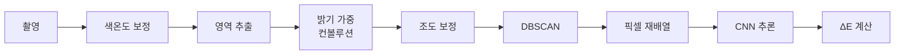
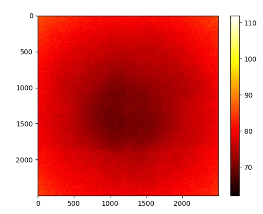
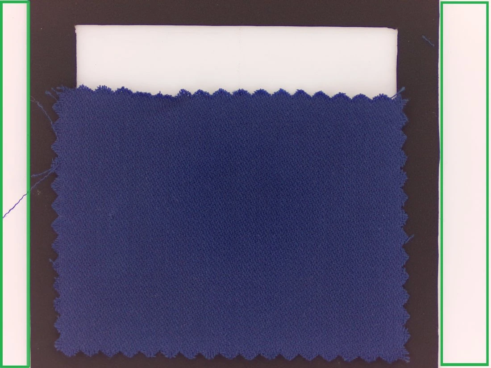
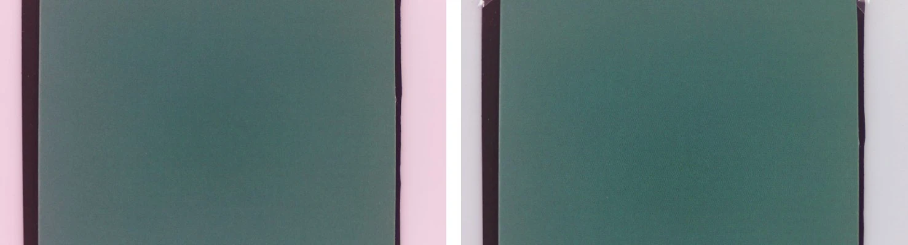
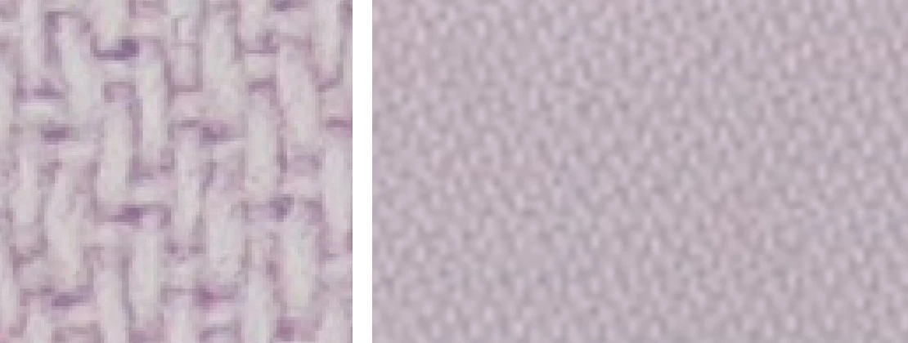
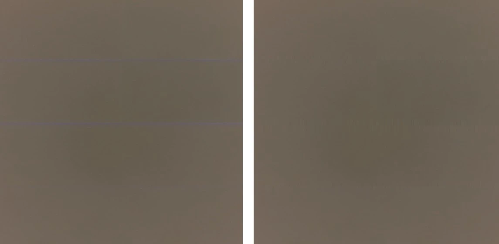
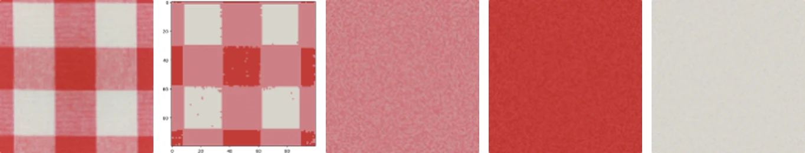

# 다색상 원단의 색상 유사도 검출 시스템: 기술 소개

작성일 2024-06-14
{ .post-date }

[개요](01-overview.md)에서 소개한 시스템이 원단 사진 한 장에서 대표색을 얻기까지의 과정을 단계별로 정리하고자 한다. 단계마다 어떤 문제가 있었는지, 무엇을 시도했는지, 최종적으로 무엇을 택했는지를 순서대로 적는다.



## 1. 촬영 환경

### 박스 내부는 흰색이어야 했다

색을 정확히 재려면 빛을 통제해야 하므로, 처음에는 반사가 없는 검은색 내부가 적합하다고 생각했다. 그런데 검은 박스에 LED를 달아 촬영해 보니 빛이 반사되지 않아 LED가 직접 닿는 곳만 밝고, 위치에 따른 조도 차이가 매우 컸다.

같은 박스의 여섯 면에 흰 종이를 붙이고 다시 촬영하자 빛이 내부에서 고르게 퍼졌고, 중앙과 가장자리의 색 차이도 줄었다. 이 실험을 근거로 내부를 흰색 불투명 아크릴로 만들었다. 조명 높이는 여러 높이를 비교해 300mm로 정했다.

실제 제작 후에는 3T 아크릴이 얇아 외부 빛이 투과하는 문제가 생겼고, 바깥 면에 검은 시트지를 붙여 해결했다.

### 조도 차이는 색이 아니라 밝기에서 온다

조명을 천장 가장자리에 둘렀기 때문에 조도가 완전히 균일하다고 볼 수 없었다. 이를 확인하려고 촬영 이미지의 픽셀별 밝기를 계산해 히트맵으로 그리는 도구를 만들었다. 밝기는 다음 식으로 구했다.

$$
Y = 0.299R + 0.587G + 0.114B
$$

{ width="420" }

*어두운 색 시료의 밝기 히트맵. 중앙이 가장자리보다 어둡다.*

여러 원단을 촬영해 비교한 결과는 다음과 같았다.

- 어두운 원단은 중앙이 뚜렷하게 어둡게 찍힌다.
- 흰색에 가까운 원단에서는 위치별 차이가 거의 보이지 않는다.
- 평균 밝기가 비슷한 두 원단(76.5와 84.1)은 색이 달라도 조도 차이의 형태가 매우 비슷했고, 밝은 원단(161.7)에서는 차이가 거의 없었다.

즉 위치별 조도 차이의 크기를 결정하는 것은 원단의 색조가 아니라 밝기였다. 조명을 바람개비 모양이나 직사각형으로 다시 배치해 보기도 했지만 오히려 중앙의 어두운 영역이 커지거나 전체 광량이 줄었다. 그래서 조명 배치는 그대로 두고, 남은 조도 차이는 소프트웨어로 보정하기로 했다.

카메라의 자동 기능이 결과를 흔들지 않도록 화이트 밸런스, 셔터 속도, 게인은 고정값으로 촬영했다.

## 2. 색온도 보정

### 문제

설정을 고정했는데도, 올려놓은 원단의 색에 따라 사진 전체의 색온도가 조금씩 달라졌다. 같은 흰색 바닥인데도 원단에 따라 붉은 기가 강해지거나 약해진 채로 찍혔다. 이 상태로는 같은 원단도 촬영할 때마다 다른 색으로 추론될 수 있다.

### 분석

촬영 영역 바깥의 흰색 바닥(Outer Area)은 어떤 원단을 올려도 항상 같은 색이어야 한다. 따라서 이 영역을 기준으로 삼으면 사진마다 색온도가 얼마나 틀어졌는지 알 수 있다.

{ width="520" }

*초록색 테두리로 표시한 양쪽 가장자리가 Outer Area다.*

먼저 원단 없이 바닥만 10장 촬영해 Outer Area의 평균색을 기준값으로 저장했다. 이후 원단을 촬영할 때마다 Outer Area의 평균색을 기준값과 비교한다. 보정 방법은 세 가지를 비교했다.

| 방법 | 내용 |
|---|---|
| 차이 보정 | 기준값과의 차이를 모든 픽셀에서 뺀다 |
| 비율 보정 | 채널별로 기준값 / 측정값을 구해 모든 픽셀에 곱한다 |
| CIELAB 보정 | CIELAB 색공간에서 기준값과의 차이만큼 평행이동한다 |

좌우 Outer Area의 면적이 다른 점을 반영한 면적 가중 방식도 시험했지만, 결과 차이가 RGB 값 1 ~ 2 수준이라 채택하지 않았다.

### 해결

같은 이미지에 비율 보정과 CIELAB 보정을 각각 적용한 결과는 다음과 같다.

| | 보정 전 | 비율 보정 | CIELAB 보정 |
|---|---|---|---|
| Outer Area와 기준값의 ΔE | 10.96 | 0.50 | 0.49 |
| 시료 영역과 정답색의 RGB 차이 | (-19, 10, -9) | (-10, 9, -6) | (16, 10, -3) |

두 방법 모두 Outer Area를 기준값에 거의 일치시켰지만, 시료 영역의 색은 비율 보정 쪽이 정답에 더 가까웠다. 비율로 보정하면 채널 사이의 상대적인 균형이 유지된다는 점도 고려해 최종적으로 비율 보정을 택했다.

$$
k_c = \frac{\text{기준값}_c}{\text{Outer Area 평균}_c}, \qquad p'_c = k_c \cdot p_c \quad (c \in \{R, G, B\})
$$



*보정 전(왼쪽)에는 가장자리 바닥이 분홍빛을 띠지만, 보정 후(오른쪽)에는 원래의 흰색에 가깝다.*

## 3. 밝기 가중 컨볼루션

### 문제

원단의 색을 정확히 보려면 고해상도로 촬영해야 한다. 원단은 실을 엮어 만들기 때문에 실 단위로 밝고 어두운 부분이 나뉘는데, 해상도가 낮으면 이 차이가 뭉개지면서 전체가 어둡게 찍힌다.



*같은 원단을 고해상도(왼쪽)와 저해상도(오른쪽)로 촬영한 모습.*

반면 뒤 단계의 DBSCAN은 모든 픽셀 쌍의 거리를 따지므로 픽셀 수가 늘면 계산량과 메모리 사용량이 급격히 커진다. 실제로 실행해 본 결과는 다음과 같았다.

| 환경 | 결과 |
|---|---|
| Raspberry Pi, 400 × 300 | 메모리 부족으로 종료 |
| Raspberry Pi, 300 × 200 | 실행됨 (약 6초) |
| 메모리 64GB 서버, 2500 × 2500 | 실행 불가 |
| 메모리 64GB 서버, 625 × 625 | 1분 ~ 1분 30초 |
| 메모리 64GB 서버, 500 × 500 | 약 20초 |

촬영은 고해상도로 하되, 군집화 전에 이미지를 크게 줄여야 한다는 결론이 나왔다. 문제는 일반적인 축소 방법이 주변 픽셀을 평균하기 때문에 저해상도로 촬영한 것과 같은 결과를 낸다는 점이었다.

### 분석

촬영한 이미지를 밝기 히트맵으로 바꿔 관찰해 보니, 원단의 실제 색은 밝은 부분에 가장 가깝게 나타났다. 어두운 부분은 대부분 실이 엮이면서 생긴 음영이다.

그렇다고 영역에서 가장 밝은 픽셀 하나만 고르는 것은 적절하지 않다. 사람은 픽셀 하나가 아니라 주변 색이 섞인 결과를 보기 때문이다. 그래서 어두운 픽셀의 영향은 줄이되 주변 픽셀을 함께 반영하는 방법을 택했다.

### 해결

이미지를 작은 블록으로 나누고, 블록 안의 픽셀을 밝기에 비례하는 가중치로 평균해 한 픽셀로 만든다. 이를 밝기 가중 컨볼루션(Brightness Weighted Adaptive Convolution)이라고 이름 붙였다.

$$
w_{i,j} = \frac{\displaystyle\sum_{(m,n) \in B_{i,j}} Br(p_{m,n}) \cdot p_{m,n}}{\displaystyle\sum_{(m,n) \in B_{i,j}} Br(p_{m,n})}
$$

$B_{i,j}$는 출력 픽셀 $(i, j)$에 대응하는 블록, $p_{m,n}$은 블록 안 픽셀의 색, $Br(\cdot)$은 픽셀의 밝기다.

구현하면서 다음을 비교해 정했다.

- **블록 이동 방식**: 블록이 겹치며 이동하는 방식과 겹치지 않는 블록으로 여러 번 나누어 줄이는 방식을 비교했다. 최종적으로 겹치지 않는 5 × 5 블록을 두 번 적용해 2500 → 500 → 100으로 줄인다.
- **밝기 정의**: 처음에는 위의 휘도 식 $Y$를 썼고, 최종적으로는 CIELAB의 명도 $L$을 쓴다.
- **블록 크기**: 블록이 크면 한 블록 안에 서로 다른 색이 섞여 원단에 없는 중간색이 만들어진다. 블록이 작으면 그럴 가능성은 줄지만 계산량이 늘어난다. 다색상 원단을 다루므로 블록을 작게 잡고 두 번에 나누어 줄였다.

## 4. 색수차 보정

### 문제

촬영 영역보다 작은 색상 시료는 위치를 옮겨 가며 8번 촬영한 뒤, 2열 4행으로 이어 붙여 2500 × 2500 이미지 한 장으로 만들었다. 그런데 이어 붙인 경계에 푸른 선이 나타났다. 렌즈의 색수차 때문에 시료의 가장자리가 푸르게 번진 것이다.

이 선은 주변보다 밝아서, 밝은 픽셀에 가중을 주는 앞 단계를 거치면 오히려 더 두드러진다. 그대로 두면 색 추론 결과가 틀어진다.

### 분석

색수차가 생기는 위치는 정해져 있다. 가로 경계 3개와 세로 경계 1개의 주변이다. 그리고 색수차가 있는 줄은 주변보다 Blue 값이 높다. 따라서 경계 주변만 살펴보면서 Blue 값이 유독 높은 줄을 찾으면 된다.

### 해결

경계마다 주변 영역을 잘라 다음 순서로 처리한다.

```text
1. 줄마다 Blue 평균을 구한다
2. Blue 평균이 상자 그림(boxplot)의 위쪽 수염을 넘는 줄을 색수차 줄로 판정한다
3. 경계를 포함하는 연속 구간만 남기고, 위아래로 여유를 두어 보정 범위를 정한다
4. 보정 범위의 바깥쪽에서 Blue 값이 극단적으로 높은 픽셀을 먼저 주변 값으로 바꾼다
5. 보정 범위를 바깥쪽 줄부터 안쪽으로, 이미 보정된 이웃 줄의 세 픽셀 평균으로 채운다
6. 보정한 영역과 그 주변의 픽셀을 작은 창 단위로 무작위로 섞는다
```

4번은 5번에서 참조할 바깥쪽 값을 먼저 믿을 수 있게 만드는 단계다. 6번은 줄 단위로 값을 채우면서 생긴 줄무늬를 없애고 주변의 질감과 어울리게 하기 위한 것이다. 세로 경계는 이미지를 전치해 같은 절차를 적용한다.



*보정 전(왼쪽)에는 이어 붙인 경계에 푸른 가로선이 보이고, 보정 후(오른쪽)에는 사라졌다.*

Blue 값의 분포가 아주 좁은 이미지에서는 정상인 줄이 색수차로 잘못 판정되는 경우가 있었다. 분포의 첨도를 계산해 일정 기준에 못 미치면 보정을 건너뛰는 조건을 실험했다.

## 5. 조도 보정

### 문제

1절에서 확인한 것처럼 어두운 원단은 중앙이 가장자리보다 어둡게 찍힌다. 같은 색의 원단이 위치에 따라 다른 색으로 기록되는 것이다.

### 분석

처음에는 휘도 식 $Y$로 구한 밝기를 위치별로 맞추려 했다. 그러나 이 식은 RGB에 고정된 가중치를 곱한 값이라 실제 색의 밝기를 나타내기에 적절하지 않았다. 명도를 색 성분과 분리해 다루는 CIELAB 색공간이 더 적합하다고 판단했다.

### 해결

축소된 이미지를 CIELAB으로 변환하고, 모든 픽셀의 명도 $L$을 가장 밝은 영역의 값으로 맞춘다. 가장 밝은 영역을 기준으로 삼은 이유는 3절과 같다. 그 부분이 실제 색에 가장 가깝다.

적용해 보니 원래 위치별 색 차이가 컸던 이미지에서 효과가 뚜렷했다. 다만 밝기가 달랐던 영역은 명도를 맞춘 뒤에도 색조가 조금 다르게 남는 문제가 있었다. 이를 다음 순서로 보완했다.

1. 명도 $L$을 동일하게 맞춘다.
2. 픽셀의 RGB 비율을 맞춘다.
3. 명도 $L$을 다시 동일하게 맞춘다.

보정한 이미지에서 대각선 방향으로 픽셀을 확인한 결과, RGB 값이 (128 ~ 129, 78 ~ 79, 140 ~ 141)로 위치에 관계없이 거의 일정했다.

## 6. DBSCAN 군집화

### 문제

다색상 원단에서 색 군집을 찾아야 하는데, 원단마다 색의 개수가 다르다. K-means는 군집 수를 미리 정해야 하므로 맞지 않았다.

### 해결

군집 수를 정하지 않아도 되는 밀도 기반 군집화 알고리즘인 DBSCAN을 사용했다. 축소된 100 × 100 이미지의 픽셀 10,000개를 RGB 공간의 점으로 보고 군집화한다.

- 거리 기준 `eps`는 3, 최소 점 개수 `min_samples`는 300이다.
- 어느 군집에도 속하지 않은 픽셀은 잡음으로 보고 버린다.
- 픽셀 수가 500개 이하인 군집은 제외한다.

### 군집을 다시 이미지로 만들기

군집 하나의 픽셀은 원단 여기저기에 흩어져 있다. 그 군집만 남기고 나머지를 가리면 대부분이 빈 이미지가 되어 CNN의 입력으로 쓰기 어렵다. 무늬의 모양과 위치는 원단마다 다르기 때문에, 모든 경우를 학습시킬 수도 없다.

그래서 군집의 픽셀만 모아 무작위로 섞은 뒤 100 × 100 이미지를 새로 만든다. 픽셀이 10,000개에 못 미치면 군집의 픽셀을 반복해 채운다. 이렇게 하면 어떤 무늬의 원단이든 군집마다 단색 원단 이미지 한 장이 되므로, 모델은 무늬와 무관하게 색에만 집중할 수 있다.



*왼쪽부터 체크 원단, 군집화 결과, 그리고 세 군집으로 각각 만든 단색 이미지.*

픽셀을 원래 순서대로 채운 이미지와 무작위로 섞은 이미지로 각각 추론해 비교했을 때, 결과의 차이는 RGB 값 1 이내였다. 섞는 방식은 난수 시드만 바꾸면 같은 군집에서 서로 다른 이미지를 만들 수 있어 데이터 증강에도 활용했다.

## 7. CNN 색상 추론

### 문제

보정을 거쳐도 카메라로 얻은 색은 실제 색과 차이가 있다. 이 차이는 색에 따라 달라지며 단순한 식으로 표현되지 않았다. 그래서 이미지에서 실제 색을 추론하는 일은 CNN에 맡겼다.

정해진 색 이름 중 하나를 고르는 분류 문제로 풀면 미리 정한 색밖에 답할 수 없다. 색차를 계산하려면 연속적인 색 값이 필요하므로 회귀 문제로 풀었다.

### 모델

초기에는 간단한 CNN으로 시작했고, 학습 시간을 줄이려고 MobileNet 계열 구조도 실험했다. Raspberry Pi에서의 학습은 너무 느려, 학습은 PC에서 하고 Raspberry Pi는 추론만 하도록 나누었다. 최종 모델은 VGG-16에서 착안한 구조다.

| 단계 | 구성 | 출력 크기 |
|---|---|---|
| 입력 | 군집별 단색 이미지 | 100 × 100 |
| 블록 1 ~ 5 | Conv 3×3 + ReLU + MaxPool, 채널 16 → 32 → 64 → 128 → 256 | 3 × 3 × 256 |
| 블록 6 | Conv 3×3 + ReLU + Dropout(0.2) | 3 × 3 × 256 |
| 출력 | Conv 1×1 + 평균 풀링 | 스칼라 1개 |

- 회귀 문제이므로 출력에는 활성화 함수를 두지 않았다.
- 색 성분마다 모델을 따로 둔다. 같은 구조의 모델 세 개가 각각 L, a, b를 추론하고, 세 값을 합쳐 하나의 색으로 만든다.

### 학습

마지막 개발 주차의 테스트 정확도는 61.5%였다. 이후 다음 내용을 적용해 추가로 학습했다.

- **ΔE 손실 함수**: 평가 기준이 ΔE이므로, 추론한 색과 정답 색 사이의 ΔE를 손실로 사용했다.
- **손실에 따른 학습률 조정**: 색 값은 0 ~ 1로 정규화되어 있어, 가중치가 조금만 바뀌어도 추론된 색이 크게 달라진다. 그래서 손실이 줄어들수록 학습률을 단계적으로 낮췄다.

    | 평균 ΔE 손실 | 학습률 |
    |---|---|
    | 3.0 초과 | $10^{-3}$ |
    | 2.0 초과 3.0 이하 | $10^{-4}$ |
    | 1.0 초과 2.0 이하 | $10^{-5}$ |
    | 0.8 초과 1.0 이하 | $10^{-6}$ |
    | 0.6 초과 0.8 이하 | $10^{-7}$ |
    | 0.6 이하 | $10^{-8}$ |

- **긴 학습**: 학습률이 낮아질수록 가중치가 조금씩만 바뀌므로 600 epoch 동안 학습했다.
- **데이터 증강**: 이미지 회전과, 시드를 바꾼 픽셀 재배열로 데이터를 늘렸다. 과적합을 피하려고 데이터가 부족한 색 위주로 적용했다.

### 결과

데이터 18,000장을 학습, 검증, 테스트에 6:2:2로 나누었다. 테스트 3,600장 중 추론한 색과 정답 색의 ΔE가 0.8 이하인 비율은 97.85%였다.

## 8. 유사도 계산

### 왜 ΔE인가

색 차이를 RGB 값의 거리로 재면 사람이 느끼는 차이와 맞지 않는다. 기준색 (120, 100, 80)을 세 가지 방식으로 조금씩 바꾼 뒤 두 지표를 비교해 이를 확인했다.

| 변형 | ΔE (CIEDE2000) | RGB 유클리드 거리 |
|---|---|---|
| 1) 비율을 유지하고 밝기만 낮춤 | 1.98 | 8.78 |
| 2) 세 채널을 같은 값만큼 바꿈 | 1.91 | 8.66 |
| 3) 값을 소폭만 바꿈 | 2.84 | 3.00 |

RGB 거리로는 3)이 기준색과 가장 가깝지만, ΔE로는 3)이 가장 멀다. 팀원 네 명이 눈으로 보고 순서를 매겼을 때도 모두 3)을 기준색과 가장 다른 색으로 골랐다. 이 결과를 근거로 성능 평가와 최종 유사도 모두 CIEDE2000을 사용했다.

### 계산 과정

1. 두 원단에서 각각 추론한 군집별 대표색(L, a, b)을 준비한다.
2. 군집 수가 적은 쪽의 색마다, 상대 원단에서 ΔE가 가장 작은 색을 찾아 짝을 짓는다.
3. 짝마다 ΔE와 성분별 차이(ΔL, Δa, Δb)를 화면에 표시한다.

ΔE만 알려 주면 색이 다르다는 사실만 알 수 있다. 성분별 차이를 함께 보여 주면 더 밝은지, 더 붉은지, 더 노란지를 알 수 있어 염색을 수정하는 데 참고할 수 있다.

## 정리

| 단계 | 문제 | 해결 |
|---|---|---|
| 촬영 환경 | 위치별 조도 차이 | 흰색 내부, 고정 촬영 설정, 밝기 히트맵으로 원인 분석 |
| 색온도 보정 | 원단에 따라 달라지는 색온도 | 바깥 영역을 기준으로 한 채널별 비율 보정 |
| 밝기 가중 컨볼루션 | 고해상도가 필요하지만 군집화가 불가능 | 밝은 픽셀에 가중을 둔 축소 (2500 → 100) |
| 색수차 보정 | 이어 붙인 경계의 푸른 선 | Blue 값 이상치 검출과 주변 값 보간 |
| 조도 보정 | 같은 색이 위치에 따라 다르게 기록됨 | CIELAB 명도 통일 |
| 군집화 | 색의 개수를 미리 알 수 없음 | DBSCAN과 군집별 픽셀 재배열 |
| 색상 추론 | 카메라 색과 실제 색의 차이 | 성분별 회귀 CNN, ΔE 손실, 단계적 학습률 |
| 유사도 계산 | RGB 거리는 지각과 맞지 않음 | CIEDE2000 |
