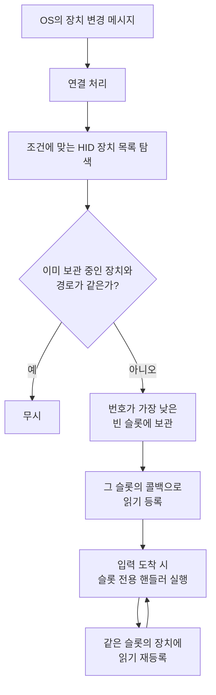
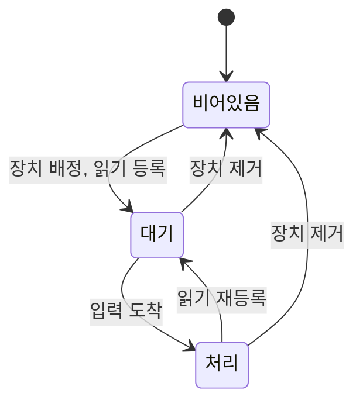

# 다중 USB 수신기 동시 지원

현재 진행 중인 과제에서 수신기를 한 개만 인식하던 프로그램이 여러 개를 동시에 지원하도록 바꾸는 task가 생겨, 그 과정을 기록하고자 한다. 대상은 무선 포인터와 함께 쓰는 윈도우 프로그램이다. 포인터의 버튼을 누르면 PC에 꽂은 USB 수신기(동글)로 신호가 전달되고, 프로그램이 이 신호를 읽어 화면에 포인터를 띄우거나 확대하는 동작을 수행한다. 수신기는 USB HID(Human Interface Device) 장치로 인식되며, 프로그램은 공개 라이브러리인 HidLibrary로 장치를 다룬다.

기존 프로그램은 수신기가 하나뿐이라고 가정하고 작성되어 있었다. 목표는 한 PC에서 최대 네 개의 포인터를 동시에 쓸 수 있게 하는 것이다.

| 항목 | 내용 |
|---|---|
| 기간 | 2022.12 ~ 2023.01 |
| 환경 | C#, Windows Forms, HidLibrary |
| 맡은 부분 | 다중 수신기 연결, 입력 처리, 연결 해제 처리 |

## 문제 상황

수신기를 두 개 꽂으면 다음과 같은 현상이 나타났다.

- 한 개를 꽂은 상태에서 다른 한 개를 꽂으면, 가장 최근에 꽂은 수신기만 동작한다. 제어권이 넘어가는 것이다.
- 두 수신기를 모두 읽도록 고치면 잠깐은 동작하지만, 몇 초 뒤에 오류가 나면서 신호가 제대로 들어오지 않는다.
- 첫 번째 수신기를 꽂을 때는 장치가 한 번만 잡히는데, 두 번째를 꽂으면 장치가 두세 개씩 한꺼번에 잡힌다.
- 두 개를 연결했다가 하나를 빼면, 이미 없는 객체를 해제하려다 오류가 난다.

가장 근본적인 문제는 입력이 들어와도 그것이 어느 수신기에서 온 것인지 알 수 없다는 점이었다.

## 분석

### 기존 코드의 읽기 구조

기존 코드가 입력을 읽는 방식은 다음과 같다.


장치가 연결되면 그 장치에 "입력이 오면 이 콜백을 불러 달라"고 읽기를 등록한다. 입력이 도착하면 콜백이 호출되고, 콜백은 화면을 다루는 핸들러를 UI 스레드에서 실행시킨다. 핸들러는 받은 데이터를 해석해 버튼에 해당하는 동작을 수행한다.

여기서 중요한 점은 **읽기 등록이 일회성**이라는 것이다. 한 번 입력을 받고 나면 등록이 끝나므로, 핸들러는 마지막에 같은 장치에 읽기를 다시 등록해야 한다. 그리고 이 코드는 장치 객체를 전역 변수 하나로 두고 있었다.

### 왜 수신기를 구분해야 하는가

장치 객체가 하나뿐이면, 새 수신기가 연결될 때 전역 변수가 새 장치로 덮어쓰인다. 그 뒤로는 핸들러가 읽기를 다시 등록하는 대상이 항상 마지막에 꽂은 장치가 된다. 먼저 꽂은 수신기는 한 번 입력을 받은 뒤로 다시 등록되지 않아 동작이 멈춘다.

그렇다고 핸들러에서 모든 장치에 읽기를 다시 등록하면, 이미 대기 중인 장치에 등록이 겹쳐 신호가 꼬인다. 몇 초 뒤에 오류가 나던 현상이 이것이다.

결국 핸들러가 실행되었을 때 **어느 장치의 입력으로 실행된 것인지**를 알아야, 그 장치에만 읽기를 다시 등록할 수 있다. 처음에는 어느 포인터가 눌렸는지 구분할 필요가 없으니 장치도 구분할 필요가 없다고 생각할 수 있었지만, 동작이 아니라 재등록 때문에 구분이 필요했다.

### 장치 경로는 식별자로 쓸 수 없다

장치 객체에서 얻을 수 있는 정보 가운데 장치마다 다른 것은 장치 경로뿐이었다. 그래서 수신기 두 개를 여러 포트에 번갈아 꽂으며 경로를 기록해 보았다. 결과는 다음과 같았다.

- 같은 수신기라도 PC의 어느 USB 포트에 꽂느냐에 따라 경로가 달라진다.
- 수신기를 몇 개 꽂았느냐에 따라서도 달라진다.
- 서로 다른 수신기가 같은 포트에 꽂히면 같은 경로를 갖는다.

장치 경로는 수신기가 아니라 꽂힌 위치를 나타내는 값이다. 경로를 빼면 두 수신기는 완전히 같은 장치로 취급되어 서로 구분되지 않는다. 포인터와 수신기도 고정된 짝이 아니어서, 수신기는 꽂힌 뒤 가장 최근에 신호를 보낸 포인터와 연결된다.

다만 경로는 "지금 같은 포트에 꽂혀 있는 같은 장치인가"를 판단하는 데에는 쓸 수 있다. 두 번째 수신기를 꽂을 때 장치가 여러 번 잡히는 문제는, 이미 가지고 있는 장치와 경로가 같으면 추가하지 않는 것으로 해결했다.

연결할 때 장치 수가 비정상적으로 늘어나던 또 다른 원인은 연결 코드에 있었다. 기존 코드는 "전역 장치 변수가 비어 있으면 찾지 못한 것"으로 판단했는데, 첫 번째 장치가 연결된 뒤에는 이 변수가 비어 있을 수 없다. 이번 탐색에서 찾은 장치를 담는 지역 변수를 따로 두어 판단하도록 고쳤다.

### 라이브러리의 구조

라이브러리가 읽기 요청을 어떻게 처리하는지도 살펴보았다. 읽기 메서드는 장치가 연결되어 있는지 확인하고, 열려 있지 않으면 장치를 연 다음, 제한 시간 안에 들어온 데이터를 읽어 보고서(report) 객체로 만들어 돌려준다. 콜백을 받는 비동기 버전은 이 읽기 메서드를 가리키는 delegate를 만들고, 사용자가 넘긴 콜백과 함께 상태 객체에 담아 비동기로 실행한다. 읽기가 끝나면 보관해 둔 콜백을 호출한다. 즉 읽기 메서드가 호출하는 쪽(caller), 사용자의 콜백이 호출되는 쪽(callback)이 되는 구조이다.

이 구조에서 콜백은 보고서만 전달받고, 어느 장치 객체에서 온 것인지는 전달받지 못한다.

## 해결

### 세 번의 시도

장치를 구분하기 위해 세 가지 방법을 차례로 시도했고, 처음에는 모두 실패했다.

| 시도 | 내용 | 결과 |
|---|---|---|
| 다른 읽기 API 사용 | 라이브러리의 다른 비동기·동기 읽기 메서드로 바꾼다 | 참고할 문서를 찾지 못했고, 직접 지정한 콜백을 붙일 방법이 없어 제외했다 |
| 클래스로 감싸기 | 장치 객체와 읽기 콜백, 핸들러를 하나의 클래스로 묶어 장치마다 인스턴스를 만든다 | 핸들러를 UI 스레드에서 실행시키는 호출이 "창 핸들을 만들기 전에는 호출할 수 없다"는 예외로 실패했다 |
| 라이브러리 수정 | 라이브러리의 장치 클래스에 멤버를 추가해 구분한다 | 수정한 내용이 프로그램에 반영되지 않았다 |

두 번째 방법이 실패한 이유는 당시에는 정확히 알지 못했다. 화면을 다루는 코드는 UI 스레드에서만 실행할 수 있어서 다른 스레드에서는 UI 스레드에 실행을 요청해야 하는데, 새로 만든 클래스에는 요청을 받아 줄 창(컨트롤)이 없었던 것으로 보았다.

### 슬롯 배열과 슬롯별 핸들러

세 방법이 모두 막힌 뒤, 처음에 떠올렸다가 미뤄 둔 방법으로 돌아갔다. 읽기 콜백과 핸들러를 장치 수만큼 미리 만들어 두면, 어느 핸들러가 실행되었는지가 곧 어느 장치인지를 알려 주므로 장치를 구분할 필요가 없다. 코드가 반복되고 확장성이 떨어진다는 이유로 미뤄 두었지만, 다른 기능을 추가하는 데 지장을 주는 구조는 아니어서 우선 이 방식으로 구현했다.

장치를 전역 변수 하나가 아니라 고정된 크기의 배열(슬롯)에 보관하고, 슬롯마다 전용 콜백과 핸들러를 짝지었다.



**연결 감지.** 수신기를 꽂으면 OS가 창으로 장치 변경 메시지를 보낸다. 창의 메시지 처리 메서드를 재정의해 이 메시지를 받으면 연결 처리를 시작한다.

**탐색과 슬롯 배정.** 라이브러리의 열거 기능으로 포인터 수신기의 하드웨어 조건에 맞는 장치 목록을 받는다. 목록을 돌면서 이미 슬롯에 있는 장치와 경로가 같은 것은 건너뛴다. 새 장치라고 판단되면 해제 콜백을 지정하고 초기 설정을 한 뒤, 번호가 가장 낮은 빈 슬롯에 넣는다.

```
함수 연결_처리():
    목록 = 조건에 맞는 HID 장치 열거
    각 장치에 대해:
        만약 슬롯에 경로가 같은 장치가 있으면: 건너뜀
        k = 번호가 가장 낮은 빈 슬롯
        해제 콜백 지정, 초기 설정
        슬롯[k] = 장치
        슬롯[k]에 읽기 등록(콜백_k)

함수 콜백_k(보고서):                 # 슬롯마다 따로 존재
    UI 스레드에서 핸들러_k(보고서) 실행

함수 핸들러_k(보고서):
    보고서를 해석해 버튼 동작 수행
    만약 슬롯[k]가 비어 있지 않으면:
        슬롯[k]에 읽기 등록(콜백_k)    # 자기 슬롯에만 재등록
```

**해제.** 수신기를 빼면 연결할 때 지정해 둔 해제 콜백이 실행된다. 여기서 슬롯을 돌며 연결이 끊긴 장치를 찾아 그 슬롯을 비운다. 모든 슬롯이 비면 포인터 화면을 연결 해제 상태로 바꾼다.

수신기를 뺄 때도 읽기 핸들러가 한 번 호출된다는 점을 주의해야 했다. 이때 이미 비워진 슬롯에 읽기를 다시 등록하려 하면 오류가 나므로, 재등록 전에 슬롯이 비어 있는지 확인한다.

슬롯의 상태는 다음과 같이 바뀐다.



처음에는 포인터 두 개로 동작을 확인했고, 이후 슬롯을 늘려 나갔다.

### 라이브러리 수정 방식과의 비교

이후 막혀 있던 라이브러리 수정도 성공시켰다. 라이브러리 쪽에서 장치를 구분할 수 있게 하면 핸들러를 장치 수만큼 만들 필요 없이 하나로 처리할 수 있다. 두 방식을 모두 구현한 뒤, 사용할 수 있는 포인터 세 개를 동시에 움직이면서 CPU 사용률을 비교했다.

| | 슬롯별 핸들러 방식 | 라이브러리 수정 방식 |
|---|---|---|
| 핸들러 수 | 슬롯 수만큼. 콜백과 핸들러가 짝이므로 네 슬롯이면 여덟 개 | 한 쌍 |
| 읽기 재등록 | 핸들러가 자기 슬롯을 이미 알고 있어 바로 등록 | 장치들의 표시를 확인해 대상을 찾은 뒤 등록 |
| 확장성 | 장치 수를 늘리려면 코드를 추가해야 한다 | 장치 수가 늘어도 코드가 그대로이다 |
| CPU 사용률 | 유의미한 차이 없음 | 유의미한 차이 없음 |

슬롯별 핸들러 방식은 대상을 찾는 과정이 없어 이론적으로는 조금 더 빠르고, 메서드가 더 많은 만큼 메모리를 조금 더 쓴다. 그러나 포인터가 네 개뿐인 규모에서는 어느 쪽도 의미 있는 차이를 만들지 않았다. 차이가 없다면 확장성이 좋은 라이브러리 수정 방식을 쓰는 편이 낫다고 판단했다. 다만 아주 단순한 방법으로 한 비교였으므로, 정확한 성능 비교는 따로 필요하다.

### 남은 문제

- 포인터 하나가 수신기 두 개를 모두 차지하는 경우가 있다. 수신기는 꽂힌 뒤 가장 최근에 신호를 보낸 포인터와 연결되므로, 새 수신기를 꽂은 직후 기존 포인터를 먼저 움직이면 그 포인터가 새 수신기까지 가져간다. 프로그램에서 막을 수 없는 부분이라 이런 경우는 없다고 가정했다.
- 포인터에서 손을 뗐다가 다시 누르면 커서가 화면 중앙으로 돌아가는 현상이 일부 PC에서 발견되었다. AMD CPU를 쓰는 PC에서만 나타났고, 원인은 파악하지 못했다.
