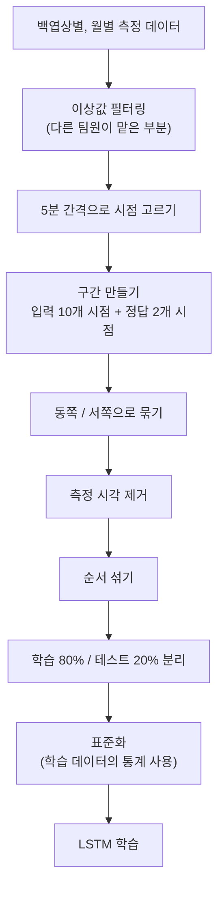
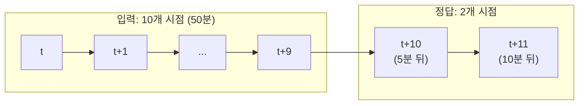
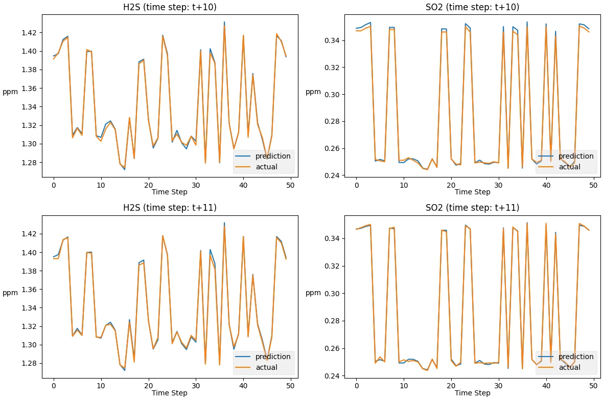

# 시계열 센서 데이터 이상 탐지 (LSTM)

현재 진행 중인 과제에서 가스와 기상 센서 데이터로 악취 상황을 감지하는 모델을 실험하게 되어, 전처리와 학습 과정을 기록하고자 한다. 대상은 하수 처리 시설에 설치된 백엽상 네 대이다. 백엽상은 온도, 습도, 기압, 풍향, 풍속을 측정하고, 여기에 더해 황화수소(H2S), 이산화황(SO2), 일산화탄소(CO), 암모니아(NH3) 가운데 일부 가스의 농도를 측정한다. 이렇게 모인 데이터를 분석해 악취를 미리 알려 주는 시스템을 만드는 것이 과제의 목표이다.

악취를 "감지"하려면 무엇이 평소와 다른 상태인지를 판단해야 한다. 이번 실험에서는 먼저 가까운 미래의 가스 농도를 예측하는 모델을 만들고, 예측이 잘 되면 그 결과를 바탕으로 이상 여부를 판단하는 순서로 접근하기로 했다. 이 글에서 다루는 것은 앞 단계인 예측 모델의 전처리와 학습 실험이다.

| 항목 | 내용 |
|---|---|
| 기간 | 2024.05 |
| 환경 | Python, pandas, NumPy, TensorFlow(Keras) |
| 맡은 부분 | 측정 간격을 맞추는 전처리, 학습 데이터 구성, LSTM 학습 실험 |

## 문제 상황

**센서의 수집 간격이 일정하지 않다.** 백엽상 가운데 두 대는 상시 전원이 아니라 배터리로 동작해서 데이터가 중간에 끊길 수 있고, 그중 한 대는 실제로 자주 끊겼다. 시설 안의 무선망 사정도 좋지 않아 전송이 늦어지거나 빠지는 경우가 있다. 그 결과 측정값이 들어온 시각의 간격이 들쭉날쭉하다.

**백엽상의 위치에 따라 데이터의 성격이 다르다.** 백엽상이 모두 배출구 바로 옆에 있는 것은 아니다. 두 대는 배출구 옆에, 한 대는 배출구에서 조금 떨어진 곳에, 나머지 한 대는 배출구 옆이 아닌 곳에 있다. 실제로 동쪽과 서쪽의 백엽상은 변수들 사이의 관계가 서로 다르게 나타났다.

**학습 데이터가 적다.** 사용할 수 있는 데이터는 4월과 5월 두 달 치뿐이고, 학습에 쓸 수 있는 형태로 만들면 수천 건 수준이다. 모든 계절의 데이터가 모인 것도 아니다.

**이상한 값이 섞여 있다.** 같은 값이 계속 반복되거나 주변 값에서 크게 벗어난 값이 들어온다. 이런 값을 걸러 내는 방법은 학습 데이터에만 쓰는 것이 아니라 나중에 추론할 때도 똑같이 적용되어야 하므로, 손으로 고르는 것이 아니라 정해진 알고리즘이어야 한다.

## 분석

**무엇을 예측할 것인가.** 하수 처리 과정에서 나오는 냄새의 원인은 대부분 황 계열이라는 설명을 현장 관계자에게서 들었다. 데이터를 살펴보아도 암모니아와 일산화탄소는 값이 거의 일정해서 예측 대상으로 삼을 의미가 적었다. 그래서 황화수소와 이산화황의 농도를 예측 대상으로 정했다.

**LSTM은 간격이 일정한 구간을 입력으로 받는다.** LSTM은 연속된 시점의 값을 차례로 읽어 다음 값을 예측한다. 시점 사이의 간격이 제각각이면 "열 시점 전"이 어떤 때는 50분 전이고 어떤 때는 두 시간 전이 되어 버린다. 따라서 학습 전에 측정값을 일정한 간격의 시점으로 정리해야 한다. 간격은 5분으로 정했고, 50분(10개 시점)의 데이터를 보고 그다음 시점을 예측하는 형태로 잡았다.

**백엽상을 합쳐서 학습할지, 따로 학습할지.** 데이터가 적으니 네 대의 데이터를 모두 합치고 싶지만, 설치 환경이 서로 달라 합치면 오히려 결과가 나빠질 수 있다. 변수 사이의 관계가 동쪽과 서쪽에서 다르게 나타났으므로, 동쪽 두 대와 서쪽 두 대를 각각 묶어 모델을 따로 학습하기로 했다.

**이상값을 거르는 순서.** 이상값을 거르는 작업(사분위 범위를 이용한 필터링)은 다른 팀원이 맡은 부분이다. 다만 순서를 정할 필요가 있었다. 처음에는 시간 기준으로 데이터를 여러 조각으로 자른 뒤 조각마다 구간을 만들 생각이었는데, 이렇게 하면 조각 사이가 이어지지 않아 앞 구간을 기준으로 뒤 구간의 이상 여부를 판단할 수 없는 경우가 생긴다. 조각의 길이가 구간 하나(12개 시점)에 못 미치면 그 조각을 통째로 버려야 하는 문제도 있다. 논의 끝에 이상값 필터링을 먼저 하고, 데이터를 하나의 표로 유지한 상태에서 구간을 만들기로 했다.

## 해결

전체 처리 순서는 다음과 같다.



### 5분 간격으로 시점 고르기

측정값을 새로 계산해 채워 넣는 대신, 실제 측정값 가운데 5분 간격에 가장 가까운 것을 골라 이어 붙이는 방식을 썼다. 정확히 5분 뒤에 측정된 값이 없을 수 있으므로 앞뒤로 1분의 허용 범위를 두었다.

```
함수 다음_시점_찾기(기준):
    후보 = 빈 목록
    기준 뒤의 측정값을 시간 순으로 하나씩 보면서:
        차이 = 측정 시각 - 기준의 측정 시각
        만약 4분 <= 차이 <= 6분이면: 후보에 추가
        만약 차이 > 6분이면: 탐색 중단
    만약 후보가 없으면: "없음" 반환
    만약 후보가 하나이면: 그 측정값 반환
    아니면: 차이가 5분에 가장 가까운 측정값 반환

함수 구간_만들기(시작):
    구간 = [시작]
    기준 = 시작
    11번 반복:
        다음 = 다음_시점_찾기(기준)
        만약 다음이 "없음"이면: 이 구간은 만들지 않음, 종료
        구간에 다음을 추가
        기준 = 다음
    구간의 앞 10개는 입력, 뒤 2개는 정답으로 저장
```

탐색을 멈추는 조건에서 한 번 실수가 있었다. 처음에는 허용 범위에 들지 않는 측정값을 만나는 즉시 탐색을 멈추게 했는데, 이렇게 하면 기준에서 4분이 채 지나지 않은 측정값을 만났을 때도 멈춰 버려 뒤에 있는 후보를 보지 못한다. 차이가 6분을 넘었을 때에만 멈추도록 고쳤다.

하나의 구간은 12개 시점으로 이루어진다.



입력은 변수 4개의 10개 시점 값이고, 정답은 t+10과 t+11 시점의 황화수소와 이산화황 농도, 즉 값 4개이다.

### 학습 데이터 구성

백엽상별, 월별로 만든 구간을 동쪽과 서쪽으로 합친 결과는 다음과 같다.

| 묶음 | 구성 | 구간 수 | 학습 | 테스트 |
|---|---|---|---|---|
| 서쪽 | 백엽상 2대의 4월, 5월 데이터 | 4,952 | 4,000 | 952 |
| 동쪽 | 백엽상 2대의 4월, 5월 데이터 | 6,862 | 5,500 | 1,362 |

합친 뒤에는 다음 순서로 처리했다.

1. **측정 시각 제거.** 구간에는 변수 4개와 함께 측정 시각이 들어 있다. 학습에는 시각을 쓰지 않으므로 제거한다.
2. **순서 섞기.** 백엽상별, 월별 데이터를 이어 붙인 순서 그대로 학습하면 모델이 그 순서에 의존할 수 있으므로 구간의 순서를 무작위로 섞는다.
3. **학습과 테스트 분리.** 약 8:2로 나눈다.
4. **표준화.** 값의 크기가 변수마다 다르므로 평균이 0, 표준편차가 1이 되도록 맞춘다.

### 표준화에서 겪은 문제

표준화는 처음에 잘못 구현되어 있었고, 데이터 증강 실험의 결과를 확인하던 중에 이를 발견했다.

처음에는 평균과 표준편차를 구간의 개수 방향으로만 계산했다. 이렇게 하면 "첫 번째 변수의 세 번째 시점"처럼 변수와 시점의 조합마다 통계값이 따로 만들어진다. 같은 변수인데도 구간 안의 위치에 따라 다른 기준으로 변환되는 것이다. 테스트 데이터를 표준화하는 부분도 비어 있었다. 이를 다음과 같이 고쳤다.

| | 처음 | 수정 후 |
|---|---|---|
| 입력의 통계 | 변수와 시점의 조합마다 하나씩 | 변수마다 하나씩 (모든 구간과 시점을 합쳐 계산) |
| 정답의 통계 | 입력과 별도로 계산 | 입력과 별도로, 정답 값 4개 각각에 대해 계산 |
| 테스트 데이터 | 표준화하지 않음 | 학습 데이터에서 구한 평균과 표준편차로 변환 |

입력과 정답의 통계를 따로 구하는 것은 둘의 분산이 다를 수 있기 때문이다. 테스트 데이터는 반드시 학습 데이터에서 구한 평균과 표준편차로 변환해야 한다.

고친 뒤에는 테스트 데이터의 값이 모두 음수로 나오는 현상이 있었다. 처음에는 학습 데이터의 통계로 변환했으니 그럴 수 있다고 해석했는데, 이 해석은 틀린 것이었다. 실제 원인은 값을 원래 단위로 되돌리는 역표준화를 잘못한 데 있었다.

### 모델

모델은 Keras로 구성했다.

| 층 | 설정 |
|---|---|
| 입력 | 변수 4개 × 10개 시점 |
| LSTM | 유닛 64개 |
| Dense | 유닛 8개, ReLU |
| Dense (출력) | 유닛 4개, 선형 |

손실 함수는 평균 제곱 오차(MSE), 최적화 알고리즘은 Adam을 썼고, 평균 제곱근 오차(RMSE)를 함께 기록했다.

배치 정규화를 넣을 수 있는지도 확인했다. LSTM 층 안에는 넣을 수 없고, LSTM을 지난 뒤 Dense 층 사이에는 넣을 수 있다. 넣어서 학습해 보았으나 결과가 더 나빠져서 빼기로 했다.

### 학습 결과

표준화를 고친 뒤 100 epoch씩 학습한 결과는 다음과 같다. 손실은 표준화된 값 기준이다.

| 묶음 | 학습률 | 테스트 MSE | 테스트 RMSE |
|---|---|---|---|
| 동쪽 | 0.0005 | 0.0017 | 0.041 |
| 서쪽 | 0.0001 | 0.0028 | 0.053 |



테스트 표본 50개에 대한 예측값(파란색)과 실제값(주황색)이다. 왼쪽은 황화수소, 오른쪽은 이산화황이고, 위는 t+10, 아래는 t+11 시점이다. 데이터를 섞은 뒤 나누었으므로 가로축은 시간 순서가 아니라 표본의 번호이다.

예측값은 실제값의 오르내림을 거의 그대로 따라갔다. 다만 시계열 예측에서는 수치 하나보다 추세를 잘 담는지가 중요하다고 보고, 손실과 함께 그래프를 확인했다.

서쪽 묶음의 손실이 동쪽보다 컸다. 서쪽에는 배출구 바로 옆에 있지 않은 백엽상이 포함되어 있다. 이 백엽상은 변수 사이의 관계가 배출구 옆의 백엽상과 비슷하게 나타나기는 하지만, 배출구에서 떨어져 있는 만큼 데이터의 품질이 떨어지는 것으로 보았다.

### 데이터 증강 실험

데이터가 적다는 문제를 줄이기 위해, 원래 데이터에 노이즈를 섞은 데이터를 더해 학습 데이터로 쓰는 실험을 했다.

| 묶음 | 증강 전 구간 수 | 증강 후 구간 수 | 학습 | 테스트 |
|---|---|---|---|---|
| 동쪽 | 6,862 | 13,724 | 11,000 | 2,724 |
| 서쪽 | 4,952 | 9,904 | 8,000 | 1,904 |

서쪽은 증강하기 전의 성능이 더 좋게 나왔다. 따라서 증강한 데이터와 원래 데이터 가운데 어느 쪽을 쓸지는 따로 확인이 필요하다고 정리했다.

### 더 먼 시점을 예측하기 위한 전처리 수정

5분, 10분 뒤가 아니라 1시간 뒤처럼 더 먼 시점을 예측하는 실험을 준비하기 위해 전처리를 수정했다. 다음 시점을 찾는 함수에 "기준 시각을 몇 분 뒤로 미룰지"를 받는 인자를 추가했다. 이 값을 60으로 주면 마지막 입력 시점에서 60분 뒤를 기준으로 앞뒤 1분 안의 측정값을 찾아 정답으로 쓴다. 구간의 크기도 12개 시점에서 입력 12개와 정답 3개로 바꾸었다.

수정한 전처리로 구간을 다시 만든 뒤, 학습률 0.0001로 100 epoch 학습했을 때 기록한 손실은 다음과 같다.

| 묶음 | 학습 구간 수 | 학습 손실 | 테스트 손실 |
|---|---|---|---|
| 서쪽 | 5,000 | 0.0075 | 0.0055 |
| 동쪽 | 8,000 | 0.0099 | 0.0075 |

### 남은 문제

- 데이터가 두 달 치뿐이어서 모든 계절의 상황을 담지 못한다. 지금의 결과는 이 제한 안에서의 결과이다.
- 예측이 잘 되는 것을 확인한 단계까지 진행했다. 예측값과 실제값의 차이를 이용해 이상 여부를 판단하는 부분은 이후의 작업으로 남아 있다.
