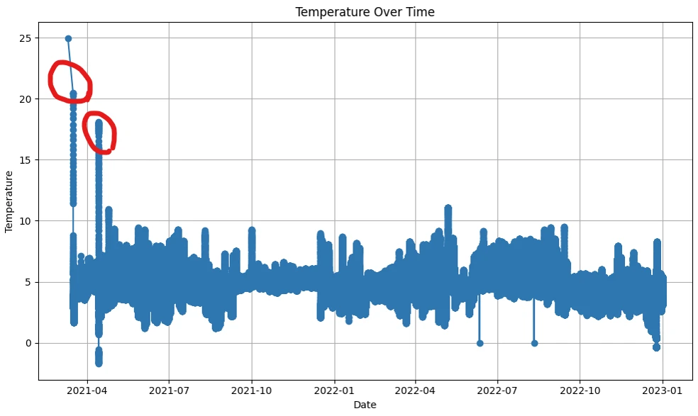
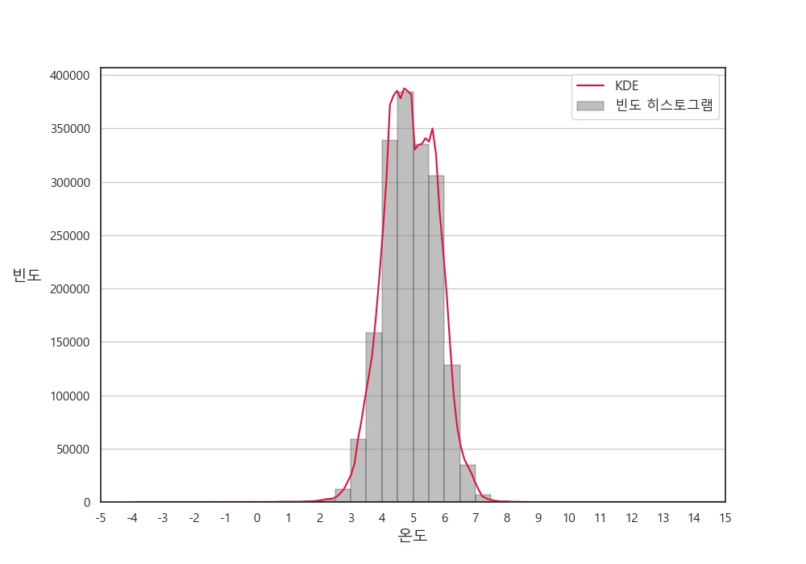
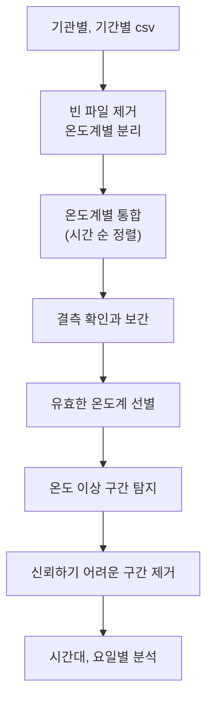
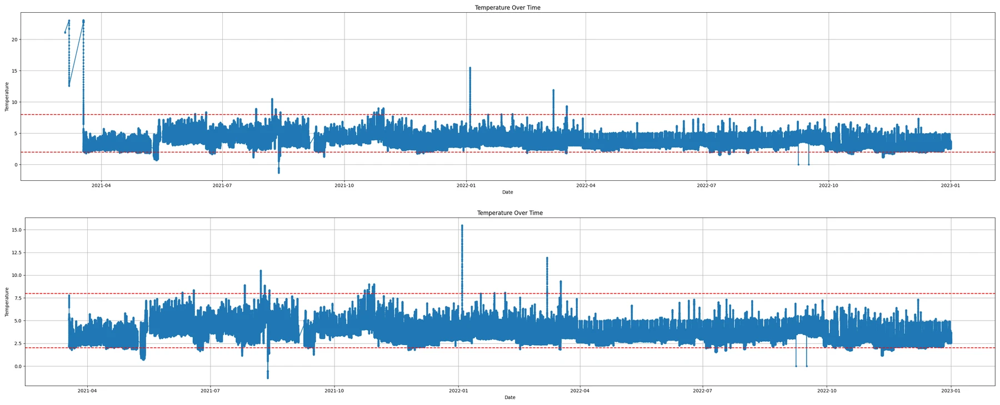
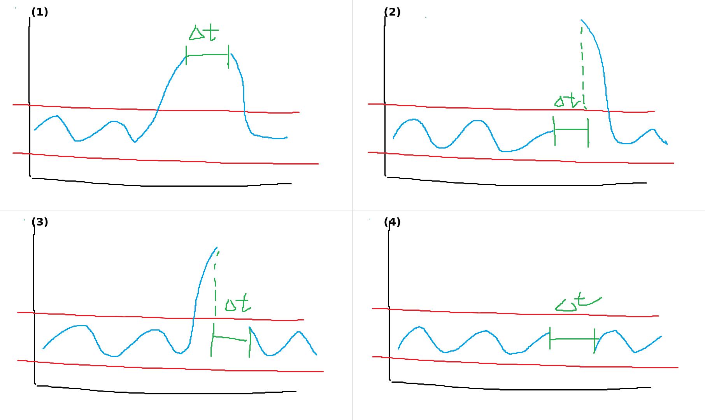

# 백신 냉장고 온도 데이터 분석

백신 냉장고의 온도 데이터를 분석하는 과정에서, 백신 냉장고의 온도 유지 성능을 분석해 보고자 한다. 대상은 여러 기관의 백신 냉장고 안에 넣어 둔 온도계가 보내온 측정값이다. 온도계는 약 30초 간격으로 온도를 측정해 서버로 보내고, 서버에는 이 값이 온도계별로 쌓여 있다. 한 온도계의 데이터는 곧 그 온도계가 들어 있는 냉장고 한 대의 기록이므로, 이 데이터를 보면 냉장고가 온도를 얼마나 잘 유지했는지 알 수 있다.

이 글은 본격적인 연구가 아니라, 쌓여 있는 데이터를 정리하고 간단히 분석하고 실험해 본 과정을 적은 것이다. 무엇을 "잘 유지했다"고 볼지 기준을 정하고, 분석할 수 있는 형태로 데이터를 정리하고, 믿기 어려운 값을 걸러 내는 방법을 찾는 데 대부분의 시간을 썼다.

| 항목 | 내용 |
|---|---|
| 기간 | 2024.01 ~ 2024.08 |
| 환경 | Python, pandas, Matplotlib, SciPy |
| 맡은 부분 | 데이터 정리(온도계별 분리와 통합), 유효한 온도계를 고르는 기준, 온도 이상 구간의 탐지와 필터링, 분포 확인, 시간대와 요일에 따른 분석 방법 |

## 문제 상황

**온도계가 너무 많다.** 온도계는 약 1,000개이다. 시계열 데이터는 그래프로 그려서 보는 것이 기본인데, 1,000개를 모두 그려서 볼 수는 없다. 그렇다고 전체의 평균을 내어 하나의 선으로 그리면 냉장고마다 다른 특성이 사라진다.

**데이터가 분석할 수 있는 형태가 아니다.** 전달받은 데이터는 기관별 폴더에 기간별 csv 파일로 나뉘어 있었다. 한 기관이 온도계를 여러 개 쓰는 경우에는 한 파일에 여러 온도계의 값이 섞여 있다. 제목 줄만 있는 빈 파일도 있고, 온도 값이 비어 있는 행이 있을 가능성도 있었다. 서버의 DB에서 온도 항목에 빈 값을 막는 설정이 되어 있지 않았기 때문이다.

**믿기 어려운 값이 섞여 있다.** 아래는 한 온도계의 전체 기록이다.



측정을 시작한 직후에 20도 안팎의 높은 값(붉은 원)이 보인다. 온도계는 실온에서 켠 다음 냉장고에 넣기 때문에, 처음 얼마 동안은 냉장고의 온도가 아니라 실온에서 식어 가는 온도계의 온도가 기록된다. 이 값을 그대로 두면 냉장고가 온도를 유지하지 못한 것으로 계산된다.

이 밖에도 다음과 같은 값이 있었다.

- 연결이 한동안 끊겼다가 다시 이어진 구간. 끊긴 동안 무슨 일이 있었는지 알 수 없다.
- 앞뒤의 흐름과 상관없이 한 번만 찍힌 값. 이전 측정값과 같은 초에 0.0도가 들어온 경우처럼 센서나 전송 과정의 오류로 보이는 것이다.
- 아주 오랫동안 범위를 벗어난 채 유지되는 구간. 냉장고를 시험하거나 수리하는 중이었을 가능성이 있다.

문제는 이런 값과 냉장고의 실제 온도 변화를 구분할 근거가 데이터 안에 거의 없다는 점이다.

## 분석

### 기준 온도

먼저 정상 범위를 확인했다. 질병관리청의 백신 보관 및 관리 가이드라인에 따르면 백신은 2 ~ 8도에서 보관해야 하고, 평균 5도를 유지하는 것이 좋다. 냉장고는 온도를 균일하게 유지해야 하고, 범위를 벗어났을 때 적정 온도로 빠르게 돌아올 수 있어야 한다.

이에 따라 2 ~ 8도를 벗어난 측정값을 **온도 이상**으로 정의했다. 8도를 넘으면 고온 이상, 2도에 못 미치면 저온 이상이다. 두 가지는 위험한 정도가 다르다고 보아 처음부터 따로 기록하고 따로 분석하기로 했다.

성능을 나타내는 지표로는 다음과 같은 후보를 검토했다.

- 측정 기간의 평균 온도가 5도에서 얼마나 떨어져 있는가
- 온도의 편차가 얼마나 큰가
- 온도 이상이 생긴 뒤 정상 범위로 돌아오는 데 얼마나 걸리는가
- 가장 높은 온도에서 정상 범위로 돌아올 때의 평균 기울기는 얼마인가

온도계가 많다는 문제에 대해서는, 이런 지표로 온도계를 몇 개의 군집으로 나눈 다음 군집마다 몇 개씩 골라 그려 보는 방법을 검토했다.

### 분포 확인

어떤 통계 기법을 쓸 수 있는지는 데이터의 분포에 달려 있다. 정규성을 가정할 수 있으면 모수 검정을, 그렇지 않으면 비모수 검정을 써야 한다. 그래서 온도계별로, 그리고 여러 온도계를 묶은 집단별로 다음 세 가지 그래프를 그렸다.

| 그래프 | 확인하는 것 |
|---|---|
| 히스토그램 | 분포의 전체 모양. 좌우 대칭인지, 봉우리가 하나인지 |
| QQ plot | 정규분포와의 차이. 정규분포를 따르면 점들이 직선에 가깝고, 한쪽으로 치우치면 직선에서 멀어진다 |
| 박스 플롯 | 중앙값과 사분위 범위, 범위를 벗어난 값 |

히스토그램은 구간(bin)을 어떻게 잡느냐에 따라 모양이 달라질 수 있다. 기준이 되는 5도를 중심으로 구간의 폭(0.5도, 0.25도, 0.1도)과 시작 위치를 바꾼 다섯 가지 설정으로 그려 비교했다.



여러 온도계의 측정값을 모아 그린 히스토그램이다. 구간의 폭은 0.5도이고, 가로축은 -5 ~ 15도로 제한했다.

데이터의 개수가 워낙 많아서 구간 설정에 따른 차이는 거의 보이지 않았다. 또한 표본이 많을수록 히스토그램의 모양이 정규분포에 가깝게 보였다. 그래프와 함께 쓸 수 있는 정규성 검정(콜모고로프-스미르노프, 릴리포스, 앤더슨-달링, 샤피로-윌크 등)도 조사해 두었다.

## 해결

전체 과정은 다음과 같다.



### 온도계별 데이터 통합

데이터를 서버에서 내려받는 일은 다른 팀원이 맡았고, 전달받은 파일을 정리하는 과정을 맡았다. 정리는 다음 순서로 자동화했다.

1. 제목 줄만 있는 빈 파일을 지운다.
2. 한 파일에 온도계가 둘 이상 들어 있으면 온도계별 파일로 나눈다.
3. 기관의 폴더를 돌면서 같은 온도계의 파일을 모두 읽어 하나로 이어 붙이고, 측정 시각 순으로 정렬해 온도계 하나에 파일 하나가 되도록 저장한다. 분석에 쓰지 않는 식별용 항목은 이때 뺀다.

처리 과정은 모두 로그 파일에 남기고, 끝난 뒤 오류와 결측 기록을 검색해 확인하도록 했다. 데이터를 여러 사람이 나누어 처리했기 때문에, 실행 순서와 확인할 항목을 문서로 정리해 함께 전달했다.

이 과정에서 두 가지 문제를 겪었다.

- **이름이 겹치는 경우.** 나눈 파일을 원래 파일과 구분하려고 파일 이름 끝에 온도계의 이름을 붙였는데, 기관의 이름과 온도계의 이름이 같은 경우가 많아 이미 나눈 파일을 다시 나누려 드는 문제가 생겼다. 나눈 파일의 이름에 별도의 구분 문자열을 넣고, 이 문자열이 있으면 건너뛰도록 고쳤다.
- **정렬 누락.** 통합한 뒤 온도계별 정보를 뽑아 보니 측정 시작일과 종료일이 이상한 것이 있었다. 파일을 이어 붙일 때 항상 시간 순으로 붙였다고 생각해 정렬을 넣지 않았는데, 실제로는 순서가 섞인 경우가 있었다. 통합 단계에서 측정 시각 기준으로 한 번 정렬하도록 고쳤다.

### 결측 보간

온도 값이 비어 있는 행은 그 행의 측정 시각을 기준으로 앞뒤 1분 안에 측정된 값들의 평균으로 채우도록 했다. 측정 간격이 약 30초이므로 앞뒤 1분이면 주변의 값 몇 개가 들어온다.

실제로 돌려 보니 결측은 한 기관의 일부 파일에서만 나왔다. 원본을 확인해 보니 온도계의 결측이 아니라 데이터를 내려받는 도중 쿼리가 중단되면서 깨진 행이었고, DB에는 해당 기간의 데이터가 아예 없었다. 그 파일은 지워도 된다고 판단했고, 결과적으로 분석할 데이터에는 결측이 없었다.

### 유효한 온도계 선별

통합한 파일마다 다음 세 가지를 뽑아 표로 만들었다.

| 항목 | 용도 |
|---|---|
| 전체 측정값의 개수 | 데이터가 충분한지 판단 |
| 첫 측정일과 마지막 측정일 | 측정 기간 파악 |
| 측정이 끊긴 가장 긴 간격 | 중간에 오래 비어 있는 온도계를 가려냄 |

간격이 전혀 없는 온도계는 없었다. 그래서 "끊김이 없는 것"이 아니라 "일정 수준 이상으로 끊기지 않은 것"을 고르는 쪽으로 기준을 잡았다. 표를 보면 2021년 3월 무렵부터 2022년 말까지 꾸준히 측정된 온도계가 많아, 이를 바탕으로 온도계를 골랐다. 이후의 분석은 약 450개의 온도계를 대상으로 했다.

뒤에서 설명할 필터링을 거친 다음에도 데이터가 충분히 남았는지 다시 확인했다. 30초 간격으로 1년을 측정하면 1,051,200개가 되는데, 그 90%인 946,080개를 기준선으로 삼았다. 필터링 뒤에 측정 기간이 1년에 못 미치고 개수도 기준에 못 미치는 온도계는 분석에서 뺐다.

### 온도 이상 구간 탐지

측정값 하나하나가 아니라, 범위를 벗어나기 시작해서 다시 돌아올 때까지를 하나의 **온도 이상 구간**으로 묶었다. 측정값을 시간 순으로 읽으면서 상태를 바꿔 가는 방식이다.

```
상태 = 정상
각 측정값에 대해 (시간 순으로):
    만약 온도 < 2 또는 온도 > 8이면:              # 범위를 벗어남
        만약 상태가 정상이면:
            상태 = 이상
            종류 = 고온 또는 저온
            시작 시각 기록
            직전 측정값과의 간격 기록              # 직전 값이 없으면 "없음"
        아니면:
            직전 측정값과의 간격을 목록에 추가
            가장 크게 벗어난 온도 갱신
            만약 종류가 달라졌으면: 종류 = 혼합
    아니면:                                       # 정상 범위
        만약 상태가 이상이면:
            이 측정값과의 간격을 "다음 간격"으로 기록
            구간 하나를 저장
            상태 = 정상

만약 상태가 이상인 채로 끝났으면:
    마지막 구간도 저장                             # 다음 간격은 "없음"
```

마지막 부분은 처음에 빠뜨렸던 것이다. 데이터가 온도 이상 상태로 끝나면 구간을 닫아 줄 정상 값이 없어서 마지막 구간이 기록되지 않았다.

구간마다 다음 값을 기록한다.

| 항목 | 뜻 |
|---|---|
| 종류 | 고온, 저온, 혼합 |
| 지속 시간 | 구간의 첫 측정값부터 마지막 측정값까지의 시간 |
| 직전 간격 | 구간이 시작되기 바로 전 측정값과의 시간 간격 |
| 다음 간격 | 구간이 끝난 바로 다음 측정값과의 시간 간격 |
| 최대 간격 | 구간 안의 측정값들 사이의 간격 가운데 가장 큰 것 |
| 평균 간격 | 구간 안의 측정값들 사이의 간격의 평균 |

### 첫 번째 시도: 온도와 지속 시간의 IQR 기준

처음에는 박스 플롯에서 쓰는 사분위 범위(IQR) 기준으로 비정상적인 구간을 걸러 내려 했다. 온도가 지나치게 높거나 낮은 구간, 지속 시간이 지나치게 긴 구간을 1.5 IQR 기준으로 찾아 지우는 방식이다.

기준을 어느 범위에서 계산할지는 항목에 따라 다르게 정했다.

- **온도**는 온도계마다 따로 계산한다. 어떤 온도계에서 튀는 값인지를 보는 것이므로 그 온도계의 분포가 기준이 되어야 한다.
- **지속 시간**은 전체 온도 이상 구간을 모아서 계산하되, 고온과 저온을 나눈다. 고온 이상만 있고 저온 이상은 몇 번 없는 온도계가 있어서, 온도계 하나만으로 계산하면 기준이 엉뚱하게 잡힐 수 있기 때문이다.

지속 시간을 정리하다가 지속 시간이 0초인 저온 이상을 발견했다. 해당 데이터를 열어 보니 이전 온도의 흐름과 상관없이 같은 초에 0.0도가 찍힌 것이었다. 지속 시간이 20초 이하인 저온 이상을 하나씩 확인해 잘못 들어온 값을 지웠고, 30초 미만인 것까지 넓혀 확인했을 때는 모두 정상적인 값이었다.



같은 온도계의 필터링 전(위)과 후(아래)이다. 붉은 점선은 2도와 8도이다. 측정을 시작한 직후의 높은 값이 제거되었다.

그러나 이 방식은 잘 맞지 않는 경우가 많았다. 연속해서 측정되어 실제 온도 변화로 보이는 구간이 길다는 이유로 지워지고, 연결이 끊겼다 이어져 믿기 어려운 구간이 짧다는 이유로 남았다. 지속 시간의 길고 짧음은 그 구간을 믿을 수 있는지와 관계가 없었던 것이다.

### 두 번째 시도: 연결이 끊긴 구간 제거

기준을 다시 세웠다. 온도 이상이 실제로 일어난 것인지 아닌지는 데이터만으로 판단할 수 없으므로, 원칙적으로 모든 온도 이상을 남긴다. 다만 **온도 이상의 앞, 뒤, 또는 중간에 연결이 오래 끊긴 경우**는 믿을 수 없다고 보고 지운다.

연결이 오래 끊기는 이유는 배터리 부족, 기기 결함, 전원 종료 등이다. 어느 쪽이든 온도계를 냉장고에서 꺼내 실온에 두었을 가능성이 높다. 배터리를 갈거나 전원을 끄려면 온도계를 꺼내야 하기 때문이다. 그러니 끊김과 맞닿아 있는 온도 이상은 냉장고의 온도가 아닐 수 있다.

끊김과 온도 이상이 만나는 경우는 네 가지이다.



붉은 선은 정상 범위의 경계, 파란 선은 온도, 초록색으로 표시한 Δt가 측정이 끊긴 시간이다.

| | 끊기기 전 | 끊긴 뒤 | 판단 | 찾는 방법 |
|---|---|---|---|---|
| (1) | 온도 이상 | 온도 이상 | 신뢰할 수 없음 | 최대 간격 |
| (2) | 정상 | 온도 이상 | 신뢰할 수 없음 | 직전 간격 |
| (3) | 온도 이상 | 정상 | 신뢰할 수 없음 | 다음 간격 |
| (4) | 정상 | 정상 | 문제 없음. 양쪽 모두 냉장고 안에서 측정된 것으로 볼 수 있다 | 찾을 필요 없음 |

앞에서 구간마다 기록해 둔 세 가지 간격이 여기에 쓰인다. 남은 문제는 얼마나 끊겨야 "오래" 끊긴 것으로 볼지이다. 직전 몇 개의 간격과 비교하는 방법도 생각했지만, 직전 간격이 모두 짧으면 1분만 끊겨도 걸리고, 직전에 이미 끊김이 있었으면 진짜 끊김을 놓치게 된다. 그래서 모든 온도계의 온도 이상 구간에서 간격을 모아 분포를 본 다음 IQR로 상한을 구했고, **34초 초과**를 기준으로 정했다. 측정 간격이 약 30초이므로 한 번이라도 측정이 빠지면 걸리는 수준이다.

최종 규칙은 다음과 같다.

1. 직전 간격이 없는 구간은 지운다. 측정을 시작하자마자 생긴 온도 이상이다.
2. 다음 간격이 없는 구간은 지운다. 온도 이상인 채로 측정이 끝난 것이다.
3. 직전 간격, 최대 간격, 다음 간격 가운데 하나라도 34초를 넘는 구간은 지운다.
4. 종류가 혼합인 구간은 지운다. 저온 이상이 유지되다가 정상 범위를 거치지 않고 곧바로 고온 이상으로 넘어간 경우로, 측정 과정의 오류로 보았다.

이 필터와 함께, 측정을 시작한 직후의 구간을 잘라 내는 처리도 적용되었다. 초반 데이터의 중앙값이 8도 이하로 내려오기 전까지를 잘라 내는 방식이다. 온도계별로 처리 전후의 그래프를 나란히 놓고 확인했는데, 대체로 잘 동작했지만 일부 온도계에서는 지나치게 많이 잘려 나가 그 온도계를 쓸 수 있는지 따로 살펴보아야 했다.

구현 과정에서는 지울 행을 찾을 때마다 곧바로 지우다가 행 번호가 어긋나 엉뚱한 행이 지워지는 문제가 있었다. 지울 행의 번호를 모아 두었다가 마지막에 한꺼번에 지우도록 바꾸어 해결했고, 큰 파일을 매번 다시 저장하지 않게 되어 속도도 빨라졌다.

마지막으로 기준이 타당한지 다시 점검했다. 간격이 30초에 못 미치는 측정값이 섞여 있어 IQR 계산이 왜곡되었을 수 있다고 보고, 30초 미만의 간격을 빼고 다시 계산했다. 결과는 달라지지 않아 기존의 필터링 결과를 그대로 쓰기로 했다.

이 방식에도 한계는 있다. 냉장고 안에 실제로 백신이 들어 있었는지는 알 수 없고, 냉장고의 설정 온도도 알 수 없다. 따라서 온도 이상 하나하나가 백신에 문제를 일으켰는지는 판단하지 않고, 냉장고의 온도 상태가 어떠했는지를 보는 데 집중하기로 했다.

### 시간대와 요일에 따른 분석 방법

필터링을 마친 데이터로, 온도 이상이 시간대와 요일에 따라 다르게 나타나는지를 보는 방법을 설계했다.

**구분.** 하루는 8시간씩 세 구간으로 나누었다. 요일은 평일과 주말로 나누었다.

| 시간대 | 범위 |
|---|---|
| Night | 0시 ~ 8시 |
| Day | 8시 ~ 16시 |
| Evening | 16시 ~ 24시 |

**지표.** 같은 온도 이상이라도 무엇을 세느냐에 따라 의미가 다르므로 세 가지를 따로 계산하기로 했다.

| 지표 | 묻는 것 | 계산 |
|---|---|---|
| 빈도 | 얼마나 자주 생겼는가 | 해당 구간에 걸친 온도 이상 구간의 수. 두 시간대에 걸쳐 있으면 양쪽에 1씩 더한다 |
| 비율 | 얼마나 많이 차지했는가 | 해당 구간의 전체 측정값 가운데 범위를 벗어난 측정값의 비율 |
| 지속 시간 | 얼마나 오래 이어졌는가 | 해당 구간에서 생긴 온도 이상 구간의 지속 시간 |

자주 생겼다고 해서 오래 이어진 것은 아니고, 오래 이어졌다고 해서 자주 생긴 것도 아니다. 온도계별로는 측정 기간 전체에 대해 시간대마다의 중앙값을 구해 대푯값으로 쓴다.

**구현.** 처음에는 온도 이상 구간의 시작 시각과 종료 시각을 읽어, 그 구간이 어느 날짜의 어느 시간대에 걸치는지를 조건문으로 하나하나 따졌다. 시작한 날, 끝난 날, 그 사이의 날을 각각 다르게 처리해야 해서 코드가 길고 느렸다. 이후 측정값 표에 열 세 개(시간대, 온도 이상 여부, 온도 이상의 종류)를 추가해 두고, 날짜와 시간대, 요일로 묶어 계산하도록 설계를 바꾸었다. 열을 추가하는 부분은 반복 호출 대신 pandas의 벡터화된 연산을 써서 속도를 높였다.

```
각 온도계의 측정값 표에 대해:
    시간대 열 추가      # 측정 시각의 시(hour)로 Night / Day / Evening 구분
    이상 여부 열 추가   # 온도 < 2 또는 온도 > 8
    종류 열 추가        # 고온 / 저온
    날짜와 시간대로 묶어서:
        빈도 = 온도 이상이 생긴 횟수
        비율 = 이상 측정값의 수 / 전체 측정값의 수
    요일(평일 / 주말)로 묶어서 같은 계산을 반복
```

**검정.** 세 시간대의 값은 같은 온도계에서 반복해 얻은 것이고 정규성을 가정하기 어려우므로, 비모수 검정인 프리드만 검정과 사후 검정(윌콕슨 부호 순위 검정)을 적용해 보았다.

다만 이 검정이 꼭 필요한지는 다시 생각하게 되었다. 분석 방법에 대해 외부에 질문해 조언을 받았는데, 요지는 두 가지였다. 낮 동안 냉장고를 더 자주 여닫는다는 것은 누구나 예상할 수 있는 일이어서 유의성 검정으로 얻는 것이 적다는 것, 그리고 데이터가 아주 많으면 차이가 아무리 작아도 통계적으로 유의하다는 결과가 나온다는 것이다. 유의한지 아닌지를 따지기보다 추세를 시각화하고, 발생 횟수를 다루는 모형(count data model)으로 차이의 크기를 수치화하는 쪽이 낫다는 의견이었다. 이에 따라 효과 크기(Cohen's d, Hedges' g, 오즈비)와 일반화 선형 혼합 모형(GLMM)을 다음에 살펴볼 것으로 정리해 두었다.

## 마무리

해당 데이터의 분석 결과는 기업 데이터이기 때문에 공개할 수 없지만, 추후 기회가 되면 논문화하고자 한다.
