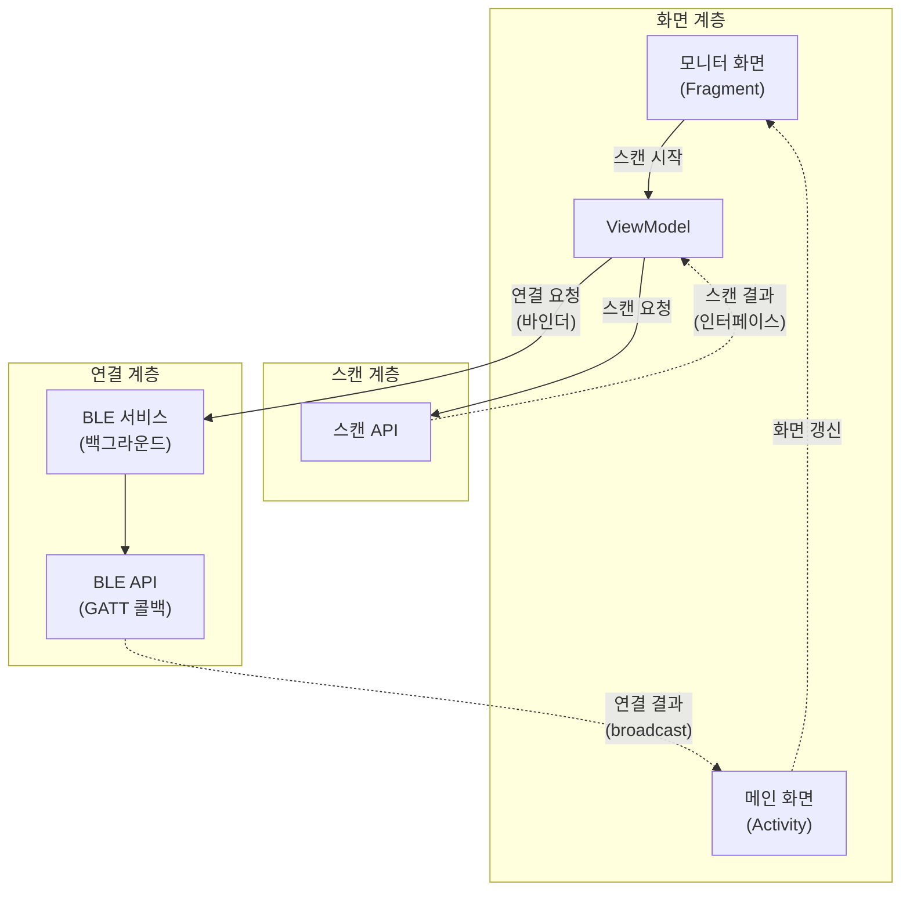
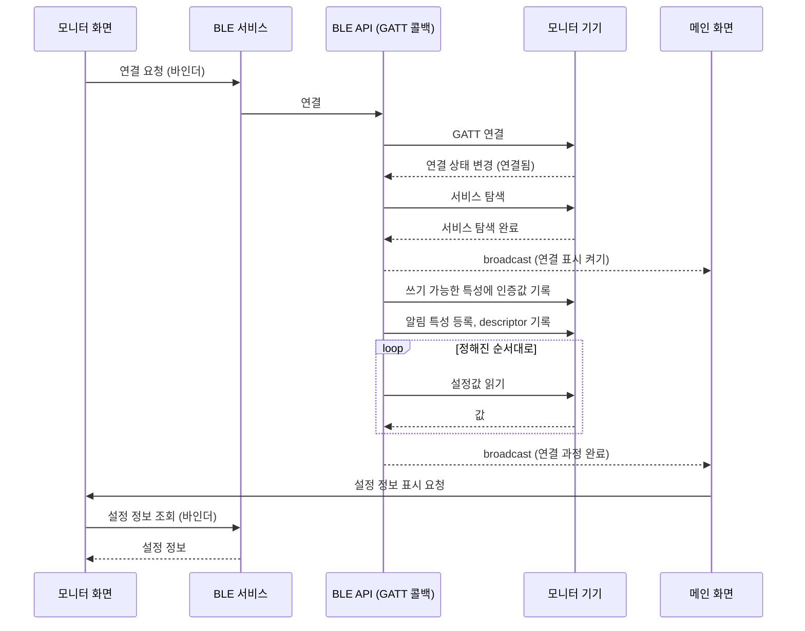

# BLE 기기 스캔부터 연결·알람 설정까지

작성일 2022-09-27
{ .post-date }

현재 진행 중인 과제에서 안드로이드 앱이 주변의 모니터 기기를 찾아 연결하고, 기기에 저장된 알람 설정을 읽어 와 화면에 보여 주는 기능을 맡게 되어, 이에 대한 내용을 정리하고자 한다. 모니터 기기는 온도계의 측정값을 받아 표시하고 알람을 울리는 장치이고, 앱과는 BLE(Bluetooth Low Energy)로 통신한다.

BLE 통신은 스캔, 연결, 서비스 탐색, 값 쓰기와 읽기가 모두 콜백으로 결과를 돌려준다. 그래서 코드가 여러 클래스에 흩어지고, 사용자가 기기를 터치한 순간부터 설정 정보가 화면에 뜨기까지의 흐름을 한눈에 보기 어렵다. 이 글에서는 그 흐름을 계층별로 나누어 처음부터 끝까지 따라간다.

| 항목 | 내용 |
|---|---|
| 시기 | 2022년 |
| 환경 | Android, Kotlin, RxJava, AIDL |
| 맡은 부분 | 모니터 기기 스캔, 연결, 인증, 알람 설정 조회 |

## 문제 상황

기능을 구현하면서 정리해야 했던 문제는 세 가지이다.

**흐름이 콜백으로 끊어진다.** 스캔 결과는 스캔 콜백으로, 연결 결과는 연결 상태 콜백으로, 서비스 탐색 결과는 또 다른 콜백으로 돌아온다. 한 동작의 결과가 어디로 돌아오는지 알지 못하면 다음 단계의 코드를 어디에 두어야 하는지도 알 수 없다.

**계층 사이에 결과를 전달할 통로가 필요하다.** 스캔과 연결을 실제로 수행하는 코드는 화면과 떨어진 곳에 있다. 연결은 화면이 바뀌어도 유지되어야 하므로 백그라운드 서비스가 맡는다. 그러면 화면에서 서비스로 명령을 보내는 통로와, 서비스에서 화면으로 결과를 알리는 통로가 각각 필요하다.

**스캔이 중복되거나 같은 기기가 여러 번 잡힌다.** 스캔 중에 스캔을 다시 시작하면 동작이 꼬이고, BLE 기기는 광고 신호를 계속 보내므로 같은 기기가 스캔 결과로 반복해서 들어온다. 주변에는 모니터가 아닌 BLE 기기도 많다.

## 분석

먼저 각 계층이 맡는 역할을 나누었다.



| 계층 | 구성 요소 | 역할 |
|---|---|---|
| 화면 | 모니터 화면, ViewModel | 스캔된 기기 목록을 보여 주고, 사용자의 터치를 받아 연결을 요청한다 |
| 스캔 | 스캔 API | BLE 스캐너를 시작하고, 스캔 콜백으로 들어온 결과를 넘긴다 |
| 연결 | BLE 서비스, BLE API | 기기와 연결하고, GATT 콜백에서 인증과 설정 읽기를 진행한다 |

계층 사이의 통로는 방향에 따라 방식이 다르다.

- **스캔 계층에서 ViewModel로**: 인터페이스를 쓴다. 스캔 API가 있는 파일에 결과를 받을 인터페이스가 선언되어 있고, ViewModel이 이 인터페이스를 구현한다. ViewModel은 초기화할 때 자기 자신을 스캔 API에 넘겨주고, 스캔 API는 넘겨받은 객체의 메서드를 호출해 스캔 결과를 전달한다. ViewModel은 스캔 API를 알고 있지만 스캔 API는 인터페이스만 알면 되므로, 의존 방향이 한쪽으로 유지된다.
- **화면에서 서비스로**: 바인더를 쓴다. AIDL로 서비스가 제공할 메서드(연결, 정보 조회 등)를 선언하고, 서비스 안에 이 인터페이스를 구현한 객체를 둔다. 화면 쪽은 바인더를 통해 그 메서드를 호출한다.
- **서비스에서 화면으로**: broadcast를 쓴다. GATT 콜백에서 단계가 끝날 때마다 메시지를 보내고, 메인 화면의 broadcast receiver가 이를 받아 화면을 갱신한다.

## 해결

### 스캔: 중복 시작 방지와 기기 필터링

모니터 화면이 만들어지면 ViewModel이 목록(RecyclerView)을 설정하고, 아직 찾은 기기가 없으므로 목록을 숨긴 상태로 시작한다. 스캔은 다음 순서로 진행된다.

```
함수 스캔_시작():
    만약 스캔_중이면: 반환            # 스캔 중 플래그로 중복 시작을 막는다
    스캔_중 = 참
    찾은_기기_목록, 화면_목록 초기화
    스캔 API에 스캔 요청

콜백 스캔_결과(기기):                 # 스캔 API가 인터페이스로 전달
    만약 기기가 찾은_기기_목록에 이미 있으면: 반환
    만약 기기 이름에 모니터의 이름이 들어 있지 않으면: 반환
    찾은_기기_목록과 화면_목록에 기기 추가
    목록을 화면에 표시하고 갱신을 알림
```

필터는 두 가지이다. 이미 목록에 있는 기기는 다시 넣지 않고, 이름에 모니터의 이름이 들어 있는 기기만 받아들인다. 이름만으로 거르는 방식은 이름이 비슷한 다른 기기를 걸러 내지 못하므로 개선이 필요하다고 당시에 적어 두었다. 스캔 결과가 올바르게 들어온 것인지 판단하는 코드도 보완할 부분으로 남겼다.

### 연결 요청

사용자가 목록에서 기기를 터치하면 그 기기의 MAC 주소를 저장하고, 현재 선택된 사용자가 있는지 확인한다. 사용자가 선택되어 있으면 스캔을 멈추고, 바인더를 통해 서비스에 연결을 요청한다. 연결이 끝날 때까지 화면에는 진행 표시를 띄운다.

서비스의 연결 메서드는 재연결 여부 같은 상태 플래그를 확인한 뒤, 가지고 있는 BLE API 객체의 연결 메서드를 호출한다. 실제 연결 시도는 여기서 이루어진다.

### 연결 이후: 인증과 설정 읽기

연결 요청 이후의 과정은 모두 GATT 콜백에서 이어진다.



1. **연결 상태 변경.** 연결에 성공하면 현재 연결 상태를 "연결됨"으로 바꾸고 서비스 탐색을 시작한다. 연결만으로는 기기와 값을 주고받을 수 없고, 기기가 요구하는 인증값을 먼저 써야 하기 때문이다.
2. **서비스 탐색 완료.** broadcast를 보내 메인 화면에 있는 연결 표시를 켠다. 오류로 종료되면 표시를 끈다.
3. **인증.** 기기의 정해진 서비스에서 쓰기 가능한 특성(characteristic)을 찾아 인증값을 기록한다.
4. **알림 등록.** 기기 규격에 정해진 대로 알림용 특성에 notification을 설정하고 descriptor를 기록한다.
5. **설정 읽기.** 기기 규격에 정해진 순서대로 설정값을 하나씩 읽는다. 마지막 값까지 읽으면 받은 값들을 앱에서 쓸 수 있는 형태로 보정해 목록에 담는다.
6. **완료 알림.** 연결 과정이 모두 끝났다는 broadcast를 보낸다.

메인 화면의 broadcast receiver는 완료 메시지를 받으면 현재 보이는 화면이 모니터 화면인지 확인하고, 그렇다면 설정 정보를 띄우도록 요청한다. 모니터 화면은 바인더에 정의된 조회 메서드로 서비스에서 값을 받아 알림창에 보여 준다.

### 남은 의문

구현하면서 풀지 못하고 적어 둔 것들이다.

- 서비스 탐색 결과를 broadcast로 메인 화면에 보내 연결 표시를 켜는 방식은 좋은 방법이 아닌 것 같다. 연결 상태를 아는 쪽과 표시를 바꾸는 쪽이 멀리 떨어져 있고, 메시지의 종류가 늘어날수록 receiver의 분기가 길어진다.
- 연결 요청 메서드는 연결이 실제로 끝나기 전에 참을 반환한다. 반환값이 연결의 성공이 아니라 요청이 접수되었다는 뜻인지 확인이 필요하다.
- notification과 descriptor의 관계는 규격대로 따라 쓰기만 했고, 정확히 이해하지 못했다.

연결이 비정상적으로 끊겼을 때의 처리는 [연결이 끊겼을 때 자동 재연결](02-auto-reconnect.md)에서 이어서 다룬다.
