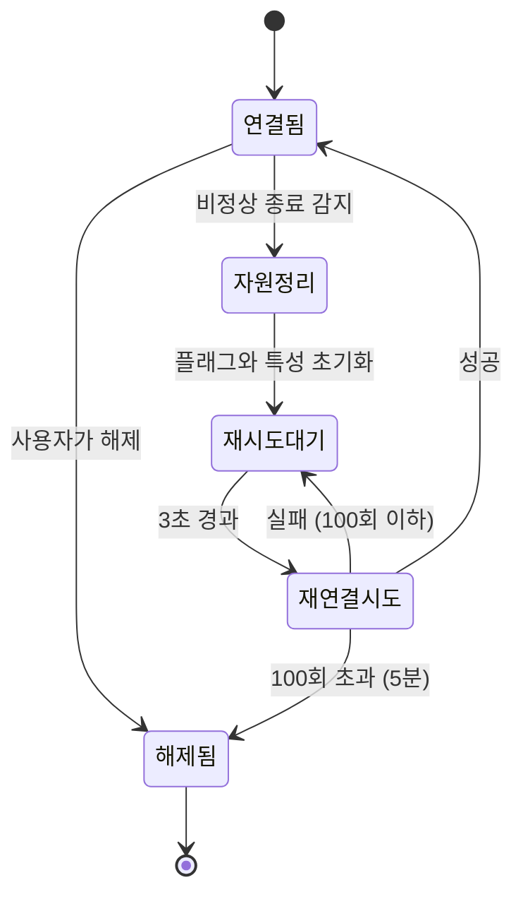

# 연결이 끊겼을 때 자동 재연결

[BLE 기기 스캔부터 연결·알람 설정까지](01-ble-scan-connect-alarm.md)에 이어, 모니터 기기와의 연결이 비정상적으로 끊겼을 때 사용자가 직접 다시 연결하지 않아도 되도록 자동 재연결을 구현하고자 한다. BLE 연결은 기기가 멀어지거나 전파 상태가 나빠지면 예고 없이 끊어진다. 측정값을 계속 받아야 하는 앱에서 그때마다 사용자가 화면을 열어 기기를 다시 선택해야 한다면 쓰기 어렵다.

## 배경: 연결 구조

앞 글의 구조를 요약하면 다음과 같다. 화면은 바인더를 통해 백그라운드의 BLE 서비스에 연결을 요청하고, 서비스는 BLE API 객체를 통해 기기에 연결한다. 연결 이후의 결과는 모두 GATT 콜백으로 돌아온다. 그 가운데 연결 상태가 바뀔 때마다 호출되는 연결 상태 콜백이 재연결의 출발점이다.

## 문제 상황

- 연결이 끊기는 시점은 예측할 수 없다. 끊겼다는 사실은 연결 상태 콜백이 호출되어야 알 수 있다.
- 끊김에는 두 종류가 있다. 사용자가 직접 연결을 해제한 경우에는 다시 연결하면 안 되고, 의도하지 않게 끊긴 경우에만 다시 연결해야 한다.
- 언제까지 재시도할지 기준이 없으면 기기가 꺼져 있거나 멀리 있는 동안 끝없이 연결을 시도하게 된다.

## 분석

**정상 종료와 비정상 종료의 구분.** 앱은 현재 연결 상태를 변수로 따로 관리한다. 연결되어 있던 상태에서 비정상적으로 연결이 끊기면, 콜백이 호출되는 시점에 이 변수의 값은 아직 "연결됨"이다. 앱이 해제를 요청한 적이 없기 때문이다. 그래서 콜백 안에서 이 변수의 값을 보면 의도하지 않은 끊김인지 알 수 있다.

**재시도 전의 자원 정리.** 끊긴 연결의 GATT 자원을 그대로 둔 채 새 연결을 시도하면 이전 연결의 상태가 남는다. 재연결을 시도하기 전에 기존 자원을 먼저 해제하고, 이전 연결에서 찾아 둔 쓰기 가능한 특성도 비워야 한다. 새로 연결하면 서비스 탐색과 인증을 처음부터 다시 거치기 때문이다.

**재시도의 한계.** 재연결은 5분 동안만 시도하기로 했다. 3초 간격으로 시도하면 100회가 5분이다.

## 해결



흐름을 의사코드로 적으면 다음과 같다.

```
콜백 연결_상태_변경(새_상태):
    만약 저장된_연결_상태 == 연결됨:        # 해제를 요청한 적이 없는데 호출됨
        자원_해제()                          # 기존 GATT 자원 방출
        만약 새_상태 == 끊김:
            재연결_플래그 = 거짓
            쓰기_가능_특성 = 없음
            서비스에 재연결 요청

함수 재연결():                               # BLE 서비스에서 실행
    횟수 = 0
    반복:
        만약 재연결됨: 종료
        만약 횟수 > 100: 연결 종료 처리 후 종료   # 3초 × 100회 = 5분
        연결 시도
        횟수 = 횟수 + 1
        3초 대기
```

1. **끊김 감지.** 연결 상태 콜백에서 저장된 연결 상태가 "연결됨"이면 비정상 종료로 판단한다.
2. **자원 해제.** 현재 연결이 쥐고 있던 자원을 방출한다.
3. **재연결 준비.** 새 상태가 끊김이면 재연결과 관련된 플래그를 초기화하고, 쓰기 가능한 특성을 비운다.
4. **재연결 요청.** BLE API는 서비스가 구현한 인터페이스의 재연결 메서드를 호출한다. 실제 재시도는 서비스에서 실행된다.
5. **재시도.** 3초 간격으로 연결을 시도한다. 다시 연결되면 멈추고, 횟수가 100을 넘으면 5분이 지난 것이므로 연결을 종료한다.

화면에 보이는 연결 표시는 이 과정과 별도로 갱신된다. 측정 화면이 보일 때마다 현재 연결 상태를 확인하는 함수가 실행되어 표시를 맞춘다.

### 남은 의문

재연결 메서드가 BLE API에서 호출되어 서비스에서 실행되는 구조를 처음에는 이해하지 못했다. 서비스가 BLE API 객체를 가지고 있는 것은 분명한데, 반대 방향의 호출이 어떻게 가능한지가 의문이었다. 스캔 결과를 ViewModel로 넘길 때와 같은 방식으로, 서비스가 인터페이스를 구현하고 BLE API가 그 인터페이스를 통해 호출하는 구조로 이해했다.
