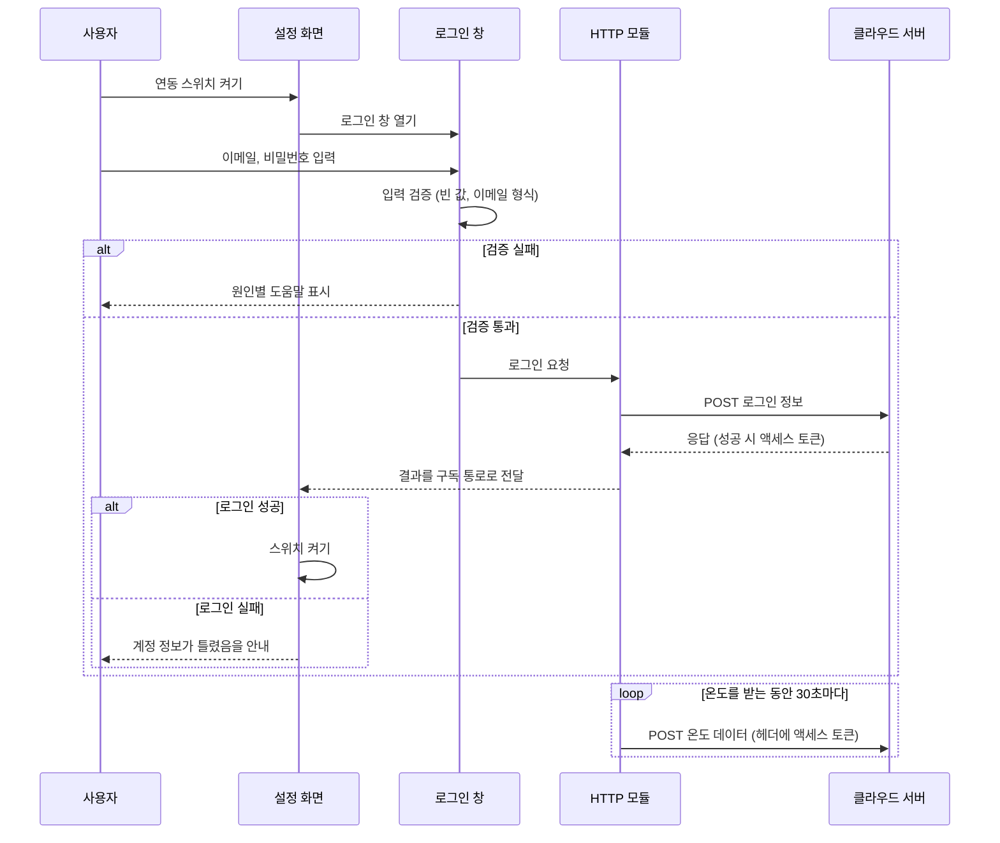

# 클라우드 연동: 로그인과 온도 데이터 전송

작성일 2022-09-27
{ .post-date }

현재 진행 중인 과제에서 앱이 측정한 온도 데이터를 클라우드 서버로 보내는 기능을 구현하게 되어, 로그인부터 전송까지의 과정을 기록한다. 앱은 BLE로 온도계의 측정값을 받고 있고, 이 데이터를 클라우드 서버로 올리려 한다. 서버는 로그인한 사용자의 데이터만 받으므로, 앱에서 클라우드 계정으로 로그인하는 기능이 먼저 필요하다.

| 항목 | 내용 |
|---|---|
| 시기 | 2022년 |
| 환경 | Android, Kotlin, Retrofit2, RxJava |
| 맡은 부분 | 설정 화면의 연동 스위치, 로그인 창, 로그인 요청, 온도 데이터 전송 |

## 문제 상황

**스위치의 상태와 실제 로그인 상태가 어긋난다.** 클라우드 연동은 설정 화면의 스위치로 켜고 끈다. 그런데 스위치를 켜는 것은 곧 로그인을 시도하는 것이고, 로그인의 결과는 서버의 응답이 와야 알 수 있다. 사용자가 스위치를 누른 순간에 바로 켜진 모양으로 바꾸면, 로그인에 실패했을 때 스위치는 켜져 있는데 실제로는 연동되지 않은 상태가 된다.

**실패의 원인을 구분해 알려야 한다.** 로그인이 되지 않는 이유는 여러 가지이다. 입력란을 비워 두었을 수도 있고, 이메일 형식이 틀렸을 수도 있고, 형식은 맞지만 계정 정보가 틀렸을 수도 있다. 앞의 두 가지는 서버에 물어볼 필요가 없는 오류이다.

**매번 로그인하게 할 수 없다.** 앱을 실행할 때마다 계정 정보를 입력해야 한다면 연동 기능을 계속 쓰기 어렵다.

## 분석

**결과를 화면에 전달할 통로.** 로그인 요청은 비동기로 처리되므로, 요청을 보낸 코드와 결과를 받는 코드가 떨어져 있다. 결과가 도착했을 때 설정 화면이 이를 알 수 있도록, 로그인 성공 여부를 흘려보내는 구독 통로(RxJava의 Subject)를 하나 두기로 했다. 설정 화면은 이 통로를 구독하고 있다가 값이 들어오면 스위치의 상태를 정한다.

**스위치 부품.** 기존에 쓰던 스위치 부품은 누르는 즉시 상태가 바뀌어서, 결과를 기다렸다가 상태를 정하는 동작을 만들기 어려웠다. 코드에서 상태를 직접 제어하기 쉬운 `SwitchCompat`으로 바꾸었다.

**요청 전에 걸러낼 수 있는 오류.** 빈 입력과 이메일 형식 오류는 서버로 보내기 전에 앱에서 확인할 수 있다. 이 둘을 먼저 걸러 내면, 서버에서 돌아온 실패는 계정 정보가 틀린 경우로 좁혀진다.

| 실패 원인 | 확인하는 곳 | 확인 방법 |
|---|---|---|
| 입력란이 비어 있음 | 앱 (요청 전) | 문자열이 비어 있는지 검사 |
| 이메일 형식이 틀림 | 앱 (요청 전) | 이메일 정규식과 대조 |
| 계정 정보가 틀림 | 서버 (요청 후) | 로그인 응답. 결과를 구독 통로로 전달 |

## 해결

전체 흐름은 다음과 같다.



### 로그인 창과 입력 검증

로그인 화면은 별도의 화면이 아니라 설정 화면 위에 뜨는 창(Dialog)으로 만들었다. 사용자가 이메일과 비밀번호를 입력하고 로그인 버튼을 누르면 다음 순서로 처리한다.

```
함수 로그인_버튼_클릭(이메일, 비밀번호):
    만약 이메일이나 비밀번호가 비어 있으면:
        "입력란을 채워 달라"는 도움말 표시, 반환
    만약 이메일이 이메일 정규식과 맞지 않으면:
        "이메일 형식을 확인해 달라"는 도움말 표시, 반환
    로그인_정보 = (이메일, 비밀번호)
    HTTP 모듈에 로그인 요청(로그인_정보)
```

### 로그인 요청

HTTP 통신에는 Retrofit2를 쓴다. 입력받은 이메일과 비밀번호를 로그인 정보 객체에 담아 요청의 본문으로 넣고 POST로 보낸다. 응답은 한 번만 돌아오므로 RxJava의 Single로 받는다. 응답이 오면 성공 여부를 구독 통로로 흘려보내고, 설정 화면은 이 값을 받아 스위치를 켜거나 실패 안내를 띄운다.

### 자동 로그인

로그인 창에는 로그인 정보를 기억할지 고르는 토글이 있다. 이 토글이 켜진 상태에서 로그인에 성공하면 입력했던 계정 정보를 앱의 저장소(SharedPreferences)에 저장한다. 다음에 앱을 실행하면 저장된 정보로 로그인 과정을 자동으로 수행한다.

### 온도 데이터 전송

로그인에 성공하면 서버는 로그인한 사용자임을 증명하는 액세스 토큰을 내려 준다. 이후의 데이터 전송은 이 토큰을 요청의 헤더에 실어 보낸다.

전송할 데이터는 앱의 여러 곳에 흩어져 있어서, 이를 모으는 역할의 클래스를 따로 두었다. 사용자 정보와 온도 데이터를 가진 객체에 접근할 수 있도록 같은 모듈에 두고, 다음 항목을 모아 하나의 온도 데이터 객체로 만든다.

- 온도계의 MAC 주소
- 기록 시각과 시간대(GMT 기준 차이)
- 현재 온도
- 사용자 이름
- 온도계의 상태

온도계로부터 온도를 받고 있는 동안, 이 객체를 30초 간격으로 서버에 POST한다.

```
반복 (온도를 받고 있는 동안, 30초마다):
    데이터 = 온도_데이터_모으기()         # MAC 주소, 시각, 온도, 사용자, 상태
    POST 온도_데이터 (헤더: 액세스 토큰)
```
