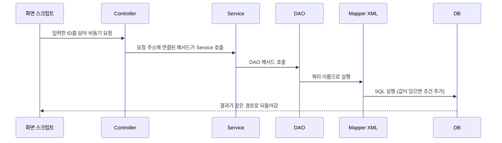
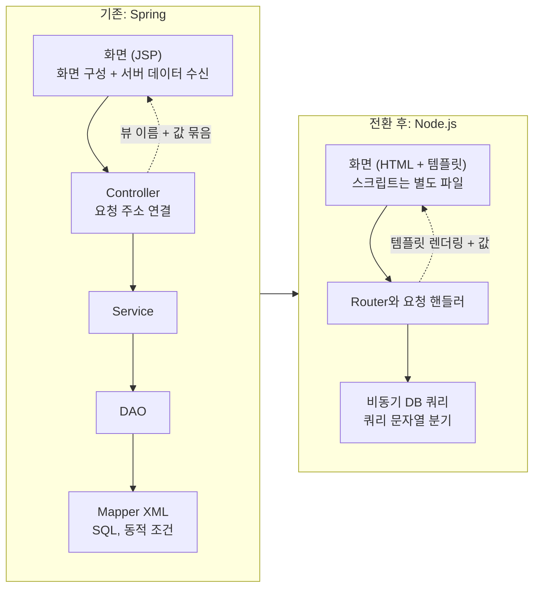

# Spring → Node.js 서버 전환

작성일 2023-02-01 · 최종 수정일 2023-02-25
{ .post-date }

현재 진행 중인 과제에서 Spring으로 작성된 서버를 Node.js로 옮기게 되었고, 그중 기기 등록과 정보 수정 화면을 맡아 그 과정을 기록하고자 한다. 대상은 온도계가 측정한 값을 모아 웹에서 보여 주는 모니터링 서비스의 서버이다. 사용자는 그룹 계정으로 로그인하고, 계정 아래에 기기(측정 위치)를 등록한 다음 실제 온도계를 그 기기에 연결한다. 온도계는 MAC 주소로 구분한다. 연결이 끝나면 메인 화면의 목록에 기기별 최근 측정값이 나타난다.

기존 서버는 Spring MVC로 작성되어 있고 화면은 JSP이다. 이것을 Express 기반의 Node.js 서버로 옮기되, 우선은 기존 서버와 똑같이 동작하게 만드는 것이 목표였다. 예외 처리와 구조 개선은 그다음으로 미루었다. 작업은 메인 화면을 기준으로 화면 단위로 나누었고, 나는 기기 등록 화면과 정보 수정 화면을 맡았다. 회원가입, 구독, 위치 설정 화면은 다른 팀원이 맡은 부분이다.

| 항목 | 내용 |
|---|---|
| 기간 | 2023.02 |
| 환경 | Node.js, Express, EJS, MySQL (옮기기 전: Spring MVC, JSP, MyBatis) |
| 맡은 부분 | 기기 등록 화면, 정보 수정 화면, 두 화면이 쓰는 API |

## 문제 상황

**옮겨 온 서버는 대부분의 기능이 동작하지 않는다.** 작업을 시작할 때 Node.js 쪽에는 서버의 뼈대와 일부 화면 전환만 있었다. 포트를 설정해 서버를 띄워 보니 화면은 일부 넘어가지만 API의 내부 로직이 비어 있어 기능이 거의 동작하지 않았다. 로그인도 DB를 거치지 않고 통과하도록 임시로 만들어져 있었다.

**화면 파일이 두 가지 역할을 함께 맡고 있다.** 기존 서버의 JSP는 화면을 구성하는 동시에, 서버가 넘겨 준 데이터를 받아 화면 스크립트의 변수로 넣어 주는 역할도 한다. Node.js에서는 화면 파일을 보내는 기본 방식이 "파일을 그대로 전송"하는 것이어서, JSP가 하던 데이터 전달에 그대로 대응되는 방식이 없다. 화면을 HTML로 바꾸고 스크립트를 분리하면, 서버가 가진 값을 화면에 어떻게 넘길지를 새로 정해야 한다.

**Spring의 구조를 모르면 무엇을 옮겨야 하는지 알 수 없다.** 버튼 하나를 눌렀을 때 어떤 코드가 실행되어 어떤 쿼리로 이어지는지를 먼저 따라가야 했다.

## 분석

### 기존 서버의 구성

동작을 분석하는 데 필요한 것은 소스 디렉터리뿐이라고 보고, 그 안을 역할별로 정리했다.

| 구성 요소 | 역할 |
|---|---|
| Controller | 요청 주소와 처리 메서드를 연결한다. 화면 이동과 데이터 요청을 모두 받는다 |
| Service | Controller가 호출한다. 필요한 DAO 메서드를 불러 결과를 돌려준다 |
| DAO | Mapper에 정의된 쿼리를 이름으로 실행한다 |
| Mapper XML | SQL이 들어 있다. 전달된 값의 유무에 따라 조건을 붙이는 동적 쿼리(MyBatis)를 쓴다 |
| 화면 (JSP, 스크립트) | 사용자에게 보이는 파일. 스크립트가 XMLHttpRequest로 API를 부른다 |

### 데이터 요청의 흐름

기기 등록 화면의 "ID 중복 확인"을 예로 흐름을 따라가 보았다.



입력란에 글자를 넣을 때마다 스크립트가 요청을 보내고, Controller → Service → DAO를 거쳐 Mapper의 쿼리가 실행된다. 쿼리는 같은 ID의 기기가 있는지 찾는데, "그룹 ID가 전달되었으면 그룹 조건도 붙인다"는 동적 조건이 걸려 있었다. 그런데 화면 스크립트는 기기 ID만 보내고 있었다. 옮기면서 손봐야 할 부분이었다.

### 화면 이동과 데이터 전달

메인 화면에서 기기 등록 버튼을 누르면 스크립트가 화면 이동 요청을 보내고, Controller가 이를 받는다. 여기서 처음에는 화면 파일로 어떻게 이동하는지를 알 수 없었다. Node.js라면 파일을 전송하면 끝인데, Spring의 Controller는 화면 파일의 경로를 직접 다루지 않기 때문이다.

정리한 결과는 다음과 같다.

- Controller는 "뷰 이름"과 "뷰에 넘길 값의 묶음"을 하나의 객체(ModelAndView)에 담아 돌려준다.
- 설정 파일에 화면 파일이 놓인 경로가 접두어로 지정되어 있어, 뷰 이름만으로 JSP 파일을 찾아간다.
- JSP의 맨 위에서 넘겨받은 묶음을 꺼내고, 그 안의 값을 화면 스크립트의 변수에 넣는다.
- 그룹 ID처럼 요청에 실려 오지 않는 값은 Controller가 쿠키에서 바로 읽는다.

기기 등록 화면에 넘어오는 값은 그룹 ID와 동작 구분값 두 개뿐이었다. 구분값은 쓰이는 곳이 없었고, 그룹 ID는 쿠키에 이미 들어 있으므로 화면에서 직접 읽을 수 있다. 이 화면은 서버가 값을 넘겨 주지 않아도 된다. 반면 정보 수정 화면은 어떤 기기를 수정할지를 서버로부터 받아야 하므로, 전달 방식을 반드시 정해야 했다.

화면 이동 요청이 값을 싣는 방식도 확인했다. 스크립트가 보이지 않는 form을 만들고, 숨김(hidden) 입력에 기기 ID를 넣어 POST로 제출한다. 주소창에 값이 드러나지 않게 하려는 것이다. 이렇게 제출한 값은 Node.js에서 요청 본문으로 받을 수 있다.

## 해결

### 대응 관계

Spring의 각 요소를 Node.js에서 무엇으로 옮길지를 다음과 같이 잡았다.



| Spring | Node.js |
|---|---|
| Controller | Router. 요청 주소별 핸들러 |
| Service, DAO | 핸들러 안에서 실행하는 비동기 DB 쿼리 |
| Mapper XML의 동적 조건 | 값의 유무에 따라 쿼리 문자열을 고르는 분기 |
| JSP | HTML과 템플릿(EJS). 스크립트는 별도 파일로 분리 |
| 쿠키 값을 인자로 받는 기능 | 쿠키 파서가 요청 객체에 넣어 주는 값 |

Controller를 Router로 나누는 일은 바로 하지 않았다. 구현된 API가 거의 없는 상태에서는 Router가 제대로 동작하는지 확인하기 어려웠기 때문이다. 우선 서버 파일 하나에 맡은 기능을 구현하고, 한 Controller에 해당하는 API가 어느 정도 모이면 Router로 옮기기로 했다. JSP도 한꺼번에 HTML로 바꾸지 않고, 각자 화면을 분석하면서 그때그때 바꾸었다.

### 화면 단위로 API를 하나씩 변환

변환은 "화면의 버튼 → 스크립트 함수 → 요청 주소 → Controller → Service → DAO → SQL" 순서로 따라간 다음, SQL과 그 앞뒤의 처리를 하나의 핸들러로 옮기는 식으로 진행했다. 맡은 두 화면에서 옮긴 API는 다음과 같다.

| 화면 | API | 하는 일 |
|---|---|---|
| 기기 등록 | ID 중복 확인 API | 같은 ID의 기기가 이미 있는지 확인한다 |
| 기기 등록 | 기기 등록 API | 그룹 ID, 기기 ID, 기기 이름으로 기기를 추가한다 |
| 정보 수정 | 화면 진입 API | 기기 ID를 받아 이름과 연결된 온도계를 조회하고 화면을 렌더링한다 |
| 정보 수정 | 온도계 목록 API | 그룹이 가진 온도계 목록을 가져와 선택 상자를 채운다 |
| 정보 수정 | 기기 수정 API | 기기 이름과 연결된 온도계를 바꾼다 |
| 정보 수정 | 기기 삭제 API | 기기를 삭제 상태로 표시한다 |
| 정보 수정 | 온도계 등록 API | 입력한 MAC 주소로 온도계를 새로 등록한다 |
| 정보 수정 | 연결 갱신 API | 새로 등록한 온도계를 기기에 연결한다 |

가장 먼저 옮긴 것은 ID 중복 확인 API이다. Mapper의 동적 조건은 그룹 ID가 왔는지에 따라 쿼리 문자열을 고르는 분기로 바꾸었고, 화면 스크립트는 그룹 ID를 함께 보내도록 고쳤다.

```
핸들러 ID_중복_확인(요청):
    기기_ID, 그룹_ID = 요청 본문
    만약 그룹_ID가 있으면:
        쿼리 = 기기 테이블에서 (기기_ID, 그룹_ID)가 일치하는 행 조회
    아니면:
        쿼리 = 기기 테이블에서 기기_ID가 일치하는 행 조회
    결과 = 쿼리 실행
    결과를 응답
```

옮긴 직후에는 "where 절에 알 수 없는 컬럼이 있다"는 오류가 났다. 쿼리 문자열에 값을 넣으면서 따옴표로 감싸지 않아, DB가 그 값을 컬럼 이름으로 읽은 것이었다. 같은 실수는 뒤에 다른 화면의 쿼리에서도 한 번 더 나왔다.

기기 삭제는 행을 지우지 않고 삭제 여부를 나타내는 컬럼의 값만 바꾸는 방식이라, 삭제 API에서도 delete 대신 update를 쓴다.

### this 바인딩 문제

기기 등록 API를 옮기려고 화면 스크립트가 보내는 값을 찍어 보니, 분명히 넣었을 그룹 ID가 빠져 있었다. 원인은 JavaScript의 `this`였다.

C++에서 `this`는 언제나 객체 자신을 가리킨다. 이 사용법에 익숙해서 JavaScript에서도 같다고 생각했는데, JavaScript의 `this`는 함수가 어떻게 호출되었는지에 따라 달라진다.

| 상황 | this가 가리키는 것 |
|---|---|
| 전역, 일반 함수 호출 | 전역 객체(window) |
| 객체의 메서드로 호출 | 그 객체 |
| 메서드 안에서 선언한 내부 함수, 콜백 | 전역 객체 |
| `call`, `apply`, `bind` 사용 | 직접 지정한 객체 |
| `new`로 호출한 생성자, 클래스 | 새로 만들어진 객체 |
| 화살표 함수 | 자신의 `this`가 없다. 정의된 위치의 바깥 `this`를 따른다 |

등록 화면의 스크립트는 화면에서 쓰는 함수들을 객체 하나에 모아 두고 있었고, 구조는 다음과 같았다.

```
전역 변수 그룹_ID = 쿠키에서 읽은 값          # 화면이 로드될 때 정해진다

객체 등록_화면:
    함수 입력_확인():
        this.그룹 = 그룹_ID                   # this는 등록_화면 객체. 객체에 '그룹'이 생긴다
        ...
        this.등록_요청()

    함수 등록_요청():
        this.그룹 = this.그룹_ID              # 객체에는 '그룹_ID'라는 멤버가 없다
        서버로 this를 JSON 문자열로 전송
```

`입력_확인`에서는 전역 변수의 값을 객체의 멤버에 제대로 넣는다. 그런데 `등록_요청`은 `this.그룹_ID`를 읽는다. 여기서 `this`는 객체이고, 객체에는 그런 멤버가 없으므로 값은 `undefined`이다. 앞에서 넣어 둔 값이 `undefined`로 덮이고, JSON으로 바꿀 때 값이 없는 항목은 빠진다. 덮어쓰는 줄을 지우자 그룹 ID가 정상으로 전송되었다.

### 외래 키 오류

값이 제대로 전송되는 것을 확인하고 기기 등록 API를 만들어 실행했더니 insert가 실패했다. 오류는 "자식 행을 추가하거나 수정할 수 없다. 외래 키 제약 조건에 걸렸다"는 내용이었다.

외래 키는 두 테이블을 잇는 값이고, 자식 테이블에 넣는 값은 부모 테이블에 반드시 있어야 한다. 테이블의 제약 조건을 조회해 보니 기기 테이블이 계정 테이블을 참조하고 있었고, 외래 키는 그룹 ID였다. 계정 테이블에 있는 그룹 ID로만 기기를 추가할 수 있다는 뜻이다. 그런데 로그인한 계정은 계정 테이블에 분명히 있었다.

오류 메시지에 찍힌 쿼리를 다시 보니 그룹 ID 자리에 문자열 `'undefined'`가 들어가 있었다. 화면이 보낸 JSON의 항목 이름과 서버가 꺼내는 이름이 달라서, 서버가 없는 항목을 읽고 있었던 것이다. 이름을 맞추자 기기가 정상으로 추가되었다. 제약 조건을 끄는 방법도 있었지만 원인은 값 쪽에 있었다.

### 템플릿으로 서버 데이터를 화면에 전달

정보 수정 화면은 어떤 기기를 수정하는지를 서버에서 받아야 한다. Spring의 방식을 쓸 수 없으므로 대안을 비교했다.

| 방법 | 판단 |
|---|---|
| 쿠키 | 브라우저가 가질 수 있는 쿠키의 수에 한계가 있고, 값 하나를 넘기려고 쿠키를 만드는 것은 부담이 크다. 쿠키는 핵심 데이터만 가져야 한다 |
| URL | 가장 간단하지만 사용자가 값을 임의로 바꿀 수 있다 |
| 템플릿 엔진 | 서버가 화면을 렌더링하면서 값을 넣어 준다. JSP가 하던 역할과 가장 가깝다 |

템플릿 엔진으로 EJS를 골랐다. EJS는 HTML 안에 `<% %>`로 JavaScript를 넣고 `<%= %>`로 값을 출력하는 방식이며, 서버는 렌더링할 때 템플릿 이름과 함께 값을 넘긴다. 템플릿 파일은 별도의 디렉터리에 모았다.

적용하면서 다음 문제를 만났다.

- **응답을 두 번 보내는 오류.** 먼저 옮겨져 있던 핸들러가 화면 파일을 전송한 뒤 데이터를 한 번 더 전송하고 있어서 "헤더를 보낸 뒤에는 다시 설정할 수 없다"는 오류가 났다. Spring에서는 화면과 데이터가 한 객체로 함께 나가지만, Express에서는 요청 하나에 응답을 한 번만 보낼 수 있다. 렌더링 호출 하나로 화면과 값을 함께 보내도록 바꾸었다.
- **값을 문자열로 받을 때.** `<%= %>`는 값을 그 자리에 코드처럼 끼워 넣는다. 스크립트에서 문자열로 쓰려면 따옴표로 감싸야 한다.
- **쿼리보다 렌더링이 먼저 끝난다.** 기기에 연결된 온도계는 DB에서 조회해 넘겨야 하는데, 쿼리가 비동기라 결과가 오기 전에 렌더링이 실행되어 값이 비어 있었다. 렌더링 호출을 쿼리의 콜백 끝으로 옮겨 결과가 온 뒤에 실행되도록 했다.

```
핸들러 정보_수정_화면(요청):
    기기_ID = 요청 본문의 기기 ID           # 숨김 입력으로 제출된 값
    쿼리(기기의 이름과 연결된 온도계 조회, 완료되면:
        템플릿 렌더링(정보 수정 화면, {기기_ID, 이름, 온도계})
    )
```

쿼리를 async/await로 기다리는 방법도 검토했다. 그러려면 DB 드라이버를 Promise를 지원하는 것으로 바꿔야 하는데, 바꾸면 기존 연결 설정의 시간대 옵션이 유효하지 않다는 경고가 나왔다. 드라이버를 바꾸면 시간대와 관련된 기존 API의 설정과 DB의 설정까지 손봐야 할 수 있다고 판단해, 기능을 옮기는 것을 먼저 끝내고 도입은 뒤로 미루었다. 이후 삭제 API처럼 쿼리를 차례로 실행해야 하는 곳에는 다른 팀원이 먼저 적용한 Promise 방식을 받아서 썼다.

### 화면 동작의 정리

기존 동작을 그대로 옮긴 뒤, 동작을 시연하면서 받은 의견과 직접 찾은 문제를 반영해 두 화면을 고쳤다.

**입력 검사의 위치.** 기존 코드는 입력란에 글자를 넣을 때마다 서버에 중복 확인을 요청했다. 중복 확인은 등록 버튼을 눌렀을 때 한 번이면 충분하다. 빈 값과 한글 입력 여부는 서버에 물을 필요가 없으므로 화면의 입력 이벤트에서 검사해 상태값으로 보관하고, 등록 버튼을 누르면 상태값을 먼저 본 뒤 중복 확인만 서버에 요청하도록 바꾸었다.

```
입력 이벤트(ID, 이름):
    ID가 비었는가, ID에 영문과 숫자 외의 글자가 있는가, 이름이 비었는가를 상태값에 기록

등록 버튼:
    만약 상태값 중 하나라도 잘못되었으면: 해당 내용을 안내하고 반환
    만약 서버에 같은 ID가 이미 있으면: 안내하고 반환
    기기 등록 요청
```

**중복 확인의 범위.** 로그인한 그룹에는 없는 ID인데도 "이미 사용 중"이라고 나오는 경우가 있었다. 기기 ID는 기기 테이블 전체의 기본 키인데 중복 확인은 로그인한 그룹 안에서만 하고 있었다. 확인을 통과한 ID가 insert에서 기본 키 중복으로 실패하면서 안내가 어긋난 것으로 보았다. 테이블의 설정대로라면 전체 기기를 대상으로 확인해야 하지만, 요청마다 전체를 뒤지는 것은 부담이 크다. 구조에 관한 문제여서 미팅 안건으로 올렸다.

**정보 수정 화면의 두 가지 모드.** 이 화면에는 등록된 온도계 가운데 하나를 고르는 기본 모드와, MAC 주소를 직접 입력해 새 온도계를 등록하는 모드가 있다. 버튼의 이름이 실제 동작과 달라서 MAC 주소 수정이라는 뜻이 드러나도록 고쳤다. MAC 입력 모드에서 저장하면 온도계 등록과 연결 갱신이 차례로 실행된다. 기존 코드가 이 두 요청만 동기 방식으로 보내고 있던 것은 등록이 끝난 뒤에 연결을 갱신해야 하기 때문이었다.

- 연결된 온도계가 없는 기기는 목록의 맨 위 항목이 선택된 것처럼 보였다. "N/A"를 기본값으로 두고, 이 값이면 수정 API가 이름만 바꾸도록 쿼리를 나누었다.
- MAC 입력 모드에서 값을 입력한 뒤 기본 모드로 돌아가 저장하면 입력한 값이 남아 있었다. 모드를 바꿀 때 입력란을 비우도록 했다.
- 함수와 변수의 이름을 역할이 드러나게 바꾸고, 화면에서 쓰는 값을 객체 하나에 모았다. 이 과정에서 바꾸지 않은 이름이 남아 `undefined`가 서버로 넘어가는 일이 있었다.

**요청 방식.** 화면 스크립트의 XMLHttpRequest를 fetch로 바꾸고, 각 요청을 Promise를 돌려주는 함수로 만들어 호출하는 쪽에서 await로 기다리도록 했다.

### 응답을 영향받은 행 수 기준으로 통일

기존 화면은 응답이 1인지를 보고 성공을 판단했고, 옮긴 API도 쿼리에서 오류가 나지 않으면 무조건 1을 돌려주고 있었다. 이 방식의 문제는 앞에서 `undefined`가 넘어갔을 때 드러났다. 조건에 맞는 행이 없어 아무것도 바뀌지 않았는데도 쿼리 자체는 오류가 아니므로 화면에는 성공으로 표시되었다.

그래서 추가, 수정, 삭제 API의 응답을 쿼리 결과의 "영향받은 행 수"로 바꾸었다. 한 행을 바꾸는 요청이라면 이 값이 1이어야 성공이다.

```
핸들러 기기_수정(요청):
    시도:
        결과 = 수정 쿼리 실행
        만약 결과의 영향받은 행 수 == 1: 상태 200으로 행 수를 응답
        아니면: 오류 발생
    오류 시:
        서버 로그에 오류 기록
        상태 404로 "수정 중 오류가 발생했다. 잠시 후 다시 시도해 달라"는 문구만 응답

화면 함수 기기_수정_요청():
    응답 = 기기 수정 API 호출
    만약 상태가 200이고 값이 1이면: 성공
    만약 상태가 200인데 값이 1이 아니면: "입력을 확인해 달라"는 오류로 거부
    만약 상태가 404이면: 서버가 준 문구로 오류를 만들어 거부
호출한 쪽:
    성공하면 완료 안내 후 메인 화면으로 이동, 거부되면 문구를 안내
```

정리하면서 정한 것은 두 가지이다. 첫째, 오류가 났을 때 DB의 오류 메시지 전체를 화면으로 보내지 않는다. 서버의 내부 정보가 드러나기 때문이다. 둘째, 서버가 오류 상태로 응답해도 fetch는 이를 실패로 처리하지 않고 정상 응답처럼 다음 단계로 넘긴다. 그래서 응답의 상태 코드를 따로 보관해 두었다가 본문을 읽은 뒤에 구분했다.

### 남은 문제

- 기기를 삭제해도 연결되어 있던 온도계의 정보는 남는다. 연결 정보를 지우는 쿼리를 삭제 API에 넣어 두었지만, 행을 실제로 지우는 동작이라 확인을 거친 뒤에 켜기로 하고 비활성화해 두었다.
- 하나의 온도계가 여러 기기에 연결될 수 있다. 정보 수정 화면에서 온도계를 자유롭게 바꿀 수 있기 때문이다. MAC 주소를 바꾸는 기능은 일반 사용자의 화면이 아니라 관리자 페이지에 두는 것이 맞다고 보았다. 이후의 [관리자 페이지](05-admin-page.md)로 이어지는 문제이다.
- 화면에서 막아 둔 입력을 서버에서도 막아야 하는지는 정하지 못했다.
- 로그인이 임시 구현이고 토큰 처리가 없다. 이 부분은 [토큰 기반 인증](03-token-auth.md)에서 다룬다.

이어서 맡은 그래프 화면의 내용은 [측정 데이터 달력·그래프 조회](02-calendar-graph.md)에 정리했다.
