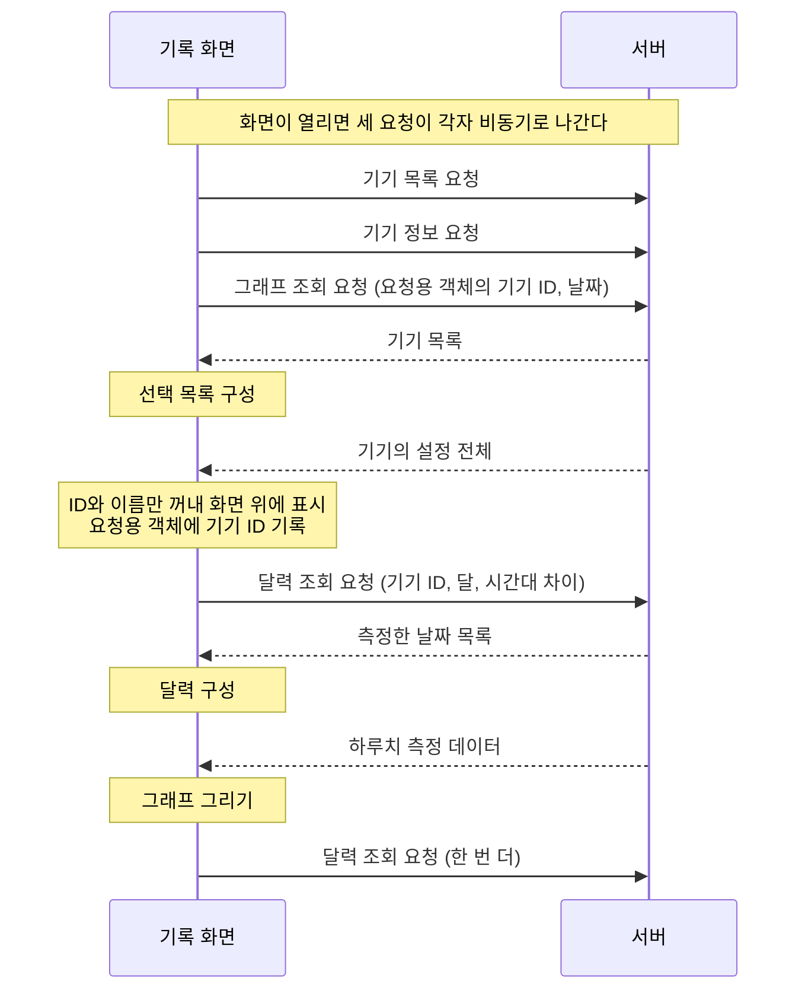
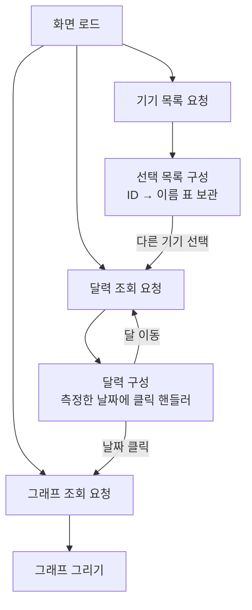

# 측정 데이터 달력·그래프 조회

작성일 2023-02-09 · 최종 수정일 2023-02-25
{ .post-date }

현재 진행 중인 과제에서 측정 데이터를 달력과 그래프로 보여 주는 화면을 새 서버로 옮기게 되어, 분석과 개선 내용을 정리한다. 이 글은 [Spring → Node.js 서버 전환](01-spring-to-nodejs.md)에 이어지는 내용이다. 서비스의 메인 화면에는 기기별 최근 측정값이 목록으로 나오고, 여기서 섭씨, 화씨, 습도 칸 가운데 하나를 누르면 그 기기의 기록 화면으로 넘어간다. 기록 화면은 세 부분으로 되어 있다.

- 기기 선택 목록: 같은 그룹의 다른 기기로 바꿀 수 있다.
- 달력: 한 달 가운데 측정 데이터가 있는 날짜가 표시되고, 그런 날짜만 누를 수 있다.
- 그래프: 선택한 날짜의 하루치 측정값을 그린다.

기록 화면이 쓰는 API의 변환은 여러 사람이 나누어 맡았고, 각자의 코드를 합친 뒤에 화면이 제대로 동작하지 않았다. 나는 화면 스크립트를 분석해 고치는 일과 그래프 오류의 원인 분석, 차트 라이브러리 비교를 맡았다. 달력 API의 변환과 조회 쿼리의 개선은 다른 팀원이 맡은 부분이다.

| 항목 | 내용 |
|---|---|
| 기간 | 2023.02 |
| 환경 | Node.js, Express, EJS, JavaScript(fetch, Promise), Chart.js |
| 맡은 부분 | 기록 화면 스크립트 분석과 개선, 그래프 오류 원인 분석, 차트 라이브러리 비교 |

## 문제 상황

**코드를 합친 뒤 원인을 알 수 없는 오류가 많았다.** 기록 화면에 들어가면 그래프는 그려지지만 콘솔에는 오류가 여럿 찍혔고, 기기 선택 목록이 한 번 열리면 접히지 않는 식으로 동작도 어긋나 있었다. 예를 들어 응답으로 받은 데이터를 반복문으로 돌리는 코드가 있었는데, 로그를 찍어 보니 반복문이 한 번만 돌고 있었다.

**화면 스크립트의 흐름을 파악하기 어렵다.** 화면이 열릴 때 여러 요청이 각자 비동기로 나가고, 한 요청의 응답 처리 안에서 다른 요청을 다시 보내는 식으로 얽혀 있었다. 어떤 순서로 무엇이 실행되는지를 코드만 보고는 알 수 없었다.

**그래프가 깨지는 날짜가 있다.** 어떤 날짜에서는 그래프의 오른쪽 끝에 세로로 떨어지는 선이 하나 더 그려졌다.

**차트 라이브러리를 바꿔야 한다.** 기존 그래프는 오래된 라이브러리로 그리고 있었고 속도가 느렸다. 라이브러리를 곧 바꿀 예정이므로, 지금의 그래프가 어떤 데이터로 어떻게 그려지는지를 알고 있어야 했다.

## 분석

오류를 하나씩 쫓기 전에 화면 스크립트 전체를 처음부터 따라가며 기능을 정리하기로 했다.

### 화면 진입

메인 화면에서 칸을 누르면 기기 ID, 기록 종류, 그래프 종류(섭씨·화씨·습도)를 담아 기록 화면으로 이동을 요청한다. 서버의 화면 진입 API는 그룹의 기기 목록과 그 기기의 알람 설정을 조회한 다음, 기기 ID, 기록 종류, 온도 상한·하한, 습도 상한·하한, 그래프 종류의 일곱 가지 값을 템플릿에 넣어 화면을 렌더링한다. 알람 설정을 조회하는 부분은 여러 API에서 반복해서 쓰여, 다른 팀원이 모듈로 분리해 두었다.

### 화면이 쓰는 API

| API | 하는 일 |
|---|---|
| 기기 목록 API | 그룹의 기기 가운데 삭제되지 않은 것을 가져온다 |
| 기기 정보 API | 선택한 기기의 설정 전체를 가져온다 |
| 달력 조회 API | 한 달 가운데 그 기기가 측정한 날짜를 가져온다. 온도와 습도를 구분하지 않는다 |
| 그래프 조회 API | 선택한 날짜의 측정 데이터를 가져온다 |

### 화면이 열릴 때의 흐름



이 흐름을 정리하면서 문제점이 드러났다.

- **기기 정보 API는 필요 이상을 가져온다.** 기기의 설정 전체를 쿼리 여러 개로 가져오지만, 화면이 실제로 쓰는 것은 이름 하나뿐이다. 게다가 화면이 처음 열릴 때는 기기 ID가 이미 템플릿으로 전달되어 있다.
- **요청 사이의 순서를 보장하는 장치가 없다.** 그래프 조회는 요청용 객체에 들어 있는 기기 ID를 보내는데, 이 값은 비동기로 도는 기기 정보 요청이 끝나야 기록된다. 지금은 우연히 문제가 없지만, 순서를 믿고 쓸 수 있는 구조가 아니다.
- **달력 조회를 두 번 한다.** 달력 조회는 측정한 날짜를 받아 달력을 다시 구성하는 일이므로, 한 번 하고 나면 또 할 이유가 없다. 두 번째 호출을 주석으로 막아도 화면은 똑같이 동작했다.

### 달력 구성

달력은 표(table)로 만들어진다. 달력 조회의 응답을 받은 뒤 다음 순서로 구성한다.

```
함수 달력_구성(측정한_날짜들):
    한 주의 시작 요일 결정                      # 기본은 일요일
    달력 위에 연도와 달 표시
    첫 행을 만들고, 1일의 요일 앞까지 빈 칸으로 채움
    그 달의 각 날짜에 대해:
        칸을 추가하고, 칸의 ID를 "연-월-일" 형식의 문자열로 지정
        한 행에 일곱 칸이 차면 새 행을 만듦
        오늘 날짜와 현재 선택된 날짜에는 표시용 클래스를 부여
    측정한_날짜들의 각 날짜에 대해:
        해당 칸에 "데이터 있음" 표시를 하고, 클릭 핸들러를 등록   # 인자는 칸의 ID
    마지막 행의 남은 자리를 빈 칸으로 채움
    행과 칸의 위치를 세는 변수를 0으로 초기화
```

측정 데이터가 없는 날짜에는 클릭 핸들러가 붙지 않으므로 누를 수 없다. 선택된 날짜가 강조되는 것은 스크립트가 아니라 스타일시트에서 처리하고 있었다.

### 날짜, 달, 기기를 바꿀 때

| 조작 | 실행되는 일 |
|---|---|
| 날짜 클릭 | 요청용 객체의 날짜를 바꾸고, 그래프 데이터를 비운 뒤 그래프 조회를 다시 요청한다. 달이 바뀐 것이 아닌데도 달력 조회를 한 번 더 한다 |
| 달 이동 | 기준 날짜의 달을 바꾸고 달력 조회를 다시 요청한다. 그래프는 날짜를 직접 눌러야 바뀐다 |
| 다른 기기 선택 | 기기 정보를 요청해 기기 ID와 이름을 바꾸고, 달력 조회를 다시 요청한다. 그래프는 날짜를 직접 눌러야 바뀐다 |

달을 옮겼는데 그 달에 측정한 날이 없어도 달력은 오류 없이 다시 그려진다. 데이터가 없다는 안내는 그래프 조회에서만 나오고, 데이터가 없는 날짜는 누를 수 없으므로 그 밖의 경우는 따로 처리할 필요가 없다.

화면에는 달력 대신 기록을 목록으로 보여 주는 기능의 흔적도 있었다. 숨겨진 영역을 보이게 해 보니 만들다가 중단된 기능이었고, 대응하는 API도 없었다. 쓰이지 않으므로 다시 숨겨 두었다.

### 그래프

그래프는 그래프 조회의 응답을 받은 뒤 함수 하나에서 모두 그린다. 알람 설정의 상한과 하한에 따라 그릴 범위를 정하고, 가로축과 세로축의 최솟값과 최댓값으로 비율을 조절한다. 이 함수는 라이브러리를 바꾸면 통째로 다시 써야 하므로 손대지 않기로 했다. 고칠 대상은 그래프를 그리기까지의 흐름이다.

## 해결

### 화면 스크립트 개선

**반복문이 한 번만 돌던 문제.** 기기 정보 API의 응답은 "행의 배열"이고, 조건에 맞는 기기는 하나이므로 배열에는 원소가 하나뿐이다. 필요한 값들은 그 첫 번째 원소 안에 들어 있다. 그런데 화면 코드는 배열을 돌면서 값을 꺼내려 하고 있었다. 반복문이 한 번만 도는 것은 정상이었고, 반복문 자체가 필요 없는 코드였다. 첫 번째 원소에서 값을 바로 꺼내도록 고쳤다.

**템플릿으로 받는 값의 정리.** 서버가 넘겨 주는 일곱 가지 값을 하나의 객체로 받고 있었는데, 기기에 관한 값(기기 ID, 온도·습도의 상한과 하한)과 그래프에 관한 값(기록 종류, 그래프 종류)으로 나누어 두 객체로 받도록 했다.

**기기 정보 API 제거.** 이름 하나를 얻으려고 설정 전체를 조회할 이유가 없다. 기기 목록을 받을 때 이름도 함께 받아 "기기 ID → 이름"의 표로 보관하고, 이름이 필요할 때는 이 표에서 꺼내도록 바꾸었다. 화면이 쓰는 API가 세 개로 줄었다.

**요청을 함수로 분리.** XMLHttpRequest로 되어 있던 세 요청을 fetch로 바꾸고, 각각을 Promise를 돌려주는 비동기 함수로 분리했다. 처음에는 요청하는 부분과 응답으로 화면을 바꾸는 부분을 따로 나누었는데, 세 응답이 모두 올 때까지 화면 갱신이 늦어져서 요청과 처리를 한 함수에 두는 쪽으로 정리했다.

화면이 열릴 때의 실행 순서는 두 가지를 놓고 고민했다. 달력 데이터를 먼저 받아 오늘 측정한 데이터가 있는지 확인한 다음 그래프를 요청하는 편이 더 깔끔하다. 하지만 한 번에 구조를 바꾸기가 어려워서, 우선 기존 동작처럼 세 요청을 동시에 보내도록 했다.

```
화면이 로드되면:
    언어 설정, 제목 표시, 로딩 표시 켜기
    요청용 객체에 오늘의 달과 날짜를 기록
    시도:
        다음 셋을 동시에 실행하고 모두 끝나기를 기다림:
            기기_목록()        # 선택 목록 구성, ID → 이름 표 보관
            달력_조회()        # 측정한 날짜를 받아 달력 구성
            그래프_조회()      # 하루치 데이터를 받아 그래프 그리기
    오류 시:
        오류 기록
    화면 위에 기기 ID와 이름(표에서 꺼냄) 표시
```

세 함수를 묶어서 실행하도록 바꾸자, 서로 독립된 세 가지 일이 화면이 열릴 때 실행된다는 것이 코드에 그대로 드러났다. 달력 조회는 한 번만 실행된다.



**고치면서 만난 오류.** 구조를 바꾸는 동안 나온 오류는 대부분 사소한 원인이었다.

| 현상 | 원인 | 수정 |
|---|---|---|
| "undefined의 속성을 읽을 수 없다" | 그래프 데이터를 담을 변수를 선언만 하고 배열로 초기화하지 않았다 | 선언할 때 빈 배열로 초기화 |
| 시각을 다루는 곳에서 오류 | 응답으로 받은 등록 시각 문자열을 날짜 객체로 바꾸는 과정을 빠뜨렸다 | 날짜 객체로 변환 |
| 기기 목록을 두 번 눌러야 열린다 | 목록의 처음 표시 상태가 "숨김"으로 지정되어 있지 않았다 | 목록을 채울 때 숨김으로 지정하고, 누를 때마다 열림과 숨김이 바뀌게 수정 |
| 다른 기기를 누르면 "함수가 정의되지 않았다" | 요청과 처리를 합치기 전의 함수 이름이 남아 있었다 | 합친 함수의 이름으로 교체 |
| 달력의 날짜를 눌러도 반응이 없다 | 날짜 클릭 핸들러만 예전 요청 방식으로 남아 있었다 | 날짜를 바꾼 뒤 새 함수를 부르도록 수정, 로딩 표시 추가 |

**데이터가 없는 날의 처리.** 오늘 측정한 데이터가 없는 기기를 고르면 그래프 조회가 처리되지 않은 오류로 끝났다. 요청 함수가 오류 객체를 던지고 호출한 쪽에서 받도록 고쳤는데, 고치고 나니 이것을 오류로 다루는 것이 맞는지가 의문이었다. 있어야 할 데이터가 없는 것이 아니라 원래 없는 것이기 때문이다. 우선은 "오늘은 수집된 데이터가 없다"는 안내를 띄우고 빈 그래프 영역을 보여 주도록 했다. 이 상태에서도 달력을 옮겨 데이터가 있는 날짜를 누르면 그래프가 그려진다.

정리한 뒤 다음을 확인했다.

- 다른 날짜를 선택하면 그날의 그래프가 그려진다.
- 달력을 이전 달로 옮겨 측정한 날짜의 데이터를 볼 수 있다.
- 섭씨, 화씨, 습도 그래프가 각각 그려진다.
- 기록 화면에서 다른 기기를 선택해 그 기기의 데이터를 볼 수 있다.

기록 화면의 기기 선택 목록에서는 구독 기간이 만료된 기기의 데이터도 볼 수 있었다. 막아야 하는 동작인지 팀에서 논의하기로 했다.

### 그래프가 깨지는 날짜

문제의 그래프는 하루치 곡선의 오른쪽 끝에서 선이 아래로 수직으로 떨어지는 모양이었다.

처음 세운 가설은 "다음 날 자정의 데이터까지 쿼리에 포함되어, 그래프의 설정과 맞지 않는 점이 하나 더 찍힌다"는 것이었다. 그래서 받아 온 데이터의 마지막 원소를 하나 버려 보았지만 현상은 그대로였다. 쿼리를 확인해 보니 다음 날 자정의 데이터는 애초에 들어오지 않고 있었다.

그래프 데이터의 첫 원소와 마지막 원소를 로그로 찍어 비교했다.

| 날짜 | 마지막 원소 | 그래프 |
|---|---|---|
| 깨지는 날 | 같은 시각의 데이터가 두 번 들어온다. 두 행의 온도 값이 서로 다르다 | 끝에 수직선이 생긴다 |
| 정상인 날 | 한 번만 들어온다 | 정상 |

같은 기기라도 날짜에 따라 달랐다. 마지막으로 측정된 시각에 온도 값이 서로 다른 행이 두 개 있으면 둘 다 넘어오고, 값이 같으면 하나만 넘어온다. 마지막 시각의 점이 두 개가 되면 그래프가 깨진다. 왜 같은 시각의 행이 둘로 잡히는지는 조회 쿼리 쪽의 문제여서 여기서는 끝까지 밝히지 못했다.

우선 화면 쪽에서 막았다.

```
그래프 데이터를 받은 뒤:
    만약 마지막 원소와 그 앞 원소의 등록 시각이 같으면:
        마지막 원소를 버림
```

이것은 임시 조치이고, 근본적인 해결은 쿼리를 고치는 것이다.

### 차트 라이브러리 비교

기존 그래프는 느렸고 라이브러리도 오래된 것이었다. 유료 라이브러리를 쓰지 않는다면 후보는 Chart.js와 ECharts 두 가지로 좁혀졌다.

| | Chart.js | ECharts |
|---|---|---|
| 장점 | 가볍고 빠르다. 사용법이 간단하다. 사용자가 많아 자료를 찾기 쉽다 | 차트의 종류가 다양하다. 세부 조정의 폭이 넓다. 확대, 필터 같은 상호작용 기능이 많다 |
| 단점 | 지원하는 차트의 종류가 적다. 세부 조정에 한계가 있다 | 상대적으로 무겁고 느리다. 배우는 데 시간이 걸린다. 참고할 자료가 적다 |

라이브러리를 바꾸는 이유가 속도 개선이므로 Chart.js가 목적에 맞는다. 다만 차트의 종류와 조정의 폭이 좁아서, 확장성을 생각하면 ECharts가 나을 수도 있다고 보았다. 다른 팀원과 상의한 결과, 지금 서비스가 제공하는 기능의 범위에서는 Chart.js로 구현하는 것이 맞다고 판단했다. 우선 Chart.js로 구현해 속도 차이를 확인하고, 두 라이브러리의 차이를 정리해 방향을 다시 정하기로 했다.

판단에 앞서 기록 화면에 Chart.js로 그래프를 그려 보는 임시 코드를 붙여 동작을 확인했다. 버튼을 누르면 한 번 그려지는 수준의 시험용 코드이다. Chart.js는 이후 [가스 센서 모니터링 화면](04-gas-sensor-monitoring.md)의 그래프에도 사용했다.
