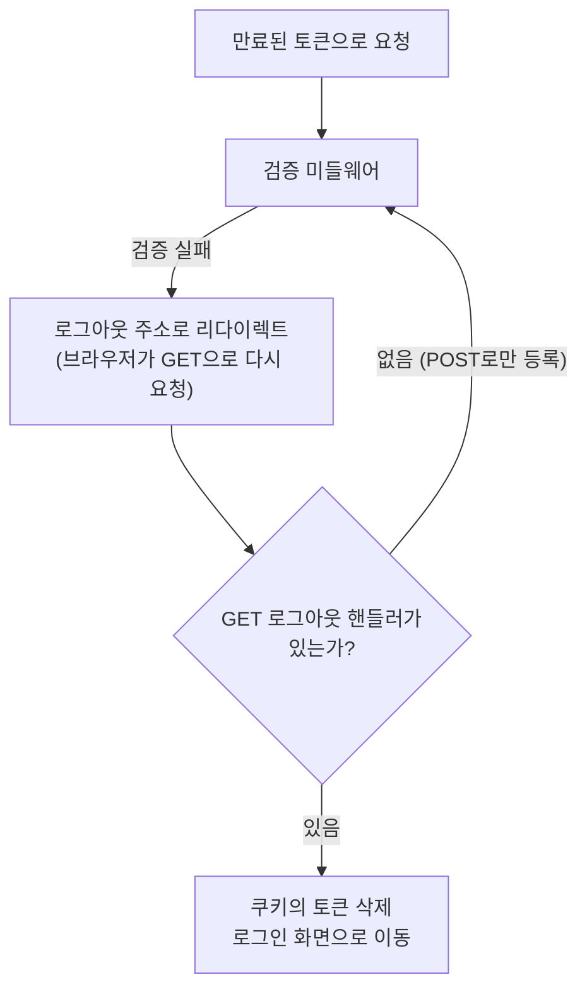
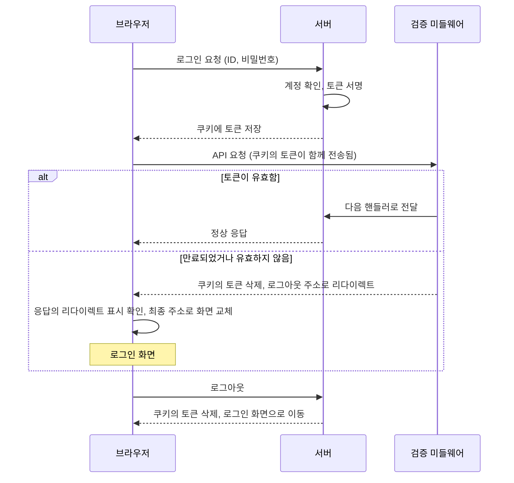
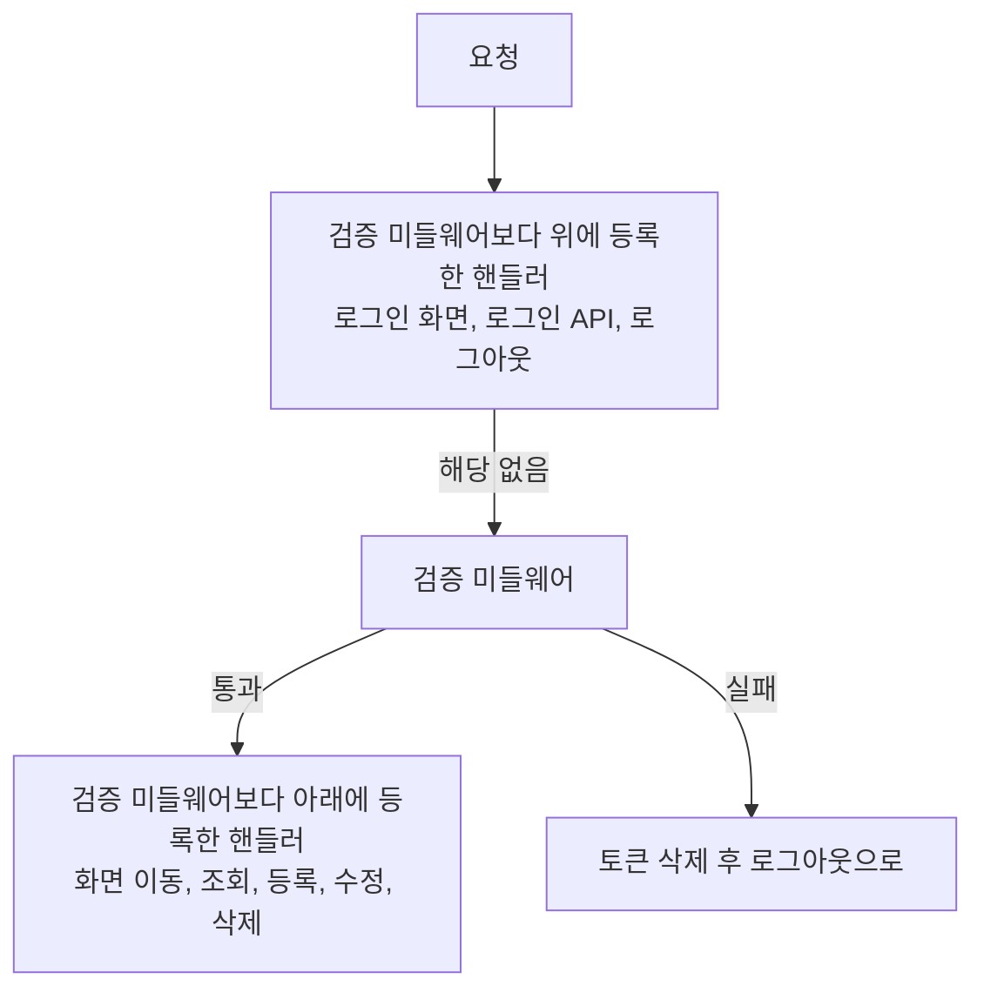

# 토큰 기반 인증

현재 진행 중인 과제에서 서버의 안정성을 높이기 위해 로그인에 액세스 토큰을 도입하게 되어, 이에 대한 내용을 기록한다. 대상은 [Spring에서 Node.js로 옮긴](01-spring-to-nodejs.md) 온도 모니터링 서비스의 서버이다. 기능을 옮기는 작업이 어느 정도 끝난 뒤, 미뤄 두었던 로그인 쪽을 정리할 차례가 되었다.

액세스 토큰은 서버가 로그인에 성공한 사용자에게 발급하는 서명된 문자열이다. 사용자는 이후의 요청에 이 토큰을 함께 보내고, 서버는 서명을 확인해 로그인한 사용자의 요청인지를 판단한다. 서버가 로그인 상태를 따로 저장하지 않아도 된다는 것이 세션 방식과 다른 점이다. 토큰을 어떻게 적용할지 논의한 결과, 우선 액세스 토큰만 적용하기로 했다.

| 항목 | 내용 |
|---|---|
| 기간 | 2023.03 ~ 2023.04 |
| 환경 | Node.js, Express, JWT(jsonwebtoken), 쿠키, fetch |
| 맡은 부분 | 토큰 발급, 검증 미들웨어, 로그아웃, 만료 처리, 자동 로그인 |

## 문제 상황

**로그인이 임시 구현 상태이다.** 서버를 옮기기 시작했을 때 로그인 API는 기능 확인을 위해 DB를 거치지 않고 통과하도록 만들어져 있었다. 이후 실제 로그인 API를 거치도록 고쳤지만 토큰 처리는 빠져 있었다. 로그인 API 안에 토큰을 발급하는 코드가 일부 들어 있기는 했으나, 발급한 토큰을 쿠키에 넣는 부분이 없어서 실제로는 쓰이지 않았다.

**사용자 정보를 쿠키에 그대로 둔다.** 로그인하면 화면 스크립트가 그룹 ID를 쿠키에 넣고, 이후의 화면과 요청이 이 쿠키를 읽어 쓴다. 자동 로그인은 더 위험했다. 그룹 ID 쿠키와 자동 로그인 쿠키, 두 개가 있는지만 보고 로그인된 것으로 처리하고 있었다.

**토큰을 넣고 나니 만료 시 로그인 화면으로 넘어가지 않는다.** 검증 미들웨어를 붙이고 토큰이 만료되었을 때 로그인 화면으로 보내도록 했는데, 화면이 바뀌지 않았다. 메인 화면에서는 안내창도 뜨지 않았고, 로그아웃 요청에서는 토큰 검사가 끝없이 반복되었다.

## 분석

### 기존의 토큰 방식

이전에 만들어 둔 관리자 페이지에는 토큰 미들웨어가 있었다. 이것을 가져와 적용하기로 했는데, 그대로 붙일 수는 없었다. 이 서비스의 로그인은 토큰을 발급한 뒤 곧바로 메인 화면으로 넘어가지 않는다. 구독에 관한 정보를 먼저 화면에 알려야 하기 때문이다. 또 메인 화면의 목록을 가져오는 코드가 그룹 ID 쿠키를 읽고 있어서, 이 쿠키를 없애면 목록을 가져오지 못했다. 토큰에 ID를 담되, 쿠키를 쓰는 기존 코드는 우선 그대로 두었다.

### 한 번 발급한 토큰은 지울 수 없다

로그아웃할 때 서버가 쿠키의 토큰을 지우도록 만들면서, 지운다는 것의 의미를 다시 확인했다. 쿠키에서 토큰을 지워도 토큰 자체는 만료 시각까지 유효하다. 서버는 발급한 토큰을 기억하지 않으므로, 누군가 그 토큰을 가지고 있다면 계속 쓸 수 있다.

이를 막는 일반적인 방법이 블랙리스트이다. 로그아웃한 토큰을 서버가 목록으로 가지고 있다가, 검증할 때 목록에 있는 토큰은 거부한다. 다만 이렇게 하면 서버가 상태를 갖게 되므로, 상태를 저장하지 않는다는 토큰 방식의 장점이 줄어든다. 사용자가 토큰을 직접 지우고 나가 버리면 그 토큰은 목록에 올라가지 않는다는 빈틈도 있다.

### 리다이렉트가 동작하지 않는 이유

만료 처리가 되지 않는 문제는 원인이 두 가지였다.

**첫째, 리다이렉트는 GET 요청을 만든다.** 로그아웃 API는 처음에 POST로 등록되어 있었다. 검증 미들웨어가 만료된 토큰을 만나 로그아웃 주소로 리다이렉트하면 브라우저는 그 주소로 GET 요청을 보낸다. POST로만 등록된 로그아웃 핸들러는 이 요청과 맞지 않으므로 요청은 아래로 계속 내려가고, 다시 검증 미들웨어를 만난다. 토큰은 여전히 유효하지 않으므로 또 리다이렉트된다.



로그인 화면은 GET으로 등록되어 있어 잘 넘어가는데 로그아웃만 되지 않는 것을 보고, 두 핸들러의 차이를 비교하다가 찾았다. 로그아웃 핸들러의 위치도 문제였다. 검증 미들웨어보다 아래에 있어서, 토큰이 만료된 사용자는 로그아웃조차 할 수 없었다.

**둘째, 비동기 요청은 리다이렉트로 화면을 바꾸지 않는다.** 주소창으로 이동하는 요청은 서버가 리다이렉트하면 브라우저가 그 주소의 화면을 연다. 그러나 화면 스크립트가 fetch로 보낸 요청은 다르다. 리다이렉트된 주소의 응답이 스크립트로 돌아올 뿐이고 화면은 그대로이다. 스크립트는 그 응답을 정상 응답처럼 다음 단계로 넘기므로, 의도하지 않은 처리가 이어진다. 메인 화면은 일정한 간격으로 최근 측정값을 다시 가져오는데, 이 요청들이 모두 이 경우에 해당했다. 이전에 만든 관리자 페이지에서도 fetch를 쓰는 부분은 똑같이 동작하지 않는다는 것을 확인했다.

다만 응답 객체에는 리다이렉트를 거쳤는지를 알려 주는 표시(`redirected`)와 최종 주소(`url`)가 들어 있다. 이것을 이용해 화면 쪽에서 직접 이동시킬 수 있다.

### 해결안 세 가지

| 방법 | 내용 | 판단 |
|---|---|---|
| 응답의 리다이렉트 표시 확인 | 요청마다 응답을 받은 직후 표시를 확인하고, 참이면 최종 주소로 화면을 바꾼다 | 토큰이 필요한 모든 요청에 같은 조건문을 넣어야 한다. 대신 추가되는 동작이 가장 적다 |
| fetch 인터셉터 | fetch를 감싼 함수를 만들어 그 안에서 표시를 확인한다. 요청은 모두 이 함수로 보낸다 | 반복되는 코드가 줄어든다. 요청마다 함수 호출과 인자 전달이 한 단계 더 생긴다 |
| axios 도입 | 인터셉터 기능이 들어 있는 HTTP 클라이언트로 바꾼다 | axios도 리다이렉트로 화면을 직접 바꿔 주지는 못한다. 인터셉터를 쓰는 점은 같고, 이미 fetch로 바꿔 둔 요청을 다시 바꿔야 한다 |

세 방법 모두 결국 화면 쪽에서 응답을 확인해 이동시킨다는 점은 같았다. 화면에서 토큰을 직접 해석해 만료 여부를 판단하는 방법도 있었지만, 위험성이 있어 판단은 서버에서만 하기로 했다.

## 해결

전체 흐름은 다음과 같다.



### 발급

토큰은 JSON 형식의 토큰을 만들어 주는 JWT 패키지로 발급한다. 로그인에 성공하면 사용자의 ID를 담아 서명하고, 서버가 응답에서 직접 쿠키에 넣는다. 쿠키에는 스크립트에서 읽을 수 없게 하는 옵션(httpOnly)과 HTTPS에서만 전송하게 하는 옵션(secure)을 지정했다. 토큰의 설정값은 기존 설정 파일들이 있는 디렉터리에 별도 파일로 두었다.

```
함수 토큰_발급(요청, 응답):
    시도:
        ID = 요청에 담긴 사용자 ID
        토큰 = 서명(내용: {ID}, 비밀 키, 옵션: {만료 24시간, 발급자, 알고리즘 HS256})
        응답의 쿠키에 토큰 저장 (httpOnly, secure)
        메인 화면으로 이동
    오류 시:
        상태 500으로 "서버 오류로 로그인에 실패했다. 잠시 후 다시 시도해 달라"고 응답
```

**만료 시간.** 사용자의 편의를 고려해 24시간으로 정했다.

**서명 알고리즘.** JWT가 지원하는 방식은 크게 HS256, RS256, ECDSA가 있다. 다음 이유로 HS256을 골랐다.

1. 처리 속도가 빠르다.
2. 대칭 키를 쓰므로 비밀 키 하나만 잘 관리하면 되고, 관리할 키가 늘지 않는다.
3. 서버가 한 대뿐이다. 토큰을 발급한 서버가 검증도 하므로 대칭 키로 충분하다. RS256과 ECDSA는 비대칭 키를 쓴다.
4. 클라이언트 쪽 라이브러리와의 호환성이 가장 좋다.

이 서비스는 메인 화면이 짧은 주기로 데이터를 다시 가져오는 것이 핵심 기능이다. 요청마다 검증이 실행되므로, 서버의 부담을 줄이려면 검증이 빠른 방식이어야 한다고 판단했다.

### 검증 미들웨어

```
함수 토큰_검증(요청, 응답, 다음):
    시도:
        요청.해석된_내용 = 검증(쿠키의 토큰, 비밀 키)
        다음()
    오류 시:                              # 만료되었거나 유효하지 않은 토큰
        응답의 쿠키에서 토큰 삭제
        로그아웃 주소로 리다이렉트
```

검증에서 오류가 났다면 만료되었거나 잘못된 토큰이므로, 원인을 나누지 않고 곧바로 토큰을 지운 뒤 로그아웃으로 보낸다.

미들웨어는 서버 파일에서 한 번만 등록하고, 그 위치를 기준으로 핸들러를 나누었다.



토큰을 받기 전에 쓸 수 있어야 하는 것은 미들웨어 위에, 로그인한 뒤에만 쓸 수 있는 것은 모두 아래에 둔다. 로그인한 뒤의 모든 동작에 대해 토큰을 검사하는 것이 맞다고 보았다. 모든 API가 토큰을 검증하면, 화면의 코드를 일부러 고쳐 요청을 보내더라도 유효한 토큰 없이는 어떤 API도 쓸 수 없기 때문이다.

### 로그아웃

기존의 로그아웃은 화면 스크립트가 로그인 화면으로 이동하는 것이 전부였다. 토큰은 엄격하게 다뤄야 하므로 서버를 거치도록 바꾸었다. 로그아웃 주소로 이동하면 서버가 쿠키의 토큰을 지우고 로그인 화면으로 보낸다. 동작에 큰 영향이 없는 다른 쿠키는 서버의 부담을 줄이기 위해 화면 쪽에서만 지운다.

- 로그아웃 핸들러를 GET으로 바꾸고 검증 미들웨어 위로 올렸다. 앞에서 분석한 무한 반복이 이것으로 해결되었다.
- 화면 쪽의 로그아웃은 비동기 요청이 아니라 로그아웃 주소로 화면을 교체하는 방식으로 했다. 이렇게 하면 리다이렉트가 그대로 동작한다.
- 로그인 화면에서 메인 화면으로 넘어갈 때도 주소를 "교체"하는 방식으로 바꾸었다. 로그아웃한 뒤 뒤로 가기를 하면 쿠키가 예상과 다르게 지워지는 일이 있어서, 이전 화면으로 돌아갈 수 없게 하는 편이 안전하다고 보았다.

블랙리스트는 이번에 구현하지 못했다. 로그아웃할 때 현재 토큰을 목록에 올리는 방식과 이를 지원하는 모듈, 메모리 기반 저장소를 쓰는 방법까지 조사했고, 적용은 다음 과제로 남겼다.

### 만료 처리

검증에 실패한 요청이 fetch로 보낸 것이라면 화면이 스스로 바뀌지 않는다. 세 가지 해결안 가운데 첫 번째인 "응답의 리다이렉트 표시 확인"을 골랐다.

```
함수 최근_측정_시각_요청():
    응답 = fetch(조회 API)
    만약 응답.redirected 이면:            # 서버가 로그아웃으로 리다이렉트했다
        화면을 응답.url로 교체
        반환                              # 이후의 처리를 하지 않는다
    데이터 = 응답 본문
    화면 갱신(데이터)
```

인터셉터 방식도 구현해 보았다.

```
함수 토큰_확인_fetch(주소, 옵션):
    응답 = fetch(주소, 옵션)
    만약 응답.redirected 이면:
        만약 이미 안내창을 띄웠으면: 반환   # 여러 요청이 동시에 만료를 만나도 한 번만 안내
        안내창을 띄웠다고 기록
        "로그인 가능한 시간이 지났다. 다시 로그인해 달라"고 안내
        화면을 응답.url로 교체
        반환
    응답을 그대로 반환
```

인터셉터를 쓰면 요청마다 같은 조건문을 넣지 않아도 된다. 그러나 요청마다 함수 호출이 한 번 더 생기고 인자를 다시 넘겨야 한다. 메인 화면처럼 요청이 계속 나가는 화면에서는 이 부담이 작지 않다고 판단했다. 코드가 반복되더라도 가장 빠르다고 볼 수 있는 방식, 즉 토큰이 필요한 모든 요청에 조건문을 넣는 방식을 채택했다. 더 나은 방법이 있는지는 계속 찾아보기로 했다.

### 자동 로그인

사용자가 로그아웃하지 않고 창을 닫았다가 다시 들어오는 경우를 처리했다. 로그인 화면을 요청받았을 때 쿠키에 토큰이 있으면 유효한지 확인하고, 유효하면 로그인 과정을 거치지 않고 바로 들어가게 한다. 토큰이 없거나 유효하지 않으면 기존처럼 로그인 화면을 보여 준다.

```
핸들러 로그인_화면(요청):
    만약 쿠키에 토큰이 있고 검증에 성공하면:
        메인 화면으로 이동
    아니면:
        로그인 화면 전송
```

자동 로그인으로 들어온 사용자에게도 구독에 관한 안내는 필요하다. 로그인 화면의 스크립트에 있던 구독 정보 확인 코드를 공용 함수로 분리해 양쪽에서 쓰도록 했다. 자동 로그인일 때는 사용자가 어느 계정으로 들어왔는지 알기 어려우므로, 안내 문구에 계정의 ID를 함께 표시한다.

토큰이 만료된 상태에서 자동 로그인 쿠키만 남아 있을 때 로그인되지 않도록 하는 것, 로그인 화면의 자동 로그인 선택에 따라 쿠키를 처리하는 것은 남은 작업으로 정리했다.

### 앞으로의 개선 방향

지금의 자동 로그인은 한계가 분명하다. 액세스 토큰만 쓰므로 24시간이 지나면 만료되고, 그보다 긴 기간의 자동 로그인을 지원할 수 없다. 그렇다고 액세스 토큰의 만료 시간을 늘리면 탈취되었을 때의 위험이 커진다. 안전하게 구현하려면 다음과 같은 구성이 필요하다고 정리했다.

1. 리프레시 토큰을 함께 발급한다. 액세스 토큰의 만료 시간은 15분 정도로 짧게 잡아 탈취의 위험을 줄인다.
2. 리프레시 토큰의 만료 시간은 몇 주에서 몇 달로 잡고, 자동 로그인을 원하는 사용자는 리프레시 토큰을 검증해 액세스 토큰을 다시 발급받는다.
3. 리프레시 토큰은 수명이 길어 탈취가 걱정된다. 한 번 쓰인 리프레시 토큰은 새것으로 교체해 다시 쓸 수 없게 한다(Refresh Token Rotation).
4. Redis 같은 인메모리 DB에 리프레시 토큰을 만료 시각과 함께 저장하고, 허용 목록이나 차단 목록으로 관리한다. 사용자가 직접 로그아웃하면 목록에서 지워 무효로 만든다. 토큰은 스스로 취소될 수 없으므로 목록을 통해 간접적으로 취소하는 것이다.
5. 그래도 탈취된 리프레시 토큰으로 한 번은 재발급이 가능하다. 평소와 다른 IP에서 로그인하면 추가 인증을 요구하는 식의 대책이 더 필요하다.

다만 이 구성은 서버 한 대로 운영하는 작은 서비스의 현실과 거리가 있다. 그대로 적용하면 서버에 가해지는 부담이 적지 않을 것으로 보았다. 지금의 방식을 유지하기에는 보안이 걱정되고, 위의 방식을 그대로 넣기에는 부담이 커서, 어느 수준에서 구현할지를 미팅에서 논의할 안건으로 올렸다.

쿠키에 토큰을 두는 방식의 보안도 더 살펴볼 부분이다. httpOnly와 secure 옵션으로 스크립트를 통한 탈취는 막았지만, 입력값 제한이나 same-site 설정 같은 추가 장치를 어디까지 넣어야 하는지는 판단하지 못했다.

관리자만 접근해야 하는 화면에도 같은 인증이 필요하다. 이 문제는 [관리자 페이지](05-admin-page.md)를 만들면서 다시 나온다.
