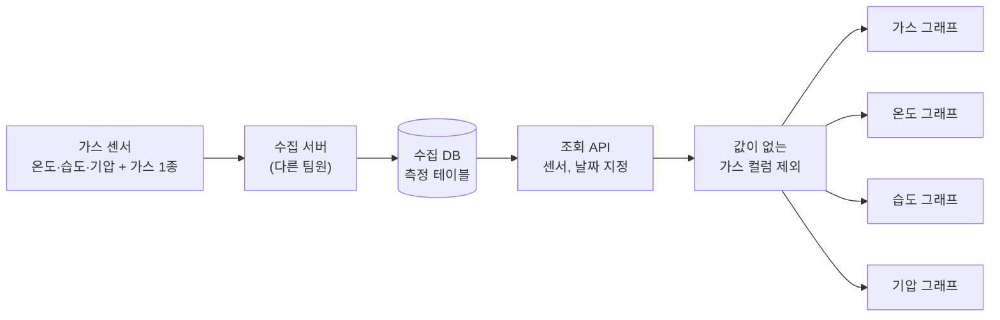
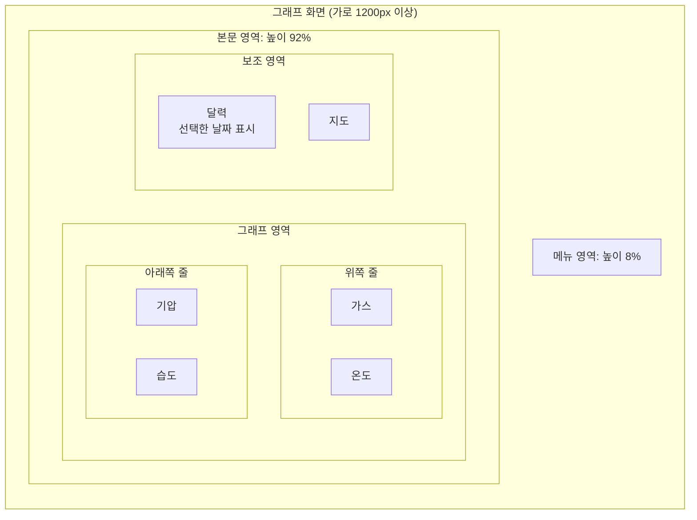
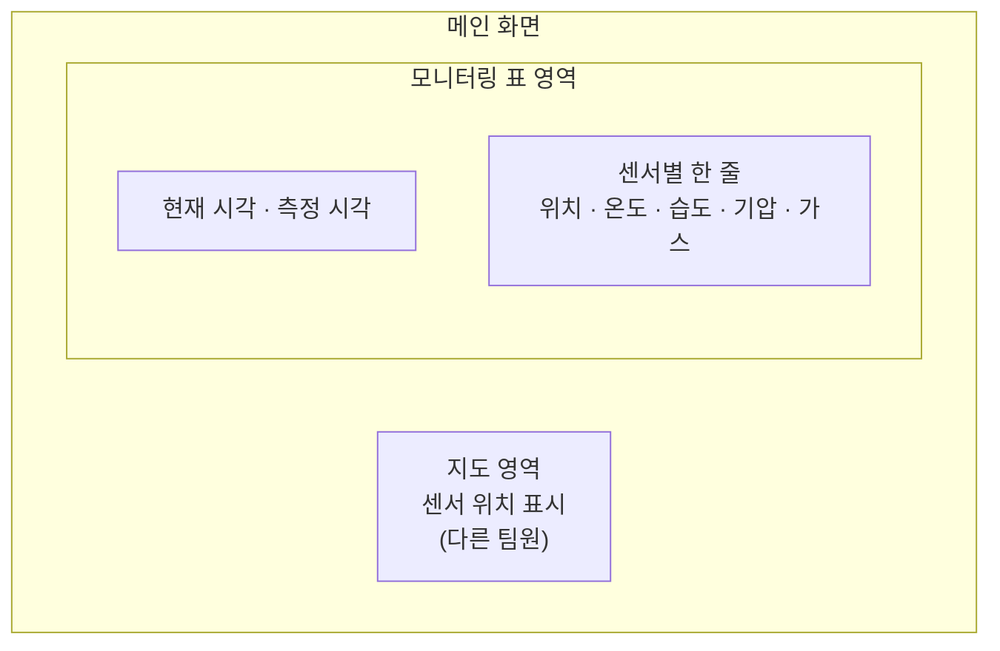

# 가스 센서 모니터링 화면

현재 진행 중인 과제에서 가스 센서가 수집한 데이터를 웹에서 그래프로 확인하는 화면을 만들게 되어, 그 과정을 정리한다. 과제는 여러 지점에 설치한 가스 센서의 측정값을 모아 한곳에서 지켜보는 모니터링 시스템이다. 센서가 보낸 데이터는 수집 서버를 거쳐 DB에 쌓이고, 웹 화면은 이 데이터를 조회해 보여 준다.

화면은 두 개이다. 메인 화면은 지도 위에 센서의 위치를 표시하고 센서별 최근 측정값을 표로 보여 준다. 그래프 화면은 센서 하나를 골라 하루 동안의 변화를 그래프로 보여 준다. 나는 그래프 화면 전체와 메인 화면의 화면 구성을 맡았다. 지도, 센서 데이터를 받는 수집 서버, 전시용 이상치 시연 기능은 다른 팀원이 맡은 부분이다.

만든 화면은 전시회에서 시연할 예정이었고, 전시에서는 PC가 아니라 태블릿을 쓴다.

| 항목 | 내용 |
|---|---|
| 기간 | 2023.05 ~ 2023.07 |
| 환경 | HTML, CSS(Flexbox, media query), JavaScript, Chart.js, Node.js |
| 맡은 부분 | 그래프 화면(그래프, 달력, 레이아웃), 메인 화면의 레이아웃 |

## 문제 상황

**센서마다 측정하는 가스의 종류가 다르다.** 설치된 센서는 암모니아, 황화수소, 이산화황, 일산화탄소 가운데 한 가지씩을 측정한다. 측정 테이블에는 가스 종류별 컬럼이 따로 있어서, 센서에 따라 값이 들어 있는 컬럼이 다르다. 어떤 센서를 고르느냐에 따라 그려야 할 그래프가 달라지는 것이다.

**처음 만든 화면은 비율이 무너진다.** 처음 만든 그래프 화면은 화면을 확대하거나 축소한 뒤 100%로 돌아와도 비율이 원래대로 돌아오지 않았다. 원인을 한동안 찾지 못했다. 달력도 화면 크기에 따라 밀렸다.

**태블릿에서 써야 한다.** 화면이 좁아져도 내용이 보여야 하고, 태블릿을 가로에서 세로로 돌려도 문제가 없어야 한다. 그런데 태블릿을 돌리면 그래프가 돌리기 전의 해상도로 남아 있었다.

## 분석

### 그래프는 항상 네 개이다

센서마다 가스의 종류는 다르지만 공통점이 있다. 모든 센서는 온도, 습도, 기압을 함께 측정하고, 가스는 한 종류만 측정한다. 따라서 어떤 센서를 고르든 그래프는 온도, 습도, 기압, 가스의 네 개이다. 달라지는 것은 네 번째 그래프가 어떤 가스의 것인지와 그 세로축의 범위뿐이다.

조회한 데이터에서 값이 들어 있지 않은 가스 컬럼을 빼면 남는 하나가 그 센서의 가스이므로, 센서의 종류를 따로 알려 주지 않아도 데이터만으로 구분할 수 있다.



### 비율이 돌아오지 않던 원인

원인은 레이아웃을 새로 짜는 과정에서 찾았다. 그래프를 최대한 크게 보이려고 그래프의 크기를 그것이 놓인 영역의 가로 100%, 세로 100%로 지정해 두었는데, Chart.js의 그래프가 영역을 꽉 채울 만큼 크면 확대·축소를 거친 뒤 100%로 돌아왔을 때 비율이 유지되지 않았다. 그래프가 주변 요소를 침범할 정도로 커지는 것이 문제인 것으로 보았다.

비슷한 문제가 하나 더 있었다. 위쪽 메뉴 영역의 높이를 지정하지 않은 채 본문 영역의 높이를 100%로 주고, 넘치는 부분을 숨기는 속성으로 가려 두었다. 이렇게 하면 넘치지 않는 것처럼 보일 뿐 실제 크기는 화면보다 크다. 그래프의 아랫부분이 화면 밖으로 빠져나가 보이지 않았다.

두 경우 모두 크기를 "남는 만큼 전부"로 지정한 데서 나온 문제였다. 영역마다 차지할 비율을 정해 주어야 한다.

### 화면이 바뀌어도 그래프는 다시 그려지지 않는다

태블릿을 돌리면 화면의 가로와 세로가 바뀌지만, 이미 그려진 그래프는 그려질 때의 크기를 유지한다. 화면 크기가 바뀌는 시점에 그래프를 다시 그려야 한다. 브라우저는 창의 크기가 바뀔 때 resize 이벤트를 발생시키므로 이것을 이용할 수 있다. 다만 이 이벤트는 크기가 바뀌는 동안 연속으로 발생한다.

## 해결

### 그래프 네 개로 분리

화면에 그래프가 들어갈 영역을 네 개로 나누고, 그래프를 그리는 함수도 온도, 습도, 기압, 가스의 네 개로 만들었다.

```
함수 그래프_표시(센서, 날짜):
    데이터 = 조회 API(센서, 날짜)
    가스 = 데이터의 가스 컬럼 가운데 값이 들어 있는 것    # 값이 없는 컬럼은 제외
    온도_그래프(데이터.시각, 데이터.온도)
    습도_그래프(데이터.시각, 데이터.습도)
    기압_그래프(데이터.시각, 데이터.기압)
    가스_그래프(데이터.시각, 데이터[가스], 세로축 범위 = 미리 정해 둔 가스별 범위[가스])
```

세로축의 범위는 항목별로 미리 정해 둔 값을 쓴다. 가스는 종류에 따라 범위가 다르므로 종류별로 범위를 저장해 두고 꺼내 쓴다.

네 함수는 겹치는 코드가 많다. 종류를 인자로 받아 하나로 합치는 것도 생각했지만, 중복을 없애려고 조건문을 많이 넣으면 오히려 복잡해질 수 있다고 보아 우선 그대로 두었다.

**날짜 선택.** 그래프 화면의 달력에서 날짜를 누르면 그날의 데이터를 다시 조회해 그린다. 새 날짜를 누를 때 이전에 선택한 칸의 강조를 지워야 하므로, 마지막으로 선택한 칸을 기억해야 한다. 이 값은 달력을 그리는 함수의 지역 변수로 두고, 칸의 클릭 핸들러가 클로저로 참조하게 했다. 함수가 끝난 뒤에도 핸들러가 변수를 붙잡고 있으므로 값이 유지된다. 이 방식에는 주의할 점이 있다. 달을 옮기면 달력을 그리는 함수가 다시 실행되므로, 다른 달로 갔다가 돌아오면 선택이 초기화된다.

**공용 스크립트.** 지도를 띄우는 코드와 타이머 코드를 스크립트 하나로 분리해 메인 화면과 그래프 화면이 함께 쓰게 했다. 그런데 타이머는 메인 화면의 실시간 모니터링에만 쓰여서, 그래프 화면에서는 코드가 꼬였다. 화면의 종류를 인자로 받아 구분하게 해 두었는데, 임시로 돌아가게만 한 것이어서 다시 정리해야 하는 부분이다.

### 레이아웃 재구성

그래프 화면의 레이아웃을 처음부터 다시 짰다. 크기는 상대값으로 지정하고, 영역마다 차지할 비율을 정했다.



- **메뉴와 본문.** 넘치는 부분을 숨기는 방식을 버리고, 메뉴 영역에 높이 8%, 본문 영역에 92%를 지정했다. 본문이 화면 밖으로 빠져나가는 문제가 없어졌다.
- **그래프의 크기.** 그래프가 영역을 꽉 채우지 않도록 가로를 100%보다 조금 줄였다. 확대·축소한 뒤 비율이 돌아오지 않던 문제가 없어졌다.
- **좁은 화면.** media query로 가로가 1200px보다 좁을 때는 그래프 영역과 보조 영역(달력, 지도)의 배치가 바뀌도록 했다. 태블릿을 기준으로 테스트했고, 브라우저 개발자 도구에서 화면 크기를 바꿔 가며 배치를 맞추었다.

### 화면 크기가 바뀔 때 그래프 다시 그리기

resize 이벤트에서 그래프를 지우고 다시 그리도록 했다. 이벤트가 발생할 때마다 그리면 크기를 바꾸는 동안 계속 다시 그리게 되므로, 크기 변경이 끝난 뒤에 한 번만 그리도록 타이머를 두었다.

```
크기 변경 이벤트가 발생하면:
    예약해 둔 타이머가 있으면 취소
    0.3초 뒤에 실행되도록 타이머 예약:
        기존 그래프 제거
        그래프 다시 그리기
```

크기가 연속으로 바뀌는 동안에는 타이머가 계속 취소되고 다시 예약된다. 마지막 변경에서 0.3초가 지나야 그래프가 다시 그려진다. 화면 크기를 바꿔 가며 그래프가 화면에 맞게 다시 그려지는 것을 확인했다.

### 메인 화면

메인 화면의 레이아웃도 같은 방식으로 다시 구성했다. 화면은 지도 영역과 모니터링 표 영역으로 나뉜다. 표 영역의 위쪽에는 현재 시각과 마지막 측정 시각이 나오고, 그 아래에 센서마다 한 줄씩 설치 위치, 온도, 습도, 기압, 가스의 값이 나온다.



- 영역은 flex로 배치해 화면 해상도에 따라 상대적으로 놓이게 했고, 그래프 화면과 같이 가로 1200px을 기준으로 media query를 두었다.
- 칸 안의 글자를 가운데에 놓는 방법은 칸 자체를 flex 컨테이너로 만들고 그 안에서 가로와 세로 정렬을 지정하는 것으로 정리했다.
- 표의 테두리가 겹쳐 두껍게 보이는 문제는 테두리를 합치는 속성으로 해결되지 않아, 겹치지 않는 변에만 테두리를 주는 방식으로 해결했다.
- 센서가 네 개뿐이어서 표의 줄은 화면에 직접 적어 두었다. 센서가 늘어나면 쓸 수 없는 방식이므로, DB의 센서 목록 체계가 잡히면 목록을 조회해 줄을 만들도록 바꿔야 한다.

화면을 구성하다 보니 flex로 모든 해상도에 맞추는 대신, 해상도 구간마다 고정된 크기의 레이아웃을 제공하는 방식도 괜찮겠다는 생각이 들었다. PC에서는 레이아웃의 크기를 바꾸지 않고, 화면이 일정 수준보다 좁아지면 다른 레이아웃으로 넘기는 식이다. 뒤에 [관리자 페이지](05-admin-page.md)의 대시보드에서는 그래프 영역의 크기를 고정하는 방식을 썼다.

### 남은 문제

- 그래프와 표의 코드가 센서 네 개를 전제로 작성되어 있다. 센서 목록에 따라 동작하는 일반적인 방식으로 바꿔야 한다.
- 같은 길이의 데이터인데도 그래프마다 가로축의 시간 단위가 다르게 나오는 경우가 있다.
- 달력에서 데이터가 있는 날짜를 따로 표시하지 않는다. [측정 데이터 달력·그래프 조회](02-calendar-graph.md)의 달력처럼 표시할지는 확인이 필요한 사항으로 남겼다.
- 이 화면의 코드는 다른 팀원의 코드와 아직 합쳐지지 않은 상태에서 작성한 것이어서, 합치는 과정이 남아 있다.
