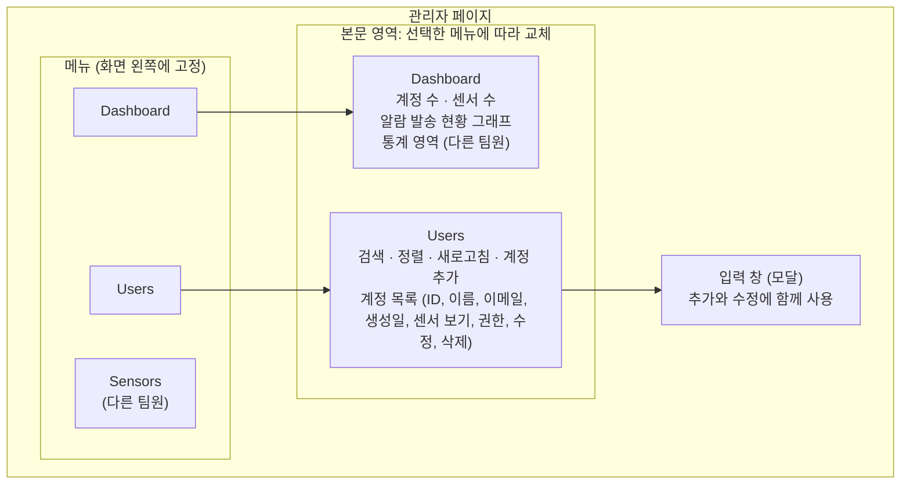
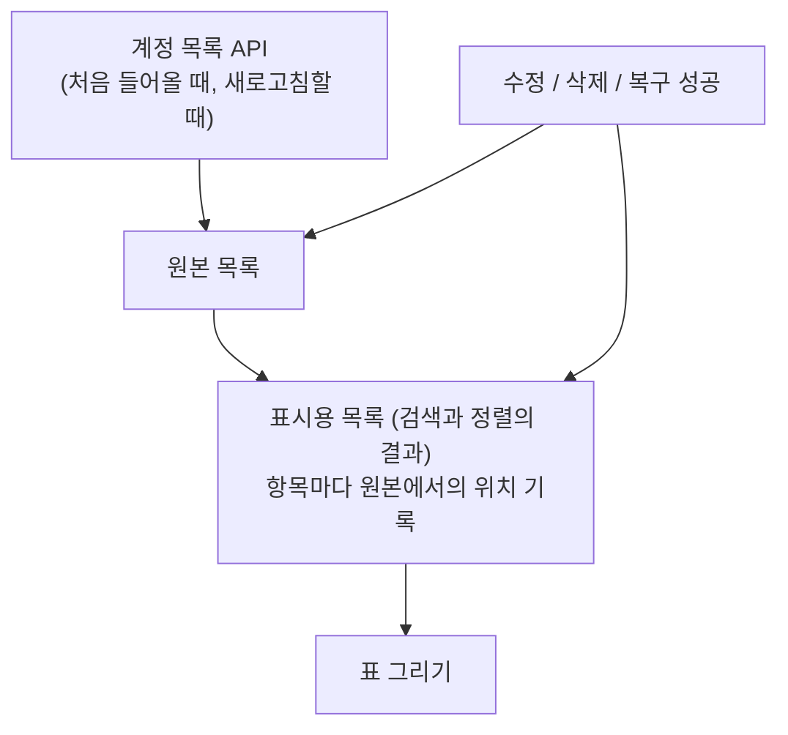

# 관리자 페이지

현재 진행 중인 과제에서 서비스 운영을 위한 관리자 페이지를 새로 만들게 되어, 기획부터 구현까지를 기록한다. 대상은 앞의 글들에서 다룬 온도 모니터링 서비스이다. 서비스의 사용자는 그룹 계정으로 로그인해 온도계를 등록하고 측정값을 확인한다. 운영하는 쪽에서는 계정을 만들어 주고, 온도계를 등록해 주고, 알람이 제대로 나가고 있는지를 살펴야 한다. 지금까지는 이런 일을 한곳에서 할 수 있는 화면이 없었다.

관리자 페이지는 세 화면으로 나누어 만들었다. 계정을 관리하는 Users 화면, 온도계를 관리하는 Sensors 화면, 운영 수치를 보여 주는 Dashboard 화면이다. 나는 전체 레이아웃과 Users 화면, Dashboard 화면을 맡았다. Sensors 화면은 다른 팀원이 맡은 부분이다.

| 항목 | 내용 |
|---|---|
| 기간 | 2023.07 ~ 2023.08 |
| 환경 | Node.js, Express, MySQL, HTML/CSS, JavaScript, Chart.js |
| 맡은 부분 | 기획 내용 확인, 전체 레이아웃, Users 화면, Dashboard 화면 |

## 문제 상황

**계정은 생성만 가능하고 수정과 삭제가 없다.** 이전에 만들어 둔 관리자 페이지에는 계정을 생성하는 코드만 있었다. 계정의 이름이나 이메일을 바꾸거나 비밀번호를 다시 정해 주는 일, 계정을 지우는 일은 할 수 없었다.

**수정 화면에서는 어떤 항목이 바뀔지 알 수 없다.** 관리자는 이름만 바꿀 수도 있고, 이메일과 비밀번호를 함께 바꿀 수도 있다. 바뀐 항목만 수정하려면 쿼리의 내용이 요청마다 달라져야 한다.

**온도계 등록 절차가 길다.** 기존에는 온도계의 ID와 이름을 입력해 먼저 등록하고, 그다음에 MAC 주소를 입력해 연결해야 했다.

**운영 상태를 한눈에 볼 곳이 없다.** 알람이 얼마나 발송되었는지는 하루에 한 번 정해진 시각에 오는 통계 메일로만 확인하고 있었다.

## 분석

### 필요한 기능과 기획 의도 확인

요청받은 기능은 네 가지였다. 문장만으로는 뜻이 분명하지 않은 것이 많아서, 항목마다 질문을 만들어 의도를 확인했다.

| 요청받은 기능 | 확인한 내용 |
|---|---|
| 사용자 계정의 생성과 삭제 | 기존의 생성 코드를 활용하되 삭제를 추가한다 |
| 온도계의 등록과 삭제. MAC 주소를 "찍으면" 자동으로 등록 | 카메라 촬영이 아니다. 입력란에 커서를 두고 QR 리더기로 온도계의 코드를 읽으면 MAC 주소가 키보드로 친 것처럼 입력된다. MAC 주소만 받으면 계정의 ID와 MAC 주소의 끝자리를 조합해 온도계의 ID와 이름을 만들고 한 번에 등록한다 |
| 구독 연장 화면과의 통합 | 따로 쓰고 있는 구독 기간 변경 기능을 계정을 관리하는 화면에 넣기를 원한다. 시간이 부족하면 별도 화면으로 두어도 된다 |
| 관제. 여러 수치를 그래프나 숫자로 보여 주기 | 센서의 측정값이 아니라 운영에 관한 수치이다. 온도가 누락되고 있는 사용자의 수, 기간별 알람 발송 횟수가 예시이다. 메일로 받던 알람 통계를 화면에서 바로 볼 수 있으면 좋겠다는 의도이다 |

그 밖에 확인한 것은 다음과 같다.

- **디자인.** 사용자가 두 명 남짓이므로 최대한 간단하고 직관적으로 만들고, 디자인은 기능 개발이 끝난 뒤에 다시 본다.
- **접속.** 회사 내부 네트워크에서만 접속한다. 로그인과 관련된 기능은 이번 개발에서 모두 제외한다.
- **권한.** 기획에는 관리자, 직원, 고객 같은 권한 구분이 있었지만 DB에 권한을 담을 곳이 없다. 화면에는 모든 계정을 "Client"로 고정해 표시하고, DB를 고치게 되면 그때 쓴다.

온도계의 자동 등록은 Sensors 화면에 들어가는 기능이라 이 글에서는 다루지 않는다. 일반 사용자의 화면에서 MAC 주소를 바꿀 수 있게 두는 것이 위험하다는 점은 [서버를 옮기던 때](01-spring-to-nodejs.md)에 이미 적어 둔 문제였는데, 이번에 온도계 등록이 관리자 페이지의 기능으로 들어가게 되었다.

### 계정 데이터의 규모

계정 테이블의 행은 1022개 정도였다. 많은 수가 아니므로, Users 화면에 들어올 때 전체를 한 번에 받아 오고 정렬과 검색은 화면에서 처리하기로 했다. 관리자 페이지는 사용자가 적어서, 데이터를 먼저 다 가져온 뒤에 화면에서 다루는 방식을 써도 부담이 없다.

### 입력을 언제 검사할 것인가

계정의 ID는 영문자와 숫자로만 이루어져야 하고 영문자로 시작해야 한다. 처음에는 글자를 입력할 때마다 검사해 바로 안내하려고 했다. 키를 뗄 때 발생하는 이벤트에 검사 함수를 걸었는데, 한글을 입력하면 함수가 두 번 실행되었다. 한글은 조합 문자여서 글자가 조합 중인지 끝났는지를 판단하기 어렵기 때문에 생기는 현상이다. 관리자가 한글을 입력하는 경우도 고려해야 했다.

| 시도 | 결과 |
|---|---|
| 문자가 실제로 입력될 때 발생하는 이벤트로 교체 | 글자를 두 개 입력해야 첫 글자가 읽혀서 쓸 수 없었다 |
| 이벤트의 조합 중 표시(`isComposing`)를 확인 | 확인해도 두 번 실행되었다 |
| 입력란에서 포커스가 벗어날 때 검사 | 동작했다. 포커스를 옮기지 않고 곧바로 추가 버튼을 눌러도 포커스 해제가 먼저 처리되어 검사가 실행된다 |
| 추가 버튼을 눌렀을 때 한 번만 검사 | 최종 선택 |

마지막에 생각을 바꾼 이유는 이 화면의 사용자가 관리자라는 점이다. 입력을 잘못할 가능성이 낮으므로 매 입력마다 안내할 필요가 없다. 모든 검사를 추가 버튼을 눌렀을 때 한 번에 하고, 문제가 있으면 안내창으로 알리는 것으로 정리했다. ID의 규칙도 글자를 하나씩 확인하는 코드 대신 정규식 하나로 바꾸었다. 화면 공용 스크립트에 이메일 형식 등을 정규식으로 검사하는 함수 모음이 이미 있어서, ID 규칙을 검사하는 함수를 거기에 추가했다.

## 해결

### 화면 구성



메뉴는 스크롤을 내려도 항상 보여야 한다. 위치를 화면에 고정하는 속성을 썼는데, 고정된 요소는 문서의 흐름에서 빠지므로 본문이 메뉴 밑으로 들어가 레이아웃이 무너졌다. 메뉴와 같은 크기의 빈 영역을 본문 옆에 두어 자리를 채웠다. 입력 창을 띄울 때 어두운 배경이 고정된 메뉴를 덮지 못하는 문제도 있었는데, 문서에서 요소가 놓인 순서를 바꿔 해결했다.

### 계정 추가

계정 추가 API는 계정 테이블의 현재 컬럼에 맞춰 행을 추가한다. 비밀번호는 기존 로그인 API와 같은 방식으로 해시해 저장한다. 추가 버튼을 누르면 다음을 차례로 검사한다.

| 검사 | 기준 |
|---|---|
| 글자 수 | ID 40자 이하, 이름 100자 이하, 이메일 30자 이하 |
| ID 규칙 | 영문자와 숫자만, 영문자로 시작 (정규식) |
| 이메일 형식 | 정규식 |
| ID 중복 | 서버에 확인 요청 |

ID 중복 확인은 EXISTS로 작성했다. ID가 기본 키이고, 존재 여부만 알면 되므로 행을 조회해 오는 것보다 효율적이다.

**생성 시각.** 계정의 생성 시각이 DB에 한국 시간으로 기록되고 있었다. DB의 시각은 UTC가 기준이다. 원인은 화면에서 현재 시각을 문자열로 만들어 보낸 데 있었다. 문자열은 그대로 저장되지만, 날짜 객체로 보내면 전송 과정에서 UTC로 바뀐다. 날짜 객체로 보내도록 고치자 9시간이 빠진 시각으로 저장되었다.

### 계정 목록

화면이 가진 목록은 두 벌이다. 서버에서 받은 그대로의 원본 목록과, 검색과 정렬을 거쳐 지금 표에 나오고 있는 목록이다. 표시용 목록의 각 항목에는 원본에서의 위치를 함께 기록해 둔다.



- **검색과 정렬.** 화면이 가진 목록으로 처리하고 서버에 다시 요청하지 않는다. 정렬은 선택 상자에서 고른 기준과 방향으로 표시용 목록을 정렬한 뒤 표를 다시 그린다.
- **다시 방문.** Users 메뉴를 처음 누를 때만 목록을 받아 온다. 다른 메뉴에 갔다가 돌아오면 이전의 검색과 정렬 결과가 그대로 남아 있다. 새로고침 버튼을 누르면 목록을 다시 받아 오고 검색과 정렬은 초기화한다.
- **페이지당 개수.** 한 페이지에 보여 줄 개수를 바꾸면 첫 페이지로 돌아가게 했다. 보고 있던 위치를 유지하는 기준을 정하기가 어려워서 다른 서비스의 동작을 참고했다. 선택 상자에서 읽은 값이 문자열이라 위치 계산이 어긋나는 오류가 있어 숫자로 바꾸었다.
- **긴 글자.** ID, 이름, 이메일이 칸을 넘으면 말줄임표로 표시한다.
- **센서 보기.** 계정마다 있는 돋보기 버튼을 누르면 Sensors 화면으로 넘어가 그 계정의 센서를 보여 준다.

표의 페이지를 넘기는 부분과 검색의 기본 코드는 다른 팀원이 Sensors 화면에 만든 것을 가져와 Users 화면에 맞게 고쳐 썼다.

목록을 받은 뒤 표를 그리는 일을 연결하는 데 반응형 라이브러리(RxJS)를 쓰는 것도 검토했다. 목록을 관찰 대상으로 두고 표를 그리는 쪽이 구독하게 하면 함수끼리 직접 부르지 않아도 된다. 그러나 화면 하나만 이 방식으로 바꿔서는 얻는 것이 적고, 배우는 데 시간이 걸려 다른 사람이 유지보수하기 어렵다고 보아 쓰지 않았다.

### 추가·수정 겸용 입력 창

계정을 추가할 때와 수정할 때 같은 입력 창을 쓴다. 화면의 상태값으로 "수정 중"인지를 구분해, 창을 열 때와 닫을 때의 동작을 나눈다. 수정으로 열면 선택한 계정의 값이 채워진 채로 열리고, 닫을 때 입력란을 비운다. ID는 기본 키이므로 수정할 수 없고, 이름, 이메일, 비밀번호를 바꿀 수 있다.

입력 창을 여는 버튼에 핸들러를 등록하다가 누르지도 않았는데 창이 열리는 오류가 있었다. 핸들러 자리에 "인자를 넣어 호출한 결과"를 넘겼기 때문이다. 등록하는 순간에 함수가 실행되어 버린다. 호출을 익명 함수로 감싸서 눌렀을 때 실행되도록 고쳤다.

### 바뀐 항목만 받아 수정 쿼리 만들기

처음에는 화면이 모든 값과 함께 "이름이 바뀌었다", "비밀번호가 바뀌었다", "이메일이 바뀌었다"는 표시를 보내고, 서버가 표시를 하나씩 확인해 쿼리를 만들었다.

```
# 처음 방식 (서버)
설정절 = ""
만약 이름이 바뀌었다는 표시가 있으면:
    설정절에 이름 추가
만약 비밀번호가 바뀌었다는 표시가 있으면:
    만약 설정절이 비어 있으면: 비밀번호 추가
    아니면: 쉼표를 붙이고 비밀번호 추가
만약 이메일이 바뀌었다는 표시가 있으면:
    만약 설정절이 비어 있으면: 이메일 추가
    아니면: 쉼표를 붙이고 이메일 추가
```

항목이 세 개뿐이라 동작에는 문제가 없지만, 항목마다 "앞에 다른 항목이 있었는가"를 따로 확인해야 해서 읽기 어렵고, 항목이 늘어날 때마다 조건문이 늘어난다. 쿼리의 내용을 화면이 정하게 할 수는 없으므로 서버에서 만드는 것은 그대로 두고, 주고받는 데이터의 모양을 바꾸었다. 화면은 바뀐 항목만 담은 객체를 보내고, 서버는 그 객체의 항목을 돌면서 쿼리를 만든다. 바뀌었다는 표시를 따로 보낼 필요가 없어진다.

```
# 화면
함수 계정_수정():
    바뀐_항목 = 빈 객체
    만약 입력한 이름이 목록의 값과 다르면:
        바뀐_항목.이름 = 입력한 이름
    만약 비밀번호나 비밀번호 확인이 입력되어 있으면:
        만약 두 값이 서로 다르면: 안내하고 반환
        바뀐_항목.비밀번호 = 입력한 비밀번호
    만약 입력한 이메일이 목록의 값과 다르면:
        만약 이메일 형식이 아니면: 안내하고 반환
        바뀐_항목.이메일 = 입력한 이메일

    만약 바뀐_항목이 비어 있으면: "변경된 사항이 없다"고 안내하고 반환
    바뀐_항목의 각 항목에 대해 글자 수를 검사하고, 문제가 있으면 모아서 안내하고 반환

    바뀐_항목.ID = 수정 중인 계정의 ID
    성공 = 계정 수정 API(바뀐_항목)
    만약 성공이면: 표시용 목록과 원본 목록에 반영
    아니면: 실패를 안내

# 서버
핸들러 계정_수정(요청):
    바뀐_항목 = 요청 본문
    설정절 = ""
    바뀐_항목의 수정 대상 항목 각각에 대해:
        만약 설정절이 비어 있지 않으면: 쉼표 추가
        만약 항목이 비밀번호이면: 설정절에 "비밀번호 = 해시한 값" 추가
        아니면: 설정절에 "항목 = 값" 추가
    쿼리 = 계정 테이블에서 ID가 일치하는 행을 설정절대로 수정
    결과 = 쿼리 실행
    영향받은 행 수가 1이면 참, 아니면 거짓을 응답
```

글자 수 검사도 같은 방식이다. 바뀐 항목만 돌면서 항목에 맞는 기준(이름 100자 이하, 이메일 30자 이하, 비밀번호 8자 이상)으로 검사하므로, 바꾸지 않은 항목은 검사하지 않는다.

수정이 성공하면 목록을 다시 받아 오지 않고 화면이 가진 값을 바꾼다. 표시용 목록에서 수정 중인 항목을 찾아 표의 글자와 목록의 값을 바꾸고, 그 항목에 기록해 둔 위치로 원본 목록의 값도 바꾼다. 비밀번호는 화면에 나오지 않으므로 반영할 것이 없다. 계정을 새로 추가한 경우는 목록에 바로 넣지 않고 새로고침이 필요하다고 안내한다.

### 삭제와 복구

삭제는 행을 지우지 않고 삭제 여부를 나타내는 컬럼의 값을 바꾼다. 휴지통 버튼을 누르면 확인과 취소가 있는 창으로 한 번 더 묻고, 확인하면 삭제 상태로 바꾼다. 삭제된 계정은 목록에 빨간색으로 표시되며 복구할 수 있다. 삭제와 복구는 바꾸는 값만 다르므로 처리 과정을 하나로 합치기로 했다.

### Dashboard

Dashboard에 넣기로 한 항목 가운데 내가 맡은 것은 숫자로 보여 주는 항목과 알람 발송 현황이다. 화면 아래쪽의 센서 통계와 사용자 통계 영역은 다른 팀원이 맡은 부분이다.

| 항목 | 처리 |
|---|---|
| 계정 수, 센서 수 | 각각의 수를 돌려주는 API를 만들어 화면 위쪽에 숫자로 표시한다 |
| DB 용량 | 쿼리로 가져올 방법을 찾지 못해 우선 제외했다 |
| 알람 발송 현황 | 기간별 발송 횟수를 그래프로 표시한다. 기본 기간은 접속한 날로부터 7일 전까지이다 |

**알람 발송 현황.** 알람 발송 기록 테이블에서 고온 알람, 저온 알람, 측정 누락 알람의 횟수를 센다. 이 테이블에는 문제가 두 가지 있었다. 행이 매우 많은데 날짜에 인덱스가 걸려 있지 않고, 날짜를 나타내는 별도의 컬럼이 없어서 발송 요청 시각에서 날짜를 꺼내 써야 한다. 발송 완료 시각은 대부분의 행에서 비어 있어 기준으로 쓸 수 없었다.

처음 작성한 쿼리는 기간 전체의 발송 횟수를 종류별로 하나씩 돌려주었다. 이렇게는 날짜별 추이를 그릴 수 없다. 요청 시각에서 꺼낸 날짜로 묶어(group by) 날짜마다 종류별 횟수를 세도록 바꾸었다.

```
알람 발송 현황 API(시작일, 종료일):
    알람 발송 기록에서 요청 시각이 기간 안에 있는 행을 고름
    요청 시각의 날짜별로 묶음
    날짜마다 (고온 횟수, 저온 횟수, 누락 횟수)를 셈
    날짜 순으로 응답

화면:
    응답을 날짜, 고온, 저온, 누락의 네 배열로 나눔
    가로축을 날짜로 하는 그래프에 세 계열로 그림
```

날짜별로 묶는 일을 쿼리에서 하지 않고, 기간 안의 행만 가져와 화면에서 세는 방법도 생각했다. 실행해 보니 쿼리가 우려한 만큼 느리지는 않아서 우선 쿼리에서 처리하는 쪽으로 진행했다. 기간 조건을 쓰는 이상 날짜에 대한 인덱스는 필요하고, 인덱스를 위해 날짜 컬럼을 추가할지 기존의 요청 시각을 쓸지는 정하지 못했다.

**그래프의 크기.** 그래프는 Chart.js로 그렸다. Chart.js의 그래프는 유지하려는 가로세로 비율이 있어서, 높이가 정해진 상태에서 너비만 늘린다고 그래프가 커지지 않는다. 일정한 높이가 확보되어야 제대로 보인다. [가스 센서 모니터링 화면](04-gas-sensor-monitoring.md)에서도 그래프의 크기를 "남는 만큼"으로 지정했다가 문제를 겪었다. 이번에는 flex로 크기를 나누는 대신 고정된 크기를 주었다. 알람 그래프 영역은 높이 700px에 너비 100%로 하고, 부모 영역의 크기가 정해져 있으므로 너비는 일정 이상 커지지 않는다. 그래프의 크기를 고정하자 주변 영역이 조금씩 무너져서, 숫자 항목의 높이도 100px로 고정했다.

### 남은 문제

- **인증과 권한.** 관리자 페이지에는 관리자로 등록된 사용자만 들어올 수 있어야 한다. 이번에는 로그인을 제외하고 만들었지만, [토큰 기반 인증](03-token-auth.md)을 여기에도 적용해야 한다. 권한의 종류와 범위(읽기, 쓰기, 삭제)는 DB 구조가 정해져야 진행할 수 있다.
- **목록의 필터.** 삭제된 계정 보기, 특정 기간에 만든 계정만 보기, 센서 수를 기준으로 보기 같은 필터가 필요하다. 검색과 정렬 상태를 유지한 채 새로고침하는 기능도 남아 있다.
- **알람 그래프의 기간 선택.** 지금은 최근 7일로 고정되어 있다. 시작일과 종료일을 고르는 입력을 붙여야 한다.
- **오류 처리.** 관리자 페이지의 API 전반에 대해 오류 처리를 보강해야 한다.
