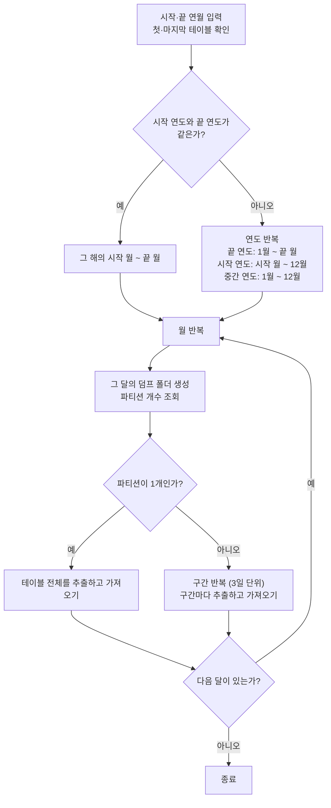

# 대용량 DB 백업 자동화

현재 진행 중인 과제에서 운영 DB의 오래된 측정 데이터를 로컬 저장소로 백업하는 task가 생겼는데, 이에 대한 내용을 기록하고자 한다. 대상은 온도계가 측정한 값을 모아 웹에서 보여 주는 모니터링 서비스의 데이터베이스이다. 측정값은 클라우드의 관리형 MySQL(AWS RDS)에 쌓이고, 측정 테이블은 달마다 하나씩 만들어진다.

데이터는 2020년 1월부터 쌓여 왔고, 운영 DB의 사용량은 275GB에 이르렀다. 오래된 데이터는 조회되는 일이 드물다. 그래서 2020년 1월부터 2022년 12월까지 3년 치, 월 단위 테이블 36개를 기업 내부의 로컬 저장소(NAS)에 있는 DB로 옮기고, 운영 DB에서는 지워서 용량을 줄이기로 했다. 서비스는 계속 운영 중이므로, 옮기는 동안 서비스에 지장을 주지 않아야 한다.

| 항목 | 내용 |
|---|---|
| 기간 | 2023.12 ~ 2024.01 |
| 환경 | MySQL(AWS RDS), mysqldump, Bash, WSL2(Ubuntu) |
| 맡은 부분 | 백업 방식 조사와 선택, 추출·가져오기 자동화 스크립트, 동작 검증, 가져오기 절차 정리, 용량 변화 기록 |

## 문제 상황

**테이블이 너무 커서 한 번에 추출되지 않는다.** 일부 테이블은 한 번에 추출을 시도하면 끝나기 전에 DB와의 연결이 끊겼다.

**나누어 추출하면 횟수가 너무 많다.** 큰 테이블은 대부분 이미 파티션으로 나뉘어 있었다. 파티션은 한 테이블을 어떤 값의 범위에 따라 여러 조각으로 나누어 저장하는 기능이다. 파티션 단위로 추출하면 연결이 끊기는 문제는 피할 수 있지만, 추출해야 하는 횟수가 270회 이상이 되어 손으로 할 수 있는 양이 아니었다.

**파티션을 나눈 기준이 테이블마다 다르다.** 자동화하려면 모든 테이블이 같은 규칙으로 나뉘어 있어야 한다. 그런데 파티션의 경계(등록 시각의 어느 시점에서 자르는가)가 테이블마다 불규칙해서, 기존 경계를 그대로 따라가는 스크립트를 쓰면 경계값을 일일이 코드에 적어 넣는 일을 피할 수 없었다.

**추출 자체가 운영 DB에 부하를 준다.** 추출은 운영 중인 DB에서 대량의 데이터를 읽어 내는 작업이다. 서비스가 쓰고 있는 DB의 자원을 함께 쓰게 된다.

## 분석

### 추출 방식의 비교

운영 DB에 주는 부하를 최대한 줄여야 한다는 기준으로 두 가지 방식을 골라 비교했다.

| | AWS의 DB 이전 서비스(DMS) | mysqldump |
|---|---|---|
| 방식 | 이전 작업을 위한 별도의 서비스 | 표준 백업 도구로 DB에서 직접 추출 |
| 장점 | 원본 DB에 주는 영향을 최소화한다. 데이터를 걸러 내거나 변환할 수 있다 | 별도의 서비스 구성이 필요 없고 단순하다. 옵션으로 부하를 어느 정도 조절할 수 있다 |
| 단점 | 비용이 부과될 수 있다 | DB의 크기와 서버 성능에 따라 시간이 오래 걸리고, 그동안 서버에 부하를 준다 |

안정성과 효율만 보면 이전 서비스가 낫지만, 비용이 부과될 가능성이 있어 mysqldump를 쓰기로 했다. 대신 mysqldump의 단점인 부하를 다룰 방법이 필요했다. 추출이 서버에 주는 부하로 서비스에 문제가 생길 수 있으므로, 스크립트는 사용량이 적은 새벽에 실행했다. 실제로 2GB 정도의 테이블 하나를 추출할 때에도 운영 DB의 CPU 사용률이 올라가는 것을 확인할 수 있었다.

### 월 단위 테이블의 구조

자동화의 규칙을 정하기 위해, 운영 DB에서 달마다의 테이블이 어떻게 나뉘어 있는지를 직접 조회해 기록했다.

| 기간 | 파티션 |
|---|---|
| 2020년 1월 ~ 12월 | 없음. 용량이 크지 않다 |
| 2021년 1월 ~ 2월 | 없음 |
| 2021년 3월 ~ 2022년 12월 | 달마다 12 ~ 13개 |

파티션의 경계는 등록 시각을 유닉스 시각으로 바꾼 값으로 정해져 있었다. 경계 사이의 간격은 이틀인 곳과 사흘인 곳이 섞여 있었고, 그 배열도 모든 달이 같지는 않았다. 2021년에는 6월이, 2022년에는 1월, 2월, 6월이 나머지 달과 다른 배열을 가지고 있었다. 간격이 고르지 않으니 파티션마다 들어 있는 데이터의 양도 차이가 나는 것으로 보였다.

### 경계를 새로 정한다

mysqldump는 행을 고르는 조건을 지정해 추출할 수 있다. 그렇다면 기존 파티션을 단위로 삼을 필요가 없다. 등록 시각을 일정한 간격으로 잘라 그 조건으로 추출하면, 원본의 경계가 어떻게 나뉘어 있든 같은 코드로 모든 달을 처리할 수 있다.

간격은 3일로 정했다. 받는 쪽의 테이블도 등록 시각 3일 간격의 파티션으로 새로 만든다. 이렇게 하면 불규칙한 경계 문제를 피할 수 있고, 받는 쪽에서는 파티션마다 데이터가 고르게 나뉜다. 나중에 다음 해의 데이터를 다시 옮길 때에도 경계값을 코드에 적어 넣을 필요가 없다.

## 해결

### 전체 흐름


추출과 가져오기는 Bash 스크립트 하나가 수행한다. 스크립트는 WSL2의 Ubuntu에서 실행했고, 먼저 내 PC의 시험용 로컬 DB를 받는 쪽으로 두고 동작을 검증했다. 그 뒤 추출한 덤프 파일과 스크립트를 넘겨, 로컬 저장소의 DB에 같은 방법으로 넣도록 했다.

### 스크립트의 구조

스크립트는 다섯 부분으로 이루어진다.

| 부분 | 하는 일 |
|---|---|
| 설정 | 내보낼 쪽 DB와 받을 쪽 DB의 접속 정보, 달마다의 날짜 수 표, 구간 길이(3일) |
| 입력 | 시작 연·월과 끝 연·월을 받는다. 첫 테이블과 마지막 테이블의 이름을 보여 주고 진행 여부를 확인받는다 |
| 연도 반복 | 해마다 처리할 시작 월과 끝 월을 정한다 |
| 월 반복 | 그 달의 덤프 폴더를 만들고, 테이블의 파티션 개수를 조회해 추출 방식을 고른다 |
| 구간 반복 | 등록 시각을 3일 간격으로 잘라, 구간마다 추출하고 곧바로 받을 쪽 DB에 넣는다 |

반복은 연도, 월, 구간의 세 겹이다.



**파티션 개수로 방식을 고른다.** 달마다 그 달 테이블의 파티션 개수를 DB의 정보 스키마에 물어본다. 파티션을 나누지 않은 테이블도 여기에는 한 줄로 나타나므로, 개수가 1이면 파티션이 없는 테이블이다. 이런 테이블은 크기가 작으므로 전체를 한 번에 추출한다. 2020년 전체와 2021년 1 ~ 2월이 여기에 해당한다. 개수가 2 이상이면 구간 반복으로 넘어간다.

**추출할 때의 설정.** 추출에는 다음과 같은 설정을 적용했다.

| 설정 | 이유 |
|---|---|
| 데이터만 추출한다 (테이블 생성문과 삭제문 제외) | 받는 쪽의 테이블은 미리 만들어 두고, 구간마다 나온 파일을 같은 테이블에 차례로 넣는다 |
| 트리거를 제외한다 | 트리거는 데이터가 실시간으로 들어올 때만 의미가 있다 |
| 인덱스는 덤프에 넣지 않는다 | 인덱스의 용량도 매우 크다. 데이터를 다 넣은 뒤에 따로 만든다 |
| 단일 트랜잭션으로 읽는다 | 추출이 운영 DB에 주는 부하를 줄인다 |
| 행 조건을 지정한다 | 등록 시각의 구간에 해당하는 행만 추출한다 |

덤프 파일은 달마다 폴더를 만들어 그 안에 둔다. 파티션이 없는 달의 폴더에는 파일이 하나, 있는 달의 폴더에는 구간 수만큼의 파일이 생긴다. 파일 이름은 문자로 시작한다. 이름이 숫자로 시작하는 파일은 상위 버전의 MySQL에서 가져오기가 동작하지 않는다는 점에 유의해야 했다.

### 구간 조건

한 달을 3일 간격의 경계로 자른다. 경계는 그 달의 3일, 6일, 9일처럼 3의 배수인 날의 0시이고, 날짜를 유닉스 시각으로 바꾸어 조건에 쓴다. 반복 횟수는 그 달의 날짜 수를 3으로 나눈 몫이며, 나머지가 1이면 한 번을 더한다.

| 달의 날짜 수 | 몫 | 나머지 | 반복 횟수 | 마지막으로 쓰는 경계 |
|---|---|---|---|---|
| 30일 | 10 | 0 | 10 | 27일 0시 |
| 31일 | 10 | 1 | 11 | 30일 0시 |
| 28일 | 9 | 1 | 10 | 27일 0시 |

구간의 조건은 위치에 따라 세 가지이다.

| 구간 | 조건 |
|---|---|
| 첫 구간 | 등록 시각 < 첫 경계 |
| 중간 구간 | 이전 경계 ≤ 등록 시각 < 현재 경계 |
| 마지막 구간 | 등록 시각 ≥ 이전 경계 |

30일인 달을 예로 들면 다음과 같이 나뉜다.


첫 구간과 마지막 구간은 한쪽이 열려 있다. 그래서 테이블에 들어 있는 모든 행은 등록 시각이 어떤 값이든 반드시 어느 한 구간에 속하고, 구간끼리 겹치지도 않는다. 월 반복과 구간 반복을 의사코드로 쓰면 다음과 같다.

```
함수 월_반복(연도, 시작 월, 끝 월):
    월 = 시작 월 ... 끝 월 에 대해:
        그 달의 덤프 폴더 생성
        n = 파티션 개수 조회(그 달의 측정 테이블)
        만약 n == 1:                                  # 파티션이 없는 테이블
            테이블 전체 추출 → 가져오기
        아니면:
            구간_반복(연도, 월)

함수 구간_반복(연도, 월):
    횟수 = 그 달의 날짜 수 // 3
    만약 그 달의 날짜 수 % 3 == 1: 횟수 += 1          # 28일, 31일인 달
    이전 = 없음
    k = 1 ... 횟수 에 대해:
        만약 k == 횟수:
            조건 = (등록 시각 >= 이전)                 # 마지막 구간
        아니면:
            경계 = 유닉스_시각(그 달 (3 × k)일 0시)
            만약 k == 1:
                조건 = (등록 시각 < 경계)              # 첫 구간
            아니면:
                조건 = (이전 <= 등록 시각 < 경계)      # 중간 구간
            이전 = 경계
        조건에 맞는 행만 추출 → 가져오기
```

### 범위 버그 수정

연도 반복은 처음에 "시작 연도이면 시작 월부터 12월까지, 끝 연도이면 1월부터 끝 월까지, 그 밖의 해는 1월부터 12월까지"의 순서로 조건을 보도록 작성했다. 이 코드는 두 해 이상을 받을 때에만 올바르게 동작했다. 한 해 안에서 범위를 지정하면 그 해가 시작 연도이면서 끝 연도이기 때문에, 먼저 검사한 조건 하나만 적용된다.

| 입력한 범위 | 시작 연도를 먼저 검사 | 끝 연도를 먼저 검사 | 단일 연도를 따로 처리 |
|---|---|---|---|
| 2020년 1월 ~ 3월 | 1월 ~ 12월 (잘못됨) | 1월 ~ 3월 | 1월 ~ 3월 |
| 2020년 10월 ~ 12월 | 10월 ~ 12월 | 1월 ~ 12월 (잘못됨) | 10월 ~ 12월 |

첫 번째 수정에서는 끝 연도의 조건을 먼저 검사하도록 순서를 바꾸었다. 1월 ~ 3월의 경우는 해결되었지만, 끝 연도는 반드시 1월부터 처리하도록 되어 있어서 10월 ~ 12월을 지정하면 1월부터 추출하는 문제가 남았다. 조건의 순서로는 해결할 수 없는 문제였다. 그래서 반복에 들어가기 전에 시작 연도와 끝 연도가 같은지를 먼저 확인하고, 같으면 입력받은 시작 월과 끝 월을 그대로 써서 처리한 뒤 바로 끝내도록 고쳤다.

```
함수 범위_처리(시작 연도, 시작 월, 끝 연도, 끝 월):
    만약 시작 연도 == 끝 연도:                       # 단일 연도
        월_반복(시작 연도, 시작 월, 끝 월)
        종료
    연도 = 시작 연도 ... 끝 연도 에 대해:            # 여러 해
        만약 연도 == 끝 연도:
            월_반복(연도, 1, 끝 월)
        아니고 연도 == 시작 연도:
            월_반복(연도, 시작 월, 12)
        아니면:
            월_반복(연도, 1, 12)
```

### 동작 확인

스크립트가 완성된 뒤, 2021년 3월부터 5월까지의 데이터를 시험용 로컬 DB로 옮겨 확인했다. MySQL이 정보 스키마로 보여 주는 테이블의 행 수와 용량은 추정값이어서 정확하지 않을 수 있으므로, 양쪽 테이블에 직접 쿼리를 실행해 비교했다.

| 확인한 항목 (2021년 5월 테이블) | 운영 DB | 로컬 DB |
|---|---|---|
| 기본 키의 최댓값 | 150,527,452 | 150,527,452 |
| 파티션 | 12개 (불규칙한 간격) | 11개 (3일 간격) |

2021년 3월과 4월의 테이블도 같은 방법으로 데이터가 넘어온 것을 확인했다. 파티션이 없는 2020년의 테이블은 그보다 먼저, 12개 전부를 로컬 DB로 옮기는 데 성공했다.

시험 과정에서 로컬 DB의 테이블 하나가 아무리 기다려도 지워지지 않는 문제가 있었다. 이 문제는 [테이블이 지워지지 않던 문제](07-metadata-lock.md)에 따로 정리했다.

### 가져오기 절차

로컬 저장소의 DB에 데이터를 넣는 일은 받는 쪽에서 수행할 수 있도록 절차를 문서로 정리해 전달했다. 전달한 스크립트는 같은 스크립트에서 추출 부분만 꺼 둔 것으로, 이미 만들어진 덤프 파일을 읽어 가져오기만 수행한다.

1. 덤프 파일을 받아, 월별 폴더를 스크립트와 같은 경로에 모은다.
2. 스크립트의 설정에서 받는 쪽 DB의 주소, 사용자, 비밀번호, DB 이름, 포트 다섯 가지를 환경에 맞게 고친다.
3. 가져오기 전에 테이블을 미리 만든다.
4. 스크립트를 실행하고 2020년 1월부터 2022년 12월까지를 지정한다. 한 번에 전부 실행되므로, 나누어 진행하려면 범위를 좁혀 입력한다.
5. 데이터를 다 넣은 뒤에 인덱스를 만든다. 인덱스는 기본 키와 등록 시각에만 둔다.

테이블과 인덱스를 만드는 쿼리는 다른 팀원이 작성했다. 절차에는 다음 주의 사항을 함께 적었다.

- 테이블을 만들기 전에 가져오기를 실행하면 안 된다.
- 가져오기가 진행 중인 테이블은 조회하지 않는다. 문제가 생길 수 있다.
- 전체를 넣는 데에는 시간이 오래 걸린다. 로컬 저장소에 전부 넣는 데 약 15시간이 걸렸다.
- 받는 쪽의 DB는 MySQL이 아니라 MariaDB일 수 있었다. MySQL의 클라이언트 명령으로 MariaDB에도 가져올 수 있다고 보고 절차를 작성했고, 되지 않을 경우에는 MariaDB의 클라이언트를 설치해 스크립트를 고치는 방법과 컨테이너로 MySQL을 설치하는 방법을 대안으로 적어 두었다.

### 원본 삭제와 용량 변화

데이터를 옮긴 뒤 운영 DB에서 해당 연도의 테이블을 삭제하고, 그때마다 사용량을 기록했다.

| 시점 | 운영 DB 사용량 | 감소량 |
|---|---|---|
| 옮기기 전 | 275GB | |
| 2022년 테이블 삭제 후 | 169GB | 106GB |
| 2021년 테이블 삭제 후 | 101GB | 68GB |
| 2020년 테이블 삭제 후 | 100.2GB | 0.8GB |

데이터와 인덱스를 합쳐 모두 174.8GB가 줄었다. 운영 DB의 여유 공간은 약 41.5GB에서 약 244GB로 늘었다. 다만 운영 DB에 할당된 스토리지 345GB는 그대로였다. 사용량이 줄어도 할당된 크기는 자동으로 줄지 않았으므로, 스토리지 비용이 바로 줄어드는 것은 아니라는 점도 함께 확인했다.

운영 DB에서 지운 기간의 데이터를 기존 화면에서 계속 조회할 수 있게 하는 일은 [백업 이후 조회 경로 분리](08-query-path-split.md)에서 다룬다.

### 남은 개선점

스크립트는 DB의 비밀번호를 명령줄 인자로 직접 넘긴다. 이 방식은 권장되지 않으며, 실행할 때마다 명령줄에 비밀번호를 쓰지 말라는 경고가 출력된다. 동작에는 지장이 없어 그대로 두었지만, 비밀번호를 환경 변수 등으로 옮겨 명령줄에 드러나지 않게 하는 것이 개선할 점으로 남았다.
