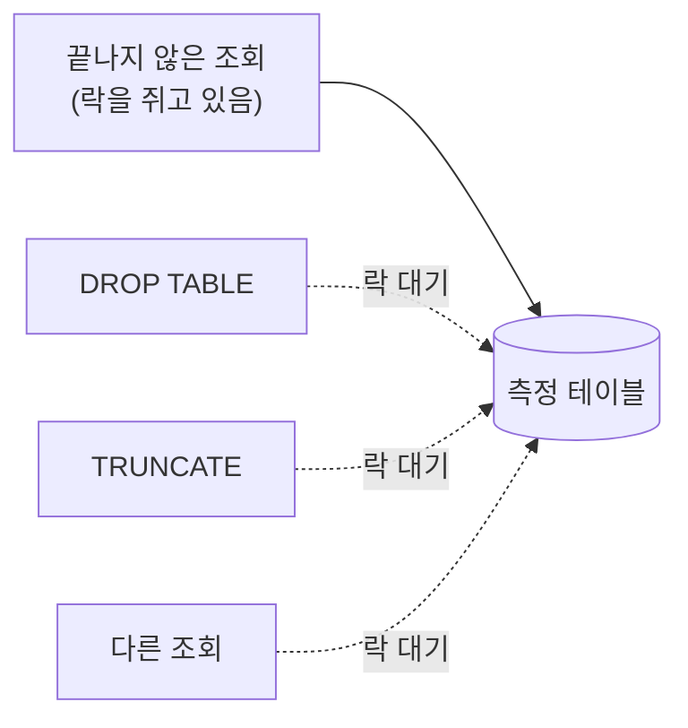

# 테이블이 지워지지 않던 문제

작성일 2023-12-23
{ .post-date }

백업 작업 중 테이블 삭제가 끝나지 않는 문제를 만나, 해결 과정을 기록한다. 이 문제는 [대용량 DB 백업 자동화](06-db-backup-automation.md)를 진행하던 중에 생겼다. 운영 DB의 측정 데이터를 로컬 저장소로 옮기는 작업이었고, 그 과정에서 내 PC의 시험용 MySQL에 측정 테이블을 가져와 추출과 가져오기를 시험하고 있었다. 그러다 시험용 DB의 테이블 하나를 지우려 했는데, 명령이 끝나지 않았다.

| 항목 | 내용 |
|---|---|
| 시기 | 2023.12 |
| 환경 | MySQL(시험용 로컬 DB), WSL2(Ubuntu) |
| 맡은 부분 | 원인 분석과 해결 |

## 문제 상황

테이블에 삭제(DROP)와 비우기(TRUNCATE)를 실행했는데, 아무리 오래 기다려도 테이블이 지워지지 않았다. 찾아보니 테이블 비우기는 데이터가 아무리 많아도 바로 끝나야 하는 명령이었다. 데이터의 양 때문이 아니라, 작업하는 과정에서 내부적으로 무언가 꼬인 것으로 보였다.

## 분석

**콘솔에서 직접 실행해도 같다.** 관리자 계정으로 DB 콘솔에 직접 접속해 삭제하면 해결될 수 있다는 답변을 보고, WSL에서 DB 콘솔에 직접 접속해 삭제 명령을 내렸다. 테이블은 여전히 지워지지 않았다.

**실행 중인 프로세스 목록을 본다.** 다음으로 `SHOW FULL PROCESSLIST`로 DB가 처리 중인 명령의 목록을 확인했다. 그동안 실행했던 삭제와 비우기 명령이 여러 개 그대로 남아 있었고, 상태는 모두 "Waiting for table metadata lock"이었다. 하나같이 34만 초 넘게 기다린 상태였고, 같은 테이블에 실행한 조회까지 같은 상태로 멈춰 있었다.

**메타데이터 락.** 메타데이터 락은 테이블이나 뷰 같은 데이터베이스 객체의 이름이나 구조를 바꿀 때 얻는 락이다. 삭제와 비우기는 테이블의 구조를 바꾸는 명령(DDL)이므로 이 락을 얻어야 실행된다. 메타데이터 락에서 대기가 생기는 경우는 보통 두 가지이다.

- 다른 세션이 이미 그 테이블의 락을 쥐고 있고 아직 반환하지 않은 경우
- 메타데이터 락과 InnoDB의 트랜잭션을 동시에 사용하는 경우

이번 문제는 첫 번째 경우였다.



**락을 쥐고 있는 쪽을 찾는다.** 실행 중인 트랜잭션은 정보 스키마의 InnoDB 트랜잭션 목록(`information_schema.innodb_trx`)에서 볼 수 있다. 상태가 RUNNING인 것 가운데 시작 시각이 비정상적으로 오래된 것을 찾으면 된다. 확인해 보니 실행 중인 트랜잭션이 하나 있었다. 프로세스 목록에서 그 스레드를 찾아보니, 약 35만 초 전에 시작된 조회가 아직도 데이터를 보내는 상태(Sending data)로 남아 있었다.

이 조회는 내가 며칠 전에 실행한 것이었다. 가져온 테이블에서 기본 키 번호가 중간에 빠진 구간이 있는지 찾으려고, 생성형 AI에게 물어 얻은 쿼리를 그대로 실행했다. 테이블을 자기 자신과 조인하는 쿼리였고, 나흘이 지나도록 끝나지 않고 있었다. 이 조회가 테이블에 접근하면서 얻은 메타데이터 락을 끝나지 않은 채 계속 쥐고 있었고, 그 뒤에 실행한 삭제 명령은 모두 이 락이 풀리기를 기다리고 있었다.

## 해결

락을 쥐고 있는 스레드를 종료하면 된다. 종료하기 전에 그 스레드가 종료해도 되는 상태인지를 살폈다. 데이터를 보내는 중이라 강제로 종료해도 되는지 확신할 수 없었지만, 시험용 DB이고 어차피 지우려던 테이블이므로 잘못되더라도 문제가 될 것이 없다고 판단했다.

```
1. SHOW FULL PROCESSLIST 로 대기 중인 명령과 그 상태를 확인한다
2. InnoDB 트랜잭션 목록에서 RUNNING 상태이고 시작 시각이 오래된 트랜잭션을 찾는다
3. 그 트랜잭션의 스레드가 실행 중인 명령을 확인한다
4. KILL <스레드 번호> 로 종료한다
```

`KILL`로 해당 스레드를 종료하자, 대기하던 삭제 명령이 실행되어 테이블이 지워졌다.

원인은 결국 내가 실행해 둔 쿼리였다. 생성형 AI가 만들어 준 쿼리를 내용을 따져 보지 않고 그대로 실행해서는 안 된다는 교훈을 다시 한번 얻었다.
