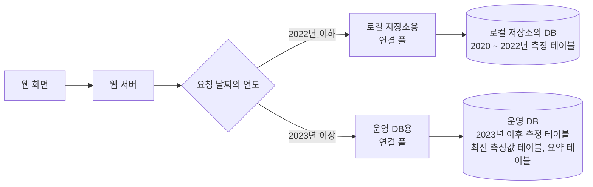

# 백업 이후 조회 경로 분리

데이터를 로컬 저장소로 옮긴 뒤에도 기존 화면에서 예전 데이터를 조회할 수 있도록 서버를 수정하게 되어, 이를 정리한다. 대상은 온도계가 측정한 값을 모아 웹에서 보여 주는 모니터링 서비스의 웹 서버(Node.js)이다. 측정 데이터는 클라우드의 운영 DB에 달마다 하나씩 만들어지는 측정 테이블에 쌓인다. 앞선 작업인 [대용량 DB 백업 자동화](06-db-backup-automation.md)에서 2020년부터 2022년까지의 측정 테이블을 기업 내부의 로컬 저장소(NAS)에 있는 DB로 옮기고, 운영 DB에서는 삭제했다.

데이터가 있는 곳이 둘로 나뉘었으므로, 서버도 요청에 따라 알맞은 곳에서 데이터를 읽어야 한다. 로컬 저장소에 DB를 구축하는 일은 다른 팀원이 맡은 부분이고, 이 글은 서버 쪽의 수정을 다룬다.

| 항목 | 내용 |
|---|---|
| 시기 | 2023.12 |
| 환경 | Node.js, Express, MySQL (운영 DB는 AWS RDS, 옮긴 데이터는 로컬 저장소의 DB) |
| 맡은 부분 | 수정이 필요한 API 분류, 로컬 저장소용 연결 풀 추가, 그래프 조회 API의 연결 분기 |

## 문제 상황

서버는 운영 DB에 대한 연결 풀을 가지고 있고, API들은 이 풀에서 연결을 얻어 쿼리를 실행한다. 측정 데이터를 읽는 API는 요청에 담긴 날짜의 연도와 월로 측정 테이블의 이름을 만들어 조회한다.

사용자가 화면에서 2020 ~ 2022년의 날짜를 고르면, 서버는 이전과 똑같이 운영 DB에서 그 달의 테이블을 찾는다. 그러나 그 테이블은 운영 DB에 더 이상 없다. 옮긴 기간의 데이터를 요청하면 조회가 실패하게 된다.

## 분석

서버의 모든 API를 고칠 필요는 없다. 옮긴 것은 2020 ~ 2022년의 월 단위 측정 테이블뿐이므로, 이 테이블에 접근하는 API만 찾으면 된다. 측정 데이터와 관련된 API를 하나씩 살펴, 어느 테이블에 접근하는지를 기준으로 나누었다.

| API | 접근하는 테이블 | 판단 |
|---|---|---|
| 그래프 조회 | 월 단위 측정 테이블 | 수정 필요. 특정 날짜의 측정 데이터를 실제로 가져오는 부분이다 |
| 데이터 다운로드 | 월 단위 측정 테이블 | 수정 필요. 지정한 기간의 측정 데이터를 읽어 파일로 내려 준다 |
| 월간 보고서 | 월 단위 측정 테이블 | 수정 필요. 한 달 치 측정 데이터를 읽어 보고서를 만든다 |
| 마지막 측정 시각 조회 | 최신 측정값 테이블 | 수정 불필요. 실시간 데이터는 옮기지 않았다 |
| 기기 목록과 알람 설정 조회 | 최신 측정값 테이블 | 수정 불필요. 같은 이유이다 |
| 달력 조회 | 요약 테이블 | 수정 불필요. 요약 테이블은 옮기지 않았다 |

수정이 필요한 것은 세 가지로 좁혀졌다. 이 글에서는 그 가운데 내가 수정한 그래프 조회를 다룬다.

## 해결

### 두 저장소와 두 개의 연결 풀

로컬 저장소의 DB에 접속하기 위한 설정 파일을 운영 DB의 것과 별도로 두고, 서버가 시작할 때 이 설정으로 연결 풀을 하나 더 만든다. 서버는 운영 DB용 풀과 로컬 저장소용 풀을 함께 가지고 있다가, 요청이 들어오면 날짜에 따라 둘 중 하나에서 연결을 얻는다.



### 그래프 조회의 분기

그래프 조회 API는 로그인한 그룹의 특정 기기에 대해, 요청한 날짜의 측정 데이터를 돌려준다. 요청 날짜에서 연도를 구해, 2022년 이하이면 로컬 저장소용 풀에서, 2023년 이상이면 운영 DB용 풀에서 연결을 얻도록 분기를 추가했다. 쿼리의 내용은 두 경우가 같고, 연결과 테이블 이름만 달라진다.

```
함수 그래프_조회(요청):
    연도, 월 = 요청 날짜에서 분리
    테이블 = 측정_테이블_이름(연도, 월)       # 2022년 이하는 소문자 이름
    만약 연도 <= 2022:
        연결 = 로컬_저장소_풀에서 연결 얻기
    아니면:
        연결 = 운영_DB_풀에서 연결 얻기
    결과 = 연결로 조회(테이블, 그룹, 기기, 날짜)
    결과를 응답으로 전송
    마지막에: 연결을 풀에 반환
```

테이블 이름에서 한 가지 주의할 점이 있었다. 기존 코드는 테이블 이름을 대문자로 만들어 쓰고 있었는데, 로컬 저장소의 DB에서는 옮긴 테이블에 소문자 이름으로 접근해야 했다. 그래서 2022년 이하의 요청에서는 이름을 소문자로 만들도록 했다.

코드를 살피는 과정에서 쓰이지 않는 부분도 발견했다. 요청 날짜에 시간 차이를 더해 두 번째 테이블 이름을 계산하는 코드가 있었는데, 계산한 값이 어디에도 쓰이지 않았다. 개발하다가 중단된 것으로 판단해 주석으로 막아 두었다.

이렇게 수정한 뒤 2020 ~ 2022년의 데이터에 문제없이 접근할 수 있게 되었다.

### 나머지 API

분류에서 수정이 필요하다고 본 나머지 두 가지(데이터 다운로드, 월간 보고서)는 다른 팀원이 맡았다. 또 위의 분기는 경계가 되는 연도를 코드에 직접 적어 둔 것이어서, 다음에 데이터를 다시 옮기면 코드를 고쳐야 한다는 한계가 있다.
