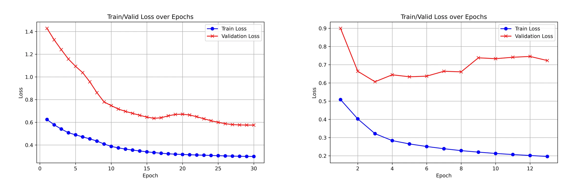
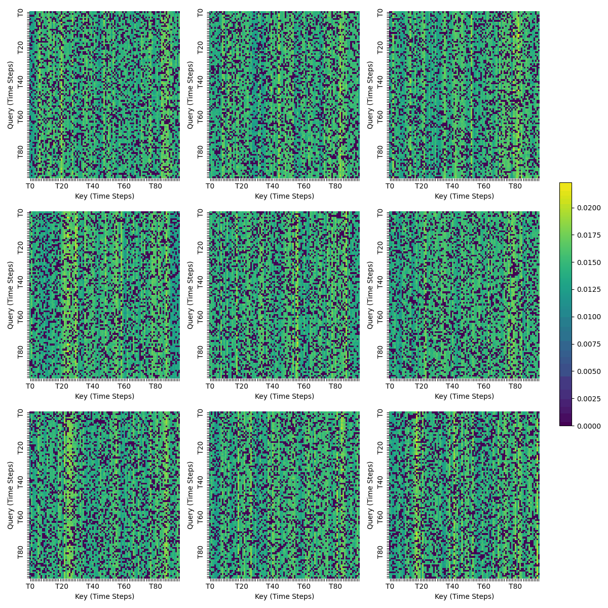
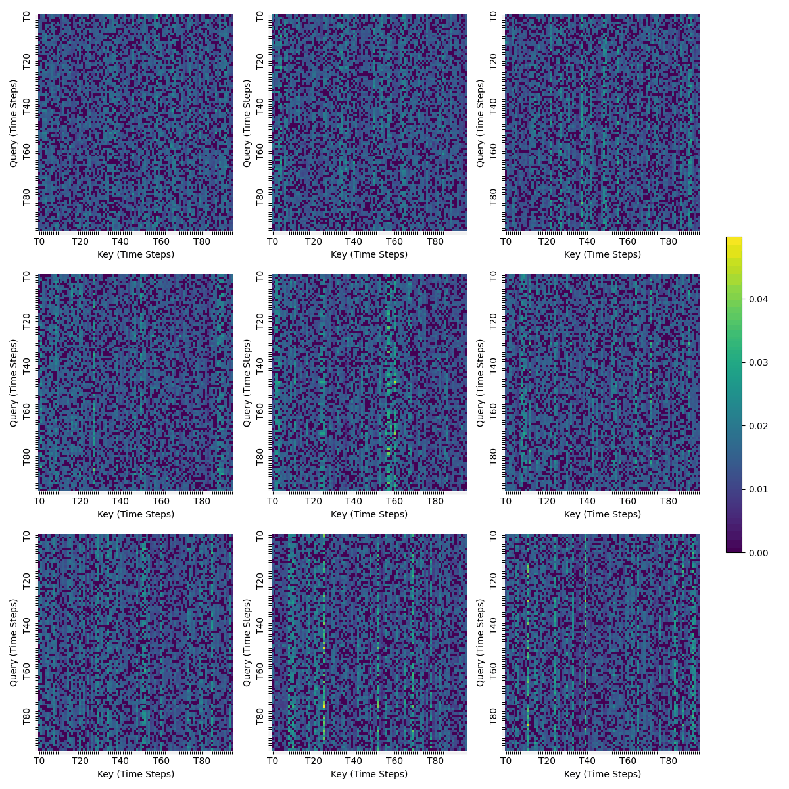
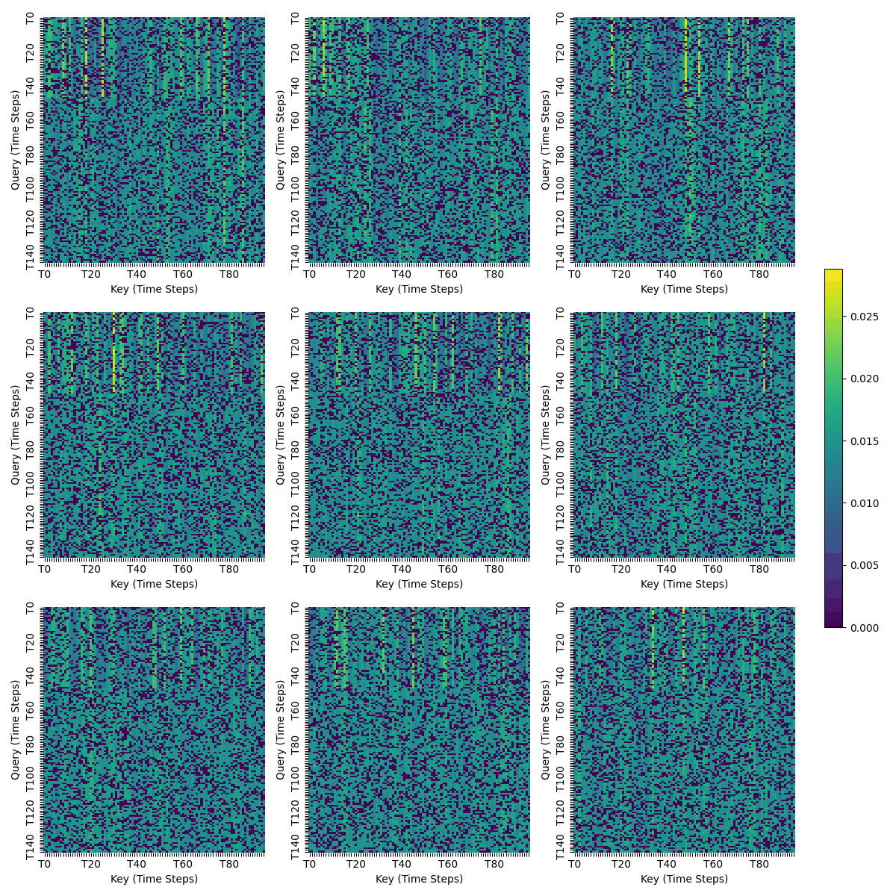
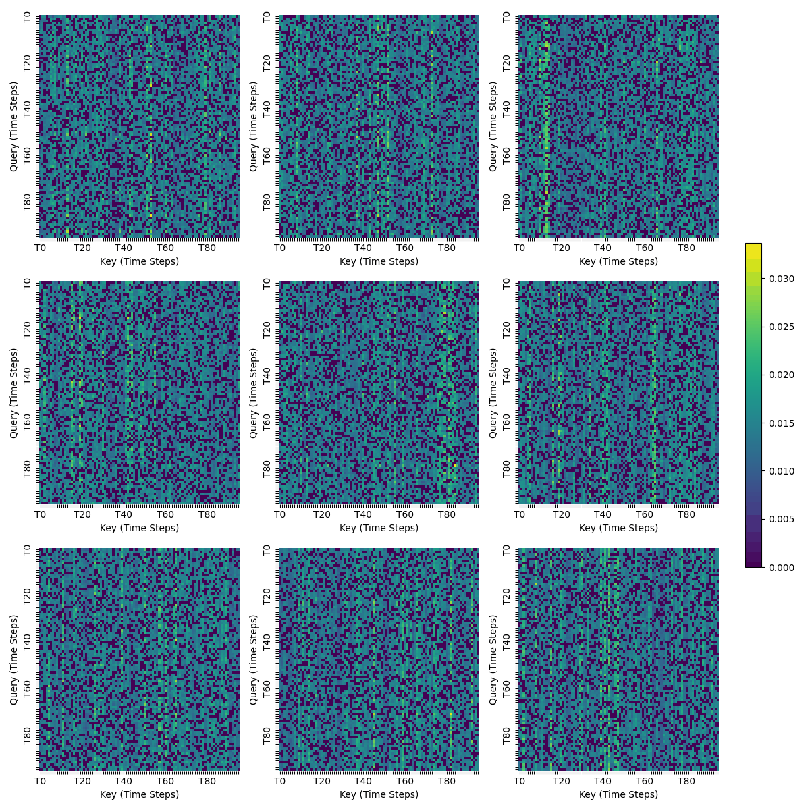
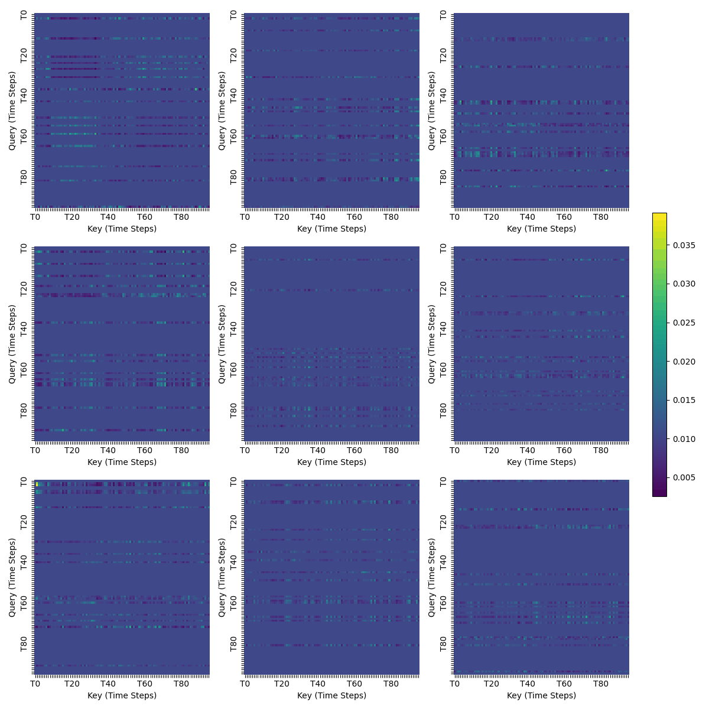

# 시계열 Transformer 임베딩 비교 실험과 디버깅 기록

작성일 2025-01-06 · 최종 수정일 2025-01-17
{ .post-date }

연구실 인턴 3주차와 4주차(2025년 1월 6일부터 17일까지)에 한 실험을 정리하고자 한다. 멘토에게 받은 과제였고, 내용은 다음과 같다. 공개 저장소인 CARD의 코드로 vanilla Transformer를 장기 시계열 예측에 돌려 보고, 입력 임베딩 방식을 바꿔 가며 어떤 것이 가장 좋은지 찾은 뒤, 그 결과를 Informer와 비교한다.

결과만 보면 표 몇 개로 끝나는 실험이지만, 실제로는 코드가 내가 생각한 대로 돌고 있는지 확인하는 데 많은 시간이 들었다. 그래서 이 글은 실험 결과와 함께, 중간에 겪은 오류와 그것을 어떻게 찾았는지를 같이 적는다.


## 1. 목적

실험의 목적은 Transformer와 Informer를 이해한 것을 바탕으로, 시계열 예측에서 어떤 임베딩과 attention 방식이 가장 효율적인지 실험으로 비교하는 것이었다. 처음 세운 계획은 다음과 같다.

1. Transformer에서 임베딩 방식을 바꿔 가며 가장 좋은 것을 찾는다.
2. Transformer에서 attention 방식을 바꿔 가며 가장 좋은 것을 찾는다.
3. 찾은 설정을 Informer에 적용하고 Transformer와 비교한다.

이 가운데 2번은 내가 과제를 잘못 이해한 것이었다. 이 점은 6절에서 다시 적는다.

## 2. 코드를 돌리고 구조를 파악하기

### Transformer로 실행하기

CARD 저장소의 장기 예측 코드는 실행 스크립트의 `--model` 인자로 모델을 고를 수 있고, CARD 외에 Transformer도 선택할 수 있다. 다만 그대로는 돌지 않아 몇 군데를 고쳤다.

- 학습 루프가 `h_loss`를 요구했다. 과거 손실의 이동 평균을 구하는 데 쓰는 값이고 CARD에서만 사용되므로 제거했다.
- 검증 손실을 계산하는 부분과 로그 저장 경로에서도 오류가 나서 수정했다.
- 학습이 길어지므로 터미널 세션이 끊겨도 학습이 유지되도록 tmux 안에서 실행했다.

### 데이터가 잘리는 방식

입력 길이 `seq_len`은 96으로 고정하고, 예측 길이 `pred_len`은 96, 192, 336, 720을 쓴다. 디코더에는 입력의 마지막 48개(`label_len`)를 함께 넣는다. 샘플 하나는 시작 위치에서 `seq_len + pred_len`만큼을 잘라 만들기 때문에, 구간 길이가 $N$이면 샘플 수는 다음과 같다.

$$
N - \text{seq\_len} - \text{pred\_len} + 1
$$

ETTm1의 학습 구간은 34,560개인데 실제 샘플 수가 34,369개로 찍혀서 확인해 보니, $34560 - 96 - 96 + 1 = 34369$로 위 식과 맞았다. 검증과 테스트 구간도 같은 이유로 191개씩 줄어든다. 테스트 결과의 shape이 `(11425, 96, 7)`로 나오는 것도 이것으로 설명된다.

### 모델 구조

모델을 출력해 구조를 확인했다. 인코더 층은 self-attention과 feed-forward로 이루어지고, feed-forward는 kernel 크기 1의 `Conv1d` 두 개로 구현되어 있다. 디코더 층은 self-attention, cross-attention, feed-forward 순서다. 인코더와 디코더의 층을 모두 지난 뒤에는 `LayerNorm`이 한 번 더 있고, 디코더 끝에는 출력 차원으로 줄이는 선형 층이 있다.

코드를 읽으며 적어 둔 질문 가운데 실험으로 이어진 것은 "층을 모두 지난 뒤에 왜 `LayerNorm`을 한 번 더 두는가"였다. 이 질문은 9절의 추가 실험에서 다룬다.

### 디코더는 자기회귀로 돌지 않는다

Transformer의 디코더는 값을 하나씩 만들어 다시 입력에 넣는 자기회귀(auto-regressive) 방식이라고 알고 있었다. 그런데 이 코드에는 그런 반복문이 보이지 않았다. shape을 찍어 확인했다.

```text
batch_x:  [1, 96, 7]      인코더 입력
batch_y:  [1, 144, 7]     label 48 + pred 96
dec_inp:  [1, 144, 7]     label 48은 실제 값, 나머지 96은 0
outputs:  [1, 144, 7]     한 번의 forward로 전부 출력
```

디코더 입력은 실제 값 48개 뒤에 0으로 채운 96개를 붙인 것이고, 출력은 한 번에 나온다. 테스트에서도 샘플마다 forward가 한 번씩만 호출되었다. 즉 이 코드의 Transformer는 자기회귀가 아니라 Informer가 제안한 generative style decoder 방식으로 예측한다. 인코더는 cross-attention에 쓸 표현을 만들고, 디코더는 label 구간을 단서로 예측 구간 전체를 한 번에 채운다.

그렇다면 디코더의 마스킹은 어떻게 되는가. 모델의 `forward`에서 디코더로 넘기는 `x_mask`와 `cross_mask`가 모두 `None`인 것을 보고, 당시에는 "마스킹을 아예 하지 않는다"고 적었다. 그런데 뒤에 겪은 오류의 traceback에는 디코더 self-attention 안에서 `TriangularCausalMask`를 만드는 줄이 찍혀 있다. 마스크 인자가 `None`이면 attention 내부에서 causal mask를 만드는 구조로 보이며, 그렇다면 당시의 메모는 틀린 것이다. 이 부분은 당시 끝까지 확인하지 못했고, 한 번에 출력하는 디코더에서 마스킹이 어떤 의미를 갖는지도 질문으로 남겨 두었다. 답은 뒤의 "남았던 질문과 답"에 적었다.

## 3. 비교 대상

### 임베딩

저장소의 임베딩 모듈에는 아홉 가지 방식이 있었다. 코드를 읽어 보니 `DataEmbedding`은 값 임베딩, 위치 임베딩, 시간 임베딩을 더한 것이어서, 구성 요소 네 가지를 이해하면 나머지도 설명할 수 있었다.

| 구성 요소 | 내용 |
|---|---|
| TokenEmbedding | 입력 값을 `Conv1d`(kernel 3, circular padding)로 `d_model` 차원으로 올린다 |
| PositionalEmbedding | 위치를 sinusoidal 함수로 인코딩한다 |
| TimeFeatureEmbedding | 타임스탬프에서 뽑은 실수형 시간 특성을 선형 층으로 올린다 |
| TemporalEmbedding, FixedEmbedding | 월, 일, 요일, 시 같은 정수를 `nn.Embedding`으로 조회한다 |

위치 인코딩의 식은 다음과 같다.

$$
PE_{(pos,\,2i)} = \sin\!\left(\frac{pos}{10000^{2i/d_{model}}}\right), \qquad
PE_{(pos,\,2i+1)} = \cos\!\left(\frac{pos}{10000^{2i/d_{model}}}\right)
$$

코드에서는 분모를 지수 함수로 바꾸어 계산한다.

$$
10000^{2i/d_{model}} = e^{(2i/d_{model}) \ln 10000}
$$

TimeFeatureEmbedding에 들어가는 시간 특성은 전처리 단계의 `time_features` 함수가 만든다. 시각, 요일, 일, 연중 일 같은 값을 각각 $[-0.5,\,0.5]$ 범위로 옮긴다. 예를 들어 시각 $h \in [0, 23]$은 $h/23 - 0.5$가 된다. 주기를 `h`로 주면 시각, 요일, 월중 일, 연중 일의 네 가지 특성이 만들어진다.

디버깅을 거친 뒤 실제로 비교한 방식은 다음 여섯 가지다. $x_t$는 입력 값, $\tau_t$는 시간 특성, $W$는 선형 층이다.

| 방식 | 구성 | Dropout |
|---|---|---|
| Positional Embedding | $W x_t + PE_t$ | 없음 |
| Token Embedding | $\text{Conv}(x)_t$ | 없음 |
| Time Feature Embedding | $W x_t + W_\tau \tau_t$ | 없음 |
| Data Embedding | $\text{Conv}(x)_t + PE_t + W_\tau \tau_t$ | 있음 |
| Data Embedding w/o pos | $\text{Conv}(x)_t + W_\tau \tau_t$ | 있음 |
| Data Embedding w/o time feature | $\text{Conv}(x)_t + PE_t$ | 있음 |

Positional Embedding과 Time Feature Embedding은 원래 값 임베딩 없이는 단독으로 쓸 수 없어서, 값에 선형 층을 붙이는 형태로 고쳤다(4절). 그래서 이 둘은 값 임베딩이 선형 층이고 dropout이 없다는 점에서 나머지와 다르다. 이 차이는 뒤의 결과 해석에서 계속 문제가 된다.

### Attention

저장소에는 FullAttention, ProbAttention(Informer), DSAttention(Non-stationary Transformer의 De-stationary Attention)이 있었다.

### 데이터셋

ETT 계열은 변수가 7개이고, Exchange Rate는 변수가 8개다. Exchange Rate는 비정상성(non-stationarity)이 강하고 데이터가 작아 과적합이 쉽게 나타난다. 분할 비율은 Exchange Rate에서 7:1:2를 썼다.

## 4. 1차 파일럿과 디버깅

모든 조합을 긴 epoch으로 돌릴 수는 없었다. 그래서 짧은 학습으로 임베딩 후보를 추리는 파일럿 실험을 먼저 하기로 했다. 처음에는 ETTm1과 Exchange Rate에서, 비교적 큰 모델(`d_model` 128, `d_ff` 512, head 4개, 인코더 2층, 디코더 1층, dropout 0.1, seed 42, 20 epoch)로 시작했다.

### 4.1 임베딩 인자가 조용히 무시되었다

**문제 상황.** 임베딩 종류를 번호로 받아 고르도록 코드를 고친 뒤, 이틀에 걸쳐 임베딩별 실험을 돌렸다. 그런데 결과가 모두 똑같았다.

**분석.** 임베딩 번호를 정수로 넘겼는데, 고르는 쪽에서는 문자와 비교하고 있었다. 어떤 번호를 넣어도 조건이 맞지 않아 전부 기본값인 `DataEmbedding`으로 실행되었다. 상황을 단순화하면 다음과 같다.

```python
# args.embed 는 정수로 들어온다
if args.embed == '0':        # 문자와 비교하므로 항상 False
    embedding = PositionalEmbedding(...)
...
else:
    embedding = DataEmbedding(...)   # 결국 항상 여기로 온다
```

오류 메시지가 없었기 때문에 이틀치 실험이 통째로 무효가 되었다. 그 전에 아홉 가지 임베딩이 모두 오류 없이 돌아가는지 10 epoch씩 확인해 두었는데, 비교를 고치자마자 0번부터 4번까지가 곧바로 오류를 냈다. 앞선 확인에서 아홉 가지가 문제없이 돌았던 것도 실제로는 전부 같은 임베딩이 돌았기 때문이었던 셈이다.

**해결.** 비교를 고친 뒤 드러난 오류는 인자 개수 문제였다. 모델은 임베딩에 값 `x`와 타임스탬프 `x_mark`를 함께 넘기는데, `DataEmbedding` 계열만 둘을 받고 `PositionalEmbedding` 같은 단독 모듈은 `x` 하나만 받는다. 임베딩 종류에 따라 넘기는 인자를 다르게 했고, 실행 로그에 실제로 선택된 임베딩의 이름이 찍히도록 했다.

### 4.2 PositionalEmbedding이 학습되지 않았다

**문제 상황.** Positional Embedding만으로 돌리자 학습 손실이 줄지 않았다. 10 epoch 동안 학습 손실은 0.7078에서 0.7546 사이를 오갔고, 검증 손실은 1.58과 1.63 사이에 머물렀다.

**분석.** 저장소의 `PositionalEmbedding`은 `forward`에서 위치 인코딩 텐서만 잘라서 돌려준다. 입력 값 `x`는 길이를 알아내는 데만 쓰인다. `DataEmbedding` 안에서는 값 임베딩에 더해지므로 문제가 없지만, 단독으로 쓰면 모델이 입력 값을 전혀 보지 못한다. 학습이 안 되는 것이 당연했다.

**해결.** 입력 값을 `d_model` 차원으로 올리는 선형 층을 두고, 그 결과에 위치 인코딩을 더하도록 고쳤다. 정리하면 다음과 같은 형태다.

```python
class PositionalEmbedding(nn.Module):
    def __init__(self, c_in, d_model, max_len=5000):
        super().__init__()
        self.linear = nn.Linear(c_in, d_model)      # 값을 d_model 차원으로

        pe = torch.zeros(max_len, d_model).float()
        position = torch.arange(0, max_len).float().unsqueeze(1)
        div_term = (torch.arange(0, d_model, 2).float()
                    * -(math.log(10000.0) / d_model)).exp()
        pe[:, 0::2] = torch.sin(position * div_term)
        pe[:, 1::2] = torch.cos(position * div_term)
        self.register_buffer('pe', pe.unsqueeze(0))  # 학습되지 않는 값

    def forward(self, x):
        # (1, seq_len, d_model)이 배치 방향으로 broadcasting 된다
        return self.linear(x) + self.pe[:, :x.size(1)]
```

위치 인코딩은 buffer로 등록되어 학습되지 않고, 선형 층은 모듈의 파라미터이므로 학습된다. 인코더와 디코더는 서로 다른 선형 층을 갖는다. Time Feature Embedding도 같은 방식으로 값에 선형 층을 붙여 단독으로 쓸 수 있게 했다.

이렇게 고친 Positional Embedding은 사실상 `DataEmbedding`에서 시간 특성을 뺀 것과 구성이 같다. 다른 점은 값 임베딩이 `Conv1d`가 아니라 선형 층이고 dropout이 없다는 것뿐이다.

### 4.3 FixedEmbedding과 nn.Embedding의 CUDA assert

**문제 상황.** FixedEmbedding을 고르자 다음 메시지가 수백 줄 출력되며 학습이 멈췄다.

```text
Indexing.cu:1308: indexSelectLargeIndex: Assertion `srcIndex < srcSelectDimSize` failed.
RuntimeError: CUDA error: device-side assert triggered
```

더 곤란했던 것은 그 뒤였다. 오류가 난 프로세스가 GPU를 붙잡은 채 종료되지 않았고, 강제 종료도 되지 않아 한동안 그 GPU에 모델을 올릴 수 없었다.

**분석.** `FixedEmbedding`은 `nn.Embedding`을 쓴다. `nn.Embedding`은 정수 인덱스를 받아 그 인덱스에 해당하는 벡터를 돌려주는 조회 테이블이다. 여기에 실수인 시계열 값을 `long`으로 바꿔 넣었으니, 테이블 크기를 벗어난 인덱스를 조회하게 되어 assert가 발생한 것이다. traceback이 가리키는 위치는 실제 원인과 다른 곳(디코더의 마스크 생성)이었는데, CUDA 오류는 비동기로 보고되기 때문이다.

**해결.** 시계열 값을 `nn.Embedding`에 넣으려면 값을 구간으로 나누어 정수로 바꿔야 하는데, 그렇게 할 이유를 찾지 못했다. 같은 모듈을 쓰는 TemporalEmbedding과 함께 실험에서 제외했다. `DataEmbedding`에서 위치와 시간을 모두 뺀 변형도 TokenEmbedding에 dropout만 더한 것이어서 제외했다.

다만 이 판단에는 확인하지 못한 부분이 있다. 타임스탬프를 정수(월, 일, 요일, 시)로 인코딩하는 설정을 쓰면, 이 모듈들은 값이 아니라 시간 정보에 대해 정상적으로 동작했을 수 있다. 당시에는 실수형 시간 특성을 쓰는 설정을 그대로 둔 채 실험했고, 설정을 바꿔 다시 시도해 보지는 않았다.

### 4.4 TimeFeatureEmbedding과 주기 설정

Time Feature Embedding은 입력 shape이 맞지 않아 돌지 않았다. 이 모듈은 값이 아니라 타임스탬프 `x_mark`를 받아야 하고, 그 마지막 차원은 주기 설정에 따라 정해진다(`h`이면 4). 값과 타임스탬프를 구분해 넘기도록 고쳐 해결했다. 주기 설정은 `h`일 때 성능이 더 좋아 `h`로 두었다.

### 4.5 shuffle을 켜면 검증 손실이 나빠졌다

**문제 상황.** 학습 데이터를 섞으면 더 강건하게 학습될 것이라 기대하고 DataLoader의 shuffle을 켰다. 결과는 반대였다. 세 데이터셋 모두에서 학습 손실은 더 낮아졌는데 검증 손실은 높아졌고, early stopping(patience 10)으로 학습이 일찍 끝났다.

| 데이터셋 | shuffle 끔: 학습 / 검증 손실 | shuffle 켬: 학습 / 검증 손실 | shuffle 켬: 종료 epoch |
|---|---|---|---|
| ETTm1 | 0.2990904 / 0.5754985 | 0.1964587 / 0.7228999 | 13 |
| Weather | 0.4067702 / 0.5197422 | 0.3124629 / 0.5984641 | 13 |
| Exchange Rate | 0.1368339 / 0.9259382 | 0.0753472 / 1.0639678 | 17 |

shuffle을 끈 쪽은 30 epoch을 모두 채웠다. 두 경우 모두 `pred_len` 96, seed 42다.



*ETTm1의 학습 손실과 검증 손실. 왼쪽은 shuffle을 끈 경우, 오른쪽은 켠 경우다. 켠 경우에는 3 epoch 이후 검증 손실이 다시 올라간다.*

**분석.** 원인을 좁히려고 조건을 하나씩 바꿨다.

| 시도 | 결과 |
|---|---|
| dropout을 0.3으로 올림 | 큰 차이 없음 |
| 검증 데이터의 shuffle만 끔 | 큰 차이 없음 |
| 학습 데이터의 shuffle만 끔 | 20 epoch 동안 early stopping 없이 학습됨 |
| shuffle을 켠 채 모델을 키움(인코더 3층, 디코더 3층) | 큰 차이 없음 |
| shuffle을 켠 채 모델을 줄임(인코더 1층, 디코더 1층, `d_model` 32) | 20 epoch 동안 early stopping 없이 학습됨 |

문제를 일으키는 것은 학습 데이터의 shuffle이었고, 모델을 작게 만들면 증상이 사라졌다. 그래서 데이터의 실제 복잡도에 비해 모델이 너무 커서, 섞인 데이터에서 잘못된 특성을 외워 버린 것이 아닌가 하고 추측했다. 모델 크기와 학습률 스케줄을 몇 차례 더 바꿔 보았지만, ETTm1과 Weather에서 통하는 설정이 Exchange Rate에서는 통하지 않았다.

이 시기의 로그에는 30 epoch 무렵 학습률이 `0.0000000`으로 찍혀 있다. 학습률 스케줄이 CARD 모델용 설정으로 잡혀 있었다는 것을 뒤늦게 확인했고, 에폭마다 5%씩 줄이는 방식으로 바꾸자 이전보다 결과가 나아졌다. shuffle에서 본 현상에도 이 스케줄이 영향을 주었을 수 있다.

**해결.** 원인을 끝까지 밝히지 못했다. 이 실험의 목적은 임베딩 비교이지 shuffle이 아니므로, shuffle은 끄고 진행하기로 했다. 풀지 못한 질문으로 남겼다.

### 4.6 1차 파일럿에서 얻은 것

오류를 고친 뒤 ETTm1과 Exchange Rate에서 여섯 가지 임베딩을 다시 돌렸고, 인코더와 디코더 층 수를 늘리거나 줄인 설정으로도 반복했다. 이때 적어 둔 관찰은 다음과 같다.

- 대부분의 경우 과적합이 심하게 나타났다.
- ETTm1과 Exchange Rate에서 가장 좋은 임베딩이 서로 달랐다. 데이터의 특성이 다르면 임베딩이 풀어야 할 문제도 다르다고 보았고, 가능한 한 여러 데이터에서 확인해야 한다고 생각했다.
- 테스트 결과가 좋더라도 검증 손실이 크게 흔들리는 설정은 좋게 평가하기 어렵다.

## 5. 파일럿 재설계

### 왜 다시 설계했는가

1차 파일럿은 후보를 추리는 근거로 쓰기에 부족했다. 파일럿이 잘못되면 본 실험도 잘못되므로, 파일럿이라도 조건을 제대로 통제해야 한다고 판단했다. 문제는 다음과 같았다.

- 모델 크기를 내가 임의로 정했고, 그 설정에서 과적합이 심했다. 4.5에서 본 것처럼 설정이 적절한지 확신할 수 없었다.
- `pred_len`을 96, 192, 336까지만, 일부 설정에서는 192까지만 돌렸다.
- ETTm1은 규모가 커서, 주어진 시간과 자원 안에서 여러 조건을 돌리기 어려웠다.
- 임베딩의 우열을 무엇으로 정할지 기준을 미리 세워 두지 않았다.

### 다시 정한 조건

| 항목 | 내용 |
|---|---|
| 데이터셋 | ETTh1, Exchange Rate. ETTm1은 규모가 커서 특성이 비슷한 ETTh1로 바꿨다 |
| 하이퍼파라미터 | 저장소가 제시한 설정을 그대로 사용 |
| seed | 2025로 고정하고 한 번만 실행 |
| 입력과 예측 길이 | `seq_len` 96, `label_len` 48, `pred_len` 96, 192, 336, 720 |
| 평가 | 데이터셋과 `pred_len`마다 MSE와 MAE를 따로 보고, 1등을 한 횟수(Winner Count)가 많은 방식을 좋은 방식으로 본다 |

Winner Count를 기준으로 삼은 것은, 특정 `pred_len`에서만 잘 되는 방식은 과적합일 가능성이 있고, 여러 조건에서 고르게 좋은 방식이 의미가 있다고 보았기 때문이다.

결과 시트에 기록된 설정은 다음과 같다. 1차 파일럿과 비교하면 모델이 매우 작다.

| seed | seq_len | label_len | epochs | e_layers | d_layers | n_heads | d_model | d_ff | dropout | batch_size | learning_rate | freq | patience |
|---|---|---|---|---|---|---|---|---|---|---|---|---|---|
| 2025 | 96 | 48 | 20 | 2 | 1 | 2 | 16 | 32 | 0.3 | 128 | 0.0001 | h | 10 |

### 파일럿 결과

굵은 글씨는 열에서 가장 낮은 값이다.

**ETTh1**

| 임베딩 | 96 MSE | 96 MAE | 192 MSE | 192 MAE | 336 MSE | 336 MAE | 720 MSE | 720 MAE |
|---|---|---|---|---|---|---|---|---|
| Positional | 1.0955 | 0.7912 | 1.1070 | 0.7969 | 1.1049 | **0.7998** | **1.0853** | **0.7973** |
| Token | 1.144 | 0.8498 | 1.1848 | 0.8707 | 1.2135 | 0.8873 | 1.1808 | 0.8789 |
| Time Feature | **1.0327** | **0.7704** | **1.0552** | **0.7878** | **1.0777** | 0.8103 | 1.1112 | 0.8415 |
| Data | 1.0951 | 0.803 | 1.1223 | 0.8253 | 1.1488 | 0.8280 | 1.1758 | 0.8538 |
| Data w/o pos | 1.1217 | 0.8285 | 1.1537 | 0.8491 | 1.1699 | 0.8652 | 1.1752 | 0.8771 |
| Data w/o time feature | 1.1467 | 0.8408 | 1.2242 | 0.8708 | 1.2789 | 0.9007 | 1.3213 | 0.9170 |

**Exchange Rate**

| 임베딩 | 96 MSE | 96 MAE | 192 MSE | 192 MAE | 336 MSE | 336 MAE | 720 MSE | 720 MAE |
|---|---|---|---|---|---|---|---|---|
| Positional | **2.1212** | **1.1932** | 2.2485 | **1.2191** | 2.4398 | 1.2614 | 2.9544 | 1.3779 |
| Token | 2.7099 | 1.3469 | 2.8593 | 1.379 | 2.9733 | 1.4080 | 3.2074 | 1.4834 |
| Time Feature | 2.7245 | 1.4143 | 2.8094 | 1.4265 | 2.8944 | 1.4361 | 3.2788 | 1.5159 |
| Data | 2.2034 | 1.2634 | 2.2025 | 1.2585 | **2.2093** | **1.2413** | **2.3309** | **1.2662** |
| Data w/o pos | 2.1657 | 1.2668 | **2.1931** | 1.2761 | 2.2197 | 1.2787 | 2.3432 | 1.2967 |
| Data w/o time feature | 3.3949 | 1.5431 | 3.3992 | 1.5306 | 3.3626 | 1.5163 | 3.3527 | 1.5016 |

당시 집계한 Winner Count는 Positional 7(ETTh1 3, Exchange Rate 4), Time Feature 5(5, 0), Data 3(0, 3), Data w/o pos 1(0, 1)이었다. 표의 값으로 다시 세어 보면 Exchange Rate의 336 MAE는 Data(1.2413)가 Positional(1.2614)보다 낮으므로 Positional 6, Data 4가 맞다. 상위 네 가지가 무엇인지는 달라지지 않는다.

### 후보 선정

Winner Count만 보면 Positional과 Time Feature가 가장 좋았다. 그런데 이 둘은 dropout이 없는 방식이다. epoch이 짧은 파일럿에서 dropout 0.3이 걸린 다른 방식들은 아직 충분히 학습되지 못했을 것이고, dropout이 없는 방식만 빠르게 손실을 줄였을 가능성이 높다고 보았다. 그렇다면 epoch을 길게 잡는 본 실험에서는 이 둘이 오히려 쉽게 과적합되어 순위가 뒤집힐 수 있다.

또 한 데이터셋에서만 좋은 방식은 의미가 작다. Time Feature는 ETTh1에서만 1등을 했고 Exchange Rate에서는 하위권이었다. 두 데이터셋에서 모두 안정적이었던 것은 오히려 Data Embedding이었다.

그래서 Positional과 Time Feature를 포함하되, Data Embedding과 Data w/o pos도 함께 본 실험에 올리기로 했다.

## 6. 본 실험 준비

### Attention 시각화

결과를 수치로만 비교하면 왜 그런 차이가 나는지 알기 어려우므로, attention map을 저장하는 코드를 만들었다.

- 인코더는 self-attention(96 × 96), 디코더는 cross-attention(144 × 96)을 저장한다. 144는 `label_len` 48과 `pred_len` 96을 합한 길이다.
- 가장 세부적인 패턴이 나타나는 마지막 층을 본다.
- 학습의 처음, 중간, 끝 시점에서 각각 배치 세 개를 뽑아 9장을 하나의 그림으로 그린다.
- 임베딩 벡터를 PCA나 t-SNE로 그리는 것도 계획했지만, 주로 분류 문제에서 쓰는 방법이어서 이번에는 하지 않았다.

만드는 과정에서 문제가 두 가지 있었다. 첫째, early stopping이 걸리면 "마지막 epoch"이 미리 정해지지 않아 그림이 깨졌다. 모든 attention 값을 저장해 두었다가 나중에 고르려고 했더니 GPU 메모리가 부족했고, 일정 간격의 epoch마다 저장하는 방식으로 바꿨다. 둘째, 그 간격을 판단하는 조건식에서 연산자 우선순위를 놓쳤다.

```python
if epoch + 1 % 5 == 0:      # 1 % 5 가 먼저 계산되어 epoch + 1 == 0 과 같아진다
if (epoch + 1) % 5 == 0:    # 의도한 조건
```

### ProbAttention: cross-attention의 shape이 틀렸다

**문제 상황.** attention을 ProbAttention으로 바꾸자 `index out of bounds` assert와 함께 CUDA 오류가 났다. 오류는 손실을 출력하는 줄에서 보고되었다.

**분석.** 원인을 알 수 없어 중간 텐서의 shape을 하나씩 비교했다. 비교 기준으로는 오류 없이 돌던 DSAttention 설정을 썼다. 바로 뒤에 적듯이 이 설정은 당시 실제로는 FullAttention과 같은 계산을 하고 있었다.

| 위치 | 비교 기준 | ProbAttention |
|---|---|---|
| 인코더 self-attention map | (128, 2, 96, 96) | (128, 2, 96, 96) |
| 디코더 cross-attention 출력 | (128, 144, 16) | (128, 144, 16) |
| 디코더 cross-attention map | (128, 2, 144, 96) | (128, 2, 96, 96) |

다른 곳은 모두 같았고, ProbAttention의 cross-attention map만 query 길이가 144가 아니라 96으로 나왔다.

**해결.** 디코더의 cross-attention을 FullAttention으로 바꾸자 오류가 사라졌다. 찾아보니 Informer도 ProbAttention은 self-attention에만 쓰고 cross-attention에는 FullAttention을 쓴다. 애초에 self-attention을 전제로 만들어진 구조를 cross-attention에 넣은 것이 문제였다. 다만 shape이 어긋난 것이 어떤 경로로 인덱스 오류가 되는지까지는 파악하지 못했다.

### DSAttention: 사용되지 않고 있었다

**문제 상황.** DSAttention은 오류 없이 돌았다. 그런데 결과가 FullAttention과 완전히 같았다.

**분석.** 확인해 보니 DSAttention은 애초에 사용되지 않고 있었다. 결과가 FullAttention과 같은 것이 당연했다. 4.1과 같은 종류의 문제다. 오류가 나지 않았기 때문에 돌아간다고 믿었다.

**해결.** Non-stationary Transformer의 코드를 가져와 붙였다. 이 attention은 `tau`와 `delta`라는 값을 추가로 받는다. 그런데 `delta`의 길이가 인코더 입력 길이인 96으로 고정되어 있어 디코더 self-attention(길이 144)에서 맞지 않았다. 원본 코드가 디코더 self-attention에는 `delta`를 넘기지 않는 것을 보고 그대로 따랐다. 실행은 되었지만 이번에는 cross-attention map이 (96, 96)으로 나왔다. 분명히 어딘가 잘못된 상태였다.

### 과제 범위를 잘못 이해하고 있었다

그 무렵 과제 범위를 다시 확인했고, attention 종류를 바꿔 가며 비교하는 것은 과제에 포함되지 않는다는 것을 알았다. 내가 잘못 이해한 것이었다. 과제는 다음과 같이 정리되었다.

1. Transformer에서 임베딩만 바꿔 가며 비교한다.
2. Informer에서도 같은 임베딩으로 실험한다.
3. 임베딩이 같을 때 attention의 차이가 결과를 얼마나 바꾸는지 본다.

DSAttention은 고치다 만 상태로 두었고, 본 실험에서는 쓰지 않았다. 이 일을 겪고 나서, 과제를 받을 때는 내가 이해한 내용을 다시 말해 확인받아야 한다고 적어 두었다.

## 7. 본 실험: Transformer

### 설정

파일럿과 같은 설정에서 epoch만 늘렸다. ETTh1은 50 epoch, Exchange Rate는 20 epoch이다. Exchange Rate는 데이터가 작아 과적합이 빨리 오므로 짧게 잡았다.

| seed | seq_len | label_len | epochs | e_layers | d_layers | n_heads | d_model | d_ff | dropout | batch_size | learning_rate | freq | patience |
|---|---|---|---|---|---|---|---|---|---|---|---|---|---|
| 2025 | 96 | 48 | 50 / 20 | 2 | 1 | 2 | 16 | 32 | 0.3 | 128 | 0.0001 | h | 10 |

### 결과

굵은 글씨는 열에서 가장 낮은 값이다.

**ETTh1**

| 임베딩 | 96 MSE | 96 MAE | 192 MSE | 192 MAE | 336 MSE | 336 MAE | 720 MSE | 720 MAE | MSE 평균 | MAE 평균 | Winner Count |
|---|---|---|---|---|---|---|---|---|---|---|---|
| Positional | 1.2220 | 0.8438 | 1.2541 | 0.8435 | 1.2277 | 0.8414 | 1.1703 | 0.8299 | 1.2185 | 0.8396 | 0 |
| Time Feature | **1.0368** | **0.7700** | **1.1010** | **0.8100** | **1.1360** | **0.8275** | **1.1195** | **0.8294** | **1.0983** | **0.8092** | 8 |
| Data | 1.1577 | 0.8517 | 1.2259 | 0.8609 | 1.2487 | 0.8798 | 1.2609 | 0.9082 | 1.2233 | 0.8752 | 0 |
| Data w/o pos | 1.0680 | 0.7916 | 1.1315 | 0.8371 | 1.2094 | 0.8722 | 1.2276 | 0.9005 | 1.1591 | 0.8504 | 0 |

**Exchange Rate**

| 임베딩 | 96 MSE | 96 MAE | 192 MSE | 192 MAE | 336 MSE | 336 MAE | 720 MSE | 720 MAE | MSE 평균 | MAE 평균 | Winner Count |
|---|---|---|---|---|---|---|---|---|---|---|---|
| Positional | 2.2738 | 1.2688 | 2.3787 | 1.2970 | 2.4333 | 1.3091 | 2.8188 | 1.4070 | 2.4762 | 1.3205 | 0 |
| Time Feature | 1.8722 | **1.0577** | 2.0824 | **1.1199** | 2.2427 | 1.1699 | 2.6025 | **1.2781** | 2.2000 | **1.1564** | 3 |
| Data | 1.7840 | 1.1269 | 1.8922 | 1.1504 | 2.119 | 1.2038 | 2.6823 | 1.3439 | 2.1194 | 1.2063 | 0 |
| Data w/o pos | **1.6803** | 1.0964 | **1.7892** | 1.1252 | **1.9599** | **1.1647** | **2.4178** | 1.2816 | **1.9618** | 1.1670 | 5 |

두 데이터셋을 합친 Winner Count는 Time Feature 11(8 + 3), Data w/o pos 5(0 + 5)이고, 나머지 둘은 한 번도 1등을 하지 못했다.

예상과 달랐다. 긴 epoch에서는 dropout이 없는 방식이 과적합될 것이라고 보았는데, Time Feature Embedding이 가장 좋았다. 파일럿에서 1위였던 Positional Embedding은 Exchange Rate에서 가장 나빴다.

### 왜 Time Feature Embedding인가

결과를 설명할 수 있는 가설을 하나씩 따져 보았다.

**dropout이 없어서 학습이 더 잘 된 것인가.** 그렇다면 dropout이 없는 Positional도 좋아야 한다. 그러나 Exchange Rate에서 Time Feature는 상위권이고 Positional은 최하위다. 또 dropout이 있는 Data w/o pos가 ETTh1에서 Positional과 비슷한 수준이다. dropout이 성능을 좌우한 주된 요인일 가능성은 낮아 보였다.

**값 임베딩이 선형 층이어서 유리했던 것인가.** ETTh1에서는 선형 층을 쓰는 Time Feature와 Positional의 MAE가 좋았다. ETTh1처럼 비교적 단순한 데이터에서는 단순한 임베딩이 더 맞을 수 있다. 그러나 `Conv1d`를 쓰는 Data w/o pos도 비슷한 성능을 냈고, Exchange Rate에서는 선형 층을 쓰는 Positional이 가장 나빴다. 선형 층이 결정적인 요인이라고 하기도 어렵다.

**시간 정보를 어떻게 넣는지가 중요했던 것인가.** Exchange Rate는 ETTh1보다 비정상성이 강하다. 여기서는 시간 특성을 쓰는 세 방식이 모두 Positional보다 좋았다. 위치 인코딩만으로는 부족하고, 타임스탬프에서 뽑은 시간 특성이 예측에 필요한 시간 정보를 주었다고 볼 수 있다. 반면 ETTh1에서는 시간 정보를 넣는 방식의 차이가 크지 않았다. 위치와 시간 특성을 둘 다 넣은 Data Embedding이 오히려 나빴던 것을 보면, 단순한 데이터에서는 정보를 많이 주는 것이 해석을 어렵게 했을 수도 있다.

**그런데 Exchange Rate의 MSE는 왜 Data w/o pos가 더 좋은가.** `Conv1d`는 인접한 시점을 함께 보므로 국소적인 변화를 잡는 데 유리하다. 비정상성이 강한 데이터에서 급격한 변화를 따라가는 데 도움이 되었고, 큰 오차에 민감한 MSE에서 그 차이가 드러났다고 생각했다.

### Attention map으로 본 차이

Exchange Rate, `pred_len` 96에서 같은 조건으로 저장한 attention map을 비교했다. 세로축이 query, 가로축이 key다. 값이 0인 어두운 칸이 무작위로 흩어져 있는 것은, 이 코드의 FullAttention이 softmax 뒤에 dropout을 적용한 값을 돌려주고 그것을 학습 중에 저장했기 때문으로 보인다. 따라서 봐야 할 것은 밝은 칸이 어디에 모이는가이다.

{ width="640" }

*Time Feature Embedding, 인코더 self-attention. 밝은 세로줄이 여러 key 위치에 걸쳐 넓게 퍼져 있다.*

{ width="640" }

*Data Embedding w/o pos, 인코더 self-attention. 전체적으로 값이 낮고, 소수의 key 위치에만 강한 줄이 선다. 색 눈금의 최댓값도 위 그림의 두 배가 넘는다.*

인코더에서 본 것은 다음과 같다.

- Time Feature는 활성화가 가장 넓게 퍼진다. 시간 정보를 충분히 받아 여러 시점을 함께 고려하는 것으로 보았다.
- Data와 Data w/o pos는 서로 비슷한 모양이고, 활성화가 특정 구간에 집중된다.
- Positional은 성능이 좋은 방식들과 다른 위치에서 활성화가 나타난다.

디코더의 cross-attention에서는 다음을 보았다.

{ width="640" }

*Time Feature Embedding, 디코더 cross-attention. query는 144개(label 48 + 예측 96)다. 강한 활성화는 query의 앞부분, 즉 실제 값이 들어 있는 label 구간에 모여 있다.*

- Time Feature는 인코더와 달리 특정 지점에 활성화가 집중되고, 학습이 진행될수록 뚜렷해진다.
- Data와 Data w/o pos는 여기서도 서로 비슷하고, 특정 지점에서 강하게 활성화된다.
- Positional은 학습이 진행되어도 뚜렷한 패턴이 생기지 않고 노이즈에 가깝다. 시간 의존성을 잘 잡지 못한 것으로 보았다.
- ETTh1의 디코더에서는, 특히 Time Feature에서 왼쪽 위 영역의 활성화가 약하게 나타났다. 디코더 입력의 앞 48개만 실제 값이고 나머지는 0으로 채워지기 때문이라고 보았다(2절).

처음에는 Data 계열의 집중된 활성화를 "단기 의존성을 잡는다"고 해석했다. 그런데 다시 보니 이상했다. query가 뒤쪽 시점인데 앞쪽 key에서 활성화가 생긴다면 그것을 단기 의존성이라고 부를 수는 없다. 그래서 해석을 다음과 같이 고쳤다. Time Feature는 풍부한 시간 정보를 받아 고려하는 지점이 많고, Data 계열은 소수의 중요한 지점에 집중한다. 집중하는 지점이 시간적으로 가까운지 먼지는 이 그림만으로 말할 수 없다.

### 집중을 만드는 것은 무엇인가

Data w/o pos와 Time Feature는 둘 다 값 임베딩에 시간 특성을 더한 것이다. 다른 점은 값 임베딩이 `Conv1d`인지 선형 층인지와 dropout이 있는지의 두 가지뿐이다. 그래서 Data w/o pos의 값 임베딩만 선형 층으로 바꿔 attention map을 다시 그렸다. 이 변형과 Time Feature의 차이는 dropout 하나만 남는다.

{ width="640" }

*Data w/o pos에서 값 임베딩을 선형 층으로 바꾼 경우, 인코더 self-attention.*

- 선형 층으로 바꾸자 활성화가 이전보다 넓게 퍼졌다. `Conv1d` 기반의 값 임베딩이 attention을 특정 구간에 집중시키는 효과가 있다고 볼 수 있다.
- 그래도 Time Feature보다는 여전히 집중된 모양이다. 남은 차이는 dropout뿐이므로, 임베딩의 dropout도 attention을 sparse하게 만드는 쪽으로 작용한다고 보았다.

수치에서는 dropout의 영향이 크지 않았지만, attention map에는 분명한 차이를 만들었다.

## 8. Informer와의 비교

### 설정

여기서 Informer라고 부르는 것은 같은 Transformer에서 attention을 ProbAttention으로 바꾸고, 디코더의 cross-attention만 FullAttention으로 둔 모델이다. Informer의 또 다른 요소인 distilling은 적용하지 않았다. attention의 차이만 보기 위해서다. 나머지 설정은 7절과 같다.

### 결과

**ETTh1**

| 임베딩 | 96 MSE | 96 MAE | 192 MSE | 192 MAE | 336 MSE | 336 MAE | 720 MSE | 720 MAE | MSE 평균 | MAE 평균 | Winner Count |
|---|---|---|---|---|---|---|---|---|---|---|---|
| Positional | 1.1111 | 0.8207 | **1.1046** | 0.8250 | **1.0922** | **0.8070** | **1.0593** | **0.8068** | 1.0180[^avg] | **0.8149** | 5 |
| Time Feature | 1.1027 | **0.8050** | 1.1111 | **0.8202** | 1.1363 | 0.8484 | 1.1273 | 0.8403 | 1.1194 | 0.8285 | 3[^win] |
| Data | 1.1049 | 0.8257 | 1.1977 | 0.8803 | 1.1725 | 0.8620 | 1.1866 | 0.8774 | 1.1654 | 0.8614 | 0 |
| Data w/o pos | **1.0723** | 0.8073 | 1.1603 | 0.8557 | 1.2042 | 0.8800 | 1.2179 | 0.8938 | 1.1637 | 0.8592 | 0 |

[^avg]: 결과 시트에는 1.0180으로 적혀 있으나, 같은 행의 네 값을 평균하면 1.0918이다. 어느 쪽이든 순위는 같다.

[^win]: 결과 시트는 96 MSE의 1등을 Time Feature(1.1027)로 표시했지만, 표의 값으로는 Data w/o pos(1.0723)가 더 낮다. 값대로 세면 Time Feature 2, Data w/o pos 1이다.

**Exchange Rate**

| 임베딩 | 96 MSE | 96 MAE | 192 MSE | 192 MAE | 336 MSE | 336 MAE | 720 MSE | 720 MAE | MSE 평균 | MAE 평균 | Winner Count |
|---|---|---|---|---|---|---|---|---|---|---|---|
| Positional | 1.9529 | **1.1811** | 2.0202 | **1.2026** | 2.1195 | **1.2261** | 2.6514 | 1.3541 | 2.1860 | 1.2410 | 3 |
| Time Feature | **1.9328** | 1.1978 | **2.0058** | 1.2206 | **2.0994** | 1.2439 | **2.4563** | 1.3262 | **2.1236** | 1.2471 | 4 |
| Data | 2.0148 | 1.1940 | 2.0563 | 1.2056 | 2.1602 | 1.2286 | 2.5656 | **1.3169** | 2.1992 | **1.2363** | 1 |
| Data w/o pos | 2.0184 | 1.1950 | 2.0770 | 1.2131 | 2.1888 | 1.2421 | 2.6195 | 1.3394 | 2.2259 | 1.2474 | 0 |

### 같은 임베딩에서 attention만 바꾸면

Transformer에서 가장 좋았던 Time Feature Embedding으로 두 모델을 나란히 놓으면 다음과 같다.

| 데이터셋 | pred_len | Transformer MSE | Informer MSE | Transformer MAE | Informer MAE |
|---|---|---|---|---|---|
| ETTh1 | 96 | **1.0368** | 1.1027 | **0.7700** | 0.8050 |
| ETTh1 | 192 | **1.1010** | 1.1111 | **0.8100** | 0.8202 |
| ETTh1 | 336 | **1.1360** | 1.1363 | **0.8275** | 0.8484 |
| ETTh1 | 720 | **1.1195** | 1.1273 | **0.8294** | 0.8403 |
| Exchange Rate | 96 | **1.8722** | 1.9328 | **1.0577** | 1.1978 |
| Exchange Rate | 192 | 2.0824 | **2.0058** | **1.1199** | 1.2206 |
| Exchange Rate | 336 | 2.2427 | **2.0994** | **1.1699** | 1.2439 |
| Exchange Rate | 720 | 2.6025 | **2.4563** | **1.2781** | 1.3262 |

16개 가운데 13개에서 Transformer가 더 좋았다. Informer가 앞선 것은 Exchange Rate의 MSE 세 개뿐이다.

임베딩별로 Transformer에서 Informer로 바꿨을 때의 변화를 정리하면 다음과 같다.

| 임베딩 | ETTh1 | Exchange Rate |
|---|---|---|
| Positional | 8개 모두 좋아짐 | 8개 모두 좋아짐 |
| Time Feature | 8개 모두 나빠짐 | MSE는 96을 빼고 좋아짐, MAE는 모두 나빠짐 |
| Data | 192 MAE를 빼고 좋아짐 | 720을 빼고 나빠짐 |
| Data w/o pos | 좋아진 것과 나빠진 것이 섞임 | 8개 모두 나빠짐 |

### 해석

- **ProbAttention의 혜택은 Positional Embedding이 가장 크게 받았다.** Positional은 두 데이터셋의 모든 경우에서 좋아졌고, 위치 인코딩이 없는 Time Feature와 Data w/o pos는 대체로 나빠졌다. 위치 인코딩이 있는 Data는 ETTh1에서는 좋아졌지만 Exchange Rate에서는 나빠져, 경향이 뚜렷하다고 하기는 어렵다. Informer가 위치 정보를 포함한 입력 표현을 전제로 설계된 것과 관련이 있을 것이라고 추측했다. 선형 층 기반의 값 임베딩이 ProbAttention과 잘 맞는 것일 가능성도 있다. 둘 다 아직 가능성일 뿐이다.
- **dropout이 있는 방식이 Informer에서 대체로 나빴다.** ProbAttention은 일부 query만 골라 계산하므로, 여기에 dropout까지 걸리면 FullAttention에서보다 불리하게 작용했을 수 있다.
- **전반적으로는 Transformer가 더 좋았다.** Informer 논문에서도 다변량 예측에서의 향상 폭은 크지 않았으므로, 다변량 예측에서 ProbAttention이 항상 유리하다고 볼 수는 없다. 또 ProbAttention의 성능은 상위 몇 개의 query를 고를지 정하는 하이퍼파라미터에 좌우되는데, 여기서는 원래 코드의 값을 그대로 썼다. 비정상성이 약한 ETTh1에서는 일부 query만 보는 방식이 전역적인 의존성을 놓쳤을 수 있다.
- **Exchange Rate에서는 MSE만 좋아지고 MAE는 나빠졌다.** ProbAttention이 특징적인 일부 지점에는 잘 집중해 큰 오차를 줄였지만, 나머지 구간의 예측은 오히려 나빠진 것으로 해석했다.
- distilling을 넣으면 결과가 달라질 수 있다. 논문은 distilling이 성능과 메모리 양쪽에 도움이 된다고 보고한다.

{ width="640" }

*ETTh1, Informer 인코더의 self-attention. 대부분의 query 행은 균일한 값이고 일부 행만 다른 분포를 갖는다. ProbAttention이 선택한 query에서만 attention을 계산하고 나머지 행은 평균으로 채우기 때문이다.*

## 9. 추가 실험

본 실험만으로는 결론을 일반화하기 어려워, 세 가지를 더 돌렸다.

### 다른 데이터셋: ETTh2, illness

ETTh1과 가장 비슷한 ETTh2, Exchange Rate와 가장 비슷하다고 본 illness를 추가해, 본 실험과 같은 경향이 나오는지 확인했다. illness의 `pred_len`은 24, 36, 48, 60이다.

| 모델 | 데이터셋 | Positional | Time Feature | Data | Data w/o pos |
|---|---|---|---|---|---|
| Transformer | ETTh2 | 2.3090 / 1.2668 / 0 | 2.2768 / 1.2041 / 0 | 2.1141 / 1.1982 / 1 | **1.9418 / 1.1539 / 7** |
| Transformer | illness | 7.4039 / 1.9860 / 0 | **6.0788 / 1.7010 / 8** | 7.5763 / 1.9768 / 0 | 7.5444 / 1.9730 / 0 |
| Informer | ETTh2 | 2.6578 / 1.3730 / 0 | 2.0859 / 1.1954 / 0 | **2.0459 / 1.1336 / 5** | 2.0278 / 1.1547 / 3 |
| Informer | illness | 7.4120 / 2.0110 / 0 | 7.9529 / 2.0684 / 0 | 6.8490 / 1.9216 / 0 | **6.3463 / 1.8368 / 8** |

각 칸은 MSE 평균 / MAE 평균 / Winner Count다. 굵은 글씨는 Winner Count가 가장 큰 방식이다. 추가 실험 시트에는 ETTh2 표의 넷째 행이 "w/o time feature"로 적혀 있다(뒤의 큰 모델 실험의 ETTh1 표도 같다). 본 실험 시트의 같은 자리도 처음에는 그렇게 적혀 있다가 "w/o Pos"로 고쳐졌고, 실험 메모도 w/o pos를 기준으로 적혀 있어 여기서는 w/o pos로 옮겼다.

- ETTh1에서 가장 좋았던 Time Feature가 ETTh2에서는 한 번도 1등을 하지 못했다. 같은 ETT 계열인데도 가장 좋은 임베딩이 달랐다.
- Informer의 Exchange Rate 실험에서 MSE 평균이 가장 나빴던 Data와 Data w/o pos가 illness에서는 가장 좋았다.
- illness는 MSE가 6 안팎에서 8을 넘는 수준으로, 사실상 학습이 되지 않았다. 이 상태에서 순위를 비교하는 것은 의미가 작다.

데이터의 특성이 비슷해 보여도 가장 좋은 임베딩은 달라졌다. 적은 수의 실험으로 일반적인 결론을 내리기는 어렵다는 것을 확인했다.

### 마지막 LayerNorm 제거

2절에서 적은 질문, 즉 인코더와 디코더의 층을 모두 지난 뒤에 있는 `LayerNorm`이 어떤 역할을 하는지 보려고, Transformer에서 이 둘을 제거하고 본 실험을 다시 돌렸다.

| 데이터셋 | 임베딩 | 있음: MSE 평균 / MAE 평균 | 없음: MSE 평균 / MAE 평균 |
|---|---|---|---|
| ETTh1 | Positional | 1.2185 / 0.8396 | 1.2212 / 0.8408 |
| ETTh1 | Time Feature | 1.0983 / 0.8092 | 1.0989 / 0.8098 |
| ETTh1 | Data | 1.2233 / 0.8752 | 1.2264 / 0.8774 |
| ETTh1 | Data w/o pos | 1.1591 / 0.8504 | 1.1622 / 0.8512 |
| Exchange Rate | Positional | 2.4762 / 1.3205 | 2.4798 / 1.3213 |
| Exchange Rate | Time Feature | 2.2000 / 1.1564 | 2.2061 / 1.1578 |
| Exchange Rate | Data | 2.1194 / 1.2063 | 2.1184 / 1.2808[^ln] |
| Exchange Rate | Data w/o pos | 1.9618 / 1.1670 | 1.9690 / 1.1689 |

[^ln]: 이 평균은 720 MAE가 1.6431로 적힌 데서 나온 값이다. `LayerNorm`이 있을 때의 같은 칸은 1.3439이고 다른 칸들의 변화는 소수 셋째 자리 수준이어서, 옮겨 적다 생긴 오류일 가능성이 있다.

평균 손실 16개 가운데 15개가 조금씩 나빠졌다. 예외는 Exchange Rate에서 Data Embedding의 MSE 평균 하나다. 차이는 대부분 소수 셋째 자리 수준이다. 마지막 `LayerNorm`이 성능을 크게 좌우하지는 않지만, residual connection을 거치며 생긴 분포의 차이를 한 번 더 정리해 약간의 이득을 주는 것으로 이해했다.

### 더 큰 모델

모델을 키우면(인코더 3층, 디코더 3층, head 4개, `d_model` 128, `d_ff` 512) 임베딩의 순위가 유지되는지도 보았다.

| 모델 | 데이터셋 | Positional | Time Feature | Data | Data w/o pos |
|---|---|---|---|---|---|
| Transformer | ETTh1 | 1.0752 / 0.8205 / 0 | **0.8388 / 0.7033 / 7** | 1.0358 / 0.8102 / 0 | 0.8687 / 0.7210 / 1 |
| Transformer | Exchange Rate | 1.0480 / 0.8423 / 3 | **0.9731 / 0.8114 / 5** | 1.1278 / 0.8719 / 0 | 1.2968 / 0.9288 / 0 |
| Informer | ETTh1 | **1.0226 / 0.7776 / 4** | 1.0286 / 0.7716 / 0 | 1.0100 / 0.7746 / 1 | 1.0190 / 0.7699 / 3 |
| Informer | Exchange Rate | **1.0572 / 0.8457 / 4** | 1.1281 / 0.8723 / 2 | 1.1295 / 0.8825 / 0 | 1.0619 / 0.8583 / 2 |

각 칸은 MSE 평균 / MAE 평균 / Winner Count다. 굵은 글씨는 Winner Count가 가장 큰 방식이다.

- 성능이 크게 좋아졌다. Transformer의 Time Feature를 기준으로 ETTh1의 MSE 평균은 1.0983에서 0.8388로, Exchange Rate는 2.2000에서 0.9731로 내려갔다.
- 향상 폭은 Exchange Rate에서 훨씬 컸다. ETTh1은 작은 모델로도 어느 정도 해석되는 데이터이고, Exchange Rate는 작은 모델이 잡지 못하던 특성을 큰 모델이 잡게 된 것으로 보았다.
- Transformer에서는 Time Feature가 두 데이터셋 모두에서 1위였다. 반면 Informer에서는 순위가 본 실험과 또 달라졌고, 일관된 경향을 찾기 어려웠다.

## 10. 정리

### 결론

내가 내린 결론은 다음과 같다. 이 실험의 조건 안에서, Transformer에는 Time Feature Embedding이 가장 좋았다.

1. Time Feature Embedding은 입력에 적절한 양의 시간 정보를 준다. ETTh1과 Exchange Rate 모두에서 그랬다.
2. ETTh1처럼 단순한 데이터에서는 `Conv1d` 기반의 값 임베딩보다 선형 층이 더 유리할 수 있다.
3. 타임스탬프에서 뽑은 시간 특성은 Exchange Rate처럼 비정상성이 강한 데이터를 예측하는 데 도움이 된다. 다만 MSE 기준으로는 `Conv1d` 기반의 값 임베딩이 더 강했다. 두 가지를 적절히 조합하면 더 좋은 결과를 얻을 수 있을 것이라고 생각했다.

Informer와의 비교에서는 같은 임베딩일 때 Transformer가 대체로 더 좋았고, ProbAttention으로 바꿨을 때 뚜렷하게 이득을 본 것은 Positional Embedding이었다.

### 한계

이 결론은 다음 한계 안에서만 유효하다.

- **seed가 하나다.** 모든 결과는 seed 2025로 한 번 돌린 값이다. seed에 따라 결과가 크게 달라질 수 있다는 것을 알면서도, 시간이 부족해 반복하지 못했다. 표에서 소수 셋째 자리로 갈리는 순위는 seed를 바꾸면 뒤집힐 수 있다.
- **데이터셋이 적다.** 본 실험은 두 개, 추가 실험까지 합쳐 네 개다. 그 안에서도 데이터셋마다 가장 좋은 임베딩이 달랐다.
- **절대 성능이 낮다.** 본 실험의 모델은 `d_model`이 16인 매우 작은 모델이고, ETTh1의 MSE가 1.0을 넘는다. 모델을 키우자 손실이 크게 줄었고 일부 순위도 바뀌었다. illness에서는 학습이 되지 않았다. 충분히 학습되지 않은 모델끼리의 비교라는 점을 감안해야 한다.
- **학습률이 너무 빨리 줄었다.** 에폭마다 학습률을 일정 비율로 줄이는 단순한 방식을 썼는데, 학습 손실이 0.6 근처에서 더 내려가지 않았다. 같은 조건끼리의 비교라는 점은 유지되지만, 일부 실험에서는 이 때문에 지나치게 낮은 성능이 나왔다. 다음 실험에서는 학습률 스케줄부터 따져야 한다고 적어 두었다.
- **비교 대상의 조건이 완전히 같지 않다.** Positional과 Time Feature는 dropout이 없고 값 임베딩이 선형 층이다. 임베딩 "방식"의 차이와 이 두 요인의 차이가 섞여 있다. 7절의 attention map 비교로 일부를 분리해 보았지만 수치로 확인하지는 않았다.
- **Informer는 일부만 구현된 상태다.** distilling이 빠져 있고, query 선택 개수를 정하는 하이퍼파라미터를 조정하지 않았다.
- **결과 시트를 손으로 정리했다.** 글을 쓰며 표를 다시 확인하니 평균과 1등 표시가 값과 맞지 않는 칸이 몇 군데 있었다. 본문에서는 값을 기준으로 다시 세었고, 차이가 있는 곳은 표 아래에 적었다.

### 디버깅에서 배운 것

이 실험에서 가장 오래 남은 것은 결과보다 과정이다. 겪은 문제를 한 표로 모으면 다음과 같다.

| 문제 | 원인 | 조치 |
|---|---|---|
| 임베딩을 바꿔도 결과가 같음 | 정수 인자를 문자와 비교해 항상 기본 임베딩이 선택됨 | 비교를 고치고, 선택된 임베딩 이름을 로그에 출력 |
| Positional Embedding에서 손실이 줄지 않음 | 모듈이 입력 값을 쓰지 않고 위치 인코딩만 반환 | 값에 선형 층을 적용한 뒤 위치 인코딩을 더함 |
| FixedEmbedding에서 CUDA assert | 실수 값을 `nn.Embedding`의 인덱스로 사용 | 실험에서 제외 |
| shuffle을 켜면 검증 손실이 나빠짐 | 밝히지 못함. 모델 크기와 학습률 스케줄을 의심 | shuffle을 끄고 진행 |
| ProbAttention에서 CUDA assert | cross-attention에 ProbAttention을 써서 shape이 어긋남 | cross-attention을 FullAttention으로 변경 |
| DSAttention의 결과가 FullAttention과 같음 | 필요한 인자가 전달되지 않아 실제로는 사용되지 않음 | 일부만 고치고 실험에서 제외 |
| 시각화가 원하는 epoch에 저장되지 않음 | `%`가 `+`보다 먼저 계산됨 | 괄호 추가 |

이 가운데 가장 비용이 컸던 것은 오류를 내며 멈춘 문제가 아니라, 오류 없이 다른 것을 실행한 두 문제였다. 두 경우 모두 단서는 "결과가 완전히 같다"는 것 하나뿐이었다.

### 남았던 질문과 답

공부할 당시에는 풀지 못하고 남겨 둔 질문들이다. 글을 정리하면서 답을 찾아 덧붙였다. 코드에 관한 답은 CARD 저장소의 공개 코드를 다시 읽고 확인한 것이다.

**Q. 한 번에 출력하는 디코더에서 self-attention의 causal mask는 어떤 역할을 하는가. 이 코드에서 실제로 적용되고 있는가.**

적용되고 있다. 공개 코드의 Transformer는 디코더 self-attention을 `FullAttention(True, ...)`, 곧 `mask_flag=True`로 만든다. `FullAttention.forward`는 `mask_flag`가 켜져 있고 `attn_mask`가 `None`이면 `TriangularCausalMask`를 직접 만들어 score의 대각선 위쪽을 $-\infty$로 채운다. 모델의 `forward`가 `x_mask=None`을 넘기는 것은 "마스킹하지 않는다"가 아니라 "기본 causal mask를 쓴다"는 뜻이다. 2절에 적은 당시의 메모가 틀렸고, traceback을 보고 한 추정이 맞다. 인코더 self-attention과 디코더 cross-attention은 `mask_flag=False`로 만들어져 mask가 없다.

역할은 자기회귀 디코더에서와 다르다. 자기회귀 디코더에서는 causal mask가 정답이 미리 보이는 것을 막는다. 한 번에 출력하는 디코더에서는 예측 구간의 입력이 0에 위치와 시간 임베딩을 더한 것뿐이라 가려야 할 정답이 없다. 여기서 mask가 하는 일은 정보가 흐르는 방향을 제한하는 것이다. 위치 $i$의 query는 $j \le i$인 위치만 본다. 따라서 label 구간(앞 48개)은 뒤쪽의 빈 자리를 보지 못하고, 예측 구간의 각 위치는 label 구간과 자기보다 앞선 자리만 본다. Informer 논문도 generative style decoder에 masked attention을 그대로 두고, 각 위치가 뒤의 위치를 보지 못하게 하는 것이라고 설명한다.

**Q. FixedEmbedding과 TemporalEmbedding은 타임스탬프를 정수로 인코딩하는 설정에서는 쓸 수 있었던 것이 아닌가.**

그렇다. 공개 코드에서 두 모듈은 처음부터 값이 아니라 정수 타임스탬프를 받도록 만들어져 있다. 데이터를 만드는 쪽은 `embed` 설정이 `timeF`가 아니면 `timeenc=0`으로 두고, 타임스탬프를 월, 일, 요일, 시의 정수 열로 만든다. `DataEmbedding`은 `embed_type`이 `timeF`가 아니면 시간 임베딩으로 `TemporalEmbedding`을 쓰고, 이 모듈은 `x_mark`를 `long`으로 바꾼 뒤 열마다 크기가 정해진 테이블(월 13, 일 32, 요일 7, 시 24)에서 벡터를 조회해 더한다. `FixedEmbedding`은 그 테이블을 sinusoidal 값으로 고정해 학습하지 않는 것이고, `embed_type`이 `fixed`가 아니면 학습되는 `nn.Embedding`이 쓰인다. 4.3에서 난 오류는 이 모듈에 실수인 시계열 값을 넣었기 때문이다. $[-0.5,\,0.5]$ 범위의 실수형 시간 특성을 넣어도 `long`으로 바뀌면서 정보가 사라지므로, 정수 타임스탬프 설정과 함께 써야 하는 모듈이다.

**Q. ProbAttention을 cross-attention에 쓰면 왜 shape이 어긋나는가.**

공개 코드의 `ProbAttention`이 attention map을 돌려줄 때 query의 길이와 key의 길이가 같다고 전제하기 때문이다. 출력(context)은 query 길이 $L_Q$에 맞춰 만든다. 그런데 `output_attention`이 켜져 있을 때 돌려주는 map은 value의 길이 $L_V$만으로 `(B, H, L_V, L_V)` 크기의 균등한 행렬을 먼저 만들고, 선택된 query의 행에만 실제 attention을 덮어쓴다. self-attention에서는 $L_Q = L_V$라 문제가 없다. cross-attention에서는 $L_Q = 144$, $L_V = 96$이므로 map이 (96, 96)으로 나온다. 6절의 표에서 출력은 (128, 144, 16)으로 맞고 map만 (128, 2, 96, 96)이었던 것이 이 때문이다.

당시 파악하지 못한 인덱스 오류도 같은 줄에서 나온다. 덮어쓸 행의 번호는 0부터 143까지의 query 위치인데, 행이 96개뿐인 텐서에 쓰므로 96 이상의 위치가 선택되면 범위를 벗어난다. 코드상으로는 map을 돌려주지 않는 설정에서는 이 줄이 실행되지 않는다. attention map을 저장하려고 `output_attention`을 켠 것이 오류를 드러낸 셈이다. mask를 쓰는 경로에는 "$L_Q = L_V$, 즉 self-attention 전용"이라는 주석과 assert도 있다.

#### 아직 남은 질문

- shuffle을 켰을 때 왜 검증 손실이 나빠졌는가. 학습률 스케줄을 고친 상태에서 shuffle 여부만 바꾸고 seed 여러 개로 다시 돌려, 현상이 재현되는지부터 확인해야 한다. 재현된다면 그다음에 모델 크기를 바꿔 가며 원인을 좁힐 수 있다.
- Informer에서 위치 인코딩이 있는 방식만 좋아진 이유는 무엇인가. seed 하나의 결과이므로 여러 seed에서도 유지되는지를 먼저 보아야 한다. 유지된다면 값 임베딩과 dropout을 같게 둔 채 위치 인코딩만 넣고 빼는 비교가 필요하다.
- 같은 ETT 계열인 ETTh1과 ETTh2에서 가장 좋은 임베딩이 왜 다른가. 이것도 seed를 바꿨을 때 순위가 유지되는지 확인하는 것이 먼저다.
- 한 번에 출력하는 디코더에서 causal mask를 빼면 성능이 달라지는가. 디코더 self-attention의 `mask_flag`만 끄고 같은 조건으로 돌려 보면 알 수 있다.
- 정수 타임스탬프와 `TemporalEmbedding`을 쓰는 설정은 실수형 시간 특성을 쓰는 설정과 비교해 어떤가. 코드상 동작한다는 것만 확인했고 실험은 하지 않았다.

## 참고 자료

- Vaswani et al., "Attention Is All You Need", NeurIPS 2017. <https://arxiv.org/abs/1706.03762>
- Zhou et al., "Informer: Beyond Efficient Transformer for Long Sequence Time-Series Forecasting", AAAI 2021. <https://arxiv.org/abs/2012.07436>
- Liu et al., "Non-stationary Transformers: Exploring the Stationarity in Time Series Forecasting", NeurIPS 2022. <https://arxiv.org/abs/2205.14415>
- Wang et al., "CARD: Channel Aligned Robust Blend Transformer for Time Series Forecasting", ICLR 2024. <https://arxiv.org/abs/2305.12095>
- CARD 저장소(실험에 사용한 코드). <https://github.com/wxie9/CARD>
- Non-stationary Transformers 저장소(DSAttention 코드 참고). <https://github.com/thuml/Nonstationary_Transformers>
- Informer 코드 리뷰 블로그 글(cross-attention 구성을 확인하는 데 참고). <https://seunghan96.github.io/ts/informer%EC%BD%94%EB%93%9C/>
