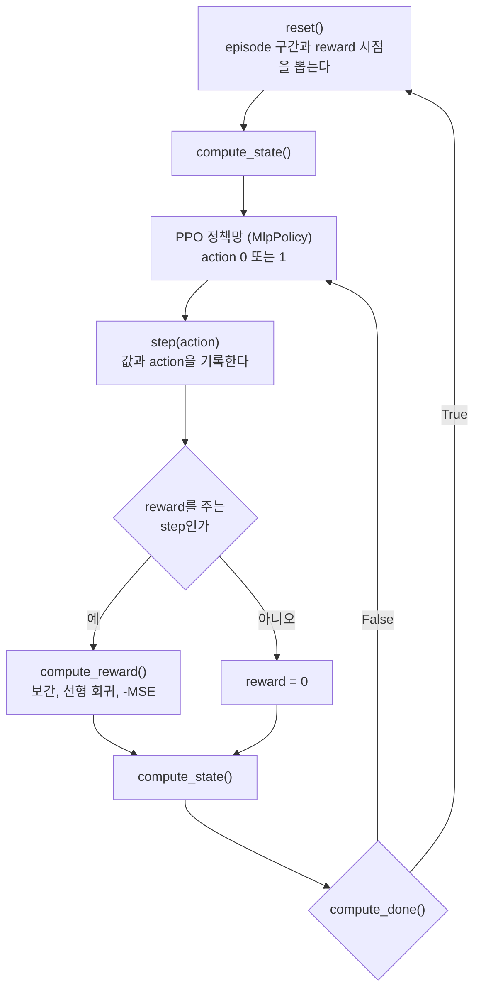
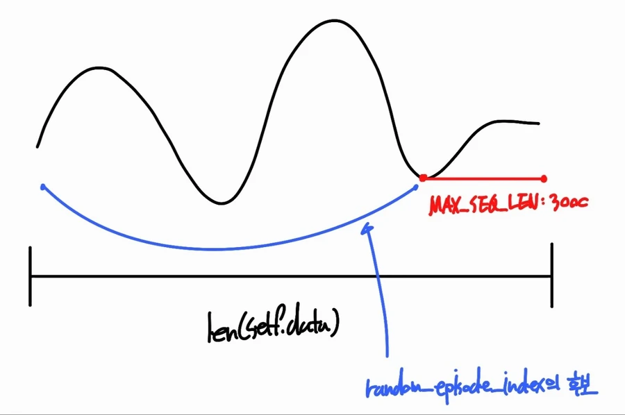

# DTF-net 코드 분석: Gym 환경으로 읽는 Trend Point Detection

작성일 2025-01-31 · 최종 수정일 2025-02-11
{ .post-date }

DTF-net은 인턴으로 있던 연구실의 선행 연구로, 강화학습 agent가 시계열에서 추세에 남겨야 할 점(Dynamic Trend Point, DTP)을 고르게 하는 방법이다. 논문의 내용과 읽으면서 생긴 질문은 [논문 리뷰](../../papers/2024-12-29-dtf-net.md)에 정리했다. 이 글은 그 질문 가운데 코드로만 확인할 수 있는 것들을 풀기 위해 공개 코드를 읽은 기록이다.

코드를 읽기 전에 확인하려던 것은 다음과 같다.

- state가 누적된다고 하는데, 정확히 어떻게 늘어나는가
- positional encoding은 언제, 어떻게, 왜 쓰이는가
- reward ratio와 max sequence length는 어디에서 쓰이는가
- MLP 정책망은 무엇이고 action은 어떻게 뽑히는가
- "episode iteration을 10 미만으로 유지한다"는 말은 무슨 뜻인가
- reward는 어떤 순서로 계산되는가
- 무작위 sampling은 어디에서 이루어지는가

| 날짜 | 한 일 |
|---|---|
| 2025-01-31 | 환경 클래스, `reset`, `compute_state`, 학습 호출부를 처음 읽고 의문을 적었다 |
| 02-03 | 논문에서 남은 의문 중 코드로 확인할 항목을 골랐다 |
| 02-05 | 로그를 넣어 가며 한 episode의 흐름을 처음부터 끝까지 따라갔다 |
| 02-07 ~ 02-08 | 종료 조건, reward 회귀, 학습 이후 단계 등 남은 항목을 확인했다 |
| 02-10 ~ 02-11 | 추세를 내보낼 때의 보간 코드를 정리하고, state 구성을 다시 확인했다 |

코드는 길게 옮기지 않고 의사코드와 그림으로 설명한다. 변수 이름은 공개 코드의 것을 그대로 썼다.

## 1. 전체 구조

코드는 두 단계로 나뉜다.


1단계에서는 Gym 환경 위에서 PPO agent를 학습시킨다. 이때 환경에는 train과 valid 데이터가 함께 들어간다. 2단계에서는 학습된 정책으로 계열 전체를 처음부터 끝까지 한 번 진행해 DTP를 얻고, 이를 보간한 추세를 저장한다. 그 뒤에 선형 예측 모델이 원본과 추세를 함께 입력으로 받아 학습한다.

처음 코드를 볼 때는 RL 학습 호출 뒤에 또 다른 학습이 이어지는 이유를 알 수 없었다. 두 학습이 별개인지, 환경을 왜 매번 새로 만드는지도 의문이었다. 끝까지 읽고 나서 위와 같은 구조임을 알았다.

## 2. Gym 환경으로 읽기

DTF-net의 환경은 `gym.Env`를 상속한 클래스다. Gym 환경에서 반드시 구현해야 하는 것은 두 가지다.

- `reset()`: 환경을 초기화하고 첫 state를 돌려준다. 새 episode가 시작될 때 호출된다.
- `step(action)`: action을 한 번 수행하고 `(state, reward, done, info)`를 돌려준다.

이 구조만 맞추면 action을 뽑는 정책을 어떤 알고리즘으로 둘지는 자유롭게 고를 수 있다. DTF-net은 Stable-Baselines3의 PPO를 쓴다. 학습은 `RLmodel.learn(total_timesteps=...)` 한 줄로 시작되고, 그 안에서 다음 순환이 반복된다.



### 환경이 정의하는 공간

| 항목 | 정의 | 기본값 |
|---|---|---|
| 관측 공간 | `Box(-inf, inf, shape=(feature, state_dim))` | feature 1, state_dim 300 |
| action 공간 | `Discrete(2)` | 0 또는 1 |
| look-back `seq_len` | 예측에 쓰는 과거 구간의 길이 | 336 |
| 예측 길이 `pred_len` | 예측 구간의 길이 | 24 |
| `label_len` | 디코더용 구간의 길이 | 0 |
| `segment_length` | `seq_len + pred_len` | 360 |
| `MAX_SEQ_LEN` | episode 하나의 최대 길이 | 3000 |
| `ratio` | 한 step에 reward가 주어질 확률 | 0.1 |
| 전체 step 수 | `learn`에 넘기는 `total_timesteps` | 10,000 |

- 관측 공간의 하한과 상한이 무한대인 것은 값이 실수이기 때문이다. `state_dim` 300은 positional encoding의 차원이다.
- ETTh1에는 변수가 7개 있는데 feature가 1로 잡히는 것이 처음에는 이상했다. 대상 변수 하나만 쓰는 단변량 설정이 기본값이기 때문이다.
- `label_len`은 생성형 디코더를 쓰는 예측 모델에서 필요한 값이다. 여기서는 선형 모델을 쓰므로 0이다.
- 상태를 구간으로 나누지(binning) 않고 연속 값 그대로 쓴다. 그러면 가능한 state가 매우 많아지지 않을까 하는 의문이 들었다. 구간을 나누려면 기준을 정해야 하고 거기에 주관이 많이 들어간다는 점도 함께 적어 두었다.

## 3. reset: episode와 reward 시점 뽑기

`reset`은 새 episode에서 다룰 구간과, 그 구간 안에서 reward를 줄 시점을 미리 정한다.

```text
reset(predict):
  if predict:                         # 2단계에서만 쓰는 모드
      start   = 0
      seq_len = 데이터 전체 길이
  else:                               # 1단계 학습
      start   = randint(0, len(data) - MAX_SEQ_LEN)
      seq_len = randint(segment_length + label_len, MAX_SEQ_LEN)

  episode_data  = data[start : start + seq_len]
  state_trend   = [data[start]]       # 지금까지 본 모든 값
  feature_trend = [data[start]]       # DTP로 고른 값만. 나머지는 NaN
  action_trend  = [1]                 # 지금까지의 action. 첫 시점은 1로 시작한다
  timestamp     = 1
  random_reward = 길이 seq_len의 0/1 배열. 1이 나올 확률이 ratio
  return compute_state()
```

논문의 episode sampling 식과 맞추어 보면 다음과 같다.

$$
s \sim \mathrm{unif}\{0, N\}, \qquad l \sim \mathrm{unif}\{h + p, H\}
$$

- 시작점 $s$가 `start`다. 다만 뽑는 범위는 전체 길이에서 `MAX_SEQ_LEN`을 뺀 곳까지다. 이렇게 하면 계열의 마지막 부분이 덜 쓰이지 않을까 생각했는데, 길이도 함께 무작위로 뽑으므로 문제가 되지 않는다고 판단했다.
- 길이 $l$이 여기서의 `seq_len`이다. 최솟값 $h + p$가 `segment_length`(336 + 24)이고, 최댓값 $H$가 `MAX_SEQ_LEN`(3000)이다.

{ width="520" }

*직접 그린 그림. 전체 길이에서 `MAX_SEQ_LEN`을 뺀 앞쪽 구간(파란색)이 시작점 후보다.*

`random_reward`가 논문의 reward sampling에 해당한다. `ratio`가 0.1이면 episode의 각 step이 10% 확률로 reward 시점이 된다. 배열의 길이가 episode 길이와 같다는 점에서 의문이 두 가지 생겼다. 왜 step마다 reward가 있을 수 있는가, 그리고 예측 구간에 해당하는 부분에도 왜 reward 시점이 있는가. 답은 `compute_reward`에서 나왔다. Reward는 look-back 구간이 다 찰 때까지 기다렸다가 주는 것이 아니라, reward 시점이 되면 그때까지 쌓인 값만으로 계산한다.

세 리스트의 역할은 다음과 같다.

| 리스트 | 내용 |
|---|---|
| `state_trend` | action과 무관하게 지금까지 지나온 모든 시점의 값 |
| `action_trend` | 지금까지의 action (0 또는 1) |
| `feature_trend` | action이 1인 시점은 원본 값, 0인 시점은 NaN. 나중에 보간해 추세를 만든다 |

`action_trend`가 1로 시작하므로 episode의 첫 시점은 항상 DTP가 된다. 처음에는 이유를 몰랐다. 보간 코드를 읽고 나서 결과적으로 어떤 효과가 있는지는 알았다. 첫 값이 항상 채워져 있으므로 추세의 앞쪽에 빈 구간이 생기지 않는다. 논문을 읽을 때 가졌던 의문, 즉 action이 하나뿐일 때 어떻게 보간하느냐는 것도 여기서 풀린다. 첫 점이 항상 있고, 보간 뒤에 남는 빈 곳은 앞뒤 값으로 채운다.

## 4. compute_state: state에 실제로 들어가는 것

논문은 state를 다음과 같이 정의한다.

$$
S_t = PE(\{X_{s:s+t},\, A_{0:t}\}), \qquad t < l
$$

코드에서 positional encoding은 환경을 만들 때 한 번 계산해 둔다.

```text
PositionalEmbedding(d_model = 300, max_len = 5000):
  pe = (5000, 300) 크기의 표. 학습되지 않는다
  pe[pos, 2i]   = sin(pos / 10000^(2i / d_model))
  pe[pos, 2i+1] = cos(pos / 10000^(2i / d_model))
  pe를 (1, 5000, 300)으로 만들어 buffer에 등록한다

  forward(x):
      return pe[:, :x.size(1)]        # x의 두 번째 축 길이만큼 잘라서 돌려준다
```

`forward`는 입력 `x`의 값을 쓰지 않는다. `x`의 모양만 보고 미리 만든 표의 앞부분을 잘라 돌려준다. 값에 더해 주는 것이 아니라 표의 일부를 그대로 내보내는 구조다.

`compute_state`는 이 모듈을 다음과 같이 부른다.

```text
compute_state():
  state_trend  = 지금까지의 값        # (timesteps, 1)
  action_trend = 지금까지의 action    # (timesteps, 1)
  emb   = concat(state_trend, action_trend, axis = 0)    # (2 * timesteps, 1)
  state = PositionalEmbedding(emb)
```

로그로 모양을 찍어 보았다. 값과 action을 세로로 이어 붙이므로 `emb`의 모양은 `(2 * timesteps, 1)`이다. `forward`가 보는 것은 두 번째 축의 길이인데, 이 값은 항상 1이다. 따라서 돌려받는 것은 항상 `(1, 1, 300)`, 곧 표의 0번 위치 한 줄이다. Episode가 얼마나 진행되었든 state의 모양은 같다.

여기서 확인된 것과 확인되지 않은 것을 나누어 적는다.

- **확인된 것**: state의 길이는 항상 일정하다. 논문이 말한 "state의 길이를 일정하게 유지한다"는 목적은 이 구조로 달성된다. 정책망은 `(1, 300)` 모양의 실수 벡터를 받는다.
- **풀리지 않은 것**: 내가 따라간 경로에서는 `state_trend`와 `action_trend`의 값이 state에 반영되는 지점을 찾지 못했다. 이어 붙인 배열의 행 방향 길이(`2 * timesteps`)도 쓰이지 않는다. 그렇다면 state가 시계열의 값이나 진행 정도를 어떻게 담는지, agent가 무엇을 보고 action을 정하는지 설명할 수 없었다.

DTF-net의 agent는 데이터의 분포와 시간적 특성을 학습해 급격한 변화를 찾고, reward를 통해 예측에 필요한 점을 스스로 고르는 것으로 이해하고 있었다. State가 데이터를 반영하지 못한다면 이것이 어떻게 가능한지가 의문이었다. 2월 11일에 이 부분을 다시 읽었지만 결론은 같았다. 내가 놓친 처리가 있을 수 있으므로 단정하지 않고 질문으로 남겼다.

## 5. Action: Discrete(2)와 MlpPolicy

```python
RLmodel = PPO("MlpPolicy", env, verbose=1, device='cuda')
```

`MlpPolicy`는 Stable-Baselines3가 제공하는 정책망으로, PPO 내부에서 쓸 신경망의 종류를 정하는 인자다. MLP 대신 CNN 기반 정책을 고를 수도 있다. 정책망은 state를 입력으로 받아 action을 정하는 분포를 출력한다. 이산 action이면 각 action의 확률 분포를 내고, 연속 action이면 값 자체를 낸다.

Action 공간이 `Discrete(2)`이므로 agent가 내는 것은 0 또는 1이다. 1이면 현재 시점을 DTP로 고르고, 0이면 건너뛴다.

## 6. step: 한 시점 진행

```text
step(action):
  point_state = episode_data[timestamp]      # 이번에 넘어간 시점의 값
  action_trend에 action을 추가한다
  state_trend에 point_state를 추가한다

  if action == 1:
      feature_trend에 point_state를 추가한다  # DTP: 원본 값을 남긴다
      chunk    = timestamp                   # 가장 최근에 DTP를 고른 시점
      flag_old = flag
      flag     = timestamp
  else:
      feature_trend에 NaN을 추가한다          # 나중에 보간으로 채울 자리

  reward = compute_reward()  (random_reward에서 이 step이 1일 때)
           0                 (그 밖의 경우)
  state  = compute_state()
  done   = compute_done()
  timestamp를 1 늘린다
  return state, reward, done, info
```

`chunk`, `flag`, `flag_old`는 reward를 계산할 구간을 정할 때 쓰인다. 코드에는 `bidirection` 옵션에 따른 분기가 하나 더 있다. 이 옵션은 기본값이 False이고, 그와 짝을 이루는 `bi_flag`는 옵션이 켜져 있을 때만 의미가 있어서 기본 설정에서는 쓰이지 않는다.

## 7. compute_reward: 보간, 선형 회귀, 음의 MSE

Reward 계산은 세 부분으로 이루어진다.

### 입력 만들기

```text
data_processor():
  feature_segment = feature_trend를 선형 보간하고, 남은 빈 곳은 ffill, bfill로 채운다
  X = [state_trend, feature_segment]   # 두 열: 원본 값, 추세
  y = episode_data                      # episode 전체
```

로그로 찍은 모양은 다음과 같았다.

| 시점 | `X.shape` | `y.shape` |
|---|---|---|
| episode 중반 | (733, 2) | (1921, 1) |
| 같은 episode의 뒤쪽 | (1589, 2) | (1921, 1) |

`X`는 지금까지 진행한 step 수만큼 길어지고, 열은 원본 값과 보간된 추세 두 개다. `y`는 episode 전체다. 논문의 $[X, \mathcal{T}]$ 입력이 이 두 열이다.

### 구간 고르기

`indexing()`이 `X`와 `y`에서 회귀에 쓸 구간을 고른다. `chunk`는 가장 최근에 action 1이 나온 시점이다.

```text
if timestamp < seq_len + label_len:        # 아직 look-back 길이만큼 진행하지 않았다
    chunk = 0                              # 처음부터 지금까지를 모두 쓴다
else:
    tmp = chunk
    if timestamp - tmp < seq_len + label_len:      # 최근에 DTP가 있었다
        chunk = tmp - ((seq_len + label_len) - (timestamp - tmp))
    elif timestamp - tmp > seq_len + label_len:    # look-back 길이를 넘도록 DTP가 없었다
        chunk = tmp + ((timestamp - tmp) - (seq_len + label_len))
if flag <= chunk:                          # 위의 분기와 별개로, 그 뒤에 따로 있는 조건문
    chunk = flag_old                       # flag_old까지 구간을 넓힌다
```

- 진행한 step이 look-back(336)보다 적으면 지금까지의 모든 시점이 입력이 된다. 정답 쪽은 앞의 `pred_len`만큼을 버리고 현재 시점까지를 쓴다.
- 최근에 DTP가 있었던 경우의 식은 `label_len`이 0일 때 `timestamp - seq_len`으로 정리된다. 즉 최근 336 step이 입력 구간이 된다.

직접 그림을 그려 가며 원리를 대략 이해했는데, 로그와 맞지 않는 점이 하나 있었다. 내 해석으로는 세 번째 분기에서 구간이 336보다 길어지는 경우가 있어야 했다. 그런데 로그에서는 회귀에 들어가는 `X`와 `y`의 길이가 336을 넘지 않았다.

다시 따져 보고 내린 결론은 그 분기가 실제로는 거의 일어나지 않는다는 것이다. 그 분기에 들어가려면 336 step이 넘는 동안 action 1이 한 번도 나오지 않아야 한다. Action 1이 나오는 빈도를 생각하면 그런 경우는 드물다. 학습 맨 처음에 `chunk`, `flag`, `flag_old`가 모두 0으로 시작하는 동안에만 잠깐 생길 수 있다.

이 세 변수는 `reset`에서 초기화되지 않는다. 새 episode가 시작될 때 이전 episode의 값이 남아 문제가 되지 않는지 경우를 나누어 따져 보았다.

- `chunk`는 episode 초반에 0으로 고정되므로 영향이 없다.
- 문제가 되려면 `flag`가 `chunk`보다 작거나 같아져야 한다. 초기화되지 않은 `flag`는 이전 episode의 큰 값을 가지고 있으므로 그렇게 되지 않는다.
- Episode가 바뀐 뒤 처음으로 action 1이 나올 때 `flag_old`에 이전 episode의 값이 들어가지만, 그 시점에는 `chunk`가 0으로 고정되어 있어 구간 계산에 쓰이지 않는다.

결론은 초기화하지 않아도 이 알고리즘에서는 오류가 생기지 않는다는 것이다. 다만 읽는 사람 입장에서는 세 변수를 `reset`에서 함께 0으로 돌려놓는 편이 의도를 따라가기 쉽겠다고 적어 두었다. 구간을 `flag_old`까지 넓히는 분기의 의도는 끝내 이해하지 못했다.

### 회귀와 reward

처음에는 `learn`을 부르면 그 안에서 시계열 예측 모델도 함께 학습되는 것이라고 짐작했다. Reward가 예측 손실이기 때문이다. 그렇다면 입력의 길이가 step마다 달라지는데 예측 모델이 이를 어떻게 처리하는지가 의문이었다.

확인해 보니 reward 계산에는 신경망이 쓰이지 않는다. Regressor는 선형 회귀이고, 정규방정식(normal equation)의 닫힌 해로 계수를 바로 구한다.

$$
\hat{\beta} = (X^{\top} X)^{-1} X^{\top} y
$$

경사하강법으로 학습하는 모델이 아니므로 `X`와 `y`의 길이가 매번 달라져도 그때그때 풀 수 있다. Reward는 이 회귀의 MSE에 음수를 붙인 값이다.

$$
R = -\frac{1}{n} \sum_{i=1}^{n} (y_i - \hat{y}_i)^2
$$

정리하면 RL 학습 단계에서 쓰이는 "예측 모델"은 닫힌 해로 푸는 선형 회귀뿐이다. 논문 표에 나오는 예측 성능은 2단계 이후에 따로 학습하는 예측 모델의 결과다. 이 구분을 놓쳐서 한동안 reward와 예측 손실을 함께 그려 비교하려는 계획을 세우기도 했다. RL 학습 중에는 reward가 곧 그 손실이므로 둘을 나란히 그릴 수 없다.

## 8. compute_done과 episode 수

`compute_done`이 True를 돌려주면 episode가 끝나고 `reset`이 다시 호출된다. 언제 끝나는지 보려고 `reset`과 `compute_done`에 로그를 넣었다.

| episode | 뽑힌 시작점 | 뽑힌 길이 `seq_len` | 종료된 `timestamp` |
|---|---|---|---|
| 1 | 6718 | 683 | 658 |
| 2 | 5642 | 2640 | 2615 |
| 3 | 7976 | 2666 | 2641 |
| 4 | 333 | 924 | 899 |
| 5 | 3177 | 1427 | 1402 |
| 6 | 4018 | 1047 | 1022 |
| 7 | 7953 | 2380 | (학습 종료로 끝까지 가지 못함) |

- 기록된 여섯 번 모두 뽑힌 길이보다 25 작은 시점에서 episode가 끝났다. 기본 예측 길이는 24다.
- 여섯 episode의 종료 시점을 더하면 9,237이다. 일곱 번째 episode는 도중에 끊겼다. `learn`에 넘긴 전체 step 수 10,000을 넘어서자 학습이 멈춘 것이다.

이것으로 "episode iteration을 10 미만으로 유지한다"는 논문의 문장을 이해했다. Episode 횟수를 직접 정하는 인자는 없다. 전체 step 수에 상한이 있고 episode 하나가 수백에서 수천 step이므로, 그 안에 들어가는 episode가 몇 개에 그친다. 시드를 바꾸면 뽑히는 길이가 달라져 episode 수도 달라졌고, 전체 step 수를 1,000으로 줄이면 1,000을 넘긴 직후 끊겼다.

정확히 10,000번째 step에서 끊기는 것은 아니었다. 왜 조금 넘겨서 멈추는지는 확인하지 못했다.

## 9. 2단계: 계열 전체에서 추세 내보내기

RL 학습이 끝나면 환경을 새로 만들어 `predict` 모드로 진행한다.

```text
env = Env(train 데이터)
obs = env.reset(predict = True)        # 시작점 0, 길이는 데이터 전체
model = 저장해 둔 정책을 불러온다

repeat:
    action = model.predict(obs)
    obs, reward, done, info = env.step(action)
until done

origin, trend, action = env.get_data()
trend = trend를 선형 보간하고, 남은 빈 곳은 ffill, bfill로 채운다
추세, action 지점, 결과를 파일로 저장한다
```

- Episode sampling이 없다. 계열의 처음부터 끝까지가 episode 하나다. 로그에서도 시작점 0, 길이 8640(train)과 3216으로 찍혔고, 각각 8615와 3191에서 끝났다.
- Reward sampling은 이 단계에서도 그대로 이루어진다.
- 같은 과정을 valid 데이터에 대해 한 번 더 수행하고 결과를 따로 저장한다.

저장된 추세가 예측 모델의 두 번째 입력 열이 된다. 예측 모델의 학습 데이터 모양은 `(8640, 2)`였다. 원본 값과 추세 두 열이다.

여기서 마지막 줄의 보간이 눈에 들어왔다. DTP 사이를 잇는 선형 보간이 train 계열 전체에 대해 한 번에 이루어진다. 이 점이 다음 실험의 출발점이 되었다([Future Value Leakage 검증 실험](03-future-value-leakage.md)).

## 10. 논문에서 가져온 질문이 어떻게 풀렸는가

| 질문 | 코드에서 확인한 것 |
|---|---|
| Reward ratio | `reset`에서 episode 길이만큼 0/1을 미리 뽑는다. 1이 나올 확률이 ratio(기본 0.1)다 |
| Max sequence length | Episode 길이의 상한(기본 3000)이자, 시작점을 뽑는 범위를 정하는 값이다 |
| 무작위 sampling의 위치 | 둘 다 `reset`에 있다. 시작점과 길이(state sampling), reward 시점(reward sampling) |
| MLP 정책망 | Stable-Baselines3 PPO의 `MlpPolicy`. `(1, 300)` 벡터를 받아 0 또는 1을 낸다 |
| Episode iteration | 횟수를 정하는 인자는 없다. 전체 step 수(기본 10,000) 안에 들어가는 episode가 몇 개에 그친다 |
| Reward 계산 | 그때까지의 값과 보간된 추세 두 열로 닫힌 해 선형 회귀를 풀고, 그 MSE에 음수를 붙인다 |
| Action 하나로 어떻게 보간하는가 | 첫 시점의 action이 항상 1이고, 보간 뒤 빈 곳은 ffill, bfill로 채운다 |
| 누적 state와 positional encoding | 길이가 일정해지는 것은 확인했다. 값이 반영되는 경로는 찾지 못했다 (4절) |

## 11. 남았던 질문과 답

공부할 당시에는 풀지 못하고 남겨 둔 질문들이다. 글을 정리하면서 답을 찾아 덧붙였다. 답은 논문과 공개 코드에서 확인되는 것까지만 적었고, 설계의 의도처럼 거기에 적혀 있지 않은 것은 아래에 따로 남겼다.

**Q. State가 시계열을 어떻게 반영하는가. 값과 action을 이어 붙이는 것은 어떤 역할을 하는가.**

공개 코드를 다시 읽어도 4절에서 따라간 경로가 전부였다. `compute_state`는 값과 action을 행 방향으로 이어 붙인 `(2 * timesteps, feature)` 배열을 `PositionalEmbedding`에 넘기고, `forward`는 `pe[:, :x.size(1)]`을 돌려준다. `x.size(1)`은 변수의 수(`feature`)이고, 배열에 담긴 값과 행의 수는 읽히지 않는다. 그래서 공개 코드의 기본 설정(단변량)에서 관측으로 나가는 것은 값이나 진행 정도와 무관하게 표의 0번 행, 곧 $\sin 0 = 0$과 $\cos 0 = 1$이 번갈아 놓인 벡터다. 이어 붙인 배열은 이 구현에서 열의 수만 전달한다. 학습 과정에서 시계열의 값이 실제로 쓰이는 곳은 reward를 계산하는 `compute_reward`다. 내가 놓친 처리가 있었던 것은 아니다. 다만 논문의 식 $S_t = PE(\{X_{s:s+t}, A_{0:t}\})$과 이 구현이 어떻게 대응하는지는 공개 코드만으로는 말할 수 없다.

**Q. Reward용 회귀를 닫힌 해 선형 회귀로 둔 이유는 무엇인가.**

논문에서 확인되는 것은 두 가지다. 첫째, reward를 예측의 sum-of-squares로 정의한 것에 대해서는 이유가 적혀 있다. Gaussian Process로 reward function을 학습하는 선행 연구에서 착안했고, 이 선택이 GP보다 reward를 효율적으로 계산하게 해 준다는 것이다. 둘째, reward를 계산하는 예측기는 "simple ML time series predictor"라고만 부른다. 그 예측기를 선형 회귀로 정한 이유는 논문에 따로 적혀 있지 않다. 공개 코드에서는 `regressor` 인자의 기본값이 `Linear`이고, SVM과 ARIMA도 고를 수 있게 되어 있다.

**Q. 2단계에서 reward를 계산할 필요가 있는가. Train과 valid를 나누어 따로 진행하는 이유는 무엇인가.**

결과만 놓고 보면 필요하지 않다. 공개 코드의 2단계 반복문은 `env.step`이 돌려주는 reward를 받기만 하고 쓰지 않는다. 저장되는 추세와 action 지점은 `feature_trend`와 `action_trend`에서 나오고, reward 계산이 바꾸는 `chunk`는 reward의 구간을 정하는 데만 쓰인다. 환경에 reward 계산을 끄는 옵션이 없어서 그대로 실행되는 것이다.

Train과 valid를 따로 진행하는 것은 뒤에 오는 예측 모델의 입력 형식과 맞물려 있다. 공개 코드는 예측 모델에 `[train, valid]` 두 묶음을 따로 넘기고, 묶음마다 원본과 추세를 열로 붙인다. 그래서 추세도 분할마다 따로 뽑아 짝을 맞춘다. Test 구간도 같은 방식으로 한 번 더 진행한다. 이렇게 하면 보간이 분할의 경계를 넘지 않는다는 것까지는 코드에서 확인된다.

**Q. `flag_old`로 구간을 넓히는 분기의 의도는 무엇인가.**

의도는 논문에도 코드에도 적혀 있지 않아 답하지 못했다. 동작만 다시 정리한다. 공개 코드에서 진행한 step이 look-back 길이 이상이면 `chunk`는 두 분기 어느 쪽을 지나든 `timestamp - seq_len - label_len`이 된다. 그 뒤에 `flag <= chunk`이면 `chunk`를 `flag_old`로 바꾼다. `flag`는 가장 최근 DTP의 시점이고 `flag_old`는 그 바로 전 DTP의 시점이다. 즉 가장 최근의 DTP가 회귀 구간의 시작점이거나 그보다 앞에 있을 때, 구간의 시작을 그 전 DTP까지 당겨 구간이 최근의 두 DTP를 포함하게 한다. 코드를 읽을 당시에는 이 조건을 세 번째 분기에 딸린 것으로 이해했는데, 실제로는 분기 뒤에 따로 있는 조건문이다.

**Q. Agent가 고른 점이 변화점과 겹친다면 그 이유는 무엇인가.**

논문의 설명은 reward에 있다. DTP를 예측 모델의 추가 입력으로 넣었을 때 예측이 상승과 하락을 뭉개지 않고 따라가면 agent가 더 높은 reward를 받고, 그래서 그런 점을 고르게 된다는 것이다. 근거로는 합성 데이터와 Nasdaq 데이터의 결과를 든다. 환경의 코드에도 "변화점을 고르라"는 항은 없고 reward는 예측 오차뿐이다. 겹침이 설계에서 직접 보장되는 것이 아니라 reward를 거쳐 간접적으로 유도되고 결과로 확인되는 성질이라는 당시의 생각은 논문의 서술과 어긋나지 않는다.

**Q. Reward가 episode마다 크게 흔들리는 것은 무작위 sampling 때문인가.**

코드에서 정해지는 부분이 있다. Episode의 길이는 360에서 3,000 사이에서 균등하게 뽑히고, 각 step이 reward 시점이 될 확률은 0.1이다. Reward 시점의 수는 평균적으로 길이의 10%이므로 episode마다 36개에서 300개까지 달라진다. Reward는 항상 0 이하인 $-\text{MSE}$이므로, 정책이 같아도 episode별 reward의 합은 길이에 따라 몇 배씩 차이가 난다. 여기에 시작 위치가 달라 구간마다 값의 변동 폭이 다르다는 점이 더해진다. 합이 아니라 reward 시점 하나당 평균으로 보면 길이의 영향은 빠진다.

### 아직 남은 질문

- Agent는 무엇을 근거로 action을 정하는가. 학습 중 정책망에 들어가는 관측을 step마다 기록해 실제로 변하는지 확인하고, 다변량 설정에서도 같은지 보아야 한다. 논문의 실험에 쓰인 구현이 공개 코드와 같은지는 내가 확인할 수 없는 부분이다.
- Reward용 예측기를 선형 회귀로 정한 이유, `flag_old`로 구간을 넓히도록 한 이유, train과 valid를 나누도록 한 이유는 논문과 코드에 적혀 있지 않다. 동작은 확인했지만 의도는 알지 못한다.
- Agent가 고른 점이 실제로 변화점과 얼마나 겹치는가. 변화점의 위치를 아는 합성 데이터에서 DTP와의 일치율을 재어 보아야 한다.
- Reward의 흔들림 가운데 길이로 설명되지 않는 부분은 얼마나 되는가. Episode의 길이와 시작점을 고정한 채 학습 곡선을 다시 그려 보면 알 수 있다. Reward를 점차 줄이거나 episode 길이를 조절하는 방식이 도움이 되는지, episode가 짧을 때와 길 때 중 어느 쪽이 쉬운 문제인지도 그다음에 확인할 일이다.

## 참고 자료

- Towards Dynamic Trend Filtering through Trend Point Detection with Reinforcement Learning. 분석한 코드는 이 논문의 공개 코드다.
- [DTF-net 논문 리뷰](../../papers/2024-12-29-dtf-net.md). 논문의 방법과, 이 글에서 확인하려 한 질문의 배경을 정리했다.
- Stable-Baselines3. PPO와 `MlpPolicy` 구현을 제공하는 강화학습 라이브러리다.
