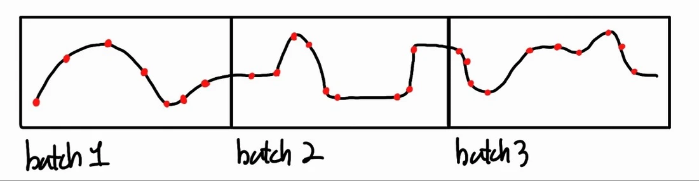
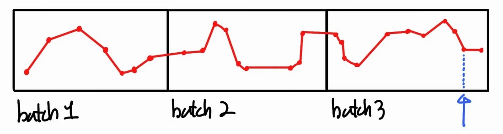
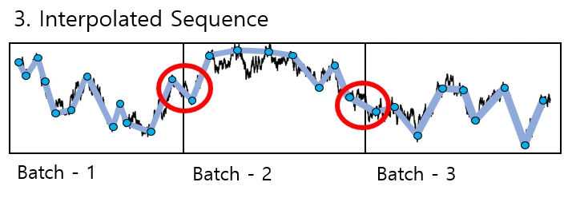
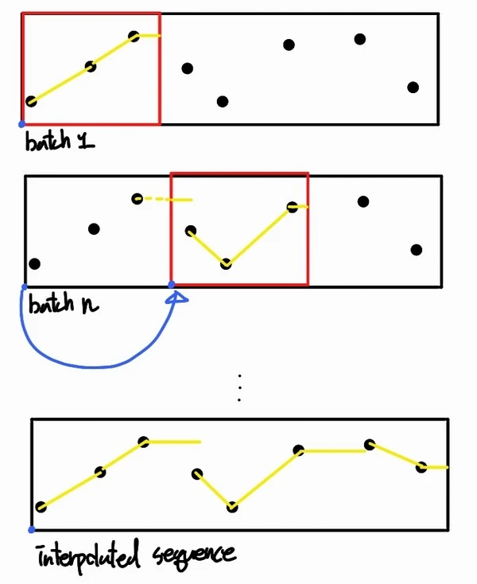
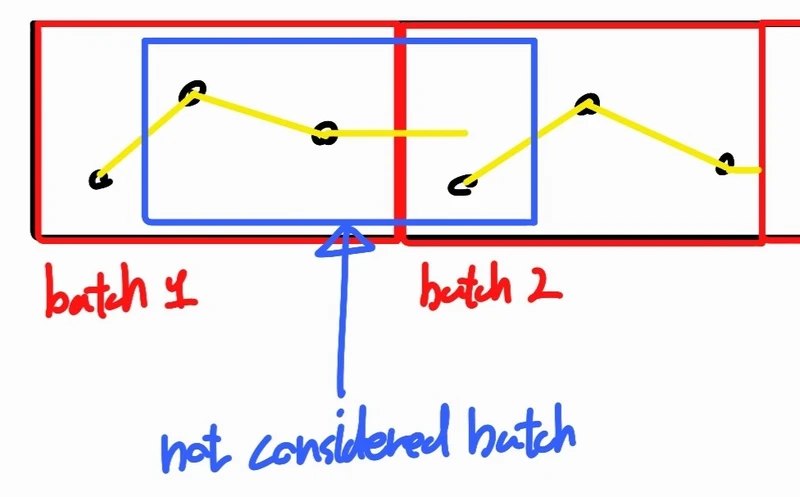
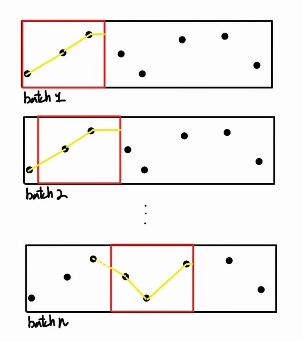

# DTF-net 추세 보간의 Future Value Leakage 검증 실험

작성일 2025-02-11 · 최종 수정일 2025-02-17
{ .post-date }

DTF-net은 강화학습 agent가 고른 점(Dynamic Trend Point, DTP)을 선형 보간해 추세를 만들고, 그 추세를 예측 모델의 추가 입력으로 넣는 방법이다. [코드 분석](02-dtfnet-code-analysis.md)을 마칠 무렵, 이 보간이 계열 전체에 대해 한 번에 이루어진다는 점에서 한 가지 가능성이 제기되었다. 예측 모델의 입력에 미래 값이 섞여 들어갈 수 있다는 것이다. 이 글은 그 가능성을 확인하려고 보간 방식을 세 가지로 바꾸어 비교한 실험의 기록이다.

| 날짜 | 한 일 |
|---|---|
| 2025-02-10 | 공개 코드의 보간 과정을 그림으로 정리했다 |
| 02-11 | 실험을 설계하고 두 가지 대안을 처음 구현했다 |
| 02-13 | 첫 결과를 확인하다가 구현이 틀린 것을 발견했다 |
| 02-14 | 다시 구현하고 NaN 문제를 해결한 뒤 결과를 얻었다 |
| 02-17 | 결과를 해석하고 추가 실험을 계획했다 |

## 1. 가설

### 원본 코드의 보간

RL 학습이 끝나면 학습된 정책으로 train 계열 전체를 한 번 진행해 DTP를 얻는다. 그 결과는 DTP 위치에만 원본 값이 있고 나머지는 비어 있는 계열이다. 공개 코드는 이 계열을 다음 세 단계로 채운다.

```text
trend = 선형 보간(trend)      # DTP와 DTP 사이를 직선으로 잇는다
trend = forward fill(trend)   # 남은 빈 곳을 앞의 값으로 채운다
trend = backward fill(trend)  # 그래도 남은 빈 곳을 뒤의 값으로 채운다
```

단계별로 어떤 일이 일어나는지 그림을 그려 확인했다.



*직접 그린 예시. 검은 선이 원본 계열, 빨간 점이 DTP다. 세로선으로 나눈 세 구간은 예측 모델에 들어가는 입력 구간을 단순화해 그린 것이다.*



*DTP만 남긴 뒤 계열 전체를 보간한 결과. 마지막 DTP 뒤쪽(파란 화살표)은 이을 다음 점이 없으므로 마지막 값으로 채워진다.*

- 선형 보간은 두 DTP 사이만 채운다. 마지막 DTP 뒤쪽은 이을 점이 없어서 마지막 값이 그대로 이어진다. 실제로 돌려 확인해 보니 이 부분은 선형 보간 단계에서 이미 앞의 값으로 채워졌다. 그래서 forward fill을 따로 부르지 않아도 결과가 같다.
- 맨 앞은 항상 값이 있다. DTF-net의 환경이 첫 시점의 action을 항상 1로 두기 때문이다. 따라서 계열 전체를 대상으로 할 때는 backward fill이 하는 일이 없다.

### 무엇이 문제인가

예측 모델은 계열 전체를 한 번에 보지 않는다. 길이가 정해진 입력 구간(look-back)을 받아 그 뒤를 예측한다. 그런데 추세는 그 구간을 자르기 전에 계열 전체에서 보간된다.

{ width="560" }

*구간 경계를 가로지르는 선분(빨간 원). 경계 왼쪽 구간의 끝부분은 오른쪽 구간에 있는 DTP를 향해 그어진 직선 위에 있다.*

두 DTP를 잇는 직선 위의 값은 양쪽 끝점으로 정해진다. 입력 구간의 마지막 DTP 뒤쪽은 그 구간 밖에 있는 다음 DTP를 향해 그어진 직선으로 채워진다. 다음 DTP의 값은 예측 시점에서는 아직 관측되지 않은 미래의 원본 값이다. 따라서 입력 구간의 끝부분에는 미래 값이 선형으로 섞여 있다. 이것이 future value leakage다.

실제 예측 상황에서는 다음 DTP가 어디에서 어떤 값으로 나올지 알 수 없다. 그러므로 이 누수가 성능에 영향을 주고 있다면, 실제 예측에 적용했을 때는 같은 성능이 나오지 않을 수 있다. 확인할 질문은 하나다. 미래 값이 섞이지 않도록 추세를 만들면 예측 성능이 얼마나 달라지는가.

## 2. 세 가지 보간 방식

미래 값을 쓰지 않는 방법은 두 가지를 생각할 수 있었다.

| 모드 | 이름 | 추세를 만드는 방법 | 미래 값 |
|---|---|---|---|
| 0 | Original | 계열 전체에서 DTP 사이를 선형 보간 | 사용 |
| 1 | Forward fill only | 선형 보간과 backward fill을 빼고 forward fill만 적용 | 사용하지 않음 |
| 2 | Batch-wise interpolation | 입력 구간마다 그 구간이 볼 수 있는 DTP만으로 따로 보간 | 사용하지 않음 |

**Forward fill only.** 각 시점의 추세 값은 가장 최근 DTP의 값이다. DTP와 DTP 사이가 계단 모양이 된다. 미래 값을 전혀 쓰지 않지만, DTP 사이의 기울기 정보도 함께 사라진다.

**Batch-wise interpolation.** 입력 구간 안에 있는 DTP끼리는 선형 보간을 그대로 한다. 구간 안의 값은 예측 시점에 이미 알고 있는 과거이기 때문이다. 구간의 마지막 DTP 뒤쪽만 forward fill로 채운다. 기울기 정보를 가능한 한 남기면서 미래 값만 끊는 방식이다.

노트에서는 입력 구간 하나를 batch라고 불렀다. 미니배치와 헷갈릴 수 있으므로 이 글에서는 입력 구간이라고 쓰고, 방식의 이름만 batch-wise로 둔다. 그림의 "batch"도 입력 구간을 뜻한다.

## 3. 구현 과정

Forward fill only는 원본 코드에서 두 줄을 빼면 되므로 구현할 것이 거의 없었다. 시간이 든 것은 batch-wise interpolation이다. 올바른 구현에 이르기까지 두 번 틀렸다.

### 원본 모드에서 손실이 NaN으로 나온 문제

두 모드를 구현하고 실험을 돌리자, 손대지 않은 원본 모드에서 예측 손실이 NaN으로 나왔다. 모드를 추가하면서 코드의 순서를 바꾼 것이 원인이었다. 그 결과 예측 모델이 test 데이터로 학습되는 순서가 되었고, 그 시점에는 데이터가 비어 있어 손실이 NaN이 된 것이다. 순서를 되돌려 해결했다.

### 첫 번째 구현: 겹치지 않는 구간으로 나누어 이어 붙이기

처음에는 계열을 look-back 길이(336)만큼씩 겹치지 않게 자르고, 각 조각 안에서 보간한 뒤 다시 이어 붙여 새 계열 하나를 만들었다. 조각의 앞쪽에 빈 곳이 있으면 가장 가까운 이전 DTP의 값으로, 뒤쪽 빈 곳은 forward fill로 채웠다.

{ width="380" }

*첫 번째 구현. 구간을 look-back 길이만큼 건너뛰며 보간했고, 결과적으로 맨 아래와 같은 새 계열 하나가 만들어졌다.*

이 구현의 결과를 2월 13일에 확인했을 때는 batch-wise 모드에서 의미 있는 성능 차이가 보이지 않는다고 적었다. Forward fill only에서는 성능이 어느 정도 떨어졌다. 처음에는 차이가 없는 이유를 다른 곳에서 찾았다. 조각의 앞뒤에서 채워지는 시점이 몇 개 되지 않아서 영향이 작다고 해석한 것이다.

다시 생각해 보니 구현이 의도와 달랐다. 예측 모델의 학습 데이터는 겹치지 않는 조각이 아니라 한 시점씩 이동하는 sliding window로 만들어진다.

{ width="460" }

*빨간 상자가 내가 나눈 조각이고, 파란 상자가 실제 학습에 쓰이는 입력 구간 중 하나다. 파란 구간의 끝부분은 조각 안에서 보간된 값이므로 여전히 구간 밖의 DTP에 의존한다.*

조각의 경계와 맞아떨어지는 입력 구간은 일부뿐이다. 나머지 구간은 조각의 중간에서 끝나므로, 그 끝부분에는 여전히 미래의 DTP를 향한 직선이 들어 있다. 바꾼 방식의 영향을 받지 않는 입력 구간이 많았으니 성능 차이가 작게 나오는 것은 당연한 결과였다.

### 고치는 과정에서 확인한 것들

구간마다 따로 보간하려면 이전 구간의 정보가 필요하다고 생각했고, 그 과정에서 두 가지를 걱정했다.

- **Scaling.** 보간하지 않은 상태로 데이터를 만들면 표준화가 꼬이지 않을까 걱정했다. 표준화를 하려면 계열이 이미 채워져 있어야 한다고 생각했기 때문이다. 코드를 다시 확인해 보니 표준화는 DTF-net을 학습시키기 전에 원본에만 적용된다. 추출된 추세는 이미 표준화된 값에서 나온 것이어서 다시 표준화하지 않는다. 문제가 되지 않았다.
- **Shuffle.** 이전 구간의 값을 가져오려면 학습 데이터를 섞지 않아야 한다고 생각했다. 그래서 shuffle을 끄면 성능이 달라지는지부터 확인했다. 성능은 조금 바뀌었지만 방향이 일정하지 않았고, Exchange Rate에서는 차이가 거의 없었다. 그 뒤에 이 확인 자체가 필요 없다는 것을 알았다. 필요한 것은 "이전 구간"이 아니라 각 입력 구간이 계열 전체에서 어디에서 시작하는지다. 시작 위치만 알면 섞는 것과 무관하게 계열 전체에서 가장 가까운 이전 DTP를 찾을 수 있다.

고쳐 쓴 두 번째 구현도 다시 보니 틀려 있었다. 구간 앞쪽에 채울 이전 값을 가져오는 방식이 맞지 않았고, 여전히 계열 하나를 새로 만드는 구조였다. 구간마다 따로 보간해야 하는데 계열을 다시 만드는 데 그친 것이다.

### 최종 구현: 입력 구간마다 따로 보간하기

최종 구현은 학습에 쓰이는 모든 입력 구간을 하나씩 따로 다룬다.

```text
sparse = DTP 위치에는 원본 값, 나머지는 NaN인 계열 전체

for 학습에 쓰이는 모든 입력 구간 [i, i + seq_len):      # 한 시점씩 이동
    w = sparse[i : i + seq_len]

    구간이 DTP로 시작하지 않으면:
        j = i보다 앞에 있는 가장 가까운 DTP              # 과거의 값
        k = 구간 안의 첫 DTP
        구간의 처음부터 k까지를, j와 k를 잇는 직선 위의 값으로 채운다

    구간 안의 DTP 사이를 선형 보간한다
    구간 안의 마지막 DTP 뒤쪽은 그 값으로 채운다          # forward fill

    이 구간의 추세로 저장한다
```

{ width="380" }

*최종 구현. 구간이 한 시점씩 이동하고, 구간마다 뒤쪽은 forward fill로 끝난다. 맨 아래처럼 구간이 DTP 사이에서 시작하면 구간 밖의 이전 DTP에서 이어지는 직선(점선)으로 앞쪽을 채운다.*

- 구간 뒤쪽은 forward fill로 끝난다. 미래의 DTP를 쓰지 않는다.
- 구간 앞쪽은 구간 밖에 있는 이전 DTP와 선형 보간한다. 과거의 값을 쓰는 것은 누수가 아니므로, 쓸 수 있는 과거 값이 있다면 forward fill보다 선형 보간이 합리적이라고 판단했다.
- 첫 구간은 계열의 첫 시점에서 시작하고 그 시점은 항상 DTP이므로 앞쪽을 따로 채울 필요가 없다.

구현하면서 부딪힌 문제는 다음과 같다.

- pandas의 DataFrame을 기준으로 인덱싱하니 위치가 계속 어긋났다. NumPy 배열로 바꾸어 처리했다.
- 기존 Dataset 객체의 추세 열을 통째로 바꿔 넣으려 했지만, Dataset은 항목 대입을 지원하지 않았다. 구간별로 보간한 추세를 미리 리스트로 만들어 두고, 이를 인덱스로 꺼내 돌려주는 Dataset 클래스를 따로 만들었다. 구간마다 길이 336의 추세를 따로 가지므로 train에서만 값이 약 270만 개가 된다.
- 데이터 로더의 worker가 여러 개이면 로그가 섞여 확인이 어려웠다. 디버깅하는 동안에는 worker를 하나로 두었다.

### Batch-wise 모드에서 손실이 NaN으로 나온 문제

재구현한 코드에서는 학습 손실부터 NaN이 나왔다. 원인을 좁혀 간 순서는 다음과 같다.

1. Shuffle을 끄고 worker를 하나로 줄여도 NaN이 나왔다. 두 설정은 원인이 아니다.
2. 학습 중에 입력 배치마다 NaN이 있는지 검사했다. 모든 배치에 NaN이 하나 이상 있었다.
3. 구간 앞쪽을 채우는 함수의 출력을 검사했다. 여기에는 NaN이 없었다.
4. 따라서 NaN은 Dataset이 항목을 꺼내 줄 때 생긴다. NaN이 있는 배치만 출력해 확인했다.

원인은 Dataset이 항목을 돌려주는 부분의 분기였다. 한쪽 분기에서는 보간된 추세가 들어가는데, 다른 쪽 분기에서는 보간되지 않은 값이 그대로 나가고 있었다. 그 분기에서 보간을 한 번 더 하는 대신, 미리 계산해 둔 추세를 그대로 꺼내 쓰도록 고쳐 해결했다.

마지막으로 값이 제대로 들어가는지 확인했다. 보간된 값 0.04643394가 입력 텐서에서는 0.0464로 찍혔다. 값이 실제로 달라진 것인지 출력 자릿수의 차이인지는 확인하지 못했고, 나중에 조사할 항목으로 적어 두었다.

## 4. 실험 설정

| 항목 | 내용 |
|---|---|
| 데이터 | ETTh1, Exchange Rate (단변량) |
| 시드 | 2023, 2024, 2025 |
| 비교 대상 | Original, Forward fill only, Batch-wise interpolation |
| Reward sampling 비율 | 0.1 |
| Look-back | 336 |
| 예측 모델 | 추세를 추가 입력으로 받는 선형 모델 |
| 지표 | 예측 MSE, MAE |

그 밖의 설정은 공개 코드의 기본값을 그대로 두었다. 예측 길이는 노트에 따로 적어 두지 않았다. 기본값은 24이고, 원본 모드의 결과가 논문이 예측 길이 24에서 보고한 값과 같은 수준이다.

## 5. 결과

2월 14일에 최종 구현으로 얻은 결과다. 값이 작을수록 좋다. 그 전의 잘못된 구현으로 얻은 수치는 싣지 않았다.

| 데이터 | 방식 | 2023 MSE | 2023 MAE | 2024 MSE | 2024 MAE | 2025 MSE | 2025 MAE |
|---|---|---|---|---|---|---|---|
| ETTh1 | Original | 0.0251 | 0.1203 | 0.0257 | 0.1215 | 0.0258 | 0.1220 |
| ETTh1 | Batch-wise | 0.0300 | 0.1344 | 0.0300 | 0.1327 | 0.0290 | 0.1310 |
| ETTh1 | Forward fill | 0.0310 | 0.1367 | 0.0305 | 0.1341 | 0.0290 | 0.1311 |
| Exchange Rate | Original | 0.0257 | 0.1217 | 0.0271 | 0.1254 | 0.0245 | 0.1181 |
| Exchange Rate | Batch-wise | 0.0278 | 0.1272 | 0.0285 | 0.1293 | 0.0318 | 0.1364 |
| Exchange Rate | Forward fill | 0.0280 | 0.1277 | 0.0287 | 0.1298 | 0.0323 | 0.1379 |

원본 모드와 비교한 변화율은 다음과 같다. 음수는 성능이 나빠졌다는 뜻이다. 이 값은 (원본 모드의 손실 - 해당 방식의 손실) / 해당 방식의 손실로 계산한 것이다. 분모가 원본이 아니라 해당 방식의 손실이라는 점에 유의해야 한다.

| 데이터 | 방식 | 2023 MSE | 2023 MAE | 2024 MSE | 2024 MAE | 2025 MSE | 2025 MAE |
|---|---|---|---|---|---|---|---|
| ETTh1 | Batch-wise | -16.4% | -10.5% | -14.4% | -8.5% | -11.1% | -6.9% |
| ETTh1 | Forward fill | -19.1% | -12.0% | -15.8% | -9.4% | -11.1% | -7.0% |
| Exchange Rate | Batch-wise | -7.6% | -4.4% | -5.0% | -3.1% | -23.0% | -13.5% |
| Exchange Rate | Forward fill | -8.3% | (주) | -5.6% | -3.4% | -24.2% | -14.4% |

(주) 이 칸은 노트에 적힌 값이 위 결과 표의 수치와 맞지 않아 싣지 않았다.

- 두 데이터, 세 시드, 두 지표 모두에서 원본 모드의 손실이 가장 작았다. 미래 값을 쓰지 않는 두 방식은 모든 경우에 성능이 떨어졌다.
- 두 방식 사이에서는 batch-wise가 forward fill보다 손실이 작거나 같았다. ETTh1의 시드 2025에서는 MSE가 같고 MAE가 0.0001 차이다.
- ETTh1에서 세 시드의 평균 변화율은 batch-wise가 MSE -13.9%, MAE -8.6%이고 forward fill이 MSE -15.3%, MAE -9.4%다.
- Exchange Rate는 시드에 따른 차이가 크다. Forward fill의 MSE 변화율은 평균 -12.7%인데, 시드 2025에서는 -24.2%다. Batch-wise도 시드 2025에서 -23.0%로 다른 두 시드(-7.6%, -5.0%)와 크게 다르다.

## 6. 해석

### 미래 값을 끊으면 성능이 떨어진다

원본 방식의 추세 입력이 입력 구간 밖의 DTP에 의존한다는 것은 코드의 구조에서 나오는 사실이다. 이 실험에서는 그 의존을 끊었을 때 예측 손실이 실제로 커졌다. 두 데이터와 세 시드라는 범위 안에서는 방향이 모두 같았다.

이 결과가 뜻하는 바를 스스로 물어보았다. 누수가 있는 상태로 추론하면 문제가 되는가. 된다고 판단했다. 미래 값 없이 학습했을 때 test 성능이 눈에 띄게 떨어진다면, 다음 DTP를 알 수 없는 실제 예측 상황에 이 방법을 적용할 때는 그만큼을 감안해야 한다. 반대로 여러 데이터에서 학습하면 영향이 크지 않을 수도 있다. 그것을 말하려면 더 다양한 데이터에서 실험해 보아야 한다.

### 두 방식의 차이가 작다

Batch-wise는 forward fill보다 많은 정보를 준다. 입력 구간 안의 DTP 사이가 계단이 아니라 직선으로 이어진다. 그런데 두 방식의 성능 차이는 그 정보량에 비해 작았다.

내 해석은 이렇다. DTP 사이를 잇는 직선은 선형적인 정보일 뿐이어서 예측에 크게 보태는 것이 없다. 모델의 예측이 가장 크게 기대는 것은 DTP 자체의 값이다. 선형 보간을 아예 없앤 forward fill에서도 성능이 완전히 무너지지 않았다는 점이 이를 간접적으로 뒷받침한다.

### 시드에 따른 차이

Exchange Rate에서 시드 2025만 변화율이 두 배 이상 크다. DTF-net이 시드에 민감하다는 특성과 관련이 있어 보인다. 시드에 따른 민감도는 결국 reward의 안정성과 이어지는 문제라고 생각했다. 이를 따지려면 reward의 안정성을 수치로 나타낼 방법이 먼저 필요하다. 시드 세 개로는 이것이 일반적인 경향인지 말할 수 없다.

### MSE와 MAE의 변화율 차이

모든 경우에 MSE의 변화율이 MAE보다 컸다. 처음에는 이것을 급격한 변화에 대한 예측이 약해졌다는 신호로 읽을 수 있지 않을까 생각했다. MSE는 큰 오차에 더 민감하기 때문이다. 그러나 MSE는 오차를 제곱하므로 같은 변화에도 원래 더 크게 움직인다. 이 차이만으로 급격한 변화의 예측이 나빠졌다고 말할 근거는 부족하다고 판단했다. 확인하려면 특정 구간의 예측을 방식별로 그려 직접 비교해야 한다.

## 7. 한계와 더 해 보고 싶은 것

- **시드가 세 개뿐이다.** 시드에 따른 차이가 크게 나온 만큼 결과를 일반화하기 어렵다. 무작위 시드 10개로 늘려 다시 실험할 계획을 세웠다.
- **데이터가 두 개, 예측 설정이 하나다.** 다른 데이터와 다른 예측 길이에서는 확인하지 않았다. Look-back이 짧아지면 영향이 더 커질 수 있다고 예상했지만 실험하지는 않았다.
- **설정은 기본값 그대로다.** 방식마다 따로 조정하지 않았다.
- **예측을 직접 보지 않았다.** 손실의 평균만 비교했다. Test 구간의 특정 배치와 예측을 함께 그려, 세 방식의 예측이 어디에서 어떻게 달라지는지 확인하려 했다. 그 전에 test 데이터에 배치가 몇 개인지, 그중 어느 것을 그릴지부터 정해야 한다.
- **입력 값의 자릿수 문제**(3절)를 확인하지 못했다.

## 참고 자료

- Towards Dynamic Trend Filtering through Trend Point Detection with Reinforcement Learning. 실험은 이 논문의 공개 코드에서 추세를 보간하는 부분만 바꾸어 진행했다.
- [DTF-net 논문 리뷰](../../papers/2024-12-29-dtf-net.md)
- [DTF-net 코드 분석](02-dtfnet-code-analysis.md). 추세가 만들어지고 예측 모델에 들어가는 과정을 정리했다.
