# HP filter와 L1 trend filtering 비교 실험

인턴으로 있던 연구실의 선행 연구인 DTF-net([논문 리뷰](../../papers/2024-12-29-dtf-net.md))은 강화학습으로 추세를 뽑아내는 trend filtering 방법이다. 이 논문을 읽으면서 가장 먼저 막힌 질문은 "L1 trend filtering이 이미 급격한 변화를 잘 잡는다고 하는데, 왜 새로운 방법이 필요했는가"였다. 이 질문에 답하려면 L1 trend filtering이 무엇을 하고 무엇을 못 하는지부터 알아야 했다.

이 글은 그 과정을 기록한 것이다. 먼저 Hodrick-Prescott(HP) filter와 L1 trend filtering의 목적 함수를 비교하고, 합성 데이터로 두 필터를 직접 돌려 본다. 이어서 L1 trend filtering의 한계를 네 가지로 정리해 각각을 실험으로 확인하고, 마지막으로 같은 방식의 합성 데이터에서 L1 trend filtering과 DTF-net을 비교한다.

용어의 배경은 스터디 글 [추세 필터링과 변화점 탐지](../../study/trend-filtering-cpd/index.md)에 따로 정리했다.

## 1. 두 필터의 목적 함수

Trend filtering은 원본 시계열과의 근접성(proximity)을 최대한 유지하면서 노이즈를 걷어내, 그 아래에 있는 추세(underlying trend)를 찾는 작업이다. 관측값을 $y_1, \dots, y_n$, 구하려는 추세를 $x_1, \dots, x_n$이라고 하면 HP filter는 다음 식을 최소화하는 $x$를 추세로 삼는다.

$$
\frac{1}{2}\sum_{t=1}^{n}(y_t - x_t)^2 + \lambda\sum_{t=2}^{n-1}(x_{t-1} - 2x_t + x_{t+1})^2
$$

앞의 항은 추세가 원본에서 멀어지지 않게 하는 항(data fidelity)이고, 뒤의 항은 추세를 매끄럽게 만드는 항이다. $x_{t-1} - 2x_t + x_{t+1}$은 이차 차분으로, 그 시점에서 추세가 얼마나 휘었는지(곡률)를 나타낸다. $\lambda \ge 0$는 두 항의 비중을 정한다.

- $\lambda \to 0$이면 매끄러움에 대한 제약이 사라져 추세가 원본과 같아진다.
- $\lambda \to \infty$이면 추세가 하나의 직선이 된다. 이 직선을 best affine fit이라고 부른다.

L1 trend filtering은 여기서 이차 차분에 대한 제곱을 절댓값으로 바꾼 것이다.

$$
\frac{1}{2}\sum_{t=1}^{n}(y_t - x_t)^2 + \lambda\sum_{t=2}^{n-1}\lvert x_{t-1} - 2x_t + x_{t+1}\rvert
$$

이차 차분을 계산하는 $(n-2) \times n$ 행렬을 $D$라고 하면 두 식의 뒤쪽 항은 각각 $\lambda\lVert Dx \rVert_2^2$와 $\lambda\lVert Dx \rVert_1$이다. 즉 두 필터의 차이는 곡률에 L2 penalty를 주느냐, L1 penalty를 주느냐뿐이다.

### L2 penalty와 L1 penalty가 만드는 차이

처음에는 "norm 하나 바꿨을 뿐인데 왜 결과의 모양이 달라지는가"가 이해되지 않았다. 다음과 같이 정리했다.

- **L2 penalty**: 제곱은 큰 값을 강하게 누르지만 작은 값에는 거의 영향을 주지 않는다. 값이 0에 가까워질수록 줄이려는 힘도 함께 작아지기 때문에, 모든 곡률을 조금씩 줄일 뿐 어떤 곡률을 정확히 0으로 만들지는 않는다. 그 결과 추세 전체가 완만한 곡선이 된다.
- **L1 penalty**: 절댓값의 기울기는 값의 크기와 무관하게 일정하다. 곡률이 작든 크든 같은 크기의 힘으로 0 쪽으로 당기므로, 충분히 작은 곡률은 정확히 0이 된다(sparsity). 일종의 thresholding이다.

이차 차분이 0이라는 것은 연속한 세 점이 한 직선 위에 있다는 뜻이다. 따라서 L1 penalty 아래에서는 대부분의 시점에서 추세가 직선이 되고, 곡률이 0이 되지 않고 살아남은 몇몇 시점에서만 기울기가 바뀐다. 이렇게 해서 L1 trend filtering의 추세는 직선 조각을 이어 붙인 모양(piecewise linear)이 된다. 기울기가 바뀌는 지점을 kink라고 하며, 이 kink를 추세가 급격히 변하는 지점(abrupt change)으로 해석할 수 있다.

!!! note "kink와 knot"
    kink는 기울기가 불연속적으로 바뀌는 지점이다. knot은 spline regression에서 온 말로, 함수를 여러 조각으로 나눌 때 조각이 이어지는 지점을 뜻한다. L1 trend filtering에서는 두 말을 거의 같은 뜻으로 쓴다.

DTF-net 논문은 HP filter가 급격한 변화를 놓치는 이유를 다른 각도에서 설명한다. 제곱합(sum-of-squares)을 최소화하는 것은 꼬리가 가벼운(light-tailed) Gaussian 분포로 근사하는 것과 같아서, 분포의 꼬리에 있는 극단값(extreme value)이 지워진다는 것이다. abrupt change도 꼬리 쪽에 극단값과 섞여 있으므로 함께 smoothing된다. 이 논증의 출처는 [Modeling Extreme Events in Time Series Prediction 리뷰](../../papers/2025-02-04-modeling-extreme-events.md)에 정리했다.

이 설명을 읽으면서 든 의문도 적어 둔다. 분포로 설명하지 않고, "이차 차분의 제곱합은 큰 곡률을 많이 줄이고 작은 곡률은 조금 줄여 모두 0에 가깝게만 만들기 때문에 전체가 매끄러워진다"고 말하는 편이 더 직접적이지 않은가 하는 것이다. 어느 쪽이 정확한 설명인지는 결론을 내리지 못했다.

## 2. 성질 비교

L1 trend filtering 논문(Kim et al., 2009)이 HP filter와 나란히 놓고 설명하는 성질을 표로 정리했다.

| 성질 | HP filter | L1 trend filtering |
|---|---|---|
| 계산량 | 풀어야 할 선형 시스템이 띠 행렬 구조라 $O(n)$에 풀린다 | 미분 불가능한 항이 있어 선형 시스템 한 번으로 풀리지 않는다. 보통 interior-point method를 쓰며 최악의 경우 $O(n^{1.5})$이지만 실제로는 $O(n)$과 큰 차이가 없다 |
| 선형성 | 추세가 데이터 $y$의 선형 함수다 (선형 필터) | 추세가 $y$의 비선형 함수다 |
| $\lambda \to 0$ | 추세가 원본 $y$로 수렴한다 | 같다 |
| $\lambda \to \infty$ | best affine fit으로 서서히 수렴한다 | 유한한 값 $\lambda_{\max}$를 넘는 순간 정확히 best affine fit이 된다 |
| affine 조정과의 교환 | 필터 적용 전에 하든 후에 하든 결과가 같다 | 같다 |
| 추세의 모양 | 매끄러운 곡선 | 조각별 직선, kink에서 기울기가 바뀐다 |
| 정규화 경로 | $\lambda$가 변하면 추세가 연속적으로, 부드럽게 변한다 | $\lambda$에 대해 조각별 선형이다. $\lambda$가 특정 값을 지날 때마다 kink의 구성이 바뀐다 |

정규화 경로(regularization path)는 $\lambda$를 바꿔 갈 때 최적해인 추세가 어떻게 변하는지를 나타낸 것이다.

표의 내용 중 선형성과 $\lambda_{\max}$ 부분은 정리할 당시 뜻이 잘 와닿지 않는다고 적어 두었던 부분이다. 실험을 먼저 해 보기로 했다.

## 3. 실험 1: 매끄러운 추세와 급변이 있는 추세

### 설정

길이 200의 합성 시계열을 두 종류 만들었다.

- **매끄러운 추세**: 직선과 사인파의 합에 표준편차 1.0의 Gaussian 노이즈를 더했다.
- **급변이 있는 추세**: 같은 형태의 추세에서 $t = 50 \sim 69$ 구간을 3만큼 올리고 $t = 120 \sim 139$ 구간을 2만큼 내렸다. 추세 자체에도 표준편차 0.3의 노이즈를 넣어 덜 매끄럽게 만들었다. 관측 노이즈는 표준편차 1.0이다.

HP filter는 `statsmodels`의 구현을 썼고, L1 trend filtering은 목적 함수를 `cvxpy`에 그대로 적어 풀었다. 그림을 그리는 부분을 뺀 코드는 다음과 같다.

```python
import numpy as np
import cvxpy as cp
import statsmodels.api as sm

n = 200
t = np.arange(n)

# 아래 (가), (나) 중 하나를 쓴다
# (가) 매끄러운 추세
true_trend = 0.05 * t + np.sin(0.1 * t)

# (나) 급변이 있는 추세
true_trend = 0.03 * t + np.sin(0.1 * t)
true_trend[50:70] += 3      # 특정 구간에서 급격한 상승
true_trend[120:140] -= 2    # 특정 구간에서 급격한 하락
true_trend += np.random.normal(scale=0.3, size=n)

noise = np.random.normal(scale=1.0, size=n)
series = true_trend + noise  # 관측된 시계열

# HP filter
lambda_hp = 1600  # 경제 데이터에서 흔히 쓰는 값
hp_cycle, hp_trend = sm.tsa.filters.hpfilter(series, lamb=lambda_hp)

# L1 trend filtering
lambda_l1 = 1
x = cp.Variable(n)
D = np.diff(np.eye(n), 2, axis=0)  # 2차 차분 행렬
objective = cp.Minimize(0.5 * cp.sum_squares(series - x) + lambda_l1 * cp.norm1(D @ x))
prob = cp.Problem(objective)
prob.solve()

l1_trend = x.value
l1_cycle = series - l1_trend  # 원본에서 추세를 뺀 성분
```

두 필터는 penalty의 형태가 다르고 구현에서 쓰는 계수도 달라서, HP filter의 $\lambda$와 L1 trend filtering의 $\lambda$를 값끼리 비교할 수는 없다. 또 이 실험에서는 난수 시드를 고정하지 않아, 아래 그림들은 같은 추세에 서로 다른 노이즈가 더해진 것이다.

### 매끄러운 추세

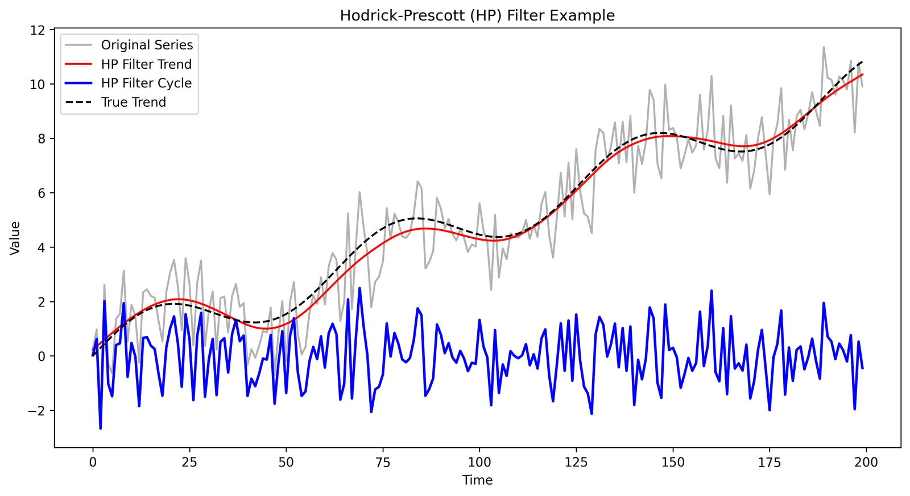

*HP filter($\lambda = 1600$). 회색은 관측값, 검은 점선은 실제 추세, 빨간 선은 추출한 추세, 파란 선은 원본에서 추세를 뺀 성분이다.*

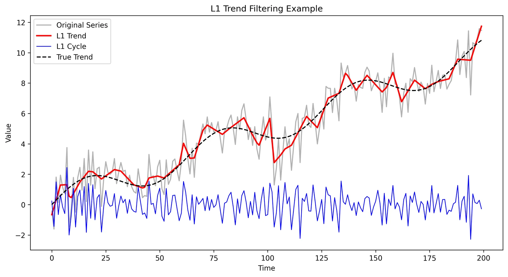

*L1 trend filtering($\lambda = 1$).*

HP filter는 매끄러운 추세만 뽑아낸다. L1 trend filtering은 같은 변동을 직선 조각으로 근사한다. 다만 이 그림에서는 L1 추세가 노이즈를 따라 여러 번 꺾이는 모습도 함께 보인다. 이 점은 4절에서 한계로 다시 다룬다.

실제 추세가 이렇게 매끄럽기만 한 경우는 드물 것이라고 생각해, 추세에 급변을 넣은 데이터로 넘어갔다.

### 급변이 있는 추세

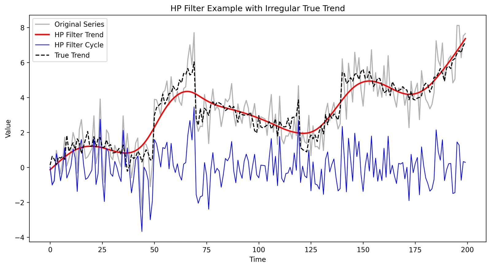

*HP filter($\lambda = 1600$). $t = 50$, $70$, $120$, $140$ 부근의 급변이 완만한 곡선으로 뭉개진다.*

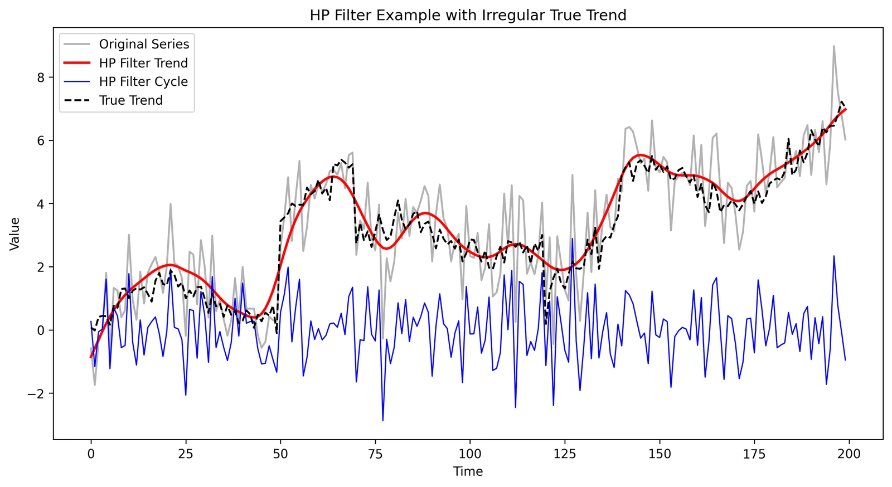

*HP filter($\lambda = 100$).*

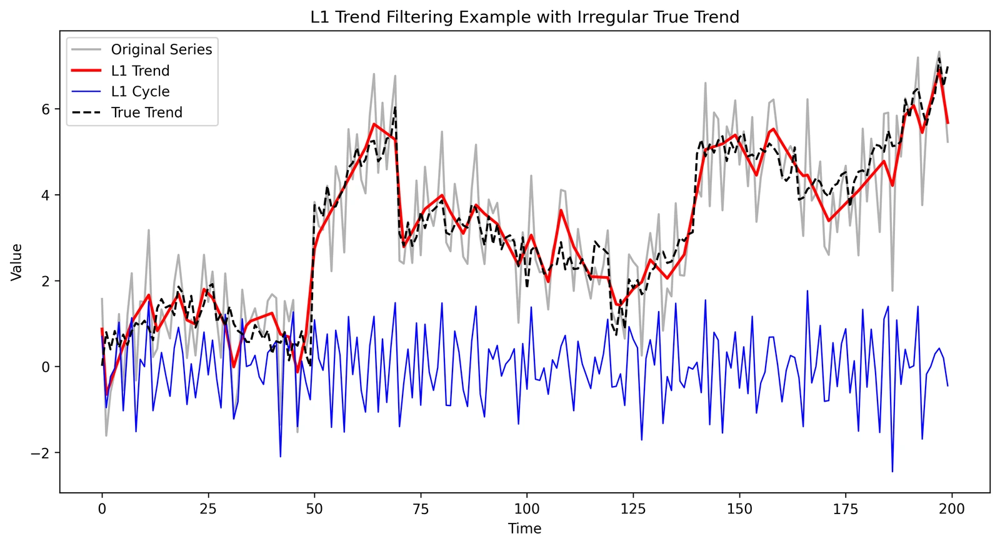

*L1 trend filtering($\lambda = 1$).*

관찰한 내용은 다음과 같다.

- HP filter는 $\lambda = 1600$에서 지나치게 매끄러운 추세를 낸다. 실제 추세의 급변을 따라가지 못한다.
- $\lambda$를 100으로 낮춰도 추세를 조금 더 가깝게 따라갈 뿐, 국소적으로 나타나는 급변을 급변으로 잡아내지는 못한다. $\lambda$를 조절해서 해결되는 문제가 아니라 HP filter에 내재된 한계로 보였다.
- L1 trend filtering은 급변 구간을 직선 조각의 꺾임으로 표현한다.

이 결과를 보고 적어 둔 질문은 세 가지였다.

1. HP filter가 급변을 못 잡는 이유는 L2 norm 때문인가? 1절의 내용이 이 질문에 대한 답이다.
2. L1 trend filtering이 급변을 잡는 이유는 L1 norm이 만드는 piecewise linearity 때문일 것이다. 논문에서 이 부분을 집중해서 읽기로 했다.
3. 그렇다면 L1 trend filtering은 change point를 탐지하는 방법이라고 보아야 하는가? 이 질문은 change point detection을 공부한 뒤에야 답할 수 있었고, [스터디 글](../../study/trend-filtering-cpd/04-change-point-terms.md)에 정리했다.

## 4. L1 trend filtering의 한계

실험 1만 보면 L1 trend filtering으로 충분해 보인다. 그래서 "$\lambda$만 적절히 고르면 kink를 잘 잡을 수 있는데, 무엇이 문제인가"를 다시 따져 보았다. 정리한 한계는 네 가지이고, 각각을 합성 데이터로 확인했다.

### 설정

이번에는 시드를 고정하고 노이즈를 줄여, 추세와 추출 결과의 차이가 잘 보이게 했다.

```python
np.random.seed(42)

n = 200
t = np.arange(n)

# 변형: true_trend = 0.03 * t/2 + np.sin(0.1 * t) - 2
true_trend = 0.03 * t/2 - 2
true_trend[50:70] += 2      # 특정 구간에서 급격한 상승
true_trend[120:140] -= 2    # 특정 구간에서 급격한 하락

noise = np.random.normal(scale=0.1, size=n)
series = true_trend + noise

# 변형: 뒤쪽 절반에만 노이즈를 추가
# series[100:100+int(n/2)] += np.random.normal(scale=0.5, size=int(n/2))
```

필터를 적용하는 부분은 실험 1과 같다. 실험에 따라 추세에 사인파와 노이즈를 넣은 변형, 뒤쪽 절반의 노이즈를 키운 변형을 썼다. 아래 그림에서 파란 선이 실제 추세, 빨간 선이 L1 trend filtering의 결과다.

### 한계 1. 노이즈를 kink로 판단한다

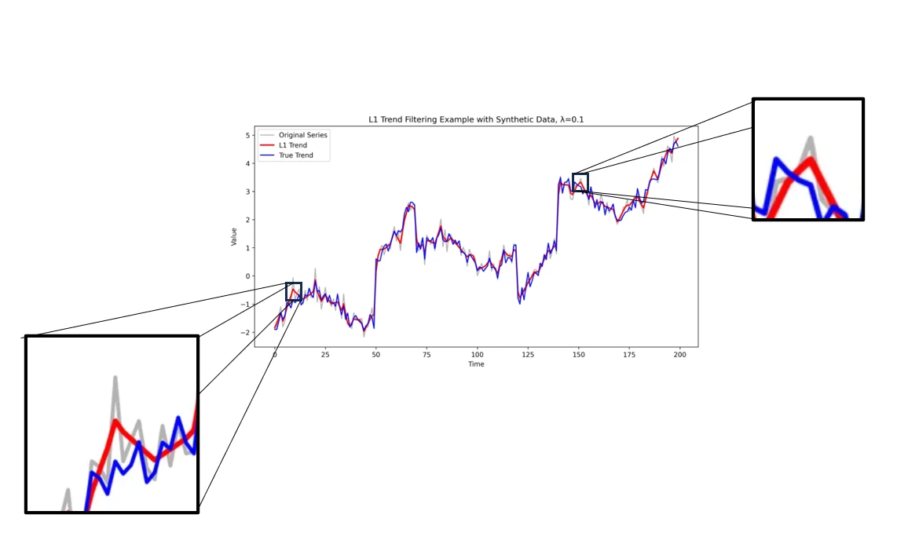

*$\lambda = 0.1$. 확대한 두 부분에서 빨간 선(L1)이 실제 추세(파란 선)에는 없는 꺾임을 만든다.*

L1 trend filtering은 살아남은 kink를 abrupt change로 본다. 그런데 최적화 과정에서 노이즈가 완전히 걸러지지 않으면, 노이즈 때문에 생긴 꺾임도 kink로 남는다. 확대한 부분이 그런 경우다. 이는 L1 trend filtering이 찾아낸 abrupt change가 실제로는 노이즈일 수 있다는 뜻이다.

### 한계 2. overfitting과 underfitting

한계 1은 결국 $\lambda$를 어떻게 정하느냐의 문제다.

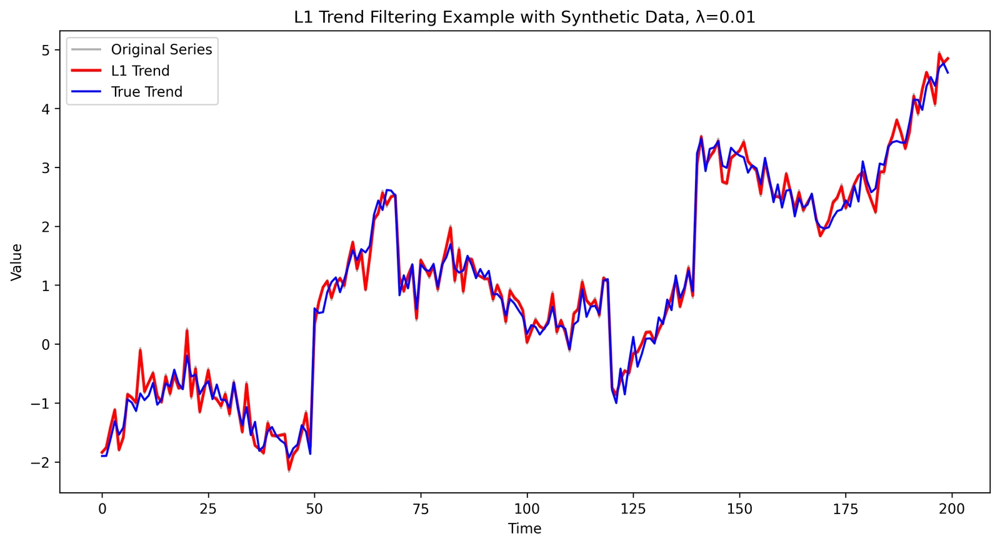

*$\lambda = 0.01$. 추세가 관측값과 거의 같아진다.*

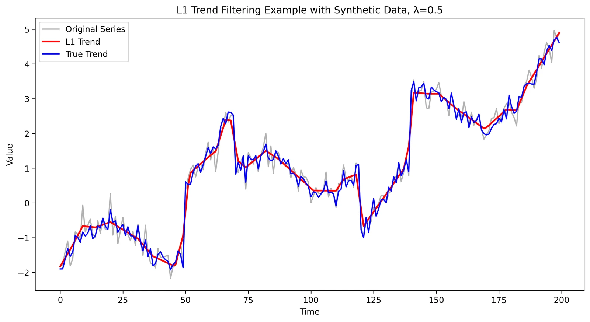

*$\lambda = 0.5$. 추세가 지나치게 매끄러워져 급변 구간의 모서리가 뭉개진다.*

- $\lambda$가 너무 작으면 smoothness 항의 영향이 거의 없어져 추세가 원본과 같아진다. 근접성은 높지만 노이즈를 걸러낸다는 trend filtering의 목적이 사라진다. overfitting이다.
- $\lambda$가 너무 크면 sparsity가 지나치게 강해져 추세가 과도하게 smoothing되고, abrupt change를 제대로 반영하지 못한다. underfitting이다.

따라서 L1 trend filtering을 쓰려면 데이터마다 적절한 $\lambda$를 직접 찾아야 한다. $\lambda$를 고르는 방법을 다룬 연구(Yamada and Yoon, 2016)도 있어 읽을 자료로 남겨 두었다.

### 한계 3. $\lambda$ 하나로 전 구간의 smoothness를 정한다

시계열에서는 구간(sub-sequence)마다 노이즈의 수준이 다를 수 있다. 이를 확인하려고 $t = 100$을 기준으로 앞쪽은 표준편차 0.1의 노이즈만 두고, 뒤쪽에는 그보다 훨씬 큰 노이즈를 넣었다.

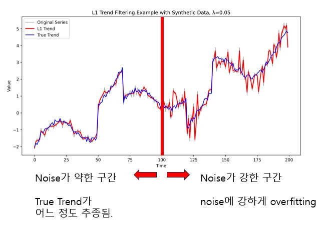{ width="620" }

*$\lambda = 0.05$. 노이즈가 약한 앞 구간은 실제 추세를 어느 정도 따라가지만, 노이즈가 강한 뒤 구간은 노이즈에 맞춰진다.*

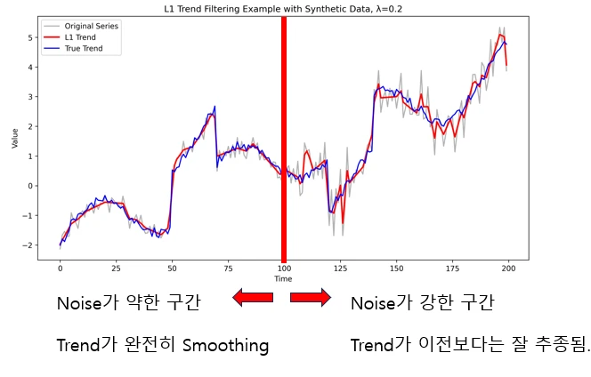{ width="620" }

*$\lambda = 0.2$. 뒤 구간은 전보다 추세를 잘 따라가지만, 앞 구간은 더 매끄러워진다.*

뒤 구간의 overfitting을 없애려고 $\lambda$를 키우면 뒤 구간은 나아지지만, 노이즈가 약한 앞 구간에는 필요 이상의 smoothing이 걸려 abrupt change가 흐려진다. $\lambda$를 어떻게 잡아도 $t = 100$을 경계로 trade-off가 생긴다.

DTF-net 논문은 전 구간에 같은 수준의 smoothing이 걸리는 현상을 constant smoothness라고 부른다. 논문은 이를 이차 차분의 제곱합에서 오는 문제로 설명하는데, 위 실험처럼 $\lambda$ 하나가 전 구간에 똑같이 적용된다는 점에서 L1 trend filtering도 같은 문제를 가진다고 판단했다. 이 해석이 논문의 의도와 맞는지는 확인이 필요한 질문으로 남겼다.

### 한계 4. delayed detection

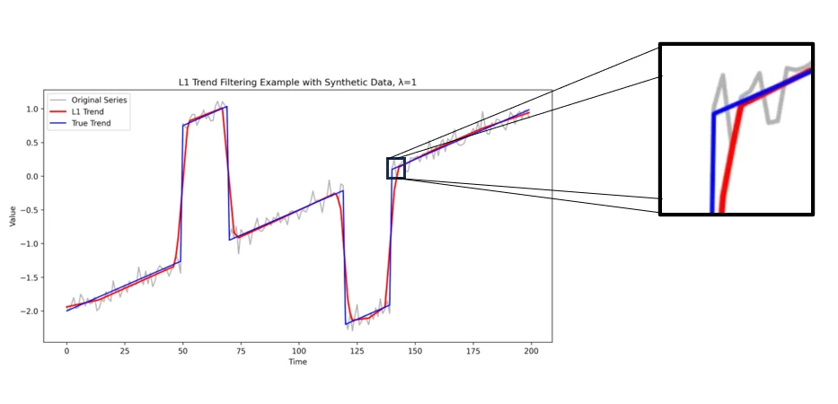{ width="760" }

*$\lambda = 1$. 직선 추세에 수준 변화만 넣은 데이터다. 확대한 부분에서 빨간 선(L1)이 실제 추세(파란 선)보다 늦게 새 수준에 도달한다.*

HP filter와 L1 trend filtering은 모두 이차 차분, 즉 곡률에 penalty를 준다. 추세가 갑자기 뛰는 지점은 곡률이 매우 큰 지점이므로 이 penalty가 급변 자체를 완만하게 만든다. 그 결과 추출된 추세는 실제 변화 시점보다 조금 늦게, 비스듬하게 새 수준에 도달한다. 이는 L1 trend filtering만의 문제가 아니라 이차 차분으로 smoothness를 얻는 방법 전체의 문제다.

### 네 가지를 묶으면

한계 2, 3, 4는 모두 "$\lambda$가 정하는 고정된 smoothness"에서 나온다. 한 시계열 안에서도 구간마다 통계적 특성이 다른데, 하나의 값으로 전체를 똑같이 다루기 때문이다. 그래서 구간마다 통계적 특성을 보고 smoothing의 정도를 다르게 정하는 방법이 필요했고, 이것이 DTF-net의 출발점이라고 이해했다.

한계 1에 대해서는 생각이 달랐다. DTF-net도 에이전트가 학습한 policy로 점을 고르기 때문에, 고른 점이 항상 abrupt change이고 노이즈가 아니라고 확신할 수는 없다. L1 trend filtering보다 낫다고 해도 이 문제에서 자유롭지는 않을 것이라고 보았다.

## 5. DTF-net과의 합성 데이터 비교

### DTF-net이 다른 점

DTF-net은 시계열에서 추세를 이루는 점(trend point)을 강화학습 에이전트가 직접 고르고, 고른 점 사이를 선형 보간해 추세를 만든다. 자세한 구조는 [DTF-net 코드 분석](02-dtfnet-code-analysis.md)에 정리했다. 4절의 한계와 연결하면 다음 두 가지가 기대되는 장점이다.

- 어느 점을 남길지를 구간의 상태를 보고 정하므로, smoothing의 정도가 구간별로 달라질 수 있다(dynamic trend filtering). 한계 3에 대응한다.
- 실제 데이터 포인트를 추세의 꼭짓점으로 삼으므로, 논리적으로는 급변 지점이 늦게 잡힐 이유가 없다. 한계 4에 대응한다.

논문은 길이 1,000의 합성 신호에 abrupt change 11개를 넣고 표준편차 0.2의 Gaussian 노이즈를 더해 여러 방법을 비교한다. 이 실험을 내 데이터로 다시 해 보고 싶었다. 확인하려던 것은 세 가지다.

1. 구간마다 노이즈 수준이 다를 때 DTF-net은 L1 trend filtering보다 잘 걸러내는가?
2. 두 방법 중 어느 쪽이 abrupt change를 더 잘 잡는가?
3. DTF-net에서는 delayed detection이 생기지 않는가?

실험 전의 예상도 적어 두었다. 노이즈가 전 구간에서 균일하다면, 그 노이즈에 맞는 $\lambda$ 하나만 찾으면 되므로 L1 trend filtering이 불리할 이유가 없다. 이 경우 DTF-net이 L1 trend filtering보다 못하게 나와도 이상한 일은 아니라고 생각했다.

### 데이터

실제 벤치마크 데이터의 모양을 빌려 합성 데이터를 만들었다. ETTh1과 Exchange Rate를 살펴보았는데, Exchange Rate는 값의 scale이 너무 작아 노이즈를 섞기 어려워 ETTh1을 썼다.

- ETTh1에서 길이 1,000의 구간을 잘라 window 20의 이동 평균을 구하고, 이를 실제 추세(true trend)로 삼았다. 길이는 논문의 합성 데이터 실험을 따랐다.
- 여기에 Gaussian 노이즈를 더한 것을 관측값으로 삼았다.
- L1 trend filtering과 DTF-net의 결과를 각각 실제 추세와 겹쳐 그려 비교했다.

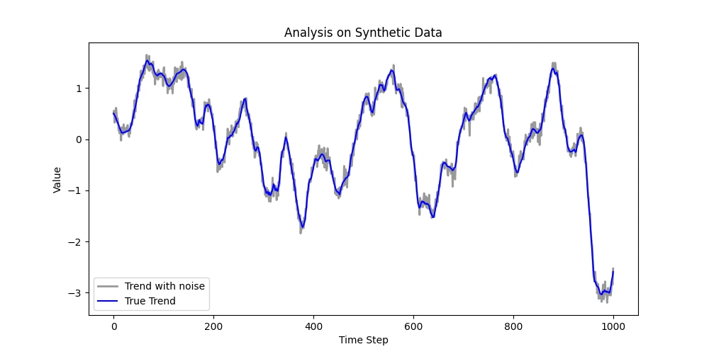{ width="720" }

*표준화한 실제 추세(파란 선)와 표준편차 0.1의 노이즈를 더한 관측값(회색).*

### 표준화를 두 번 하는 함정

이 비교에서 가장 오래 걸린 부분은 scale을 맞추는 일이었다.

처음에는 내가 표준화한 데이터를 DTF-net에 그대로 넣었다. 그러자 DTF-net이 뽑은 추세가 입력값의 범위를 벗어나는 결과가 나왔다.

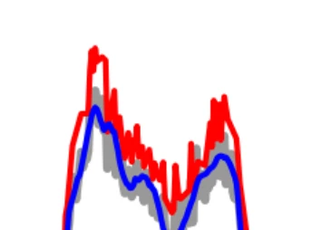{ width="260" }

*확대한 모습. 빨간 선(DTF-net)이 회색 관측값보다 위에 있다.*

DTF-net은 원본의 점을 골라 그 사이를 잇는 방식이므로 추세가 원본 값의 범위를 넘을 수 없다. 원인을 찾아보니 DTF-net의 데이터 로더가 내부에서 `StandardScaler`로 표준화를 한 번 더 하고 있었다. 이미 표준화한 데이터를 다시 표준화하면서 출력과 비교 대상의 scale이 어긋난 것으로 추정했다.

그래서 이번에는 표준화하지 않은 원래 scale의 데이터를 저장해 넣어 보았다(시드 2025, 노이즈 표준편차 0.3, 데이터의 표준편차는 약 3.9).

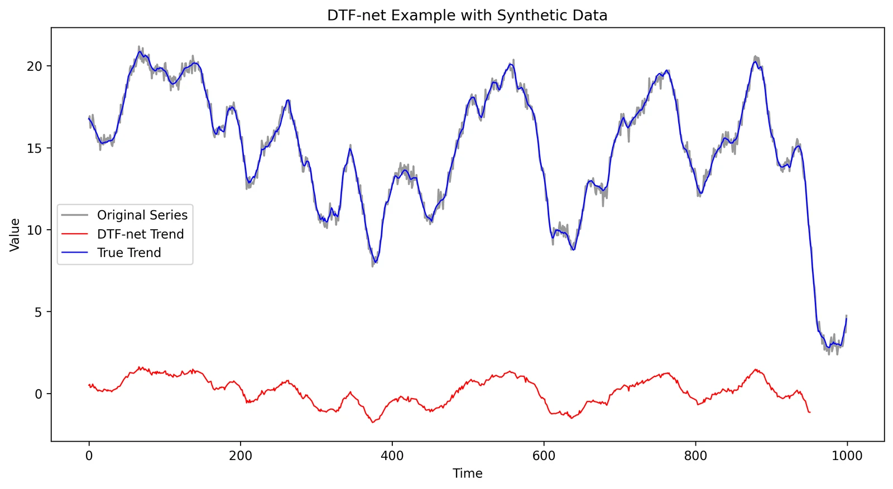

*원래 scale의 관측값과 실제 추세(위), 표준화된 scale로 나온 DTF-net의 추세(아래 빨간 선).*

DTF-net의 출력은 표준화된 scale이고 실제 추세는 원래 scale이라 아예 비교가 되지 않았다. 최종적으로 다음과 같이 정리했다.

1. 실제 추세를 가장 먼저 표준화한다.
2. 표준화한 추세에 노이즈를 더한다. 표준화하면 표준편차가 1이므로, 현실적인 수준이 되도록 노이즈의 표준편차는 0.1로 잡았다.
3. DTF-net의 데이터 로더에서는 scaling을 끈다(`scale=False`).

이렇게 하면 실제 추세, 관측값, 두 방법의 출력이 모두 같은 scale에 놓인다. 처음에 썼던 표준편차 0.2는 표준화한 데이터에 비해 지나치게 큰 노이즈였다는 것도 이 과정에서 알았다.

### 노이즈가 균일할 때

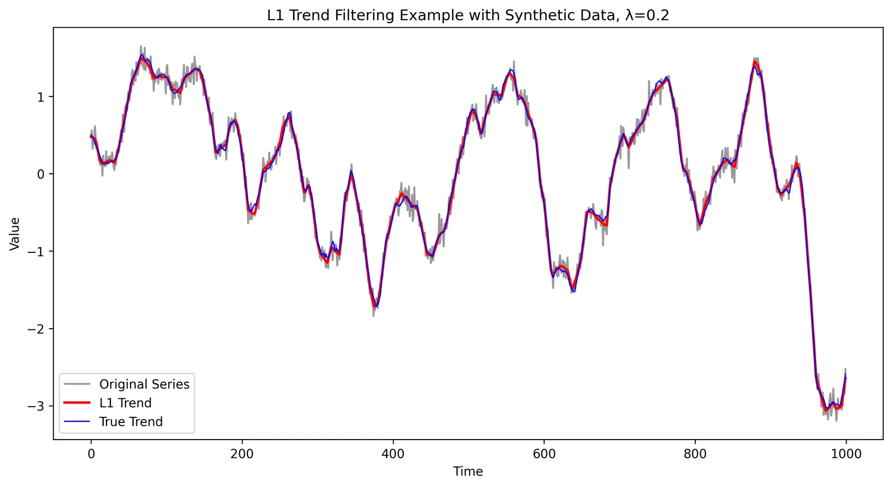

*L1 trend filtering($\lambda = 0.2$).*

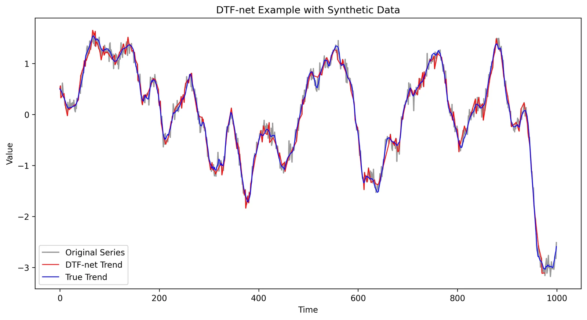

*DTF-net.*

- L1 trend filtering은 곡선으로 휘는 부분은 완전히 따라가지 못하지만, 직선에 가까운 부분은 전반적으로 잘 맞춘다. 전 구간의 노이즈가 같으니, 그 노이즈에 맞는 $\lambda$를 찾으면 실제 추세를 잘 따라가는 것이 당연한 결과다.
- DTF-net은 전체적인 추세는 따라가지만, 곳곳에서 노이즈를 따라 튀는 부분이 보인다.

### 구간마다 노이즈가 다를 때

다음으로 전체를 4등분해 구간별 노이즈의 표준편차를 0.1, 0.2, 0.3, 0.15로 다르게 주었다. 4절의 한계 3을 겨냥한 설정이다.

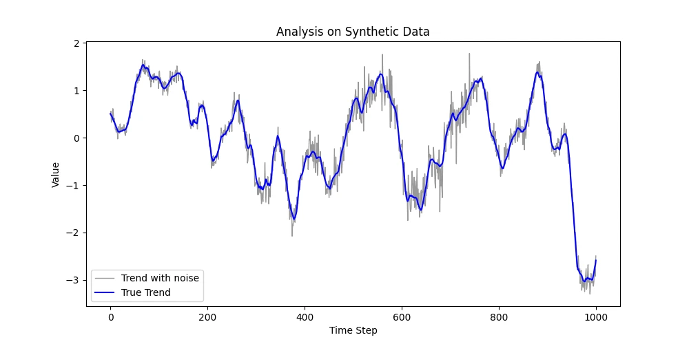{ width="720" }

*구간별로 노이즈 수준이 다른 합성 데이터.*

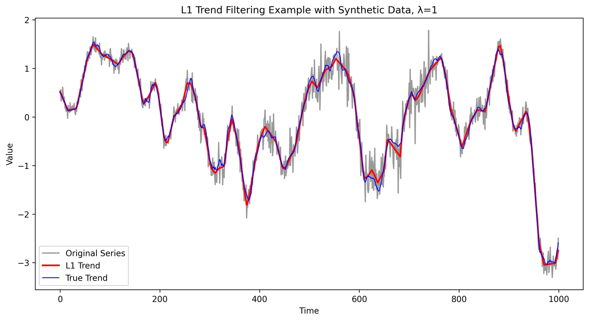

*L1 trend filtering($\lambda = 1$).*

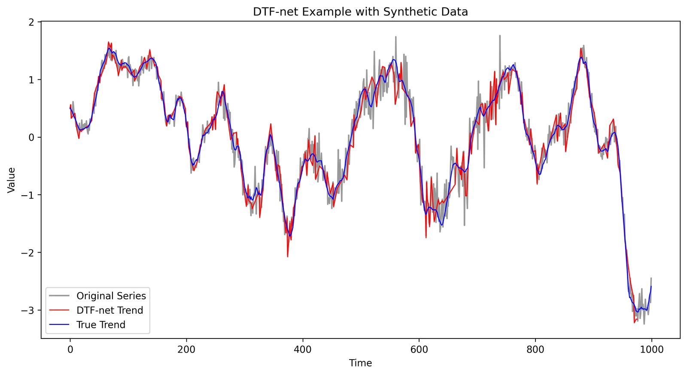

*DTF-net.*

예상과 달랐다.

- L1 trend filtering은 이 데이터에서도 실제 추세를 예상보다 훨씬 잘 맞췄다.
- DTF-net은 노이즈가 큰 구간에서 노이즈를 따라 크게 흔들렸다. 내가 돌린 설정에서는 DTF-net이 L1 trend filtering보다 노이즈에 더 민감했다.

### 해석과 단서

이 결과를 "DTF-net이 L1 trend filtering보다 못하다"로 읽을 수는 없다. 다음 단서가 붙는다.

- **hyperparameter를 맞추지 못했을 수 있다.** DTF-net의 학습 설정(`MAX_LEN`, epoch 수, reward 비율 등)을 이 데이터에 맞게 탐색하지 못했다. 여러 번 학습해 보았지만 좋은 결과를 얻기 어려웠고, 이것이 설정의 문제인지 학습 안정성의 문제인지는 가리지 못했다.
- **정량 비교가 없다.** 추출한 추세와 실제 추세 사이의 MSE, MAE로 비교하는 것까지 생각했지만 수치를 남기지 못했다. 위 판단은 모두 그림을 보고 한 정성적 판단이다.
- **데이터가 하나다.** ETTh1의 한 구간으로 만든 합성 데이터에서만 확인했다.
- **학습과 평가의 구분이 없다.** 길이 1,000의 데이터 하나를 통째로 썼기 때문에 test 구간을 따로 두지 못했다. L1 trend filtering도 주어진 데이터에서 $\lambda$를 바꿔 가며 결과를 보는 방식이므로, 같은 데이터에서 얼마나 잘 걸러내는지를 보는 비교라고 생각했다.
- **내 데이터는 급변 지점에도 노이즈가 섞여 있다.** 논문의 합성 데이터는 abrupt change 지점에 노이즈가 별로 없어 보이는데, 내가 만든 데이터는 그렇지 않다. 이 차이가 결과에 영향을 주었을 수 있다.

결과를 보면서 생각이 바뀐 부분도 있다. 직선에 가까운 구간에서는 노이즈가 아무리 달라도 smoothing만 하면 대체로 잘 맞아 보인다. 문제가 되는 것은 abrupt change가 있는 자리에 노이즈가 있을 때, 그 지점이 제대로 잡히느냐다. L1 trend filtering의 문제는 abrupt change를 못 잡는 것이 아니라, 그 지점의 노이즈가 현재 $\lambda$로 걸러질 수 있는 수준이 아닐 때 제대로 잡지 못한다는 것이다. 그렇다면 구간별 노이즈 수준만 바꾼 이번 실험은 한계 3을 드러내기에 충분한 설계가 아니었다. abrupt change의 위치를 직접 정해 둔 데이터로 다시 비교해야 했다.

정리하면 DTF-net의 장점은 "어떤 데이터에서든 abrupt change를 더 잘 잡는다"가 아니라, 방법의 구조상 구간별로 smoothing을 다르게 할 수 있고 급변 지점을 직접 고르므로 지연이 생기지 않을 수 있다는 데 있다. 다만 그 구조가 실제로 그렇게 동작하려면 policy가 잘 학습되어야 하고, 학습된 policy가 새로운 데이터에서도 같은 지점을 고른다는 보장은 따로 확인해야 한다.

논문의 실험에 대해서도 의문이 남았다. 논문의 합성 데이터 비교 표는 설명을 읽어 보면 노이즈가 더해진 신호와의 오차, 즉 원본과의 근접성을 재는 것으로 이해된다. 근접성이 높다는 것과 실제 추세를 잘 복원했다는 것은 다른 문제다. 근접성만 보면 $\lambda$를 아주 작게 잡아 원본을 그대로 따라가는 쪽이 유리하기 때문이다. 한편 abrupt change가 있는 구간에서 근접성이 높다는 것은 그 변화를 노이즈로 취급해 깎아내지 않았다는 뜻이므로, 그 자체로 의미 있는 검증이라는 점은 납득했다.

## 6. 정리

- HP filter와 L1 trend filtering의 차이는 이차 차분에 L2 penalty를 주느냐 L1 penalty를 주느냐뿐이다. L1 penalty는 작은 곡률을 정확히 0으로 만들어 조각별 직선 추세를 만들고, 살아남은 kink가 abrupt change의 후보가 된다.
- 합성 데이터에서 HP filter는 $\lambda$를 낮춰도 급변을 급변으로 표현하지 못했고, L1 trend filtering은 꺾임으로 표현했다.
- L1 trend filtering의 한계는 노이즈를 kink로 판단할 수 있다는 것, $\lambda$에 따라 overfitting과 underfitting을 오간다는 것, $\lambda$ 하나로 전 구간의 smoothness가 정해진다는 것, 급변을 늦게 잡는다는 것이다. 뒤의 셋은 고정된 smoothness라는 하나의 원인으로 묶인다.
- ETTh1로 만든 합성 데이터에서 L1 trend filtering과 DTF-net을 비교했을 때, 내가 돌린 설정에서는 DTF-net이 노이즈에 더 민감했다. 설정 탐색과 정량 평가가 빠져 있어 결론으로 삼을 수는 없다.
- 비교 실험에서 실제로 얻은 것은 scale을 맞추는 절차였다. 실제 추세를 먼저 표준화하고, 노이즈를 더하고, 모델 내부의 scaling을 끈다.

## 남았던 질문과 답

공부할 당시에는 풀지 못하고 남겨 둔 질문들이다. 글을 정리하면서 답을 찾아 덧붙였다. DTF-net에 관한 답은 논문의 4.1절과 Table 1을 다시 읽고 확인한 것이다.

**Q. 논문의 합성 데이터 비교에서 실제 추세와의 오차는 왜 보고되지 않는가?**

논문이 적어 둔 것은 무엇을 재는지와 그 기준이다. 논문은 추세의 ground truth를 정의하기 어렵다는 점을 먼저 들고, MSE와 MAE로 "원본과의 근접성(proximity to the original data)"을 잰다고 적는다. 비교 기준으로는 노이즈를 더한 신호를 쓰며, 그 목적은 노이즈가 있는 데이터에서의 강건성을 보는 것이라고 한다. 5절에서 표를 "노이즈가 더해진 신호와의 오차"로 읽은 것은 논문의 서술과 맞다. 원본을 그대로 따라가는 방법이 유리해지는 문제에 대해서는 "노이즈의 10% 이상을 걸러내야 smoothness가 확인된다"는 가정을 따로 둔다. 노이즈를 더하기 전 신호와의 오차를 보고하지 않은 이유는 논문에 적혀 있지 않다.

**Q. 논문의 합성 데이터는 어떤 절차로 만들어졌는가? abrupt change 11개는 어떤 기준으로 정해졌는가?**

논문에 적힌 것은 다음이 전부다. 길이 1,000의 합성 추세 신호를 만들고 abrupt change 11개를 넣는다. 예로 든 것은 세 종류다. 시점 100과 800 부근에서 각각 $-2$와 $-5$ 근처로 떨어지는 급락, 시점 500에서 700 사이에 분산이 큰 채로 평균이 0에서 4로 옮겨 가는 mean shift, 시점 800에서 1000까지 한 주기를 도는 사인파다. 여기에 표준편차 0.2의 Gaussian 노이즈를 더한다. 합성 데이터를 쓰는 이유는 실제 데이터에서는 추세의 ground truth를 정하기도, abrupt change에 label을 붙이기도 어렵기 때문이라고 한다. 부분 구간 평가는 label을 붙인 abrupt change 주변의 30-window에서 한다. 11개 각각의 위치와 그것을 정한 기준은 본문에 없고, 공개 저장소에서도 합성 데이터를 만드는 코드는 찾지 못했다.

**Q. 노이즈가 전 구간에서 균일한 합성 데이터에서 DTF-net이 L1 trend filtering보다 나은 이유는 무엇인가?**

표를 다시 보면 질문의 전제부터 고쳐야 한다. Table 1의 전체 구간 MSE는 $\ell_1$($\lambda = 0.1$)이 0.0461, $\ell_1$($\lambda = 5 \times 10^{-4}$)이 0.0004, DTF-net이 0.0289다. DTF-net은 $\lambda = 0.1$인 경우보다는 원본에 가깝지만, $\lambda$를 아주 작게 둔 경우보다는 멀다. 논문은 뒤의 경우를 노이즈에 overfitting된 것으로 분류하고, $\ell_1$이 $\lambda$에 민감하다는 근거로 든다. 논문의 주장은 "overfitting되기 쉬운 방법을 제외하면 DTF-net이 가장 좋다"이다. 그리고 앞의 답대로 이 표가 재는 것은 노이즈가 섞인 신호와의 근접성이다. "노이즈가 균일하면 맞는 $\lambda$ 하나를 찾은 L1이 불리할 이유가 없다"는 내 예상은 노이즈를 걷어 낸 추세를 얼마나 잘 복원하는가에 대한 것이어서, 이 표와는 재는 대상이 다르다. 두 가지가 서로 모순되는 것은 아니다.

**Q. delayed detection을 두 방법 사이에서 어떻게 정량적으로 비교할 수 있는가?**

변화 시점을 아는 합성 데이터가 있으면 두 가지 방식으로 잴 수 있다. 첫째는 도달 시간이다. 시점 $\tau$에서 수준이 $a$에서 $b$로 뛰는 데이터에서, 추출한 추세 $\hat{x}$가 새 수준에 충분히 가까워지는 첫 시점과 $\tau$의 차이를 지연으로 정의한다.

$$
\text{delay} = \min\{\, t \ge \tau : \lvert \hat{x}_t - b \rvert \le \epsilon \lvert b - a \rvert \,\} - \tau
$$

예를 들어 $\epsilon = 0.1$로 두고, 노이즈의 seed를 바꿔 가며 평균을 낸다. L1 trend filtering은 전체 데이터를 한 번에 보는 방법이라 비스듬한 구간이 $\tau$보다 앞에서 시작되기도 하므로, 추세가 옛 수준에서 벗어나기 시작하는 시점도 같은 방식으로 함께 재야 한다. 둘째는 위치 오차다. L1 trend filtering의 kink(이차 차분이 0이 아닌 시점)나 DTF-net의 DTP 가운데 $\tau$에 가장 가까운 것까지의 거리를 잰다. 변화점 탐지에서 탐지 지연이나 위치 오차를 재는 방식과 같다. 두 방법 모두 추세를 내놓으므로 첫째 방식이 더 공정하고, 둘째 방식은 "어느 점을 골랐는가"를 따로 볼 때 쓸 수 있다.

**Q. "왜 이 지점이 abrupt change인가"를 설명하는 방법이 있는가?**

L1 trend filtering 쪽은 최적성 조건으로 설명할 수 있다. Kim et al.(2009)에 따르면 $x$가 최적해일 필요충분조건은 다음을 만족하는 $\nu \in \mathbb{R}^{n-2}$가 존재하는 것이다.

$$
y - x = D^{\top}\nu, \qquad
\nu_t = +\lambda \ \text{if } (Dx)_t > 0, \quad
\nu_t = -\lambda \ \text{if } (Dx)_t < 0, \quad
\nu_t \in [-\lambda, \lambda] \ \text{if } (Dx)_t = 0
$$

$y - x = D^{\top}\nu$를 풀어 쓰면 잔차가 $\nu$의 이차 차분이라는 뜻이므로, $\nu_t$는 잔차 $y - x$를 처음부터 두 번 누적한 값이다. 따라서 조건은 이렇게 읽힌다. 두 번 누적한 잔차는 항상 $[-\lambda, \lambda]$ 안에 있어야 하고, 추세는 그 값이 정확히 $\pm\lambda$에 닿는 시점에서만 꺾일 수 있다. "여기서 꺾지 않으면 누적된 잔차가 $\lambda$를 넘는다"가 그 지점이 선택된 이유다. 2절에서 와닿지 않는다고 적었던 $\lambda_{\max} = \lVert (DD^{\top})^{-1}Dy \rVert_\infty$도 같은 조건에서 나온다. 직선 하나로 맞췄을 때의 누적 잔차가 어디에서도 $\lambda$를 넘지 않으면 꺾을 이유가 없으므로 추세가 정확히 best affine fit이 된다. 다만 이것은 지점이 선택되는 기계적인 조건이다. 그 꺾임이 노이즈 때문인지 실제 변화 때문인지를 가려 주지는 않는다.

### 아직 남은 질문

- 논문이 노이즈를 더하기 전 신호와의 오차를 보고하지 않은 이유, abrupt change 11개를 정한 기준은 논문에 적혀 있지 않다. 공개 코드로 합성 실험을 재현해 두 가지 오차를 모두 계산해 보면 결과는 직접 확인할 수 있다.
- 내가 만든 합성 데이터에서 DTF-net이 L1 trend filtering보다 노이즈에 민감했던 것이 설정 탓인지는 여전히 모른다. 5절에 적은 대로 설정 탐색과 정량 평가를 갖춘 뒤에야 말할 수 있다.
- 위에서 정의한 지연을 실제로 재 보지는 않았다. 수준 변화의 위치를 정해 둔 합성 데이터에서 두 방법의 지연을 재는 실험이 남아 있다.
- DTF-net이 고른 지점에 대해서는 L1의 최적성 조건에 해당하는 설명을 찾지 못했다. 학습된 정책이 그 지점에서 action 1을 낸 근거를 입력에서 찾을 수 있는지부터 확인해야 한다.

## 참고 자료

- S.-J. Kim, K. Koh, S. Boyd, D. Gorinevsky, "$\ell_1$ Trend Filtering", SIAM Review, 51(2), 2009. <https://doi.org/10.1137/070690274>
- R. J. Hodrick, E. C. Prescott, "Postwar U.S. Business Cycles: An Empirical Investigation", Journal of Money, Credit and Banking, 29(1), 1997.
- "Towards Dynamic Trend Filtering through Trend Point Detection with Reinforcement Learning", IJCAI 2024. <https://arxiv.org/abs/2406.03665>
- H. Yamada, G. Yoon, "Selecting the tuning parameter of the $\ell_1$ trend filter", Studies in Nonlinear Dynamics & Econometrics, 20(1), 2016. <https://doi.org/10.1515/snde-2014-0089>
- L1 trend filtering을 공부하며 참고한 강의 영상: <https://www.youtube.com/watch?v=MfawcA2Lt6c&t=3069s>
- 혁펜하임, Convex Optimization 강의 재생목록: <https://www.youtube.com/watch?v=E-INcQ4rRVk&list=PL_iJu012NOxeMJ5TPPW1JZKec7rhjKXUy>
