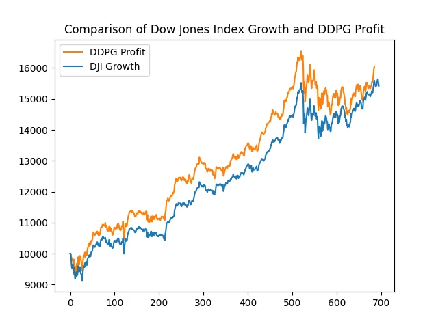
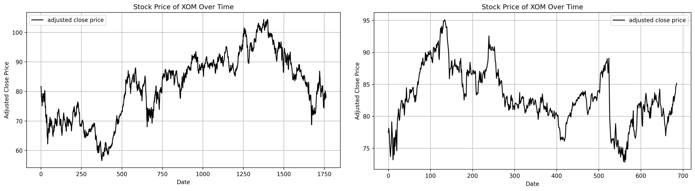
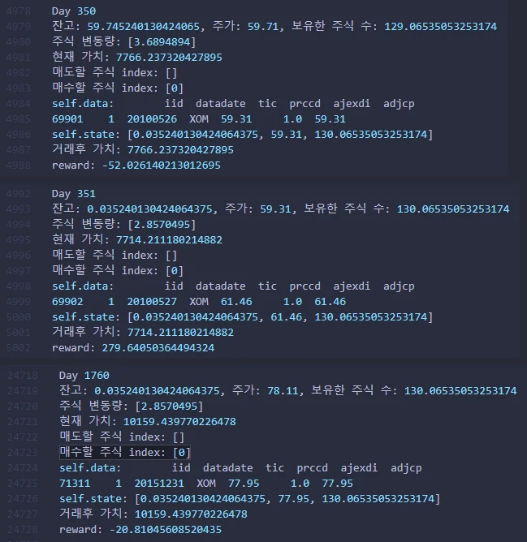
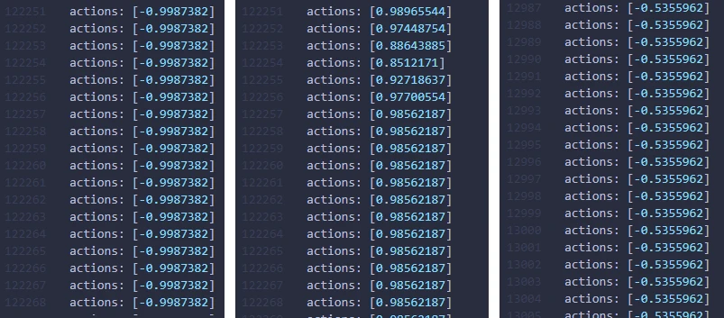
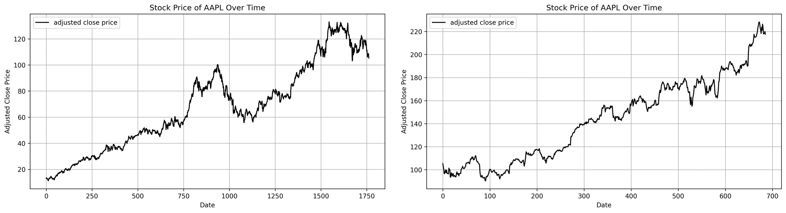
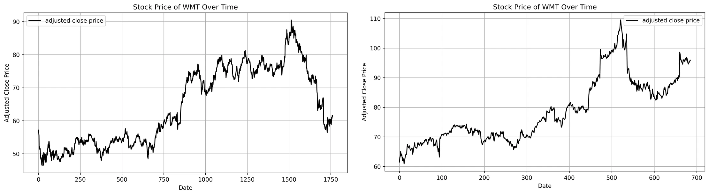
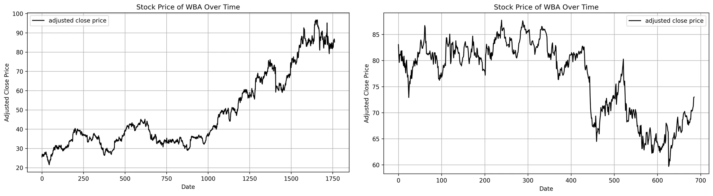

# DDPG 주식 거래 논문 재현과 단일 종목 실험

작성일 2025-03-18 · 최종 수정일 2025-03-22
{ .post-date }

강화학습으로 시계열의 변화점(change point)을 잡을 수 있다면 그것은 왜 가능한가. 이 질문에 실험으로 접근해 보려고, DDPG로 주식을 거래하는 논문 "Practical Deep Reinforcement Learning Approach for Stock Trading"을 재현하고 환경을 단일 종목용으로 바꾸어 agent가 사고파는 시점을 관찰하려 했다.

결론부터 적으면 재현은 되었지만 단일 종목 실험은 실패했다. agent는 변화점에서 사고파는 것을 배우지 못했고, 처음부터 끝까지 사기만 하거나 팔기만 하는 policy로 수렴했다. 이 글은 그 과정과 실패의 원인으로 추정한 것들을 기록한 것이다.

| 날짜 | 한 일 |
|---|---|
| 2025-03-10 | 논문을 읽고 요약했다 |
| 03-18 ~ 03-19 | 실행 환경을 만들고, 공개 코드를 분석하고, 논문의 설정을 재현했다 |
| 03-19 ~ 03-20 | 환경을 단일 종목용으로 바꾸었다. 학습이 되지 않아 parameter noise를 조사하고, 여러 설정과 시드, 다른 종목으로 실험한 뒤 문제를 정리했다 |
| 03-22 | 실패 원인과 이론적 배경, 이후 계획을 정리했다 |

## 1. 출발점: 강화학습은 어떻게 변화점을 잡는가

인턴으로 있던 연구실의 선행 연구인 DTF-net은 강화학습 agent가 시계열에서 추세를 이루는 점을 고르게 하는 방법이다([논문 리뷰](../../papers/2024-12-29-dtf-net.md), [코드 분석](02-dtfnet-code-analysis.md)). 이 연구를 공부하면서 풀지 못한 질문이 하나 있었다.

> 강화학습은 어떻게 주요 변곡점(abrupt change)을 잡아낼 수 있는가?

이 질문과 주식 거래를 다음과 같이 연결했다.

- 주식 거래는 시계열 데이터를 MDP로 모델링한 대표적인 문제다. FinRL-Meta 같은 벤치마크가 이를 다룬다.
- 주식을 거래할 때 최적의 거래 시점은 abrupt change나 extreme value와 같다고 볼 수 있다. 가장 낮은 전환점에서 사고 가장 높은 지점에서 파는 것이 이상적이기 때문이다.
- 강화학습은 agent의 action 예측으로 거래 시점을 정하는 대표적인 방법이다. 이와 비슷하게, 추세 필터링에서도 꼭 필요한 점을 agent가 잡아내게 하려는 것이다.

여기서 다음 가설을 세웠다.

!!! note "가설"

    주식 거래에서 optimal trading point를 잡는 것은 change point를 잡는 것과 일치한다. 상승 직전에 사고 하락 직전에 파는 것이 이상적이기 때문이다. 따라서 agent는 학습을 통해 change point를 매수와 매도 시점으로 삼아 reward를 극대화할 것이다.

확인하려는 것은 이렇다. 학습이 어느 정도 된다면, 종목 하나에 대해 agent가 거래하는 시점이 달라질 때마다 reward가 어떻게 바뀌는지 볼 수 있다. 어떤 지점을 잡을 때 수익이 극대화되는지 관찰하고, 그 지점이 변화점 부근인지 확인한다.

## 2. 재현 대상 논문

### 요약

"Practical Deep Reinforcement Learning Approach for Stock Trading"은 주식 거래를 MDP로 모델링하고 DDPG로 거래 전략을 학습한다.

| MDP 요소 | 정의 |
|---|---|
| State | 주식 가격, 종목별 보유 수량, 잔고 |
| Action | 종목별 매도, 유지, 매수. 매도하면 보유 수량이 줄고 매수하면 늘어난다. 잔고가 음수가 되는 매수는 할 수 없다 |
| Reward | 포트폴리오 자산 가치의 변화 |
| 목표 | 특정 시점의 투자 수익 극대화 |

- 데이터는 Dow Jones 30 종목의 일별 가격이다. 2009 ~ 2014년을 학습, 2015년을 검증, 2016 ~ 2018년을 거래(테스트)에 쓴다.
- 비교 대상은 Dow Jones Industrial Average(DJIA)와 Min-Variance Portfolio Allocation이다.
- 평가 지표는 최종 포트폴리오 가치, 연환산 수익률(annualized return), 연환산 표준 오차, Sharpe ratio다. Sharpe ratio는 무위험 수익률을 넘는 초과 수익을 변동성으로 나눈 값으로, 위험 대비 수익을 나타낸다.

논문이 보고한 결과는 다음과 같다.

| | DDPG | DJIA | Min-Variance |
|---|---|---|---|
| 연환산 수익률 | 25.87% | 16.40% | 15.93% |
| Sharpe ratio | 1.79 | 1.27 | 1.45 |

초기 자산 10,000달러는 DDPG에서 19,791달러가 되었다고 보고한다.

### 왜 DDPG인가

논문이 DDPG를 쓰는 이유는 다음과 같이 이해했다.

- 주가는 매우 다양한 값을 가질 수 있어 state space가 지나치게 크다. 이를 모두 다루며 모델링하기 어렵다.
- Actor-Critic 구조로 Q function과 policy를 모두 parameterize해 큰 state space와 action space에 대처한다.
- Target Network로 학습을 안정시킨다.
- Replay Buffer로 표본을 재사용하고 표본 사이의 상관관계를 줄인다.

DDPG 자체는 [강화학습 시리즈의 DDPG 글](../../study/reinforcement-learning/06-ddpg.md)에 정리했다.

## 3. 재현

### 실행 환경

공개된 코드는 OpenAI Baselines의 DDPG 구현 위에 주식 거래용 Gym 환경(`RLStock-v0`)을 얹은 것이다. Python 3.7과 TensorFlow 1.14로 환경을 만들었다. 먼저 Baselines에 들어 있는 Pong 예제를 돌려 설치를 확인한 뒤 주식 환경으로 넘어갔다.

```shell
python -m baselines.run --alg=ddpg --env=RLStock-v0 --network=mlp --num_timesteps=2e4 --play
```

`--play`를 주면 학습이 끝난 뒤 테스트까지 이어서 수행한다. 처음에는 데이터 전처리 단계에서 오류가 나 실행되지 않았고, 데이터 파일을 바로잡은 뒤에야 학습과 테스트 결과 그림이 정상적으로 나왔다. GPU는 버전이 맞지 않아 쓰지 못했지만 CPU로도 충분히 빨랐다.

### 코드에서 확인한 설정

코드를 읽고 값을 직접 출력해 보며 확인한 내용이다.

| 항목 | 내용 |
|---|---|
| 종목 | 28개. 날짜마다 28개 종목의 데이터가 모두 있는 것을 확인했다 |
| 가격 | 수정 종가(종가를 조정 계수로 나눈 값). 주식 분할과 배당을 반영한다 |
| 학습 데이터 | 2009년부터 2015년까지, 1,762 거래일 |
| 테스트 데이터 | 2016년 이후, 686 거래일 |
| State | 잔고 1개 + 종목별 수정 종가 28개 + 종목별 보유 수량 28개 = 57차원 |
| Action | 28차원, 범위 $[-5, 5]$. 종목마다 한 번에 최대 5주를 사거나 판다 |
| Reward | 한 step 전후의 총 자산(잔고 + 가격 × 보유 수량) 차이 |
| 초기 자산 | 10,000달러 |
| Actor | MLP |

- 논문에는 검증 구간(2015년)이 있지만, 코드에서는 검증을 없애고 2015년까지를 학습에 쓰고 있었다.
- action이 음수인 종목을 먼저 팔고 양수인 종목을 그다음에 산다. 보유 수량보다 많이 팔라는 action이 나오면 가진 만큼만 팔고, 잔고보다 많이 사라는 action이 나오면 살 수 있는 만큼만 산다.
- episode 하나는 학습 데이터 전체를 처음부터 끝까지 한 번 지나는 것이다(1,761 step).
- 전체 학습 길이는 20,000 timestep이다. 1,761 × 11 < 20,000 < 1,761 × 12이므로 온전한 episode는 11번이고, 12번째는 도중에 끊긴다. episode가 끝날 때마다 저장되는 자산 그래프도 11장이었다.

### 결과

시드를 42로 고정하고 같은 설정으로 두 번 실행했다. 두 번 모두 테스트 구간의 최종 자산이 16,049.99달러로 소수점 아래까지 같았다. 시드를 고정하면 결과가 재현된다는 것을 확인했다.

{ width="560" }

*테스트 구간(2016년 이후)에서 DDPG agent의 자산(주황)과 Dow Jones 지수를 같은 금액으로 환산한 값(파랑). 가로축은 거래일이다.*

두 선 모두 10,000달러에서 출발한다. 파란 선은 같은 돈을 지수에 넣어 두기만 했을 때의 값이므로, 주황 선이 파란 선보다 위에 있으면 agent의 거래가 지수를 그냥 들고 있는 것보다 나았다는 뜻이다. 주황 선은 초반을 지난 뒤로 대부분의 구간에서 파란 선 위에 있고, 끝으로 갈수록 두 선의 간격이 좁아진다.

코드는 논문에서 소개한 대로 동작했다. 여기까지가 재현이다.

## 4. 단일 종목 환경으로 전환

### 왜 종목을 하나로 줄였는가

처음에는 28개 종목을 그대로 두고 그중 한 종목의 action만 추적하면 되지 않을까 생각했다. 그러나 종목이 여러 개이면 결과가 바뀌어도 그것이 정말 특정 종목의 거래 때문인지 알기 어렵다. 한 종목의 action 하나가 바뀐 것을 추적해도, 같은 날 다른 종목을 팔아서 자산이 줄었을 수도 있기 때문이다. 어느 지점을 잡았을 때 reward가 달라지는지 비교하려면 종목이 하나여야 통제할 수 있다고 판단했다.

### 종목 선택

변동성이 큰 종목일수록 좋은 시점을 잡았는지 여부가 결과에 뚜렷이 드러날 것이라고 생각했다. 일별 수익률의 표준편차로 고르는 방법도 생각했지만, 우선 28개 종목을 종목별로 나누어 저장하고 그래프로 그려 눈으로 확인했다. 시스코(CSCO), 엑손모빌(XOM), 쉐브론(CVX)의 변동이 커 보였고, 그중 엑손모빌로 시작했다.



*엑손모빌(XOM)의 수정 종가. 왼쪽이 학습 구간, 오른쪽이 테스트 구간이다. 학습 구간에서는 60달러 아래까지 내려갔다가 100달러를 넘고 다시 80달러 부근으로 돌아온다. 한 방향으로만 가지 않고 오르내림이 여러 번 있다.*

이런 모양이라면 "쌀 때 사서 비쌀 때 판다"가 성립할 지점이 여러 군데 있다. Agent가 시점을 고르는 법을 배운다면 그 지점들에서 매수와 매도가 갈릴 것이라고 기대했다.

### 바꾼 것

기존 코드의 틀은 유지하고 다음만 바꾸었다.

| | 기존 (28 종목) | 변경 (1 종목) |
|---|---|---|
| 데이터 | 28개 종목 | 전처리에서 한 종목만 남김 |
| State | [잔고, 가격 × 28, 보유 수량 × 28], 57차원 | [잔고, 가격, 보유 수량], 3차원 |
| Action | [매수/매도량 × 28], 28차원 | [매수/매도량], 1차원 |

그 밖에 관찰을 위해 다음을 추가했다.

- 매 step의 action, 잔고, 가격, 보유 수량, reward를 출력한다.
- 기존 코드는 학습 중 자산 그래프를 같은 파일에 덮어써서 마지막 episode의 것만 남았다. episode마다 다른 이름으로 저장하도록 바꾸었다.
- 테스트 환경도 같은 방식으로 바꾸고 action의 이력을 기록한다.

### 첫 결과: 사기만 하다가, 팔기만 한다

엑손모빌로 학습시킨 첫 결과는 다음과 같았다. 첫 episode에서 agent는 처음부터 350일째까지 계속 사기만 했고, 잔고가 바닥났다. 그 뒤로도 끝까지 한 번도 팔지 않았다.

| Day | 잔고 | 주가 | 보유 수량 | action | 총 자산 |
|---|---|---|---|---|---|
| 350 | 59.75 | 59.71 | 129.07 | 3.69 | 7,766.24 |
| 351 | 0.04 | 59.31 | 130.07 | 2.86 | 7,714.21 |
| 1760 | 0.04 | 78.11 | 130.07 | 2.86 | 10,159.44 |

*출력한 로그에서 세 시점을 뽑아 소수 둘째 자리까지 적은 것이다. 351일째 이후로는 잔고가 없어 action이 양수여도 거래가 일어나지 않는다.*

{ width="560" }

*위 표의 바탕이 된 실행 화면. 위에서부터 350일째, 351일째, 마지막 날(1760일째)이다. "주식 변동량"이 그날의 action이고, "매도할 주식 index"는 세 시점 모두 비어 있다.*

화면에서 세 줄만 따라가면 된다. 350일째에 59.75달러 남아 있던 잔고가 351일째에는 0.04달러가 되고, 그 값이 1760일째까지 그대로다. 보유한 주식 수도 351일째의 130.07주에서 끝까지 변하지 않는다. 그 사이 action은 2.857로 고정되어 있다. 계속 "사라"고 하지만 살 돈이 없어 아무 일도 일어나지 않는 상태가 1,400일 넘게 이어진 것이다.

그러고 나서 두 번째 episode부터는 반대로 사는 것 자체를 하지 않았다. 이후의 모든 episode, 모든 timestep에서 action이 음수(매도)였다. 보유한 주식이 없으니 매도는 아무 일도 일으키지 않고, 자산은 10,000달러에서 움직이지 않으며, reward는 계속 0이다. 첫 episode에서 계속 사기만 한 경험 때문에, 매수를 해서 음의 reward를 받느니 차라리 매도만 시도하는 쪽으로 학습된 것으로 보였다.

## 5. 원인 찾기: Parameter Noise

### 최대 거래량을 바꿔 보기

28개 종목일 때는 한 번에 최대 28 × 5 = 140주가 거래될 수 있었다. 종목이 하나면 5주뿐이라 수익이 잘 나지 않는 것일 수 있다고 생각해, action의 범위를 키워 보았다. 시드는 2025로 고정했다.

| action 범위 | 최종 자산 (total reward) |
|---|---|
| $(-5, 5)$ | 10,039.93 |
| $(-10, 10)$ | 9,900.54 |
| $(-20, 20)$ | 10,000.00 |
| $(-30, 30)$ | 10,000.00 |
| $(-40, 40)$ | 10,004.25 |
| $(-50, 50)$ | 10,000.00 |

자산이 정확히 10,000달러로 끝나는 경우가 너무 많았다. 주가는 매일 변하므로, 가치가 그대로라는 것은 거래 자체를 하지 않았다는 뜻이다. 거래량의 문제가 아니라 학습이 되지 않는 것이었다. 특히 첫 episode부터 10,000달러로 끝나는 경우가 있어, 탐색(exploration)이 되지 않는다고 의심했다.

### Adaptive parameter noise가 동작하는 방식

DDPG의 policy는 deterministic이므로 exploration은 전적으로 noise에 달려 있다. 코드의 기본 설정은 `noise_type='adaptive-param_0.2'`였다. 밑줄 뒤의 숫자가 noise의 표준편차로 들어간다. 이 noise가 언제, 얼마나 적용되는지 알기 위해 Baselines의 DDPG 코드를 읽었다.

**noise의 두 종류**

| | Action noise | Parameter noise |
|---|---|---|
| 더하는 곳 | agent가 고른 action | actor network의 weight |
| 효과 | 실행할 때마다 무작위로 달라지는 즉각적인 탐색 | policy 자체가 바뀌며, 한번 더해지면 일정 시간 유지된다 |

**학습 루프의 구조**

```text
epoch (10회)
└─ cycle (epoch마다 20회)
   ├─ rollout (cycle마다 100 step): 환경에서 행동하고 transition을 저장
   └─ train: Replay Buffer에서 뽑아 actor와 critic을 갱신
              이때 cycle마다 한 번 parameter noise의 크기를 조정
```

환경에서 100 step을 걸으며 경험을 모으고(rollout), 모은 경험으로 신경망을 고치는(train) 것이 cycle 하나다. 이것을 20번 하면 epoch 하나가 된다. 10 × 20 × 100 = 20,000 timestep이다. episode의 길이가 1,761 step이므로, cycle 17개를 채우고 18번째 cycle의 61번째 rollout 뒤에 환경이 처음으로 reset된다. noise의 크기 조정은 Replay Buffer에 쌓인 transition이 batch 크기보다 많을 때 cycle마다 한 번 수행된다.

**크기를 조정하는 기준**

조정의 기준은 다음 값이다.

```python
self.adaptive_policy_distance = tf.sqrt(tf.reduce_mean(tf.square(self.actor_tf - adaptive_actor_tf)))
```

같은 state를 넣었을 때 noise가 없는 actor의 출력과 noise를 더한 actor의 출력이 얼마나 다른지를 RMS로 잰 것이다. Weight에 더한 noise가 실제 행동을 얼마나 바꾸는지를 재는 자인 셈이다. 설정한 숫자(예: 0.2)는 noise의 초기 표준편차이면서 동시에 이 거리의 목표값이다.

- 거리가 목표값보다 크면 noise가 너무 크다고 보고 표준편차를 줄인다.
- 거리가 목표값보다 작으면 표준편차를 키운다.
- 한 번에 바뀌는 비율은 1%다(계수 1.01).

목표값을 0.5로 두고 출력해 본 예시다.

```text
desired: 0.5
distance: 1.0101988315582275
dec
self.current_stddev: 0.4526434773464916
```

두 policy의 출력 차이가 0.5 정도이길 바라는데 실제로는 1.0이 나왔으므로, noise가 너무 크다고 판단해 표준편차를 줄인 것이다.

### 28 종목 환경에서 noise 바꿔 보기

단일 종목 환경에서 noise를 0.2에서 5로 키워 보았지만, noise의 표준편차만 계속 커질 뿐 달라지는 것이 없었다. 그래서 학습이 되는 28 종목 환경으로 돌아가, noise를 바꾸면 어떤 일이 일어나는지부터 확인했다.

먼저 noise를 크게 키웠다.

- 5.0: total reward는 16,000 수준이었다.
- 10.0: 역시 16,000 수준이었다. 다만 noise의 표준편차가 epoch마다 계속 커졌다.
- 1.0: noise의 표준편차가 계속 줄어들었다.

noise의 크기 자체가 결과를 크게 좌우하지는 않는 것처럼 보였다. 다음으로 noise가 조정되는 주기를 바꾸었다. cycle을 20에서 40으로 늘리고 cycle당 rollout을 100에서 50으로 줄였다. 전체 timestep은 같고 조정만 두 배 자주 일어난다. 그다음에는 noise의 크기를 바꿔 가며 실행했다.

| 실험 | 바꾼 것 | total reward | noise 표준편차의 변화 |
|---|---|---|---|
| exp-prev | 기존 설정 (cycle 20, rollout 100) | 17,471 | |
| exp-after-1 | cycle 40, rollout 50 | 17,832 | |
| exp-after-2 | noise 1.0 | 18,370 | 끝에 가서 감소 |
| exp-after-3 | noise 2.0 | 16,497 | 상승 |
| exp-after-4 | noise 1.5 | 16,846 | 1 epoch 이후 상승 |
| exp-after-5 | noise 0.5 | 18,951 | 감소 |

*total reward는 실행이 끝날 때 출력된 값을 그대로 적은 것이다. exp-after-2부터의 cycle 설정은 기록에 따로 남아 있지 않다.*

- exp-prev와 exp-after-1은 한참 뒤에야 결과가 갈렸다. exp-prev에서는 cycle 18쯤, exp-after-1에서는 cycle 36쯤부터 reward가 달라지기 시작했다. 두 지점은 step 수로는 같은 1,800 step 부근이다. 조정을 더 자주 한 쪽의 결과가 조금 더 좋았다.
- noise 1.0(exp-after-2)에서는 끝에 가서 표준편차가 줄었고 결과가 더 좋아졌다. 이번에도 cycle 18쯤부터 차이가 생겼다.
- noise 2.0과 1.5(exp-after-3, 4)에서는 표준편차가 오히려 커졌고 결과가 나빴다. 이때는 첫 cycle의 첫 rollout부터 자산이 exp-prev와 달랐다.
- noise 0.5(exp-after-5)에서는 첫 cycle부터 차이가 생겼고, 표준편차가 줄었으며, 결과가 가장 좋았다.

당시에는 noise의 표준편차가 커지는 것을 학습이 잘 되지 않는다는 신호로 읽었고, 설정에 따라 적절한 noise 수준이 있다고 정리했다. 위에서 확인한 조정 규칙대로라면, 표준편차가 계속 커진다는 것은 두 policy의 출력 차이가 목표값에 끝내 미치지 못했다는 뜻이기도 하다. Actor의 출력은 $\tanh$를 거친 $[-1, 1]$의 값이어서 이 거리는 2를 넘을 수 없으므로, 5.0이나 10.0은 처음부터 닿을 수 없는 목표값이다.

조정 속도도 바꿔 보았다. 목표값을 0.5로 두고, 한 번에 바뀌는 비율을 정하는 계수를 키웠다.

| 조정 계수 | total reward |
|---|---|
| 1.01 (기본값) | 15,161 |
| 1.05 | 17,012 |
| 1.10 | 17,712 |

noise가 목표 수준으로 더 빨리 수렴했고 결과도 좋아졌다. 기본값에서의 결과가 위 표의 exp-after-5와 다른데, 두 실행의 나머지 설정이 같았는지는 기록에 남아 있지 않다.

### 잠정 결론

- noise가 없으면 exploration이 전혀 일어나지 않으므로 noise는 반드시 필요하다.
- parameter noise의 표준편차는 cycle마다 한 번 조정된다. 당시에는 그래서 cycle이 길면 action의 변화가 드물다고 정리했는데, 이 결론은 정확하지 않다. Baselines 코드에서 행동에 쓰이는 noise 낀 actor는 `agent.reset()`에서만 다시 만들어지고, 환경이 하나일 때 이 함수는 학습을 시작할 때와 episode가 끝날 때만 불린다. Cycle의 길이가 정하는 것은 표준편차를 조정하는 빈도이고, 행동하는 policy가 바뀌는 빈도는 episode의 길이가 정한다.
- 28 종목 환경에서는 조정 횟수가 적어도 학습이 된다. reward가 생기기 때문이다. 처음에는 가진 주식이 없어 매도 action은 reward를 만들지 못하지만, 28개 중 매수 action이 나오는 종목이 있고 그중 오르는 종목이 있으면 양의 reward를 받는다.
- 단일 종목 환경은 28 종목 환경에 맞춰진 cycle과 noise를 그대로 쓰고 있었다. action이 하나뿐인데 그것이 변하지 않으니, 늘 같은 action만 경험하고 학습 자체가 불가능했던 것으로 추측했다.

## 6. 다시 단일 종목: 무엇을 바꿔도 같았다

위의 추측에 따라 단일 종목 환경에서 설정을 바꿔 가며 실험했다. 기준 설정은 cycle 40, rollout 50, `adaptive-param_0.5`다.

| 바꾼 것 | 결과 |
|---|---|
| 기준 설정 | 35 cycle 뒤 reset될 때 action이 바뀌기는 했지만 모두 매도였다. 보유 주식이 없어 거래가 없었다. 테스트에서도 action이 -0.8 정도로 고정되어 거래가 없었다 |
| action 범위 $(-1, 1)$ | 모두 매도 |
| noise 1.0 | 도움이 되지 않았다 |
| action 범위 $(-50, 50)$ | 모두 매도 |
| action 범위 $(-0.1, 0.1)$, noise 0.5 | action이 0만 나왔다 |
| action 범위 $(-1, 1)$, cycle 400, rollout 5 | cycle을 늘려도 큰 차이가 없었다 |
| action 범위 $(-5, 5)$, noise 5.0 | 5와 -5가 번갈아 나왔다. noise의 표준편차는 계속 발산했다 |
| 거래량 늘리기, 학습을 훨씬 길게 하기 | 각각 효과 없음 |
| action noise 사용 | 효과 없음 |
| learning rate 증가, 감소 | 큰 효과 없음 |

action 범위는 $(-1, 1)$부터 $(-100, 100)$까지 바꿔 보았고, 효과가 없어 이후에는 원래대로 $(-5, 5)$로 고정했다.

학습 과정에서 나타난 양상은 세 가지로 정리된다.

**1. 계속 매도만 한다.** 보유 주식이 없으므로 아무 일도 일어나지 않는다. reward는 줄지도 늘지도 않는다.

```text
actions: [-4.835313]
current state: [10000, 81.64, 0]
begin_total_asset: 10000.0
new state: [10000, 81.63, 0]
end_total_asset: 10000.0
reward: 0.0
  ...
actions: [-4.835313]
final state: [10000, 77.95, 0]
total_reward: 10000.0
```

**2. 계속 매수만 한다.** 주가가 장기적으로 오르면 사기만 해도 reward가 오른다. 하지만 학습 구간의 주가에는 오르내림이 있으므로 정상적인 학습이라고 볼 수 없다. 4절의 첫 결과가 이 경우다. 잔고가 떨어지면 변화가 없다가, 주가가 내려 다시 살 수 있게 되면 사고, 이후 끝까지 같은 action을 반복한다.

**3. 한 step마다 매수와 매도를 번갈아 한다.** 주가가 오르는 구간이면 reward가 조금 오른다.

```text
actions: [0.99999785]
actions: [-1.]
actions: [0.99999785]
actions: [-1.]
  ...
total_reward: 10001.839996051765
```

세 경우 모두 학습이 정상적으로 진행된 것으로 보기 어렵다.

### 시드를 바꿔도 같았다

엑손모빌에 대해 20개가 넘는 시드로 실험했다.

- 시드에 따라 약간의 차이는 있었지만, 학습에서 episode가 끝날 때 총 자산이 11,000달러를 넘는 경우는 없었다.
- 테스트에서는 대부분 처음부터 끝까지 같은 값의 매수만 하거나 같은 값의 매도만 했다. 예를 들어 어떤 시드에서는 action이 -0.9987382로 고정되었고, 다른 시드에서는 처음 몇 step만 조금 변하다가 0.98562187로 고정되었다.
- 학습 중 총 자산이 10,600달러 정도로 비교적 잘 나온 시점까지만 학습시키고 테스트해 보아도 마찬가지였다. action이 -0.5355962로 고정되어 매도만 했고, 최종 자산은 10,000달러였다.

{ width="640" }

*테스트 중에 찍힌 action. 왼쪽은 매도 쪽 값(-0.9987382)만 반복한다. 가운데는 처음 여섯 step만 조금 다르다가 0.98562187로 굳는다. 오른쪽은 자산이 잘 나온 시점까지만 학습시킨 경우로, -0.5355962만 반복한다.*

세 화면 모두 같은 숫자가 세로로 줄지어 있다. 주가는 매일 달라지는데 action은 달라지지 않는다. Agent가 그날의 state를 보고 결정하는 것이 아니라, 입력과 상관없이 한 가지 값을 내고 있다는 뜻이다.

### 종목을 바꿔도 같았다

다음으로 데이터를 바꿔 보았다. 새 종목마다 무작위 시드로 10 epoch씩 세 번 학습시켰다.







*위에서부터 애플(AAPL), 월마트(WMT), 월그린스 부츠 얼라이언스(WBA). 각각 왼쪽이 학습 구간, 오른쪽이 테스트 구간이다. 애플과 월마트는 양쪽 모두 오른쪽 위로 올라가고, 월그린스는 학습 구간에서는 오르지만 테스트 구간에서는 내려간다.*

세 종목을 고른 이유가 이 모양에 있다. 앞의 둘은 "사서 들고만 있어도 돈을 버는" 종목이고, 셋째는 학습 때 통하던 그 전략이 테스트에서는 손해가 되는 종목이다. Agent가 시점을 배웠는지, 아니면 그저 사는 것만 배웠는지를 셋째 종목이 가려 준다.

| 종목 | 실행 | 학습 중 최대 자산 | 테스트 최종 자산 | 테스트에서의 행동 |
|---|---|---|---|---|
| AAPL | 1 | 65,768 | 21,632 | 매 step 매수 |
| | 2 | 65,713 | 21,629 | 매 step 매수 |
| | 3 | 65,734 | 21,686 | 매 step 매수 |
| WMT | 1 | 12,338 | 13,996 | 매 step 매수 |
| | 2 | 12,342 | 13,873 | 매 step 매수 |
| | 3 | 12,376 | 13,908 | 매 step 매수 |
| WBA | 1 | 32,512 | 9,099 | 매 step 매수 |
| | 2 | 32,514 | 9,099 | 매 step 매수 |
| | 3 | 32,512 | 9,090 | 매 step 매수 |

- 애플과 월마트는 장기적으로 우상향한다. agent는 테스트에서 매 step 1주 정도를 사는 action만 골랐다. 세 번의 실행에서 고른 값은 순서대로 0.99, 0.86, 0.9로, 사는 양만 조금 다를 뿐 실행마다 한 가지 값만 반복했다. 결국 수익은 얼마나 많이 사느냐로만 정해진다.
- 그래서 테스트 구간에서 주가가 떨어지는 월그린스로도 실험했다. 세 번 모두 테스트에서 매수만 했고, 주가가 시작점보다 낮아졌으므로 최종 자산도 10,000달러 아래로 떨어졌다. 학습 구간에서는 주가가 올랐고, 그때 배운 매수를 주가가 내리는 테스트 구간에서도 그대로 반복한 것으로 보인다.

수익이 난 경우는 거의 모두 episode 내내 매수만 한 경우였다. 학습 구간도 우상향이고 테스트 구간도 우상향이라 최종 수익이 좋게 나왔을 뿐, 시점을 고르는 법을 배운 것이 아니다.

## 7. 결과와 원인 분석

**실험은 가설을 확인하지 못했다.** agent가 변화점을 매수와 매도 시점으로 삼는지 보려 했지만, 그 전 단계인 "시점을 고르는 policy의 학습"부터 되지 않았다. 따라서 optimal trading point가 change point와 일치하는지에 대해서는 이 실험으로 아무것도 말할 수 없다.

원인으로는 다음 세 가지를 꼽았다.

1. **State가 너무 작다.** 단일 종목 환경의 state는 [잔고, 가격, 보유 수량] 세 숫자뿐이다. 좋은 action을 고르기에는 정보가 부족하고, 이 때문에 overfitting이 일어났을 가능성이 있다.
2. **과거의 가격이 state에 없다.** state에는 그날의 가격 하나만 들어 있다. 가격이 오르는 중인지 내리는 중인지, 방금 꺾였는지를 agent가 알 방법이 없다. 변화점은 "과거와 달라지는 순간"인데 과거가 입력에 없는 것이다.
3. **거래 비용이 없다.** 사고파는 데 비용이 들지 않으므로 매 step 거래를 반복해도 불이익이 없다.

이 실험을 정리하면서 다음과 같은 의문도 적어 두었다.

- 지금은 episode의 최종 자산으로만 평가하고 있다. 처음부터 끝까지 사기만 해도 좋은 점수가 나오는 평가다. 최종 지점이 아니라 구간별로 reward의 변동을 보고 평가해야 하지 않을까. reward가 크게 오른 timestep이 있다면 왜 올랐는지 분석하는 식으로.
- 장기적으로 우상향하는 종목에서는 agent가 계속 사기만 하므로 optimal point를 비교할 수 없다. 횡보하거나 하락하는 종목에서 reward가 높게 나오는지가 더 중요하다.
- 단기적인 수익을 판단하는 다른 지표가 필요하다.

DDPG를 쓰는 것 자체에 대한 의문도 남았다. 주식은 정수 단위로 거래하는데 action은 실수로 나온다. 실제로 위의 로그에서 보유 수량이 130.07주처럼 소수로 찍혔다. 그렇다고 action을 discrete하게 만들면 매수량과 매도량의 가짓수만큼 action이 필요해 action space가 매우 커진다.

## 8. Q function은 왜 변화점을 따라갈 수 있는가

실험과 별개로, 출발점이 된 질문을 이론적으로 정리해 보았다. 질문을 다시 적으면 이렇다.

> 강화학습은 과거의 입력만 보고, 앞으로 올라갈지 내려갈지 꺾일지를 어떻게 판단하는가? "reward를 잘 주고 episode를 반복하면 된다"는 것은 표면적인 답이다. 왜 되는가?

실험으로 검증하지 못한 생각이라는 점을 전제로, 당시 정리한 내용은 다음과 같다.

- 핵심은 RL agent에 신경망을 결합해 연속적인 입력 state를 처리할 수 있게 된다는 점이라고 생각한다.
- 변화점의 본질은 과거와 다른 분포가 나타나는 순간을 알아내는 것이다. agent는 "과거는 이랬는데 지금은 뭔가 다르다"를 통계적으로 감지하는 능력을 학습한다. 분포의 parameter 변화를 명시적으로 추정하는 것이 아니라 암묵적으로 포착한다.
- DQN을 예로 들면, agent는 연속적인 값으로 이루어진 window를 state로 입력받고 그 state의 Q값을 근사한다. 변화점을 맞게 짚었을 때 큰 reward를 받는다면, Q function은 변화점이 일어날 가능성이 높은 state에서 큰 값을 갖게 된다.
- 즉 "이런 과거의 흐름"과 "이런 현재의 패턴"이 함께 나타나면 변화점일 가능성이 높다는 것을 학습된 Q값으로 배운다. agent가 분포의 parameter를 직접 예측하는 것은 아니지만, Q function이 다음 확률과 비슷한 역할을 하는 값을 근사한다고 볼 수 있다.

$$
p(\text{change point} \mid x_{t-n}, x_{t-n+1}, \cdots, x_t)
$$

- 정리하면 agent는 입력되는 시계열의 패턴을 익히고, 특정한 패턴일 때 "변화점이다"라는 action을 하면 reward가 큰지를 학습한다. 그 결과 Q function은 state마다 변화점의 발생 가능성을 근사하게 된다.
- DTF-net은 reward를 예측 오차(forecasting MSE)로 두고, noise를 걸러 내기 위해 abrupt change를 고른다. DTF-net처럼 시계열에 positional encoding을 더하면 window 안의 패턴을 파악하기가 더 쉬웠을 것이라고 추측했다.

7절에서 꼽은 두 번째 원인은 이 설명과 맞닿아 있다. 위의 논리는 state가 window, 곧 과거의 흐름을 담고 있다는 것을 전제로 한다. 단일 종목 환경의 state에는 그날의 가격 하나만 있었다.

## 9. 다음 계획

정리한 뒤 다음을 계획했다.

- **알고리즘 교체**: DDPG가 단일 종목 거래에 적합하지 않을 수 있다고 판단했다. DQN, A2C, PPO로 바꿔 본다.
- **과거 데이터 반영**: state에 과거의 정보가 들어가도록 환경을 다시 구성한다. technical indicator를 넣거나 시계열을 patch 단위로 넣는 방법을 생각했다.
- **Pre-training**: 종목 하나의 데이터는 너무 적으므로 다른 데이터로 먼저 학습시키는 방법을 고려한다.
- **Distribution shift 대처**: 학습 구간과 테스트 구간의 분포가 다르므로 이를 완화할 방법을 고려한다.

여기서 언급한 DQN, A2C, PPO는 [강화학습 시리즈](../../study/reinforcement-learning/index.md)에 정리해 두었다.

## 정리

- 강화학습이 변화점을 잡을 수 있는 이유를 확인하려고, "최적의 거래 시점은 변화점과 일치한다"는 가설을 세우고 DDPG 주식 거래 논문의 코드로 실험했다.
- 28 종목 설정의 재현은 되었다. 시드를 고정하면 테스트 최종 자산이 16,049.99달러로 같게 나왔다.
- 28 종목 환경에서 adaptive parameter noise의 동작을 코드로 확인했다. noise의 크기는 "noise를 더한 policy와 원래 policy의 출력 차이"가 목표값에 맞도록 cycle마다 조정된다. 목표값 0.5에서 결과가 가장 좋았다.
- 단일 종목 환경에서는 학습이 되지 않았다. action 범위, noise의 종류와 크기, 조정 주기, learning rate, 20개 이상의 시드, 네 개의 종목으로 실험했지만 policy는 매수만 하거나 매도만 하는 쪽으로 수렴했다.
- 원인으로 state가 지나치게 작다는 점, 과거 가격이 state에 없다는 점, 거래 비용이 없다는 점을 꼽았다.

## 남았던 질문과 답

공부할 당시에는 풀지 못하고 남겨 둔 질문들이다. 글을 정리하면서 답을 찾아 덧붙였다. 코드에 관한 답은 논문 저장소의 `run.py`와 환경 코드, OpenAI Baselines의 공개된 DDPG 코드(`ddpg.py`, `ddpg_learner.py`, `models.py`, `noise.py`)를 다시 읽고 확인한 것이다.

**Q. 논문은 적응성을 위해 거래(테스트) 단계에서도 agent를 계속 학습시킨다고 한다. 구체적으로 어떻게 한다는 것인가?**

논문에서 이 내용은 한 문장뿐이다. 거래 데이터를 더 잘 활용하려고 거래 단계에서도 학습을 계속하며, 그것이 시장의 변화에 적응하는 데 도움이 된다는 것이다. 갱신을 언제, 어떤 데이터로 하는지는 적혀 있지 않다. 공개 코드에서도 그 절차는 찾을 수 없었다. 저장소의 `run.py`는 `--play`가 주어지면 테스트 환경을 새로 만들고, 686 step 동안 `model.step(obs)`로 action을 얻어 `env.step`에 넘기기만 한다. Transition을 저장하거나 학습 함수를 부르는 줄이 없다. 내가 재현한 것도 이 경로이므로, 3절의 결과는 거래 단계에서 학습을 하지 않은 결과다.

**Q. 환경의 action space는 정수형으로 선언되어 있는데 실제 action은 실수로 나온다. 어디에서 그렇게 되는가?**

선언과 실제 값이 만나는 곳이 없기 때문이다. 환경은 action space를 `Box(low=-5, high=5, shape=(28,), dtype=np.int8)`로 선언한다. Baselines의 DDPG가 여기서 읽는 것은 차원의 수와 상한뿐이다. Actor의 출력층은 $\tanh$이므로 $[-1, 1]$의 실수를 내고, 학습 루프는 여기에 상한(`max_action`)을 곱해 `env.step`에 그대로 넘긴다. `Box`의 `dtype`은 표본을 뽑거나 포함 여부를 검사할 때만 쓰이고, `step`에 들어오는 값을 바꾸거나 검사하지 않는다. 환경의 매수, 매도 함수도 action을 반올림하지 않고 수량에 바로 더하고 뺀다. 정수가 되는 곳은 살 수 있는 수량을 구하는 몫 연산(`//`) 하나다. 4절의 표에서 350일째에 action이 3.69였는데 보유 수량이 129.07에서 130.07로 정확히 1만큼 늘어난 것이 이 때문이다. 잔고 59.75로 살 수 있는 수량이 1이었고, 둘 중 작은 값이 쓰였다.

함께 확인한 것이 하나 있다. 저장소의 `run.py`는 테스트 구간에서 `max_action`을 곱하지 않고 Actor의 출력을 그대로 환경에 넘긴다. 6절에서 action 범위를 $(-5, 5)$로 두었는데도 테스트의 action이 $-0.99$, $0.86$처럼 $[-1, 1]$ 안에만 있었던 것은 이 때문으로 보인다.

**Q. noise를 크게 주면 표준편차가 계속 커지기만 했다. 왜 그 설정에서는 출력 차이가 목표값에 닿지 못하는가?**

목표값이 구조상 닿을 수 없는 값이었기 때문이다. 조정의 기준이 되는 거리는 두 Actor의 출력 차이의 RMS인데, 두 출력 모두 $\tanh$를 거친 $[-1, 1]$의 값이다. 차이의 크기는 2를 넘을 수 없으므로 거리도 2를 넘지 못한다.

$$
d = \sqrt{\frac{1}{N}\sum_{i=1}^{N} (a_i - \tilde{a}_i)^2} \;\le\; 2
$$

`adaptive-param_5.0`이나 `10.0`은 목표 거리를 5, 10으로 두는 설정이다. 거리가 항상 목표보다 작으므로 조정할 때마다 표준편차에 1.01이 곱해지고, 끝없이 커진다. 5절에서 이 숫자가 noise의 초기 표준편차이면서 거리의 목표값이라고 적었는데, 두 값은 단위가 다르다. 앞의 것은 가중치에 더하는 noise의 크기이고, 뒤의 것은 $[-1, 1]$ 범위인 출력의 차이다. 목표값으로서 의미가 있는 범위는 2보다 충분히 작은 값이다. 2.0은 batch의 모든 표본에서 두 출력이 정반대로 포화해야만 닿는 값이어서 사실상 닿지 않는다.

**Q. parameter noise의 조정이 target network의 갱신과 함께 일어나는가?**

같은 반복문 안에 있지만 주기가 다르고 서로 무관하다. Baselines의 학습 루프는 cycle마다 rollout을 마친 뒤 학습 step을 50번(기본값) 돈다. Target network의 soft update는 학습 step마다 한 번씩 실행된다. Noise 크기의 조정은 학습 step 번호가 `param_noise_adaption_interval`(기본값 50)의 배수일 때만 실행되므로 cycle마다 한 번, 그 cycle의 첫 학습 step 직전에 일어난다. 조정에 쓰이는 것은 거리를 재기 위한 별도의 Actor 복사본이고 target network와는 관계가 없다.

이 질문을 확인하다가 더 중요한 점을 알았다. 조정된 표준편차가 실제 행동에 반영되는 시점은 또 따로 있다. 행동에 쓰이는 noise 낀 Actor는 `agent.reset()`에서만 "현재 Actor의 가중치 + noise"로 다시 만들어지고, 환경이 하나일 때 이 함수는 학습을 시작할 때와 episode가 끝날 때만 불린다. 이 환경의 episode는 1,761 step이므로, 행동하는 network의 가중치는 episode 하나가 끝날 때까지 바뀌지 않는다. 그 사이에 Actor가 갱신되어도 행동에는 반영되지 않는다. 5절에서 조정 주기를 바꾼 두 실험의 결과가 cycle 18과 cycle 36, 곧 같은 1,800 step 부근에서야 갈린 것이 이것으로 설명된다. 그 지점이 첫 reset이다. 그러므로 5절의 잠정 결론 가운데 "cycle이 길면 action의 변화가 드물다"는 정확하지 않다. Cycle의 길이가 정하는 것은 표준편차를 조정하는 빈도이고, 행동하는 policy가 바뀌는 빈도는 episode의 길이가 정한다.

**Q. 단일 종목에서는 action이 생각보다 잘 변하지 않았다. 초기 상태에 따라 결과가 크게 갈리는 것인가?**

코드에서 정해지는 부분은 두 가지다. 첫째, 앞의 답대로 episode 안에서는 행동하는 network가 고정되어 있다. Action이 달라질 수 있는 경로는 입력 state의 변화뿐이고, 출력층이 $\tanh$이므로 출력이 한쪽 끝에 포화해 있으면 state가 변해도 값이 거의 움직이지 않는다. 로그에 남은 $-0.9987$, $0.99999785$, $-1$ 같은 값이 포화한 출력이다. 둘째, 첫 episode의 행동은 초기 noise가 정한다. Actor의 출력층은 $\pm 0.003$ 범위에서 초기화되어 noise가 없으면 출력이 0에 가깝다. 여기에 표준편차 0.2 이상의 noise가 더해지므로, 첫 episode에서 사는 쪽으로 갈지 파는 쪽으로 갈지는 seed가 뽑은 noise에 달려 있다. 그리고 그 policy가 1,761 step 동안 유지되며 Replay Buffer를 채운다. 초기 조건의 영향을 크게 받는 구조인 것은 맞다. 저장소의 테스트 루프도 noise를 끄지 않고 `model.step(obs)`를 부르므로, 테스트에서 행동하는 것 역시 마지막 reset 때 만들어진 noise 낀 Actor다.

### 아직 남은 질문

- 논문이 말한 거래 단계의 학습이 어떤 절차인지는 논문과 공개 코드로는 알 수 없다.
- 첫 episode의 행동 방향이 최종 policy(매수만 하는지, 매도만 하는지)를 실제로 결정하는가. Seed마다 첫 episode의 action 부호와 최종 결과를 함께 기록해 보아야 한다.
- noise 1.5에서도 표준편차가 커졌다. 1.5는 구조상 닿을 수 없는 값은 아니므로, 조정할 때마다 거리를 기록해 실제로 어느 수준에 머무는지 확인해야 한다.
- 행동하는 policy가 episode마다 한 번만 바뀐다는 점을 고치면 단일 종목에서도 학습이 되는가. Episode를 짧게 자르거나 rollout마다 noise를 다시 뽑도록 바꿔 다시 실험해 보아야 한다. 7절에서 꼽은 세 원인과 어느 쪽이 더 큰 요인인지는 그 실험 없이는 말할 수 없다.

## 참고 자료

- Z. Xiong, X.-Y. Liu, S. Zhong, H. Yang, A. Walid, "Practical Deep Reinforcement Learning Approach for Stock Trading", 2018. <https://arxiv.org/abs/1811.07522>
- X.-Y. Liu et al., "FinRL-Meta: Market Environments and Benchmarks for Data-Driven Financial Reinforcement Learning", NeurIPS Datasets and Benchmarks, 2022. <https://arxiv.org/abs/2211.03107>
- T. P. Lillicrap et al., "Continuous control with deep reinforcement learning", ICLR, 2016. <https://arxiv.org/abs/1509.02971>
- "Towards Dynamic Trend Filtering through Trend Point Detection with Reinforcement Learning", IJCAI 2024. <https://arxiv.org/abs/2406.03665>
- OpenAI Baselines (DDPG 구현과 adaptive parameter noise). <https://github.com/openai/baselines>
- 재현 대상 논문의 공개 저장소(`run.py`와 환경 코드). <https://github.com/AI4Finance-Foundation/Deep-Reinforcement-Learning-for-Stock-Trading-DDPG-Algorithm-NIPS-2018>
