# AirPassengers 정상화와 AR 차수 선택

작성일 2025-04-15
{ .post-date }

[시계열 통계 기초](../../study/time-series-statistics/index.md)를 공부하면서 정상성, ACF와 PACF, AIC와 BIC를 개념으로만 정리해 두었다. 이 글은 그것들을 데이터 하나에 처음부터 끝까지 적용해 본 실험 기록이다. 월별 항공 승객 수 데이터(AirPassengers)를 여러 방법으로 정상 시계열로 바꾸고, 방법마다 AR 모델의 차수를 바꿔 가며 예측 성능을 비교했다.

먼저 밝혀 둘 점이 있다. 이 실험에는 테스트 구간의 정보가 학습 과정에 섞인 test leakage가 있었다. 아래의 수치는 방법들 사이의 상대적인 경향을 보는 용도로만 읽어야 하고, 깨끗한 예측 성능으로 볼 수 없다. 자세한 내용은 [한계와 할 일](#limitations)에 적었다.

## 목표

확인하고 싶었던 것은 세 가지다.

1. **어떤 전처리가 정상성을 확보해 주는가.** AR 모델은 정상 시계열을 가정한다. 차분, 로그 변환, Box-Cox 변환, 계절성 분해를 조합했을 때 ADF 검정 결과가 어떻게 달라지는지 본다.
2. **AIC와 BIC가 고른 차수가 실제로 예측을 가장 잘하는가.** PACF를 눈으로 보고 고른 차수, AIC와 BIC가 고른 차수, 실제 예측 오차가 가장 작은 차수를 비교한다.
3. **계절성을 어떻게 분해하느냐가 결과를 얼마나 바꾸는가.** Classical seasonal decomposition과 STL을 같은 조건에서 비교한다.

세 번째는 이전에 가졌던 의문에서 나왔다. 로그 변환, 1차 차분, 계절 차분을 거치면 남은 시계열이 정상성을 갖는다. 그때는 "남은 것이 정상적이라는 것은 분해 과정에서 패턴을 제대로 뽑아내지 못했다는 뜻이 아닌가"라고 생각했다. 다시 따져 보니 잘못된 생각이었다. 정상화는 비정상적인 성분을 걷어 내고 정상 과정만 남기는 작업이므로, 남은 시계열이 정상적인 것은 의도한 결과다. 따져야 하는 것은 남은 시계열이 정상인지 아닌지가 아니라, 걷어 낸 성분이 올바르게 추출되었는가다. 더 정교한 분해 방법을 쓰면 달라지는 것도 추출한 계절성이 얼마나 정확한가일 것이다. 그래서 우선 classical seasonal decomposition과 STL의 결과를 나란히 비교해 보기로 했다.

## 데이터

- AirPassengers: 1949년 1월부터 1960년 12월까지의 월별 항공 승객 수
- 변수 하나(Passengers)로 이루어진 단변량 시계열, 144개월

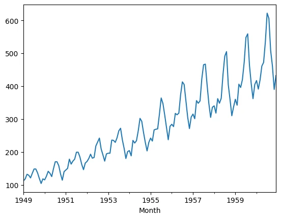{ width="520" }

*AirPassengers 원본 시계열.*

강한 상승 추세, 12개월 주기의 계절성, 그리고 뒤로 갈수록 커지는 분산이 모두 보인다. ADF 검정 결과도 정상 시계열이 아님을 가리킨다.

| | ADF 통계량 | p-value |
|---|---|---|
| 원본 | 0.8154 | 0.9919 |

AR을 적용하려면 먼저 정상성을 확보해야 한다.

## 변환 후보

다음 변환들을 적용해 비교했다.

| 이름 | 내용 |
|---|---|
| Original | 아무 변환도 하지 않은 원본 |
| Diff w/o Log | 로그 변환 없이 1차 차분만 적용 |
| Log Transformed | 원본에 로그 변환 적용 |
| Diff w/ Log | 로그 변환 뒤 1차 차분 |
| Diff w/ Box-Cox | Box-Cox 변환 뒤 1차 차분 |
| deseasonalMult + Diff | Multiplicative 방식의 classical seasonal decomposition으로 계절성을 제거한 뒤 1차 차분 |

Box-Cox 변환은 로그 변환처럼 분산을 안정시키는 변환이다. 로그 변환보다 좀 더 안정적으로 분산을 고르게 만들어 준다고 보고 후보에 넣었다. 뒤의 계절성 분해 절에서는 여기에 Box-Cox 변환과 계절성 분해를 조합한 두 가지를 더 추가했다.

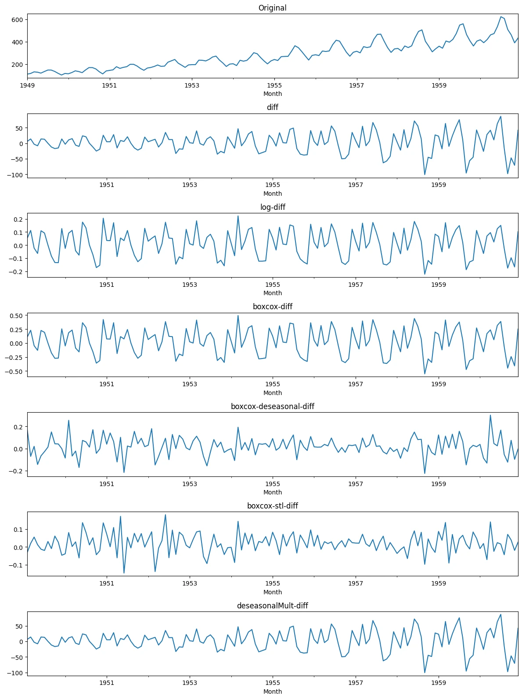

*위에서부터 원본, 차분, 로그 + 차분, Box-Cox + 차분, Box-Cox + classical 분해 + 차분, Box-Cox + STL 분해 + 차분, multiplicative 분해 + 차분.*

## 변환 뒤의 ADF 검정

먼저 차분 계열 세 가지의 결과다.

| 변환 | ADF 통계량 | p-value |
|---|---|---|
| Diff w/o Log | -2.8293 | 0.0542 |
| Diff w/ Log | -2.7171 | 0.0711 |
| Diff w/ Box-Cox | -2.8717 | 0.0487 |

- **차분만 적용**: p-value가 0.05를 조금 넘는다. 통계적 유의성을 확보하려면 정상성을 더 확보해야 한다.
- **로그 변환 뒤 차분**: 차분만 했을 때보다 p-value가 오히려 높아졌다. 이유는 파악하지 못했다.
- **Box-Cox 변환 뒤 차분**: p-value가 0.05 아래로 내려가 단위근이 있다는 귀무가설을 기각할 수 있었다.

로그 변환 쪽 결과를 두고 실험 당시에는 "로그 변환이 오히려 분산 안정성을 떨어뜨린 것 같다"고 적었다. 그런데 위의 그림을 보면 차분만 한 시계열은 뒤로 갈수록 진폭이 커지고, 로그를 취한 뒤 차분한 시계열은 진폭이 고르다. ADF는 단위근이 있는지를 보는 검정이어서, p-value가 조금 높아졌다는 것만으로 분산이 덜 안정해졌다고 말하기는 어렵다. 세 값 모두 0.05 근처에 몰려 있다는 점도 함께 보아야 한다. 이 부분은 [남았던 질문과 답](#open-questions)에서 다시 다룬다.

## 계절성 분해를 더하면

AirPassengers는 계절성이 강하다. 그렇다면 계절성을 먼저 제거하는 것이 정상성 확보에 더 도움이 되지 않을까 싶어 실험으로 확인했다. Classical seasonal decomposition과 STL 두 가지를 적용했다. 두 방법의 차이는 [시계열 분해](../../study/time-series-statistics/06-time-series-decomposition.md)에 정리해 두었다.

적용하면서 정한 것은 다음과 같다.

- **순서**: 계절성 분해는 차분보다 먼저 적용한다. 차분을 먼저 하면 원래의 계절 구조가 훼손될 수 있으므로, 계절성을 먼저 제거하고 차분으로 추세를 제거하는 순서가 통상적으로 더 효과적이라고 한다.
- **모형**: AirPassengers의 계절성은 값이 커질수록 함께 커지는 multiplicative 형태다. 다만 Box-Cox 변환을 먼저 적용하면 additive 분해로도 충분하다고 한다. Box-Cox 변환이 구간별 분산 차이를 줄여 주기 때문일 것이다.
- **주기**: ACF를 그려 보면 lag 12를 기준으로 강한 자기상관이 나타난다. 월별 데이터의 연간 주기라는 도메인 지식과도 맞으므로 주기를 12로 두었다.

전체 결과는 다음과 같다. 판정은 유의수준 5% 기준이다.

| 시계열 | ADF 통계량 | p-value | 판정 |
|---|---|---|---|
| `air_passengers` | 0.8154 | 0.9919 | Non-stationary |
| `air_passengers_diff` | -2.8293 | 0.0542 | Non-stationary |
| `air_passengers_log_diff` | -2.7171 | 0.0711 | Non-stationary |
| `air_passengers_boxcox_diff` | -2.8717 | 0.0487 | Stationary |
| `air_passengers_boxcox_deseasonal_diff` | -3.2887 | 0.0154 | Stationary |
| `air_passengers_boxcox_stl_diff` | -4.2321 | 0.0006 | Stationary |
| `air_passengers_deseasonalMult_diff` | -2.8295 | 0.0542 | Non-stationary |

Box-Cox 변환 뒤에 계절성을 제거하고 차분하면 p-value가 뚜렷하게 내려간다. Classical 분해를 쓰면 0.0154, STL을 쓰면 0.0006이다. 계절성을 먼저 제거하는 것이 정상성 확보에 도움이 된다는 예상과 맞는 결과다.

정상으로 판정된 세 가지를 AR 모델의 입력으로 골랐다.

1. `air_passengers_boxcox_diff`: Box-Cox + 차분
2. `air_passengers_boxcox_deseasonal_diff`: Box-Cox + classical 분해 + 차분
3. `air_passengers_boxcox_stl_diff`: Box-Cox + STL 분해 + 차분

## 예측과 평가 방법

### 예측값 되돌리기

모델에 넣은 것은 1차 차분한 시계열이다. 변환한 시계열을 $z_t$라 하면 모델이 예측하는 것은 $w_t = z_t - z_{t-1}$, 즉 직전 시점으로부터의 변화량이다. 따라서 예측값을 원래 수준으로 되돌리려면 이전 값에 변화량을 더해야 한다.

$$
\hat{z}_t = \hat{w}_t + z_{t-1}
$$

예측 구간의 첫 시점에서 $z_{t-1}$은 학습 데이터의 마지막 값 $z_T$를 써야 한다. 그 뒤로는 예측한 변화량을 차례로 누적해 복원한다. 정상화 과정에서 차분을 했다면 예측한 뒤에 그것을 되돌려 주어야 하는가 하는 것이 실험 전에 가졌던 질문이었는데, 답은 이 식이다. 아래 그림들은 이렇게 원래 단위까지 되돌린 예측값을 실제값과 겹쳐 그린 것이다.

### 평가 지표

| 지표 | 의미 |
|---|---|
| RMSE | 절대적인 오차의 크기. 실제값과 단위가 같다. 오차를 제곱하므로 큰 오차에 민감하고, 오차가 정규분포에 가깝다고 볼 때 적합하다. 작을수록 예측이 전반적으로 덜 흔들린다 |
| MAPE | 상대적인 오차의 크기(%). 실제값 대비 몇 % 틀렸는지를 알 수 있다 |

예측 구간은 그림에서 주황색 점선으로 표시한 마지막 구간으로, 1958년 하반기부터 1960년 말까지다.

## 결과 1: Box-Cox + 차분

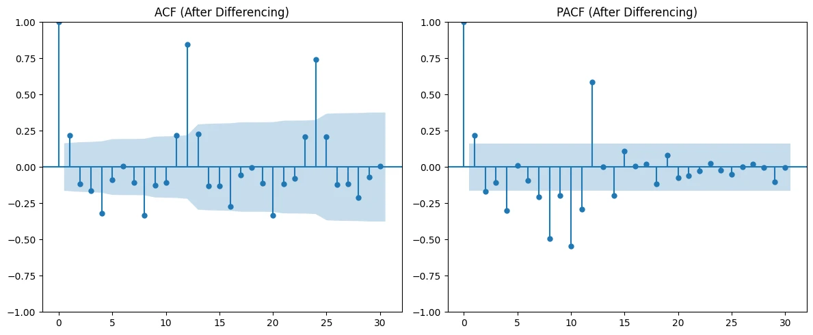

*Box-Cox 변환 뒤 차분한 시계열의 ACF(왼쪽)와 PACF(오른쪽).*

- ACF에서는 lag 12마다 강한 자기상관이 반복해서 나타난다. 계절성이 그대로 남아 있다.
- PACF에서는 lag 12에서 강하게 튄 뒤 끊긴다. 이 그림만 보면 lag 12가 가장 적절한 차수로 보였다.

더 정교하게 비교하려고 차수별 AIC와 BIC를 계산했다.

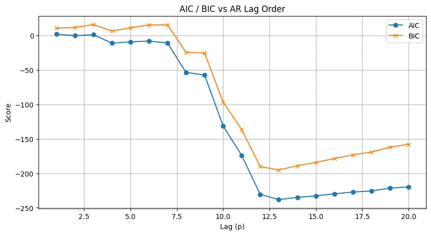{ width="640" }

*차수 1부터 20까지의 AIC와 BIC.*

예상과 달리 AIC와 BIC 모두 lag 12가 아니라 lag 13에서 가장 낮았다. 어느 쪽이 맞는지 예측으로 비교했다.

| 차수 | RMSE | MAPE |
|---|---|---|
| Lag 10 | 44.23 | 8.62% |
| Lag 12 | 30.58 | 6.17% |
| Lag 13 | 23.35 | 4.65% |
| Lag 14 | 26.57 | 5.39% |

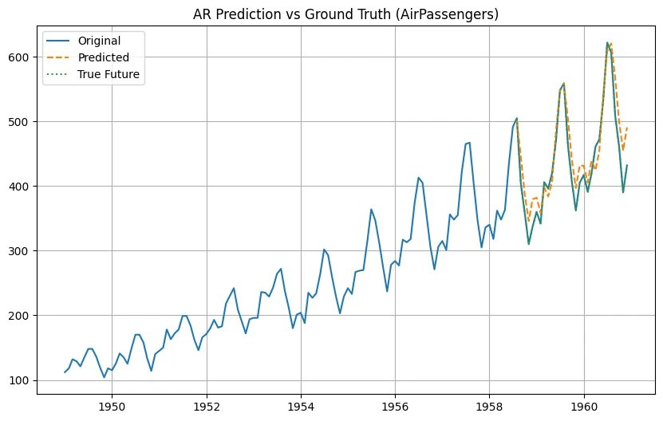{ width="640" }

*Lag 12. RMSE 30.58, MAPE 6.17%.*

{ width="640" }

*Lag 13. RMSE 23.35, MAPE 4.65%.*

AIC와 BIC가 고른 lag 13이 예측에서도 가장 좋았다. PACF를 눈으로 보고 고른 lag 12보다 RMSE가 7 이상 작다. 그래프 판독만으로 차수를 정하지 말고 여러 기준을 함께 비교해야 한다고 느꼈다.

## 결과 2: Box-Cox + Classical 분해 + 차분

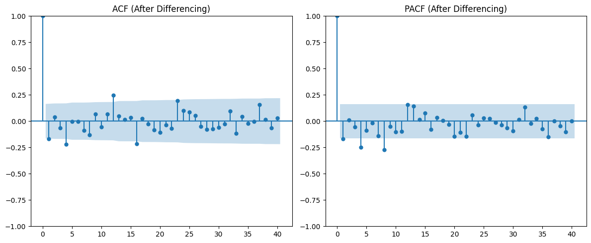

*Box-Cox 변환, classical 분해로 계절성 제거, 차분을 거친 시계열의 ACF와 PACF.*

- 앞의 경우처럼 눈에 띄는 절단점이 없다. 계절 성분을 제거해서 계절성 때문에 생기던 자기상관이 사라졌기 때문으로 보인다.
- 그래도 값이 주기적으로 오르내리는 것으로 보아 계절성이 약간은 남아 있는 것 같다.

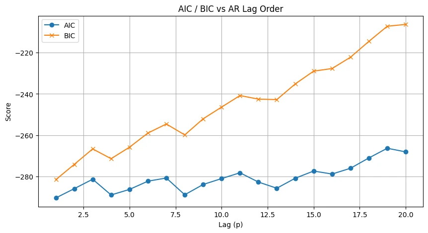{ width="640" }

*차수 1부터 20까지의 AIC와 BIC.*

AIC와 BIC 모두 lag 1에서 가장 낮다. 비정상적인 패턴을 모두 걷어 냈으니 시점 사이의 의존성이 거의 남지 않아, 바로 앞의 값 하나만으로도 설명이 되는 것이 아닐까 생각했다. Lag 1과, 앞의 실험에서 성능이 좋았던 lag 12, 13을 비교했다.

| 차수 | RMSE | MAPE |
|---|---|---|
| Lag 1 | 28.36 | 6.17% |
| Lag 12 | 28.72 | 6.03% |
| Lag 13 | 23.18 | 4.73% |

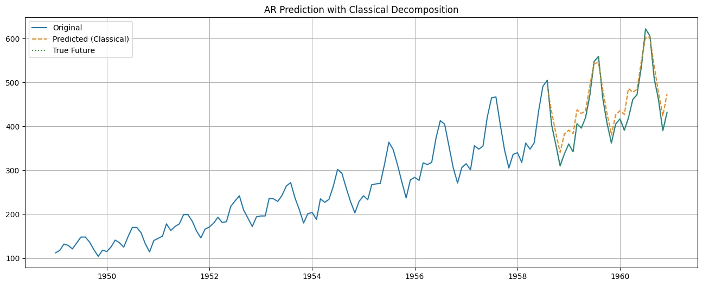

*Lag 1. RMSE 28.36, MAPE 6.17%.*

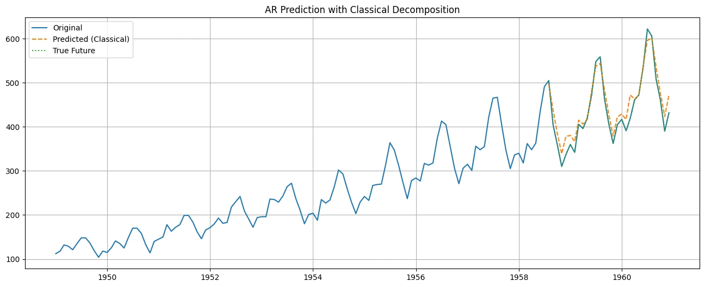

*Lag 13. RMSE 23.18, MAPE 4.73%.*

여기서는 AIC와 BIC의 선택과 예측 성능이 어긋났다. 두 기준은 lag 1을 골랐지만 예측 오차는 lag 13이 가장 작았다.

## 결과 3: Box-Cox + STL 분해 + 차분

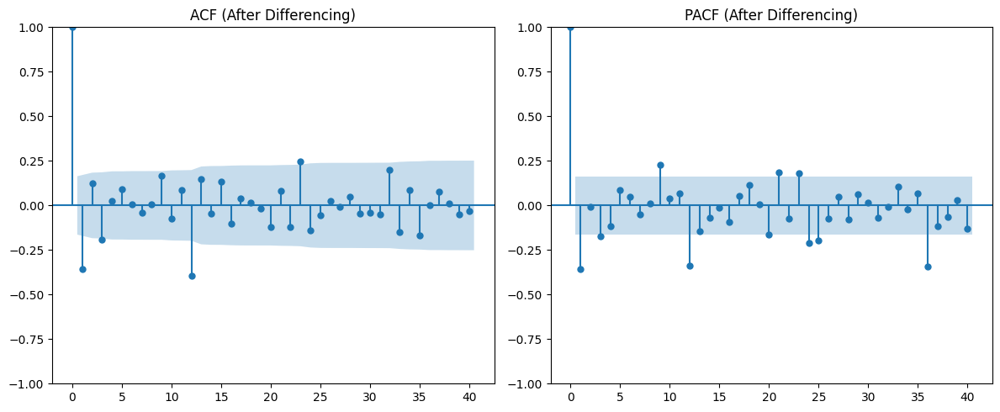

*Box-Cox 변환, STL 분해로 계절성 제거, 차분을 거친 시계열의 ACF와 PACF.*

- 계절성을 제거한 뒤에는 상관 구조가 상당히 무너진다.
- Lag 12의 배수 근처에서 값이 튀는 경향은 남아 있지만, 전체적으로 자기상관이 약해졌다. 어느 정도 정상화가 된 것으로 보았다.

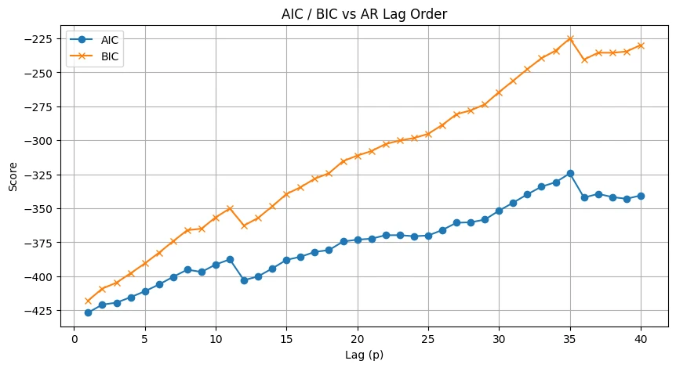{ width="640" }

*차수 1부터 40까지의 AIC와 BIC.*

이번에도 lag 1에서 AIC와 BIC가 가장 낮다. 다만 lag 12의 배수마다 값이 조금씩 내려가는 모양이 보인다.

| 차수 | RMSE | MAPE |
|---|---|---|
| Lag 1 | 8.01 | 1.63% |
| Lag 12 | 12.47 | 2.44% |
| Lag 13 | 15.56 | 3.10% |

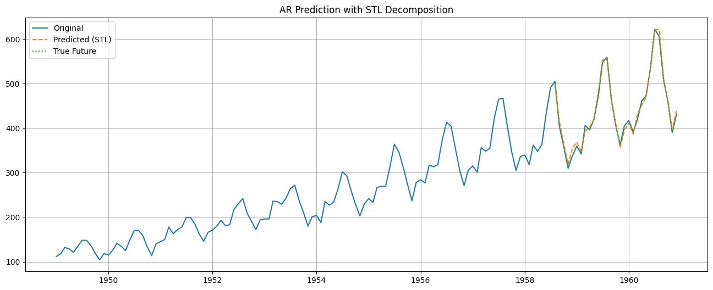

*Lag 1. RMSE 8.01, MAPE 1.63%.*

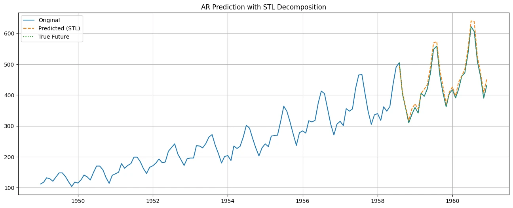

*Lag 13. RMSE 15.56, MAPE 3.10%.*

AIC와 BIC가 고른 lag 1이 예측에서도 가장 좋았고, 차수를 늘릴수록 오차가 커졌다.

## AIC와 BIC의 선택과 실제 예측 성능

| 전처리 | AIC, BIC가 고른 차수 | 그 차수의 RMSE, MAPE | 예측이 가장 좋았던 차수 | 그 차수의 RMSE, MAPE |
|---|---|---|---|---|
| Box-Cox + 차분 | 13 | 23.35, 4.65% | 13 | 23.35, 4.65% |
| Box-Cox + classical 분해 + 차분 | 1 | 28.36, 6.17% | 13 | 23.18, 4.73% |
| Box-Cox + STL 분해 + 차분 | 1 | 8.01, 1.63% | 1 | 8.01, 1.63% |

- 세 전처리 가운데 두 가지에서 AIC와 BIC가 고른 차수가 예측도 가장 잘했다. 비교한 차수 안에서의 결과다.
- 계절성을 그대로 둔 첫 번째 경우에는 PACF를 눈으로 본 판단(lag 12)보다 AIC와 BIC의 선택(lag 13)이 나았다.
- 어긋난 것은 classical 분해를 쓴 경우다. 두 기준은 lag 1을 골랐지만 lag 13의 오차가 더 작았다.

## 해석

**계절성을 제거하면 AIC와 BIC가 고르는 차수가 줄어든다.** 계절성을 남겨 둔 시계열에서는 두 기준이 lag 13을 골랐고, 계절성을 따로 제거한 두 경우에는 모두 lag 1을 골랐다. 비정상적인 패턴을 걷어 내고 나면 시점 사이의 의존성이 거의 남지 않아 바로 앞의 값만으로 설명이 되기 때문이라고 추측했다.

**STL의 가정이 현실에 더 가깝다.** Classical 분해는 계절 성분이 모든 주기에서 같은 모양이라고 가정한다. 현실의 계절 패턴은 시간이 지나며 변한다고 보는 편이 더 알맞은 가정이므로, 계절 성분의 변화를 허용하는 STL이 더 유효한 가정이라고 볼 수 있다. Classical 분해를 쓴 경우에 ACF에 계절성이 조금 남아 보이고 lag 13의 예측이 더 좋았던 것도, 고정된 계절 성분으로는 실제 계절성을 다 걷어 내지 못했기 때문일 수 있다. 다만 이것은 확인한 사실이 아니라 추측이다.

**그러나 STL은 그대로 예측에 쓰기 어렵다.** STL에서는 계절 성분이 시간에 따라 변한다. Classical 분해처럼 한 주기의 모양을 미래에 그대로 붙일 수 없으므로, 계절성을 제거하고 남은 시계열만 예측해서는 최종 예측을 만들 수 없다. 계절 성분을 따로 예측하는 모델이 필요하다. 계절성을 전처리로 떼어 내지 않고 모델 안에 직접 반영하려는 시도들이 나온 것도 이 때문이라고 생각한다.

## 한계와 할 일 { #limitations }

**Test leakage가 있었다.** 실험 과정에서 테스트 구간의 정보가 섞여 들어갔다. 어느 단계에서 섞였는지까지는 기록해 두지 않았다. 위의 RMSE와 MAPE는 실제로 미래를 모르는 상태에서 얻을 수 있는 성능보다 좋게 나왔을 수 있다. 특히 STL을 쓴 결과는 다른 두 경우보다 오차가 훨씬 작은데, 위에서 적었듯이 STL의 계절 성분은 미래 구간에 대해 따로 예측해야 하는 값이다. 이 수치는 그 점과 함께 읽어야 하고, 지금 상태로 "STL이 가장 좋다"고 결론 내릴 수는 없다.

할 일은 학습 구간과 테스트 구간을 처음부터 분리해 다시 실험하는 것이다. 변환과 계절성 분해, 차수 선택을 모두 학습 구간만으로 수행하고, 테스트 구간은 마지막 평가에만 써야 한다.

그 밖에 확인이 필요한 점은 다음과 같다.

- `air_passengers_deseasonalMult_diff`의 ADF 결과(-2.8295, 0.0542)가 차분만 한 경우(-2.8293, 0.0542)와 거의 같고, 그림에서도 두 시계열이 구분되지 않는다. Multiplicative 분해로 계절성을 제거한 것이 실제로 반영되었는지 코드를 다시 확인해야 한다.
- 차수는 전처리마다 서너 개만 비교했다. AIC와 BIC가 고른 차수가 "가장 좋았다"는 것은 비교한 차수 안에서의 이야기다.
- ADF의 p-value가 0.0487, 0.0542처럼 기준 바로 근처에 있는 경우가 많았다. 0.05를 경계로 정상과 비정상을 나눈 판정은 그만큼 조심해서 읽어야 한다.

## 남았던 질문과 답 { #open-questions }

공부할 당시에는 풀지 못하고 남겨 둔 질문들이다. 글을 정리하면서 답을 찾아 덧붙였다.

**Q. 로그 변환 뒤 차분했을 때 ADF의 p-value가 차분만 했을 때보다 높게 나온 이유는 무엇인가?**

두 검정에 들어간 시차의 수가 달랐기 때문이다. 글을 정리하면서 같은 데이터로 ADF 검정을 다시 계산해 보았다. statsmodels의 `adfuller`는 기본 설정에서 검정 회귀에 넣을 시차의 수를 AIC로 자동 선택하는데, 차분만 한 시계열에서는 12를, 로그를 취한 뒤 차분한 시계열과 Box-Cox 변환 뒤 차분한 시계열에서는 14를 골랐다. 본문의 세 p-value(0.0542, 0.0711, 0.0487)는 이 설정에서 그대로 재현된다. 시차의 수를 같은 값으로 고정하면 p-value는 다음과 같다.

| 시차의 수 | 차분 | 로그 + 차분 | Box-Cox + 차분 |
|---|---|---|---|
| 12 | 0.0542 | 0.0302 | 0.0236 |
| 13 | 0.0463 | 0.0188 | 0.0133 |
| 14 | 0.0636 | 0.0711 | 0.0487 |

시차를 12나 13으로 맞추면 로그를 취한 쪽의 p-value가 오히려 낮고, 14에서는 두 값이 비슷하다. 본문에서 비교한 0.0542와 0.0711은 시차 12의 결과와 시차 14의 결과를 나란히 놓은 것이었다. 따라서 이 차이에서 "로그 변환이 분산 안정성을 떨어뜨렸다"는 결론은 나오지 않는다. 같은 시계열에서도 시차를 하나 바꾸면 p-value가 0.02와 0.07 사이를 오가므로, 0.05를 경계로 한 정상 판정이 시차 선택에 따라 뒤집힌다는 점도 함께 확인된다. 변환끼리 비교하려면 시차의 수를 같게 두어야 한다.

**Q. 계절성을 제거한 뒤 AIC와 BIC가 lag 1을 고르는 것은, 비정상적인 패턴을 모두 걷어 내 시점 사이의 의존성이 거의 남지 않았기 때문인가?**

그 결과만으로는 그렇게 말할 수 없다. 두 기준은 $\mathrm{AIC} = 2k - 2\ln\hat{L}$, $\mathrm{BIC} = k\ln n - 2\ln\hat{L}$로, 차수를 늘려 얻는 likelihood의 증가가 penalty보다 작으면 작은 차수를 고른다. 비교한 후보가 1부터 20(또는 40)까지였으므로 lag 1은 후보 가운데 가장 작은 차수다. 그래서 이 결과가 말해 주는 것은 "lag 2 이상을 더해도 penalty만큼 나아지지 않는다"까지다. 의존성이 거의 없는 경우와 lag 1의 의존성만 남은 경우를 구분하지 못한다.

의존성이 남아 있어도 lag 1이 뽑힐 수 있다는 점도 있다. AR($p$)는 1부터 $p$까지의 시차를 모두 넣는 모델이어서, lag 12의 의존성을 담으려면 계수를 11개 이상 더 써야 한다. 계절 시차에 남은 의존성이 약하면 그만큼의 penalty를 넘지 못한다. Classical 분해를 쓴 경우에 ACF에 주기적인 오르내림이 남아 보였고 lag 13의 예측 오차가 더 작았던 것은 이 경우와 모순되지 않는다.

### 아직 남은 질문

- 계절성을 제거한 시계열에 의존성이 실제로 얼마나 남아 있는가. 후보에 차수 0(상수만 있는 모델)을 넣어 다시 비교하고, 시계열과 AR(1) 잔차에 Ljung-Box 검정을 적용하면 가릴 수 있다. Test leakage를 없앤 상태에서 해야 한다.
- 변환별 정상성 비교는 시차의 수를 고정한 채 다시 해야 한다. 계절성 분해를 더한 두 경우는 위의 재계산에 넣지 않았다.

## 참고 자료

- AirPassengers 데이터: G. E. P. Box, G. M. Jenkins, "Time Series Analysis: Forecasting and Control"에 실린 1949 ~ 1960년 월별 국제선 항공 승객 수.
- 이 글에서 쓴 개념은 [시계열 통계 기초](../../study/time-series-statistics/index.md) 시리즈에 정리했다. [정상성과 단위근 검정](../../study/time-series-statistics/02-stationarity-and-unit-root-test.md), [ACF와 PACF](../../study/time-series-statistics/03-autocovariance-acf-pacf.md), [AIC와 BIC](../../study/time-series-statistics/05-aic-and-bic.md), [시계열 분해](../../study/time-series-statistics/06-time-series-decomposition.md).
