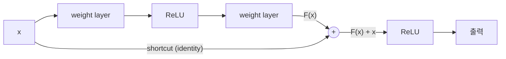

# ResNet: 깊은 네트워크를 학습시키는 residual learning

"Deep Residual Learning for Image Recognition"(He et al., CVPR 2016)을 논문 리뷰 강의와 함께 읽고 정리한 글이다. 강의의 흐름대로 CNN과 VGG를 짧게 복습한 뒤 residual block의 아이디어를 보고, 논문 본문을 따라간다. 중간에 skip connection을 조금 다른 각도에서 설명한 강의의 내용도 덧붙였다. 출처는 글 끝에 적었다.

## 왜 ResNet인가

ResNet이 좋은 평가를 받는 이유는 크게 두 가지다.

1. 성능이 매우 뛰어났다.
2. 논문이 제시한 아이디어가 직관적이고 단순했다.

일반적으로 네트워크가 깊어질수록 데이터에서 더 풍부한 특징을 뽑아낼 수 있고 성능도 좋아진다. 그런데 layer를 단순히 많이 쌓기만 하면 어느 지점부터는 오히려 성능이 떨어진다. ResNet 이전의 모델로 실험해 보면 더 깊은 모델의 error가 더 높게 나온다.

여기서 눈여겨볼 점은 test error만이 아니라 **training error**도 높아진다는 것이다. 깊은 모델이 학습 데이터에 과적합해서 일반화가 안 되는 것이 아니라, 학습 데이터조차 제대로 맞추지 못한다는 뜻이다. 논문은 이 문제를 residual learning으로 풀었고, 이것이 이 논문의 contribution이다.

## 배경: CNN과 VGG

논문은 독자가 CNN을 알고 있다고 가정한다. CNN에서는 서로 다른 filter가 입력 위를 sliding하며 영역별로 convolution을 수행해 activation map을 만든다. Filter는 모두 학습되는 값이고, 학습이 진행되면서 filter마다 서로 다른 특징을 뽑도록 만들어진다. RGB 3채널 입력에 filter 6개를 적용하면 출력 activation map의 채널은 6개가 되고, 각 채널은 서로 다른 특징 정보를 담는다.

일반적인 CNN은 layer가 깊어질수록 채널 수(filter 개수)가 늘고 너비와 높이는 줄어드는 식으로 구성된다. Padding을 따로 붙이지 않으면 convolution을 거칠 때마다 너비와 높이가 줄어든다.

VGG("Very Deep Convolutional Networks for Large-Scale Image Recognition", ICLR 2015)는 ResNet 이전에 ImageNet 대회에서 좋은 성능을 낸 네트워크다. 작은 크기의 filter를 여러 번 써서 layer를 깊게 쌓은 것이 특징이다. VGG-16은 convolution layer 13개와 fully connected layer 3개로, weight가 있는 layer가 16개다. 작은 filter를 쓰더라도 convolution을 여러 번 거치면, 깊은 곳의 activation 하나는 결과적으로 입력의 넓은 영역을 보게 된다. 파라미터가 많다는 단점이 있지만 convolution layer의 장점을 잘 살린 구조여서 지금도 backbone으로 자주 쓰인다.

그렇다면 layer를 깊게 쌓을수록 성능이 계속 좋아질까. 그렇지 않았고, 파라미터 수도 여전히 많았다. 다른 접근이 필요했고, 그 배경에서 나온 것이 ResNet이다.

## Residual block

Residual block의 역할은 네트워크의 최적화 난이도를 낮추는 것이다. 논문은 layer가 깊어질수록 학습이 어려워지고 의도한 대로 최적화하기가 쉽지 않다고 본다. VGG식으로 convolution을 깊게 쌓기만 해서는 학습이 잘 되지 않으니, 학습이 잘 되도록 구조를 바꾸자는 것이다.

학습시키고자 하는 원래의 mapping을 $H(x)$라고 하자. 보통의 네트워크는 입력을 convolution(weight layer)에 통과시켜 특징을 뽑고, ReLU 같은 activation function으로 비선형성을 준 뒤, 다시 convolution을 거치는 식으로 $H(x)$를 직접 만든다. ResNet은 $H(x)$를 곧바로 학습하는 대신 다음을 학습한다.

$$
F(x) = H(x) - x
$$

구조로 보면 weight layer 몇 개를 거친 결과 $F(x)$에 입력 $x$를 그대로 더해 $H(x) = F(x) + x$를 만든다.

이렇게 하면 앞선 layer까지 학습한 정보 $x$는 그대로 가져오고, 거기에 추가로 필요한 $F(x)$만 학습하면 된다. $H(x)$ 전체를 학습할 때는 여러 weight layer가 각자 mapping을 새로 만들어야 하므로 수렴이 어렵고, 이 어려움은 layer가 깊어질수록 커진다. 반면 남은 부분(residual)만 학습하는 것은 그보다 쉽다. 그래서 이 형태로 네트워크를 바꾸면 더 높은 성능이 나올 수 있다는 것이 논문의 생각이다.

### 수식

$\sigma$를 activation function(ReLU)이라고 하면, weight layer 두 개로 된 residual function은 다음과 같다. 입력에 $W_1$을 곱하고 activation을 거친 뒤 $W_2$를 곱한다.

$$
F = W_2\, \sigma(W_1 x)
$$

Residual block의 출력은 여기에 shortcut connection으로 입력을 더한 것이다.

$$
y = F(x, \{W_i\}) + x
$$

$x$와 $F$의 차원이 다르면 그대로 더할 수 없다. 이때는 shortcut에 linear projection $W_s$를 두어 차원을 맞춘다.

$$
y = F(x, \{W_i\}) + W_s x
$$

$W_s$가 필요한 경우는 두 가지다.

- **채널 수가 다를 때**: 입력의 채널 수 $C_{in}$과 $F$의 출력 채널 수 $C_{out}$이 다르면 맞춰야 한다.
- **공간 크기가 다를 때**: $F$ 안에서 stride나 pooling으로 크기를 줄였다면 $x$의 공간 크기도 맞춰야 한다.

## 논문 본문

### Abstract

깊은 신경망은 학습시키기 어렵다. 논문은 residual learning framework를 제시해 이전보다 훨씬 깊은 네트워크를 쉽게 학습시킬 수 있게 했다. ImageNet에서 152 layer의 residual net을 평가했는데, VGG보다 훨씬 깊으면서도 복잡도는 더 낮고 성능은 크게 좋아져 2015년 ImageNet 분류 대회에서 1위를 했다. CIFAR-10에서도 같은 실험으로 성능 개선을 확인했다. 표현의 "깊이"는 컴퓨터 비전에서 중심적인 역할을 하며, 더 깊은 네트워크를 학습시킬 수 있게 된 덕분에 object detection과 segmentation에서도 성능이 좋아졌다.

### Degradation problem

CNN을 깊게 쌓는 시도는 이미지 분류에서 큰 돌파구였다. CNN을 학습시키면 layer가 깊어짐에 따라 low, mid, high level의 feature가 차례로 추출되고, 깊이가 깊을수록 feature의 수준도 풍부해진다. VGG(ICLR 2015)와 GoogLeNet(CVPR 2015)도 깊이의 이점을 살린 모델이다.

그러면 "layer를 깊게 쌓기만 하면 더 좋은 네트워크가 학습되는 것 아닌가"라는 의문이 든다. 그러나 깊게 쌓는 것이 다른 문제를 일으킨다는 것은 오래전부터 알려져 있었다. 대표적인 것이 vanishing gradient다. Sigmoid 같은 activation function을 쓰면 역전파 과정에서 gradient가 0에 가까워져 학습이 잘 되지 않는다. 이를 풀기 위한 방법 가운데 하나가 가중치를 적절히 초기화하는 것이고, 같은 저자가 2015년 "Delving Deep into Rectifiers"에서 제안한 He initialization이 그 예다.

논문이 문제 삼는 것은 이것과는 다른 **degradation problem**이다. 깊이가 어느 정도를 넘으면 accuracy가 더 오르지 않고 오히려 떨어진다. 그리고 이것은 overfitting 때문이 아니다. 같은 환경에서 layer만 더 쌓았는데 training error가 높아진다. 학습 자체가 잘 안 되는 것이다.

논문의 저자들은 이 문제가 vanishing gradient 때문도 아니라고 말한다. 학습 과정에서 forward와 backward의 신호를 확인했을 때 신호가 사라지는 현상은 보이지 않았다는 것이다. 저자들은 깊은 plain network의 수렴 속도가 매우 낮기 때문일 것이라고 추측한다. 요약하면 "그냥 학습 난이도 자체가 높다"는 주장이다.

### Identity mapping으로 생각하기

읽으면서 이 부분이 가장 어렵고 또 핵심이라고 느꼈다.

얕은 모델이 하나 있고, 거기에 layer를 더 쌓아 깊은 모델을 만든다고 하자. 추가한 layer가 모두 identity mapping(입력을 그대로 내보내는 mapping)이라면 깊은 모델은 얕은 모델과 똑같이 동작한다. 그러니 더 깊은 모델의 training error가 얕은 모델보다 높을 이유가 없다. 그런데 실험에서는 더 높게 나온다. 이는 여러 개의 비선형 layer로 identity mapping을 만들어 내는 일 자체가 optimizer에게 쉽지 않다는 것을 뜻한다.

이 논증은 일종의 휴리스틱으로 읽었다. 다시 생각해 보면 "identity mapping을 기본으로 깔아 두면 layer를 추가할 때마다 값을 조금씩 바꿔 나가는 식으로 학습하게 되므로 training error가 적어도 나빠지지는 않을 것"이라는 생각이 그 안에 들어 있다고 보아야 할 것 같다.

그래서 논문은 문제를 바꾼다. 원하는 mapping $H(x)$를 직접 맞추는 대신 $F(x) = H(x) - x$를 맞추게 한다. 수학적으로는 $H(x)$를 학습하는 것과 차이가 없어 보이지만 학습의 난이도가 달라진다. 극단적인 경우로 identity mapping이 최적해라면, 비선형 layer들로 identity를 만드는 것보다 $F(x)$를 0으로 만드는 것이 훨씬 쉽다. 입력을 항상 출력에 더해 주므로 identity는 기본으로 주어진다.

물론 실제로 최적해가 정확히 identity mapping일 가능성은 희박하다. 그래도 최적의 함수가 zero mapping보다 identity mapping에 더 가깝다면, 아무것도 없는 상태에서 새 함수를 학습하는 것보다 identity를 기준으로 변화량만 찾는 쪽이 쉽다. 논문은 실험에서 residual function의 response(layer 출력의 크기)가 일반적으로 작게 나온다는 것을 보여, 이 가정이 그럴듯하다는 근거로 삼는다.

Shortcut connection은 identity mapping이므로 추가 파라미터가 필요 없고, 계산 복잡도도 늘지 않으며, 구현도 간단하다.

### Skip connection을 보는 다른 설명

같은 내용을 다른 강의에서는 다음과 같이 설명한다.

모델의 이상적인 출력이 $H(x)$일 때, 이것을 $F(x)$만으로 만드는 것과 $F(x) + x$로 만드는 것 중 어느 쪽이 쉬울까. $H(x)$를 $x$에 가깝게 만들어야 하는 상황을 가정해 보자.

- Skip connection이 없으면 weight 행렬이 identity 행렬에 가까워져야 한다.
- Skip connection이 있으면 weight 행렬이 영행렬에 가까워지면 된다.

그런데 weight는 He, Xavier, LeCun 어느 방법을 쓰든 0 근처의 값으로 초기화된다. 따라서 skip connection이 있는 쪽이 $H(x)$를 $x$에 가깝게 만들기 훨씬 쉽다.

그러면 왜 $H(x)$가 $x$에 가까워야 한다고 볼 수 있는가. 모델이 아주 깊다면 입력에서부터 값을 조금씩 바꿔 나가는 것이 이상적이다. 원하는 것은 낮은 test error인데, layer마다 값이 크게 바뀌는 네트워크는 과적합되었을 가능성이 높다. 잘 학습된 ResNet이라면 다음 layer로 갈 때 값의 변화가 크지 않을 것이다. Skip connection은 "한 layer에서 모든 것을 다 하려 하지 말고 조금씩만 바꾸라"고 모델에게 귀띔해 주는 장치인 셈이다. 논문도 layer가 깊은 모델일수록 response의 표준편차가 작다는 실험 결과를 제시한다.

여기서 한 가지 짚어 둔 점이 있다. 맨 처음 block의 입력과 마지막 block의 출력이 같아서는 당연히 안 된다. ResNet이 가정하는 것은 block 하나를 지날 때의 변화가 작다는 것이지 전체의 변화가 작다는 것이 아니다. 작은 변화가 쌓이므로 전체 입력과 출력이 같아지는 일은 없다.

강의에서는 같은 효과를 내는 다른 방법도 언급했다.

- Skip connection 없이 convolution만으로: filter의 가운데 값만 1로 두면 identity가 된다.
- Weight에 prior를 주는 방법: 초기화를 identity처럼 하거나, regularization으로 weight가 identity 행렬에 가까워지도록 유도한다.

다만 이런 방법들보다 skip connection이 더 낫다고 정리했다. 이 설명은 Transformer의 residual connection을 다룰 때도 다시 썼다([Attention Is All You Need 리뷰](../../papers/2025-01-06-attention-is-all-you-need.md)의 "Residual connection은 왜 도움이 되는가").

### Residual function은 layer가 둘 이상이어야 한다

$F$를 weight layer 하나로만 만들면 이점이 없다. 그 경우 출력은

$$
y = W_1 x + x
$$

가 되는데, 중간에 activation을 거치지 않으므로 linear layer 하나를 쓴 것과 사실상 같다.

### Shortcut의 선택지

차원이 달라지는 곳에서 shortcut을 어떻게 만들지에 대해 논문은 세 가지를 실험으로 비교한다.

| 방식 | 내용 |
|---|---|
| Zero-padding shortcut | 차원이 늘어나는 곳에서 모자란 부분을 0으로 채운다. 파라미터가 늘지 않는다. |
| 필요한 곳에만 projection | 차원이 같은 곳은 identity, 달라지는 곳에만 projection을 쓴다. |
| 모든 곳에 projection | 모든 shortcut에 projection을 쓴다. 파라미터가 추가된다. |

실험에서는 모든 shortcut에 projection을 쓰는 쪽이 조금 더 좋았다. 그러나 차이가 크지 않아서, 논문은 projection이 degradation 문제를 푸는 데 필수는 아니라고 결론 내린다.

### Bottleneck architecture

Bottleneck은 깊은 모델에서 복잡도를 줄이기 위한 구조다. $3 \times 3$ convolution 두 개 대신 $1 \times 1$, $3 \times 3$, $1 \times 1$ convolution 세 개를 쓴다.

1. 첫 $1 \times 1$ convolution이 채널 수를 줄여 연산량과 메모리 사용량을 줄인다.
2. $3 \times 3$ convolution이 줄어든 차원에서 특징을 추출한다.
3. 마지막 $1 \times 1$ convolution이 채널 수를 복원해 residual connection으로 더할 수 있게 한다.

이 구조에서는 block의 입력과 출력의 shape이 같아지므로 identity shortcut이 특히 효과적이다. Identity shortcut에는 파라미터가 없어서 빠르고 가볍기 때문이다.

### CIFAR-10 실험

CIFAR-10은 입력 이미지가 $32 \times 32$로 ImageNet보다 작다. 논문은 여기에 맞춰 파라미터 수를 줄인 별도의 ResNet을 설계해 실험한다. 학습률은 0.1에서 시작해 10으로 나누는 감소를 두 번 적용했다. 논문은 1202 layer까지 쌓은 모델(파라미터 약 19.4M)도 학습은 되지만, 이렇게 작은 데이터셋에는 불필요하게 큰 모델이라고 말한다.

## 정리

- 깊은 plain network는 overfitting이나 vanishing gradient와는 별개로, training error 자체가 높아지는 degradation problem을 겪는다.
- ResNet은 $H(x)$ 대신 $F(x) = H(x) - x$를 학습하게 한다. 입력을 출력에 더하는 shortcut이 identity mapping을 기본으로 제공하므로, 각 block은 변화량만 학습하면 된다.
- Weight가 0 근처에서 초기화된다는 점을 생각하면, "$F$를 0에 가깝게"가 "$H$를 identity에 가깝게"보다 쉬운 목표다.
- Shortcut은 대부분 파라미터 없는 identity로 충분하고, projection은 차원을 맞출 때만 있으면 된다.

LSTM의 cell state도 이전 값을 더하기로 넘겨준다는 점에서 같은 생각 위에 있다. 이 연결은 [다음 글](02-lstm.md)에서 다룬다.

## 참고 자료

- K. He, X. Zhang, S. Ren, J. Sun, "Deep Residual Learning for Image Recognition", CVPR 2016. <https://arxiv.org/abs/1512.03385>
- K. Simonyan, A. Zisserman, "Very Deep Convolutional Networks for Large-Scale Image Recognition", ICLR 2015. <https://arxiv.org/abs/1409.1556>
- K. He, X. Zhang, S. Ren, J. Sun, "Delving Deep into Rectifiers: Surpassing Human-Level Performance on ImageNet Classification", ICCV 2015. <https://arxiv.org/abs/1502.01852>
- 동빈나, "ResNet: Deep Residual Learning for Image Recognition (꼼꼼한 딥러닝 논문 리뷰와 코드 실습)" (YouTube). <https://www.youtube.com/watch?v=671BsKl8d0E>
- 혁펜하임, "ResNet의 Skip-connection 제대로 이해하기!" (YouTube). <https://www.youtube.com/watch?v=Fypk0ec32BU>
