# LSTM: cell state와 gate로 긴 시퀀스를 학습하기

작성일 2024-11-24
{ .post-date }

"Long Short-Term Memory"(Hochreiter & Schmidhuber, Neural Computation 1997)를 리뷰한 연구실 세미나 영상을 보고 정리한 글이다. 발표는 실제 시계열 데이터에 여러 모델을 써 보면 LSTM의 성능이 좋은 경우가 여전히 많다는 점에서 출발해, 원 논문으로 돌아가 LSTM의 근본을 이해해 보자는 취지였다. LSTM은 Highway Network, ResNet처럼 매우 깊은 모델을 학습시키는 방법들의 바탕이 되는 통찰을 제공했다는 점도 함께 다룬다.

## 시계열 데이터와 이를 다루는 방법

시계열 데이터는 일정 시간 동안 수집된 순차적인 데이터이고, 시간 순서에 따라 값들이 서로 상관관계를 갖는다. 다루는 방법은 크게 둘로 나눌 수 있다.

- **Data approach**: 과거에는 시계열을 직접 다루는 모델이 많지 않아서, 데이터를 변형해 SVM이나 Random Forest 같은 일반 모델에 넣는 경우가 많았다. DTW(Dynamic Time Warping), FFT, time-lag feature가 대표적이다. 지금은 잘 쓰이지 않는다.
- **Model approach**: 모델이 순서 구조를 직접 다룬다. HMM(Hidden Markov Model)이나 ARIMA 같은 확률 통계 모델이 쓰였고, 지금은 딥러닝이 주로 쓰인다.

## Vanilla RNN

RNN(Recurrent Neural Network)은 1980년대 중반 Rumelhart, Hinton 등의 연구에서 나왔다. Fully connected network와 비슷하지만, 출력 $h_t$가 다음 시점 $t+1$에 입력 $x_{t+1}$과 함께 다시 들어간다는 점이 다르다. 현재 step의 출력이 다음 step의 입력으로 순환하므로 순환 신경망이라고 부른다.

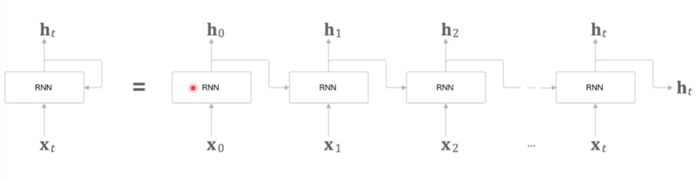

왼쪽의 되돌아오는 화살표 하나를 시간 순서대로 펼친 것이 오른쪽이다. 같은 RNN 상자가 step마다 반복되고, 각 상자의 출력이 오른쪽 옆 상자로 넘어간다. 출처: 세미나 슬라이드(그림은 "밑바닥부터 시작하는 딥러닝 2")

그림의 오른쪽처럼 입력은 0번 step부터 순서대로 들어가고 출력도 $h_0$부터 $h_t$까지 순서대로 나온다. 모든 step의 출력을 쓸 수도 있고 마지막 step의 출력만 쓸 수도 있다.

상자 하나의 안은 다음과 같이 생겼다.

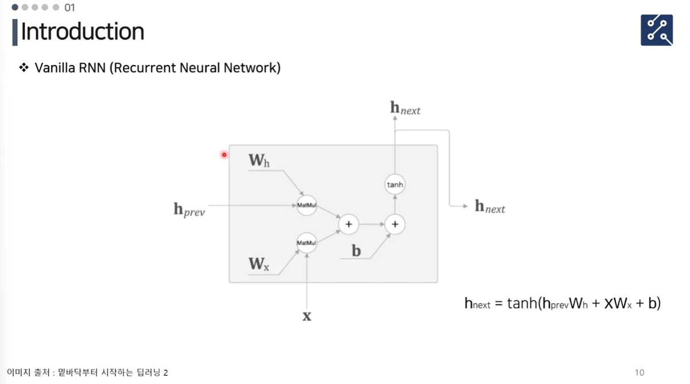

아래에서 올라오는 입력 $x$와 왼쪽에서 들어오는 이전 step의 출력 $h_{prev}$가 각각 weight와 곱해지고(MatMul), 더해진 뒤 tanh를 지나 $h_{next}$가 된다. $h_{next}$는 위(출력)와 오른쪽(다음 step) 두 곳으로 나간다. 출처: 세미나 슬라이드

입력에 weight를 곱하고 bias를 더하는 것은 fully connected layer와 같고, 이전 step의 hidden state $h_{t-1}$이 함께 들어간다는 점이 다르다. 식으로 쓰면 다음과 같다.

$$
h_t = \tanh(W_h h_{t-1} + W_x x_t + b)
$$

### BPTT

Cell 하나만 놓고 보면 역전파는 forward의 화살표를 거꾸로 따라가는 것이다.

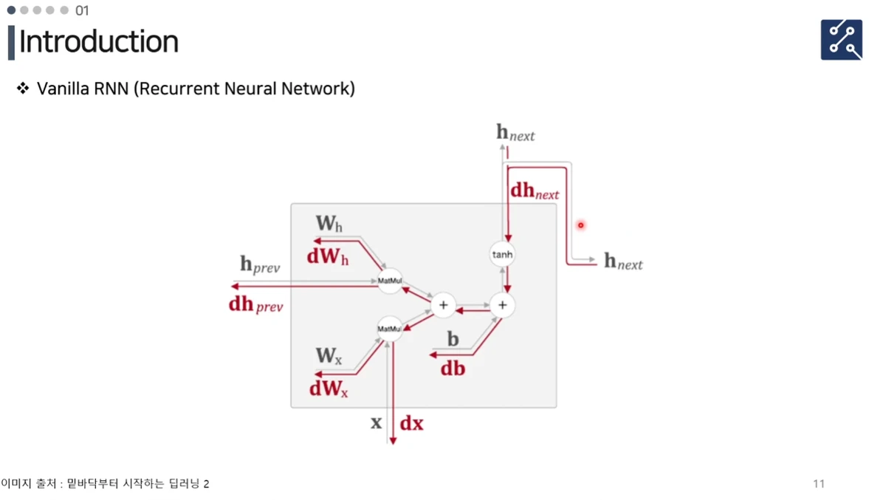

빨간 화살표가 gradient가 흐르는 방향이다. 위에서 내려온 $dh_{next}$가 tanh와 덧셈, 행렬곱을 거꾸로 지나 $dW_h$, $dW_x$, $db$를 만들고, 왼쪽으로는 $dh_{prev}$가 되어 이전 step으로 넘어간다. 출처: 세미나 슬라이드

그런데 RNN은 시간에 따라 펼쳐 놓고 역전파해야 한다. RNN cell을 시간 축으로 펼치면 깊은 네트워크처럼 되고, 마지막 step에서부터 거꾸로 gradient를 전달한다. 이 방법을 BPTT(Backpropagation Through Time)라고 한다.

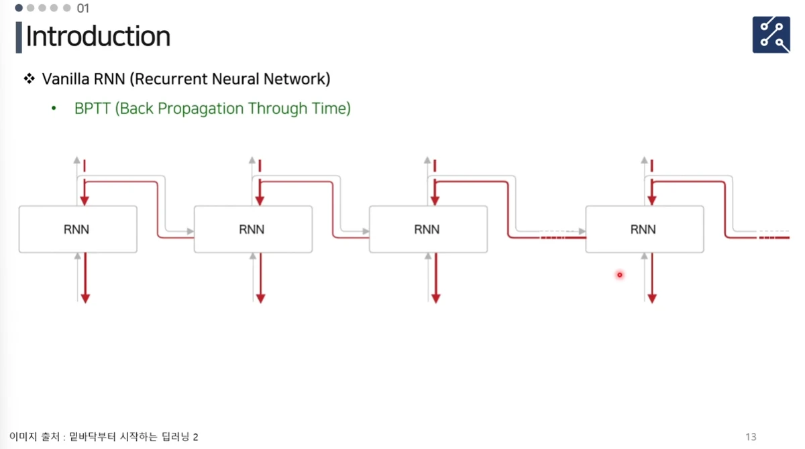

빨간 선이 오른쪽(마지막 step)에서 왼쪽(첫 step)으로 cell을 하나씩 거슬러 간다. 시퀀스가 길수록 이 빨간 선이 지나야 하는 cell이 많아진다. 출처: 세미나 슬라이드

Fully connected network는 hidden layer마다 다른 weight를 갖지만, RNN은 같은 cell이 반복되므로 모든 time step이 같은 weight를 공유한다. 그리고 time step이 길어지면 fully connected network에서 hidden layer를 깊게 쌓았을 때 생기는 문제가 그대로 생긴다.

### 긴 시퀀스에서 생기는 문제

기존 RNN은 긴 time step에서 학습이 잘 되지 않았다. 강의에서는 보통 10 step을 넘으면 성능이 떨어졌다고 소개한다. 논문의 저자들은 원인으로 vanishing gradient와 exploding gradient를 든다. 둘 다 BPTT로 gradient를 전달하는 과정에서 생긴다.

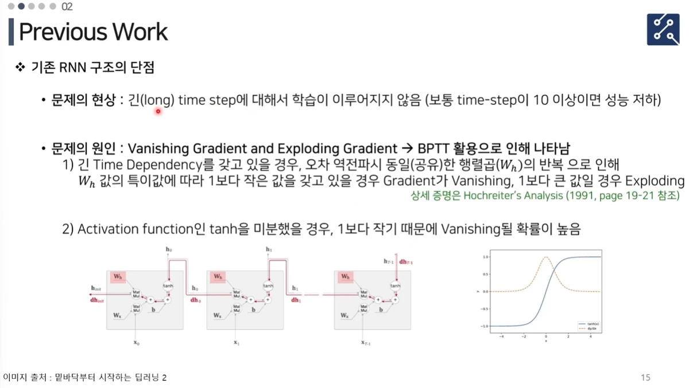

아래 왼쪽 그림에서 분홍색으로 칠한 $W_h$가 cell마다 똑같이 들어 있다는 것, 오른쪽 그래프에서 점선(tanh의 미분)이 0에서만 1이고 나머지에서는 1보다 작다는 것이 두 원인이다. 출처: 세미나 슬라이드

- 긴 시퀀스에서는 역전파 때 같은 행렬 $W_h$가 반복해서 곱해진다. $W_h$의 값에 따라 1보다 작은 값이 반복해서 곱해지면 gradient가 사라지고, 1보다 큰 값이 반복해서 곱해지면 gradient가 폭발한다.
- Activation function의 미분값도 매 step 곱해진다. 이 값이 1보다 작으면 긴 시퀀스를 거슬러 가는 동안 gradient가 점점 작아진다.

0.9를 열 번 곱하면 0.35쯤이 되고 백 번 곱하면 거의 0이 되는 것과 같은 이치다. 특히 vanishing gradient가 큰 문제였다. 여러 연구가 이를 풀려고 했지만 모두 한계가 있었다.

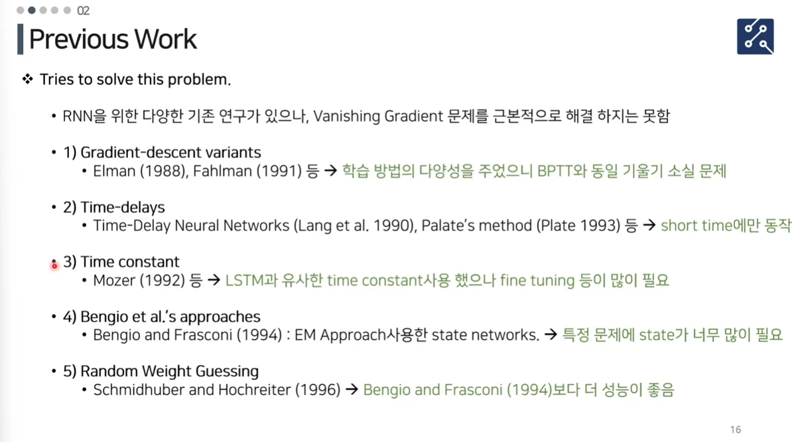

검은 글씨가 접근 방법, 초록 글씨가 그 한계다. 학습 방법을 바꾼 연구는 같은 기울기 소실을 겪었고, time delay를 쓴 연구는 짧은 구간에서만 동작했다. 출처: 세미나 슬라이드

저자들은 이 가운데 세 번째 줄의 time constant라는 개념과 비슷한 cell state를 모델에 넣는 방법을 택했다.

## LSTM의 세 가지 기여

저자들은 10 step이 넘는 긴 시퀀스를 처리하기 위한 RNN 구조로 LSTM을 제안한다. 한 unit에서 계산된 정보를 먼 time step까지 길게 전달하는 메모리 구조라는 뜻에서 이런 이름이 붙었다. 기여는 세 가지로 정리된다.

1. **장기 기억 cell의 도입**: CEC(Constant Error Carousel)라고 부르는 cell로 vanishing gradient를 막는다.
2. **Gate 구조의 도입**: 입력과 출력을 얼마나 통과시킬지를 gate가 학습으로 조절한다.
3. **학습 방법의 개선**: BPTT와 RTRL(Real-Time Recurrent Learning)의 변형을 섞어서 쓴다.

### 1. 장기 기억 cell

LSTM은 기존 RNN 구조에 장기 기억을 담당하는 cell state $C$를 추가했다. 이것이 LSTM의 핵심이다. 앞의 문제는 gradient가 cell을 지날 때마다 무언가가 곱해진다는 데서 왔다. 그래서 아무것도 곱해지지 않고 지나가는 길을 하나 따로 낸 것이다.

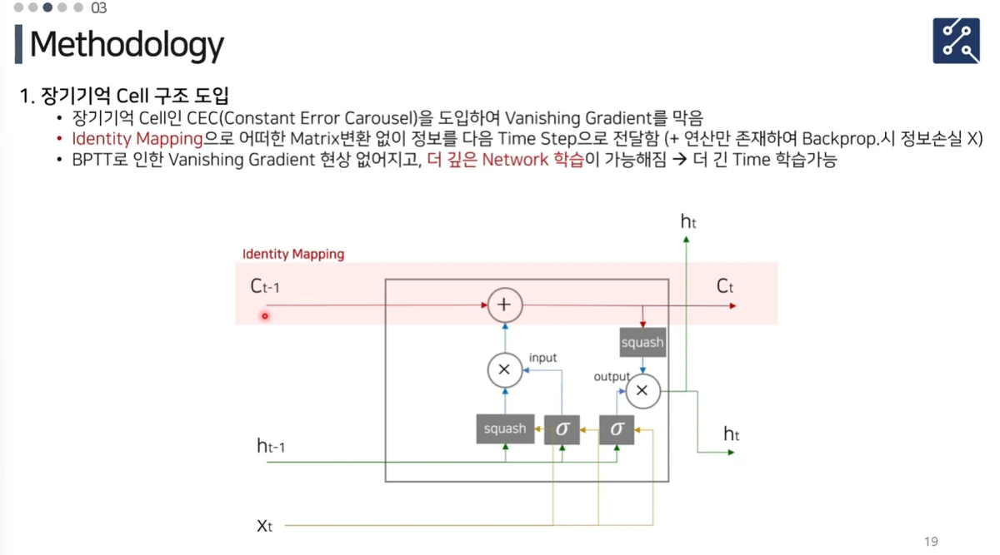

분홍색 띠로 칠한 맨 위의 가로선이 cell state의 경로다. $C_{t-1}$이 왼쪽에서 들어와 $+$ 하나만 지나 $C_t$로 나간다. 이 선 위에는 weight 행렬도 activation function도 없다. 출처: 세미나 슬라이드

Cell state는 이전 값 $C_{t-1}$에 새 정보를 **더해서** 다음 step으로 넘긴다.

$$
C_t = C_{t-1} + i_t \odot s_t
$$

곱이 아니라 더하기이므로, 역전파 때 $C_t$에서 $C_{t-1}$로 가는 경로의 gradient는 그대로 전달된다. 이 연산은 $C_{t-1}$에 weight 1.0을 곱해서 넘기는 것과 같고, $C_{t-1}$에서 $C_t$로의 identity mapping이라고 볼 수 있다. Cell state가 vanishing gradient를 막는 이유를 한 문장으로 쓰면, forward pass에서 정보가 선형으로 흐르기 때문에 backward pass에서도 gradient가 반복된 곱으로 줄어들지 않는다는 것이다.

!!! question "Q. 이것을 왜 identity mapping이라고 부르는가?"
    Identity mapping은 입력을 변형 없이 그대로 출력으로 전달하는 것이다. 뒤에 나올 forget gate까지 포함한 식 $C_t = f_t \odot C_{t-1} + i_t \odot \tilde{C}_t$로 보면, forget gate $f_t$가 1에 가깝고 input gate $i_t$가 0에 가까울 때 $C_t$는 $C_{t-1}$과 거의 같다. 항상 그런 것은 아니므로 엄밀한 의미의 identity mapping은 아니다. 그래도 이전 상태의 정보가 손실 없이 전달될 수 있는 경로가 있고, 새 정보는 필요할 때만 더해진다는 점에서 identity mapping의 개념을 넓혀 쓴 것으로 이해했다.

    한편 고속도로처럼 값을 그대로 넘기기만 하면 정보에 변화가 없다. 무엇을 더하고 무엇을 내보낼지는 gate가 맡는다.

[ResNet](01-resnet.md)과 견주어 보면, ResNet은 입력을 출력에 더해 줌으로써 block이 학습해야 할 것을 0에 가까운 변화량으로 바꾸어 학습 난이도를 낮췄다. Cell state와 마찬가지로 gradient가 유지되는 경로를 만들면서, 거기에 더해 학습 난이도 자체를 낮춘 관점이라고 해석할 수 있다.

### 2. Gate

Cell state의 길은 값을 그대로 넘기기만 한다. 그 길에 무엇을 올리고 무엇을 내릴지를 정하는 것이 gate다. Gate는 0과 1 사이의 값을 내는 sigmoid이고, 이 값을 곱해서 정보를 얼마나 통과시킬지를 조절하는 밸브처럼 쓴다.

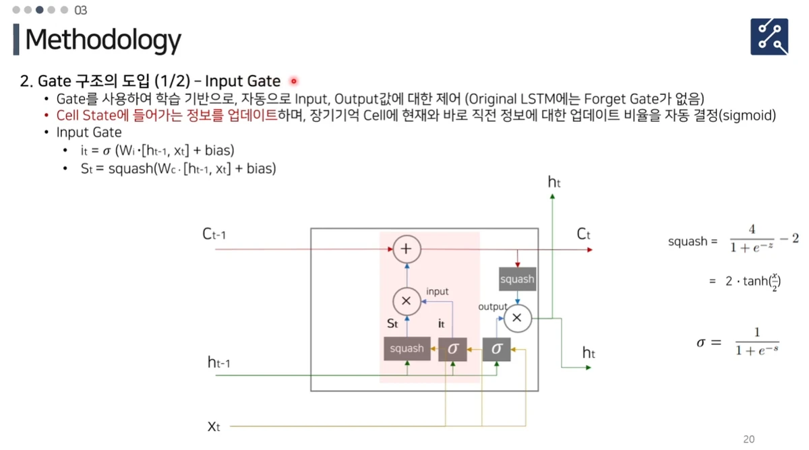

분홍색으로 칠한 부분이 input gate다. 아래의 squash 상자가 후보 정보 $s_t$를, 그 옆의 $\sigma$ 상자가 비율 $i_t$를 만들고, 둘이 $\times$에서 곱해져 위의 $+$로 올라가 cell state에 더해진다. 출처: 세미나 슬라이드

**Input gate**는 이전 step의 출력 $h_{t-1}$과 현재 입력 $x_t$를 받아 두 가지를 계산한다. 하나는 cell에 넣을 후보 정보 $s_t$이고, 다른 하나는 그 정보를 얼마나 넣을지를 0과 1 사이의 값으로 정하는 $i_t$다.

$$
i_t = \sigma(W_i [h_{t-1}, x_t] + b_i), \qquad \sigma(z) = \frac{1}{1 + e^{-z}}
$$

$$
s_t = \mathrm{squash}(W_c [h_{t-1}, x_t] + b_c), \qquad \mathrm{squash}(z) = \frac{4}{1 + e^{-z}} - 2 = 2\tanh\left(\frac{z}{2}\right)
$$

Squash는 tanh를 조금 변형한 함수다. $i_t \odot s_t$가 cell state에 더해진다.

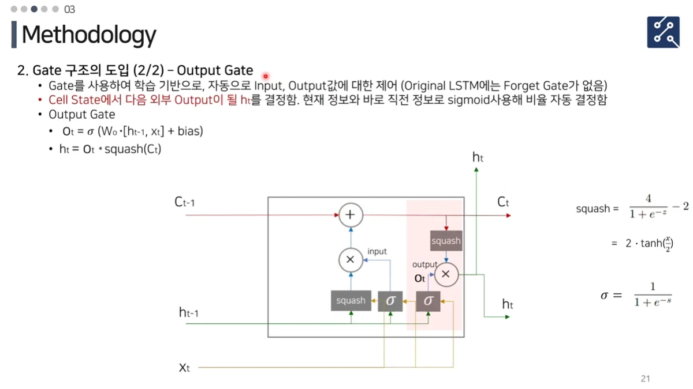

이번에는 오른쪽의 분홍색 부분이다. Cell state에서 아래로 갈라져 나온 값이 squash를 지나고, $\sigma$ 상자가 만든 비율 $o_t$와 $\times$에서 곱해져 $h_t$로 나간다. 출처: 세미나 슬라이드

**Output gate**는 cell state의 정보를 $h_t$로 내보낼 때 그 양을 조절한다. Input gate와 마찬가지로 $h_{t-1}$과 $x_t$로 0과 1 사이의 비율을 계산하고, squash를 거친 cell 값에 곱한다.

$$
o_t = \sigma(W_o [h_{t-1}, x_t] + b_o), \qquad h_t = o_t \odot \mathrm{squash}(C_t)
$$

두 gate 덕분에 장기적으로 유지해야 할 cell state가 학습에 의해 자동으로 갱신되고 출력된다.

### 3. 학습 방법

당시 RNN은 BPTT로 학습하거나, 특수한 경우에 RTRL을 썼다. RTRL은 forward 과정에서 미분값을 함께 계산해 나가므로 backward 연산이 따로 없고, 시퀀스 전체의 중간값을 저장해 둘 필요가 없어 메모리 면에서 유리하다. 대신 느리다.

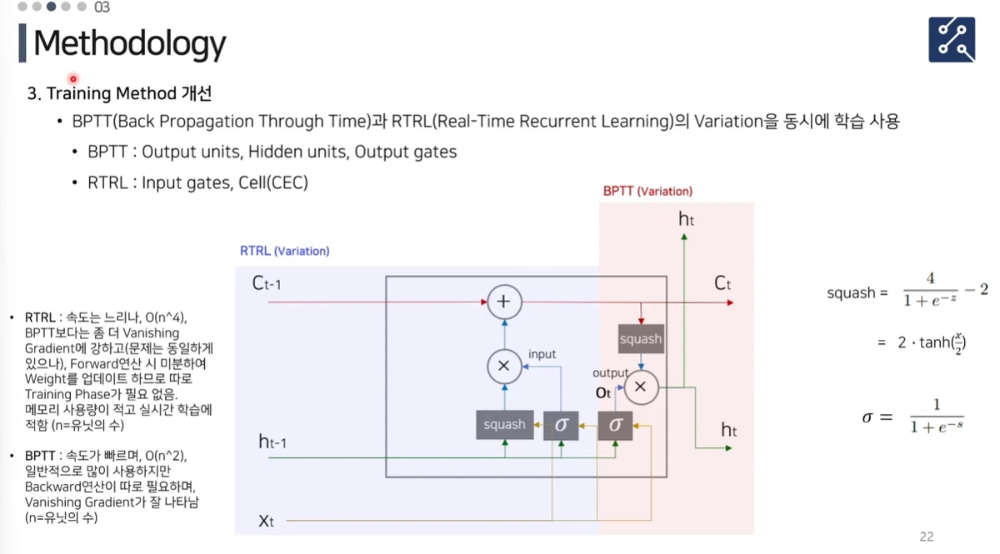

파란 영역(왼쪽)이 RTRL의 변형으로 학습하는 부분, 분홍 영역(오른쪽)이 BPTT의 변형으로 학습하는 부분이다. 출처: 세미나 슬라이드

그림에서 나뉜 대로, 저자들은 입력, cell state, input gate 쪽은 RTRL로, output gate와 출력 쪽은 BPTT로 학습하는 방식을 썼다. Gradient를 일부 경로에서 잘라 내는(truncated) 방식이다. 다만 왜 이렇게 섞었는지는 논문에 분명히 설명되어 있지 않다.

## 세 가지 기여를 다시 들여다보기

### Cell state와 residual connection

BPTT에서 시퀀스가 길다는 것은 deep neural network에서 hidden layer를 많이 쌓은 것과 같은 상황이다. 시계열 문제에서 긴 시퀀스 때문에 생기는 vanishing gradient는, 깊이를 늘렸을 때 생기는 vanishing gradient와 같은 문제다.

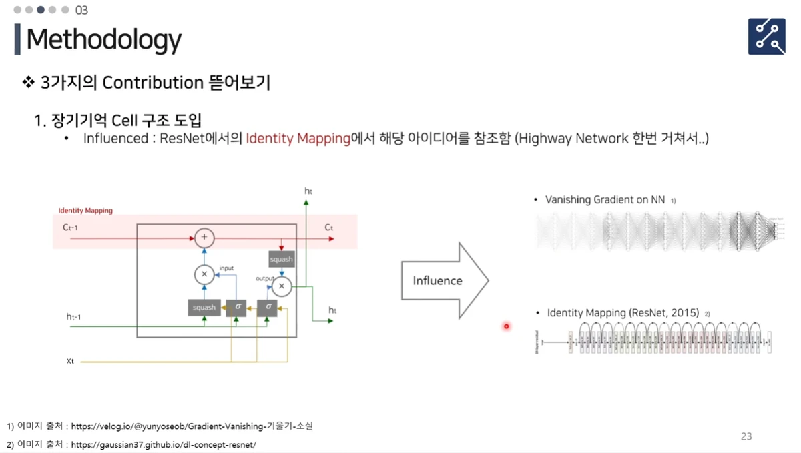

왼쪽 LSTM의 분홍색 가로선과, 오른쪽 아래 ResNet 그림에서 layer 위를 건너뛰는 여러 개의 호가 같은 역할을 한다. 둘 다 값을 변형 없이 다음으로 넘기는 길이다. 출처: 세미나 슬라이드

그렇게 보면 이전 cell 값을 identity로 받아 현재 값에 더하는 LSTM의 아이디어는 convolutional network의 residual connection과 같은 방법론이다. LSTM에서는 그 길이 시간 방향으로, ResNet에서는 깊이 방향으로 나 있다는 점만 다르다. 1997년에 나온 구조가 2015년의 모델에 영향을 주었고 지금도 여러 방법에 쓰이고 있다.

### Gate와 Highway Network

ResNet은 Highway Network와 가까운 관계에 있는데, 그 Highway Network에 직접 영향을 준 것이 LSTM이다.

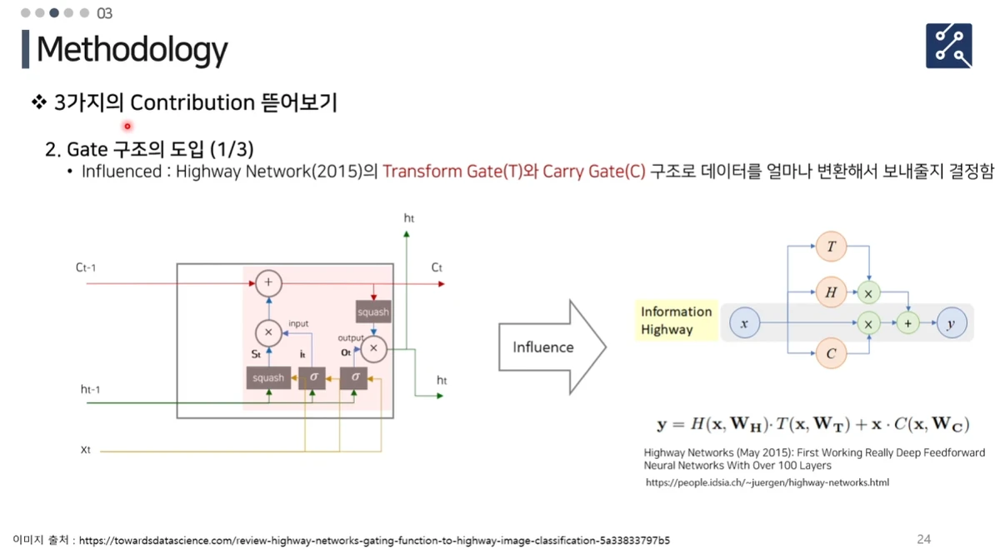

오른쪽이 Highway Network다. 가운데 회색 띠가 입력 $x$를 그대로 넘기는 길(information highway)이고, $T$가 변환한 값 $H$를 얼마나 쓸지, $C$가 $x$를 얼마나 그대로 넘길지를 정한다. 출처: 세미나 슬라이드

Highway Network는 시계열이 아닌 일반 네트워크에 transform gate($T$)와 carry gate($C$)를 두어, 입력을 얼마나 변환하고 얼마나 그대로 넘길지를 정한다. 그림 아래의 식이 그 내용이다.

$$
y = H(x, W_H) \cdot T(x, W_T) + x \cdot C(x, W_C)
$$

Residual learning보다 연산량이 많고 복잡하지만, 100 layer가 넘는 네트워크를 학습시킬 수 있음을 처음 보인 구조다.

### Forget gate는 왜 추가되었나

원래의 LSTM에는 forget gate가 없다. Cell state가 항상 weight 1.0으로 넘어가기만 하니 문제가 생겼고, 저자들은 후속 논문(Gers et al., "Learning to Forget")에서 forget gate를 추가했다.

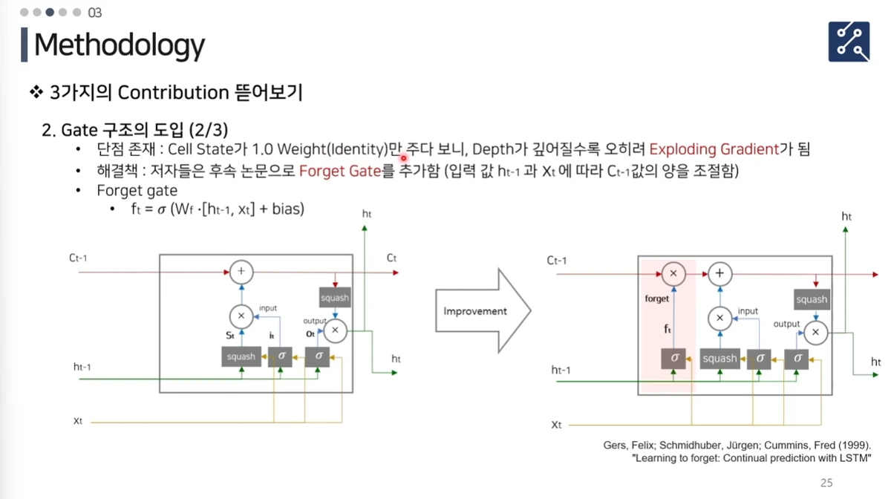

왼쪽이 원래 구조, 오른쪽이 고친 구조다. 오른쪽에서 분홍색으로 칠한 부분이 새로 생긴 forget gate이고, cell state의 가로선 위에 $\times$가 하나 더 생겼다. $C_{t-1}$이 이제 $f_t$와 곱해진 뒤에 더해진다. 출처: 세미나 슬라이드

Forget gate는 $h_{t-1}$과 $x_t$에 따라 $C_{t-1}$을 얼마나 남길지를 조절한다.

$$
f_t = \sigma(W_f [h_{t-1}, x_t] + b_f), \qquad C_t = f_t \odot C_{t-1} + i_t \odot s_t
$$

노트에는 이 문제를 강의의 표현대로 "exploding gradient"라고 적어 두었는데, 후속 논문이 지적한 것은 좀 더 정확히 말하면 cell state의 **값**이 끝없이 커지는 문제다. 끊기지 않고 계속 들어오는 입력에서는 weight 1.0으로 더해지기만 하는 cell state가 한없이 누적되고, 그러면 출력 쪽 squash 함수가 포화되어 cell이 기억 장치로서 제 역할을 하지 못한다. Forget gate는 필요할 때 cell state를 줄이거나 비울 수 있게 해 준다.

정리하면 흐름은 이렇다. $C_{t-1}$은 (원래 구조에서는) 반드시 weight 1.0으로 다음 step에 전달된다. 여기에 더해지는 값은 $h_{t-1}$과 $x_t$로 계산한 후보 $s_t$를 input gate $i_t$로 조절한 것이다. 이렇게 만들어진 $C_t$에 다시 squash를 취하고 output gate $o_t$를 곱해 $h_t$를 내보낸다. Forget gate는 이 가운데 $C_{t-1}$이 넘어가는 양을 조절하는 자리에 들어간다.

### Squash 함수는 왜 tanh 계열인가

논문이 이유를 분명히 밝히지는 않았다. 강의에서는 후보가 될 만한 함수들의 미분값을 견주어 다음과 같이 추측한다.

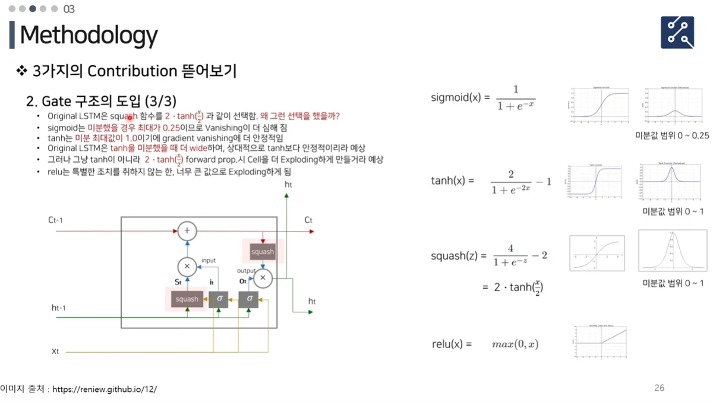

오른쪽의 그래프 쌍에서 왼쪽이 함수, 오른쪽이 그 미분이다. Sigmoid의 미분은 봉우리가 0.25까지밖에 올라가지 않고, tanh와 squash의 미분은 1까지 올라간다. Squash의 봉우리가 tanh보다 옆으로 넓다는 것도 보인다. 출처: 세미나 슬라이드

- Sigmoid는 미분의 최댓값이 0.25여서 vanishing gradient가 더 심해진다.
- tanh는 미분값이 0에서 1 사이이고 최댓값이 1이어서 vanishing과 exploding을 모두 피하기에 유리하다.
- LSTM이 쓴 $2\tanh(z/2)$는 tanh보다 미분값이 넓게 퍼져 있어, gradient가 0으로 빨리 떨어지는 것을 막기에 더 좋았을 것이다. 대신 값의 범위가 넓어 cell 값이 커지는 문제에는 더 취약했을 것이다.
- ReLU는 별도의 조치가 없으면 값이 너무 커질 수 있어 squash 자리에는 쓰지 않는다.

### RTRL과 BPTT를 왜 섞었나

RTRL은 복잡도가 $O(n^4)$로 매우 느리고 구현도 복잡하다. 그런데도 저자들이 RTRL과 BPTT를 섞은 이유는 논문에 나와 있지 않다. 강의에서 든 추측은 다음과 같다.

- 당시에는 메모리가 부족해서 모든 학습을 BPTT로 하기 어려웠을 것이다. 강의 슬라이드는 1997년 무렵 고사양 PC의 메모리가 64MB 수준이었다는 점을 든다.
- 2005년 무렵부터는 RTRL이 쓰이지 않고 full BPTT로 통합되었다. Momentum을 쓰는 SGD 같은 최적화 기법이 발전해 수렴이 쉬워졌기 때문으로 보인다. 원래의 LSTM은 batch 학습을 하지 않았으므로 더 그랬을 것이다.
- 긴 시퀀스의 학습에는 학습 방법보다 cell state 구조가 더 지배적인 영향을 주었을 것이다.
- RTRL은 너무 느려서 쓰기 어렵고, 그 뒤 forget gate, dropout, normalization 같은 기법이 더해지면서 필요가 없어졌을 것이다.

강의에서는 RTRL이 BPTT보다 vanishing gradient에 강하다는 설명도 있었다. 이 부분은 그대로 받아들이기 어렵다. 잘라 내지 않은 RTRL과 BPTT는 같은 gradient를 계산하는 서로 다른 절차이므로, gradient가 사라지는 정도는 알고리즘이 아니라 모델 구조에 달려 있다. LSTM에서 gradient가 유지되는 것은 cell state의 더하기 경로 덕분이고, 학습 알고리즘의 차이는 계산 비용과 메모리 사용량에서 나타난다고 보는 것이 맞다.

## 현재의 LSTM

지금 흔히 말하는 LSTM은 forget, input, output gate를 모두 쓰고 squash 자리에 tanh를 쓰며, full BPTT로 학습한다. 강의에서는 약 1,000 step까지 학습이 된다고 알려져 있다고 소개한다.

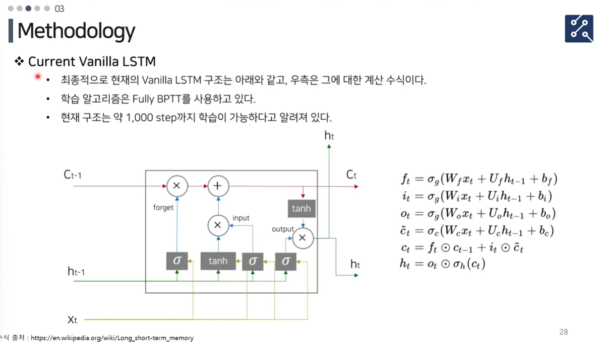

앞의 그림들과 견주면 $\sigma$ 상자가 셋(forget, input, output)으로 늘었고 squash 상자가 tanh로 바뀌었다. 맨 위 가로선을 왼쪽에서 오른쪽으로 따라가면 $\times$(잊기), $+$(더하기)의 순서로 $c_t = f_t \odot c_{t-1} + i_t \odot \tilde{c}_t$가 만들어진다. 출처: 세미나 슬라이드

그림 오른쪽의 식을 옮기면 다음과 같다.

$$
\begin{aligned}
f_t &= \sigma(W_f x_t + U_f h_{t-1} + b_f) \\
i_t &= \sigma(W_i x_t + U_i h_{t-1} + b_i) \\
o_t &= \sigma(W_o x_t + U_o h_{t-1} + b_o) \\
\tilde{c}_t &= \tanh(W_c x_t + U_c h_{t-1} + b_c) \\
c_t &= f_t \odot c_{t-1} + i_t \odot \tilde{c}_t \\
h_t &= o_t \odot \tanh(c_t)
\end{aligned}
$$

## 실험

논문은 여섯 가지 실험으로 LSTM의 성능을 보였다. 실험의 설계에서 눈에 띄는 점은 학습 때 짧은 예제를 쓰지 않고, 학습과 테스트 모두 긴 time lag을 가진 예제를 썼다는 것이다. 이전 연구 가운데에는 짧은 예제로 학습하고 긴 예제로 테스트한 것이 있었는데, 그렇게 해서는 긴 시퀀스를 정말로 학습한 것인지 확인할 수 없기 때문이다.

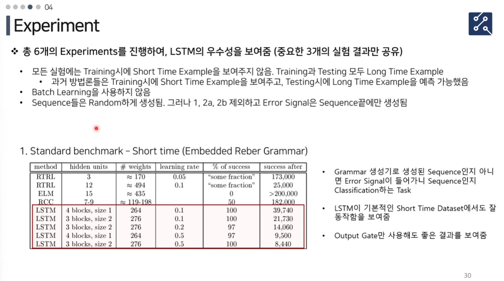

세미나에서 소개한 첫 번째 실험의 결과다. 빨간 상자가 LSTM의 행이고, 오른쪽 두 열이 성공률(% of success)과 성공할 때까지 걸린 횟수(success after)다. LSTM은 성공률이 97~100%이고, 걸린 횟수도 8,440~39,740으로 다른 방법(25,000~200,000 이상)보다 대체로 적다. 출처: 세미나 슬라이드(표는 원 논문)

이 실험은 짧은 time lag의 표준 benchmark(Embedded Reber Grammar)다. 긴 시퀀스를 위해 만든 LSTM이 기본적인 짧은 시퀀스 문제에서도 잘 동작한다는 것을 먼저 보인 것이다.

또 batch 학습을 하지 않고 예제를 하나씩 보여 주며 갱신하는 online learning(incremental learning)을 썼다. 용어를 정리해 두면 다음과 같다.

| 방식 | 파라미터를 갱신하는 단위 |
|---|---|
| Stochastic Gradient Descent | 예제 하나 |
| Batch Gradient Descent | 전체 데이터 |
| Mini-batch Gradient Descent | mini-batch |

## 정리

- LSTM은 RNN에 cell state라는 더하기 경로(identity mapping)를 두어, 긴 시퀀스에서도 gradient가 안정적으로 전달되게 했다. 이 생각은 Highway Network와 ResNet 같은 이후의 구조에 영향을 주었다.
- Gate를 두어 정보가 들어오고 나가는 비율을 학습으로 조절한다.
- 원래의 LSTM에 forget gate가 추가되고 학습 방법이 full BPTT로 바뀌어 지금의 구조가 되었다.

## 참고 자료

- S. Hochreiter, J. Schmidhuber, "Long Short-Term Memory", Neural Computation 9(8), 1997.
- F. A. Gers, J. Schmidhuber, F. Cummins, "Learning to Forget: Continual Prediction with LSTM", Neural Computation 12(10), 2000.
- R. K. Srivastava, K. Greff, J. Schmidhuber, "Highway Networks", 2015. <https://arxiv.org/abs/1505.00387>
- 서울대학교 산업공학과 DSBA 연구실, "[Paper Review] Long Short-Term Memory (Neural Computation 1997)" (YouTube). <https://www.youtube.com/watch?v=IgIHjiCgECw>
