# Autoencoder: manifold learning, 규제, 응용

작성일 2024-11-24
{ .post-date }

Autoencoder를 소개하는 공개 세미나 영상을 보고 정리한 글이다. Autoencoder가 무엇이고 왜 쓰는지, bias-variance tradeoff의 관점에서 어떤 변형들이 나왔는지, 그리고 어디에 쓰이는지를 차례로 본다. 세미나가 manifold learning 쪽을 중심으로 설명하므로 이 글도 그 범위를 따른다.

## Autoencoder란

Autoencoder는 label이 없는 데이터의 효과적인 코딩(표현)을 배우는 데 쓰는 신경망이다. Label이 필요 없으므로 비지도 학습에 속한다.

하는 일은 단순하다. 입력을 좁은 통로로 밀어 넣었다가 다시 꺼내서, 꺼낸 것이 넣은 것과 같아지게 만든다. 통로가 좁으니 입력을 그대로 베낄 수는 없고, 중요한 것만 추려 담는 법을 배워야 한다.

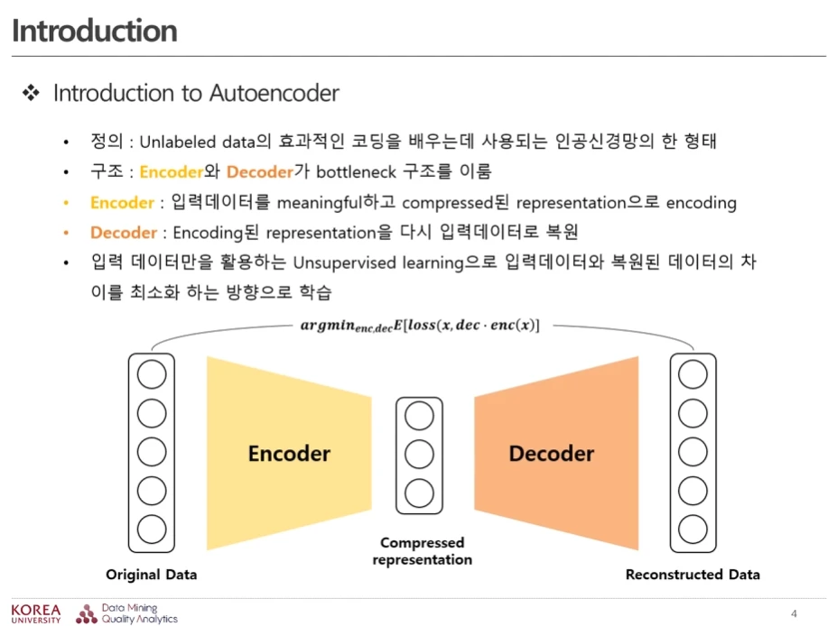

왼쪽의 원 다섯 개(입력)가 가운데에서 세 개로 줄었다가 오른쪽에서 다시 다섯 개가 된다. 노란 사다리꼴이 줄이는 쪽(encoder), 주황 사다리꼴이 되돌리는 쪽(decoder)이다. 맨 위의 식은 양 끝의 두 데이터가 같아지도록 학습한다는 뜻이다. 출처: 세미나 슬라이드

구조는 그림처럼 encoder와 decoder가 가운데가 좁은 bottleneck 모양을 이룬다.

- **Encoder**: 입력 데이터를 의미 있고 압축된 representation으로 바꾼다.
- **Decoder**: 압축된 representation을 다시 입력 데이터로 복원한다.

학습은 입력과 복원된 데이터의 차이를 줄이는 방향으로 한다.

$$
\min_{\mathrm{enc},\, \mathrm{dec}} \ \mathbb{E}\big[\mathrm{loss}\big(x, \mathrm{dec}(\mathrm{enc}(x))\big)\big]
$$

Autoencoder를 쓰는 목적은 크게 두 가지다. 같은 구조에서 어느 쪽 절반을 얻으려 하느냐가 다르다.

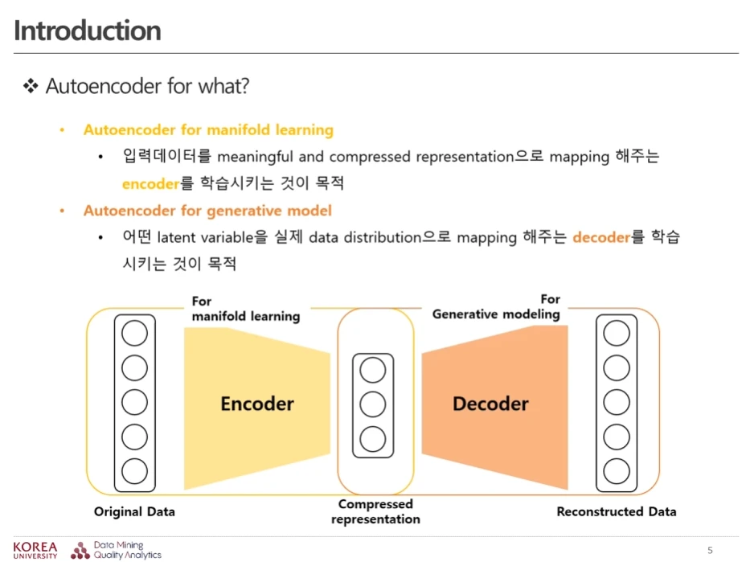

노란 테두리로 묶인 왼쪽 절반(입력에서 representation까지)이 manifold learning에 쓰는 부분, 주황 테두리로 묶인 오른쪽 절반(representation에서 데이터까지)이 생성 모델에 쓰는 부분이다. 출처: 세미나 슬라이드

1. **입력을 압축된 representation으로 mapping하는 encoder를 얻기 위해.** Manifold learning을 위한 autoencoder이고, encoder를 학습시키려고 decoder를 붙인 구조다.
2. **Latent variable을 실제 데이터의 분포로 mapping하는 decoder를 얻기 위해.** 생성 모델을 위한 autoencoder이고, decoder를 학습시키려고 encoder를 붙인 구조다.

## Manifold learning

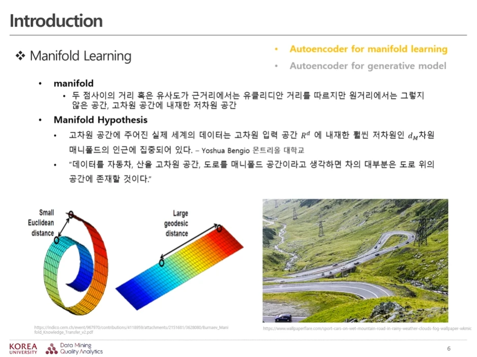

왼쪽 아래의 두 그림에서 같은 두 점을 잇는 화살표의 길이를 견주어 보면 된다. 말려 있을 때는 짧고(small Euclidean distance), 펼치면 길다(large geodesic distance). 오른쪽 사진은 manifold 가정을 설명하는 비유다. 출처: 세미나 슬라이드

Manifold는 가까운 범위에서는 유클리드 공간처럼 보이지만 전체로는 그렇지 않은 공간이다. 두 점 사이의 거리(유사도)가 근거리에서는 Euclidean distance를 따르지만 원거리에서는 따르지 않는다. 쉽게 말하면 고차원 공간에 들어 있는 저차원 공간이다. 그림의 돌돌 말린 면 위의 두 점은 3차원 공간에서 직선으로 재면 가깝지만, 면을 펼친 2차원에서 재면 멀리 떨어져 있다. 두 점이 실제로 얼마나 다른지를 말해 주는 것은 면을 따라 잰 뒤쪽의 거리다.

데이터의 관점에서는 이렇게 가정한다. 고차원 공간에 주어진 실제 데이터는 공간 전체에 퍼져 있지 않고, 그 안에 있는 훨씬 저차원의 manifold 근처에 몰려 있다. 슬라이드의 도로 사진이 이 가정을 비유한 것이다. 데이터를 자동차, 산 전체를 고차원 공간, 도로를 manifold라고 생각하면 차는 대부분 도로 위에 있다. 산은 넓지만 차가 있을 수 있는 곳은 가느다란 도로뿐이다. Manifold learning은 이 가정 아래 저차원 구조를 찾아내는 비선형 차원 축소이자 비지도 학습이다.

Manifold learning을 쓰는 이유는 두 가지로 정리했다.

1. **차원의 저주.** 고차원 공간에서는 데이터가 희박하게 분포해서 비슷한 데이터끼리의 특성을 파악하기 어렵다. 차원을 줄여 이 문제를 풀고 학습 속도와 성능을 높인다.
2. **고차원에서의 거리는 믿기 어렵다.** 고차원 공간에서 가까워 보이는 두 점이 manifold 위에서는 멀고 의미도 전혀 다를 수 있다. 고차원에서 그대로 해석하려 해도 그 거리가 의미 있는 것이 아닐 수 있다는 뜻이다.

정리하면 데이터를 저차원으로 줄이면서도 본질적인 구조와 특성을 보존하려는 것이고, PCA 같은 선형 방법으로는 놓칠 수 있는 비선형 관계를 잡아내려는 것이다.

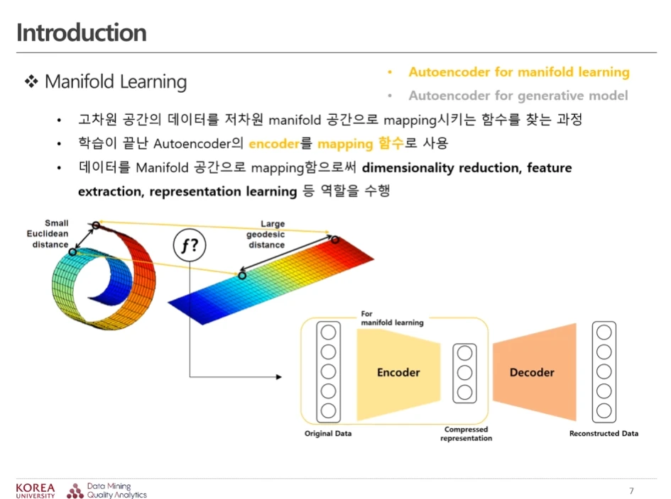

말린 면의 점을 펼친 면의 점으로 보내는 노란 화살표가 찾으려는 함수 $f$이고, 그 $f$에서 내려온 화살표가 autoencoder의 encoder를 가리킨다. 출처: 세미나 슬라이드

Manifold learning은 고차원 데이터를 저차원 manifold로 mapping하는 함수를 찾는 과정이다. 그림의 표현으로는 말린 면을 펼쳐 주는 함수 $f$를 찾는 일이다. 학습이 끝난 autoencoder의 encoder를 이 mapping 함수로 쓰면 dimensionality reduction, feature extraction, representation learning을 할 수 있다.

생성 모델은 반대로 실제 데이터의 분포를 학습해 데이터를 만들어 낸다. GAN(Generative Adversarial Network)과 VAE(Variational Autoencoder)가 대표적이다.

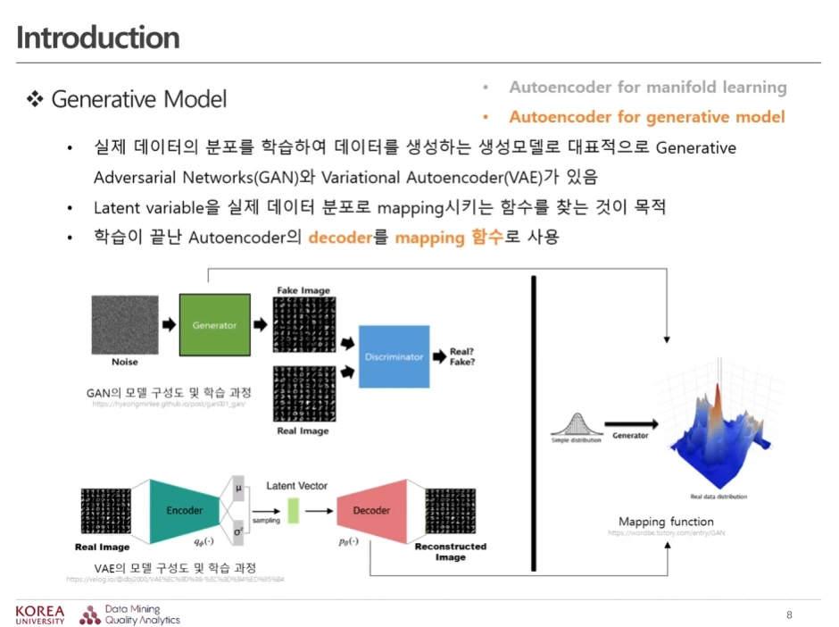

오른쪽 그림이 생성 모델이 하려는 일이다. 종 모양의 단순한 분포에서 뽑은 값을 울퉁불퉁한 실제 데이터 분포의 한 점으로 보낸다. 왼쪽 위 GAN의 generator와 왼쪽 아래 VAE의 decoder가 이 일을 맡는다. 출처: 세미나 슬라이드

Latent variable을 실제 데이터 분포로 mapping하는 함수를 찾는 것이 목적이고, 학습이 끝난 autoencoder의 decoder를 그 함수로 쓴다.

두 목적에 따라 autoencoder의 종류도 갈린다.

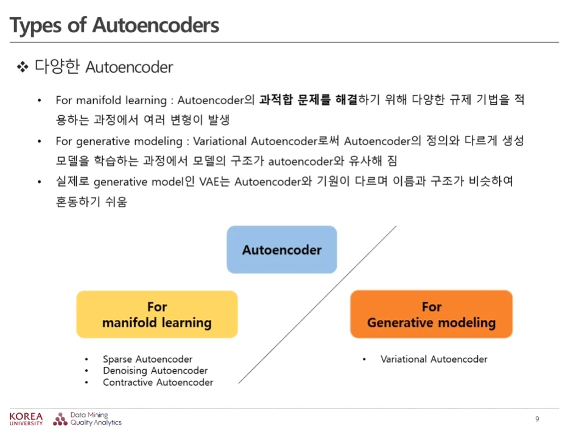

왼쪽 갈래에 sparse, denoising, contractive autoencoder가, 오른쪽 갈래에 variational autoencoder가 있다. 출처: 세미나 슬라이드

슬라이드는 VAE가 이름과 구조는 비슷하지만 autoencoder와 기원이 다르다는 점도 짚는다. 생성 모델을 학습하는 과정에서 구조가 autoencoder와 비슷해진 것이어서 혼동하기 쉽다. 이 글은 왼쪽 갈래만 다룬다.

## Bias-variance tradeoff와 규제

Manifold learning을 위한 autoencoder에는 여러 변형이 있는데, 과적합 문제를 풀기 위해 다양한 규제(regularization) 기법을 적용하는 과정에서 파생된 것들이다. 그래서 세미나는 먼저 bias와 variance를 설명한다.

어떤 데이터에 대해 모델을 만들 때 모델의 error는 세 항으로 나뉜다.

$$
\text{Total Error} = \text{Bias}^2 + \text{Variance} + \text{Irreducible Error}
$$

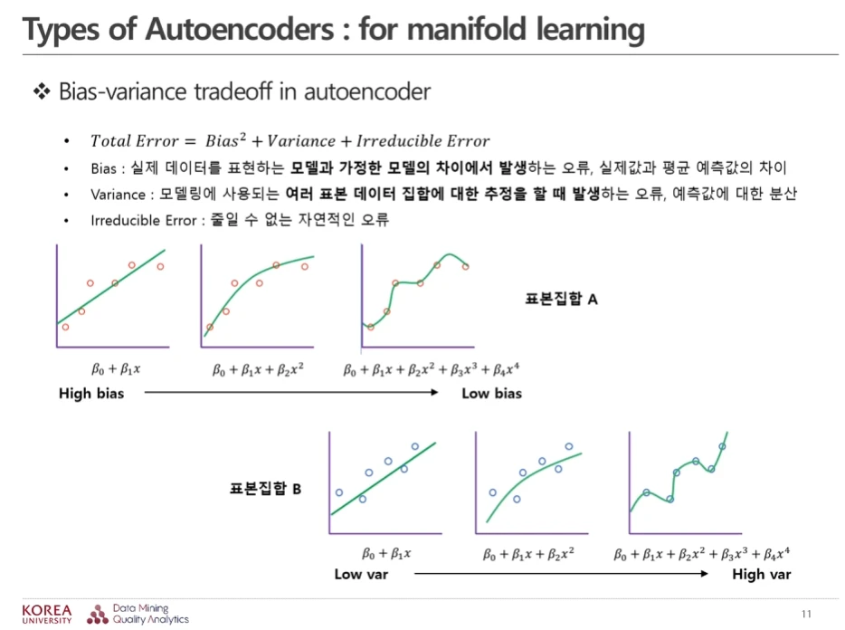

윗줄(표본 집합 A)에서는 왼쪽에서 오른쪽으로 갈수록 초록 곡선이 점들에 더 바짝 붙는다. 그다음 윗줄과 아랫줄(표본 집합 B)을 세로로 견주어 본다. 1차 함수는 두 줄에서 거의 같은 직선인데, 4차 함수는 표본이 바뀌자 모양이 전혀 달라졌다. 출처: 세미나 슬라이드

- **Bias**: 실제 데이터를 만들어 낸 모델과 우리가 가정한 모델의 차이에서 생기는 error다. 실제값과 평균 예측값의 차이라고 할 수 있다. 그림의 윗줄처럼 같은 데이터에 1차 함수, 2차 함수, 4차 함수를 차례로 맞춰 보면 차수가 높아질수록 이 error가 줄어든다(high bias에서 low bias로).
- **Variance**: 모델의 예측값이 얼마나 흩어지는지를 나타낸다. 표본 집합을 바꿔 가며 모델을 추정할 때 생기는 error다. 그림에서 표본 집합 A로 맞춘 모델과 표본 집합 B로 맞춘 모델을 비교하면, 차수가 높을수록 두 모델의 모양이 크게 달라진다(low var에서 high var로).
- **Irreducible error**: 줄일 수 없는 자연적인 오류다.

Variance에 대해서는 따로 풀어서 적어 두었다. Variance는 모델이 학습 데이터의 작은 변화(예를 들어 표본을 어떻게 뽑았는지에 따른 차이)에 얼마나 민감하게 반응하는지를 나타낸다. Variance가 크다는 것은 데이터가 조금만 달라져도 모델의 출력이 크게 달라진다는 뜻이다. 그림의 맨 오른쪽 열이 그 예다. 4차 함수로 맞춘 모델은 bias는 작지만, 표본이 바뀌면 곡선이 크게 출렁인다.

모델이 복잡해지면(layer와 node가 늘어 파라미터가 많아지면) 데이터의 더 세부적인 패턴을 학습할 수 있다. 그 결과 데이터에 섞인 잡음이나 우연한 특성까지 학습하게 되고, 새로운 데이터에서는 불안정한 성능을 보인다. 복잡한 모델은 학습 데이터를 완벽히 맞추려고 데이터를 통째로 암기하는 경향이 있고, 이것이 과적합이다. 그래서 모델이 데이터의 사소한 특성까지 암기하지 않도록 적절한 규제가 필요하다.

Bias와 variance는 tradeoff 관계다. 모델의 복잡도가 높아질수록 bias는 줄고 variance는 늘어난다.

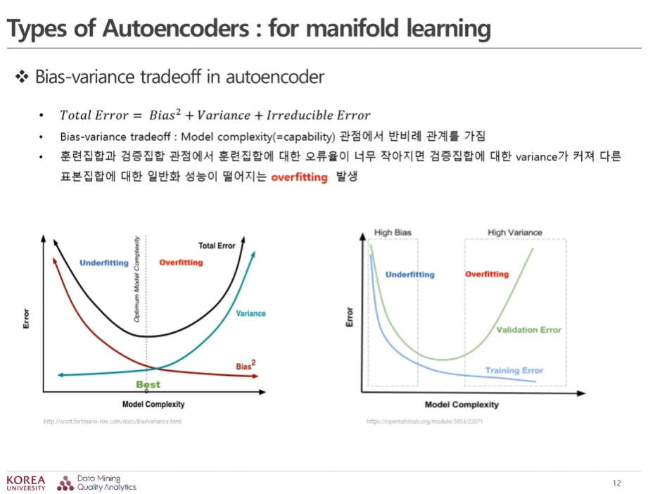

가로축은 두 그래프 모두 모델의 복잡도다. 왼쪽에서 빨간 선(bias)은 내려가고 청록 선(variance)은 올라가며, 둘을 더한 검은 선(total error)은 U자가 되어 가운데 어딘가에서 가장 낮다. 오른쪽은 같은 현상을 학습 집합과 검증 집합의 error로 본 것이다. 출처: 세미나 슬라이드

오른쪽 그래프에서 파란 선(training error)은 복잡도가 높아질수록 계속 내려가는데, 초록 선(validation error)은 어느 지점부터 다시 올라간다. 학습 집합의 error가 지나치게 작아지면 다른 표본 집합에서의 variance가 커져 일반화 성능이 떨어지는 것이고, 이 구간이 overfitting이다. 따라서 total error를 가장 작게 하는 복잡도, 곧 왼쪽 그래프의 점선 위치를 찾아야 한다.

그런데 데이터에 딱 맞는 복잡도를 찾기는 매우 어렵다. 그래서 딥러닝은 모델의 복잡도를 충분히 높여 놓고, 규제 기법으로 bias를 조금 높이는 대신 variance를 크게 낮추는 방향으로 발전했다.

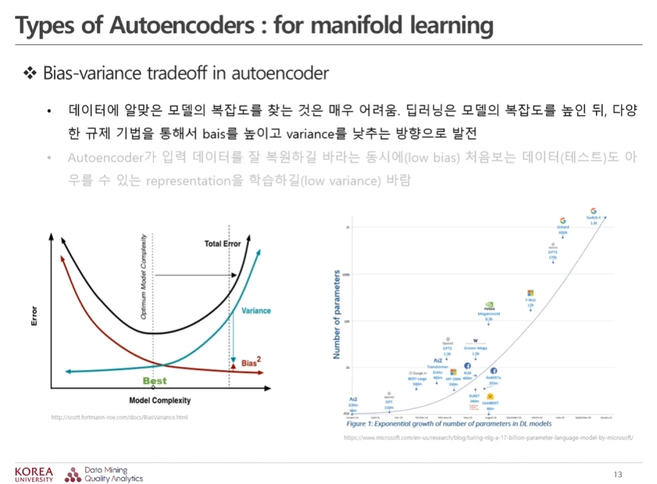

왼쪽 그래프에서 오른쪽 점선이 복잡도를 높여 놓은 지점이다. 거기서 빨간 화살표(bias가 커지는 양)는 짧고 청록 화살표(variance가 줄어드는 양)는 길다. 오른쪽은 언어 모델의 파라미터 수를 등장 시기에 따라 찍은 그래프다. 출처: 세미나 슬라이드

왼쪽 그래프의 두 화살표가 말하듯, 규제를 걸면 bias가 커지는 양보다 variance가 줄어드는 양이 더 크다. 오른쪽 그래프처럼 언어 모델의 크기를 등장 시기별로 보면 최근 모델일수록 복잡도가 아주 크고, 이런 모델들은 여러 규제를 적용해 일반화 성능을 확보한다.

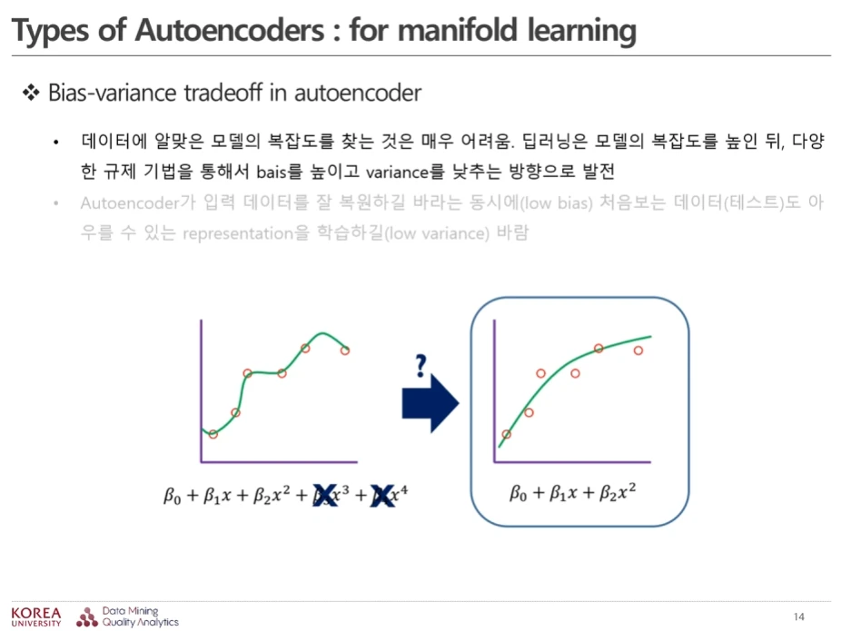

규제가 하는 일을 앞의 다항식 예로 그린 것이다. 4차 함수에서 $x^3$과 $x^4$ 항에 X 표를 쳐서 쓰지 못하게 하면, 점마다 구불구불 따라가던 곡선이 오른쪽의 매끈한 곡선이 된다. 출처: 세미나 슬라이드

규제는 이 그림처럼 모델에 어떤 제약을 걸어 모델이 가진 용량을 다 쓰지 못하게 하는 것이고, 이를 통해 학습 데이터를 그냥 외워 버리는 일을 막는다.

Autoencoder에도 같은 tradeoff가 있다. 우리는 autoencoder가 입력을 잘 복원하기를 바라면서(low bias), 동시에 처음 보는 데이터까지 아우르는 representation을 학습하기를 바란다(low variance). 앞의 것은 입력에 민감하게 반응해야 한다는 요구이고, 뒤의 것은 둔감하게 반응해야 한다는 요구다. Autoencoder 역시 복잡도를 높인 뒤 규제를 적용하는 길을 갔고, 그 과정에서 아래의 변형들이 나왔다.

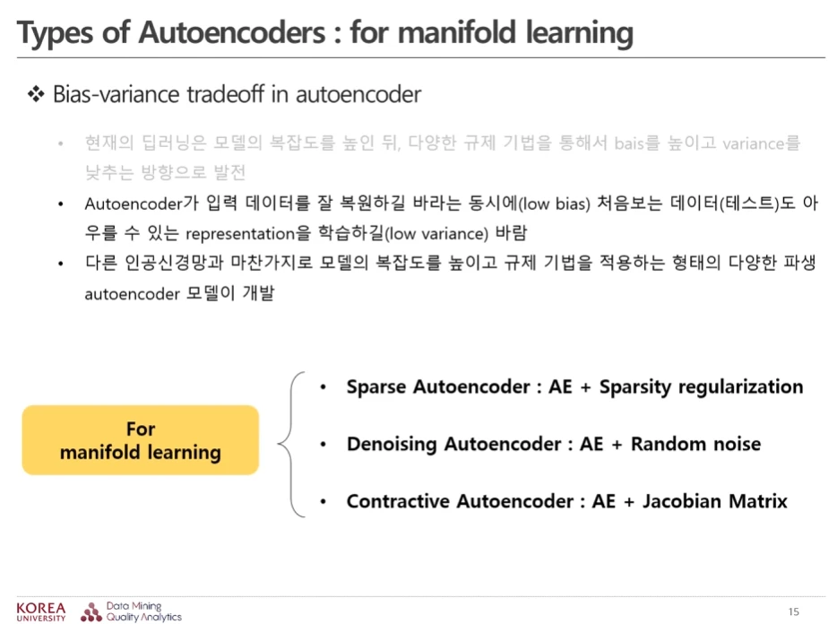

세 변형은 모두 "기본 autoencoder + 규제 하나"의 꼴이다. 더하는 것이 각각 sparsity 규제, 무작위 잡음, Jacobian matrix다. 출처: 세미나 슬라이드

## 규제를 넣은 autoencoder

### Sparse autoencoder

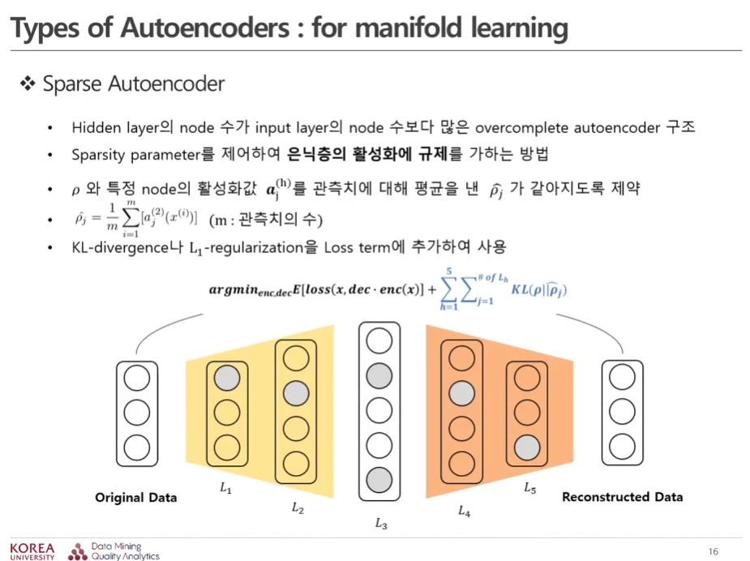

앞의 autoencoder 그림과 달리 가운데로 갈수록 원이 많아진다(입력 3개, 가운데 5개). 대신 층마다 한두 개의 원만 회색으로 칠해 구분해 두었다. 한 번에 활성화되는 node가 일부뿐이라는 표시다. 출처: 세미나 슬라이드

다른 autoencoder와 달리 hidden layer의 node 수가 입력 layer보다 많은 overcomplete 구조를 가진다. 통로를 좁히는 대신, 넓은 통로에서 한 번에 쓸 수 있는 node의 수를 줄이는 방식이다. Hidden layer에서 실제로 활성화되는 node가 적어지도록(sparse하도록) 제약을 건다.

Sparsity parameter $\rho$를 정하고, hidden node $j$의 활성화 값을 전체 관측치 $m$개에 대해 평균 낸 값 $\hat{\rho}_j$가 $\rho$와 같아지도록 한다.

$$
\hat{\rho}_j = \frac{1}{m} \sum_{i=1}^{m} a_j\big(x^{(i)}\big)
$$

이 제약은 loss에 KL divergence 항이나 L1 regularization 항을 추가해서 구현한다.

$$
\min_{\mathrm{enc},\, \mathrm{dec}} \ \mathbb{E}\big[\mathrm{loss}\big(x, \mathrm{dec}(\mathrm{enc}(x))\big)\big] + \sum_{j} \mathrm{KL}\big(\rho \,\|\, \hat{\rho}_j\big)
$$

### Denoising autoencoder

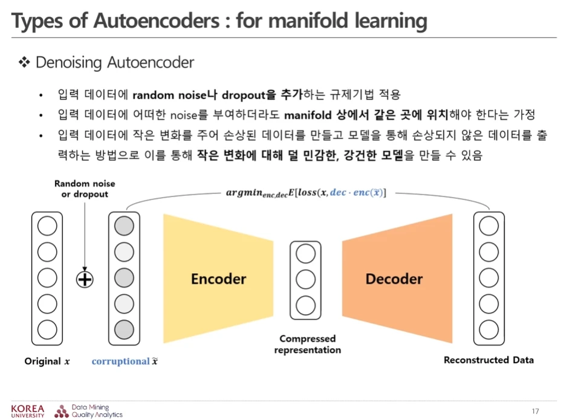

맨 왼쪽의 원래 입력 $x$에 잡음이 더해져 회색이 섞인 $\tilde{x}$가 되고, encoder에는 이 $\tilde{x}$가 들어간다. 그런데 위의 식에서 loss는 복원 결과를 $\tilde{x}$가 아니라 원래의 $x$와 비교한다. 출처: 세미나 슬라이드

이름 그대로 잡음을 제거하는 autoencoder다. 입력 데이터에 무작위 잡음을 더하거나 dropout을 적용해 일부러 손상시킨 뒤, 모델이 손상되지 않은 원래 데이터를 복원하도록 학습시킨다.

$$
\min_{\mathrm{enc},\, \mathrm{dec}} \ \mathbb{E}\big[\mathrm{loss}\big(x, \mathrm{dec}(\mathrm{enc}(\tilde{x}))\big)\big]
$$

바탕이 되는 가정은 입력에 잡음을 조금 더하더라도 manifold 위에서는 같은 곳에 놓여야 한다는 것이다. 이렇게 학습하면 입력의 작은 변화에 강건한 모델을 얻는다.

### Contractive autoencoder

Denoising autoencoder와 목적은 같다. 작은 변화에 강건한 모델을 얻으려는 것이다. 차이는 초점에 있다. Denoising autoencoder는 입력의 작은 변화를 견디고 복원하는 데 초점을 두고, contractive autoencoder는 encoder가 특징을 추출하는 단계에서 중요하지 않은 입력의 변화를 무시하도록 하는 데 초점을 둔다.

구현은 encoder의 Jacobian matrix의 크기를 loss에 더하는 것이다. Jacobian은 입력의 변화에 대한 encoder 출력(representation)의 변화를 1차 도함수로 모아 놓은 행렬이다.

$$
\min_{\mathrm{enc},\, \mathrm{dec}} \ \mathbb{E}\big[\mathrm{loss}\big(x, \mathrm{dec}(\mathrm{enc}(x))\big)\big] + \lambda \big\| \nabla_x \mathrm{enc}(x) \big\|_F^2,
\qquad
\big\| \nabla_x \mathrm{enc}(x) \big\|_F^2 = \sum_j \sum_k \left( \frac{\partial\, \mathrm{enc}(x)_j}{\partial x_k} \right)^2
$$

직관은 숫자 이미지로 설명할 수 있다.

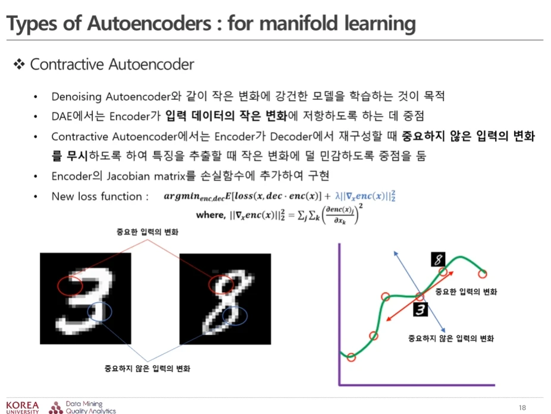

왼쪽의 두 숫자에서 빨간 원이 중요한 변화, 파란 원이 중요하지 않은 변화다. 오른쪽에서는 초록 곡선이 manifold이고, 빨간 화살표는 곡선을 따라가는 방향, 파란 화살표는 곡선을 가로지르는 방향이다. 출처: 세미나 슬라이드

손글씨 3과 8을 나란히 놓으면, 빨간 원 안의 왼쪽 획이 닫혀 있는지 열려 있는지는 두 숫자를 가르는 중요한 변화다. 반면 파란 원 안의 아래쪽 획의 모양이 조금 다른 것은 3과 8을 구분하는 데 중요하지 않다. 숫자들이 오른쪽 그림처럼 1차원 곡선 모양의 manifold 위에 놓여 있다고 하면, 앞의 변화는 manifold를 따라 3에서 8 쪽으로 움직이는 방향(빨간 화살표)이고 뒤의 변화는 manifold에서 벗어나는 방향(파란 화살표)이다. Contractive autoencoder는 파란 화살표 방향, 곧 중요하지 않은 방향의 변화에 대해 representation이 변하지 않도록 학습한다.

## 응용

### Classification

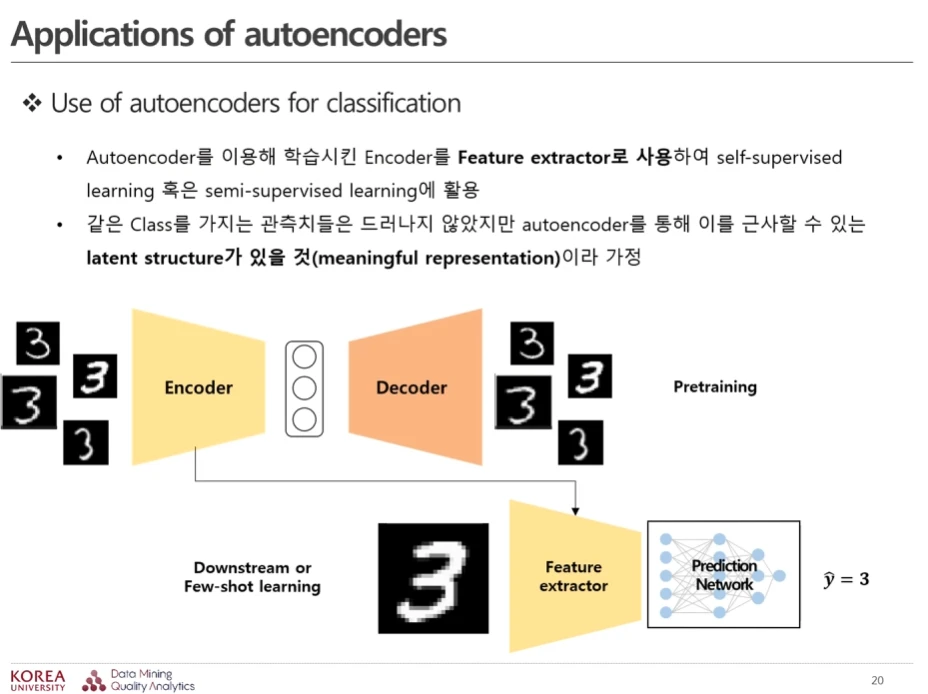

윗줄이 사전 학습이다. 숫자 이미지를 넣고 같은 이미지를 복원하게 한다. 아랫줄에서는 윗줄의 노란 encoder만 떼어 와 feature extractor로 쓰고, 그 뒤에 예측 network를 붙여 숫자를 맞힌다. 출처: 세미나 슬라이드

Autoencoder는 비지도 학습이므로 label 없이 사전 학습할 수 있다. 그림처럼 사전 학습한 뒤 encoder를 feature extractor로 삼아 downstream task에 쓰거나 few-shot learning에 쓴다. 같은 class에 속한 관측치들에는 겉으로 드러나지 않더라도 autoencoder로 근사할 수 있는 latent structure가 있을 것이라고 가정하는 것이다.

Classification에서 규제 기법으로도 쓸 수 있다.

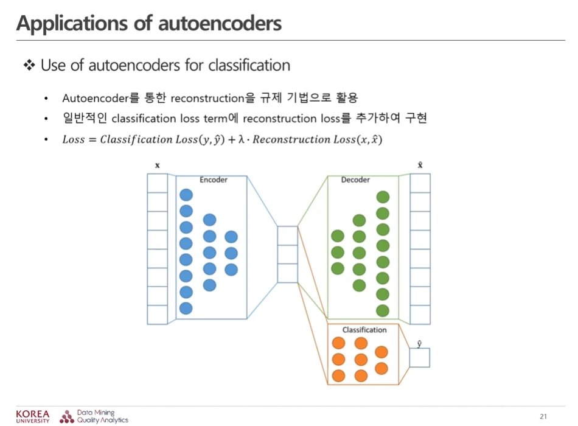

가운데의 representation에서 가지가 둘로 갈린다. 초록 가지(decoder)는 입력을 복원한 $\hat{x}$를, 주황 가지(classification)는 예측 $\hat{y}$를 낸다. 출처: 세미나 슬라이드

두 가지의 loss를 더해서 함께 학습한다. 일반적인 classification loss에 reconstruction loss를 더하는 방식이다.

$$
\mathrm{Loss} = \mathrm{Classification\ Loss}(y, \hat{y}) + \lambda \cdot \mathrm{Reconstruction\ Loss}(x, \hat{x})
$$

세미나에서는 Vision Transformer를 autoencoder처럼 사용하는 자기지도 학습 연구(SiT, Self-supervised Vision Transformer)도 소개했다. 전통적인 autoencoder와는 다르지만 Transformer를 같은 방식으로 썼다는 점에서 흥미로운 사례다.

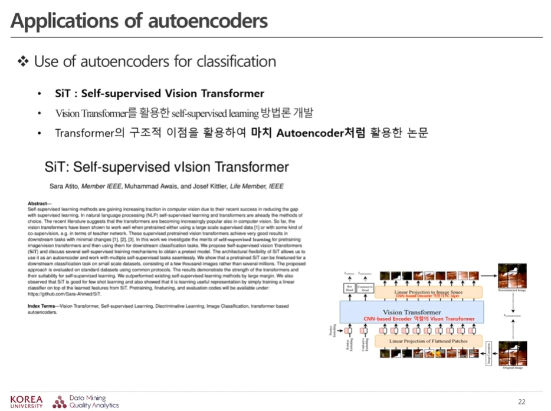

오른쪽 아래 구조도에서 아래의 손상된 이미지 조각들이 Vision Transformer를 지나 위에서 원래 이미지로 복원된다. 구조도에 덧붙은 빨간 글씨는 Vision Transformer가 encoder의 역할을, 그 위의 linear projection이 decoder의 역할을 한다는 주석이다. 출처: 세미나 슬라이드

### Clustering

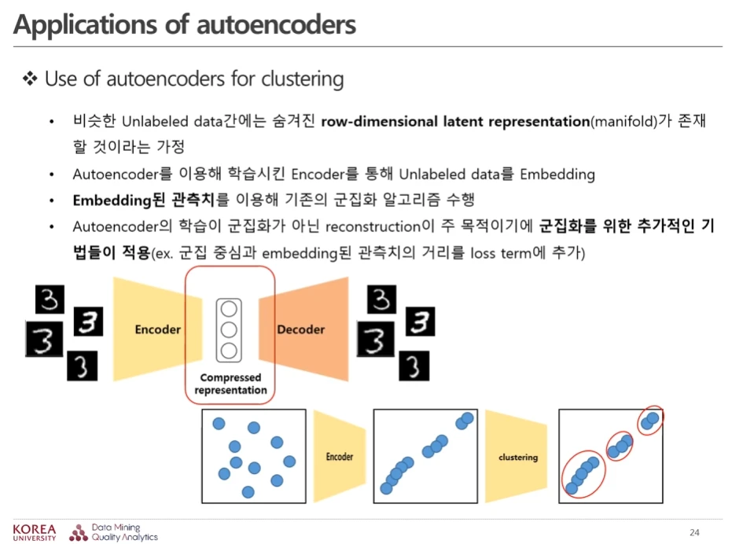

아랫줄의 세 상자를 왼쪽부터 보면 된다. 흩어져 있던 점들이 encoder를 지나면 선 하나 위에 정렬되고, 그 상태에서 군집화를 하면 빨간 타원 세 개로 쉽게 나뉜다. 출처: 세미나 슬라이드

Label이 없는 비슷한 데이터들 사이에 저차원의 latent representation, 곧 manifold가 있다고 가정한다. Encoder로 고차원 데이터를 저차원으로 embedding한 뒤, 그 결과에 K-Means 같은 기존 군집화 알고리즘을 적용한다. Autoencoder는 군집화가 아니라 복원을 목적으로 학습되므로, 군집화에 맞추기 위한 추가 기법이 함께 쓰이기도 한다. 슬라이드가 든 예는 군집 중심과 embedding된 관측치 사이의 거리를 loss에 더하는 것이다.

### Anomaly detection

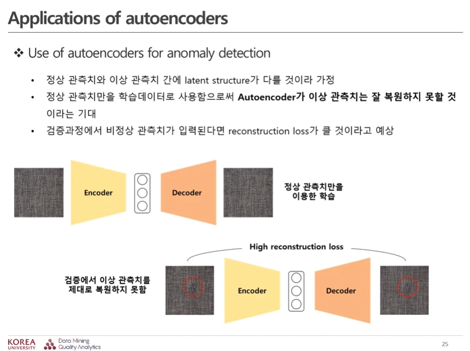

윗줄은 학습이다. 흠이 없는 표면 사진을 넣으면 같은 사진이 나온다. 아랫줄은 검증이다. 빨간 원 안에 흠이 있는 사진을 넣었는데 복원된 사진에서는 그 부분이 입력과 다르게 나오고, 그만큼 reconstruction loss가 커진다. 출처: 세미나 슬라이드

정상 관측치와 이상 관측치의 latent structure가 다르다고 가정한다. 정상 데이터만으로 autoencoder를 학습시키면 이상 데이터는 잘 복원하지 못할 것이라고 기대할 수 있다. 본 적이 없는 것은 되돌려 그리지 못한다는 것이다. 검증 단계에서 이상 관측치가 들어오면 reconstruction loss가 크게 나오고, 이를 이용해 이상을 탐지한다. 시계열에 적용하는 방법은 [다음 글](04-lstm-autoencoder-anomaly-detection.md)에서 자세히 본다.

### Dimensionality reduction

실제 데이터는 매우 높은 차원의 sparse한 벡터로 표현되는 경우가 많고, 이런 데이터로 학습하면 차원의 저주에 빠지기 쉽다. 목표는 고차원의 sparse한 데이터를 훨씬 낮은 차원의 intrinsic dimensionality로 mapping하는 것이다. 고전적인 방법으로 관측치를 낮은 차원으로 linear projection하는 PCA가 있고, 여기에 비선형 변환을 더한 것이 autoencoder라고 해석할 수 있다.

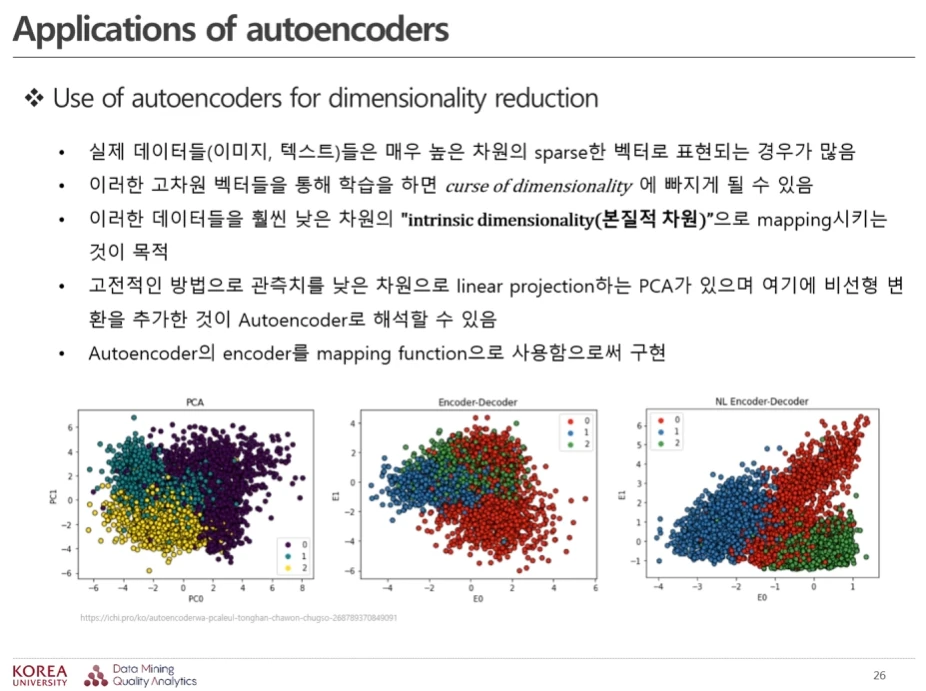

세 class(점의 색)를 2차원으로 줄인 결과다. 왼쪽이 PCA, 가운데가 encoder-decoder, 오른쪽이 비선형(NL) encoder-decoder다. 비선형 변환을 쓴 오른쪽에서 세 색이 가장 덜 겹친다. 출처: 세미나 슬라이드 PCA는 [선형대수 복습](08-linear-algebra-and-pca.md)에서 다시 정리했다.

## 정리

- Autoencoder는 입력을 압축했다가 복원하도록 학습하는 비지도 학습 모델이다. Encoder를 얻으려는 목적(manifold learning)과 decoder를 얻으려는 목적(생성 모델)으로 나뉜다.
- 모델의 복잡도를 높이고 규제로 variance를 낮추는 딥러닝의 일반적인 방향이 autoencoder에도 적용되어, sparse, denoising, contractive autoencoder 같은 변형이 나왔다.
- 학습된 encoder와 reconstruction error는 classification, clustering, anomaly detection, 차원 축소에 쓰인다.

## 참고 자료

- 고려대학교 산업경영공학부 DMQA 연구실, "[DMQA Open Seminar] Autoencoder" (YouTube). <https://www.youtube.com/watch?v=X8SBsVqmVdY>
