# LSTM Autoencoder로 시계열 이상 탐지하기: EncDec-AD

작성일 2024-11-25
{ .post-date }

[Autoencoder](03-autoencoder.md)를 시계열 이상 탐지에 쓰는 방법을 정리한 글이다. 시계열 이상 탐지를 autoencoder로 푸는 흐름을 소개한 공개 세미나와, 그 대표적인 모델인 EncDec-AD의 논문 "LSTM-based Encoder-Decoder for Multi-sensor Anomaly Detection"(Malhotra et al., 2016)을 리뷰한 영상을 함께 보고 하나로 묶었다. 영상을 보며 생긴 질문과 찾아본 답도 같이 적었다.

## 시계열 이상 탐지

시계열 데이터는 관측치가 시간 순서를 가진 데이터다. 변수의 개수에 따라 단변량과 다변량으로 나눈다.

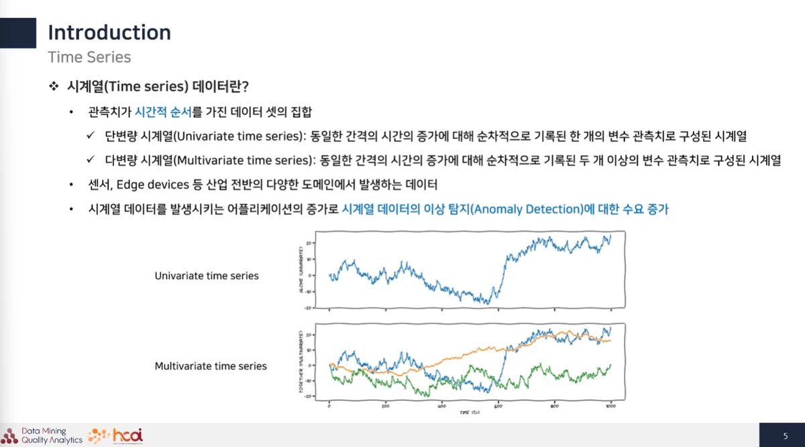

위 그래프는 선이 하나(변수 하나)인 단변량 시계열, 아래 그래프는 같은 시간 축 위에 선이 셋(변수 셋)인 다변량 시계열이다. 출처: 세미나 슬라이드

기계에 부착된 센서나 스마트폰 같은 edge 기기처럼 산업 전반에서 흔하게 생기는 데이터이고, 실시간으로 데이터를 모아 의사결정을 하는 응용이 늘면서 시계열 이상 탐지의 수요도 늘고 있다.

시계열의 이상은 두 가지로 나눌 수 있다.

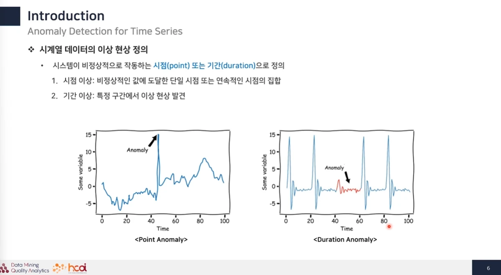

왼쪽은 한 시점의 값이 혼자 튀어 오른 시점 이상이다. 오른쪽의 빨간 구간은 값 자체는 평범한 범위 안에 있지만, 일정한 간격으로 크게 솟던 봉우리가 그 자리에서만 제대로 나타나지 않는 기간 이상이다. 출처: 세미나 슬라이드

- **시점 이상**: 비정상적인 값에 도달한 단일 시점, 또는 그런 시점이 연속된 집합이다.
- **기간 이상**: 시점 하나하나는 비정상적이지 않을 수 있지만, 구간 전체를 놓고 보면 이상이 드러나는 경우다. 오른쪽 그래프처럼 값의 크기만 보는 방법으로는 잡을 수 없다.

### 왜 어려운가

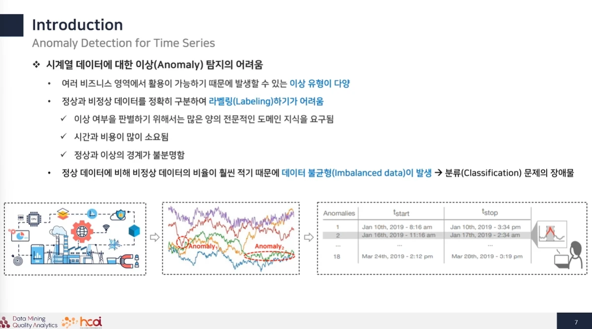

슬라이드 아래쪽의 그림은 label을 만드는 과정이다. 설비에서 나온 여러 시계열(가운데)에서 사람이 이상 구간을 하나하나 찾아 시작 시각과 끝 시각을 적어야(오른쪽) label이 생긴다. 출처: 세미나 슬라이드

- 이상의 유형이 매우 다양하고, 정상과 비정상을 정확히 구별해 labeling하기 어렵다.
- 통계적으로 접근해 이상 여부를 판단하려면 도메인 지식이 많이 필요하고 시간과 비용도 많이 든다. 정상과 이상의 경계가 불분명한 경우도 많다.
- 정상 데이터에 비해 이상 데이터가 매우 적어 데이터 불균형이 생긴다. 이 때문에 이상 탐지를 classification 문제로 풀기 어렵다.

정상과 이상을 명확히 구분할 수 있다면 일은 쉬워지겠지만, 실제로는 미리 정의한 유형 말고도 예상하지 못한 이상이 항상 존재한다. 그래서 최근의 이상 탐지 연구는 정답을 모르는 상태에서 데이터에 숨은 패턴을 찾는 비지도 방식으로 많이 진행된다.

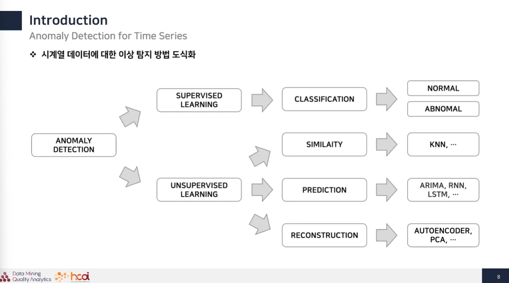

위쪽 가지가 지도 학습(정상과 비정상을 분류), 아래쪽 가지가 비지도 학습이다. 비지도 쪽은 다시 유사도(KNN 등), 예측(ARIMA, RNN, LSTM 등), 재구성(autoencoder, PCA 등)으로 갈린다. 출처: 세미나 슬라이드

그림의 아래쪽 가지처럼 판별 방식은 크게 유사도 기반, 예측 기반, 재구성 기반으로 나뉘고, autoencoder는 맨 아래의 재구성 기반에 속한다.

### 재구성 기반 이상 탐지

재구성 기반 방법의 생각은 "정상만 보고 배운 모델은 정상만 제대로 따라 그릴 수 있다"는 것이다. 따라 그린 결과가 원본과 많이 다르면 그 입력은 정상이 아니라고 본다.

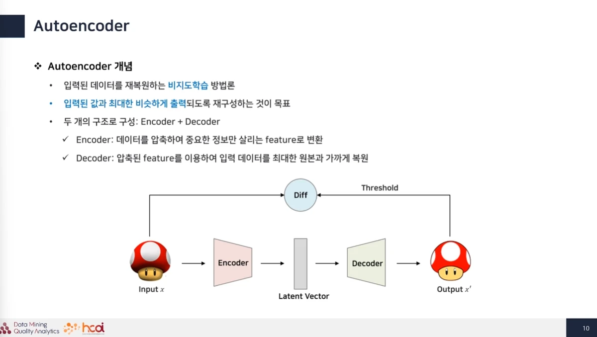

아랫줄이 복원 과정(입력 $x$, encoder, latent vector, decoder, 출력 $x'$)이고, 위의 Diff가 입력과 출력의 차이를 계산해 임계치(threshold)와 비교하는 부분이다. 출처: 세미나 슬라이드

Autoencoder는 입력을 encoder로 압축해 latent variable에 중요한 정보만 남기고, decoder로 원래 입력에 가깝게 복원한다. 입력만 가지고 학습하는 비지도 학습이므로, 이상의 유형이 다양하고 label이 부족한 시계열 이상 탐지에 쓰기 좋다. 정상 데이터에 비해 비정상 데이터가 훨씬 적은 불균형 상황에서도 쓸 수 있다.

방법은 다음과 같다.

1. 정상 데이터만으로 autoencoder를 학습시킨다. 정상 데이터가 들어오면 입력과 거의 같은 출력이 나오게 된다.
2. 이 모델에 비정상 데이터를 넣으면, 학습한 적이 없는 패턴이므로 복원된 값이 입력과 차이가 난다.
3. 입력과 출력의 차이(그림의 Diff)를 reconstruction error라고 하고, 이 값이 임계치보다 크면 이상(anomaly)으로 판단한다.

## EncDec-AD

EncDec-AD는 encoder와 decoder를 각각 LSTM으로 만든 autoencoder다. 시계열의 이상을 잡으려면 시간적인 특성을 고려해야 하는데, 일반적인 autoencoder는 그것을 담지 못한다. 그래서 이전 정보를 이어받아 쓰는 [LSTM](02-lstm.md)을 encoder와 decoder에 사용한다.

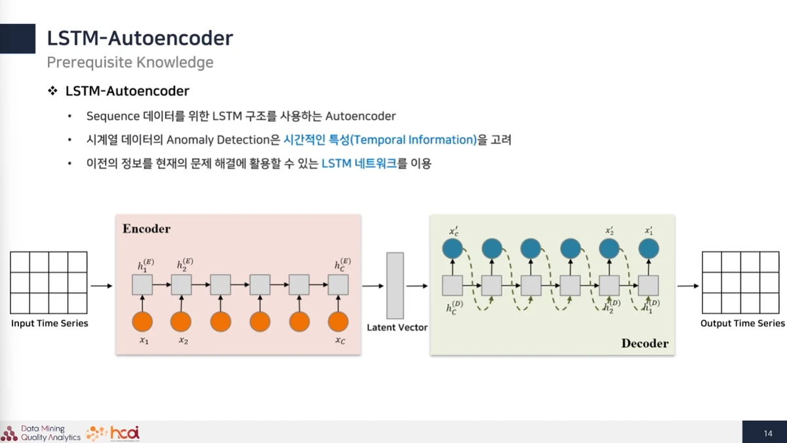

왼쪽의 표(입력 시계열)가 분홍색 encoder를 지나 가운데의 회색 막대(latent vector) 하나가 되고, 초록색 decoder가 그것을 다시 표(출력 시계열)로 편다. 주황 원이 각 시점의 입력 $x_1, \dots, x_C$, 파란 원이 복원값이다. Decoder의 첨자가 $C$에서 1로 거꾸로 간다는 점도 눈여겨본다. 출처: 세미나 슬라이드

LSTM encoder-decoder는 원래 기계 번역에서 Seq2Seq로 제안된 구조다. Encoder는 입력 시퀀스를 고정된 차원의 벡터 representation으로 mapping하고, decoder는 그 representation으로부터 target 시퀀스를 만들어 낸다. EncDec-AD에서는 target이 입력 시계열 자신이다. Encoder가 입력 시계열의 representation을 학습하고, decoder가 그 representation으로 시계열을 복원한다.

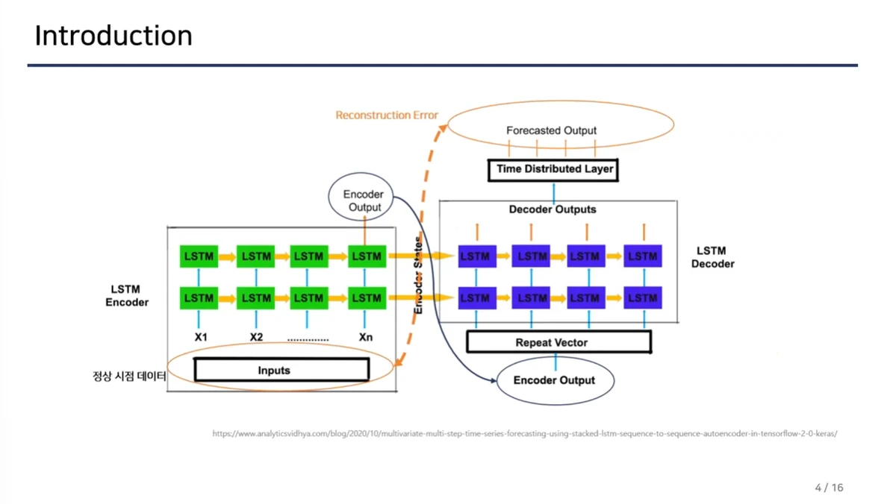

같은 구조를 다른 그림으로 본 것이다. 초록색 LSTM encoder의 마지막 출력(encoder output)이 파란색 LSTM decoder로 넘어가고, 주황 점선이 decoder가 낸 출력과 맨 아래의 입력(정상 시점 데이터)을 이어 reconstruction error를 만든다. 출처: 논문 리뷰 영상의 슬라이드

논문 리뷰 영상은 전체 흐름을 시점 세 개짜리 그림으로 줄여서 보여 준다. 아래의 Encoder, Decoder, 목적 함수 절은 이 그림 하나를 차례로 풀어 쓴 것이다.

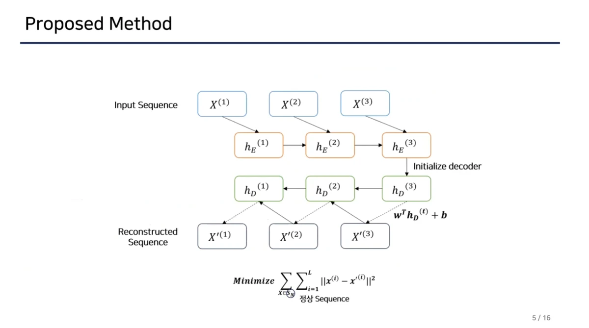

윗줄에서 입력 $X^{(1)}, X^{(2)}, X^{(3)}$이 차례로 들어가 encoder의 hidden state $h_E$가 오른쪽으로 진행한다. 마지막 $h_E^{(3)}$이 decoder의 첫 hidden state $h_D^{(3)}$이 되고(initialize decoder), decoder는 화살표 방향대로 오른쪽에서 왼쪽으로 진행하며 $X'^{(3)}, X'^{(2)}, X'^{(1)}$을 낸다. 출처: 논문 리뷰 영상의 슬라이드

### Encoder

Encoder는 길이 $C$의 시퀀스 $x_1, \dots, x_C$를 순서대로 받는다. 각 $x_i$는 $m$차원 벡터다. $m$은 변수(센서)의 개수이고 $C$는 window의 크기다.

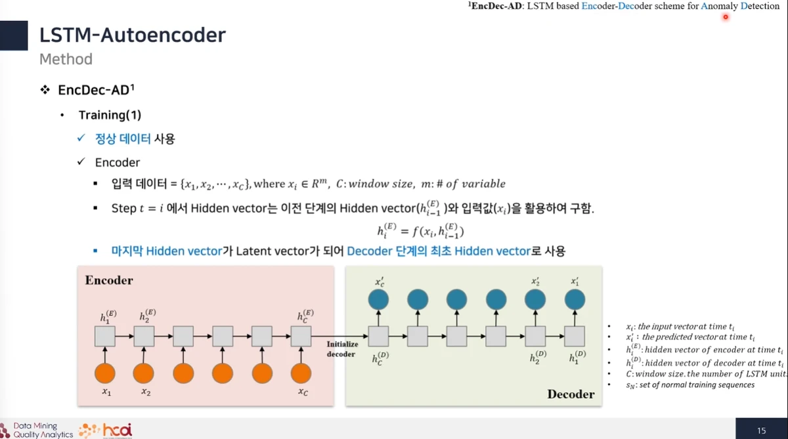

분홍색 상자 안에서 회색 네모가 hidden vector다. 네모마다 아래의 주황 원(그 시점의 입력)과 왼쪽 네모(이전 hidden vector)에서 화살표가 들어온다. 맨 오른쪽 네모 $h_C^{(E)}$에서 decoder로 가는 화살표에 "Initialize decoder"라고 적혀 있다. 출처: 세미나 슬라이드

각 step에서는 이전 step의 hidden vector와 현재 입력으로 현재의 hidden vector를 구한다.

$$
h_i^{(E)} = f\big(x_i,\ h_{i-1}^{(E)}\big)
$$

마지막 step의 hidden vector $h_C^{(E)}$가 latent vector가 되고, decoder의 첫 hidden vector로 쓰인다. Window 전체의 정보가 이 벡터 하나에 담긴다.

### Decoder

Decoder는 입력 시퀀스를 **역순**으로 복원한다. $x'_C$를 먼저 내고 $x'_{C-1}, \dots, x'_1$의 순서로 내려간다. 각 step의 hidden vector에 linear layer를 적용해 복원값 $x'_i$를 만든다.

Decoder의 hidden vector를 구하는 방법은 학습 때와 추론 때가 다르다. 차이는 decoder의 각 step에 무엇을 넣어 주느냐다.

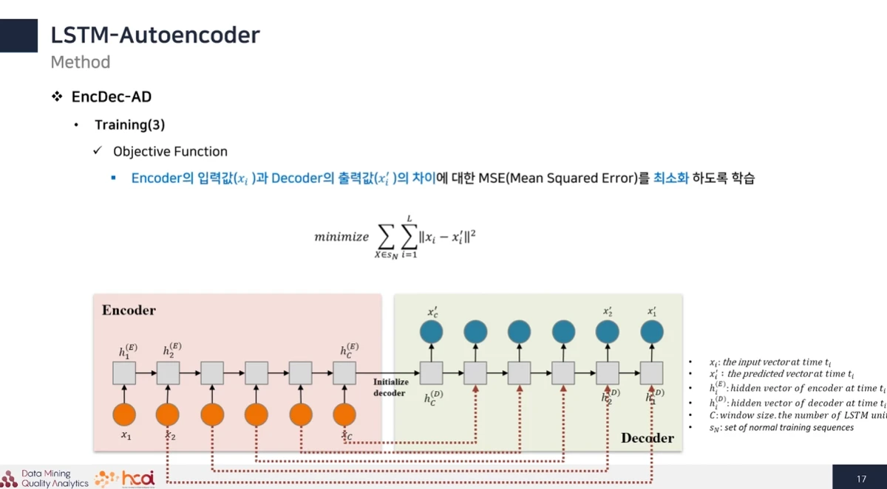

학습 때의 그림이다. 빨간 점선이 encoder 쪽의 주황 원(실제 입력값)에서 나와 decoder의 회색 네모로 들어간다. $x_C$는 decoder의 둘째 네모로, $x_2$는 맨 끝 네모로 가는 식으로 역순에 맞춰 이어져 있다. 출처: 세미나 슬라이드

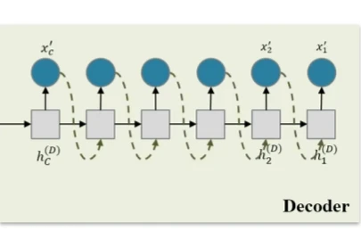{ width="405" }

추론 때의 그림이다. 빨간 점선이 없고, 파란 원(decoder가 방금 낸 출력)에서 나온 초록 점선이 바로 다음 네모로 들어간다. 출처: 세미나 슬라이드

- **학습**: 직전에 복원한 시점의 **실제 입력값** $x_i$를 넣는다(빨간 점선).

    $$
    h_{i-1}^{(D)} = g\big(x_i,\ h_i^{(D)}\big)
    $$

- **추론**: 실제 입력값 대신 decoder가 **직전에 낸 출력** $x'_i$를 넣는다(초록 점선).

    $$
    h_{i-1}^{(D)} = g\big(x'_i,\ h_i^{(D)}\big)
    $$

### 목적 함수

정상 시퀀스의 집합을 $s_N$이라고 할 때, encoder의 입력과 decoder의 출력 사이의 차이를 MSE 관점에서 최소화한다.

$$
\min \sum_{X \in s_N} \sum_{i=1}^{C} \big\| x_i - x'_i \big\|^2
$$

### 학습과 추론에서 decoder의 입력이 다른 이유

!!! question "Q. 왜 학습 때는 실제 입력을 decoder에 넣고, 추론 때는 decoder의 이전 출력을 넣는가?"
    학습 때 쓰는 방식을 teacher forcing이라고 한다. Decoder의 입력으로 decoder의 이전 출력이 아니라 실제 target 시퀀스(ground truth)를 넣는 방법이다.

    이렇게 하는 이유는 학습 초기의 모델이 올바른 시퀀스를 만들어 낼 능력이 없기 때문이다. Teacher forcing을 쓰지 않으면 잘못된 예측값을 바탕으로 hidden state가 갱신되고, 그 오류가 뒤로 이어져 학습이 더뎌진다. 실제값을 넣어 주면 모델이 더 빨리 수렴한다.

    추론 때는 사정이 다르다. 실제로 사용하는 환경에서는 target 시퀀스가 주어지지 않으므로, 모델은 encoder가 만든 vector와 자신이 이전에 낸 출력만으로 다음 출력을 만들어야 한다.

!!! question "Q. Teacher forcing을 쓰면 일반화 성능이 떨어지지 않는가?"
    떨어질 수 있다. 학습 때는 항상 ground truth를 입력으로 받지만 추론 때는 자신이 만든 출력을 입력으로 받으므로, 두 단계에서 decoder가 보는 입력의 분포가 다르다. 이 차이가 성능 저하로 이어진다.

    이를 줄이는 방법으로 scheduled sampling이 있다. 학습 중에 일정 확률로 ground truth 대신 decoder의 출력을 입력으로 넣어, 추론 때의 상황을 미리 겪게 하는 것이다.

### Anomaly score

학습이 끝나면 reconstruction error로부터 anomaly score를 계산한다.

1. 정상 데이터 가운데 따로 떼어 둔 구간($v_{N1}$)에서 각 시점의 error vector를 구한다.

    $$
    e^{(i)} = \big| x^{(i)} - x'^{(i)} \big|
    $$

2. Error vector가 정규분포 $\mathcal{N}(\mu, \Sigma)$를 따른다고 가정하고, 최대가능도 추정으로 $\mu$와 $\Sigma$를 구한다.
3. 새로운 시점의 error vector가 이 분포에서 얼마나 떨어져 있는지를 anomaly score로 삼는다. Mahalanobis 거리의 형태다.

    $$
    a^{(i)} = \big(e^{(i)} - \mu\big)^{\top} \Sigma^{-1} \big(e^{(i)} - \mu\big)
    $$

4. 임계치 $\tau$를 정해 $a^{(i)} > \tau$이면 이상, 그렇지 않으면 정상으로 판단한다.

## 데이터를 나누는 방법

논문은 데이터를 여섯 부분으로 나눈다. 정상 시계열이 넷, 이상 시계열이 둘이다.

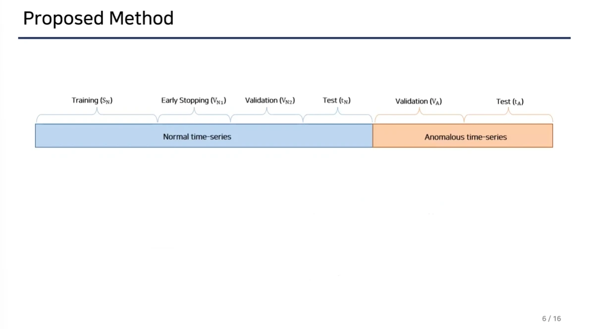

파란 막대가 정상 시계열, 주황 막대가 이상 시계열이다. 이상 시계열은 학습에 쓰지 않고 validation과 test에만 들어 있다. 출처: 논문 리뷰 영상의 슬라이드

각 부분의 용도는 다음과 같다.

| 구분 | 기호 | 용도 |
|---|---|---|
| 정상 | $s_N$ (training) | 모델 학습. Encoder가 시계열의 정보를 압축한 representation을 만들도록 학습한다. |
| 정상 | $v_{N1}$ (early stopping) | 학습의 조기 종료, 그리고 reconstruction error의 분포($\mu$, $\Sigma$) 추정. |
| 정상 | $v_{N2}$ (validation) | 이상 쪽 $v_A$와 함께 임계치 $\tau$와 LSTM unit 수를 정하는 데 쓴다. |
| 정상 | $t_N$ (test) | 최종 성능 평가. |
| 이상 | $v_A$ (validation) | $v_{N2}$와 함께 $F_\beta$ score가 최대가 되는 $\tau$와 hidden layer의 LSTM unit 수를 정한다. |
| 이상 | $t_A$ (test) | Validation에서 정한 값으로 최종 성능 평가. |

!!! question "Q. 왜 early stopping용 데이터를 validation과 따로 두었는가?"
    과적합을 막기 위해서다. Validation 데이터 하나로 early stopping과 hyperparameter tuning을 모두 해 버리면 그 데이터에 과적합되어 일반화 성능이 떨어질 수 있다. 데이터가 부족하다면 따로 두지 않고 진행할 수도 있다.

!!! question "Q. F-beta score란 무엇인가?"
    정밀도(precision)와 재현율(recall)을 함께 반영하는 평가 지표이고, $\beta$로 두 지표의 중요도를 조절한다. 아래에 따로 정리했다.

### F-beta score

먼저 용어다. 이상 탐지에서는 이상을 양성으로 본다.

- True Positive(TP): 실제 양성을 양성으로 맞게 예측한 경우
- False Positive(FP): 실제 음성을 양성으로 잘못 예측한 경우
- False Negative(FN): 실제 양성을 음성으로 잘못 예측한 경우

$$
\mathrm{Precision} = \frac{TP}{TP + FP}, \qquad \mathrm{Recall} = \frac{TP}{TP + FN}
$$

정밀도는 모델이 양성이라고 예측한 것 가운데 실제 양성의 비율이고, 재현율은 실제 양성 가운데 모델이 양성으로 찾아낸 비율이다. $F_\beta$ score는 둘의 가중 조화 평균이다.

$$
F_\beta = (1 + \beta^2) \cdot \frac{\mathrm{Precision} \cdot \mathrm{Recall}}{\beta^2 \cdot \mathrm{Precision} + \mathrm{Recall}}
$$

- $\beta > 1$: 재현율을 더 중요하게 본다.
- $\beta = 1$: 둘을 같은 비중으로 본다. 흔히 쓰는 F1 score다.
- $\beta < 1$: 정밀도를 더 중요하게 본다.

어느 쪽을 중시할지는 상황에 달려 있다. 산업 설비를 모니터링할 때는 설비 손상을 놓치는 것이 치명적이므로 재현율이 중요하고, $\beta$를 2 이상으로 둘 수 있다. 반대로 정상 상태를 이상으로 잘못 알리는 비용이 크다면 정밀도를 중시해 $\beta$를 0.5 이하로 둔다.

이 방식의 임계치 선택에는 label이 붙은 이상 데이터($v_A$)가 필요하다는 점도 눈에 들어왔다. 예전에 LSTM으로 이상 탐지를 해 본 과제에서는 데이터 수집 기간이 짧고 도메인 전문가와 협의할 시간도 부족해서, 이런 검증용 이상 데이터를 만들지 못했고 별도의 평가 지표로 hyperparameter를 조정할 수도 없었다.

## 실험

실험에 쓴 데이터셋은 다섯 가지다. 세미나 슬라이드의 표를 옮겼다.

| 데이터셋 | 예측 가능 여부 | 차원 | 주기성 |
|---|---|---|---|
| Power demand | Yes | 1 | Periodic |
| Space shuttle | Yes | 1 | Periodic |
| Engine-P | Yes | 12 | Aperiodic |
| Engine-NP | No | 12 | Aperiodic |
| ECG | Yes | 1 | Quasi-periodic |

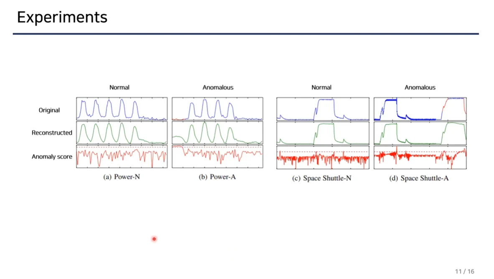

세 줄은 위에서부터 원본, 복원 결과, anomaly score이고, 맨 아랫줄의 빨간 점선이 임계치다. 열은 데이터셋마다 정상(N)과 이상(A)의 짝이다. 정상 열에서는 초록 선(복원)이 파란 선(원본)과 같은 모양이다. 이상 열에서는 원본에 빨갛게 표시된 구간((b)의 맨 왼쪽, (d)의 맨 오른쪽)에서 복원이 원본과 어긋나고, 그 자리의 anomaly score가 점선 위로 올라간다. 출처: 논문 리뷰 영상의 슬라이드(그래프는 논문의 실험 결과 그림)

그림을 보면, 이상이 있는 시계열에서는 anomaly score가 임계치를 넘는 구간이 나타나고 정상 시계열에서는 대체로 임계치 아래에 머문다.

다변량 데이터를 그대로 쓰지 않고 PCA로 단변량으로 바꿔 진행한 실험도 있다. 엔진 데이터 두 종류에 대해 첫 번째 주성분만 사용했는데, 한쪽은 첫 주성분이 전체 분산의 72%를, 다른 쪽은 61%를 설명한다.

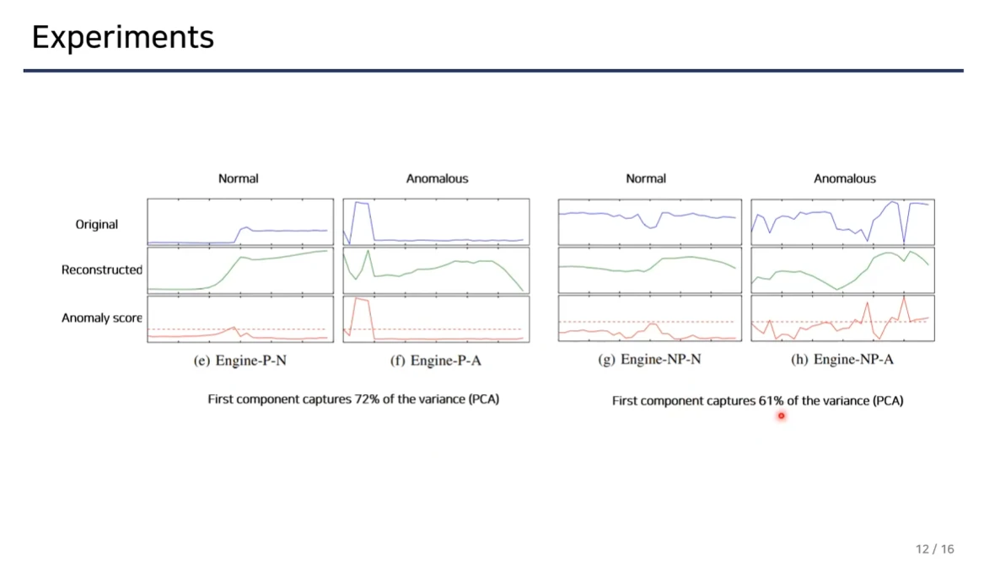

읽는 법은 앞의 그림과 같다. 왼쪽 두 열이 Engine-P(첫 주성분이 분산의 72%), 오른쪽 두 열이 Engine-NP(61%)다. 이상 열인 (f)와 (h)에서 anomaly score가 점선 위로 솟는 구간이 보인다. 출처: 논문 리뷰 영상의 슬라이드(그래프는 논문의 실험 결과 그림)

## 정리

- 시계열 이상 탐지는 이상의 유형이 다양하고 label과 이상 데이터가 부족해서, 정상 데이터만으로 학습하는 재구성 기반 방법이 잘 맞는다.
- EncDec-AD는 LSTM encoder가 window를 벡터 하나로 압축하고 LSTM decoder가 역순으로 복원한다. 학습 때는 teacher forcing을 쓰고 추론 때는 자신의 출력을 다시 입력으로 쓴다.
- Reconstruction error의 분포를 정상 데이터로 추정하고, 그 분포에서 먼 정도를 anomaly score로 삼는다. 임계치는 $F_\beta$ score로 정한다.

## 참고 자료

- P. Malhotra, A. Ramakrishnan, G. Anand, L. Vig, P. Agarwal, G. Shroff, "LSTM-based Encoder-Decoder for Multi-sensor Anomaly Detection", ICML 2016 Anomaly Detection Workshop. <https://arxiv.org/abs/1607.00148>
- 고려대학교 산업경영공학부 DMQA 연구실, "[Open DMQA Seminar] Anomaly Detection for Time Series with Autoencoder" (YouTube). <https://www.youtube.com/watch?v=Zzt4Ept-zYs>
- 서울대학교 산업공학과 DSBA 연구실, "[Paper Review] LSTM-based Encoder-Decoder for Multi-sensor Anomaly Detection" (YouTube). <https://www.youtube.com/watch?v=X5eXxPSuqFM>
