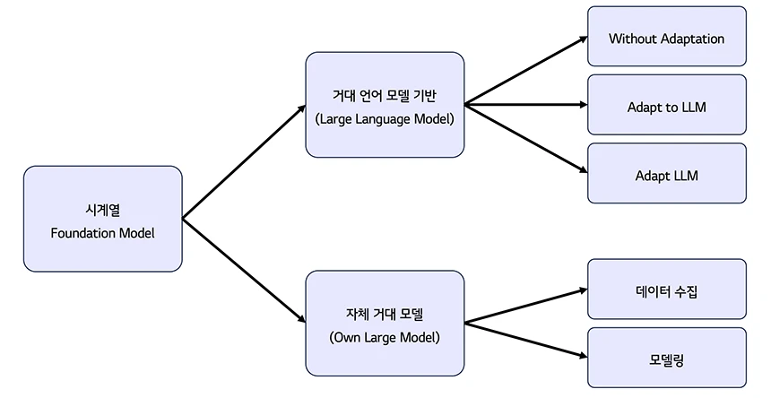
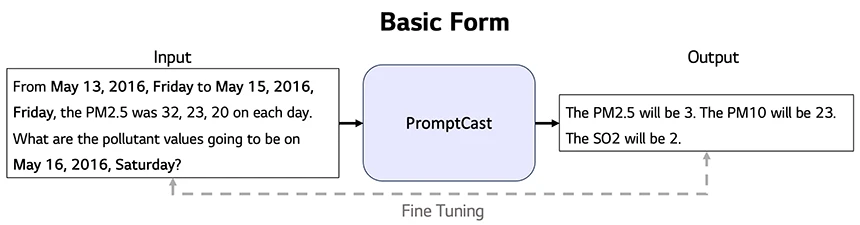
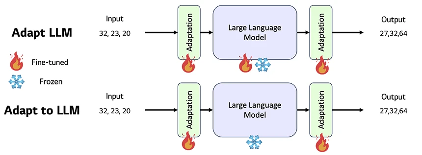
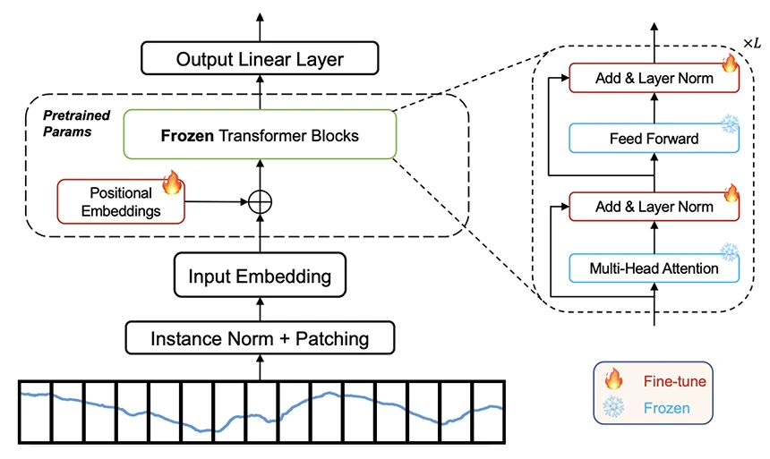
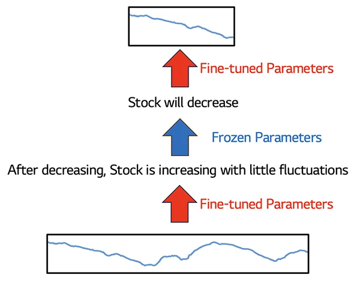
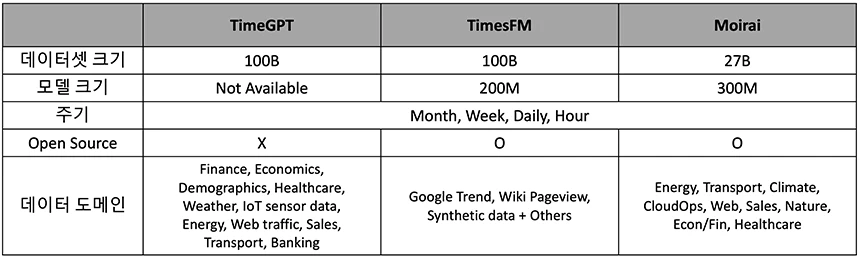

# 시계열 foundation 모델 개요

작성일 2024-11-26
{ .post-date }

Foundation 모델이 무엇이고 시계열 분야에서는 어떤 방향으로 연구되고 있는지를 파악하려고 읽은 자료를 짧게 요약한 글이다. 개념과 분류는 LG AI연구원 블로그의 글 두 편에서, Time-LLM에 관한 내용은 논문 리뷰 영상에서 가져왔다. 이 글의 분류 체계와 예시, 그림은 그 자료들의 것이고, 여기에는 내가 이해한 골자와 읽으며 든 생각만 적는다. 자세한 설명은 글 끝의 원문을 보는 것이 좋다.

## Foundation 모델이란

Foundation 모델은 아주 큰 데이터로 사전 학습(pre-training)해 두고 여러 문제에 두루 쓸 수 있게 만든 모델이다. 특정 task 하나에 맞춘 모델이 아니라 일반화된 모델이라는 점이 핵심이다. 언어의 GPT와 BERT, 이미지와 텍스트를 함께 다루는 CLIP 같은 모델이 여기에 속한다. 한 번 학습한 모델을 여러 downstream task에 다시 쓸 수 있고 적은 데이터로도 좋은 성능을 낼 수 있지만, 모델이 큰 만큼 학습에 드는 자원과 비용이 크다.

**Transfer learning과의 관계.** 사전 학습한 모델을 새 task에 맞춰 다시 학습시킨다는 점에서 foundation 모델은 transfer learning의 연장선에 있다. 차이는 출발점이다. Transfer learning은 대개 특정 task나 도메인에서 학습한 모델을 다른 곳으로 옮겨 쓰는 데서 시작했고, foundation 모델은 처음부터 여러 도메인과 task에 쓰일 것을 전제로 거대한 데이터로 학습한다.

**Fine-tuning.** 사전 학습을 마친 모델을 특정 task나 도메인의 데이터로 추가 학습시키는 과정이다. 일반적인 지식은 사전 학습에서 이미 얻었으므로, 비교적 적은 양의 도메인 데이터만으로 모델을 보완할 수 있다. 일반 텍스트로 학습한 언어 모델을 법률 문서에 맞추거나, 일반 이미지로 학습한 모델을 의료 영상에 맞추는 것이 그 예다.

## 시계열에서는

자연어와 비전에서는 거대 모델을 가져와 fine-tuning해서 쓰는 방식이 일찍 자리 잡았다. 시계열은 그만큼 큰 데이터셋을 만들기 어려워서 그런 모델을 갖지 못했다. 최근에는 두 방향에서 이 간극을 메우려는 연구가 이어지고 있다. 하나는 이미 있는 거대 언어 모델(LLM)의 일반화 능력을 빌려 오는 것이고, 다른 하나는 거대한 시계열 데이터를 모아 시계열 전용 모델을 처음부터 학습시키는 것이다.

위쪽 가지가 LLM을 빌려 쓰는 방법이고 다시 셋으로 갈린다. 아래쪽 가지가 시계열 전용 대형 모델을 직접 만드는 방법이고, 데이터 수집과 모델링이 두 과제다. 출처: LG AI연구원 블로그 그림 1

### LLM을 활용하는 세 가지 방법

세 갈래는 "LLM이 시계열에 대해 이미 얼마나 알고 있다고 보는가"에 대한 가정이 다르다. 이미 안다고 보면 묻기만 하면 되고(Without Adaptation), 모른다고 보면 LLM을 가르쳐야 하며(Adapt LLM), 말로 바꿔 주면 안다고 보면 통역만 붙이면 된다(Adapt to LLM).

| 방법 | 가정 | LLM의 학습 | 핵심 질문 | 예시 |
|---|---|---|---|---|
| Without Adaptation | LLM이 자연어 데이터에서 시계열에 관한 지식도 어느 정도 얻었다 | 하지 않거나 최소화 | 시계열 문제를 어떤 프롬프트로 쓸 것인가 | PromptCast, LLMTime |
| Adapt LLM | LLM은 시계열에 익숙하지 않으므로 익숙해지는 과정이 필요하다 | LLM의 일부 또는 전체와 앞뒤의 adaptation layer를 fine-tuning | Adaptation layer를 어떻게 설계하고 LLM을 어떻게 fine-tuning할 것인가 | OFA(GPT4TS), TEMPO, LLM4TS |
| Adapt to LLM | LLM은 텍스트로 바뀐 시계열이라면 이해할 수 있다 | 하지 않음(frozen). 앞뒤의 adaptation layer만 학습 | 시계열을 LLM이 이해하는 표현으로 어떻게 바꿀 것인가 | Time-LLM |

각 갈래에서 기억해 둔 점은 다음과 같다.

**Without Adaptation.** 시계열을 숫자가 들어간 문장으로 바꿔 LLM에 묻는다.

왼쪽 입력을 보면 관측값 32, 23, 20이 문장 안에 그대로 적혀 있고, 다음 날의 값을 질문으로 묻는다. 오른쪽 출력도 숫자가 든 문장이다. 출처: LG AI연구원 블로그 그림 2

여기서 숫자의 토큰화가 문제가 된다. Tokenizer가 숫자를 일정한 규칙 없이 쪼개기 때문에 LLM이 수를 제대로 이해하는지 의문이 생긴다. 블로그가 든 예로는 480은 토큰 하나가 되는데 바로 옆의 481은 48과 1의 토큰 둘이 된다. LLMTime은 숫자를 자릿수(digit) 단위로 토큰화하는 등의 처리로 이를 개선했고, 추가 학습 없이도 예측 성능이 괜찮게 나온다는 것을 보였다.

**Adapt LLM과 Adapt to LLM.** 나머지 두 방법은 구조가 같고, 어디를 학습시키느냐만 다르다.

불꽃이 학습되는 부분(fine-tuned), 눈송이가 고정된 부분(frozen)이다. 두 줄 모두 LLM의 앞뒤에 초록색 adaptation layer가 붙어 있고 거기에는 불꽃이 있다. 가운데 LLM 아래를 보면 윗줄에는 불꽃과 눈송이가 함께 있고(일부 또는 전체를 학습), 아랫줄에는 눈송이만 있다. 출처: LG AI연구원 블로그 그림 3

- **Adapt LLM.** OFA는 시계열을 patch로 잘라 토큰으로 만들고 LLM의 앞뒤에 linear layer를 붙였다. LLM의 파라미터는 일부만 학습시킨다. 출력 layer만 바꾸면 회귀, 분류 등 여러 시계열 task에 쓸 수 있다. TEMPO는 여기에 시계열 분해와 LoRA를 더했고, LLM4TS는 fine-tuning을 두 단계(시계열 전반에 익숙해지는 단계와 예측 같은 특정 task에 맞추는 단계)로 나누었다.

    

    아래에서 위로 읽는다. 시계열을 정규화하고 patch로 자른 뒤(instance norm + patching) embedding해서 사전 학습된 Transformer block에 넣고, 맨 위의 output linear layer가 답을 낸다. 오른쪽 확대 그림에서 "일부만 학습"의 뜻을 볼 수 있다. 사전 학습된 부분 가운데 multi-head attention과 feed forward는 고정하고(눈송이), layer norm과 positional embedding만 학습한다(불꽃). 출처: LG AI연구원 블로그 그림 4

- **Adapt to LLM.** 구조는 Adapt LLM과 비슷하지만 LLM을 전혀 학습시키지 않는다는 점이 분명한 차이다. 양쪽의 adaptation layer가 시계열과 LLM의 표현 사이를 오가는 변환을 맡고, 가운데의 LLM은 변환된 입력을 받아 task를 수행한다.

    { width="520" }

    아래에서 위로 읽는다. 첫 번째 빨간 화살표(학습되는 부분)가 시계열을 "내려갔다가 작은 등락과 함께 오르는 중"이라는 말로 바꾸고, 파란 화살표(고정된 LLM)가 "내려갈 것"이라고 답하며, 두 번째 빨간 화살표가 그 답을 다시 시계열로 바꾼다. 양쪽의 빨간 화살표가 통역이고 LLM은 자기가 아는 말로만 일한다. 출처: LG AI연구원 블로그 그림 5

### 시계열 전용 모델을 처음부터 학습하는 방법

LLM에 기대지 않고 시계열 데이터만으로 거대 모델을 만든다. 이 방향의 연구에서 중요한 것은 두 가지다. 첫째는 일반화 능력을 얻을 만큼 큰 데이터를 모으는 일이다. 둘째는 관측 주기(frequency)나 도메인이 서로 다른, 이질적인(heterogeneous) 시계열들을 하나의 모델이 받아들일 수 있게 하는 일이다.

대표적인 모델로 TimeGPT, TimesFM, Moirai가 있다.

첫 두 행이 규모다. 데이터셋은 100B, 100B, 27B개의 시점이고, 모델은 TimesFM이 200M, Moirai가 300M개의 파라미터다(TimeGPT는 공개되지 않았다). 맨 아래 행에서 TimesFM의 데이터 출처가 다른 둘과 다르다는 것도 보인다. 출처: LG AI연구원 블로그 그림 6

표에서 보듯 모두 백억 개가 넘는 시점으로 이루어진 데이터를 모아 학습했고, 1억 개 이상의 파라미터를 가진 Transformer 계열의 구조를 쓴다. TimesFM은 Google Trends, Wikipedia 페이지뷰처럼 구하기 쉬운 데이터와 합성 데이터로 큰 데이터셋을 만들었다는 점이 눈에 띈다. Moirai는 관측 주기에 따라 patch의 크기를 다르게 쓰고, 학습 때 변수를 무작위로 뽑아 함께 넣는 방식으로 다변량 문제를 다룬다.

구조는 모델마다 다르다. TimeGPT는 encoder-decoder, TimesFM은 decoder-only이고, Moirai는 논문에서 masked encoder 구조라고 설명한다.

## Time-LLM

Time-LLM은 Adapt to LLM의 대표적인 예다. LLM은 고정해 두고, 시계열을 LLM이 다룰 수 있는 표현으로 바꾸는 부분만 학습한다. 논문은 이것을 reprogramming이라고 부른다.

변환에는 cross attention을 쓴다. 입력 시계열(의 patch)을 query로, 텍스트 쪽의 단어 embedding들을 key와 value로 두어 시계열을 텍스트의 표현 공간으로 mapping한다.

입력을 다루는 방식은 [PatchTST](../../papers/2024-11-25-patchtst.md)와 같다. 정규화와 역정규화(RevIN)로 비정상성을 다루고, 변수를 하나씩 따로 처리하는 channel independence와 patching을 그대로 쓴다.

## 읽으며 든 생각

- Foundation 모델 기반의 시계열 예측은 이점이 클 것 같다. 일반화된 모델을 잘 활용하는 방법이 나오면, 새로운 예측 모델이나 이상 탐지 모델을 만들 때 드는 학습 비용을 크게 줄일 수 있다. Fine-tuning으로 특정 도메인에 맞출 수 있다면 데이터에 대한 의존도도 낮아질 것이다.
- 블로그는 대부분의 시계열 foundation 모델이 한 번에 시계열 하나만 보는 단변량 모델이라는 한계를 짚는다. 이 부분을 읽으며 이렇게 생각했다. 세상의 변수들은 서로 상관관계를 갖지만 우리가 그것을 잘 파악하지 못할 뿐이다. 변수 사이의 관계를 제대로 끌어낼 수 있는 방법을 갖춘 모델이 나온다면 예측과 이상 탐지 모두에서 더 좋은 성능을 낼 수 있을 것이다.
- 이 문제는 foundation 모델만의 것이 아니다. 단순한 linear 모델이 Transformer 기반 장기 예측 모델들을 이긴다는 결과(DLinear, AAAI 2023)가 있었고, PatchTST는 Transformer가 장기 예측에 효과적임을 다시 보였지만 channel independence를 택했기 때문에 변수 사이의 관계는 다루지 않는다. Transformer라도 다변량 데이터의 상관성을 학습하기는 쉽지 않다는 주장이 있고, 비슷한 특성을 가진 채널끼리 묶어(clustering) 관계를 학습시켜 복잡도를 낮추고 성능을 높이려는 연구도 있는 것으로 보았다. LLM 기반 모델이 다변량 관계를 잘 다루지 못한다면, 언어 모델에서 출발했다는 점과 관련이 있지 않을까 생각했다.
- 다변량 모델의 해석력을 높이는 방법 가운데 하나가 XAI다. 예를 들어 SHAP 값으로 채널별 중요도를 시각화하면 모델이 데이터를 어떤 식으로 이해하고 있는지 볼 수 있고, 디버깅에도 쓸 수 있다. XAI는 [별도의 시리즈](../xai/01-xai-overview.md)로 정리했다.
- LLM 기반의 시계열 foundation 모델은 아직 초기 단계의 분야라는 인상도 받았다.

## 참고 자료

이 글의 개념 설명과 분류 체계는 아래 두 글을 요약한 것이다.

- LG AI연구원 블로그, Foundation 모델 개념을 소개한 글. <https://www.lgresearch.ai/blog/view?seq=427>
- LG AI연구원 블로그, Foundation 모델 기반 시계열 연구의 최신 동향을 다룬 글. <https://www.lgresearch.ai/blog/view?seq=451>

Time-LLM은 아래 영상과 논문을 참고했다.

- 서울대학교 산업공학과 DSBA 연구실, "[Paper Review] Time-LLM: Time Series Forecasting by Reprogramming Large Language Models" (YouTube). <https://www.youtube.com/watch?v=sQ2ftBdondw>
- Time-LLM 소개 영상 (YouTube). <https://www.youtube.com/watch?v=Oyn028xk-vA>
- M. Jin et al., "Time-LLM: Time Series Forecasting by Reprogramming Large Language Models", ICLR 2024. <https://arxiv.org/abs/2310.01728>

본문에서 이름을 든 연구(블로그 글의 참고 문헌 목록에서 옮김).

- R. Bommasani et al., "On the Opportunities and Risks of Foundation Models", 2021. <https://arxiv.org/abs/2108.07258>
- H. Xue, F. D. Salim, "PromptCast: A New Prompt-based Learning Paradigm for Time Series Forecasting". <https://arxiv.org/abs/2210.08964>
- D. Spathis, F. Kawsar, "The First Step is the Hardest: Pitfalls of Representing and Tokenizing Temporal Data for Large Language Models". <https://arxiv.org/abs/2309.06236>
- N. Gruver, M. Finzi, S. Qiu, A. G. Wilson, "Large Language Models Are Zero-Shot Time Series Forecasters" (LLMTime). <https://arxiv.org/abs/2310.07820>
- T. Zhou, P. Niu, X. Wang, L. Sun, R. Jin, "One Fits All: Power General Time Series Analysis by Pretrained LM" (OFA). <https://arxiv.org/abs/2302.11939>
- D. Cao et al., "TEMPO: Prompt-based Generative Pre-trained Transformer for Time Series Forecasting". <https://arxiv.org/abs/2310.04948>
- C. Chang, W.-Y. Wang, W.-C. Peng, T.-F. Chen, "LLM4TS: Aligning Pre-Trained LLMs as Data-Efficient Time-Series Forecasters". <https://arxiv.org/abs/2308.08469>
- A. Garza, M. Mergenthaler-Canseco, "TimeGPT-1". <https://arxiv.org/abs/2310.03589>
- A. Das, W. Kong, R. Sen, Y. Zhou, "A Decoder-only Foundation Model for Time-series Forecasting" (TimesFM). <https://arxiv.org/abs/2310.10688>
- G. Woo, C. Liu, A. Kumar, C. Xiong, S. Savarese, D. Sahoo, "Unified Training of Universal Time Series Forecasting Transformers" (Moirai). <https://arxiv.org/abs/2402.02592>
- A. Zeng, M. Chen, L. Zhang, Q. Xu, "Are Transformers Effective for Time Series Forecasting?" (DLinear), AAAI 2023. <https://arxiv.org/abs/2205.13504>
