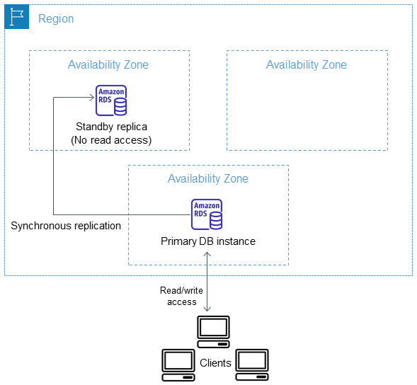

# 다중 AZ DB 인스턴스

[다중 AZ DB 인스턴스 배포 - Amazon Relational Database Service](https://docs.aws.amazon.com/ko_kr/AmazonRDS/latest/UserGuide/Concepts.MultiAZSingleStandby.html)

Amazon RDS는 **단일 대기 DB 인스턴스**와 함께 **다중 AZ 배포**를 사용하여 DB 인스턴스에 대한 고가용성 및 장애 조치 지원을 제공한다.

**다중 AZ DB 인스턴스 배포**에서 Amazon RDS는 자동으로 서로 다른 **가용 영역**에 **동기식 대기 복제본**을 **프로비저닝**하고 **유지**한다.

**가용 영역(Availability Zone)과 리전(Region)**

[리전(Region)과 가용영역(Availability zone)](https://zigispace.net/1116)

**가용 영역**은 1개 이상의 물리 데이터 센터를 묶은 **논리적인 데이터 센터**이다. 즉, 가용 영역은 1개의 데이터 센터일 수도 있고, 2개 이상의 데이터 센터를 묶어놓은 것일 수도 있지만, 개념적으로는 하나의 가상 데이터 센터라고 이해하면 된다. (*이것도 내부적으로 추상화가 된 것으로 보인다.*)

따라서 가용영역 간에는 독립적인 전원, 냉온습, 물리적 보안 등의 시설을 갖추게 되며, 물리적으로 떨어져 있기 때문에 데이터센터의 물리적인 장애가 발생하더라도 가용영역 간에 영향을 미치지 않는다.

> 이래서 다중 AZ DB 클러스터에서 Writer, Reader Instance가 서로 다른 AZ에 존재하던 것으로 생각할 수 있겠다. 물리적인 고장이 동시에 발생하는 것을 막기 위해서이다.

**리전**은 이러한 가용영역이 2개 이상 구성된 지리적 영역이다. 리전 내의 가용영역은 일종의 클러스터처럼 묶여있으며, 많은 서비스들이 리전을 기반으로 해서 제공된다. 그래서 신규 서비스의 경우 모든 리전에서 제공되는 경우도 있지만, 특정 리전만 제공되다가 점점 확대되기도 한다.

리전 내의 가용영역 간에는 높은 대역폭(Bandwidth)과 지연 시간이 매우 짧은 네트워크로 연결되어 고가용성은 물론 빠른 서비스 응답을 제공할 수 있다.

> 즉, 한국 리전이라고 한다면 한국에 설치된 1개 혹은 여러 개의 AZ가 묶인 클러스터라고 판단할 수 있으며, 여기서 데이터가 보관되고 사용되는 것이라고 볼 수 있다.

**프로비저닝**

프로비저닝은 사용자가 요청한 IT 자원을 사용할 수 있는 상태로 준비하는 것을 말한다.

**Primary DB 인스턴스**는 전체 가용 영역에서 대기 복제본으로 동기식으로 복제되어 시스템 백업 중에 데이터 이중화를 제공하고 대기 시간 급증을 최소화한다. DB 인스턴스를 **고가용성**으로 실행하면 계획된 시스템 유지관리 중 가용성을 높일 수 있다. 또한, DB 인스턴스 오류 및 가용 영역 중단이 일어나지 않도록 방지할 수 있다.

> 즉, 다중 AZ DB 인스턴스는 고가용성을 확보하기 위한 추가적인 옵션이다. 고가용성 옵션은 읽기 전용 시나리오에서는 확장 솔루션이 아니며, 대기 복제본을 사용하여 읽기 트래픽을 처리할 수 없다. 따라서 읽기 전용 트래픽을 처리하려면 대신 **다중 AZ DB 클러스터** 또는 **읽기 전용 복제본**을 사용해야 한다.

**데이터 이중화**

시스템 오류로 인한 데이터베이스 중단이나 물리적인 손상 발생 시 이를 복구하기 위해 데이터베이스를 복제하여 관리하는 것을 **데이터베이스 이중화**라고 한다.

AWS에서는 다중 AZ DB 인스턴스에 대해서 한 개의 추가적인 Standby Replica를 구비하고, 여기에 대해서는 유저가 Read Access를 할 수 없도록 제한한다.

**고가용성**

고가용성은 서버, 네트워크, 프로그램 등의 정보 시스템이 상당히 오랜 기간 동안 지속적으로 정상 운영이 가능한 성질을 말한다.

