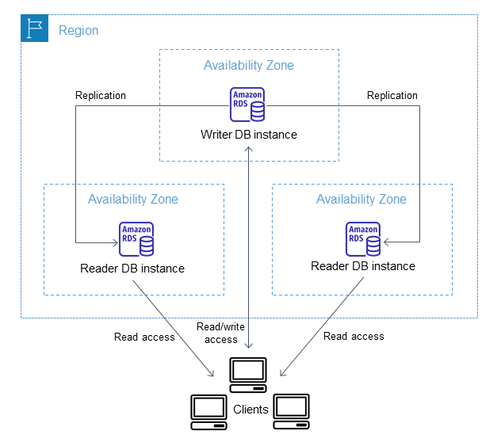
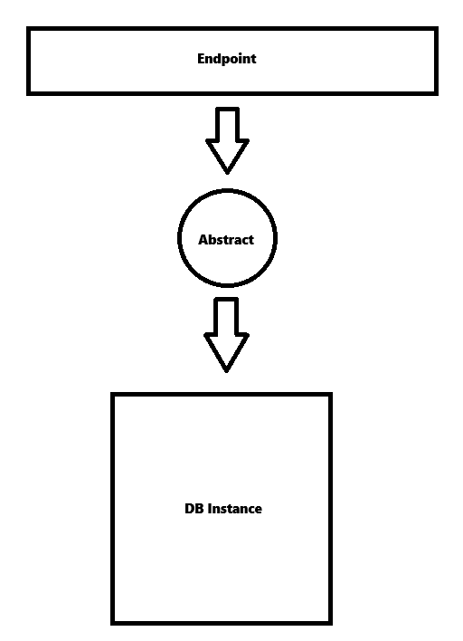

# 다중 AZ DB 클러스터

> 다중 AZ DB 클러스터와 다중 AZ DB 인스턴스는 서로 다른 것이다.

[AWS RDS 다중 AZ DB 클러스터란?](https://omty.tistory.com/46)

DB 인스턴스가 다중 AZ 배포가 되도록 지정하면 Amazon RDS 요금 페이지에 게시된 다중 AZ 요금에 따라 청구된다.

**AWS 다중 AZ DB 클러스터란**, Amazon RDS에서 고가용성을 보장하기 위한 배포 모드이다. 읽기 작업을 위한 **Reader 인스턴스**와 쓰기 작업을 위한 **Writer 인스턴스**가 존재한다. 각각의 인스턴스는 **AZ**(Availability Zone)에 존재하며 Amazon RDS의 DB 엔진 복제 기능을 사용하여 Writer DB 인스턴스의 데이터를 Reader 인스턴스로 복제한다. Writer 인스턴스가 변경될 경우 변경 내용을 각각의 Reader 인스턴스에 전송하며, 해당 변경 사항을 커밋하고 적용하려면 **하나 이상의 Reader DB 인스턴스의 승인**을 받아야 한다. (*두 개의 Reader에서 모두 다 받을 필요는 없음.*)

다중 AZ DB 클러스터는 **Cluster**(*Writer Instance로 연결됨*), **Reader**, **Instance** 3개의 Endpoint가 존재한다. 다중 AZ DB 클러스터에는 하나의 Writer만 존재하며, Cluster Endpoint의 경우 Writer DB 인스턴스에 연결된다. 오로지 Writer 인스턴스에 대해서만 DDL 및 DML과 같은 Write 작업이 가능하며, 읽기 작업 또한 가능하다.

> Cluster Endpoint는 Writer Instance로 연결된다.  
>   
> **Instance Endpoint**는 다중 AZ 배포 클러스터에 존재하는 세 개의 Instance에 각각 접근하는 것을 말하는 것 같다. Cluster, Reader Endpoint가 추상화되어 있기 때문에 직접 접근하려면 **Instance Endpoint**를 사용해야 한다.  
>   
> 이렇게 설정된 이유는 Writer 인스턴스에 장애가 발생할 경우 Reader Instance가 Writer 인스턴스로 승격되어 사용될 수 있기 때문이다.

**Reader Endpoint**의 경우에는, 읽기 전용을 위한 **Load Balancing**을 제공한다. 개발 시에 단순히 읽기 작업 (SELECT)이 필요한 경우에는 Reader Endpoint로 접근하여 처리할 수 있다. 읽기 작업을 별도의 인스턴스에서 처리함으로써, Writer 인스턴스의 오버헤드를 줄일 수 있다.

인스턴스 Endpoint의 경우 **Writer Endpoint**, **Reader Endpoint**에 직접 연결이 가능하다. **다중 AZ DB Cluster**의 경우, Cluster, Reader Endpoint를 통해 각각의 인스턴스에 접근하게 되는데, 인스턴스에 직접 접근할 경우 해당 인스턴스의 상태 및 지표 등을 확인할 수 있다.

다중 AZ DB에는 하나의 Writer 인스턴스는 읽기/쓰기의 작업이 가능하며, Reader Endpoint는 읽기 작업만 가능하다. 여기서 **Cluster, Reader Endpoint란, DB 인스턴스를 직접 가리키는 것이 아닌 추상화된 연결**이다. 해당 연결 정보를 통해 인스턴스로 접근이 가능한 중간 핸들러 역할로, 실제 DB 인스턴스에 장애가 발생할 경우 자동으로 연결된 인스턴스를 변경한다.

⇒ Endpoint의 추상화. 고장, 장애 발생에 따라서 데이터베이스에 수정이 필요한 경우, Endpoint가 실제로 가리키는 DB Instance가 변경되지만 Endpoint는 바뀌지 않는 것을 의미한다.

DB 클러스터의 기본 DB 인스턴스에 장애가 발생하면 자동으로 새로운 DB 인스턴스로 장애를 조치하는데, 기존의 Reader 인스턴스를 Writer 인스턴스로 승격하여 이를 수행한다. 이 때 Reader 인스턴스의 장애 상황에도 새로운 Writer 인스턴스로 승격이 이루어진다.
