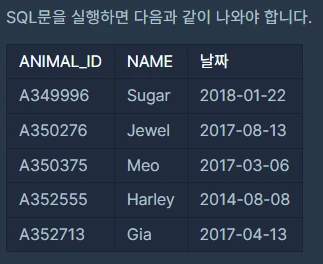
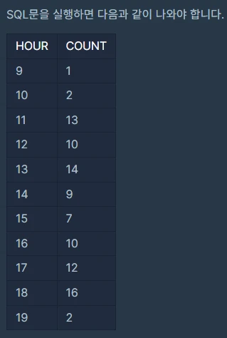

# MySQL: 프로그래머스 Lv. 2 풀이

작성일 2022-09-26
{ .post-date }

## 최솟값 구하기

- 동물 보호소에 가장 먼저 들어온 동물은 언제 들어왔는지 조회하는 SQL 문을 작성해주세요.
- 나의 생각

> 가장 먼저 들어온 동물? → `order by`  

```sql
select `DATETIME` from `ANIMAL_INS` order by `DATETIME` asc limit 1
```

- 가장 먼저 들어온 동물을 찾는 것이므로, 날짜와 관련된 row인 DATETIME을 select
- 가장 먼저 들어온 동물을 찾는 것이므로, order by `DATETIME` asc
    (asc로 정렬하면, 가장 먼저 들어온 것이 첫 번째 column이 된다.)
- limit 1을 해서 가장 위에 있는 column을 출력한다.

## 동물 수 구하기

- 동물 보호소에 동물이 몇 마리 들어왔는지 조회하는 SQL 문을 작성해주세요.
- 나의 생각

> 몇 마리 들어왔는지 세려면? → `count`  
> 근데 같은 동물에 대해서 여러 개의 column이 존재할 수 있으므로? → `distinct`

```sql
select count(distinct `ANIMAL_ID`) as `count` from `ANIMAL_INS`
```

- distinct : 중복되는 것은 한 개만 출력한다.
- as `...` : 결과를 출력할 때 row의 이름을 설정한다.
- count : 개수를 센다

## 중복 제거하기

- 동물 보호소에 들어온 동물의 이름은 몇 개인지 조회하는 SQL 문을 작성해주세요. 이때 이름이 NULL인 경우는 집계하지 않으며 중복되는 이름은 하나로 칩니다.
- 나의 생각

> 몇 개인지 조회한다? → `count`  
> 이름이 NULL이면 제외? → `is not NULL`  
> 중복되는 이름은 하나? → `distinct`

```sql
select count(distinct `NAME`) from `ANIMAL_INS` where `NAME` is not NULL
```

- 동물 수 구하기와 비슷한 문제.
- count와 distinct를 이용한다.
- where `NAME` is not NULL 을 이용해 조건을 걸어주어서 NULL이 count 되지 않도록 한다.

## 이름에 el이 들어가는 동물 찾기

- 보호소에 돌아가신 할머니가 기르던 `개` 를 찾는 사람이 찾아왔습니다. 이 사람이 말하길 할머니가 기르던 개는 이름에 ‘el’이 들어간다고 합니다. 동물 보호소에 들어온 동물 이름 중, 이름에 ‘el’이 들어가는 개의 아이디와 이름을 조회하는 SQL 문을 작성해주세요. 이때 결과는 이름 순으로 조회해주세요. 단, 이름의 대소문자는 구분하지 않습니다.
- 나의 생각

> 개를 찾는다? → `ANIMAL_TYPE` 이 Dog 이다.  
> 이름에 ‘el’이 들어간다? → `LOCATE` 함수로 문자열 포함 여부를 확인한다.  
> 결과는 이름 순으로 조회한다 → `order by NAME`

```sql
select `ANIMAL_ID`, `NAME` from `ANIMAL_INS`
where LOCATE('el', `NAME`) > 0 and `ANIMAL_TYPE` = "Dog"
order by `NAME`
```

- 개를 찾는 것이므로 where 문에서 `ANIMAL_TYPE` = “Dog”
- LOCATE 함수를 이용하면 이 문제를 해결할 수 있는데, LOCATE(”찾을 문자열”, row) 를 하면, 해당 문자열에 지정된 문자열이 시작되는 위치를 반환해준다. 만약 지정된 문자열이 없으면 0을 반환한다. 이 문제에서는 지정된 문자열 “el”이 포함돼 있는지 아닌지를 체크하는데 이용했다.
- 이름 순으로 조회하는 것이므로, order by `NAME`

## 동명 동물 수 찾기

- 동물 보호소에 들어온 동물 이름 중 두 번 이상 쓰인 이름과 해당 이름이 쓰인 횟수를 조회하는 SQL문을 작성해주세요. 이때 결과는 이름이 없는 동물은 집계에서 제외하며, 결과는 이름 순으로 조회해주세요.
- 나의 생각

> 두 번 이상 쓰인 이름? → 무조건 `count`를 써야한다.  
> 이름이 쓰인 횟수? → `count`를 해서 `select`로 출력해야함. 조건을 걸어서 2회 이상만 출력하면 된다.  
> 이름이 없는 동물은 집계에서 제외? → `is not NULL` 조건 걸기  
> 이름 순? → `order by asc`

```sql
select `NAME`, count(`NAME`) as `COUNT` from `ANIMAL_INS`
where `NAME` is not NULL
group by `NAME` having count(`NAME`) > 1
order by `NAME`
```

- 이 문제는 이름을 기준으로 출력하는 문제이다. ‘이름’이 기준이고, 이름이 중복으로 사용된 횟수를 출력하는 문제이기 때문에, group by를 이용하여 ‘이름’을 기준으로 column이 구성되도록 한다.
- having은 group by로 묶은 그룹에 대하여 조건을 걸어주는 방법이다. 문제에서 2회 이상 사용된 이름만 출력해달라고 했으므로, count(NAME) &gt; 1 로 조건을 걸어준다.
- 사실, where 절은 안 넣어줘도 되는데, 그 이유는 count는 NULL을 세지 않는다고 한다.

## NULL 처리하기

- 입양 게시판에 동물 정보를 게시하려 합니다. 동물의 생물 종, 이름, 성별 및 중성화 여부를 아이디 순으로 조회하는 SQL문을 작성해주세요. 이때 프로그래밍을 모르는 사람들은 NULL이라는 기호를 모르기 때문에, 이름이 없는 동물의 이름은 “No Name”으로 표시해주세요.
- 나의 생각

> 기본적인 출력은 아주 간단함 → select … from …  
> NULL이라는 기호는 “No Name”으로 바꿈? → `case` 구문을 사용한다.

```sql
select
	`ANIMAL_TYPE`,
	case
		when `NAME` is NULL then "No Name"
		else `NAME`
	end,
	`SEX_UPON_INTAKE`
from `ANIMAL_INS`
order by `ANIMAL_ID`
```

- 여기서는 case 구문을 사용한다.
    SQL 에서는 다음과 같은 형태로 조건을 걸어줄 수 있다.

```sql
case `row name`
	when condition1 then value
	when condition2 then value
	...
	else value
	end
```

- case 옆에 쓰인 `row name` 은 조건에 `row name`이 들어갈 경우 명시하지 않아도 된다. (문제 예시같은 경우)

## DATETIME에서 DATE로 형 변환

- ANIMAL_INS 테이블에 등록된 모든 레코드에 대해, 각 동물의 아이디와 이름, 들어온 날짜를 조회하는 SQL문을 작성해주세요. 이때 결과는 아이디 순으로 조회해야 합니다.



- 나의 생각

> 여기서 어려운 것은 날짜를 출력하는 방법? → `Date_format`으로 형식을 바꾸거나, 날짜는 `String`이므로 `substring`으로 잘라서 출력한다.

```sql
select `ANIMAL_ID`, Date_format(`DATETIME`, '%Y-%m-%d') as '날짜' from `ANIMAL_INS`

# or

select `ANIMAL_ID`, `NAME`, substring(`DATETIME`, 1, 10) from `ANIMAL_INS`
```

- 1) Date_format 함수를 이용하면, DATETIME 자료형을 원하는 format의 String으로 수정할 수 있다.
    관련 정보는 아래 게시글에 자세히 정리되어 있음.

[[mysql] DATE_FORMAT - 날짜 형식 설정](https://devjhs.tistory.com/89)

- 2) substring(string, start_idx, finish_idx) 를 이용하면 문자열을 잘라낼 수 있음.
    문제의 테이블에서 주어진 형태가 2018-01-22 14:32:00 형태이므로, 위의 코드와 같이
    인덱싱을 하면 원하는 형태의 String을 얻을 수 있음. `(SQL은 첫 인덱스가 1이다.)`

## 중성화 여부 파악하기

- 보호소의 동물이 중성화되었는지 아닌지 파악하려 합니다. 중성화된 동물은 `SEX_UPON_INTAKE` 컬럼에
    `’Neutered’` 또는 `‘Spayed’`라는 단어가 들어있습니다. 동물의 아이디와 이름, 중성화 여부를 아이디 순으로 조회하는 SQL문을 작성해주세요. 이때 `중성화`가 되어있다면 `‘O’`, 아니라면 `‘X’`라고 표시해주세요.
- 나의 생각

> 특정 컬럼의 String이 지정된 String인지 비교해야함 → 다른 문제에서 다뤘던 `when`, `case`를 사용.  
> `중성화`가 되어있다면 `‘O’`, 아니라면 `‘X’` → 이 것도 마찬가지로 `when`, `case`를 사용해서 value 바꿈.

```sql
select
	`ANIMAL_ID`,
	`NAME`,
	case
		when `SEX_UPON_INTAKE` = "Neutered Male"
		or `SEX_UPON_INTAKE` = "Spayed Female" then 'O',
		else 'X'
	end as "중성화"
from `ANIMAL_INS` order by `ANIMAL_ID`

# or

select
	`ANIMAL_ID`,
	`NAME`,
	case
		when `SEX_UPON_INTAKE` like "Intact%" then 'X'
		else 'O'
	end as "중성화"
from `ANIMAL_INS` order by `ANIMAL_ID`
```

- 1) when case then 구문을 이용해서 `SEX_UPON_INTAKE` 가 특정 문자열과 같은지 비교 가능하다.
    when `SEX_UPON_INTAKE` = “Neutered Male” or `SEX_UPON_INTAKE` = “Spayed Female” then ‘O’, …
    `NULL 처리하기` 문제에서도 언급 했지만, when 구문의 condition 에서 `row name`이 조건에 들어가면
    case 옆에 `row name`을 명시하지 않아도 된다.

- 2) when case then 구문을 이용하는건 1)과 같지만, like 를 사용한다.
    like는 문자열의 패턴을 분석하는데 사용할 수 있는 기능으로써, `like “Intact%”` 를 하면
    Intact가 처음에 나오고, 그 뒤에 아무 String이 나오는 String을 Catch해준다.
    이와 같은 방법을 이용하면 중성화가 되지 않은 레코드들을 Catch할 수 있고, then ‘X’로 값을 설정해준다.
    그 외의 경우는 중성화가 된 경우이므로, else ‘O’

## 고양이와 개는 몇 마리 있을까

- 동물 보호소에 들어온 동물 중 고양이와 개가 각각 몇 마리인지 조회하는 SQL문을 작성해주세요. 이때 고양이를 개보다 먼저 조회해주세요.
- 나의 생각

> 몇 마리인지 조회? → count  
> 고양이와 개만 출력? → 다른 동물들도 있을테니, group by로 묶어서 count 해주고 having으로 조건 건다.

```sql
select `ANIMAL_TYPE`, count(`ANIMAL_TYPE`) as `count` from `ANIMAL_INS`
group by `ANIMAL_TYPE` having `ANIMAL_TYPE` = "Cat" or `ANIMAL_TYPE` = "Dog"
order by `ANIMAL_TYPE` asc
```

- 문제에서는 테이블에 Cat과 Dog만 있는 것으로 나왔지만, 동물 보호소이기 때문에 실제로는 다른 동물 종들도 있을 것이다. 따라서, group by로 `ANIMAL_TYPE` 을 묶어준 뒤, having으로 `ANIMAL_TYPE` = “Cat” 이거나 “Dog”인 경우로 조건을 걸어준다. 그 뒤, order by로 정렬해준다.

## 입양 시각 구하기(1)

- 보호소에서는 몇 시에 입양이 가장 활발하게 일어나는지 알아보려고 합니다. 09:00부터 19:50까지,
    각 시간대 별로 입양이 몇 건이나 발생했는지 조회하는 SQL문을 작성해주세요. 이때 결과는 시간대 순으로
    정렬해야 합니다.
- 나의 생각



> 시간대 순으로 묶어준다 → `group by`  
> count 해준다. → `count()`  
> 그런데, 시간은 `String`인데, `HOUR`는 정확히 몇 ‘시’인지만 나온다. → `HOUR()` 함수로 시간만 잘라낸다.

```sql
select HOUR(`DATETIME`) as `HOUR`, count(`DATETIME`) as `COUNT` from `ANIMAL_OUTS`
group by `HOUR` having `HOUR` between 9 and 19 order by `HOUR`
```

- `HOUR()` 함수를 이용하면, DATETIME 자료형에서 시간만 잘라내줄 수 있다.
- 시간대 별로 출력해야 하므로, 당연히 `group by`로 묶어준다.
- between 을 이용하면, 특정 값이 범위 내에 속하는지 아닌지를 판단할 수 있다.

## 루시와 엘라 찾기

- 동물 보호소에 들어온 동물 중 이름이 Lucy, Ella, Pickle, Rogan, Sabrina, Mitty인 동물의 아이디와 이름, 성별 및 중성화 여부를 조회하는 SQL 문을 작성해주세요.
- 나의 생각

> 이름이 같은지 비교해야 한다? → `when case then`을 사용하거나, 조건을 걸어서 `==`으로 비교한다.

```sql
select `ANIMAL_ID`, `NAME`, `SEX_UPON_INTAKE` from `ANIMAL_INS`
where `NAME` in ("Lucy", "Ella", "Pickle", "Rogan", "Sabrina", "Mitty")
```

- 일일이 비교하는 것은 번거로운데, 마치 배열처럼 이용할 수 있는 기능이 있다.
    where `NAME` in ("Lucy", "Ella", "Pickle", "Rogan", "Sabrina", "Mitty") 를 이용하여 `NAME` 이 지정된 String 중에서 같은 값을 가질 때만 출력되도록 만들 수 있다.
