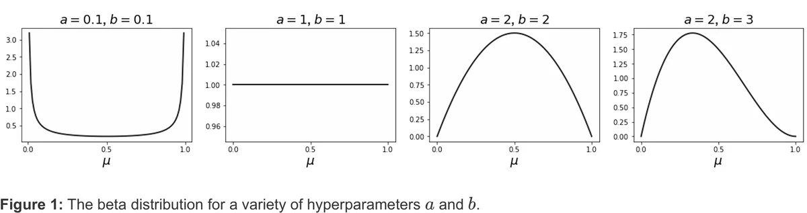
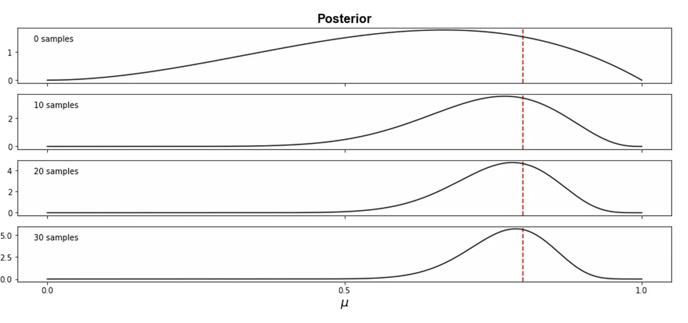

# 켤레 사전분포: 동전 던지기로 보는 MLE, MAP, conjugacy

작성일 2025-03-06
{ .post-date }

Gregory Gundersen의 블로그 글 "Conjugacy in Bayesian Inference"를 읽고 정리한 글이다. 동전 던지기라는 가장 단순한 예제 하나로 MLE가 왜 과적합하는지, prior를 넣으면 무엇이 달라지는지, 그리고 prior를 고를 때 왜 켤레(conjugate) 관계를 따지는지를 순서대로 따라간다. 수식은 블로그의 전개를 따르되 직접 다시 계산해 보며 적었다.

## Conjugacy란

베이즈 추론(Bayesian inference)은 모수 $\theta$에 대해 미리 가지고 있던 믿음(prior)을, 관측한 데이터로 갱신해 posterior를 얻는 과정이다. 갱신 규칙은 Bayes' rule이다.

$$
p(\theta \mid x) = \frac{p(x \mid \theta)\, p(\theta)}{\int p(x \mid \theta')\, p(\theta')\, d\theta'}
$$

이 식에서 prior $p(\theta)$와 posterior $p(\theta \mid x)$가 같은 함수 꼴(functional form)이 될 때, 그 prior는 likelihood $p(x \mid \theta)$에 대해 conjugate하다고 말한다. 말로만 보면 와닿지 않으므로 동전 예제로 확인한다.

## 베르누이 과정과 MLE

앞면이 나올 확률 $\mu$를 모르는 동전이 있다. 이 $\mu$를 알아내고 싶다.

동전을 $n$번 던지고 $i$번째 결과를 $x_i$라고 하자. $x_i$는 앞면이면 1, 뒷면이면 0인 Bernoulli 확률변수이고, 각 던지기는 서로 독립이며 같은 분포를 따른다(i.i.d.).

$$
p(x_i \mid \mu) = \mu^{x_i}(1-\mu)^{1-x_i}
$$

관측 전체를 $\mathcal{D} = \{x_1, \dots, x_n\}$, 앞면의 횟수를 $m = \sum_i x_i$, 뒷면의 횟수를 $l = n - m$이라고 하면, 독립이므로 전체 데이터의 likelihood는 각 던지기의 확률을 곱한 것이다.

$$
p(\mathcal{D} \mid \mu) = \prod_{i=1}^{n} \mu^{x_i}(1-\mu)^{1-x_i} = \mu^{m}(1-\mu)^{n-m}
$$

여기서 표기 하나를 짚어 둔다. 위 식은 "이 순서대로 나온 수열 하나"의 확률이다. 순서를 따지지 않고 "$n$번 중 앞면이 $m$번"이라는 사건의 확률을 쓰면 그런 수열의 개수 $\binom{n}{m}$이 앞에 붙어 이항분포가 된다.

$$
p(m \mid n, \mu) = \binom{n}{m} \mu^{m}(1-\mu)^{n-m}
$$

블로그의 식에는 조합 수가 붙어 있는 곳과 빠진 곳이 섞여 있어서, 읽으면서 "likelihood에 조합 수도 들어가야 하는 것 아닌가" 하는 의문이 들었다. 결론은 어느 쪽을 써도 된다는 것이다. $\binom{n}{m}$은 $\mu$와 무관한 상수이므로, $\mu$에 대한 함수로 보면 두 식은 상수배만큼만 다르고 최대가 되는 지점은 같다. 뒤에서 posterior를 구할 때도 비례 관계만 쓰기 때문에 결과에 영향이 없다.

### 최대가능도 추정

$\mu$를 구하는 가장 간단한 방법은 MLE(Maximum Likelihood Estimation)다. 주어진 데이터가 관측될 확률을 가장 크게 만드는 $\mu$를 고른다. 곱은 다루기 불편하므로 단조증가 함수인 log를 씌워 합으로 바꾼다.

$$
\log p(\mathcal{D} \mid \mu) = \log \binom{n}{m} + m \log \mu + (n-m)\log(1-\mu)
$$

$\mu$로 미분하면 첫 항은 $\mu$가 없어 사라진다.

$$
\frac{\partial}{\partial \mu} \log p(\mathcal{D} \mid \mu) = \frac{m}{\mu} - \frac{n-m}{1-\mu}
$$

이것을 0으로 두고 정리하면 다음을 얻는다.

$$
\mu_{\mathrm{ML}} = \frac{m}{n}
$$

미분이 0인 지점이 곧 최댓값이라고 말할 수 있는 이유는 블로그에 자세히 나오지 않는다. 처음에는 "likelihood가 convex라는 전제가 있는 것"이라고 적어 두었는데, 정확히는 log-likelihood가 위로 볼록(concave)하기 때문이다. 한 번 더 미분하면

$$
\frac{\partial^2}{\partial \mu^2} \log p(\mathcal{D} \mid \mu) = -\frac{m}{\mu^2} - \frac{n-m}{(1-\mu)^2} < 0
$$

이므로, 기울기가 0인 점이 있으면 그 점이 유일한 최대다. 부호를 뒤집은 negative log-likelihood로 보면 convex 함수의 최솟값을 찾는 문제가 된다.

### MLE는 과적합한다

동전을 세 번 던졌는데 세 번 모두 앞면이 나왔다고 하자. 공정한 동전이라도 이런 일은 $\frac{1}{8}$의 확률로 일어난다. 그런데 MLE는

$$
\mu_{\mathrm{ML}} = \frac{3}{3} = 1
$$

이라고 답한다. 이 동전은 항상 앞면만 나온다는 뜻이다. 지금까지 본 데이터만으로 확률을 정하는 frequentist 방식은 데이터가 적을 때 이렇게 과적합(overfitting)한다.

## Prior를 더한다: MAP

해결 방법 중 하나는 동전에 대한 사전 지식을 식에 넣는 것이다. $\log p(\mathcal{D} \mid \mu)$만 최대화하는 대신 다음을 최대화한다.

$$
\log p(\mathcal{D} \mid \mu) + \log p(\mu)
$$

직관적으로 대부분의 동전은 공정하다. 세 번 연속 앞면이 나왔더라도 이 사전 지식을 반영하면 $\mu = 1$이라는 극단적인 결론을 피할 수 있다. 이 역할을 하는 것이 prior $p(\mu)$다.

### Beta prior

prior는 "$\mu$가 어떤 값일 것 같은가"를 0과 1 사이의 분포로 나타낸 것이다. 이 분포를 어떻게 정할지에 대해 두 가지를 가정한다.

1. 대부분의 동전은 공정하다. 따라서 분포의 최빈값(mode)이 $\mu = 0.5$여야 한다.
2. 앞면과 뒷면 어느 쪽도 선호하지 않는다. 따라서 분포가 최빈값을 중심으로 대칭이어야 한다.

이 조건을 만족시킬 수 있는 분포 중 하나가 Beta 분포다.

$$
\mathrm{Beta}(\mu \mid a, b) = \frac{\Gamma(a+b)}{\Gamma(a)\Gamma(b)}\, \mu^{a-1}(1-\mu)^{b-1}
$$

$\Gamma$는 gamma 함수다.

$$
\Gamma(x) = \int_0^\infty u^{x-1} e^{-u}\, du
$$

gamma 함수는 factorial을 정수가 아닌 수로 일반화한 것으로, 양의 정수 $n$에 대해서는 $\Gamma(n) = (n-1)!$이다. Beta 분포에서 gamma 함수는 정규화 상수 역할을 한다. $\mu$는 0과 1 사이의 값이고 그 구간에서 밀도를 적분하면 1이 되어야 하는데,

$$
B(a, b) = \frac{\Gamma(a)\Gamma(b)}{\Gamma(a+b)} = \int_0^1 \mu^{a-1}(1-\mu)^{b-1}\, d\mu
$$

로 나누어 주면 그렇게 된다. 평균과 분산은 다음과 같다.

$$
\mathbb{E}[\mu] = \frac{a}{a+b}, \qquad \mathrm{Var}(\mu) = \frac{ab}{(a+b)^2(a+b+1)}
$$

$a$와 $b$는 분포의 모양을 정하는 hyperparameter다. 추정 대상인 $\mu$와 달리 데이터에서 학습되는 값이 아니라 미리 정해 두는 값이다. 식만 보아서는 $a$, $b$가 무슨 일을 하는지 알기 어려우므로 값을 바꿔 가며 그린 그림을 본다.

가로축은 $\mu$, 세로축은 밀도다. $a$와 $b$만 바꾸어도 U자, 평평한 선, 대칭인 봉우리, 한쪽으로 치우친 봉우리가 모두 나온다. 출처: Gundersen 블로그 Figure 1.

왼쪽부터 차례로 읽으면 이렇다.

- $(a, b) = (0.1, 0.1)$: 0과 1 근처에 밀도가 몰리는 U자다. "이 동전은 앞면만 나오거나 뒷면만 나오는 쪽일 것"이라는 믿음에 해당한다.
- $(1, 1)$: 구간 전체에서 평평한 균등분포다. 어떤 $\mu$도 더 믿지 않는다.
- $(2, 2)$: 0.5에서 가장 높고 좌우 대칭인 봉우리다.
- $(2, 3)$: 봉우리가 0.5보다 왼쪽으로 치우친다. $b$가 더 크면 작은 $\mu$ 쪽을 더 믿는다는 뜻이다.

우리가 원하는 것은 최빈값이 0.5이고 대칭인 분포였다. 세 번째 그림이 바로 그 모양이므로 $a = b = 2$를 고른다.

### Posterior도 Beta다

정규분포 같은 다른 분포가 아니라 Beta를 고른 진짜 이유는, Beta가 이 문제의 likelihood에 대해 conjugate하기 때문이다. prior와 likelihood를 곱해 보면 바로 보인다.

$$
\begin{aligned}
p(\mu \mid m, l, a, b) &\propto \underbrace{\frac{\Gamma(a+b)}{\Gamma(a)\Gamma(b)}\, \mu^{a-1}(1-\mu)^{b-1}}_{\text{prior}} \ \underbrace{\prod_{i=1}^{n} \mu^{x_i}(1-\mu)^{1-x_i}}_{\text{likelihood}} \\
&\propto \mu^{m+a-1}(1-\mu)^{l+b-1}
\end{aligned}
$$

$\frac{\Gamma(a+b)}{\Gamma(a)\Gamma(b)}$는 $\mu$와 무관한 상수이므로 비례 관계에서는 떼어 낼 수 있다. 앞에서 본 조합 수 $\binom{n}{m}$도 같은 이유로 여기에 영향을 주지 않는다.

남은 식 $\mu^{m+a-1}(1-\mu)^{l+b-1}$은 $a$ 자리에 $m+a$, $b$ 자리에 $l+b$가 들어간 Beta 분포의 꼴이다. 따라서 정규화 상수는 계산할 필요 없이 Beta의 것을 그대로 가져오면 된다.

$$
p(\mu \mid m, l, a, b) = \frac{\Gamma(m+a+l+b)}{\Gamma(m+a)\Gamma(l+b)}\, \mu^{m+a-1}(1-\mu)^{l+b-1} = \mathrm{Beta}(\mu \mid m+a,\ l+b)
$$

prior가 Beta였고 posterior도 Beta다. 이것이 conjugacy다.

### MAP 추정

이제 likelihood 대신 posterior를 최대화한다. 이 방식이 MAP(Maximum a Posteriori)다. MLE가 likelihood만 최대화했다면, MAP는 거기에 prior를 곱한 것을 최대화한다. log를 씌우고 $\mu$로 미분한다. $C$는 정규화 상수다.

$$
\log p(\mu \mid m, l, a, b) = \log C + (m+a-1)\log\mu + (l+b-1)\log(1-\mu)
$$

$$
\frac{\partial}{\partial \mu}\log p(\mu \mid m, l, a, b) = \frac{m+a-1}{\mu} - \frac{l+b-1}{1-\mu}
$$

0으로 두고 정리하면 $l = n - m$이므로

$$
\mu_{\mathrm{MAP}} = \frac{m+a-1}{n+a+b-2}
$$

를 얻는다. 앞의 상황($n = 3$, $m = 3$)에 $a = b = 2$를 넣어 보자.

$$
\mu_{\mathrm{MAP}} = \frac{3+2-1}{3+2+2-2} = \frac{4}{5}
$$

MLE는 앞면 확률을 1이라고 했지만, MAP는 0.8이라고 답한다. 데이터가 적을 때 prior가 과적합을 막아 준다는 것을 숫자로 확인할 수 있다.

## Conjugacy의 두 가지 이점

### 1. 닫힌 형태로 계산된다

위에서 $\mu_{\mathrm{MAP}}$를 쉽게 구한 것은 conjugacy 덕분이다. 만약 $\mu$의 prior를 평균 $\nu$, 분산 $\sigma^2$인 정규분포로 잡았다면 posterior는 다음에 비례한다.

$$
p(\mu \mid m, l, \sigma^2, \nu) \propto \frac{1}{\sqrt{2\pi\sigma^2}} \exp\left(-\frac{(\mu-\nu)^2}{2\sigma^2}\right) \prod_{i=1}^{n} \mu^{x_i}(1-\mu)^{1-x_i}
$$

지수 함수와 다항식이 곱해진 이 식은 이름 붙은 분포의 꼴로 정리되지 않고, 정규화 상수를 구하는 적분도 깔끔하게 풀리지 않는다. Variational inference 같은 근사 기법을 따로 쓰지 않으면 다루기 어렵다. conjugate prior를 쓰면 posterior가 닫힌 형태(closed form)로 나오므로 이런 문제가 없다.

### 2. 순차적으로 갱신할 수 있다

두 번째 이점은 데이터가 하나씩 들어오는 상황에서 드러난다. 데이터를 모두 모아 놓고 한 번에 계산할 필요 없이, 새 데이터가 올 때마다 믿음을 조금씩 고쳐 나갈 수 있다. prior와 posterior의 꼴이 같으므로, $t$ 시점의 posterior를 그대로 $t+1$ 시점의 prior로 쓸 수 있기 때문이다. 할 일은 분포의 모수를 고치는 것뿐이다. 매 시점 동전을 한 번 던진다면 다음과 같이 갱신한다.

- 앞면이 나오면 $n$과 $m$을 1씩 늘린다.
- 뒷면이 나오면 $n$과 $l$을 1씩 늘린다.

노트에는 "$m$, $l$ 대신 hyperparameter $a$, $b$를 늘려도 되는가"라는 질문을 적어 두었다. 답은 그렇다, 그리고 둘은 같은 일이다. posterior $\mathrm{Beta}(\mu \mid m+a,\ l+b)$는 $m+a$와 $l+b$라는 합에만 의존하므로, 앞면을 보았을 때 $m$을 늘리든 $a$를 늘리든 결과가 같다. 이렇게 보면 $a$와 $b$의 의미도 분명해진다. $\mu_{\mathrm{MAP}} = \frac{m + (a-1)}{n + (a-1) + (b-1)}$이므로 $a-1$과 $b-1$은 실험을 시작하기 전에 미리 본 앞면과 뒷면의 횟수처럼 작동한다. $a = b = 2$는 앞면 한 번과 뒷면 한 번을 이미 본 상태에서 시작하는 것과 같다.

이 갱신을 반복하면 posterior가 어떻게 변하는지 그림으로 볼 수 있다. 블로그는 앞면 확률이 0.8인 동전을 던지면서 표본을 0개, 10개, 20개, 30개 본 뒤의 posterior를 차례로 그렸다.

위에서 아래로 표본이 늘어난다. 빨간 점선이 동전의 실제 앞면 확률 0.8이고, 검은 곡선이 그 시점의 posterior다. 출처: Gundersen 블로그.

맨 위(표본 0개)의 곡선은 prior 그대로여서 넓게 퍼져 있다. 아래로 내려갈수록 곡선이 좁고 높아지면서 봉우리가 빨간 점선 쪽으로 옮겨 간다. 데이터가 쌓일수록 "$\mu$는 이 근처일 것"이라는 믿음이 뚜렷해지는 것이다. 네 곡선이 모두 Beta 분포라는 점도 눈여겨볼 만하다. 꼴은 그대로이고 모수만 바뀌었다. 다만 맨 아래(30개)에서도 봉우리는 점선보다 조금 왼쪽에 있어, 실제 값을 약간 과소추정하고 있다.

## 정리

- prior와 posterior가 같은 함수 꼴이면 그 prior는 likelihood에 대해 conjugate하다. Bernoulli(이항) likelihood에는 Beta prior가 conjugate하다.
- conjugate prior를 쓰면 likelihood와 prior를 곱한 결과가 닫힌 형태로 나와 계산이 가능해지고(tractable), 같은 꼴이 유지되므로 데이터가 들어올 때마다 모수만 갱신하는 효율적인 추론을 만들 수 있다.
- MLE는 likelihood만 최대화하는 frequentist 방식이고 데이터가 적으면 과적합한다. MAP는 prior를 반영한 posterior를 최대화하므로 베이즈 관점의 추정으로 볼 수 있다. 다만 MAP도 값 하나를 고르는 점 추정이고, posterior 분포 전체를 쓰는 것은 [3편](03-from-least-squares-to-bayesian-regression.md)에서 다룬다.
- 미분이 0인 지점을 최적해로 삼는 논리는 결국 함수의 볼록성에 기대고 있다. convex optimization은 따로 공부해야 할 주제로 남겨 두었다.

Bernoulli와 Beta의 관계가 우연이 아니라는 점, 즉 지수족에 속하는 likelihood에는 항상 같은 방식으로 conjugate prior를 만들 수 있다는 점은 [2편](02-exponential-family.md)에서 정리한다.

## 참고 자료

- Gregory Gundersen, "Conjugacy in Bayesian Inference", 2019. <https://gregorygundersen.com/blog/2019/03/16/conjugacy/>
