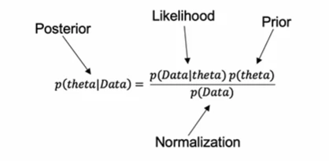
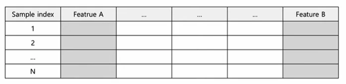
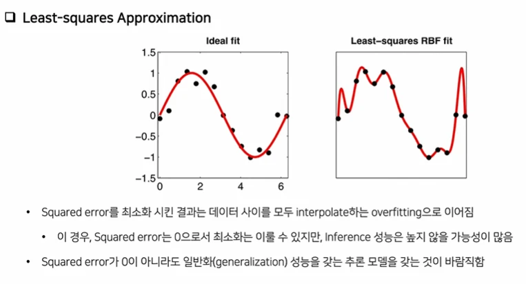
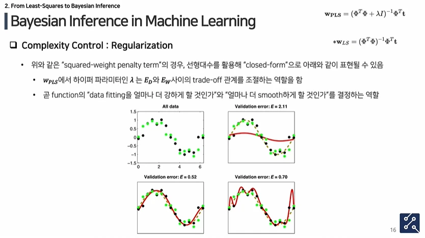
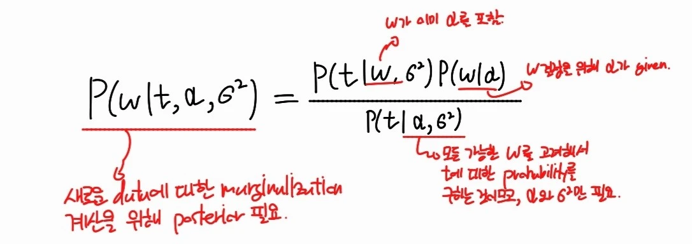
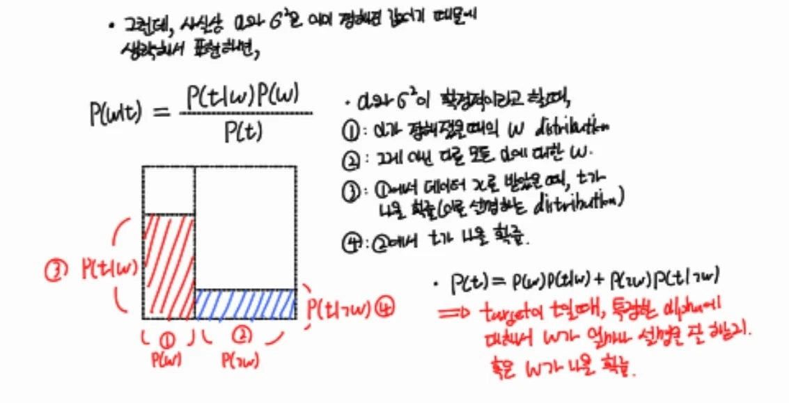
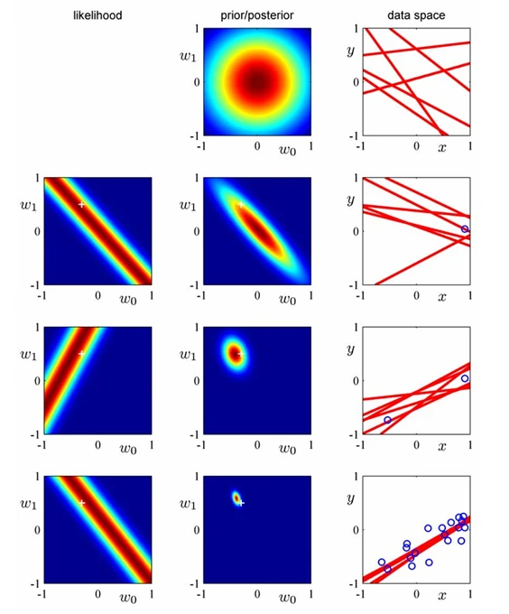
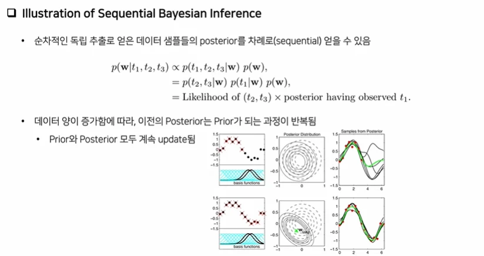
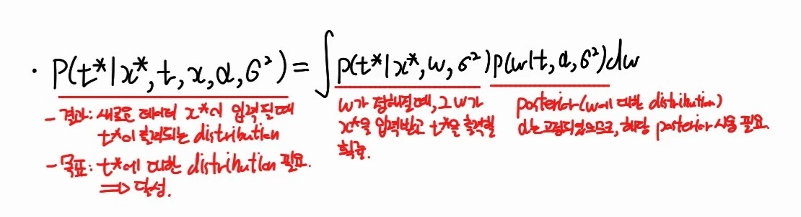
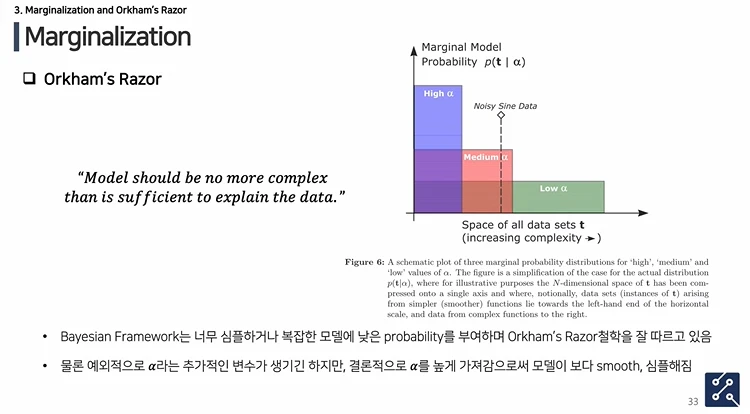

# 최소제곱에서 베이즈 회귀까지

작성일 2025-02-26 · 최종 수정일 2025-03-07
{ .post-date }

회귀 문제 하나를 놓고 최소제곱에서 출발해 정규화, 확률적 회귀, MLE, MAP를 거쳐 완전한 베이즈 예측까지 한 단계씩 올라가는 글이다. 서울대학교 산업공학과 DSBA 연구실의 YouTube 세미나 영상을 보며 정리했다. 이 영상은 M. E. Tipping의 튜토리얼 논문 "Bayesian Inference: An Introduction to Principles and Practice in Machine Learning"을 리뷰한 것이다. 여기에 PRML 3.3절 Bayesian Linear Regression을 읽으며 적어 둔 노트를 합쳤다. PRML을 먼저 읽을 때 막혔던 질문 가운데 일부는 이 강의를 정리하면서 풀렸다.

각 단계에서 "앞 단계로는 왜 부족한가"가 다음 단계의 동기가 된다. 정리하면서 스스로 던진 질문이 많았고, 대부분은 뒤 단계를 공부하면서 답을 찾았다. 질문과 답을 흐름 속에 그대로 남겼다.

## 베이즈 추론의 틀

베이즈 추론은 새로운 증거가 들어올 때마다 가설에 대한 확률을 갱신해 나가는 방법이다. 바탕은 베이즈 정리다.

$$
P(H \mid D) = \frac{P(D \mid H)\, P(H)}{P(D)}
$$

식의 어느 자리가 어떤 이름인지를 화살표로 짚은 그림이다. 가설 자리에 모수 theta가, $D$ 자리에 Data가 들어가 있을 뿐 위의 식과 같다. 출처: 강의 슬라이드(DSBA 세미나).

| 항 | 이름 | 의미 |
|---|---|---|
| $P(H \mid D)$ | posterior | 데이터 $D$를 본 뒤 갱신된 믿음 |
| $P(D \mid H)$ | likelihood | 가설 $H$가 맞을 때 $D$가 관측될 확률 |
| $P(H)$ | prior | 데이터를 보기 전의 믿음 |
| $P(D)$ | evidence | 확률의 합이 1이 되게 하는 정규화 항 |

절차는 네 단계다. prior $P(H)$에서 시작하고, 데이터를 모아 likelihood $P(D \mid H)$를 계산하고, 베이즈 정리로 prior를 posterior로 갱신하고, 데이터가 더 들어오면 이를 반복한다.

이 틀이 머신러닝과 어떻게 이어지는지 본다.

행이 표본, 열이 변수인 데이터다. 회색으로 칠한 두 열 Feature A와 Feature B 사이의 관계가 알고 싶은 대상이다. 출처: 강의 슬라이드.

머신러닝에서는 보통 이런 표본 데이터로 변수 $A$와 $B$(target)의 관계를 학습한다. 대부분의 모델은 완전히 확신하는 것처럼 값 하나를 답으로 내놓지만, 실제 세계에서 $A$와 $B$의 관계에는 불확실성이 있다. 이 불확실성까지 학습하고 추론하려는 것이 베이즈 방식이다. 조건부 확률은 대개 모수 $\mathbf{w}$를 가진 모델로 표현한다.

$$
P(B \mid A) = f(A; \mathbf{w})
$$

$B$는 $A$뿐 아니라 $\mathbf{w}$에도 의존하므로, 숨어 있는 $\mathbf{w}$의 분포를 추론하는 것이 중요한 과제가 된다.

강의가 꼽는 베이즈 방식의 장점과 단점은 이렇다.

- **장점**: 관심 없는 변수를 모두 적분해 없애는(integrate out) 과정에서 Occam's razor가 자연스럽게 구현된다. 불필요하게 복잡하지 않은 모델로 데이터를 설명하려 한다.
- **단점**: 그 적분이 닫힌 형태로 풀리지 않는(analytically intractable) 경우가 많다. 이때는 근사 기법을 써야 하고, 해석적으로 정확한 답을 얻기 어렵다.

이 두 가지가 실제로 무슨 뜻인지는 글의 뒷부분에서 드러난다.

## 문제 설정

예제 데이터는 15개의 점이다. 입력 $x_n$에 대해 target $t_n$은 $\sin(x_n)$에 Gaussian 노이즈를 더한 값이다. 강의 자료의 표기로는 다음과 같다.

$$
\mathcal{D} = \left\{ \left( x_n,\ t_n = \sin(x_n) + \mathcal{N}(0, 0.2) \right) \right\}_{n=1}^{15}
$$

이 데이터를 설명할 모델로 선형 모델을 쓴다. sin 함수는 비선형이므로 입력을 그대로 쓰지 않고, 비선형 함수 $\phi_m$을 거친 값들의 선형 결합을 쓴다.

$$
y(x; \mathbf{w}) = \sum_{m=1}^{M} w_m \phi_m(x), \qquad \phi_m(x) = \exp\left( -\frac{(x - x_m)^2}{r^2} \right)
$$

$\phi_m$은 데이터 점 $x_m$을 중심으로 하는 RBF(radial basis function)다.

처음에 "이것이 linear regression이 맞는가, $\phi$는 activation function 같은 것인가"가 헷갈렸다. 이 모델이 선형이라는 말은 입력 $x$가 아니라 모수 $\mathbf{w}$에 대해 선형이라는 뜻이다. $\phi_m$은 basis function으로, 입력에서 비선형 feature를 뽑아 선형 모델이 비선형 관계를 표현할 수 있게 해 준다. 비선형성을 넣는다는 점에서는 activation function과 역할이 비슷하지만, 학습되는 것이 아니라 미리 정해 둔 함수라는 점이 다르다. PRML은 basis function의 개수가 모델의 실질적인 복잡도를 정하고, 그 복잡도는 데이터의 크기에 맞게 조절되어야 한다고 설명한다.

### 덧붙임: kernel method

강의에서 RBF kernel이라는 말이 나와서 kernel method를 따로 찾아 정리했다.

선형 모델은 입력의 선형 결합으로 출력을 만들기 때문에 비선형인 데이터를 표현하기 어렵다. 한 가지 해결책은 입력을 더 높은 차원으로 보내는 feature mapping이다. 예를 들어 2차원 입력을 다음과 같이 3차원으로 보내면, 원래 공간에서는 직선으로 나눌 수 없던 데이터를 평면으로 나눌 수 있게 된다.

$$
\phi(x) = (x_1,\ x_2,\ x_1^2 + x_2^2), \qquad \phi(2, 3) = (2,\ 3,\ 13)
$$

이 방법에는 단점이 둘 있다. 차원이 높아질수록 계산량이 급증하고, 적절한 변환 함수를 찾기도 어렵다. Kernel trick은 변환 $\phi$를 실제로 계산하지 않고, 변환된 공간에서의 내적만 함수 $K$로 직접 계산하는 기법이다.

$$
K(x, x') = \langle \phi(x), \phi(x') \rangle
$$

가장 많이 쓰이는 것이 RBF kernel이다. 두 점 사이의 거리에 Gaussian 함수를 적용한 형태라서, 가까운 점끼리는 값이 크고 먼 점끼리는 작다.

$$
K(x, x') = \exp\left( -\frac{\lVert x - x' \rVert^2}{2s^2} \right)
$$

RBF kernel에 대응하는 $\phi$는 무한 차원이라 직접 계산할 수 없지만, kernel을 쓰면 변환한 것과 같은 유사도를 얻는다. 선형 모델 $y = \mathbf{w}^\top x + b$를 feature 공간으로 옮긴 $y = \mathbf{w}^\top\phi(x) + b$는 kernel을 써서 다음과 같이 표현된다.

$$
y = \sum_{i=1}^{N} c_i K(x, x_i) + b
$$

새 입력 $x$와 훈련 표본 $x_i$ 사이의 유사도를 구하고, 그 유사도를 학습된 계수 $c_i$로 가중합하는 구조다. 이 글의 모델 $y(x; \mathbf{w}) = \sum_m w_m \phi_m(x)$도 같은 모양이다. $\phi_m(x)$가 입력 $x$와 데이터 점 $x_m$ 사이의 RBF 유사도이고, $w_m$이 그 가중치다. kernel의 폭 $s$가 $\phi_m$의 $r$에 해당한다($r^2 = 2s^2$).

## 1단계: 최소제곱

목표는 새로운 데이터에 대해 좋은 예측을 하는 $\mathbf{w}$를 찾는 것이다. 가장 전통적인 방법은 오차의 제곱합을 최소화하는 최소제곱(least squares)이다.

$$
E_{\mathcal{D}}(\mathbf{w}) = \frac{1}{2} \sum_{n=1}^{N} \left[ t_n - \sum_{m=1}^{M} w_m \phi_m(x_n) \right]^2
$$

$\Phi_{nm} = \phi_m(x_n)$을 성분으로 하는 설계 행렬(design matrix) $\boldsymbol{\Phi}$와 $\mathbf{t} = (t_1, \dots, t_N)^\top$을 쓰면 최적해는 닫힌 형태로 구해진다.

$$
\mathbf{w}_{\mathrm{LS}} = \left( \boldsymbol{\Phi}^\top\boldsymbol{\Phi} \right)^{-1} \boldsymbol{\Phi}^\top \mathbf{t}
$$

### 기하학적으로 보면

이 식이 어디서 나오는지는 선형대수로 보면 분명하다. 크기가 $10 \times 3$이고 rank가 3인 행렬 $A$가 있다고 하자. $A$의 열들이 span하는 공간은 10차원 공간 안의 3차원 부분공간이다. 그 공간 밖에 벡터 $b$가 있을 때, $Ax$를 $b$에 최대한 가깝게 만드는 $x$를 찾는 것이 최소제곱의 목표다. 곧 오차 벡터 $b - Ax$의 2-norm을 가장 작게 만드는 것이다.

오차 벡터가 가장 짧아지는 것은 그것이 $A$의 열공간에 수직일 때다. 수직 조건을 내적으로 쓰면 해가 나온다.

$$
A^\top (b - A\hat{x}) = 0 \ \Longrightarrow\ A^\top A \hat{x} = A^\top b \ \Longrightarrow\ \hat{x} = (A^\top A)^{-1} A^\top b
$$

$A$를 $\boldsymbol{\Phi}$로, $x$를 $\mathbf{w}$로, $b$를 $\mathbf{t}$로 바꾸면 위의 $\mathbf{w}_{\mathrm{LS}}$다.

### 문제: 과적합

이렇게 구한 $\mathbf{w}_{\mathrm{LS}}$로 곡선을 그려 보면 문제가 바로 보인다.

검은 점이 15개의 데이터, 빨간 선이 맞춘 곡선이다. 왼쪽은 바라는 모양(sin 곡선)이고, 오른쪽이 실제로 최소제곱이 내놓은 곡선이다. 출처: 강의 슬라이드.

오른쪽 곡선은 15개의 점을 하나도 빠짐없이 지나가려고 심하게 구불거린다. 점 위에서의 제곱 오차는 0에 가깝게 줄일 수 있지만, 점과 점 사이를 억지로 이은 것이라 새 데이터에 대한 예측은 좋지 않을 가능성이 크다. 왼쪽 곡선은 점을 정확히 지나지 않아 제곱 오차가 0이 아니지만, 새 점이 들어와도 잘 맞을 것이다. 제곱 오차가 0이 아니더라도 이렇게 일반화(generalization)가 되는 모델이 바람직하다.

## 2단계: 정규화

데이터를 만든 실제 함수는 구불구불하기보다 매끄러울(smooth) 것이라고 가정하는 것이 보통이다. 선형 모델에서 매끄러운 함수는 복잡한 함수보다 weight의 크기가 작다. 그래서 cost function에 weight가 커지는 것을 벌하는 항을 더한다. 이것이 정규화(regularization)다.

$$
\hat{E}(\mathbf{w}) = E_{\mathcal{D}}(\mathbf{w}) + \lambda E_W(\mathbf{w}), \qquad E_W(\mathbf{w}) = \frac{1}{2} \sum_{m=1}^{M} w_m^2
$$

제곱합을 쓰는 이 penalty(L2 norm)에서도 해는 닫힌 형태다. PLS는 penalized least squares다.

$$
\mathbf{w}_{\mathrm{PLS}} = \left( \boldsymbol{\Phi}^\top\boldsymbol{\Phi} + \lambda I \right)^{-1} \boldsymbol{\Phi}^\top \mathbf{t}
$$

hyperparameter $\lambda$는 $E_{\mathcal{D}}$와 $E_W$ 사이의 trade-off, 곧 데이터에 얼마나 강하게 맞출 것인가와 함수를 얼마나 매끄럽게 할 것인가를 정한다. $\lambda$에 따라 맞춰진 곡선이 달라진다.

아래쪽 그래프 네 개를 본다. 왼쪽 위는 데이터만 그린 것이고, 나머지 셋은 $\lambda$를 달리해 맞춘 빨간 곡선이다. 각 그래프의 제목에 validation error $E$가 적혀 있다. 출처: 강의 슬라이드.

오른쪽 위($E = 2.11$)는 정규화가 너무 강한 경우다. 곡선이 거의 평평해져 데이터의 굴곡을 따라가지 못한다. 오른쪽 아래($E = 0.70$)는 정규화가 너무 약한 경우로, 1단계처럼 다시 구불거린다. 왼쪽 아래($E = 0.52$)가 그 사이에서 가장 잘 맞은 경우다. 곧 $\lambda$가 너무 크면 곡선이 평평해지고, 너무 작으면 구불거리며, 적당한 값을 골라야 한다.

여기서 질문 하나를 적어 두었다. prior를 Gaussian으로 가정하고 posterior에 negative log를 취하면 L2 정규화가, Laplace 분포로 가정하면 L1 정규화가 나온다고 알고 있었는데, 지금의 정규화 항도 그렇게 해석할 수 있는가. 답은 4단계에서 나온다.

## 3단계: 확률적 회귀와 MLE

### target을 분포로 본다

지금까지는 정해진 값 $t$ 하나를 예측하는 접근이었고, 그에 맞는 $\mathbf{w}$도 값 하나로 "결정"되었다. 하지만 값 하나로는 현실의 불확실성을 담을 수 없다. 그래서 $t$를 확률변수로 보고, 값이 아니라 분포를 예측하는 회귀를 생각한다.

$$
t_n = y(x_n; \mathbf{w}) + \epsilon_n, \qquad p(t_n \mid x_n, \mathbf{w}, \sigma^2) = \mathcal{N}\left( t_n \mid y(x_n; \mathbf{w}),\ \sigma^2 \right)
$$

target $t_n$은 모델의 출력 $y(x_n; \mathbf{w})$를 평균으로 하고 분산이 $\sigma^2$인 Gaussian을 따른다. 모델이 내놓은 값 주변에 $\sigma^2$ 수준의 노이즈가 있다는 뜻이다. 각 target이 서로 독립이므로 전체 데이터에 대해서는 곱으로 쓴다.

$$
p(\mathbf{t} \mid \mathbf{x}, \mathbf{w}, \sigma^2) = \prod_{n=1}^{N} p(t_n \mid x_n, \mathbf{w}, \sigma^2) = \prod_{n=1}^{N} (2\pi\sigma^2)^{-1/2} \exp\left[ -\frac{\{t_n - y(x_n; \mathbf{w})\}^2}{2\sigma^2} \right]
$$

이 식의 의미를 두고 생각이 몇 번 바뀌었다. 처음에는 "분포끼리 곱하면 새로운 분포가 되는 성질" 때문에 곱하는 것이라고 짐작했는데, 그게 아니다. 이 식은 $\mathbf{w}$와 $\sigma^2$이 주어졌을 때 관측된 $t_1, \dots, t_N$이 함께 나올 확률(밀도)이고, 독립이라서 각각의 확률을 곱한 것이다. $\mathbf{w}$의 함수로 보면 이것이 likelihood다.

또 하나 헷갈린 것은 방향이다. 이 식은 $p(\mathbf{t} \mid \mathbf{w})$인데, 결국 구하고 싶은 것은 $p(\mathbf{w} \mid \mathbf{t})$다. 정답 $\mathbf{t}$가 주어졌을 때 그것을 잘 맞추는 $\mathbf{w}$가 무엇인지를 찾는 문제이기 때문이다. 그래서 위의 $p(\mathbf{t} \mid \mathbf{w})$는 likelihood로 쓰이고, $t$뿐 아니라 $\mathbf{w}$도 확률변수로 보아 그 분포를 구하게 된다.

### MLE는 최소제곱과 같다

확률 모델을 세웠으니 가장 먼저 떠올릴 수 있는 추정은 likelihood를 최대화하는 것이다. negative log-likelihood를 계산한다.

$$
\begin{aligned}
-\log p(\mathbf{t} \mid \mathbf{w}, \sigma^2) &= -\log \prod_{n=1}^{N} \frac{1}{\sqrt{2\pi\sigma^2}} \exp\left[ -\frac{\{t_n - y(x_n; \mathbf{w})\}^2}{2\sigma^2} \right] \\
&= -\log (2\pi\sigma^2)^{-N/2} + \sum_{n=1}^{N} \frac{\{t_n - y(x_n; \mathbf{w})\}^2}{2\sigma^2} \\
&= \frac{N}{2} \log(2\pi\sigma^2) + \frac{1}{2\sigma^2} \sum_{n=1}^{N} \{t_n - y(x_n; \mathbf{w})\}^2
\end{aligned}
$$

첫 항은 최적화 대상인 $\mathbf{w}$와 무관한 상수다. 둘째 항은 $E_{\mathcal{D}}(\mathbf{w})$를 $\sigma^2$으로 나눈 것이므로 최소제곱의 목적 함수와 같다. 따라서

$$
\mathbf{w}_{\mathrm{ML}} = \mathbf{w}_{\mathrm{LS}}
$$

이다. 최소제곱을 확률의 시각으로 본 것이 MLE인 셈이다. label이 Gaussian을 따른다고 가정하면 negative log-likelihood가 MSE가 되고, Bernoulli를 따른다고 가정하면 BCE가 된다는 것도 같은 이야기다.

정리하면, 불확실성을 담으려고 target을 확률변수로 모델링했는데, MLE를 하면 최소제곱과 같은 $\mathbf{w}$가 나오고 과적합 문제도 그대로 남는다.

여기서 다시 질문이 생겼다. 2단계처럼 그냥 정규화 항을 더하면 되지 않는가. 왜 굳이 베이즈 추론을 가져오는가. 4단계와 5단계가 그 답이다.

## 4단계: prior와 posterior

### Prior가 정규화 역할을 한다

확률적인 틀을 유지하면서 과적합을 막는 방법은 likelihood에 prior를 결합하는 것이다. weight의 prior로는 보통 평균이 0인 Gaussian을 둔다.

$$
p(\mathbf{w} \mid \alpha) = \prod_{m=1}^{M} \left( \frac{\alpha}{2\pi} \right)^{1/2} \exp\left\{ -\frac{\alpha}{2} w_m^2 \right\}
$$

각 weight $w_m$이 독립적으로 평균 0, 분산 $\alpha^{-1}$인 Gaussian을 따른다는 뜻이다. Gaussian의 식에서 평균을 0으로, $\frac{1}{\sigma^2}$을 $\alpha$로 바꾸면 이 식이 된다. 평균이 0인 prior를 고르는 것은 작은 weight, 곧 매끄러운 함수를 선호한다는 선택이다.

$\alpha$는 prior의 분산의 역수(precision)이고, $\mathbf{w}$의 분포를 조절하는 상위의 모수라서 hyperparameter라고 부른다. 정규화의 $\lambda$와 비슷한 역할이다. 베이즈 틀에서는 hyperparameter도 확률변수로 두고 추론할 수 있지만, 우선은 $\alpha$가 주어졌다고 가정한다. $\alpha$까지 확률변수로 두는 계층적(hierarchical) 모델은 6단계에서 다룬다.

### Posterior

likelihood와 prior가 있으면 베이즈 정리로 $\mathbf{w}$의 posterior를 구할 수 있다.

$$
p(\mathbf{w} \mid \mathbf{t}, \alpha, \sigma^2) = \frac{p(\mathbf{t} \mid \mathbf{w}, \sigma^2)\, p(\mathbf{w} \mid \alpha)}{p(\mathbf{t} \mid \alpha, \sigma^2)}
$$

최소제곱과 달리 $\mathbf{w}$가 점 하나가 아니라 분포로 추정된다. 조건 기호가 많아 한눈에 읽히지 않아서, 항마다 "왜 이 변수가 조건에 있는가"를 손으로 적어 보았다.

빨간 글씨가 각 항에 붙인 설명이다. 분자의 likelihood에는 $\mathbf{w}$가 이미 $\alpha$의 영향을 담고 있어 $\alpha$가 없고, prior에는 $\mathbf{w}$를 정하기 위해 $\alpha$가 주어지며, 분모는 가능한 모든 $\mathbf{w}$를 고려한 것이라 $\alpha$와 $\sigma^2$만 남는다.

같은 내용을 글로 정리하면 다음과 같다.

- 조건에서 입력 $\mathbf{x}$가 빠진 것은 관행이다. 지금은 $\mathbf{w}$의 분포에 관심이 있고 $\mathbf{x}$는 고정된 값이므로 생략한다.
- likelihood $p(\mathbf{t} \mid \mathbf{w}, \sigma^2)$에 $\alpha$가 없는 이유는, $\mathbf{w}$가 정해지면 $\mathbf{t}$의 분포는 $\alpha$와 무관하기 때문이다. $\alpha$의 영향은 $\mathbf{w}$를 통해서만 전달된다.
- 분모인 evidence는 가능한 모든 $\mathbf{w}$에 대해 분자를 적분한 값이다. $\mathbf{w}$가 적분으로 사라지므로 $\alpha$와 $\sigma^2$만 조건으로 남는다.

$$
p(\mathbf{t} \mid \alpha, \sigma^2) = \int p(\mathbf{t} \mid \mathbf{w}, \sigma^2)\, p(\mathbf{w} \mid \alpha)\, d\mathbf{w}
$$

- "$\alpha$와 $\sigma^2$이 주어졌다"는 말을 처음에는 "완전히 정해진 값"으로 받아들였는데, 그렇게 보면 안 된다는 것을 뒤에서 알았다. 이들은 조건으로 걸려 있는 변수일 뿐이고, 6단계에서는 이들도 확률변수로 다룬다.

분모인 evidence가 "모든 $\mathbf{w}$에 대해 합친 것"이라는 말은 넓이로 그려 보면 이해하기 쉽다.

$\alpha$와 $\sigma^2$을 생략하고, $\mathbf{w}$가 "어떤 값 $w$이거나 그 밖의 값($\neg w$)이거나" 두 경우뿐이라고 단순화한 그림이다. 가로 폭이 각 경우의 확률 $P(w)$, $P(\neg w)$이고, 세로 높이가 그 경우에 $t$가 나올 확률 $P(t \mid w)$, $P(t \mid \neg w)$다. 오른쪽의 검은 글씨는 공부할 당시 이해한 대로 적은 메모다.

빗금 친 두 넓이를 더한 것이 evidence다.

$$
P(t) = P(w)\, P(t \mid w) + P(\neg w)\, P(t \mid \neg w)
$$

posterior $P(w \mid t)$는 빗금 친 전체 넓이 가운데 빨간 넓이가 차지하는 비율이다. $\mathbf{w}$가 연속인 실제 문제에서는 경우가 둘이 아니라 무한히 많으므로, 이 합이 위의 적분이 된다.

likelihood와 prior가 모두 Gaussian이므로 posterior도 Gaussian이고, 평균과 공분산이 닫힌 형태로 구해진다.

$$
p(\mathbf{w} \mid \mathbf{t}, \alpha, \sigma^2) = \mathcal{N}(\boldsymbol{\mu}, \boldsymbol{\Sigma})
$$

$$
\boldsymbol{\mu} = \left( \boldsymbol{\Phi}^\top\boldsymbol{\Phi} + \sigma^2\alpha I \right)^{-1} \boldsymbol{\Phi}^\top \mathbf{t}, \qquad \boldsymbol{\Sigma} = \sigma^2 \left( \boldsymbol{\Phi}^\top\boldsymbol{\Phi} + \sigma^2\alpha I \right)^{-1}
$$

### 왜 posterior도 Gaussian인가

"likelihood와 prior가 Gaussian이면 왜 posterior도 Gaussian인가"는 PRML을 읽을 때부터 가지고 있던 질문이다. PRML은 likelihood가 $\mathbf{w}$에 대한 2차식의 exp이므로 conjugate prior는 Gaussian이라고만 말하는데, 그때는 이 말이 이해되지 않았다.

Gaussian은 지수 안이 변수의 2차식인 분포다. likelihood의 지수는 $\mathbf{w}$의 2차식이고 prior의 지수도 $\mathbf{w}$의 2차식이다. 둘을 곱하면 지수끼리 더해지는데, 2차식과 2차식의 합은 다시 2차식이다. 실제로 지수를 모아 완전제곱 꼴로 정리하면 위의 $\boldsymbol{\mu}$와 $\boldsymbol{\Sigma}$가 나온다.

$$
\begin{aligned}
\log p(\mathbf{w} \mid \mathbf{t}, \alpha, \sigma^2) &= -\frac{1}{2\sigma^2} \lVert \mathbf{t} - \boldsymbol{\Phi}\mathbf{w} \rVert^2 - \frac{\alpha}{2} \lVert \mathbf{w} \rVert^2 + \text{const} \\
&= -\frac{1}{2} \mathbf{w}^\top \left( \frac{1}{\sigma^2}\boldsymbol{\Phi}^\top\boldsymbol{\Phi} + \alpha I \right) \mathbf{w} + \frac{1}{\sigma^2} \mathbf{w}^\top \boldsymbol{\Phi}^\top \mathbf{t} + \text{const} \\
&= -\frac{1}{2} (\mathbf{w} - \boldsymbol{\mu})^\top \boldsymbol{\Sigma}^{-1} (\mathbf{w} - \boldsymbol{\mu}) + \text{const}
\end{aligned}
$$

$$
\boldsymbol{\Sigma}^{-1} = \frac{1}{\sigma^2}\boldsymbol{\Phi}^\top\boldsymbol{\Phi} + \alpha I, \qquad \boldsymbol{\mu} = \frac{1}{\sigma^2} \boldsymbol{\Sigma}\, \boldsymbol{\Phi}^\top \mathbf{t}
$$

이것은 [1편](01-conjugate-prior.md)에서 본 conjugate prior의 한 경우다. prior와 likelihood를 곱했을 때 posterior가 prior와 같은 꼴을 유지하는 짝은 정해져 있다.

| likelihood | prior | posterior |
|---|---|---|
| Gaussian | Gaussian | Gaussian |
| Bernoulli | Beta | Beta |
| Poisson | Gamma | Gamma |

conjugate prior를 쓰면 계산이 쉬워지고 갱신이 직관적이라는 것 외에, 이 문제에서는 한 가지가 더 중요하다. likelihood만 쓰면 최적의 $\mathbf{w}$ 하나만 얻지만(MLE), prior를 두면 $\mathbf{w}$의 불확실성이 분포로 남는다. 최종 목표가 $t$의 분포를 예측하는 것인데, 거기에 $\mathbf{w}$의 불확실성까지 반영할 수 있게 되는 것이다. 그래서 먼저 $\mathbf{w}$의 분포를 구하고, 그것을 바탕으로 $t$의 분포를 다시 구한다.

### MAP는 정규화 최소제곱과 같다

posterior를 최대화하는 $\mathbf{w}$ 하나만 뽑아 쓸 수도 있다. 이것이 MAP 추정이고, 강의는 이를 Bayesian short-cut이라고 부른다. posterior의 분자에 negative log를 취해 최소화 문제로 바꾼다.

$$
\min_{\mathbf{w}} E_{\mathrm{MAP}}(\mathbf{w}) = \min_{\mathbf{w}} \left[ -\log p(\mathbf{t} \mid \mathbf{w}, \sigma^2) - \log p(\mathbf{w} \mid \alpha) \right]
$$

$\mathbf{w}$와 관련된 항만 남기면 다음과 같다. 두 항이 모두 합으로 나오는 것은 likelihood가 $n = 1, \dots, N$에 대한 곱, prior가 $m = 1, \dots, M$에 대한 곱이었기 때문이다.

$$
E_{\mathrm{MAP}}(\mathbf{w}) = \frac{1}{2\sigma^2} \sum_{n=1}^{N} \{t_n - y(x_n; \mathbf{w})\}^2 + \frac{\alpha}{2} \sum_{m=1}^{M} w_m^2
$$

양변에 $\sigma^2$을 곱하면 $E_{\mathcal{D}}(\mathbf{w}) + \sigma^2\alpha\, E_W(\mathbf{w})$다. 2단계의 정규화 최소제곱에서 $\lambda = \sigma^2\alpha$로 둔 것과 정확히 같다. Gaussian의 최빈값은 평균이므로 $\mathbf{w}_{\mathrm{MAP}} = \boldsymbol{\mu}$이고, 실제로 위의 $\boldsymbol{\mu}$는 $\lambda = \sigma^2\alpha$를 넣은 $\mathbf{w}_{\mathrm{PLS}}$와 같은 식이다.

앞에서 미뤄 둔 질문들의 답이 여기서 나온다.

- **정규화 항을 prior로 해석할 수 있는가.** 그렇다. L2 정규화는 평균이 0인 Gaussian prior를 두고 MAP 추정을 하는 것과 같다.
- **정규화 항만 더하면 되는데 왜 베이즈 추론인가.** 점 하나만 뽑는다면 둘은 같다. 차이는 그 다음에 있다. 점 추정은 $\mathbf{w}$ 하나를 고르는 것이라, 불확실성을 반영한다는 원래의 목적에는 맞지 않는다. 베이즈 방식은 posterior 분포 전체를 쓴다.
- **$\alpha$를 얼마나 작게 해야 prior의 분산이 커져서 과적합이 줄어드는가.** 이 질문은 방향이 반대였다. $\lambda = \sigma^2\alpha$이므로 $\alpha$가 클수록 prior가 0 주변으로 좁아지고 정규화가 강해져 함수가 매끄러워진다. $\alpha$가 작으면 prior가 넓게 퍼져 제약이 약해지고 최소제곱에 가까워진다. 적절한 $\alpha$를 데이터로부터 정하는 방법은 7단계에 나온다.

### PRML 3.3절과의 대응

PRML은 같은 내용을 조금 더 일반적으로 쓴다. 노이즈의 분산 대신 precision $\beta = \frac{1}{\sigma^2}$을 쓰고, prior를 임의의 평균 $\mathbf{m}_0$과 공분산 $\mathbf{S}_0$을 가진 Gaussian으로 둔다. 모수 $\mathbf{w}$가 벡터이므로 prior의 퍼짐은 숫자 하나가 아니라 공분산 행렬이다.

$$
p(\mathbf{w}) = \mathcal{N}(\mathbf{w} \mid \mathbf{m}_0, \mathbf{S}_0), \qquad p(\mathbf{w} \mid \mathbf{t}) = \mathcal{N}(\mathbf{w} \mid \mathbf{m}_N, \mathbf{S}_N)
$$

$$
\mathbf{m}_N = \mathbf{S}_N \left( \mathbf{S}_0^{-1}\mathbf{m}_0 + \beta \boldsymbol{\Phi}^\top \mathbf{t} \right), \qquad \mathbf{S}_N^{-1} = \mathbf{S}_0^{-1} + \beta \boldsymbol{\Phi}^\top\boldsymbol{\Phi}
$$

prior를 평균이 0이고 등방성(isotropic)인 Gaussian $p(\mathbf{w} \mid \alpha) = \mathcal{N}(\mathbf{w} \mid \mathbf{0}, \alpha^{-1}I)$로 단순화하면, 곧 $\mathbf{m}_0 = \mathbf{0}$, $\mathbf{S}_0 = \alpha^{-1}I$를 넣으면

$$
\mathbf{m}_N = \beta\, \mathbf{S}_N \boldsymbol{\Phi}^\top \mathbf{t}, \qquad \mathbf{S}_N^{-1} = \alpha I + \beta \boldsymbol{\Phi}^\top\boldsymbol{\Phi}
$$

가 된다. $\beta = \frac{1}{\sigma^2}$을 넣으면 강의의 $\boldsymbol{\mu}$, $\boldsymbol{\Sigma}$와 같은 식이다. log posterior도 같은 모양이다.

$$
\ln p(\mathbf{w} \mid \mathbf{t}) = -\frac{\beta}{2} \sum_{n=1}^{N} \{t_n - \mathbf{w}^\top\boldsymbol{\phi}(x_n)\}^2 - \frac{\alpha}{2} \mathbf{w}^\top\mathbf{w} + \text{const}
$$

이것을 최대화하는 것은 정규화 계수가 $\lambda = \frac{\alpha}{\beta}$인 제곱 오차를 최소화하는 것과 같고, $\frac{\alpha}{\beta} = \sigma^2\alpha$이므로 강의의 결론과 일치한다.

PRML이 짚는 극한 두 가지도 이 식에서 읽을 수 있다.

- prior가 무한히 넓어지면, 곧 $\alpha \to 0$이면 $\mathbf{m}_N$은 maximum likelihood 해 $\mathbf{w}_{\mathrm{ML}} = (\boldsymbol{\Phi}^\top\boldsymbol{\Phi})^{-1}\boldsymbol{\Phi}^\top\mathbf{t}$로 수렴한다. prior가 아무 정보도 주지 않으면 데이터만으로 정해진다는 뜻이다.
- 데이터가 없으면($N = 0$) posterior는 prior로 돌아간다. 노트에는 "데이터가 없으면 likelihood가 없기 때문인가"라고 적어 두었는데, 맞다. $\boldsymbol{\Phi}^\top\boldsymbol{\Phi}$와 $\boldsymbol{\Phi}^\top\mathbf{t}$ 항이 사라져 $\mathbf{S}_N = \mathbf{S}_0$, $\mathbf{m}_N = \mathbf{m}_0$이 된다.

### 순차 갱신

베이즈 추론은 posterior를 갱신해 나가는 과정이다. 데이터가 하나씩 독립적으로 들어온다면, 앞의 데이터로 구한 posterior가 다음 데이터에 대한 prior가 된다.

$$
\begin{aligned}
p(\mathbf{w} \mid t_1, t_2, t_3) &\propto p(t_1, t_2, t_3 \mid \mathbf{w})\, p(\mathbf{w}) \\
&= p(t_2, t_3 \mid \mathbf{w})\, p(t_1 \mid \mathbf{w})\, p(\mathbf{w}) \\
&\propto \left( t_2, t_3 \text{의 likelihood} \right) \times \left( t_1 \text{을 본 뒤의 posterior} \right)
\end{aligned}
$$

이전 posterior가 왜 prior가 될 수 있는지를 직접 써 보며 확인했다. 처음에는 prior $p(\mathbf{w})$로 $p(\mathbf{w} \mid t_1) \propto p(t_1 \mid \mathbf{w})\, p(\mathbf{w})$를 구한다. $t_2$가 들어오면 $p(\mathbf{w} \mid t_1, t_2) \propto p(t_1, t_2 \mid \mathbf{w})\, p(\mathbf{w})$인데, $\mathbf{w}$가 주어졌을 때 $t_1$과 $t_2$가 독립이라고 가정하면 $p(t_2 \mid \mathbf{w})\, p(t_1 \mid \mathbf{w})\, p(\mathbf{w})$로 나뉜다. 뒤의 두 항이 바로 앞 단계의 posterior다. 데이터가 올 때마다 갱신할 수 있으므로 online learning에 잘 맞는다.

이 과정에서 든 의문과 답도 적어 둔다.

- **evidence는 신경 쓰지 않아도 되는가.** 정규화 상수는 비례 관계에 영향을 주지 않는다. $p(\mathbf{w} \mid t_1, t_2) \propto p(t_2 \mid \mathbf{w})\, p(\mathbf{w} \mid t_1)$에서 $p(\mathbf{w} \mid t_1)$을 정규화된 것으로 쓰든 아니든 $\mathbf{w}$에 대한 함수의 모양은 같고, 마지막에 한 번 정규화하면 된다.
- **이 방식의 한계는 무엇인가.** 두 가지를 가정하고 있다. 데이터 점들이 ($\mathbf{w}$가 주어졌을 때) 서로 독립이라는 것, 그리고 모든 데이터가 같은 $\mathbf{w}$에서 나왔다는 것이다. 중간에 데이터를 만드는 분포 자체가 바뀌면 그 전까지 쌓은 posterior는 새 구간에서 의미가 없을 수 있다. 변화점 탐지 알고리즘인 BOCPD가 변화점 이후에 모수를 새로 가정하는 이유가 이것이라고 이해했다.

PRML은 직선 $y(x, \mathbf{w}) = w_0 + w_1 x$를 맞추는 예제로 이 과정을 그림으로 보여 준다. 실제 값 $a_0 = -0.3$, $a_1 = 0.5$로 만든 직선에서 $x$를 $U(-1, 1)$로 뽑고 표준편차 0.2의 Gaussian 노이즈를 더해 데이터를 만든다. 목표는 데이터만 보고 $a_0$, $a_1$을 되찾는 것이다. 모수가 둘뿐이라 $(w_0, w_1)$ 평면에 prior와 posterior를 직접 그릴 수 있다.

행은 위에서 아래로 데이터가 늘어나는 순서다. 가운데 열이 $(w_0, w_1)$ 평면 위의 prior/posterior(붉을수록 확률이 높다), 왼쪽 열이 방금 들어온 데이터 점 하나의 likelihood, 오른쪽 열이 가운데 분포에서 뽑은 $\mathbf{w}$로 그린 직선(빨간 선)과 지금까지 본 데이터(파란 원)다. 흰 십자가 실제 값이다. 출처: PRML Figure 3.7.

한 행씩 따라가면 순차 갱신이 눈에 보인다.

- **첫 행(데이터 없음)**: 가운데는 원점 주변에 둥글게 퍼진 prior뿐이고, 거기서 뽑은 오른쪽의 직선들은 방향이 제각각이다.
- **둘째 행(점 하나)**: 왼쪽의 likelihood는 그 점 하나를 지나는 직선들에 해당하는 비스듬한 띠다. 윗행의 prior에 이 띠를 곱한 것이 가운데의 posterior여서, 둥글던 분포가 띠 방향으로 길쭉해졌다. 오른쪽의 직선들은 모두 그 점 근처를 지난다.
- **셋째 행(점 둘)**: 새 점의 likelihood는 다른 방향의 띠다. 윗행의 posterior를 prior 삼아 곱하면 두 띠가 겹치는 작은 영역만 남는다.
- **넷째 행(점 여럿)**: posterior가 흰 십자 근처의 작은 점으로 모이고, 거기서 뽑은 직선들은 거의 겹친다.

"앞 행의 가운데 그림 × 이 행의 왼쪽 그림 = 이 행의 가운데 그림"이라는 관계가 곧 위에서 식으로 쓴 순차 갱신이다. 데이터가 무한히 많아지면 posterior는 실제 모수 값에 놓인 delta 함수가 된다.

강의의 그림도 같은 내용을 이 글의 sin 데이터로 보여 준다.

아래쪽 그래프의 윗줄과 아랫줄을 비교한다. 왼쪽에서 빨간 X가 쳐진 점이 관측된 데이터이고, 가운데가 posterior, 오른쪽이 posterior에서 뽑은 함수들이다. 출처: 강의 슬라이드.

윗줄은 일부 점만 관측한 상태이고 아랫줄은 더 많은 점을 관측한 상태다. 관측된 점이 많아지면 가운데의 posterior가 달라지고, 오른쪽에서 posterior로부터 뽑은 함수들이 실제 함수에 더 가깝게 모인다. 윗줄에서는 관측하지 못한 오른쪽 구간에서 함수들이 제각각 흩어지는데, 아랫줄에서는 그 구간에서도 한데 모인다.

## 5단계: 예측 분포와 marginalization

### 구하려는 것

우리의 최종 목표는 $\mathbf{w}$가 아니다. 새로운 입력 $x_*$에 대한 target $t_*$를 예측하는 것, 곧 다음 분포를 구하는 것이다.

$$
p(t_* \mid x_*, \mathbf{t}, \mathbf{x}, \alpha, \sigma^2)
$$

베이즈 방식의 답은 $\mathbf{w}$에 대해 적분하는 것이다. 이후로는 조건에서 입력 $\mathbf{x}$, $x_*$를 생략한다.

$$
p(t_* \mid \mathbf{t}, \alpha, \sigma^2) = \int p(t_* \mid \mathbf{w}, \sigma^2)\, p(\mathbf{w} \mid \mathbf{t}, \alpha, \sigma^2)\, d\mathbf{w}
$$

식의 세 덩어리에 빨간 글씨로 뜻을 적은 것이다. 좌변은 새 입력 $x_*$에 대해 $t_*$가 따르는 분포(구하려는 것), 적분 안의 첫 항은 $\mathbf{w}$가 정해졌을 때 그 $\mathbf{w}$가 $x_*$를 받아 $t_*$를 낼 확률, 둘째 항은 $\mathbf{w}$의 posterior다.

읽는 법은 이렇다. $\mathbf{w}$ 하나를 정하면 예측 하나가 나온다(첫 항). 그런데 $\mathbf{w}$가 무엇인지 모르므로, 각 $\mathbf{w}$가 얼마나 그럴듯한지(둘째 항)를 곱해 모든 $\mathbf{w}$에 대해 더한다. 왜 이렇게 해야 하는지는 아래에서 다시 따진다.

적분 안의 첫 항은 기존 데이터에 썼던 것과 같은 Gaussian 모델을 새 입력에 적용한 것이다. 기존 데이터가 $\mathbf{w}$와 $\sigma^2$으로 만들어졌다고 가정했으므로, 새 데이터도 같은 방식으로 만들어진다고 가정한다.

$$
p(t_* \mid \mathbf{w}, \sigma^2) = \mathcal{N}\left( t_* \mid y(x_*; \mathbf{w}),\ \sigma^2 \right)
$$

### Marginalization이란

이 적분은 marginalization이다. 여러 변수의 결합 분포에서 관심 없는 변수를 합하거나 적분해 없애고, 관심 있는 변수의 분포만 남기는 일이다. 결합 확률(joint), 주변 확률(marginal), 조건부 확률(conditional)의 관계는 다음과 같다.

$$
P(X = a) = \sum_{b} P(X = a, Y = b), \qquad P(Y = b \mid X = a) = \frac{P(X = a, Y = b)}{P(X = a)}
$$

주변 확률은 지금 보고 있는 변수 외의 나머지 변수가 가질 수 있는 모든 경우를 합친 확률이다. 연속 변수면 합 대신 적분을 쓴다. 베이즈 추론에서는 최종적으로 구하려는 변수는 아니지만 중간에 꼭 필요한 변수들이 나오는데, 이들을 적분해 없애는 것이 marginalization이다. posterior의 분모인 evidence도 $\mathbf{w}$를 marginalize한 값이었다. 강의는 marginalization을 베이즈 방식의 가장 큰 특징으로 꼽는다.

### 왜 posterior를 구한 뒤 적분하는가

노트에서 가장 길게 고민한 부분이다. 질문은 이랬다. $t_*$의 분포를 알고 싶다면 $p(t \mid \mathbf{w})$는 그냥 likelihood가 아닌가. 왜 굳이 posterior를 구하고 marginalization까지 하는가.

정리한 답은 두 가지다.

**첫째, likelihood는 이미 본 데이터에 대한 것이고 우리가 원하는 것은 새 데이터에 대한 것이다.** $p(\mathbf{t} \mid \mathbf{w}, \sigma^2)$는 "지금까지 관측한 데이터가 어떤 $\mathbf{w}$에서 얼마나 잘 설명되는가"를 재는 함수다. 우리가 원하는 것은 과거 데이터를 보고 학습한 뒤 아직 보지 못한 $t_*$를 예측하는 것이므로, 이 함수를 그대로 쓸 수는 없다.

**둘째, 새 데이터를 예측하려면 $\mathbf{w}$의 불확실성을 반영해야 한다.** $\mathbf{w}$를 정확히 안다면 $p(t_* \mid \mathbf{w}, \sigma^2)$는 Gaussian이므로 바로 예측할 수 있다. 문제는 $\mathbf{w}$를 모른다는 것이다. 아는 것은 데이터 $\mathbf{t}$를 본 뒤 $\mathbf{w}$가 어떤 값일 가능성이 얼마나 되는지, 곧 posterior $p(\mathbf{w} \mid \mathbf{t}, \alpha, \sigma^2)$뿐이다. 그러니 가능한 모든 $\mathbf{w}$를 고려해야 한다.

적분 안의 두 항이 하는 일을 나누어 보면 이렇다.

| 항 | 의미 |
|---|---|
| $p(t_* \mid \mathbf{w}, \sigma^2)$ | 특정한 $\mathbf{w}$가 주어졌을 때 $t_*$가 나올 확률 |
| $p(\mathbf{w} \mid \mathbf{t}, \alpha, \sigma^2)$ | 지금까지의 데이터에 비추어 그 $\mathbf{w}$가 얼마나 그럴듯한가 |

둘을 곱해 $\mathbf{w}$에 대해 적분하면 모든 $\mathbf{w}$에 대한 가중 평균이 된다. 가중 평균의 일반적인 모양은 $\sum_i (\text{예측값}_i) \times (\text{가중치}_i)$다. 여기서는 각 $\mathbf{w}$가 내놓는 예측이 예측값이고 posterior가 가중치다. 그럴듯한 $\mathbf{w}$의 예측은 크게 반영되고, 그럴듯하지 않은 $\mathbf{w}$의 예측은 거의 무시된다. 확률분포의 적분은 1이므로 가중치의 합도 1이다. 가능한 $\mathbf{w}$가 100개라면 100개의 모델이 각자 $x_*$에 대해 예측한 것을 그럴듯한 정도에 따라 평균하는 것으로, 이를 Bayesian model averaging이라고 한다.

MAP로 $\mathbf{w}$ 하나를 골라 예측할 수도 있지만 그렇게 하면 다음 문제가 생긴다.

- $\mathbf{w}$ 하나만 쓰므로 불확실성을 반영할 수 없다.
- 데이터가 적거나 노이즈가 많을 때 과적합할 위험이 크다.
- $\mathbf{w}$가 정확한 값이 아니라 분포를 따른다는 사실을 무시하게 된다.

적분을 하고 나면 가장 중요해 보였던 $\mathbf{w}$가 식에서 사라지고, $t_*$는 정해진 값이 아니라 분포가 된다. 처음에 말한 "$\mathbf{w}$의 분포를 먼저 구하고 그것으로 $t$의 분포를 구한다"가 이 적분이다.

## 6단계: hyperparameter까지 적분한다

위의 예측 분포에는 아직 $\alpha$와 $\sigma^2$이 조건으로 남아 있다. 정말 원하는 것은 학습 데이터만으로 새 데이터를 예측하는 $p(t_* \mid \mathbf{t})$이고, $\alpha$와 $\sigma^2$은 계산에 필요하기는 하지만 $\mathbf{t}$나 $t_*$와 직접 관련된 변수가 아니다. 강의는 이런 변수를 성가신(nuisance) 변수라고 부른다.

$\mathbf{w}$에 했던 것과 같은 일을 한 번 더 한다. $\alpha$와 $\sigma^2$도 불확실한 확률변수로 보고, 이들의 prior $p(\alpha)$, $p(\sigma^2)$을 둔다. hyperparameter의 prior이므로 hyper-prior라고 한다. 보통의 prior보다 한 단계 위에서 불확실성을 모델링하는 것이다. 그러면 $\mathbf{w}$, $\alpha$, $\sigma^2$ 전체에 대한 posterior(full posterior)를 쓸 수 있다.

$$
p(\mathbf{w}, \alpha, \sigma^2 \mid \mathbf{t}) = \frac{p(\mathbf{t} \mid \mathbf{w}, \sigma^2)\, p(\mathbf{w} \mid \alpha)\, p(\alpha)\, p(\sigma^2)}{p(\mathbf{t})}
$$

분자에 hyper-prior가 곱해지는 이유를 이렇게 이해했다. $\alpha$가 얼마나 그럴듯한가가 $\mathbf{w}$를 만드는 데 영향을 주고, 그렇게 만들어진 $\mathbf{w}$가 얼마나 그럴듯한가가 target $\mathbf{t}$를 만드는 데 영향을 준다. 그 과정에 $\sigma^2$도 관여한다. 그래서 각각의 그럴듯한 정도를 모두 곱해 모든 경우를 고려하고, 그런 다음 적분해서 $\mathbf{t}$와 $t_*$만 남긴다.

분모는 이번에도 분자를 모든 성가신 변수에 대해 적분한 값이다.

$$
p(\mathbf{t}) = \int p(\mathbf{t} \mid \mathbf{w}, \sigma^2)\, p(\mathbf{w} \mid \alpha)\, p(\alpha)\, p(\sigma^2)\, d\mathbf{w}\, d\alpha\, d\sigma^2
$$

full posterior를 구할 수 있다면 예측은 다음 식으로 끝난다.

$$
p(t_* \mid \mathbf{t}) = \int p(t_* \mid \mathbf{w}, \sigma^2)\, p(\mathbf{w}, \alpha, \sigma^2 \mid \mathbf{t})\, d\mathbf{w}\, d\alpha\, d\sigma^2
$$

문제는 full posterior를 계산할 수 없다는 것이다. 분모 $p(\mathbf{t})$의 적분이 풀리지 않는다. 글의 첫머리에서 말한 베이즈 방식의 단점이 여기서 실제로 나타난다. 그래서 근사 기법을 쓴다. 강의가 든 대표적인 기법은 Type-II maximum likelihood, Laplace's method, variational technique, sampling이고, 이 가운데 Type-II maximum likelihood를 사용한다.

## 7단계: Type-II maximum likelihood 근사

확률의 곱 규칙으로 full posterior를 둘로 나눈다.

$$
p(\mathbf{w}, \alpha, \sigma^2 \mid \mathbf{t}) = p(\mathbf{w} \mid \mathbf{t}, \alpha, \sigma^2)\, p(\alpha, \sigma^2 \mid \mathbf{t})
$$

첫 항은 4단계에서 구한 weight의 posterior다. Gaussian이므로 다루기 쉽다. 문제는 둘째 항, hyperparameter의 posterior다.

$$
p(\alpha, \sigma^2 \mid \mathbf{t}) = \frac{p(\mathbf{t} \mid \alpha, \sigma^2)\, p(\alpha)\, p(\sigma^2)}{p(\mathbf{t})}
$$

근사의 내용은 이 분포 전체를 쓰는 대신, 이것을 최대화하는 값 $\alpha_{\mathrm{MP}}$, $\sigma^2_{\mathrm{MP}}$ 하나로 대표시키는 것이다. hyper-prior $p(\alpha)$, $p(\sigma^2)$을 정보가 없는 평평한(uniform) 분포로 두면, 이 값을 찾는 일은 다음의 marginal likelihood를 최대화하는 일과 같다.

$$
\begin{aligned}
p(\mathbf{t} \mid \alpha, \sigma^2) &= \int p(\mathbf{t} \mid \mathbf{w}, \sigma^2)\, p(\mathbf{w} \mid \alpha)\, d\mathbf{w} \\
&= (2\pi)^{-N/2} \left\lvert \sigma^2 I + \alpha^{-1}\boldsymbol{\Phi}\boldsymbol{\Phi}^\top \right\rvert^{-1/2} \exp\left\{ -\frac{1}{2} \mathbf{t}^\top \left( \sigma^2 I + \alpha^{-1}\boldsymbol{\Phi}\boldsymbol{\Phi}^\top \right)^{-1} \mathbf{t} \right\}
\end{aligned}
$$

이 식은 4단계에서 posterior의 분모였던 evidence 그 자체다. $\mathbf{w}$에 대한 likelihood가 아니라 $\mathbf{w}$를 적분해 없앤 뒤의, hyperparameter에 대한 likelihood를 최대화하므로 Type-II maximum likelihood라고 부른다.

$\alpha_{\mathrm{MP}}$, $\sigma^2_{\mathrm{MP}}$를 찾았다면 hyperparameter의 posterior를 그 점에 놓인 delta 함수로 바꿔 넣는다.

$$
\begin{aligned}
p(t_* \mid \mathbf{t}) &= \int p(t_* \mid \mathbf{w}, \sigma^2)\, p(\mathbf{w} \mid \mathbf{t}, \alpha, \sigma^2)\, p(\alpha, \sigma^2 \mid \mathbf{t})\, d\mathbf{w}\, d\alpha\, d\sigma^2 \\
&\approx \int p(t_* \mid \mathbf{w}, \sigma^2)\, p(\mathbf{w} \mid \mathbf{t}, \alpha, \sigma^2)\, \delta(\alpha - \alpha_{\mathrm{MP}})\, \delta(\sigma^2 - \sigma^2_{\mathrm{MP}})\, d\mathbf{w}\, d\alpha\, d\sigma^2 \\
&= \int p(t_* \mid \mathbf{w}, \sigma^2_{\mathrm{MP}})\, p(\mathbf{w} \mid \mathbf{t}, \alpha_{\mathrm{MP}}, \sigma^2_{\mathrm{MP}})\, d\mathbf{w}
\end{aligned}
$$

남은 적분은 Gaussian과 Gaussian의 곱을 적분하는 것이라 닫힌 형태로 풀린다. $p(\mathbf{w} \mid \mathbf{t}, \alpha_{\mathrm{MP}}, \sigma^2_{\mathrm{MP}}) = \mathcal{N}(\boldsymbol{\mu}, \boldsymbol{\Sigma})$이고 $\mathbf{f} = (\phi_1(x_*), \dots, \phi_M(x_*))^\top$이라고 하면, 예측 분포는 평균 $\mu_*$, 분산 $\sigma_*^2$인 Gaussian이다.

$$
\mu_* = y(x_*; \boldsymbol{\mu}), \qquad \sigma_*^2 = \sigma^2_{\mathrm{MP}} + \mathbf{f}^\top \boldsymbol{\Sigma}\, \mathbf{f}
$$

예측의 평균은 posterior 평균 $\boldsymbol{\mu}$를 weight로 쓴 모델의 출력이다. 분산은 두 부분의 합이다. $\sigma^2_{\mathrm{MP}}$는 데이터 자체의 노이즈이고, $\mathbf{f}^\top\boldsymbol{\Sigma}\,\mathbf{f}$는 $\mathbf{w}$를 정확히 모르는 데서 오는 불확실성이다. 점 추정으로는 얻을 수 없던 둘째 항이 marginalization의 결과다.

## Occam's razor

Occam's razor는 모델이 데이터를 설명하는 데 필요한 것보다 더 복잡해서는 안 된다는 원칙이다. 베이즈 틀은 이 원칙을 따로 넣지 않아도 따른다. 너무 단순한 모델에도, 너무 복잡한 모델에도 낮은 확률을 준다.

강의는 marginal likelihood $p(\mathbf{t} \mid \alpha)$를 그린 그림으로 이를 설명한다.

색 상자 세 개가 세 모델이다. 상자의 폭은 그 모델이 설명할 수 있는 데이터셋의 범위, 높이는 각 데이터셋에 주는 확률이다. 점선이 우리가 가진 데이터(노이즈가 섞인 sin 데이터)의 위치다. 출처: 강의 슬라이드(Tipping 논문 Figure 6).

가로축은 가능한 모든 데이터셋 $\mathbf{t}$를 한 줄로 늘어놓은 것으로, 왼쪽일수록 매끄러운 함수에서 나온 단순한 데이터이고 오른쪽일수록 복잡한 함수에서 나온 데이터다. 세 상자를 차례로 보면 이렇다.

- **파란 상자($\alpha$가 큼)**: 매끄러운 함수만 만들 수 있으므로 왼쪽의 좁은 범위에 확률을 몰아 준다. 상자가 좁고 높다. 하지만 점선까지 닿지 못해, 우리 데이터에는 확률을 거의 주지 않는다.
- **녹색 상자($\alpha$가 작음)**: 온갖 복잡한 함수를 만들 수 있어 넓은 범위를 덮는다. 점선도 덮기는 하지만, 확률의 총합은 1이므로 넓게 펼친 만큼 상자가 낮아져 각 데이터셋에 돌아가는 확률이 낮다.
- **빨간 상자($\alpha$가 중간)**: 점선을 덮으면서도 녹색 상자보다 높다.

노이즈가 섞인 sin 데이터는 너무 단순한 모델과 너무 복잡한 모델 사이에 있어서, 중간 크기의 $\alpha$가 가장 높은 확률을 준다. 핵심은 세 상자의 넓이가 모두 1로 같다는 점이다. 많은 것을 설명할 수 있는 모델은 그 대가로 하나하나에 낮은 확률을 줄 수밖에 없다.

Type-II maximum likelihood가 marginal likelihood를 최대화하는 $\alpha$를 고르는 것은 결국 이 기준으로 모델의 복잡도를 정하는 일이다. hyperparameter $\alpha$라는 변수가 추가로 생기기는 했지만, $\alpha$를 크게 가져갈수록 모델은 더 매끄럽고 단순해진다. PRML도 같은 점을 강조한다. 선형 회귀를 베이즈 방식으로 다루면 maximum likelihood의 과적합을 피할 수 있고, 모델의 복잡도를 훈련 데이터만으로 정할 수 있다.

## 정리

| 단계 | 구하는 것 | 결과 | 남는 문제 |
|---|---|---|---|
| 최소제곱 | $E_{\mathcal{D}}$를 최소화하는 $\mathbf{w}$ | $(\boldsymbol{\Phi}^\top\boldsymbol{\Phi})^{-1}\boldsymbol{\Phi}^\top\mathbf{t}$ | 과적합 |
| 정규화 최소제곱 | $E_{\mathcal{D}} + \lambda E_W$를 최소화하는 $\mathbf{w}$ | $(\boldsymbol{\Phi}^\top\boldsymbol{\Phi} + \lambda I)^{-1}\boldsymbol{\Phi}^\top\mathbf{t}$ | 값 하나만 예측, $\lambda$를 따로 정해야 함 |
| MLE | likelihood를 최대화하는 $\mathbf{w}$ | 최소제곱과 같음 | 과적합 |
| MAP | posterior를 최대화하는 $\mathbf{w}$ | 정규화 최소제곱과 같음 ($\lambda = \sigma^2\alpha$) | 점 추정이라 불확실성이 없음 |
| posterior와 예측 분포 | $\mathbf{w}$의 분포, 그리고 $\mathbf{w}$를 적분한 $t_*$의 분포 | 둘 다 Gaussian | $\alpha$, $\sigma^2$이 조건으로 남음 |
| 완전한 베이즈 예측 | $\alpha$, $\sigma^2$까지 적분한 $p(t_* \mid \mathbf{t})$ | 계산 불가 | 근사가 필요 |
| Type-II ML 근사 | marginal likelihood를 최대화하는 $\alpha$, $\sigma^2$을 넣은 예측 분포 | $\mathcal{N}(\mu_*, \sigma_*^2)$ | hyperparameter의 불확실성은 버림 |

MLE는 과적합하고, MAP는 과적합을 막지만 불확실성을 표현하지 못한다. 우리가 정말 원하는 것은 새 입력에 대한 예측 분포이고, 베이즈 방식은 그것을 직접 준다.

## 남은 것

- PRML 노트는 3.3.2 Predictive distribution의 제목까지만 적고 끊겼다. 예측 분포는 이 글에서 강의의 전개로 정리했고, PRML의 해당 절은 아직 따라가지 못했다.
- full posterior를 근사하는 방법 가운데 Type-II maximum likelihood만 다루었다. Laplace's method, variational technique, sampling은 이름만 확인했다.

## 참고 자료

- 서울대학교 산업공학과 DSBA 연구실, "\[Paper Review\] Bayesian Inference: An Introduction to Principles and Practice in Machine Learning", YouTube. <https://www.youtube.com/watch?v=BtwL7YBTVk0>
- M. E. Tipping, "Bayesian Inference: An Introduction to Principles and Practice in Machine Learning", Advanced Lectures on Machine Learning, Springer, 2004. 위 영상이 리뷰한 논문이다.
- C. M. Bishop, "Pattern Recognition and Machine Learning", Springer, 2006. 3.3절 Bayesian Linear Regression.
- "Joint Probability, Marginal Probability, Conditional Probability", velog. <https://velog.io/@claude_ssim/%ED%99%95%EB%A5%A0%ED%86%B5%EA%B3%84-Joint-Probability-Marginal-Probability-Conditional-Pr>
- Marginalization을 설명한 tistory 글. <https://ploradoaa.tistory.com/107>
